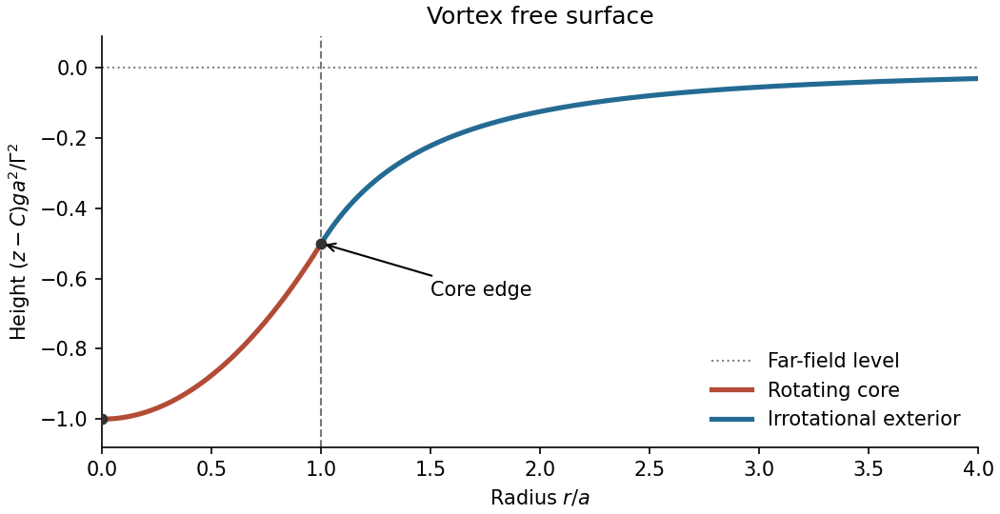

<h1 id="k/k1/c/solution">Solution</h1>

↑ **Parent:** [C](../c.md)

The [Free surface of a Rankine vortex](../../../../../free-surface-of-a-rankine-vortex.md) follows from setting its pressure constant. At a [free surface](../../../../../free-surface.md) with constant [pressure](../../../../../pressure-split.md) $p_s$, solve the two [pressure](../../../../../pressure-split.md) expressions from part (b) for $z$. With $C=(B-p_s)/(\rho g)$, this gives

$$
\boxed{z(r)=\begin{cases}
C-\dfrac{\Gamma^2(2a^2-r^2)}{2ga^4},&r\leq a,\\
C-\dfrac{\Gamma^2}{2gr^2},&r>a.
\end{cases}}
$$

Substituting $r^2=x^2+y^2$ recovers the required Cartesian form. The two values coincide at $r=a$, and both radial slopes there equal $\Gamma^2/(ga^3)$. The surface is parabolic in the core and approaches height $C$ as $r\to\infty$; at the centre its depression below $C$ is $\Gamma^2/(ga^2)$.

**[Figure 1](#k/k1/c/image-free-surface-through-the-vortex-core-and-irrotational-exterior). Free surface through the vortex core and irrotational exterior**.

## ↑ Ancestors (13)

1. [C](../c.md)
2. [K1](../../k1.md)
3. [K](../../../k.md)
4. [2012](../../../../2012-split.md)
5. [Past exam of the options I course of the University of Oxford](../../../../split.md)
6. [Options I course of the University of Oxford](../../../../../options-i-course-of-the-university-of-oxford.md)
7. [Year 2 of the mathematics course of the University of Oxford](../../../../../year-2-of-the-mathematics-course-of-the-university-of-oxford.md)
8. [Mathematics course of the University of Oxford](../../../../../mathematics-course-of-the-university-of-oxford.md)
9. [Undergraduate course of the University of Oxford](../../../../../undergraduate-course-of-the-university-of-oxford.md)
10. [Course of the University of Oxford](../../../../../course-of-the-university-of-oxford.md)
11. [University of Oxford](../../../../../university-of-oxford-split.md)
12. [List of universities](../../../../../list-of-universities.md)
13. [Codex Wiki](../../../../../split.md)
