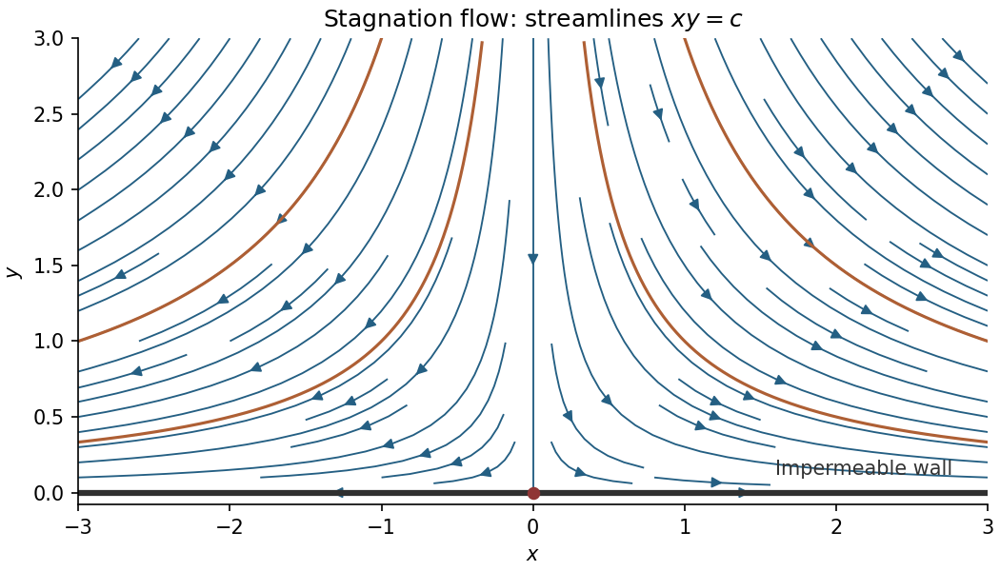

<h1 id="k/k2/a/solution">Solution</h1>

↑ **Parent:** [A](../a.md)

Use the convention $w=\phi+i\psi$, with $dw/dz=u_x-i u_y$. Then

$$
\boxed{w(z)=\frac12z^2,\qquad\phi=\frac12(x^2-y^2),\quad\psi=xy.}
$$

Indeed $w'(z)=z=x+iy$, giving [velocity](../../../../../velocity.md) components $(x,-y)$. The [streamlines](../../../../../streamline.md) are the level sets of the [stream function](../../../../../stream-function.md):

$$
\boxed{xy=c.}
$$

For $c\neq0$ these are rectangular hyperbolas, restricted to $y>0$. The level $c=0$ consists of the vertical axis and the wall $y=0$. Directly on the wall the normal [velocity](../../../../../velocity.md) is $-y=0$, so it is a streamline. The arrows point down toward the wall and then away from the stagnation point along the wall.

**[Figure 2](#k/k2/a/image-streamlines-and-velocity-directions-above-an-impermeable-wall). Streamlines and velocity directions above an impermeable wall**.

## ↑ Ancestors (13)

1. [A](../a.md)
2. [K2](../../k2.md)
3. [K](../../../k.md)
4. [2012](../../../../2012-split.md)
5. [Past exam of the options I course of the University of Oxford](../../../../split.md)
6. [Options I course of the University of Oxford](../../../../../options-i-course-of-the-university-of-oxford.md)
7. [Year 2 of the mathematics course of the University of Oxford](../../../../../year-2-of-the-mathematics-course-of-the-university-of-oxford.md)
8. [Mathematics course of the University of Oxford](../../../../../mathematics-course-of-the-university-of-oxford.md)
9. [Undergraduate course of the University of Oxford](../../../../../undergraduate-course-of-the-university-of-oxford.md)
10. [Course of the University of Oxford](../../../../../course-of-the-university-of-oxford.md)
11. [University of Oxford](../../../../../university-of-oxford-split.md)
12. [List of universities](../../../../../list-of-universities.md)
13. [Codex Wiki](../../../../../split.md)
