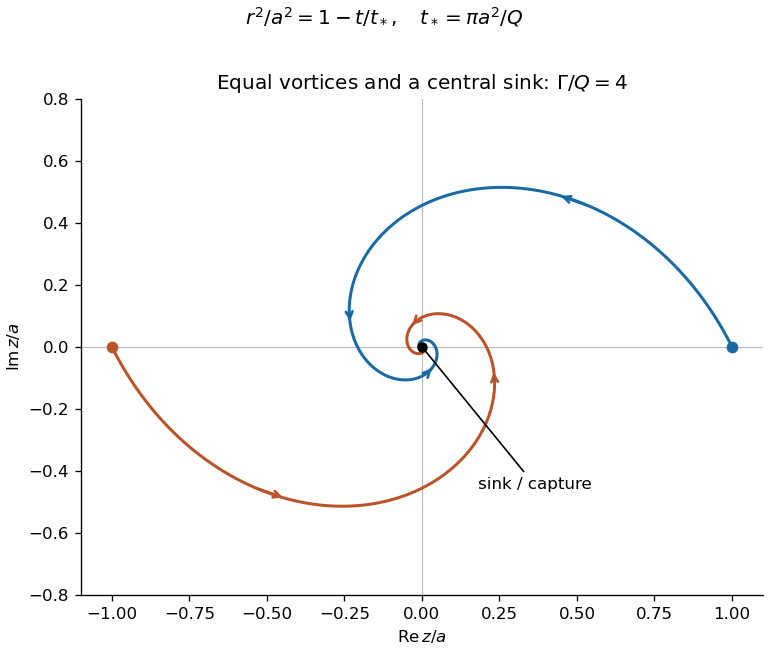
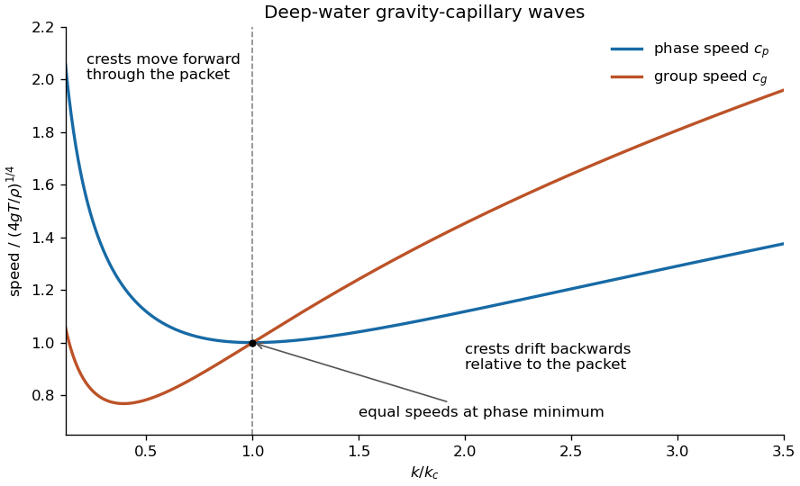

# 2013

↑ **Parent:** [Past exam of the options I course of the University of Oxford](../past-exam-of-the-options-i-course-of-the-university-of-oxford.md)

**Table of contents**

- [A](#a)
  - [1](#a/1)
    - [a](#a/1/a)
      - [Solution](#a/1/a/solution)
    - [b](#a/1/b)
      - [Solution](#a/1/b/solution)
    - [c](#a/1/c)
      - [Solution](#a/1/c/solution)
- [B](#b)
  - [1](#b/1)
    - [a](#b/1/a)
      - [Solution](#b/1/a/solution)
    - [b](#b/1/b)
      - [Solution](#b/1/b/solution)
    - [c](#b/1/c)
      - [Solution](#b/1/c/solution)
- [C](#c)
  - [1](#c/1)
    - [Solution](#c/1/solution)
- [D](#d)
  - [1](#d/1)
    - [Solution](#d/1/solution)
  - [2](#d/2)
    - [Solution](#d/2/solution)
- [E](#e)
  - [1](#e/1)
    - [a](#e/1/a)
      - [Solution](#e/1/a/solution)
    - [b](#e/1/b)
      - [i](#e/1/b/i)
        - [Solution](#e/1/b/i/solution)
      - [ii](#e/1/b/ii)
        - [Solution](#e/1/b/ii/solution)
      - [iii](#e/1/b/iii)
        - [Solution](#e/1/b/iii/solution)
  - [2](#e/2)
    - [a](#e/2/a)
      - [i](#e/2/a/i)
        - [Solution](#e/2/a/i/solution)
      - [ii](#e/2/a/ii)
        - [Solution](#e/2/a/ii/solution)
    - [b](#e/2/b)
      - [Solution](#e/2/b/solution)
- [F](#f)
  - [1](#f/1)
    - [a](#f/1/a)
      - [i](#f/1/a/i)
        - [Solution](#f/1/a/i/solution)
      - [ii](#f/1/a/ii)
        - [Solution](#f/1/a/ii/solution)
    - [b](#f/1/b)
      - [i](#f/1/b/i)
        - [Solution](#f/1/b/i/solution)
      - [ii](#f/1/b/ii)
        - [Solution](#f/1/b/ii/solution)
    - [c](#f/1/c)
      - [i](#f/1/c/i)
        - [Solution](#f/1/c/i/solution)
      - [ii](#f/1/c/ii)
        - [Solution](#f/1/c/ii/solution)
      - [iii](#f/1/c/iii)
        - [Solution](#f/1/c/iii/solution)
- [G](#g)
  - [1](#g/1)
    - [Solution](#g/1/solution)
- [H](#h)
  - [1](#h/1)
    - [a](#h/1/a)
      - [Solution](#h/1/a/solution)
    - [b](#h/1/b)
      - [Solution](#h/1/b/solution)
    - [c](#h/1/c)
      - [Solution](#h/1/c/solution)
    - [d](#h/1/d)
      - [Solution](#h/1/d/solution)
    - [e](#h/1/e)
      - [Solution](#h/1/e/solution)
- [J](#j)
  - [1](#j/1)
    - [a](#j/1/a)
      - [Solution](#j/1/a/solution)
    - [b](#j/1/b)
      - [Solution](#j/1/b/solution)
- [K](#k)
  - [1](#k/1)
    - [Solution](#k/1/solution)
  - [2](#k/2)
    - [Solution](#k/2/solution)
- [M](#m)
  - [1](#m/1)
    - [a](#m/1/a)
      - [Solution](#m/1/a/solution)
    - [b](#m/1/b)
      - [Solution](#m/1/b/solution)
    - [c](#m/1/c)
      - [Solution](#m/1/c/solution)
    - [d](#m/1/d)
      - [Solution](#m/1/d/solution)
  - [2](#m/2)
    - [a](#m/2/a)
      - [Solution](#m/2/a/solution)
    - [b](#m/2/b)
      - [Solution](#m/2/b/solution)
    - [c](#m/2/c)
      - [Solution](#m/2/c/solution)
- [O](#o)
  - [1](#o/1)
    - [a](#o/1/a)
      - [Solution](#o/1/a/solution)
    - [b](#o/1/b)
      - [Solution](#o/1/b/solution)
    - [c](#o/1/c)
      - [Solution](#o/1/c/solution)
  - [2](#o/2)
    - [a](#o/2/a)
      - [Solution](#o/2/a/solution)
    - [b](#o/2/b)
      - [Solution](#o/2/b/solution)
    - [c](#o/2/c)
      - [Solution](#o/2/c/solution)
    - [d](#o/2/d)
      - [Solution](#o/2/d/solution)
- [P](#p)
  - [1](#p/1)
    - [a](#p/1/a)
      - [Solution](#p/1/a/solution)
    - [b](#p/1/b)
      - [Solution](#p/1/b/solution)
    - [c](#p/1/c)
      - [Solution](#p/1/c/solution)
  - [2](#p/2)
    - [a](#p/2/a)
      - [Solution](#p/2/a/solution)
    - [b](#p/2/b)
      - [Solution](#p/2/b/solution)
    - [c](#p/2/c)
      - [Solution](#p/2/c/solution)

## A

↑ **Parent:** [2013](2013.md)

<h3 id="a/1">1</h3>

↑ **Parent:** [A](#a)

<h4 id="a/1/a">a</h4>

↑ **Parent:** [1](#a/1)

<h5 id="a/1/a/solution">Solution</h5>

↑ **Parent:** [A](#a/1/a)

The [degree of a field extension](../algebra.md#degree-of-a-field-extension) is the [dimension](../vector-space.md#dimension-vector-space) of the larger [field](../algebra.md#field) as a [vector space](../vector-space.md) over the smaller one:

$$
\boxed{|K:F|=\dim_FK.}
$$

The [field extension](../algebra.md#field-extension) is a [finite field extension](../algebra.md#finite-field-extension) precisely when this [dimension](../vector-space.md#dimension-vector-space) is finite, equivalently when finitely many elements of $K$ span $K$ over $F$. Finiteness here concerns the [dimension](../vector-space.md#dimension-vector-space), not the number of elements of the [fields](../algebra.md#field); for example, $\mathbb C$ has degree two over $\mathbb R$ although both [fields](../algebra.md#field) are infinite.

<h4 id="a/1/b">b</h4>

↑ **Parent:** [1](#a/1)

<h5 id="a/1/b/solution">Solution</h5>

↑ **Parent:** [B](#a/1/b)

Let $[L:F]=n<\infty$. The intermediate [field](../algebra.md#field) $K$ is an $F$-linear [linear subspace](../vector-space.md#vector-subspace) of $L$, so the finite-dimensional [linear subspace](../vector-space.md#vector-subspace) theorem gives $[K:F]\leq n$. To handle the other [field extension](../algebra.md#field-extension), take an $F$-[basis](../vector-space.md#basis) $v_1,\ldots,v_n$ of $L$. Every $\ell\in L$ is a sum $\sum f_iv_i$ with $f_i\in F\subseteq K$, so the same list spans $L$ as a $K$-[vector space](../vector-space.md). It need not remain linearly independent, but spanning suffices to give $[L:K]\leq n$. Hence **both intermediate extensions are finite**.

<h4 id="a/1/c">c</h4>

↑ **Parent:** [1](#a/1)

<h5 id="a/1/c/solution">Solution</h5>

↑ **Parent:** [C](#a/1/c)

The [tower law for field extensions](../galois-theory.md#tower-law-for-field-extensions) states that, for $F\subseteq K\subseteq L$ with both successive degrees finite,

$$
\boxed{[L:F]=[L:K][K:F].}
$$

Indeed, if $u_i$ form an $F$-[basis](../vector-space.md#basis) of $K$ and $v_j$ form a $K$-basis of $L$, their products $u_iv_j$ form an $F$-basis of $L$: expansion gives spanning, and independence follows first over $K$ and then over $F$.

Starting from a unit segment, every [straightedge and compass construction](../straightedge-and-compass-construction.md) introduces coordinates by solving linear or quadratic equations over the coordinates already available. Thus a [constructible number](../galois-theory.md#constructible-number) belongs to a tower of [field extensions](../algebra.md#field-extension) whose successive degrees are one or two; the total degree is a power of two. Doubling the volume of a unit cube would require the edge length $\sqrt[3]2$. Its [minimal polynomial](../linear-operator-theory.md#minimal-polynomial) over $\mathbb Q$ is $x^3-2$, irreducible by [Eisenstein's criterion](../commutative-algebra.md#eisenstein-criterion) at the [prime number](../prime-number.md) two. Thus $[\mathbb Q(\sqrt[3]2):\mathbb Q]=3$. If that number lay in a construction [field](../algebra.md#field) of degree $2^r$, the [tower law](../algebra.md#tower-law) would make three divide $2^r$, a contradiction. Therefore **doubling the cube by straightedge and compass is impossible**.

<h2 id="b">B</h2>

↑ **Parent:** [2013](2013.md)

<h3 id="b/1">1</h3>

↑ **Parent:** [B](#b)

<h4 id="b/1/a">a</h4>

↑ **Parent:** [1](#b/1)

<h5 id="b/1/a/solution">Solution</h5>

↑ **Parent:** [A](#b/1/a)

An [isometry](../riemannian-geometry.md#isometry) of the [Euclidean plane](../geometry-and-topology.md#euclidean-plane) is a map $T:\mathbb R^2\to\mathbb R^2$ preserving all [Euclidean distances](../topological-analysis.md#euclidean-distance), $\|T(x)-T(y)\|=\|x-y\|$. Such a map of the whole plane is automatically bijective, and has the form $T(x)=Rx+b$ with $R$ an [orthogonal matrix](../linear-algebra.md#orthogonal-matrix).

The classification is **identity, [translations](../geometry-and-topology.md#translation-geometry), [rotations](../riemannian-geometry.md#rotation-mathematics) about a point, [reflections](../linear-algebra.md#reflection-mathematics) in a line, and glide [reflections](../linear-algebra.md#reflection-mathematics)**. Here a [glide reflection](../riemannian-geometry.md#glide-reflection) is a [reflection](../linear-algebra.md#reflection-mathematics) followed by a nonzero [translation](../geometry-and-topology.md#translation-geometry) parallel to its mirror. The cases preserving [orientation](../algebraic-topology.md#orientation-of-a-simplex) have $\det R=1$ and are [translations](../geometry-and-topology.md#translation-geometry) or [rotations](../riemannian-geometry.md#rotation-mathematics); the orientation-reversing cases have $\det R=-1$ and are [reflections](../linear-algebra.md#reflection-mathematics) or glide [reflections](../linear-algebra.md#reflection-mathematics). The identity is included by allowing a zero [translation](../geometry-and-topology.md#translation-geometry) or [rotation](../riemannian-geometry.md#rotation-mathematics) angle.

<h4 id="b/1/b">b</h4>

↑ **Parent:** [1](#b/1)

<h5 id="b/1/b/solution">Solution</h5>

↑ **Parent:** [B](#b/1/b)

Put $v=P_2-P_1$ and $w=Q_2-Q_1$. They are nonzero [vectors](../vector-space.md#vector) with the same [Euclidean norm](../normed-vector-space.md#euclidean-norm). Choose the [rotation matrix](../linear-algebra.md#rotation-matrix) $R$ taking the direction $v/\|v\|$ to $w/\|w\|$; equal lengths then give $Rv=w$. Define

$$
\boxed{t(x)=Q_1+R(x-P_1).}
$$

This is a [translation](../geometry-and-topology.md#translation-geometry) by $Q_1-P_1$ followed by a [rotation](../riemannian-geometry.md#rotation-mathematics) about $Q_1$, so it is an [isometry](../riemannian-geometry.md#isometry). Direct substitution gives $t(P_1)=Q_1$ and $t(P_2)=Q_1+w=Q_2$.

<h4 id="b/1/c">c</h4>

↑ **Parent:** [1](#b/1)

<h5 id="b/1/c/solution">Solution</h5>

↑ **Parent:** [C](#b/1/c)

First use the preceding [isometry](../riemannian-geometry.md#isometry) $t$ to align the first two points, and put $R_3=t(P_3)$. It remains to align $R_3$ with $Q_3$ while fixing $Q_1,Q_2$. Use [orthonormal coordinates](../inner-product.md#orthonormal-coordinates) in which $Q_1=(0,0)$ and $Q_2=(d,0)$, $d>0$, and write $R_3=(r,s)$, $Q_3=(u,v)$. The prescribed [distances](../geometry-and-topology.md#distance) give

$$
r^2+s^2=u^2+v^2,\qquad (r-d)^2+s^2=(u-d)^2+v^2.
$$

Subtracting yields $r=u$, and then $s^2=v^2$. Therefore $Q_3$ is either $R_3$ or its [reflection](../linear-algebra.md#reflection-mathematics) across the line through $Q_1,Q_2$. In the first case take $s=t$; in the second compose $t$ with that [reflection](../linear-algebra.md#reflection-mathematics). Both constructions fix the first two images and send the third point to its required image. The argument also covers three collinear points, when the two possible third images coincide. Thus **all three points can be matched by one plane isometry**.

<h2 id="c">C</h2>

↑ **Parent:** [2013](2013.md)

<h3 id="c/1">1</h3>

↑ **Parent:** [C](#c)

<h4 id="c/1/solution">Solution</h4>

↑ **Parent:** [1](#c/1)

[Euler's totient function](../number-theory.md#euler-totient-function) is

$$
\varphi(n)=\#\{1\leq r\leq n:\gcd(r,n)=1\},\qquad n\geq1.
$$

[Euler's theorem](../number-theory.md#euler-s-theorem) states that $\gcd(a,n)=1$ implies $\boxed{a^{\varphi(n)}\equiv1\pmod n}$. For $n>1$, let $r_1,\ldots,r_{\varphi(n)}$ be the invertible residue classes modulo $n$. Multiplication by $a$ permutes these classes, since it has an inverse modulo $n$. Multiplying the resulting congruences gives

$$
a^{\varphi(n)}r_1\cdots r_{\varphi(n)}\equiv r_1\cdots r_{\varphi(n)}\pmod n.
$$

Every factor is a [unit](../algebra.md#unit-in-a-ring), so the product can be cancelled, proving the theorem. The case $n=1$ is immediate. For distinct [prime numbers](../prime-number.md) $p,q$, removing multiples of either prime from $1,\ldots,pq$ gives

$$
\boxed{\varphi(pq)=pq-q-p+1=(p-1)(q-1).}
$$

For the [RSA cryptosystem](../algebra.md#rsa-cryptosystem), choose distinct large primes $p,q$, put $N=pq$, and choose $e$ coprime to $\varphi(N)$. Compute $d$ with $ed\equiv1\pmod{\varphi(N)}$. The public key is $(N,e)$; the private exponent $d$ is retained secretly. Represent a message by $0\leq m<N$, encrypt by $c\equiv m^e\pmod N$, and decrypt by $m'\equiv c^d\pmod N$.

To prove correct decryption even for messages not coprime to $N$, write $ed=1+k(p-1)(q-1)$. Modulo $p$, if $p\mid m$ then $m^{ed}\equiv m\equiv0$; otherwise [Fermat's little theorem](../number-theory.md#fermat-little-theorem) gives $m^{ed}\equiv m$. The same reasoning holds modulo $q$. The [Chinese remainder theorem](../mathematics.md#chinese-remainder-theorem) therefore gives $m^{ed}\equiv m\pmod N$, and the chosen representative recovers $m$. Thus **decryption works for every message residue**, not merely the units.

## D

↑ **Parent:** [2013](2013.md)

<h3 id="d/1">1</h3>

↑ **Parent:** [D](#d)

<h4 id="d/1/solution">Solution</h4>

↑ **Parent:** [1](#d/1)

For a nonnegative [measurable function](../measure-theory.md#measurable-function), the [Lebesgue integral](../measure-theory.md#lebesgue-integral) is defined through nonnegative [simple functions](../measure-theory.md#simple-function):

$$
\boxed{\int_{\mathbb R}f\,dx=\sup\left\{\int_{\mathbb R}s\,dx:s\text{ simple},\ 0\leq s\leq f\right\}.}
$$

The value may be infinite. A real measurable $g$ is [Lebesgue integrable](../measure-theory.md#lebesgue-integrable-function) when $\int|g|dx<\infty$; then $\int g=\int g^+-\int g^-$, where $g^+=\max(g,0)$ and $g^-=\max(-g,0)$.

If $|g|\leq h$, every simple function below $|g|$ is also below $h$. Taking the defining suprema proves [monotonicity of the Lebesgue integral](../integral.md#monotonicity-of-the-lebesgue-integral):

$$
0\leq\int|g|\,dx\leq\int h\,dx<\infty.
$$

Hence **$g$ is integrable**, and both its positive and negative parts have finite [integrals](../integral.md).

The oscillatory function $k$ is measurable because it is continuous off the singleton $\{0\}$ and has a specified value there. The elementary bounds $|\sin u|\leq\min(1,|u|)$ give the integrable majorant

$$
|k(x)|\leq H(x)=\begin{cases}1,&|x|\leq1,\\|x|^{-3},&|x|>1.\end{cases}
$$

Indeed, $\int H=2+2\int_1^\infty x^{-3}dx=3$. The comparison just proved gives $\int|k|\leq3$, so **$k$ is Lebesgue integrable over the whole real line**, despite its oscillations near zero. Its [odd](../calculus.md#odd-function) symmetry also gives $\int k=0$, now legitimately because absolute integrability has been established.

<h3 id="d/2">2</h3>

↑ **Parent:** [D](#d)

<h4 id="d/2/solution">Solution</h4>

↑ **Parent:** [2](#d/2)

[Fubini's theorem](../measure-theory.md#fubini-s-theorem) states that an absolutely integrable measurable function on a product of two $\sigma$-finite [measure spaces](../measure.md#measure-space) has integrable sections almost everywhere, the corresponding iterated [integrals](../integral.md) exist, and both orders equal its product [integral](../integral.md). In particular, for $f\in L^1(\mathbb R^2)$,

$$
\iint f(x,y)\,dx\,dy=\int\left(\int f(x,y)\,dx\right)dy=\int\left(\int f(x,y)\,dy\right)dx.
$$

To establish integrability of the nonnegative function here, first use [Tonelli's theorem](../measure-theory.md#tonelli-theorem): for a nonnegative measurable function the product [integral](../integral.md) equals either iterated [integral](../integral.md) with infinity allowed. This avoids assuming the conclusion needed for [Fubini's theorem](../measure-theory.md#fubini-s-theorem).

If $\alpha\geq-1$, $\int_0^\infty(1+x+y)^\alpha dx=\infty$ for every fixed $y$. If $\alpha<-1$, it is

$$
\int_0^\infty(1+x+y)^\alpha dx=\frac{(1+y)^{\alpha+1}}{-\alpha-1}.
$$

The outer [integral](../integral.md) is finite exactly when $\alpha+1<-1$, that is, $\alpha<-2$. In that case

$$
\boxed{\iint_{(0,\infty)^2}(1+x+y)^\alpha dx\,dy=\frac1{(-\alpha-1)(-\alpha-2)},\qquad f\in L^1\iff\alpha<-2.}
$$

For $-2\leq\alpha<-1$ the outer [integral](../integral.md) diverges, including logarithmic divergence at $\alpha=-2$. Nonnegativity means finiteness of this [integral](../integral.md) is exactly absolute integrability; after proving it, [Fubini's theorem](../measure-theory.md#fubini-s-theorem) allows either order.

## E

↑ **Parent:** [2013](2013.md)

<h3 id="e/1">1</h3>

↑ **Parent:** [E](#e)

<h4 id="e/1/a">a</h4>

↑ **Parent:** [1](#e/1)

<h5 id="e/1/a/solution">Solution</h5>

↑ **Parent:** [A](#e/1/a)

A [basis of a topology](../topology.md#basis-of-a-topology) $\mathcal T$ is a collection $\mathcal B\subseteq\mathcal T$ such that every [open set](../topology.md#open-set) is a union of members of $\mathcal B$. Equivalently, for each open $U$ and every $x\in U$, there exists $B\in\mathcal B$ with $x\in B\subseteq U$. The empty union represents the empty set. In particular, the basis covers $X$, and any intersection of two basis elements is itself a union of basis elements.

<h4 id="e/1/b">b</h4>

↑ **Parent:** [1](#e/1)

<h5 id="e/1/b/i">i</h5>

↑ **Parent:** [B](#e/1/b)

<h6 id="e/1/b/i/solution">Solution</h6>

↑ **Parent:** [I](#e/1/b/i)

The following open rectangles form a [basis of a topology](../topology.md#basis-of-a-topology) for the [product topology](../geometry-and-topology.md#product-topology):

$$
\boxed{\{U\times V:U\in\mathcal T_X,\ V\in\mathcal T_Y\}.}
$$

These [open rectangles in a finite product](../geometry-and-topology.md#open-rectangles-in-a-finite-product) cover $X\times Y$, and intersections remain rectangles since $(U_1\times V_1)\cap(U_2\times V_2)=(U_1\cap U_2)\times(V_1\cap V_2)$. One may equivalently take products of elements from a chosen [basis of a topology](../topology.md#basis-of-a-topology) in each factor.

<h5 id="e/1/b/ii">ii</h5>

↑ **Parent:** [B](#e/1/b)

<h6 id="e/1/b/ii/solution">Solution</h6>

↑ **Parent:** [Ii](#e/1/b/ii)

Choose $v_0\in V$, using its nonemptiness. For each $u\in U$, the openness of $U\times V$ in the [product topology](../geometry-and-topology.md#product-topology) supplies open $O_u\subseteq X$, $W_u\subseteq Y$ such that

$$
(u,v_0)\in O_u\times W_u\subseteq U\times V.
$$

Since $v_0\in W_u$, every point of $O_u$ belongs to $U$. Thus $U=\bigcup_{u\in U}O_u$ is open. Interchanging the factors, using a fixed $u_0\in U$, proves $V$ open. Therefore $\boxed{U\in\mathcal T_X,\quad V\in\mathcal T_Y}$. Nonemptiness matters: an empty product is open whatever the other factor is.

<h5 id="e/1/b/iii">iii</h5>

↑ **Parent:** [B](#e/1/b)

<h6 id="e/1/b/iii/solution">Solution</h6>

↑ **Parent:** [Iii](#e/1/b/iii)

**Yes: at least one factor [topology](../topology.md) must be indiscrete.** Suppose instead that both have a nonempty proper [open set](../topology.md#open-set), say $\varnothing\ne U\subsetneq X$ and $\varnothing\ne V\subsetneq Y$. Then

$$
W=(U\times Y)\cup(X\times V)
$$

is open in the [product topology](../geometry-and-topology.md#product-topology). Both coordinate projections of $W$ are the full factors, because $U,V$ are nonempty. If $W$ were a rectangle $A\times B$, this would force $A=X$, $B=Y$, hence $W=X\times Y$. But choosing $x\notin U$ and $y\notin V$ gives $(x,y)\notin W$, a contradiction. Thus both factors cannot have nontrivial [open sets](../topology.md#open-set). This is [rectangularity of every product-open set](../geometry-and-topology.md#rectangularity-of-every-product-open-set).

<h3 id="e/2">2</h3>

↑ **Parent:** [E](#e)

<h4 id="e/2/a">a</h4>

↑ **Parent:** [2](#e/2)

<h5 id="e/2/a/i">i</h5>

↑ **Parent:** [A](#e/2/a)

<h6 id="e/2/a/i/solution">Solution</h6>

↑ **Parent:** [I](#e/2/a/i)

Let $q:X\to X/\mathcal R$ send each point to its [equivalence class](../set-theory.md#equivalence-class). The [quotient topology](../topology.md#quotient-topology) is

$$
\boxed{U\subseteq X/\mathcal R\text{ is open}\iff q^{-1}(U)\text{ is open in }X.}
$$

It is the finest [topology](../topology.md) on the quotient set making the canonical surjection $q$ continuous. The preimage test, rather than a choice of representatives, defines its [open sets](../topology.md#open-set).

<h5 id="e/2/a/ii">ii</h5>

↑ **Parent:** [A](#e/2/a)

<h6 id="e/2/a/ii/solution">Solution</h6>

↑ **Parent:** [Ii](#e/2/a/ii)

Use the [equivalence relation](../set-theory.md#equivalence-relation) of belonging to the same fibre:

$$
\boxed{x\mathcal R x'\iff f(x)=f(x').}
$$

The map $\bar f:X/\mathcal R\to Y$, $[x]\mapsto f(x)$, is well defined, injective by the definition of the relation, and surjective because $f$ is surjective. It is continuous by the [quotient topology](../topology.md#quotient-topology): for open $V\subseteq Y$, $q^{-1}(\bar f^{-1}(V))=f^{-1}(V)$ is open.

The [quotient space](../topology.md#quotient-topological-space) is [compact](../topology.md#compact-space) as the continuous image of [compact](../topology.md#compact-space) $X$, and $Y$ is [Hausdorff](../topology.md#hausdorff-space). The [compact-to-Hausdorff continuous bijection theorem](../topology.md#compact-to-hausdorff-continuous-bijection-theorem) makes $\bar f$ a [homeomorphism](../topology.md#homeomorphism). Indeed, images of closed subsets of a [compact](../topology.md#compact-space) space are [compact](../topology.md#compact-space) and hence closed in a [Hausdorff](../topology.md#hausdorff-space) space, so the inverse is continuous.

<h4 id="e/2/b">b</h4>

↑ **Parent:** [2](#e/2)

<h5 id="e/2/b/solution">Solution</h5>

↑ **Parent:** [B](#e/2/b)

Collapse the equator $E=\{(u,v,t)\in S^2:t=0\}$ to one point and identify no other points:

$$
\boxed{p\mathcal R q\iff p=q\ \text{or}\ (p\in E\text{ and }q\in E).}
$$

Each closed hemisphere is a disk; collapsing its boundary gives a sphere. The two boundaries are the same equator, so the resulting spheres meet at the single collapsed point. This is the [sphere with its equator collapsed](../topology.md#sphere-with-its-equator-collapsed).

An explicit verification avoids relying only on the picture. Away from the poles, use $p=(\sqrt{1-t^2}\cos\theta,\sqrt{1-t^2}\sin\theta,t)$ and define

$$
f(p)=\begin{cases}(1-\cos(\pi t),\ \sin(\pi t)\cos\theta,\ \sin(\pi t)\sin\theta),&t\geq0,\\
(-1+\cos(\pi|t|),\ \sin(\pi|t|)\cos\theta,\ \sin(\pi|t|)\sin\theta),&t\leq0.
\end{cases}
$$

At the north and south poles use $(2,0,0)$ and $(-2,0,0)$, respectively. The angular terms tend uniformly to zero at both poles, making these extensions continuous. Both hemisphere formulas agree at the equator, with value $(0,0,0)$. Their images lie on the two specified unit spheres and cover them; away from the common origin the height parameter and angle are recovered uniquely. Thus the fibres are exactly the stated equivalence classes. The preceding compact-to-Hausdorff argument gives $\boxed{S^2/\mathcal R\cong Y}$.

## F

↑ **Parent:** [2013](2013.md)

<h3 id="f/1">1</h3>

↑ **Parent:** [F](#f)

<h4 id="f/1/a">a</h4>

↑ **Parent:** [1](#f/1)

<h5 id="f/1/a/i">i</h5>

↑ **Parent:** [A](#f/1/a)

<h6 id="f/1/a/i/solution">Solution</h6>

↑ **Parent:** [I](#f/1/a/i)

The [total derivative](../calculus.md#total-derivative) of $f$ at $x$ is a [linear map](../vector-space.md#linear-map) $Df(x):\mathbb R^n\to\mathbb R$ satisfying

$$
\boxed{\lim_{h\to0}\frac{|f(x+h)-f(x)-Df(x)h|}{\|h\|}=0.}
$$

The [gradient](../multivariable-calculus.md#gradient) is the [vector](../vector-space.md#vector) of [partial derivatives](../multivariable-calculus.md#partial-derivative), $\nabla f(x)=(\partial_1f(x),\ldots,\partial_nf(x))$. When $f$ is totally differentiable, these [partial derivatives](../multivariable-calculus.md#partial-derivative) exist and

$$
\boxed{Df(x)h=\nabla f(x)\cdot h=\sum_{j=1}^n\partial_jf(x)h_j.}
$$

Thus the derivative is a linear functional represented by the [gradient](../multivariable-calculus.md#gradient) under the [Euclidean inner product](../inner-product.md#dot-product). Existence of [partial derivatives](../multivariable-calculus.md#partial-derivative) alone does not imply total differentiability.

<h5 id="f/1/a/ii">ii</h5>

↑ **Parent:** [A](#f/1/a)

<h6 id="f/1/a/ii/solution">Solution</h6>

↑ **Parent:** [Ii](#f/1/a/ii)

The denominator is positive on $B$ because $x_3>-1$. The [quotient rule](../calculus.md#quotient-rule) gives the [gradient](../multivariable-calculus.md#gradient)

$$
\boxed{\nabla g(x)=\left(\frac1{x_3+3},\ \frac1{x_3+3},\ -\frac{x_1+x_2}{(x_3+3)^2}\right).}
$$

In particular $g$ is continuously differentiable throughout $B$.

<h4 id="f/1/b">b</h4>

↑ **Parent:** [1](#f/1)

<h5 id="f/1/b/i">i</h5>

↑ **Parent:** [B](#f/1/b)

<h6 id="f/1/b/i/solution">Solution</h6>

↑ **Parent:** [I](#f/1/b/i)

The scalar-valued multivariable [mean value theorem](../calculus.md#mean-value-theorem) states that, if $f$ is differentiable on an [open set](../topology.md#open-set) containing the closed line segment from $x$ to $y$, then for $x\ne y$ there exists $s\in(0,1)$ such that

$$
\boxed{f(y)-f(x)=Df(x+s(y-x))(y-x)=\nabla f(x+s(y-x))\cdot(y-x).}
$$

This follows by applying the one-dimensional [mean value theorem](../calculus.md#mean-value-theorem) to $t\mapsto f(x+t(y-x))$ on $[0,1]$. The segment condition is necessary for this formulation on a possibly nonconvex domain.

<h5 id="f/1/b/ii">ii</h5>

↑ **Parent:** [B](#f/1/b)

<h6 id="f/1/b/ii/solution">Solution</h6>

↑ **Parent:** [Ii](#f/1/b/ii)

For every $z\in B$, $z_3+3>2$ and $|z_1+z_2|<2$. Consequently each of the three [partial derivatives](../multivariable-calculus.md#partial-derivative) in the preceding [gradient](../multivariable-calculus.md#gradient) has absolute value below $1/2$, so

$$
\|\nabla g(z)\|^2<\frac14+\frac14+\frac14=\frac34.
$$

The segment joining $x,y\in B$ lies inside $B$. The [mean value theorem](../calculus.md#mean-value-theorem) and [Cauchy-Schwarz inequality](../probability-and-statistics.md#cauchy-schwarz-inequality) therefore give

$$
|g(y)-g(x)|\leq\|\nabla g(x+s(y-x))\|\,\|y-x\|\leq\boxed{\frac{\sqrt3}{2}\|y-x\|}.
$$

For $x=y$ both sides vanish. This proves the required [Lipschitz continuity](../real-analysis.md#lipschitz-continuity) uniformly on the ball.

<h4 id="f/1/c">c</h4>

↑ **Parent:** [1](#f/1)

<h5 id="f/1/c/i">i</h5>

↑ **Parent:** [C](#f/1/c)

<h6 id="f/1/c/i/solution">Solution</h6>

↑ **Parent:** [I](#f/1/c/i)

A $C^1$ [diffeomorphism](../geometry-and-topology.md#diffeomorphism) $F:U\to V$ is a [bijection](../function.md#bijection) for which both $F$ and $F^{-1}$ are continuously differentiable. If a higher regularity class is specified, both maps must belong to that class. In particular, a [diffeomorphism](../geometry-and-topology.md#diffeomorphism) is a [homeomorphism](../topology.md#homeomorphism), and the [chain rule](../calculus.md#chain-rule) gives $D(F^{-1})(F(x))=(DF(x))^{-1}$.

<h5 id="f/1/c/ii">ii</h5>

↑ **Parent:** [C](#f/1/c)

<h6 id="f/1/c/ii/solution">Solution</h6>

↑ **Parent:** [Ii](#f/1/c/ii)

The [inverse function theorem](../multivariable-calculus.md#inverse-function-theorem) states: let $F:U\subseteq\mathbb R^n\to\mathbb R^n$ be $C^1$, with $U$ open, and suppose $DF(x_0)$ is invertible. Then there exist open neighbourhoods $U_0\subseteq U$ of $x_0$ and $V_0$ of $F(x_0)$ such that $F:U_0\to V_0$ is a $C^1$ [diffeomorphism](../geometry-and-topology.md#diffeomorphism). Its inverse derivative satisfies

$$
\boxed{D(F^{-1})(F(x))=(DF(x))^{-1},\qquad x\in U_0.}
$$

The conclusion is local; invertibility of one [Jacobian matrix](../multivariable-calculus.md#jacobian-matrix) does not assert global injectivity.

<h5 id="f/1/c/iii">iii</h5>

↑ **Parent:** [C](#f/1/c)

<h6 id="f/1/c/iii/solution">Solution</h6>

↑ **Parent:** [Iii](#f/1/c/iii)

The map $G$ is $C^1$ on the open ball $B$. Its [Jacobian matrix](../multivariable-calculus.md#jacobian-matrix) is

$$
DG(x)=\begin{pmatrix}(x_3+3)^{-1}&(x_3+3)^{-1}&-(x_1+x_2)(x_3+3)^{-2}\\0&1&0\\0&0&1\end{pmatrix}.
$$

At the origin $G(0)=0$ and $\boxed{\det DG(0)=1/3\ne0}$. The [inverse function theorem](../multivariable-calculus.md#inverse-function-theorem) therefore supplies the required [open sets](../topology.md#open-set) $V_1\subset B$ and $V_2\subset\mathbb R^3$, both containing zero, with $G:V_1\to V_2$ a [diffeomorphism](../geometry-and-topology.md#diffeomorphism). The explicit inverse formula on its image,

$$
G^{-1}(y_1,y_2,y_3)=(y_1(y_3+3)-y_2,\ y_2,\ y_3),
$$

also checks the local conclusion directly.

## G

↑ **Parent:** [2013](2013.md)

<h3 id="g/1">1</h3>

↑ **Parent:** [G](#g)

<h4 id="g/1/solution">Solution</h4>

↑ **Parent:** [1](#g/1)

Take independent smooth [variations](../calculus-of-variations.md#variation) $y+\varepsilon\eta$ and $z+\varepsilon\zeta$. Differentiating the [functional](../calculus-of-variations.md#functional) and using [integration by parts](../calculus.md#integration-by-parts) gives its [first variation](../calculus-of-variations.md#first-variation)

$$
\delta J=[F_{y'}\eta+F_{z'}\zeta]_a^b+\int_a^b\left[(F_y-\tfrac d{dx}F_{y'})\eta+(F_z-\tfrac d{dx}F_{z'})\zeta\right]dx.
$$

First choose [variations](../calculus-of-variations.md#variation) vanishing at the endpoints. To use the stated form of the [fundamental lemma of the calculus of variations](../calculus-of-variations.md#fundamental-lemma-of-the-calculus-of-variations), take $\eta=(x-a)(b-x)\chi$ with arbitrary smooth $\chi$, and similarly for $\zeta$. The lemma makes $(x-a)(b-x)(F_y-dF_{y'}/dx)$ vanish, and hence makes the unweighted coefficient vanish in the interior; continuity extends this to the endpoints. Applying the same argument to $z$ gives the [Euler-Lagrange equations](../analysis.md#euler-lagrange-equation)

$$
\boxed{\frac d{dx}F_{y'}=F_y,\qquad\frac d{dx}F_{z'}=F_z.}
$$

If either endpoint value of $y$ or $z$ is free, the corresponding variation there is arbitrary. The remaining boundary term gives the [natural boundary conditions for a free endpoint](../analysis.md#natural-boundary-conditions-for-a-free-endpoint): $F_{y'}=0$ for a free $y$ value and $F_{z'}=0$ for a free $z$ value at that endpoint. With both coordinates free at both endpoints, all four conditions apply.

For the specified integrand these equations reduce to

$$
y''+5y-2z=0,\qquad z''+2y=0,
$$

and the natural conditions are $y'=z'=0$ at each free endpoint. Eliminating $z$ gives

$$
y^{(4)}+5y''+4y=0,\qquad (D^2+1)(D^2+4)y=0.
$$

Its four independent modes give the full general solution

$$
\begin{aligned}
y&=A\cos x+C\sin x+B\cos2x+D\sin2x,\\
z&=2A\cos x+2C\sin x+\tfrac12B\cos2x+\tfrac12D\sin2x.
\end{aligned}
$$

At zero, $y'(0)=C+2D$ and $z'(0)=2C+D$. Vanishing forces $C=D=0$, giving

$$
\boxed{y=A\cos x+B\cos2x,\qquad z=2A\cos x+\frac B2\cos2x.}
$$

At $x=\pi/6$ the two derivative conditions become $A/2+\sqrt3B=0$ and $A+\sqrt3B/2=0$. Their coefficient determinant is nonzero, so $A=B=0$. Thus **the unique stationary extremal with all four natural boundary conditions is $y=z=0$**. The word extremal here means a stationary point of the functional; the indefinite integrand does not require this point to be a minimum.

## H

↑ **Parent:** [2013](2013.md)

<h3 id="h/1">1</h3>

↑ **Parent:** [H](#h)

<h4 id="h/1/a">a</h4>

↑ **Parent:** [1](#h/1)

<h5 id="h/1/a/solution">Solution</h5>

↑ **Parent:** [A](#h/1/a)

Let $s$ be distance along the rod from its fixed end. The position of that material point is $s\,n(t)$, where $n=(\sin\theta\cos\phi,\sin\theta\sin\phi,-\cos\theta)$ is a [unit vector](../vector-space.md#unit-vector). Its [velocity](../classical-mechanics.md#velocity) is $s\dot n$, and direct differentiation gives

$$
|\dot n|^2=\dot\theta^2+\sin^2\theta\,\dot\phi^2.
$$

The uniform linear [mass density](../fluid-mechanics.md#density) is $M/a$. Integrating the elemental [kinetic energy](../energy.md#kinetic-energy) therefore proves, rather than assumes, the rod formula:

$$
T=\frac12\int_0^a s^2|\dot n|^2\frac Ma\,ds=\boxed{\frac{Ma^2}{6}(\dot\theta^2+\sin^2\theta\,\dot\phi^2).}
$$

Equivalently, its [moment of inertia](../rigid-body-dynamics.md#moment-of-inertia) about a perpendicular axis through the pivot is $Ma^2/3$.

<h4 id="h/1/b">b</h4>

↑ **Parent:** [1](#h/1)

<h5 id="h/1/b/solution">Solution</h5>

↑ **Parent:** [B](#h/1/b)

The [centre of mass](../classical-mechanics.md#center-of-mass) is at height $-a\cos\theta/2$. With gravitational [potential energy](../energy.md#potential-energy) zero at the pivot level,

$$
V=-\frac{Mga}{2}\cos\theta.
$$

Hence the [Lagrangian](../calculus-of-variations.md#lagrangian) is

$$
\boxed{L=T-V=\frac{Ma^2}{6}(\dot\theta^2+\sin^2\theta\,\dot\phi^2)+\frac{Mga}{2}\cos\theta.}
$$

Adding a constant to the potential would change the numerical [energy](../energy.md) reference but would not change the motion.

<h4 id="h/1/c">c</h4>

↑ **Parent:** [1](#h/1)

<h5 id="h/1/c/solution">Solution</h5>

↑ **Parent:** [C](#h/1/c)

For an autonomous [Lagrangian](../calculus-of-variations.md#lagrangian), the [Euler-Lagrange equations](../analysis.md#euler-lagrange-equation) imply

$$
\frac d{dt}\left(\sum_{q=\theta,\phi}\dot q\frac{\partial L}{\partial\dot q}-L\right)=-\frac{\partial L}{\partial t}=0.
$$

Indeed, differentiating the expression cancels the acceleration terms, leaving $\sum_q\dot q(dL_{\dot q}/dt-L_q)-L_t$, which vanishes. Here $T$ is quadratic in the velocities, so $\sum\dot qL_{\dot q}=2T$. Thus the conserved [energy](../energy.md) is

$$
\boxed{H=T+V=E.}
$$

The azimuth $\phi$ is a [cyclic coordinate](../lagrangian-mechanics.md#cyclic-coordinate). Its conjugate [momentum](../momentum.md) is constant:

$$
p_\phi=\frac{\partial L}{\partial\dot\phi}=\frac{Ma^2}{3}\sin^2\theta\,\dot\phi.
$$

Therefore $\boxed{\sin^2\theta\,\dot\phi=h}$ is constant as well. Physically, $p_\phi$ is the vertical component of [angular momentum](../momentum.md#angular-momentum).

<h4 id="h/1/d">d</h4>

↑ **Parent:** [1](#h/1)

<h5 id="h/1/d/solution">Solution</h5>

↑ **Parent:** [D](#h/1/d)

Away from the coordinate poles, use $\dot\phi=h/\sin^2\theta$ in the conserved [energy](../energy.md):

$$
E=\frac{Ma^2}{6}\dot\theta^2+\frac{Ma^2h^2}{6\sin^2\theta}-\frac{Mga}{2}\cos\theta.
$$

Rearranging gives the first-order equation

$$
\boxed{\dot\theta^2=\frac{6E}{Ma^2}+\frac{3g}{a}\cos\theta-\frac{h^2}{\sin^2\theta}.}
$$

Where the right side is positive, either sign of its square root is possible, according to the direction of motion. Its zeros are turning points. For $h\ne0$, the centrifugal term excludes the poles; if $h=0$, the polar-coordinate formula is interpreted through the original rod equations.

<h4 id="h/1/e">e</h4>

↑ **Parent:** [1](#h/1)

<h5 id="h/1/e/solution">Solution</h5>

↑ **Parent:** [E](#h/1/e)

The polar [Euler-Lagrange equation](../analysis.md#euler-lagrange-equation) is

$$
\ddot\theta=\sin\theta\cos\theta\,\dot\phi^2-\frac{3g}{2a}\sin\theta.
$$

For a constant angle with $0<\theta_0<\pi$, conservation of $h$ makes $\dot\phi$ constant, say $\Omega$. The remaining equation is

$$
\cos\theta_0\,\Omega^2=\frac{3g}{2a}.
$$

If $g>0$, every nonvertical constant-angle motion is a [conical pendulum](../simple-pendulum.md#conical-pendulum) motion:

$$
\boxed{0<\theta_0<\frac\pi2,\qquad\phi(t)=\phi_0\pm\sqrt{\frac{3g}{2a\cos\theta_0}}\,t.}
$$

The rod sweeps out a cone about the downward vertical, in either azimuthal direction. Equivalently, $h^2=(3g/(2a))\sin^4\theta_0/\cos\theta_0$. The exactly downward and exactly upward vertical rods are also static solutions; azimuth has no physical meaning at either pole. No static tilted rod is possible under nonzero gravity.

If $g=0$, the condition is $\sin\theta_0\cos\theta_0\Omega^2=0$. Thus **a rod may remain at rest in any orientation, or rotate uniformly in the horizontal plane** with $\theta_0=\pi/2$ and arbitrary constant $\Omega$. The vertical cases are included among static orientations; changing only their azimuth does not move the rod.

## J

↑ **Parent:** [2013](2013.md)

<h3 id="j/1">1</h3>

↑ **Parent:** [J](#j)

<h4 id="j/1/a">a</h4>

↑ **Parent:** [1](#j/1)

<h5 id="j/1/a/solution">Solution</h5>

↑ **Parent:** [A](#j/1/a)

The [Time-dependent Schrödinger equation](../mathematical-physics.md#time-dependent-schrodinger-equation) is

$$
\boxed{i\hbar\partial_t\Psi=-\frac{\hbar^2}{2m}\partial_x^2\Psi+V(x)\Psi.}
$$

A [stationary state](../quantum-system.md#stationary-state) of [energy](../energy.md) $E$ has a [wavefunction](../wave-function.md) $\Psi(x,t)=\psi(x)e^{-iEt/\hbar}$, where

$$
-\frac{\hbar^2}{2m}\psi''+V\psi=E\psi.
$$

Its time dependence is only a [global phase](../quantum-system.md#global-phase), and its [probability density](../wave-function.md#probability-density) is independent of time.

<h4 id="j/1/b">b</h4>

↑ **Parent:** [1](#j/1)

<h5 id="j/1/b/solution">Solution</h5>

↑ **Parent:** [B](#j/1/b)

Put $s=1+it$. Logarithmic [differentiation](../calculus.md#differentiation) gives

$$
\frac{\partial_t\Psi}{\Psi}=-\frac{i}{2s}+\frac{imx^2}{2\hbar s^2},\qquad \frac{\partial_x^2\Psi}{\Psi}=-\frac{m}{\hbar s}+\frac{m^2x^2}{\hbar^2s^2}.
$$

Therefore

$$
i\hbar\partial_t\Psi=\left(\frac{\hbar}{2s}-\frac{mx^2}{2s^2}\right)\Psi=-\frac{\hbar^2}{2m}\partial_x^2\Psi,
$$

so the appropriate [potential energy](../energy.md#potential-energy) is $\boxed{V(x)=0}$. The [wavefunction](../wave-function.md) never vanishes, so no other time-independent potential gives the same equation for this precise phase choice.

The squared modulus is

$$
\boxed{|\Psi(x,t)|^2=\frac1{\sqrt{1+t^2}}\exp\left(-\frac{mx^2}{\hbar(1+t^2)}\right).}
$$

It changes width and height with time, so **this is not a [stationary state](../quantum-system.md#stationary-state)**. Its [integral](../integral.md) is the constant $\sqrt{\pi\hbar/m}$; multiplying the [wavefunction](../wave-function.md) by $(m/(\pi\hbar))^{1/4}$ normalizes it. The normalized [Gaussian wave packet](../wave-function.md#gaussian-wave-packet) stays centred at zero but spreads, with [position](../classical-mechanics.md#position) [variance](../variance.md) $\hbar(1+t^2)/(2m)$. It represents a localized [free particle](../quantum-mechanics.md#free-particle) with a spread of momenta, rather than an [energy eigenstate](../energy-eigenvalue.md#energy-eigenstate). [Free Gaussian wave packet evolution](../wave-function.md#free-gaussian-wave-packet-evolution) broadens the packet even with zero mean [momentum](../momentum.md).

## K

↑ **Parent:** [2013](2013.md)

<h3 id="k/1">1</h3>

↑ **Parent:** [K](#k)

<h4 id="k/1/solution">Solution</h4>

↑ **Parent:** [1](#k/1)

Use the [complex potential of a two-dimensional potential flow](../fluid-mechanics.md#complex-potential-of-a-two-dimensional-potential-flow) convention $W=\phi+i\psi$, for which $W'(z)=u-iv$. A positive [circulation](../vorticity.md#circulation-physics) is counterclockwise. The two [point vortices](../vorticity.md#line-vortex) and the [two-dimensional point sink](../fluid-mechanics.md#two-dimensional-point-sink) give

$$
\boxed{W(z,t)=\frac{\Gamma}{2\pi i}\bigl[\log(z-c(t))+\log(z+c(t))\bigr]-\frac Q{2\pi}\log z.}
$$

Branch choices change additive constants, not the local [velocity](../classical-mechanics.md#velocity) [field](../algebra.md#field). A vortex is transported by the nonsingular [velocity](../classical-mechanics.md#velocity) due to the other vortex and the sink; its own singular term is omitted. At $z=c$ this gives

$$
\dot{\bar c}=\frac{\Gamma}{4\pi i c}-\frac Q{2\pi c},\qquad \dot c=\frac{-Q/(2\pi)+i\Gamma/(4\pi)}{\bar c}.
$$

The other vortex follows $-c$ by symmetry. Put $c=re^{i\theta}$, with $r(0)=a$ and $\theta(0)=0$. Multiplication by $\bar c$ gives

$$
r\dot r=-\frac Q{2\pi},\qquad r^2\dot\theta=\frac{\Gamma}{4\pi}.
$$

For $Q>0$, integration yields

$$
\boxed{r^2=a^2-\frac Q\pi t,\qquad\theta=-\frac{\Gamma}{4Q}\log\left(1-\frac{Qt}{\pi a^2}\right).}
$$

Equivalently, with $s=1-Qt/(\pi a^2)$,

$$
\boxed{c(t)=a\sqrt s\,e^{-i\Gamma\log s/(4Q)},\qquad z_1(t)=c(t),\quad z_2(t)=-c(t),\quad0\leq t<\frac{\pi a^2}{Q}.}
$$

The curves obey $\theta=(\Gamma/(2Q))\log(a/r)$, so they are [logarithmic spirals](../topology.md#logarithmic-spiral). At $t=\pi a^2/Q$, both vortices reach the sink at the origin. For nonzero circulation they make infinitely many turns in that finite time; for zero circulation they approach radially. **The point-vortex evolution becomes singular at capture**, so the formula does not define a regular continuation through the event.

**[Figure 1](#k/1/image-two-equal-vortices-spiral-symmetrically-into-a-central-sink-and-reach-it-at-a-finite-capture-time). Two equal vortices spiral symmetrically into a central sink and reach it at a finite capture time**.

<h3 id="k/2">2</h3>

↑ **Parent:** [K](#k)

<h4 id="k/2/solution">Solution</h4>

↑ **Parent:** [2](#k/2)

Put $\tau=T/\rho>0$ and take the positive-frequency branch for $k>0$. The [phase velocity](../dispersion-relation.md#phase-velocity) and [group velocity](../dispersion-relation.md#group-velocity) are

$$
\boxed{c_p=\frac\omega k=\sqrt{\frac gk+\tau k},\qquad c_g=\frac{d\omega}{dk}=\frac{g+3\tau k^2}{2\sqrt{gk+\tau k^3}}.}
$$

Since the square root is increasing, minimizing $c_p$ is equivalent to minimizing $g/k+\tau k$. Its derivative is $-g/k^2+\tau$, which changes sign from negative to positive at

$$
\boxed{k_c=\sqrt{\frac g\tau}=\sqrt{\frac{\rho g}T}.}
$$

The phase speed diverges at both positive endpoints $k\downarrow0$ and $k\to\infty$, so this stationary point is its global minimum. At $k_c$, $\tau k_c^2=g$, giving

$$
\boxed{c_g(k_c)=c_p(k_c)=\left(\frac{4gT}{\rho}\right)^{1/4}.}
$$

The relative speed is especially transparent:

$$
c_g-c_p=\frac{\tau k^2-g}{2\omega}.
$$

A narrow [wave packet](../dispersion-relation.md#wave-packet) moves with $c_g$, while its crests move with $c_p$. For $k<k_c$, $c_p>c_g$: **crests move forward through the packet**, from its rear towards its front. For $k>k_c$, $c_p<c_g$: **crests drift backwards relative to the packet**, although both absolute velocities are positive. At $k_c$ the leading-order relative drift vanishes. This is the [minimum phase speed of a gravity-capillary wave](../surface-tension.md#minimum-phase-speed-of-a-gravity-capillary-wave).

**[Figure 2](#k/2/image-phase-and-group-speeds-cross-at-the-minimum-phase-speed-crest-drift-relative-to-the-packet-reverses-there). Phase and group speeds cross at the minimum phase speed; crest drift relative to the packet reverses there**.

## M

↑ **Parent:** [2013](2013.md)

<h3 id="m/1">1</h3>

↑ **Parent:** [M](#m)

<h4 id="m/1/a">a</h4>

↑ **Parent:** [1](#m/1)

<h5 id="m/1/a/solution">Solution</h5>

↑ **Parent:** [A](#m/1/a)

A [Poisson process](../poisson-process.md) has a [Poisson distribution](../discrete-probability-distribution.md#poisson-distribution) for the count in an interval of length $t$, with mean equal to rate times length. Fifteen minutes is $1/4$ hour, so

$$
\boxed{N(5{:}15)-N(5{:}00)\sim\operatorname{Poisson}(3),\qquad\mathbb P(N=k)=e^{-3}\frac{3^k}{k!},\quad k\geq0.}
$$

<h4 id="m/1/b">b</h4>

↑ **Parent:** [1](#m/1)

<h5 id="m/1/b/solution">Solution</h5>

↑ **Parent:** [B](#m/1/b)

The first arrival time $T_1$, measured in hours after opening, has [exponential distribution](../continuous-probability-distribution.md#exponential-distribution) of rate twelve. Therefore

$$
\boxed{\mathbb P(1/4<T_1<1/2)=e^{-12/4}-e^{-12/2}=e^{-3}-e^{-6}.}
$$

Equivalently, there must be no arrivals in the first quarter hour and at least one in the next; [independent increments](../stochastic-process.md#independent-increments) give $e^{-3}(1-e^{-3})$.

<h4 id="m/1/c">c</h4>

↑ **Parent:** [1](#m/1)

<h5 id="m/1/c/solution">Solution</h5>

↑ **Parent:** [C](#m/1/c)

Let $I_2=T_2-T_1$ and $I_3=T_3-T_2$ be the interarrival times adjacent to the second arrival. They are independent [exponential random variables](../continuous-probability-distribution.md#exponential-distribution) of rate twelve per hour. The second customer meets the first if $I_2<1/12$ hour, and meets a later customer if $I_3<1/12$ hour. If the third arrives too late, every subsequent customer does also. Thus the only way to meet nobody is for both gaps to be at least five minutes:

$$
\mathbb P(\text{no meeting})=\mathbb P(I_2\geq1/12)\mathbb P(I_3\geq1/12)=e^{-1}e^{-1}=e^{-2}.
$$

Hence $\boxed{\mathbb P(\text{meeting})=1-e^{-2}}$. Exact equality of arrival and departure times has [probability](../probability-theory.md#probability) zero. The calculation includes both customers already present and customers arriving during the visit; it is a [two-sided interarrival test for overlap](../poisson-process.md#two-sided-interarrival-test-for-overlap).

<h4 id="m/1/d">d</h4>

↑ **Parent:** [1](#m/1)

<h5 id="m/1/d/solution">Solution</h5>

↑ **Parent:** [D](#m/1/d)

Independent marking with [probability](../probability-theory.md#probability) $5/6$ is [Poisson thinning](../poisson-process.md#poisson-thinning) and gives a [Poisson process](../poisson-process.md) of chip-buying arrivals, of rate $12(5/6)=10$ per hour. Its first arrival time therefore satisfies

$$
\boxed{T_{\rm chips}\sim\operatorname{Exp}(10\text{ per hour}),\qquad\mathbb E T_{\rm chips}=\frac1{10}\text{ hour}=6\text{ minutes}.}
$$

For example, its survival [probability](../probability-theory.md#probability) is $\mathbb E[(1/6)^{N(t)}]=\exp(12t(1/6-1))=e^{-10t}$, which also derives the thinning conclusion directly.

<h3 id="m/2">2</h3>

↑ **Parent:** [M](#m)

<h4 id="m/2/a">a</h4>

↑ **Parent:** [2](#m/2)

<h5 id="m/2/a/solution">Solution</h5>

↑ **Parent:** [A](#m/2/a)

For $0\leq z\leq1$, [independence](../random-variable.md#independent-random-variables) and the [uniform distribution](../continuous-probability-distribution.md#continuous-uniform-distribution) give

$$
\mathbb P(M_n\leq z)=\prod_{j=1}^n\mathbb P(X_j\leq z)=z^n.
$$

Since $M_n\leq1$, for $0<\varepsilon<1$,

$$
\boxed{\mathbb P(|M_n-1|>\varepsilon)=(1-\varepsilon)^n\longrightarrow0.}
$$

For $\varepsilon\geq1$ the [probability](../probability-theory.md#probability) is zero. This is exactly [convergence in probability](../convergence-of-random-variables.md#convergence-in-probability) of $M_n$ to one.

<h4 id="m/2/b">b</h4>

↑ **Parent:** [2](#m/2)

<h5 id="m/2/b/solution">Solution</h5>

↑ **Parent:** [B](#m/2/b)

Put $Y_n=n(1-M_n)\geq0$. For fixed $x\geq0$ and sufficiently large $n>x$,

$$
\mathbb P(Y_n>x)=\mathbb P(M_n<1-x/n)=(1-x/n)^n\longrightarrow e^{-x}.
$$

For $x<0$ its distribution function is zero. The limiting distribution function is therefore $F(x)=0$ for $x<0$, $F(x)=1-e^{-x}$ for $x\geq0$, the [exponential distribution](../continuous-probability-distribution.md#exponential-distribution) of rate one. Since this distribution function is continuous everywhere,

$$
\boxed{n(1-M_n)\ \xrightarrow{d}\ \operatorname{Exp}(1).}
$$

<h4 id="m/2/c">c</h4>

↑ **Parent:** [2](#m/2)

<h5 id="m/2/c/solution">Solution</h5>

↑ **Parent:** [C](#m/2/c)

For the [uniform distribution](../continuous-probability-distribution.md#continuous-uniform-distribution) on $[0,1]$, the mean is $1/2$ and the [variance](../variance.md) is $1/12$. The [central limit theorem](../convergence-of-random-variables.md#central-limit-theorem) for independent identically distributed variables with finite nonzero [variance](../variance.md) gives

$$
Z_n=\frac{S_n-n/2}{\sqrt{n/12}}\ \xrightarrow{d}\ N(0,1).
$$

Choose $\boxed{\alpha=1/2,\quad\beta=1/2}$. Then

$$
\mathbb P(S_n<\alpha n+n^\beta)=\mathbb P(Z_n<\sqrt{12})\longrightarrow\boxed{\Phi(\sqrt{12})}.
$$

The standard normal distribution function is continuous and strictly increasing, so its value at the finite positive number $\sqrt{12}$ is strictly between $1/2$ and one, as required.

## O

↑ **Parent:** [2013](2013.md)

<h3 id="o/1">1</h3>

↑ **Parent:** [O](#o)

<h4 id="o/1/a">a</h4>

↑ **Parent:** [1](#o/1)

<h5 id="o/1/a/solution">Solution</h5>

↑ **Parent:** [A](#o/1/a)

Put $S=\sum_{j=1}^n|X_j|$. The [log-likelihood](../maximum-likelihood-estimation.md#log-likelihood) for the [Laplace distribution](../continuous-probability-distribution.md#laplace-distribution) is

$$
\ell(\theta)=-n\log(2\theta)-S/\theta,\qquad\ell'(\theta)=-n/\theta+S/\theta^2.
$$

For $S>0$ the derivative is positive for $\theta<S/n$ and negative for $\theta>S/n$, so the unique [maximum-likelihood estimator](../maximum-likelihood-estimation.md#maximum-likelihood-estimator) is

$$
\boxed{\widehat\theta=\frac1n\sum_{j=1}^n|X_j|.}
$$

The exceptional data set $S=0$ has [probability](../probability-theory.md#probability) zero; there the likelihood has its supremum at the excluded boundary $\theta=0$. For the [Fisher information](../statistical-modelling.md#fisher-information-matrix), $|X_j|$ has exponential density $\theta^{-1}e^{-y/\theta}$ for $y>0$, hence mean $\theta$. Since $\ell''(\theta)=n/\theta^2-2S/\theta^3$,

$$
\boxed{I_n(\theta)=-\mathbb E_\theta\ell''(\theta)=\frac n{\theta^2}.}
$$

This also follows from the score [variance](../variance.md), because $\operatorname{Var}(S)=n\theta^2$.

<h4 id="o/1/b">b</h4>

↑ **Parent:** [1](#o/1)

<h5 id="o/1/b/solution">Solution</h5>

↑ **Parent:** [B](#o/1/b)

The absolute observations are independent [exponential random variables](../continuous-probability-distribution.md#exponential-distribution) with mean $\theta$ and [variance](../variance.md) $\theta^2$. Applying the [central limit theorem](../convergence-of-random-variables.md#central-limit-theorem) directly to their average proves

$$
\boxed{\frac{\sqrt n(\widehat\theta-\theta)}{\theta}\ \xrightarrow{d}\ N(0,1).}
$$

Thus the large-sample approximation is $\widehat\theta\approx N(\theta,\theta^2/n)$, consistent with inverse [Fisher information](../statistical-modelling.md#fisher-information-matrix). Also $\widehat\theta\to\theta$ in [probability](../probability-theory.md#probability) by the [weak law of large numbers](../convergence-of-random-variables.md#weak-law-of-large-numbers), so $\theta$ in the standard error can be replaced by $\widehat\theta$ through [Slutsky's theorem](../statistical-inference.md#slutsky-theorem).

<h4 id="o/1/c">c</h4>

↑ **Parent:** [1](#o/1)

<h5 id="o/1/c/solution">Solution</h5>

↑ **Parent:** [C](#o/1/c)

Let $z=z_{1-\alpha/2}=\Phi^{-1}(1-\alpha/2)$, where $0<\alpha<1$. By the preceding [asymptotic normality](../statistical-inference.md#asymptotic-normality) and [Slutsky's theorem](../statistical-inference.md#slutsky-theorem), $\sqrt n(\widehat\theta-\theta)/\widehat\theta$ is approximately standard normal. Inverting $|\sqrt n(\widehat\theta-\theta)/\widehat\theta|\leq z$ gives the [Wald confidence interval](../statistical-inference.md#wald-confidence-interval)

$$
\boxed{\left[\widehat\theta-z\frac{\widehat\theta}{\sqrt n},\quad\widehat\theta+z\frac{\widehat\theta}{\sqrt n}\right]\cap(0,\infty).}
$$

Its coverage approaches $1-\alpha$ as $n\to\infty$. The interpretation of the [confidence interval](../statistical-inference.md#confidence-interval) is repeated-sample coverage of the fixed parameter; it does not assign a posterior [probability](../probability-theory.md#probability) to $\theta$.

<h3 id="o/2">2</h3>

↑ **Parent:** [O](#o)

<h4 id="o/2/a">a</h4>

↑ **Parent:** [2](#o/2)

<h5 id="o/2/a/solution">Solution</h5>

↑ **Parent:** [A](#o/2/a)

Let $s=\sum_{j=1}^nx_j$. The [Bernoulli distribution](../discrete-probability-distribution.md#bernoulli-distribution) likelihood is proportional to $\theta^s(1-\theta)^{n-s}$. Multiplication by the [beta distribution](../probability-distribution.md#beta-distribution) prior gives

$$
\pi(\theta\mid x)\propto\theta^{a+s-1}(1-\theta)^{b+n-s-1}.
$$

Normalizing with the [beta function](../complex-analysis.md#beta-function) therefore gives

$$
\boxed{\theta\mid x\sim\operatorname{Beta}(a+s,b+n-s),\qquad\pi(\theta\mid x)=\frac{\theta^{a+s-1}(1-\theta)^{b+n-s-1}}{B(a+s,b+n-s)}.}
$$

The parameters remain positive. This is [Beta-binomial conjugacy](../bayesian-statistics.md#beta-binomial-conjugacy): successes add to the first shape parameter and failures to the second.

<h4 id="o/2/b">b</h4>

↑ **Parent:** [2](#o/2)

<h5 id="o/2/b/solution">Solution</h5>

↑ **Parent:** [B](#o/2/b)

A $100(1-\alpha)\%$ [credible set](../bayesian-statistics.md#credible-set) is a measurable subset $C(x)\subseteq(0,1)$ with posterior [probability](../probability-theory.md#probability) $1-\alpha$:

$$
\boxed{\int_{C(x)}\pi(\theta\mid x)\,d\theta=1-\alpha.}
$$

In ordinary language, **given the observed data and the chosen prior model, the [probability](../probability-theory.md#probability) that the parameter lies in this set is $1-\alpha$**. Such a set need not be an interval or be unique; its defining requirement is posterior mass.

<h4 id="o/2/c">c</h4>

↑ **Parent:** [2](#o/2)

<h5 id="o/2/c/solution">Solution</h5>

↑ **Parent:** [C](#o/2/c)

Let $F_{A,B}$ denote the distribution function of the posterior [beta distribution](../probability-distribution.md#beta-distribution), with $A=a+s$ and $B=b+n-s$. This distribution is continuous with positive density on $(0,1)$. Its [equal-tailed credible interval](../bayesian-statistics.md#equal-tailed-credible-interval) is

$$
\boxed{\left[F_{A,B}^{-1}(\alpha/2),\quad F_{A,B}^{-1}(1-\alpha/2)\right].}
$$

Compute the two quantiles by solving $\int_0^{\theta_L}\pi(\theta\mid x)d\theta=\alpha/2$ and $\int_{\theta_U}^1\pi(\theta\mid x)d\theta=\alpha/2$. Each excluded tail has mass $\alpha/2$, leaving posterior mass $1-\alpha$ between the endpoints.

<h4 id="o/2/d">d</h4>

↑ **Parent:** [2](#o/2)

<h5 id="o/2/d/solution">Solution</h5>

↑ **Parent:** [D](#o/2/d)

The further observation is independent of the earlier observations conditional on $\theta$. Integrate its conditional success [probability](../probability-theory.md#probability) against the posterior:

$$
\mathbb P(X_{n+1}=1\mid x)=\int_0^1\theta\,\pi(\theta\mid x)d\theta=\frac{B(A+1,B)}{B(A,B)}.
$$

The given factorial formula for the [beta function](../complex-analysis.md#beta-function) gives this ratio as $A/(A+B)$. Thus the [posterior predictive probability](../bayesian-statistics.md#posterior-predictive-probability) is

$$
\boxed{\mathbb P(X_{n+1}=1\mid x)=\frac{a+s}{a+b+n}.}
$$

It is the posterior mean of the Bernoulli success parameter. Independence here is conditional: sharing the uncertain parameter generally makes past and future observations dependent before conditioning on it.

## P

↑ **Parent:** [2013](2013.md)

<h3 id="p/1">1</h3>

↑ **Parent:** [P](#p)

<h4 id="p/1/a">a</h4>

↑ **Parent:** [1](#p/1)

<h5 id="p/1/a/solution">Solution</h5>

↑ **Parent:** [A](#p/1/a)

The [Lagrange interpolation polynomial](../interpolation.md#lagrange-polynomial) is

$$
\boxed{p(x)=\sum_{j=0}^nf(x_j)\ell_j(x),\qquad\ell_j(x)=\prod_{\substack{0\leq k\leq n\\k\ne j}}\frac{x-x_k}{x_j-x_k}.}
$$

The distinct nodes make all denominators nonzero. Each [Lagrange basis polynomial](../interpolation.md#lagrange-cardinal-polynomial) has degree $n$ and satisfies $\ell_j(x_i)=\delta_{ij}$, so the sum has degree at most $n$ and interpolates every specified value.

<h4 id="p/1/b">b</h4>

↑ **Parent:** [1](#p/1)

<h5 id="p/1/b/solution">Solution</h5>

↑ **Parent:** [B](#p/1/b)

If $p$ and $q$ both interpolate the data and have degree at most $n$, the [polynomial](../polynomial.md) $r=p-q$ has the $n+1$ distinct [roots](../semisimple-lie-algebra.md#root-of-a-root-system) $x_0,\ldots,x_n$. A nonzero [polynomial](../polynomial.md) of degree at most $n$ has at most $n$ roots: repeated use of the [factor theorem](../polynomial.md#factor-theorem) would otherwise make a product of $n+1$ linear factors divide it. Hence $r=0$, proving **the interpolating [polynomial](../polynomial.md) is unique**.

<h4 id="p/1/c">c</h4>

↑ **Parent:** [1](#p/1)

<h5 id="p/1/c/solution">Solution</h5>

↑ **Parent:** [C](#p/1/c)

Integrate the [Lagrange interpolation polynomial](../interpolation.md#lagrange-polynomial) and exchange the [integral](../integral.md) with the finite sum:

$$
\int_a^bp(x)dx=\sum_{j=0}^nf(x_j)\int_a^b\ell_j(x)dx.
$$

Therefore the [interpolatory quadrature](../numerical-integration.md#interpolatory-quadrature) weights are

$$
\boxed{w_j=\int_a^b\ell_j(x)dx=\int_a^b\prod_{k\ne j}\frac{x-x_k}{x_j-x_k}\,dx.}
$$

The resulting [quadrature rule](../numerical-integration.md#quadrature-rule) is exact for every [polynomial](../polynomial.md) of degree at most $n$, since its interpolant is itself. For a general continuous $f$, replacing $f$ by its interpolant supplies the approximation.

<h3 id="p/2">2</h3>

↑ **Parent:** [P](#p)

<h4 id="p/2/a">a</h4>

↑ **Parent:** [2](#p/2)

<h5 id="p/2/a/solution">Solution</h5>

↑ **Parent:** [A](#p/2/a)

The first pivot is two. [Gaussian elimination](../numerical-linear-algebra.md#gaussian-elimination) without [partial pivoting](../numerical-linear-algebra.md#columnwise-partial-pivoting) uses $R_2\leftarrow R_2-2R_1$ and $R_3\leftarrow R_3-4R_1$, giving

$$
\begin{pmatrix}2&1&1\\0&1&1\\0&3&5\end{pmatrix}.
$$

The second pivot is one; $R_3\leftarrow R_3-3R_2$ gives the [upper triangular matrix](../linear-algebra.md#upper-triangular-matrix)

$$
\boxed{U=\begin{pmatrix}2&1&1\\0&1&1\\0&0&2\end{pmatrix}.}
$$

Both pivots used for division are nonzero, so no row exchange is needed.

<h4 id="p/2/b">b</h4>

↑ **Parent:** [2](#p/2)

<h5 id="p/2/b/solution">Solution</h5>

↑ **Parent:** [B](#p/2/b)

The elimination multipliers are $m_{21}=2$, $m_{31}=4$, and $m_{32}=3$. The unit [lower triangular matrix](../linear-algebra.md#lower-triangular-matrix) in the [LU factorization](../numerical-linear-algebra.md#lu-decomposition) is therefore

$$
\boxed{L=\begin{pmatrix}1&0&0\\2&1&0\\4&3&1\end{pmatrix}.}
$$

Direct multiplication checks

$$
LU=\begin{pmatrix}2&1&1\\4&3&3\\8&7&9\end{pmatrix}=A.
$$

The positive signs in $L$ undo the row subtractions used during [Gaussian elimination](../numerical-linear-algebra.md#gaussian-elimination).

<h4 id="p/2/c">c</h4>

↑ **Parent:** [2](#p/2)

<h5 id="p/2/c/solution">Solution</h5>

↑ **Parent:** [C](#p/2/c)

Take the [invertible matrix](../linear-algebra.md#invertible-matrix) $A=\left(\begin{smallmatrix}0&1\\1&0\end{smallmatrix}\right)$, whose determinant is $-1$. Suppose it had an [LU factorization](../numerical-linear-algebra.md#lu-decomposition) with any lower triangular $L$ and upper triangular $U$:

$$
L=\begin{pmatrix}\ell_{11}&0\\\ell_{21}&\ell_{22}\end{pmatrix},\qquad U=\begin{pmatrix}u_{11}&u_{12}\\0&u_{22}\end{pmatrix}.
$$

The $(1,2)$ entry gives $\ell_{11}u_{12}=1$, so $\ell_{11}\ne0$. The $(1,1)$ entry gives $\ell_{11}u_{11}=0$, so $u_{11}=0$. But then the $(2,1)$ entry would be $\ell_{21}u_{11}=0$, contradicting $a_{21}=1$. Thus **this nonsingular matrix has no unpermuted LU factorization**, even without imposing a unit diagonal on $L$. A row permutation resolves the zero pivot, explaining the role of [partial pivoting](../numerical-linear-algebra.md#columnwise-partial-pivoting).

## ↑ Ancestors (9)

1. [Past exam of the options I course of the University of Oxford](../past-exam-of-the-options-i-course-of-the-university-of-oxford.md)
2. [Options I course of the University of Oxford](../university-of-oxford.md#options-i-course-of-the-university-of-oxford)
3. [Year 2 of the mathematics course of the University of Oxford](../university-of-oxford.md#year-2-of-the-mathematics-course-of-the-university-of-oxford)
4. [Mathematics course of the University of Oxford](../university-of-oxford.md#mathematics-course-of-the-university-of-oxford)
5. [Undergraduate course of the University of Oxford](../university-of-oxford.md#undergraduate-course-of-the-university-of-oxford)
6. [Course of the University of Oxford](../university-of-oxford.md#course-of-the-university-of-oxford)
7. [University of Oxford](../university-of-oxford.md)
8. [List of universities](../README.md#list-of-universities)
9. [Codex Wiki](../README.md)
