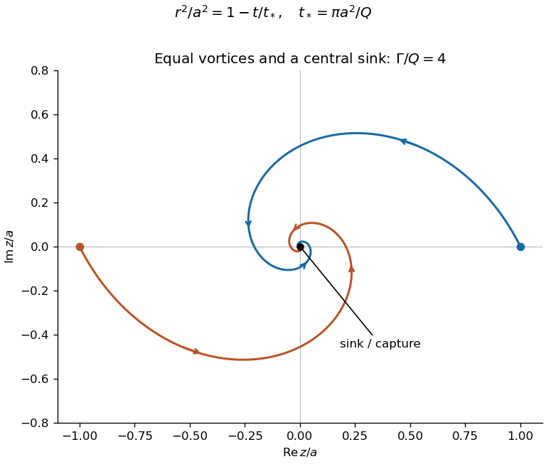

<h1 id="k/1/solution">Solution</h1>

↑ **Parent:** [1](../1.md)

Use the [complex potential of a two-dimensional potential flow](../../../../complex-potential-of-a-two-dimensional-potential-flow.md) convention $W=\phi+i\psi$, for which $W'(z)=u-iv$. A positive [circulation](../../../../circulation-physics.md) is counterclockwise. The two [point vortices](../../../../line-vortex.md) and the [two-dimensional point sink](../../../../two-dimensional-point-sink.md) give

$$
\boxed{W(z,t)=\frac{\Gamma}{2\pi i}\bigl[\log(z-c(t))+\log(z+c(t))\bigr]-\frac Q{2\pi}\log z.}
$$

Branch choices change additive constants, not the local [velocity](../../../../velocity.md) [field](../../../../field.md). A vortex is transported by the nonsingular [velocity](../../../../velocity.md) due to the other vortex and the sink; its own singular term is omitted. At $z=c$ this gives

$$
\dot{\bar c}=\frac{\Gamma}{4\pi i c}-\frac Q{2\pi c},\qquad \dot c=\frac{-Q/(2\pi)+i\Gamma/(4\pi)}{\bar c}.
$$

The other vortex follows $-c$ by symmetry. Put $c=re^{i\theta}$, with $r(0)=a$ and $\theta(0)=0$. Multiplication by $\bar c$ gives

$$
r\dot r=-\frac Q{2\pi},\qquad r^2\dot\theta=\frac{\Gamma}{4\pi}.
$$

For $Q>0$, integration yields

$$
\boxed{r^2=a^2-\frac Q\pi t,\qquad\theta=-\frac{\Gamma}{4Q}\log\left(1-\frac{Qt}{\pi a^2}\right).}
$$

Equivalently, with $s=1-Qt/(\pi a^2)$,

$$
\boxed{c(t)=a\sqrt s\,e^{-i\Gamma\log s/(4Q)},\qquad z_1(t)=c(t),\quad z_2(t)=-c(t),\quad0\leq t<\frac{\pi a^2}{Q}.}
$$

The curves obey $\theta=(\Gamma/(2Q))\log(a/r)$, so they are [logarithmic spirals](../../../../logarithmic-spiral.md). At $t=\pi a^2/Q$, both vortices reach the sink at the origin. For nonzero circulation they make infinitely many turns in that finite time; for zero circulation they approach radially. **The point-vortex evolution becomes singular at capture**, so the formula does not define a regular continuation through the event.

**[Figure 1](#k/1/image-two-equal-vortices-spiral-symmetrically-into-a-central-sink-and-reach-it-at-a-finite-capture-time). Two equal vortices spiral symmetrically into a central sink and reach it at a finite capture time**.

## ↑ Ancestors (12)

1. [1](../1.md)
2. [K](../../k.md)
3. [2013](../../../2013-split.md)
4. [Past exam of the options I course of the University of Oxford](../../../split.md)
5. [Options I course of the University of Oxford](../../../../options-i-course-of-the-university-of-oxford.md)
6. [Year 2 of the mathematics course of the University of Oxford](../../../../year-2-of-the-mathematics-course-of-the-university-of-oxford.md)
7. [Mathematics course of the University of Oxford](../../../../mathematics-course-of-the-university-of-oxford.md)
8. [Undergraduate course of the University of Oxford](../../../../undergraduate-course-of-the-university-of-oxford.md)
9. [Course of the University of Oxford](../../../../course-of-the-university-of-oxford.md)
10. [University of Oxford](../../../../university-of-oxford-split.md)
11. [List of universities](../../../../list-of-universities.md)
12. [Codex Wiki](../../../../split.md)
