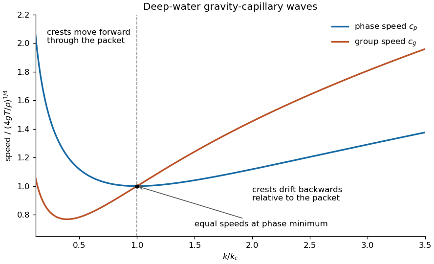

<h1 id="k/2/solution">Solution</h1>

↑ **Parent:** [2](../2.md)

Put $\tau=T/\rho>0$ and take the positive-frequency branch for $k>0$. The [phase velocity](../../../../phase-velocity.md) and [group velocity](../../../../group-velocity.md) are

$$
\boxed{c_p=\frac\omega k=\sqrt{\frac gk+\tau k},\qquad c_g=\frac{d\omega}{dk}=\frac{g+3\tau k^2}{2\sqrt{gk+\tau k^3}}.}
$$

Since the square root is increasing, minimizing $c_p$ is equivalent to minimizing $g/k+\tau k$. Its derivative is $-g/k^2+\tau$, which changes sign from negative to positive at

$$
\boxed{k_c=\sqrt{\frac g\tau}=\sqrt{\frac{\rho g}T}.}
$$

The phase speed diverges at both positive endpoints $k\downarrow0$ and $k\to\infty$, so this stationary point is its global minimum. At $k_c$, $\tau k_c^2=g$, giving

$$
\boxed{c_g(k_c)=c_p(k_c)=\left(\frac{4gT}{\rho}\right)^{1/4}.}
$$

The relative speed is especially transparent:

$$
c_g-c_p=\frac{\tau k^2-g}{2\omega}.
$$

A narrow [wave packet](../../../../wave-packet.md) moves with $c_g$, while its crests move with $c_p$. For $k<k_c$, $c_p>c_g$: **crests move forward through the packet**, from its rear towards its front. For $k>k_c$, $c_p<c_g$: **crests drift backwards relative to the packet**, although both absolute velocities are positive. At $k_c$ the leading-order relative drift vanishes. This is the [minimum phase speed of a gravity-capillary wave](../../../../minimum-phase-speed-of-a-gravity-capillary-wave.md).

**[Figure 2](#k/2/image-phase-and-group-speeds-cross-at-the-minimum-phase-speed-crest-drift-relative-to-the-packet-reverses-there). Phase and group speeds cross at the minimum phase speed; crest drift relative to the packet reverses there**.

## ↑ Ancestors (12)

1. [2](../2.md)
2. [K](../../k.md)
3. [2013](../../../2013-split.md)
4. [Past exam of the options I course of the University of Oxford](../../../split.md)
5. [Options I course of the University of Oxford](../../../../options-i-course-of-the-university-of-oxford.md)
6. [Year 2 of the mathematics course of the University of Oxford](../../../../year-2-of-the-mathematics-course-of-the-university-of-oxford.md)
7. [Mathematics course of the University of Oxford](../../../../mathematics-course-of-the-university-of-oxford.md)
8. [Undergraduate course of the University of Oxford](../../../../undergraduate-course-of-the-university-of-oxford.md)
9. [Course of the University of Oxford](../../../../course-of-the-university-of-oxford.md)
10. [University of Oxford](../../../../university-of-oxford-split.md)
11. [List of universities](../../../../list-of-universities.md)
12. [Codex Wiki](../../../../split.md)
