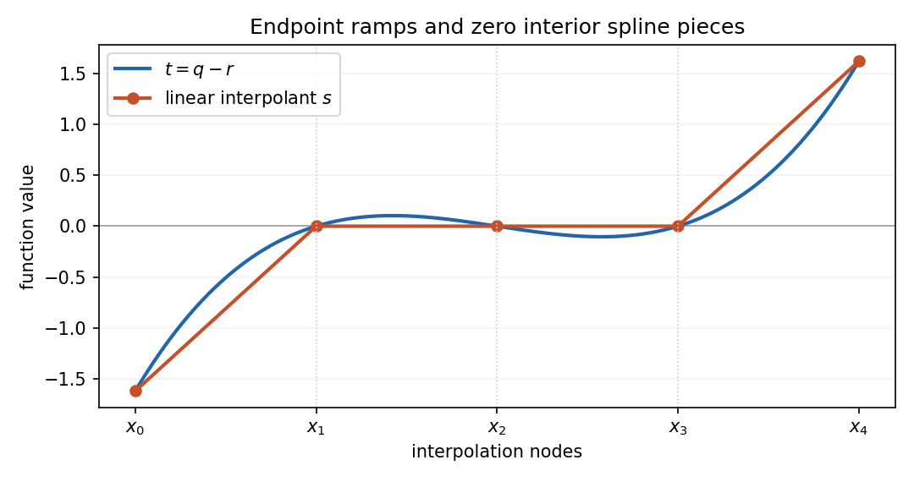

# 2004

↑ **Parent:** [Past exam of the options II course of the University of Oxford](../past-exam-of-the-options-ii-course-of-the-university-of-oxford.md)

Options II, Honour School of Mathematics; Friday 25 June 2004, 2.30pm–5.30pm. The complete thirteen-page source was supplied in [the disclosed past-papers archive](https://www.whatdotheyknow.com/request/maths_papers_2/response/1850333/attach/3/FOI%2020210708%201%20Data.zip?cookie_passthrough=1), member “FOI-20210708-1 - Data/4304 (9).pdf”, through [the original request](https://www.whatdotheyknow.com/request/maths_papers_2). A full editable source transcription is held privately. No exact worked-answer advertisement was found in the bounded availability check.

**Table of contents**

- [A](#a)
  - [A2](#a/a2)
    - [Solution](#a/a2/solution)
- [B](#b)
  - [B2](#b/b2)
    - [Solution](#b/b2/solution)
    - [a](#b/b2/a)
      - [Solution](#b/b2/a/solution)
    - [b](#b/b2/b)
      - [Solution](#b/b2/b/solution)
    - [c](#b/b2/c)
      - [Solution](#b/b2/c/solution)
- [C](#c)
  - [C2](#c/c2)
    - [a](#c/c2/a)
      - [i](#c/c2/a/i)
        - [Solution](#c/c2/a/i/solution)
      - [ii](#c/c2/a/ii)
        - [Solution](#c/c2/a/ii/solution)
      - [iii](#c/c2/a/iii)
        - [Solution](#c/c2/a/iii/solution)
    - [b](#c/c2/b)
      - [Solution](#c/c2/b/solution)
    - [c](#c/c2/c)
      - [i](#c/c2/c/i)
        - [Solution](#c/c2/c/i/solution)
      - [ii](#c/c2/c/ii)
        - [Solution](#c/c2/c/ii/solution)
- [D](#d)
  - [D3](#d/d3)
    - [Solution](#d/d3/solution)
  - [D4](#d/d4)
    - [Solution](#d/d4/solution)
    - [a](#d/d4/a)
      - [Solution](#d/d4/a/solution)
    - [b](#d/d4/b)
      - [Solution](#d/d4/b/solution)
    - [c](#d/d4/c)
      - [Solution](#d/d4/c/solution)
- [E](#e)
  - [E3](#e/e3)
    - [i](#e/e3/i)
      - [Solution](#e/e3/i/solution)
    - [ii](#e/e3/ii)
      - [Solution](#e/e3/ii/solution)
    - [Solution](#e/e3/solution)
  - [E4](#e/e4)
    - [Solution](#e/e4/solution)
- [F](#f)
  - [F2](#f/f2)
    - [a](#f/f2/a)
      - [Solution](#f/f2/a/solution)
    - [b](#f/f2/b)
      - [Solution](#f/f2/b/solution)
- [G](#g)
  - [G2](#g/g2)
    - [Solution](#g/g2/solution)
- [H](#h)
  - [H2](#h/h2)
    - [Solution](#h/h2/solution)
- [J](#j)
  - [J2](#j/j2)
    - [Solution](#j/j2/solution)
- [K](#k)
  - [K2](#k/k2)
    - [Solution](#k/k2/solution)
- [L](#l)
  - [L2](#l/l2)
    - [Solution](#l/l2/solution)
- [M](#m)
  - [M3](#m/m3)
    - [a](#m/m3/a)
      - [Solution](#m/m3/a/solution)
    - [b](#m/m3/b)
      - [Solution](#m/m3/b/solution)
    - [c](#m/m3/c)
      - [Solution](#m/m3/c/solution)
- [N](#n)
  - [N2](#n/n2)
    - [a](#n/n2/a)
      - [Solution](#n/n2/a/solution)
    - [b](#n/n2/b)
      - [i](#n/n2/b/i)
        - [Solution](#n/n2/b/i/solution)
      - [ii](#n/n2/b/ii)
        - [Solution](#n/n2/b/ii/solution)
      - [iii](#n/n2/b/iii)
        - [Solution](#n/n2/b/iii/solution)
      - [iv](#n/n2/b/iv)
        - [Solution](#n/n2/b/iv/solution)
- [O](#o)
  - [O4](#o/o4)
    - [Solution](#o/o4/solution)
    - [a](#o/o4/a)
      - [Solution](#o/o4/a/solution)
    - [b](#o/o4/b)
      - [Solution](#o/o4/b/solution)
  - [O5](#o/o5)
    - [a](#o/o5/a)
      - [Solution](#o/o5/a/solution)
    - [b](#o/o5/b)
      - [Solution](#o/o5/b/solution)
    - [c](#o/o5/c)
      - [Solution](#o/o5/c/solution)
    - [d](#o/o5/d)
      - [Solution](#o/o5/d/solution)
- [P](#p)
  - [P3](#p/p3)
    - [Solution](#p/p3/solution)
  - [P4](#p/p4)
    - [Solution](#p/p4/solution)

## A

↑ **Parent:** [2004](2004.md)

<h3 id="a/a2">A2</h3>

↑ **Parent:** [A](#a)

<h4 id="a/a2/solution">Solution</h4>

↑ **Parent:** [A2](#a/a2)

The [permutation](../combinatorics.md#permutation) inverse is $\rho_{g^{-1}}$: applying the two maps successively sends $\omega$ to $(\omega g)g^{-1}=\omega$. With the paper's right-action convention, [permutation](../combinatorics.md#permutation) products also act on the right, and

$$
\omega(\rho_g\rho_h)=(\omega g)h=\omega(gh)=\omega\rho_{gh}.
$$

Thus $\boxed{\rho(gh)=\rho(g)\rho(h)}$. If function composition is written on the left instead, the same right action is represented by $g\mapsto\rho_{g^{-1}}$; keeping these conventions consistent avoids an artificial reversal. The kernel consists precisely of elements fixing every point, so

$$
\boxed{\ker\rho=\bigcap_{\omega\in\Omega}G_\omega.}
$$

The rotational tetrahedral [group](../group.md) acts transitively on its four vertices. A [rotation](../riemannian-geometry.md#rotation-mathematics) fixing a vertex must preserve its opposite face and rotate its three vertices cyclically; its [stabilizer](../group-action.md#stabilizer-subgroup) has order three. The [orbit-stabilizer theorem](../group-action.md#orbit-stabilizer-theorem) gives $|G|=4\cdot3=12$. The rotations are the identity, two nontrivial rotations about each of the four vertex-to-opposite-face axes, and a half-turn about each of the three opposite-edge-midpoint axes. Therefore the counts by element order are

$$
\boxed{\begin{array}{c|rrrrrr}n&1&2&3&4&6&12\\\#&1&3&8&0&0&0\end{array}.}
$$

A [rotation](../riemannian-geometry.md#rotation-mathematics) fixing all vertices fixes three [linearly independent](../vector-space.md#linear-independence) vertex vectors and is the identity. The vertex [permutation](../combinatorics.md#permutation) action is therefore faithful. The listed rotations induce the identity, 3-cycles and double transpositions, all even permutations. Its injective image has order 12, the full order of $A_4$. Hence $\boxed{G\cong A_4}$.

## B

↑ **Parent:** [2004](2004.md)

<h3 id="b/b2">B2</h3>

↑ **Parent:** [B](#b)

<h4 id="b/b2/solution">Solution</h4>

↑ **Parent:** [B2](#b/b2)

Take $\boxed{K=F[x]/(f)}$ and let $\alpha$ be the [residue](../analysis.md#residue) class of $x$. Division with remainder represents every class by a [polynomial](../polynomial.md) of degree less than $n$, so every element is a [polynomial](../polynomial.md) in $\alpha$ and $f(\alpha)=0$. A nonzero class represented by $u$ has $\gcd(u,f)=1$ because $f$ is irreducible. Bézout's identity gives $au+bf=1$, making the class of $a$ its inverse. Thus $K$ is a [field](../algebra.md#field), containing $F$ through its constant classes.

A [splitting field](../galois-theory.md#splitting-field) of a nonconstant [polynomial](../polynomial.md) is an extension in which it factors into linear factors and which is generated over the original [field](../algebra.md#field) by its roots. To construct one, choose an irreducible factor and use the preceding quotient construction to adjoin a root. Divide off a linear factor in that extension and repeat on the remaining [polynomial](../polynomial.md). Each stage lowers the remaining degree, so finitely many stages suffice. The [field](../algebra.md#field) generated by all roots in the resulting [field](../algebra.md#field) is the required [splitting field](../galois-theory.md#splitting-field). This induction works with repeated roots and does not assume separability. The two roman clauses in the source specify properties of this one construction; they are not separate questions.

<h4 id="b/b2/a">a</h4>

↑ **Parent:** [B2](#b/b2)

<h5 id="b/b2/a/solution">Solution</h5>

↑ **Parent:** [A](#b/b2/a)

The roots are $\pm\sqrt{-5}$, so one root already supplies both. The [polynomial](../polynomial.md) has no rational root and is irreducible of degree two. Thus its [splitting field](../galois-theory.md#splitting-field) is $\mathbb Q(\sqrt{-5})$, with $\boxed{[K:\mathbb Q]=2}$.

<h4 id="b/b2/b">b</h4>

↑ **Parent:** [B2](#b/b2)

<h5 id="b/b2/b/solution">Solution</h5>

↑ **Parent:** [B](#b/b2/b)

Put $\alpha=\sqrt[3]2$ and $\zeta=e^{2\pi i/3}$. The three roots are $\alpha,\alpha\zeta,\alpha\zeta^2$, so the [splitting field](../galois-theory.md#splitting-field) is $K=\mathbb Q(\alpha,\zeta)$. [Eisenstein's criterion](../commutative-algebra.md#eisenstein-criterion) at two gives $[\mathbb Q(\alpha):\mathbb Q]=3$. This intermediate [field](../algebra.md#field) is real, while $\zeta$ is not real, and $\zeta$ satisfies $x^2+x+1=0$. Its degree over the intermediate [field](../algebra.md#field) is therefore exactly two. By the tower law, $\boxed{[K:\mathbb Q]=6}$.

<h4 id="b/b2/c">c</h4>

↑ **Parent:** [B2](#b/b2)

<h5 id="b/b2/c/solution">Solution</h5>

↑ **Parent:** [C](#b/b2/c)

Over $\mathbb F_5$,

$$
x^3+3=(x-3)(x^2+3x+4).
$$

The quadratic discriminant is $9-16\equiv3$, while the squares modulo five are $0,1,4$. Thus that factor is irreducible. Adjoining either quadratic root creates a degree-two extension and supplies the other root by the sum-of-roots relation. Consequently the [splitting field](../galois-theory.md#splitting-field) is $\mathbb F_{25}$ and $\boxed{[K:\mathbb F_5]=2}$.

<h2 id="c">C</h2>

↑ **Parent:** [2004](2004.md)

<h3 id="c/c2">C2</h3>

↑ **Parent:** [C](#c)

<h4 id="c/c2/a">a</h4>

↑ **Parent:** [C2](#c/c2)

<h5 id="c/c2/a/i">i</h5>

↑ **Parent:** [A](#c/c2/a)

<h6 id="c/c2/a/i/solution">Solution</h6>

↑ **Parent:** [I](#c/c2/a/i)

The [Legendre symbol](../quadratic-residue.md#legendre-symbol) is

$$
\boxed{\left(\frac ap\right)=\begin{cases}0,&p\mid a,\\1,&a\text{ is a nonzero square modulo }p,\\-1,&a\text{ is a nonsquare modulo }p.\end{cases}}
$$

The distinction between the zero class and a nonzero [quadratic residue](../quadratic-residue.md) is essential.

<h5 id="c/c2/a/ii">ii</h5>

↑ **Parent:** [A](#c/c2/a)

<h6 id="c/c2/a/ii/solution">Solution</h6>

↑ **Parent:** [Ii](#c/c2/a/ii)

[Euler's criterion](../quadratic-residue.md#euler-s-criterion) states

$$
\boxed{a^{(p-1)/2}\equiv\left(\frac ap\right)\pmod p.}
$$

For $p\nmid a$ the right side is $+1$ or $-1$. The displayed congruence also holds for $p\mid a$, since $p$ is odd and the exponent is positive.

<h5 id="c/c2/a/iii">iii</h5>

↑ **Parent:** [A](#c/c2/a)

<h6 id="c/c2/a/iii/solution">Solution</h6>

↑ **Parent:** [Iii](#c/c2/a/iii)

For distinct odd primes,

$$
\boxed{\left(\frac pq\right)\left(\frac qp\right)=(-1)^{(p-1)(q-1)/4}.}
$$

Equivalently the two Legendre symbols agree unless both primes are three modulo four, in which case their signs are opposite. Neither symbol is zero here.

<h4 id="c/c2/b">b</h4>

↑ **Parent:** [C2](#c/c2)

<h5 id="c/c2/b/solution">Solution</h5>

↑ **Parent:** [B](#c/c2/b)

[Quadratic reciprocity](../number-theory.md#quadratic-reciprocity) with the [prime](../prime-number.md) three gives

$$
\left(\frac3p\right)=(-1)^{(p-1)/2}\left(\frac p3\right).
$$

The latter symbol is $+1$ when $p\equiv1\pmod3$ and $-1$ when $p\equiv2\pmod3$. A [prime](../prime-number.md) greater than three occupies one of the classes $1,5,7,11$ modulo twelve. Combining its residues modulo three and four gives signs $+1,-1,-1,+1$ respectively. Hence

$$
\boxed{\left(\frac3p\right)=1\text{ for }p\equiv\pm1\pmod{12},\qquad
\left(\frac3p\right)=-1\text{ for }p\equiv\pm5\pmod{12}.}
$$

<h4 id="c/c2/c">c</h4>

↑ **Parent:** [C2](#c/c2)

<h5 id="c/c2/c/i">i</h5>

↑ **Parent:** [C](#c/c2/c)

<h6 id="c/c2/c/i/solution">Solution</h6>

↑ **Parent:** [I](#c/c2/c/i)

For $n\geq1$, the exponent $2^n$ is positive and even. Since $2^{2j}=4^j\equiv4\pmod{12}$ for every $j\geq1$, it follows that

$$
\boxed{F_n=2^{2^n}+1\equiv5\pmod{12}.}
$$

Here the natural-number indexing must start at one. If zero is included in that convention, $F_0=3$ is an exception to the printed assertion and must be excluded.

<h5 id="c/c2/c/ii">ii</h5>

↑ **Parent:** [C](#c/c2/c)

<h6 id="c/c2/c/ii/solution">Solution</h6>

↑ **Parent:** [Ii](#c/c2/c/ii)

Let $p=F_m$ be [prime](../prime-number.md) with $m\geq1$. The preceding parts give $(3/p)=-1$, so [Euler's criterion](../quadratic-residue.md#euler-s-criterion) implies $3^{(p-1)/2}\equiv-1\pmod p$. The [multiplicative order](../number-theory.md#multiplicative-order) $d$ of three divides $p-1=2^{2^m}$. Every proper divisor of this power of two divides $(p-1)/2$. If $d$ were proper, that half-power would be one, a contradiction. Therefore

$$
\boxed{\operatorname{ord}_p(3)=p-1,}
$$

which means precisely that three is a [primitive root](../number-theory.md#primitive-root-modulo-n) modulo $p$.

## D

↑ **Parent:** [2004](2004.md)

<h3 id="d/d3">D3</h3>

↑ **Parent:** [D](#d)

<h4 id="d/d3/solution">Solution</h4>

↑ **Parent:** [D3](#d/d3)

The [monotone convergence theorem](../measure-theory.md#monotone-convergence-theorem) says that if $0\leq f_j\uparrow f$ almost everywhere on a measure space, then $\int f_j\uparrow\int f$, allowing infinity. The [dominated convergence theorem](../measure-theory.md#dominated-convergence-theorem) says that if $g_j\to g$ almost everywhere and $|g_j|\leq H$ for an integrable $H$, then $g$ is integrable and $\int g_j\to\int g$.

For $a\ne0$, the truncated functions $f_a\mathbf1_{[-j,j]}$ increase to $f_a$. Each has the elementary integral $2\arctan(|a|j)/|a|$. Thus monotone convergence gives

$$
\boxed{\int_{\mathbb R}f_a(x)\,dx=\frac\pi{|a|}<\infty.}
$$

For fixed $x$, eventually $|x|\leq n\pi/2$ and $n\sin(x/n)\to x$, so $g_n(x)\to1/(1+x^2)$. Inside the support the supplied inequality yields $n^2\sin^2(x/n)\geq4x^2/\pi^2$. Outside the support $g_n=0$. Consequently the global bound is

$$
0\leq g_n(x)\leq\frac1{1+4x^2/\pi^2},
$$

and this majorant is integrable by the already proved formula with $a=2/\pi$. Dominated convergence now gives $\boxed{\int g_n\to\int(1+x^2)^{-1}dx=\pi}$. The majorant is independent of $n$, including on the moving support.

<h3 id="d/d4">D4</h3>

↑ **Parent:** [D](#d)

<h4 id="d/d4/solution">Solution</h4>

↑ **Parent:** [D4](#d/d4)

Lebesgue [measurability](../measure-theory.md#measurability) of $g$ means that $g^{-1}(U)$ is a [Lebesgue measurable](../measure-theory.md#lebesgue-measurable-set) subset of $\mathbb R$ for every open subset $U\subseteq\mathbb R$. Equivalently one can check all sets $\{x:g(x)>t\}$ with real $t$.

There are two conventions for a [step function](../measure-theory.md#step-function) on the whole real line. Under the bounded-support integration convention it is a finite [linear combination](../vector-space.md#linear-combination) of indicators of bounded intervals; under the unrestricted piecewise-constant convention nonzero constant tails are allowed. The conclusions below state both conventions explicitly, since only the first assertion depends on this choice.

<h4 id="d/d4/a">a</h4>

↑ **Parent:** [D4](#d/d4)

<h5 id="d/d4/a/solution">Solution</h5>

↑ **Parent:** [A](#d/d4/a)

Under the bounded-support convention, **false in general, true if $f(0)=0$**. For the first claim, take $g=0$ and $f\equiv1$: the composition is one on all of $\mathbb R$, and cannot have bounded support. For the second, refine the finitely many defining intervals into disjoint intervals on which $g$ is constant. The composition is constant on each of them and vanishes outside their bounded union because $f(0)=0$. Hence it is another [step function](../measure-theory.md#step-function).

Under the unrestricted piecewise-constant convention, **true in both cases**: composition with any function preserves constancy on the same partition, including its unbounded cells. This also applies to the broader measurable-partition convention. [Continuity](../calculus.md#continuous-function) of $f$ is not needed for this particular assertion.

<h4 id="d/d4/b">b</h4>

↑ **Parent:** [D4](#d/d4)

<h5 id="d/d4/b/solution">Solution</h5>

↑ **Parent:** [B](#d/d4/b)

**False in both cases.** Without the zero-at-zero condition, $g=0$ and $f\equiv1$ already give an integrable input and a non-integrable composition on $\mathbb R$.

Even imposing $f(0)=0$ does not control how fast $f(t)$ approaches zero. Take $g(x)=(1+x^2)^{-1}$ and the [continuous function](../calculus.md#continuous-function) $f(t)=\sqrt{|t|}$. The input has integral $\pi$, but

$$
(f\circ g)(x)=\frac1{\sqrt{1+x^2}}
$$

has a divergent integral, because its tails are comparable to $1/|x|$. Thus [continuity](../calculus.md#continuous-function) at zero is weaker than the linear growth estimate that would preserve [integrability](../measure-theory.md#integrability).

<h4 id="d/d4/c">c</h4>

↑ **Parent:** [D4](#d/d4)

<h5 id="d/d4/c/solution">Solution</h5>

↑ **Parent:** [C](#d/d4/c)

**True in both cases.** For every open $U$, [continuity](../calculus.md#continuous-function) of $f$ makes $f^{-1}(U)$ open. Then

$$
(f\circ g)^{-1}(U)=g^{-1}(f^{-1}(U))
$$

is [Lebesgue measurable](../measure-theory.md#lebesgue-measurable-set) by [measurability](../measure-theory.md#measurability) of $g$. The value $f(0)$ has no bearing on this [preimage](../set-theory.md#preimage) argument.

## E

↑ **Parent:** [2004](2004.md)

<h3 id="e/e3">E3</h3>

↑ **Parent:** [E](#e)

<h4 id="e/e3/i">i</h4>

↑ **Parent:** [E3](#e/e3)

<h5 id="e/e3/i/solution">Solution</h5>

↑ **Parent:** [I](#e/e3/i)

A space is [Hausdorff](../topology.md#hausdorff-space) if distinct points have disjoint open neighbourhoods. In symbols, for $x\ne y$ there are open $U\ni x$ and $V\ni y$ with $U\cap V=\varnothing$.

<h4 id="e/e3/ii">ii</h4>

↑ **Parent:** [E3](#e/e3)

<h5 id="e/e3/ii/solution">Solution</h5>

↑ **Parent:** [Ii](#e/e3/ii)

A space is [compact](../topology.md#compact-space) if every open cover has a finite subcover. The finite-intersection formulation says that every family of closed sets with the [finite intersection property](../topology.md#finite-intersection-property) has nonempty total intersection.

<h4 id="e/e3/solution">Solution</h4>

↑ **Parent:** [E3](#e/e3)

The nested closed sets have the [finite intersection property](../topology.md#finite-intersection-property): the intersection of finitely many is the one with the largest index and is nonempty. Compactness gives $\boxed{Y_\infty\ne\varnothing}$.

For an open neighbourhood $W$ of the intersection, suppose no $Y_n$ were contained in $W$. Then $Z_n=Y_n\cap(X\setminus W)$ would be nested, nonempty and closed. The same argument gives a point in all $Z_n$, contradicting $Y_\infty\subseteq W$. Hence

$$
\boxed{Y_n\subseteq W\text{ for some }n.}
$$

For [connectedness](../geometry-and-topology.md#connected-space), suppose $Y_\infty=A\cup B$ were a separation into two nonempty relatively closed sets. Since $Y_\infty$ is [compact](../topology.md#compact-space), $A,B$ are disjoint [compact](../topology.md#compact-space) subsets of $X$. The supplied separation fact gives disjoint open neighbourhoods $U_A,U_B$. Their union contains $Y_\infty$, so some $Y_n$ lies in that union. But $Y_n$ meets both neighbourhoods, since it contains $A$ and $B$. Its intersections with the two neighbourhoods are then a separation, contradicting its [connectedness](../geometry-and-topology.md#connected-space). Thus **the nested intersection is [connected](../geometry-and-topology.md#connected-space)**.

<h3 id="e/e4">E4</h3>

↑ **Parent:** [E](#e)

<h4 id="e/e4/solution">Solution</h4>

↑ **Parent:** [E4](#e/e4)

For the [quotient map](../topology.md#quotient-map) $\pi$, a subset $U$ of the quotient is open exactly when $\pi^{-1}(U)$ is open in $X$. This definition immediately makes $\pi$ continuous. If $g$ is continuous then $g\circ\pi$ is continuous. Conversely, [continuity](../calculus.md#continuous-function) of the composition gives, for every open $V\subseteq Z$, that $\pi^{-1}(g^{-1}(V))$ is open. By the defining criterion $g^{-1}(V)$ is open, so $g$ is continuous.

A map $h$ constant on each [equivalence class](../set-theory.md#equivalence-class) defines a unique map $\bar h([x])=h(x)$. It is well-defined by the assumed class constancy, and its composition with $\pi$ is $h$. The preceding criterion proves that $\bar h$ is continuous.

For the integer [lattice](../mathematical-logic.md#lattice) quotient, define

$$
F(x,y)=(e^{2\pi ix},e^{2\pi iy}).
$$

This continuous map is onto the product of the two unit circles, and its fibres are exactly the [lattice](../mathematical-logic.md#lattice) equivalence classes. It therefore induces a [continuous bijection](../topology.md#continuous-bijection) $\bar F:\mathbb R^2/\mathbb Z^2\to\mathbb T^2$. Every class has a representative in $[0,1]^2$, so the quotient is the continuous image of that [compact](../topology.md#compact-space) square and is [compact](../topology.md#compact-space). The target is [Hausdorff](../topology.md#hausdorff-space) as a subspace of $\mathbb C^2$. A [continuous bijection](../topology.md#continuous-bijection) from a [compact](../topology.md#compact-space) space to a [Hausdorff](../topology.md#hausdorff-space) space is a [homeomorphism](../topology.md#homeomorphism), proving

$$
\boxed{\mathbb R^2/\mathbb Z^2\cong\mathbb T^2.}
$$

Finally, if $U\subseteq\mathbb R^2$ is open, then $\pi^{-1}(\pi(U))=\bigcup_{m\in\mathbb Z^2}(U+m)$ is open, being a union of translates. The quotient criterion makes $\pi(U)$ open. Thus **the [quotient map](../topology.md#quotient-map) is an [open map](../multivariable-calculus.md#open-map)**.

## F

↑ **Parent:** [2004](2004.md)

<h3 id="f/f2">F2</h3>

↑ **Parent:** [F](#f)

<h4 id="f/f2/a">a</h4>

↑ **Parent:** [F2](#f/f2)

<h5 id="f/f2/a/solution">Solution</h5>

↑ **Parent:** [A](#f/f2/a)

Write the variables as $(u,v)\in\mathbb R^n\times\mathbb R^k$, with $a=(u_0,v_0)$. The hypothesis makes $D_uf(a)$ invertible. The [implicit function theorem](../multivariable-calculus.md#implicit-function-theorem) supplies neighbourhoods $U,V$ of $u_0,v_0$ and a unique [smooth map](../smooth-manifold.md#smooth-map-between-manifolds) $\phi:V\to U$ such that

$$
\boxed{f^{-1}(b)\cap(U\times V)=\{(\phi(v),v):v\in V\},\quad \phi(v_0)=u_0.}
$$

Its derivative is $D\phi(v_0)=-(D_uf(a))^{-1}D_vf(a)$. Thus the derivative of this parametrization has image exactly $\ker Df(a)$.

Since $h$ has a constrained maximum at $a$, differentiating $v\mapsto h(\phi(v),v)$ gives zero in every direction. Therefore $Dh(a)$ vanishes on $\ker Df(a)$. In finite-dimensional [linear algebra](../linear-algebra.md), $(\ker Df(a))^\perp$ is the [row space](../vector-space.md#row-space) of $Df(a)$. Consequently

$$
\boxed{\nabla h(a)=\sum_{j=1}^n\lambda_j\nabla f_j(a).}
$$

The full-rank hypothesis is what permits this [Lagrange multiplier](../mathematical-optimization.md#lagrange-multiplier) conclusion; it is not a consequence of constrained maximality alone at a singular constraint.

<h4 id="f/f2/b">b</h4>

↑ **Parent:** [F2](#f/f2)

<h5 id="f/f2/b/solution">Solution</h5>

↑ **Parent:** [B](#f/f2/b)

[Positive definiteness](../bilinear-form.md#positive-definiteness) gives a positive smallest [eigenvalue](../linear-operator-theory.md#eigenvalue) $c$ with $x^tAx\geq c|x|^2$. Hence the set $x^tAx=y^tAy=1$ is [compact](../topology.md#compact-space), and $h$ attains a maximum there. Its two constraint gradients are $(2Ax,0)$ and $(0,2Ay)$; they are [linearly independent](../vector-space.md#linear-independence) because $x,y$ are nonzero and $A$ is invertible.

Put $s=x^tAy$. At any constrained extremum the multiplier equations are

$$
sAy=\lambda Ax,\qquad sAx=\mu Ay.
$$

Multiplication by $x^t$ and $y^t$ gives $\lambda=\mu=s^2$. If $s=0$ the objective is zero. Otherwise $Ay=sAx$, so $y=sx$ and normalization gives $s^2=1$. Thus every maximum is at most one, and the value one is attained at $x=y$. This proves $\boxed{(x^tAy)^2\leq1}$ on the normalized constraints.

For nonzero arbitrary vectors apply that result to $x/\sqrt{x^tAx}$ and $y/\sqrt{y^tAy}$. If either vector is zero the conclusion is immediate. Therefore

$$
\boxed{(x^tAy)^2\leq(x^tAx)(y^tAy).}
$$

Equality for nonzero vectors holds precisely when they are [linearly dependent](../vector-space.md#linear-dependence). This is the [Cauchy-Schwarz inequality](../probability-and-statistics.md#cauchy-schwarz-inequality) for the [inner product](../inner-product.md) induced by $A$.

## G

↑ **Parent:** [2004](2004.md)

<h3 id="g/g2">G2</h3>

↑ **Parent:** [G](#g)

<h4 id="g/g2/solution">Solution</h4>

↑ **Parent:** [G2](#g/g2)

For a [variation](../calculus-of-variations.md#variation) $y+\varepsilon\eta$ with $\eta(0)=\eta(1)=0$, stationarity gives

$$
0=\int_0^1(F_y\eta+F_{y'}\eta')\,dx
=\int_0^1\left(F_y-\frac d{dx}F_{y'}\right)\eta\,dx.
$$

The boundary term vanishes. The [fundamental lemma of the calculus of variations](../calculus-of-variations.md#fundamental-lemma-of-the-calculus-of-variations) therefore gives the [Euler-Lagrange equation](../analysis.md#euler-lagrange-equation) $dF_{y'}/dx-F_y=0$.

Differentiating the proposed first integral gives

$$
\frac d{dx}(F-y'F_{y'})=F_x+y'\left(F_y-\frac d{dx}F_{y'}\right).
$$

Thus it is constant along an extremal when $F_x=0$, proving the [Beltrami identity](../analysis.md#beltrami-identity).

For the positive branch relevant to the endpoint data, $F=\sqrt{1+y'^2}/y$. The identity becomes

$$
\frac1{y\sqrt{1+y'^2}}=\frac1R,\qquad y^2(1+y'^2)=R^2.
$$

The [Euler-Lagrange equation](../analysis.md#euler-lagrange-equation) itself gives $yy''=-(1+y'^2)$, so $(y^2)''=-2$. Integrating, or solving the first integral, yields a circle $y^2+(x-c)^2=R^2$. The equal endpoint values force $c=1/2$ and $R^2=5/4$. Hence the unique positive smooth extremal is

$$
\boxed{y(x)=\sqrt{\frac54-\left(x-\frac12\right)^2}.}
$$

It stays positive on the entire interval and satisfies the second-order equation, including its turning point. Merely differentiating the first integral after dividing by $y'$ would need extra care there. Geometrically this is an arc of a [hyperbolic geodesic](../hyperbolic-geometry.md#geodesic-in-the-poincare-half-plane-model) in the [upper half-plane model](../hyperbolic-geometry.md#poincare-half-plane-model).

## H

↑ **Parent:** [2004](2004.md)

<h3 id="h/h2">H2</h3>

↑ **Parent:** [H](#h)

<h4 id="h/h2/solution">Solution</h4>

↑ **Parent:** [H2](#h/h2)

At fractional position $s$ along a straight rigid rod, the velocity is $(1-s)u+sv$. Uniform mass per unit length gives

$$
T=\frac m2\int_0^1|(1-s)u+sv|^2ds
=\boxed{\frac m6(|u|^2+u\cdot v+|v|^2)}.
$$

The string constraints are $x_1^2+y_1^2+(-l+z_1)^2=l^2$ and $x_2^2+y_2^2+(-2l+z_2)^2=4l^2$. Their first-order terms give $z_1=z_2=0$. Their second-order terms then give

$$
\boxed{z_1=(x_1^2+y_1^2)/(2l),\qquad z_2=(x_2^2+y_2^2)/(4l).}
$$

The rod constraint is $(l+x_2-x_1)^2+(y_2-y_1)^2+(-l+z_2-z_1)^2=2l^2$. Its first-order part is $2l(x_2-x_1)=0$, hence $x_2=x_1$ to first order.

The [centre of mass](../classical-mechanics.md#center-of-mass) rises by $(z_1+z_2)/2$. Substituting the quadratic string expansions and the linear relation between the horizontal displacements gives

$$
\boxed{V=\frac{mg}{8l}(3x_1^2+2y_1^2+y_2^2).}
$$

Vertical velocities contribute only at fourth order to the [energy](../energy.md). Substituting $u=(\dot x_1,\dot y_1,0)$ and $v=(\dot x_1,\dot y_2,0)$ into the rod [energy](../energy.md) gives

$$
\boxed{T=\frac m6(3\dot x_1^2+\dot y_1^2+\dot y_2^2+\dot y_1\dot y_2).}
$$

The decoupled $x_1$ equation is $\ddot x_1+3gx_1/(4l)=0$. For the other two coordinates put $\kappa=3g/(2l)$; their equations are

$$
2\ddot y_1+\ddot y_2+2\kappa y_1=0,\qquad
\ddot y_1+2\ddot y_2+\kappa y_2=0.
$$

A normal-mode ansatz gives $3\omega^4-6\kappa\omega^2+2\kappa^2=0$, whose roots are $\omega^2=g(3\pm\sqrt3)/(2l)$. The corresponding displacement ratios are $y_2/y_1=1\mp\sqrt3$. Therefore the three periods are

$$
\boxed{\frac{2\pi}{\sqrt{3g/(4l)}},\qquad\frac{2\pi}{\sqrt{g(3+\sqrt3)/(2l)}},\qquad\frac{2\pi}{\sqrt{g(3-\sqrt3)/(2l)}}.}
$$

## J

↑ **Parent:** [2004](2004.md)

<h3 id="j/j2">J2</h3>

↑ **Parent:** [J](#j)

<h4 id="j/j2/solution">Solution</h4>

↑ **Parent:** [J2](#j/j2)

Set $a=\sqrt{m\omega/(2\hbar)}x+\sqrt{\hbar/(2m\omega)}\,d/dx$ and let $a^\dagger$ have the opposite derivative sign. On the bound-state domain, $[a,a^\dagger]=1$ and $H=\hbar\omega(a^\dagger a+1/2)$. Thus every [energy eigenvalue](../energy-eigenvalue.md) has $E/\hbar\omega-1/2=\nu\geq0$.

The [lowering operator](../semisimple-lie-algebra.md#lowering-operator) maps an eigenstate of $a^\dagger a$ of [eigenvalue](../linear-operator-theory.md#eigenvalue) $\nu$ to one of [eigenvalue](../linear-operator-theory.md#eigenvalue) $\nu-1$, with squared [norm](../normed-vector-space.md#norm) multiplied by $\nu$. Repeated lowering cannot pass below zero, so it must terminate at zero. Hence $\nu$ is a nonnegative integer. The equation $a\psi_0=0$ gives a Gaussian [ground state](../quantum-mechanics.md#ground-state), and repeated raising gives a nonzero [square-integrable](../measure-theory.md#square-integrable-function) state for every integer $n\geq0$. Therefore

$$
\boxed{E_n=\hbar\omega(n+1/2),\qquad n=0,1,2,\ldots.}
$$

These are also the Gaussian-times-Hermite-[polynomial](../polynomial.md) solutions obtained by the suggested series method.

Put $\alpha=m\omega/\hbar$. Normalization gives $\psi_0=(\alpha/\pi)^{1/4}e^{-\alpha x^2/2}$, so

$$
\langle|x|\rangle=2\sqrt{\frac\alpha\pi}\int_0^\infty xe^{-\alpha x^2}dx
=\boxed{\sqrt{\frac\hbar{\pi m\omega}}}.
$$

The [expectation](../expected-value.md) of $x$ itself is zero by [parity](../quantum-mechanics.md#parity); that cancellation does not apply to its absolute value.

## K

↑ **Parent:** [2004](2004.md)

<h3 id="k/k2">K2</h3>

↑ **Parent:** [K](#k)

<h4 id="k/k2/solution">Solution</h4>

↑ **Parent:** [K2](#k/k2)

Orient the body boundary $C$ counterclockwise. Its outward [normal vector](../differential-geometry.md#normal-vector) satisfies $\mathbf n\,ds=(dy,-dx)$, so the [pressure](../pressure.md) force on the body has complex component

$$
F_x-iF_y=-i\oint_C p\,d\bar z.
$$

For steady [incompressible flow](../fluid-mechanics.md#incompressible-flow) and [irrotational flow](../vorticity.md#irrotational-flow), [Bernoulli's principle](../euler-equations-for-an-inviscid-fluid.md#bernoulli-s-principle) gives $p=p_0-\rho|w'|^2/2$. The constant-[pressure](../pressure.md) integral vanishes. Write $q=w'=u-iv$. The [impermeability condition](../viscous-fluid-flow.md#no-penetration-boundary-condition) makes velocity tangent to $C$, implying $q\,dz=\bar q\,d\bar z$. Thus $|q|^2d\bar z=q^2dz$ along the boundary, and

$$
\boxed{F_x-iF_y=\frac{i\rho}{2}\oint_C(w')^2\,dz}.
$$

This proves the [Blasius force theorem](../fluid-mechanics.md#blasius-force-theorem), with force measured per unit length perpendicular to the flow plane.

For a circle of radius $a$, [Milne-Thomson's circle theorem](../fluid-mechanics.md#milne-thomson-circle-theorem) replaces an incident analytic potential $f(z)$ by $f(z)+\overline{f(a^2/\bar z)}$, making the [stream function](../fluid-mechanics.md#stream-function) constant on the circle. Its reflected singularities must lie inside the circle; here the physical source lies outside. With $c=Q/(2\pi)$ and $d=a^2/b$, this yields, up to additive constants,

$$
w(z)=c\bigl[\log(z-b)+\log(z-d)-\log z\bigr],\qquad
w'=c\left(\frac1{z-b}+\frac1{z-d}-\frac1z\right).
$$

The interior image source and sink have equal and opposite strengths, so there is no extra net source inside the body. No independent vortex term is added. The potential may have logarithmic branches, but the velocity and [pressure](../pressure.md) are single-valued.

Only $d$ and $0$ lie inside $C$. The residues of $(w')^2$ are

$$
\operatorname{Res}_d(w')^2=2c^2\left(\frac1{d-b}-\frac1d\right),\qquad
\operatorname{Res}_0(w')^2=2c^2\left(\frac1b+\frac1d\right).
$$

Their sum is $-2c^2a^2/[b(b^2-a^2)]$. The [residue theorem](../analysis.md#residue-theorem) and the preceding force formula therefore give

$$
\boxed{F_x=\frac{\rho Q^2a^2}{2\pi b(b^2-a^2)},\qquad F_y=0}.
$$

The force points towards the external source. [Reflection](../linear-algebra.md#reflection-mathematics) symmetry across the horizontal axis independently checks the vanishing vertical component.

## L

↑ **Parent:** [2004](2004.md)

<h3 id="l/l2">L2</h3>

↑ **Parent:** [L](#l)

<h4 id="l/l2/solution">Solution</h4>

↑ **Parent:** [L2](#l/l2)

The velocity is $\mathbf u=\nabla\phi$ because the flow is irrotational. [Incompressible flow](../fluid-mechanics.md#incompressible-flow) requires $\nabla\cdot\mathbf u=0$, hence the [velocity potential](../fluid-mechanics.md#velocity-potential) satisfies [Laplace's equation](../partial-differential-equation.md#laplace-equation):

$$
\phi_{xx}+\phi_{yy}=0,\qquad y<\eta(x,t).
$$

The exact [kinematic boundary condition](../fluid-mechanics.md#kinematic-boundary-condition) at the free surface is $\eta_t+\phi_x\eta_x=\phi_y$. With constant atmospheric [pressure](../pressure.md), the dynamic condition from [Bernoulli's principle](../euler-equations-for-an-inviscid-fluid.md#bernoulli-s-principle) is $\phi_t+\tfrac12|\nabla\phi|^2+g\eta=0$, after choosing the time-dependent potential gauge. For small amplitudes, the products of perturbations are second order. Evaluating the remaining first-order terms at the undisturbed level $y=0$ gives

$$
\boxed{\phi_y=\eta_t,\qquad\phi_t+g\eta=0\quad(y=0)}.
$$

Substitution of $\phi=f(y)\sin(kx-\omega t)$ into [Laplace's equation](../partial-differential-equation.md#laplace-equation) gives $f''-k^2f=0$. For $k\ne0$, decay as $y\to-\infty$ selects $f(y)=Be^{|k|y}$. The two boundary conditions for $\eta=A\cos(kx-\omega t)$ yield

$$
|k|B=A\omega,\qquad \omega B=gA.
$$

For a nonzero wave amplitude these are compatible precisely when

$$
\boxed{\omega^2=g|k|,\qquad \phi=\frac{gA}{\omega}e^{|k|y}\sin(kx-\omega t)}.
$$

With the conventional $k>0$ and positive frequency, the [dispersion relation](../dispersion-relation.md) is $\omega(k)=\sqrt{gk}$. The exponential decay is the infinite-depth boundary condition; retaining a growing exponential would violate it.

## M

↑ **Parent:** [2004](2004.md)

<h3 id="m/m3">M3</h3>

↑ **Parent:** [M](#m)

<h4 id="m/m3/a">a</h4>

↑ **Parent:** [M3](#m/m3)

<h5 id="m/m3/a/solution">Solution</h5>

↑ **Parent:** [A](#m/m3/a)

The [moment-generating function](../probability-distribution.md#moment-generating-function) of a [random variable](../random-variable.md) $X$ is $M_X(t)=\mathbb E[e^{tX}]$ wherever this [expectation](../expected-value.md) is finite. Existence on an open interval containing zero is the condition needed for the usual uniqueness and convergence theorems. For the [exponential distribution](../continuous-probability-distribution.md#exponential-distribution) with rate $\lambda>0$,

$$
M_X(t)=\int_0^\infty\lambda e^{-(\lambda-t)x}\,dx
=\boxed{\frac\lambda{\lambda-t}\quad(t<\lambda)}.
$$

For $t\geq\lambda$ the integral diverges. Differentiating at zero gives mean $1/\lambda$ and [variance](../variance.md) $1/\lambda^2$.

<h4 id="m/m3/b">b</h4>

↑ **Parent:** [M3](#m/m3)

<h5 id="m/m3/b/solution">Solution</h5>

↑ **Parent:** [B](#m/m3/b)

The independent identically distributed [central limit theorem](../convergence-of-random-variables.md#central-limit-theorem) states that for variables of common finite mean $\mu$ and finite positive [variance](../variance.md) $\sigma^2$,

$$
\frac{\sum_{i=1}^nX_i-n\mu}{\sigma\sqrt n}\ \xrightarrow{d}\ N(0,1).
$$

For the [exponential distribution](../continuous-probability-distribution.md#exponential-distribution), $\mu=1/\lambda$ and $\sigma=1/\lambda$. Thus the event in question is exactly

$$
\left\{\frac{\lambda\sum_{i=1}^nX_i-n}{\sqrt n}<x\right\}.
$$

The limiting [normal distribution](../probability-distribution.md#normal-distribution) has a continuous distribution function at every real $x$, so [convergence in distribution](../convergence-of-random-variables.md#convergence-in-distribution) gives

$$
\boxed{\mathbb P\left(\sum_{i=1}^nX_i<\frac{n+x\sqrt n}{\lambda}\right)\longrightarrow\Phi(x)}.
$$

Here $\Phi(x)=(2\pi)^{-1/2}\int_{-\infty}^xe^{-u^2/2}\,du$, including the strict-inequality convention because the limiting distribution is continuous.

<h4 id="m/m3/c">c</h4>

↑ **Parent:** [M3](#m/m3)

<h5 id="m/m3/c/solution">Solution</h5>

↑ **Parent:** [C](#m/m3/c)

For sufficiently large $n$, $p_n=\lambda/n$ lies in $(0,1]$. The waiting time has the [geometric distribution](../discrete-probability-distribution.md#geometric-distribution) on $1,2,\ldots$, so summing its [geometric series](../sequence-and-series.md#geometric-series) gives

$$
M_{Y_n/n}(t)=\sum_{j=1}^\infty p_n(1-p_n)^{j-1}e^{tj/n}
=\boxed{\frac{(\lambda/n)e^{t/n}}{1-(1-\lambda/n)e^{t/n}}},
$$

whenever $(1-\lambda/n)e^{t/n}<1$. Fix $t<\lambda$. The expansions $e^{t/n}=1+t/n+O(n^{-2})$ show that the numerator is $\lambda/n+O(n^{-2})$ and the denominator is $(\lambda-t)/n+O(n^{-2})$. Therefore

$$
M_{Y_n/n}(t)\longrightarrow\frac\lambda{\lambda-t}.
$$

The [convergence theorem for moment-generating functions](../probability-distribution.md#convergence-theorem-for-moment-generating-functions) says that pointwise convergence of finite [moment-generating functions](../probability-distribution.md#moment-generating-function) on a fixed open interval about zero to the [moment-generating function](../probability-distribution.md#moment-generating-function) of a [probability distribution](../probability-distribution.md) implies [convergence in distribution](../convergence-of-random-variables.md#convergence-in-distribution) to that distribution. For example take $|t|<\lambda/2$; all large $n$ satisfy the convergence condition throughout that interval. The limit is the [moment-generating function](../probability-distribution.md#moment-generating-function) from part (a), proving

$$
\boxed{Y_n/n\xrightarrow{d}\operatorname{Exp}(\lambda)}.
$$

## N

↑ **Parent:** [2004](2004.md)

<h3 id="n/n2">N2</h3>

↑ **Parent:** [N](#n)

<h4 id="n/n2/a">a</h4>

↑ **Parent:** [N2](#n/n2)

<h5 id="n/n2/a/solution">Solution</h5>

↑ **Parent:** [A](#n/n2/a)

Reading positive entries as directed edges, the [communicating class](../markov-chain.md#communicating-class) decomposition is

$$
\boxed{\{1,5,8,9\}\text{ closed};\qquad\{2,3\}\text{ open};\qquad\{4,6,7\}\text{ open}}.
$$

For the first class, paths $1\to5\to8\to9\to1$ establish mutual reachability, and every transition from one of these states stays in this set. States 2 and 3 communicate, but state 2 can enter the first class and never return. States 4,6,7 communicate through $4\to6\to7\to4$, but state 6 can enter state 2 with no route back. These paths also exclude any larger [communicating class](../markov-chain.md#communicating-class). In a finite [Markov chain](../markov-chain.md), the closed class is recurrent and the two open classes are transient.

<h4 id="n/n2/b">b</h4>

↑ **Parent:** [N2](#n/n2)

<h5 id="n/n2/b/i">i</h5>

↑ **Parent:** [B](#n/n2/b)

<h6 id="n/n2/b/i/solution">Solution</h6>

↑ **Parent:** [I](#n/n2/b/i)

Assume $K\geq1$ is an integer, $0<p<1$, and put $q=1-p$. There is a discrepancy between the printed state definition and the formula requested later. We first follow the stated cumulative count, which retains previous good items when a defective item appears during phase A. The transition probabilities are

$$
P_{i,i}=p,\quad P_{i,i+1}=q\quad(0\leq i<K),\qquad
P_{K,0}=p/r,\quad P_{K,K}=1-p/r,
$$

with all others zero. The balance equations imply $q\pi_i=q\pi_{i-1}$ for $1\leq i<K$ and $(p/r)\pi_K=q\pi_{K-1}$. Thus

$$
\boxed{\pi_i=\frac p{Kp+rq}\quad(0\leq i<K),\qquad\pi_K=\frac{rq}{Kp+rq}}.
$$

For comparison, if clearance requires $K$ consecutive good items, each defect in phase A resets the state to zero. Replace its transitions by $P_{i,0}=p$, $P_{i,i+1}=q$, combining contributions if destinations coincide. Phase B retains its two transitions. For this [consecutive-clearance inspection model](../markov-chain.md#consecutive-clearance-inspection-model), balance yields $\pi_i=q^i\pi_0$ and $(p/r)\pi_K=q^K\pi_0$. With $D=1+(r-1)q^K$, normalization gives

$$
\boxed{\pi_i=\frac{pq^i}{D}\quad(0\leq i<K),\qquad\pi_K=\frac{rq^K}{D}}.
$$

This second model is the one giving the printed formula in part (iii). It is a different transition rule, rather than an algebraic simplification of the cumulative model.

<h5 id="n/n2/b/ii">ii</h5>

↑ **Parent:** [B](#n/n2/b)

<h6 id="n/n2/b/ii/solution">Solution</h6>

↑ **Parent:** [Ii](#n/n2/b/ii)

For an irreducible [positive recurrent](../markov-chain.md#positive-recurrent-markov-chain) [Markov chain](../markov-chain.md), the [Markov chain ergodic theorem](../markov-chain.md#markov-chain-ergodic-theorem) gives a unique [stationary distribution](../markov-chain.md#stationary-distribution) $\pi$, with almost-sure long-run occupation fraction $\pi_j$ in state $j$. More generally, time averages of an integrable state reward converge to its stationary mean. If the chain is also aperiodic, then $\mathbb P_i(X_n=j)\to\pi_j$ for every initial state $i$; the aperiodicity assumption is needed for this last distributional conclusion.

For either transition rule in part (i), $0<p<1$ permits progression through the phase-A states and a return from phase B to zero. Both chains are finite and irreducible, hence [positive recurrent](../markov-chain.md#positive-recurrent-markov-chain). State $K$ has a positive self-loop, so both are aperiodic. Therefore

$$
\boxed{\lim_{n\to\infty}\mathbb P(X_n=j)=\pi_j},
$$

using respectively the cumulative or consecutive [stationary distribution](../markov-chain.md#stationary-distribution) given in part (i), for every starting distribution.

The excluded endpoint cases are simple: at $p=0$, phase B is eventually reached and then absorbing, so the limiting law is the point mass at $K$. At $p=1$, the cumulative rule traps the chain at its current phase-A count (or eventually at zero if started in phase B), so the limit can depend on the initial count; under the consecutive rule zero is eventually absorbing. Irreducibility and the preceding stationary formulas must not be asserted unchanged at these endpoints.

<h5 id="n/n2/b/iii">iii</h5>

↑ **Parent:** [B](#n/n2/b)

<h6 id="n/n2/b/iii/solution">Solution</h6>

↑ **Parent:** [Iii](#n/n2/b/iii)

During phase A every item is inspected, while during phase B inspection has probability $1/r$, independently of item quality. The long-run inspected fraction is therefore the stationary reward

$$
I=\sum_{i<K}\pi_i+\frac{\pi_K}{r}=1-\left(1-\frac1r\right)\pi_K.
$$

This can be justified by the [Markov chain ergodic theorem](../markov-chain.md#markov-chain-ergodic-theorem) for state occupation and the strong law for the independent inspection coins (or the corresponding bounded martingale differences).

For the printed cumulative count this gives

$$
\boxed{I_{\rm cumulative}=\frac{Kp+q}{Kp+rq}}.
$$

It does not equal the claimed expression in general. For instance $K=2$, $p=1/2$, $r=2$ gives $I=3/4$, whereas the printed expression gives $4/5$.

For the consecutive-clearance rule, substituting $\pi_K=rq^K/D$ instead gives

$$
I_{\rm consecutive}=1-\frac{(r-1)q^K}{D}
=\boxed{\frac1{1+(r-1)(1-p)^K}}.
$$

Thus **the claimed formula is valid for consecutive clearance, and false for the literal cumulative count**. For $p=0$ the limiting inspected fraction is $1/r$ in either model; for $p=1$ it is 1 because phase A never clears.

<h5 id="n/n2/b/iv">iv</h5>

↑ **Parent:** [B](#n/n2/b)

<h6 id="n/n2/b/iv/solution">Solution</h6>

↑ **Parent:** [Iv](#n/n2/b/iv)

An item escapes detection only in phase B, when it is defective and its inspection coin says no. Since the current item's quality and inspection choice are independent of the phase determined by previous items, the long-run fraction of all production that is defective and undetected is

$$
U=p\left(1-\frac1r\right)\pi_K.
$$

Consequently the two interpretations give

$$
\boxed{U_{\rm cumulative}=\frac{p(r-1)q}{Kp+rq},\qquad U_{\rm consecutive}=\frac{p(r-1)q^K}{1+(r-1)q^K}}.
$$

If the denominator population is defective items alone, divide by their long-run fraction $p$: the corresponding missed fractions are $(r-1)q/(Kp+rq)$ and $(r-1)q^K/[1+(r-1)q^K]$. Stating the denominator matters; the phrase “proportion of defective items” can mean either this conditional fraction or the unconditional production fraction. At $p=0$ no defective item exists, so the unconditional fraction is zero and the conditional fraction is undefined; at $p=1$ eventual full inspection gives zero misses.

## O

↑ **Parent:** [2004](2004.md)

<h3 id="o/o4">O4</h3>

↑ **Parent:** [O](#o)

<h4 id="o/o4/solution">Solution</h4>

↑ **Parent:** [O4](#o/o4)

Let $f_0,f_1$ be densities or probability mass functions relative to a common measure, describing two simple hypotheses. A randomized [hypothesis test](../statistical-hypothesis-test.md) is a measurable function $0\leq\varphi\leq1$, whose value is the conditional rejection probability. Fix $0<\alpha<1$. The [Neyman-Pearson lemma](../statistical-hypothesis-test.md#neyman-pearson-lemma) states that a test $\varphi_*$ with $\mathbb E_0\varphi_*=\alpha$ is most powerful among tests with size at most $\alpha$ if it rejects where $f_1>cf_0$, accepts where $f_1<cf_0$, and randomizes as necessary on equality, for a threshold $c\geq0$. Sets where $f_0=0<f_1$ are included in rejection. A [likelihood](../maximum-likelihood-estimation.md#likelihood-function)-ratio quantile and boundary randomization supply such a test.

To prove optimality, let $\varphi$ be any competitor with $\mathbb E_0\varphi\leq\alpha$. Pointwise, the threshold rule makes

$$
(\varphi_*-\varphi)(f_1-cf_0)\geq0.
$$

Integrating and rearranging gives

$$
\mathbb E_1\varphi_*-\mathbb E_1\varphi
\geq c(\mathbb E_0\varphi_*-\mathbb E_0\varphi)\geq0.
$$

Thus no competitor of the permitted size has larger [statistical power](../probability-and-statistics.md#statistical-power), proving the lemma. Randomization permits exact size when discrete observations cannot supply it with a deterministic rejection region.

<h4 id="o/o4/a">a</h4>

↑ **Parent:** [O4](#o/o4)

<h5 id="o/o4/a/solution">Solution</h5>

↑ **Parent:** [A](#o/o4/a)

The [likelihood ratio](../statistical-hypothesis-test.md#likelihood-ratio) for the two binomial probabilities is

$$
\frac{f_{3/4}(y)}{f_{1/4}(y)}=3^{2y-5},
$$

strictly increasing in $y$. By the [Neyman-Pearson lemma](../statistical-hypothesis-test.md#neyman-pearson-lemma), reject in the highest upper tail. Under the null,

$$
\mathbb P_{1/4}(Y\geq4)=\frac{5\cdot3+1}{4^5}=\frac{16}{1024}=\frac1{64}.
$$

Hence **reject exactly when $Y\geq4$**, with no randomization required. Its [statistical power](../probability-and-statistics.md#statistical-power) at the stated alternative is

$$
\boxed{\mathbb P_{3/4}(Y\geq4)=\frac{5\cdot3^4+3^5}{4^5}=\frac{81}{128}}.
$$

<h4 id="o/o4/b">b</h4>

↑ **Parent:** [O4](#o/o4)

<h5 id="o/o4/b/solution">Solution</h5>

↑ **Parent:** [B](#o/o4/b)

For any fixed $p>1/4$ below 1, the ratio to the null is

$$
\frac{f_p(y)}{f_{1/4}(y)}=[4(1-p)/3]^5\left(\frac{3p}{1-p}\right)^y.
$$

It increases with $y$. Its ordering is therefore the same for every such alternative, while the size is determined only by the null. The very same rule, **reject when $Y\geq4$**, is most powerful against each alternative and hence is a [uniformly most powerful test](../statistical-hypothesis-test.md#uniformly-most-powerful-test). At $p=1$ its power is 1, also optimal.

More generally, for $0<p_0<1$, the [binomial likelihood](../discrete-probability-distribution.md#binomial-likelihood) ratio against any $p>p_0$ increases with $y$. Choose an integer cutoff $c$ so that

$$
\mathbb P_{p_0}(Y>c)\leq\alpha\leq\mathbb P_{p_0}(Y\geq c),
$$

and reject for $Y>c$, randomize with probability

$$
\boxed{\gamma=\frac{\alpha-\mathbb P_{p_0}(Y>c)}{\mathbb P_{p_0}(Y=c)}}
$$

when $Y=c$, and accept below. This gives exact size $\alpha$ and is a [uniformly most powerful test](../statistical-hypothesis-test.md#uniformly-most-powerful-test) for every positive integer $n$. Exact prescribed size may require this boundary randomization; a deterministic cutoff alone need not attain it. For $p_0=0$, reject all $Y>0$ and reject at $Y=0$ with probability $\alpha$, which is likewise optimal. At $p_0=1$ the stated one-sided alternative is empty. The cutoff generally depends on $p_0,n,\alpha$; there is no claim that one fixed cutoff serves every null parameter.

<h3 id="o/o5">O5</h3>

↑ **Parent:** [O](#o)

<h4 id="o/o5/a">a</h4>

↑ **Parent:** [O5](#o/o5)

<h5 id="o/o5/a/solution">Solution</h5>

↑ **Parent:** [A](#o/o5/a)

An [estimator](../statistical-modelling.md#estimator) $T$ of a parameter or estimand $g(\theta)$ is an [unbiased estimator](../statistical-modelling.md#unbiased-estimator) if its [expectation](../expected-value.md) exists and

$$
\boxed{\mathbb E_\theta[T]=g(\theta)\quad\text{for every admissible }\theta}.
$$

Unbiasedness concerns the sampling mean of the [estimator](../statistical-modelling.md#estimator) over repetitions, rather than equality to the target for any particular observed sample.

<h4 id="o/o5/b">b</h4>

↑ **Parent:** [O5](#o/o5)

<h5 id="o/o5/b/solution">Solution</h5>

↑ **Parent:** [B](#o/o5/b)

[Maximum likelihood estimation](../maximum-likelihood-estimation.md) treats the observations as fixed and chooses admissible parameter values maximizing their joint [likelihood function](../maximum-likelihood-estimation.md#likelihood-function), or equivalently its logarithm. Interior score equations identify candidates, but parameter boundaries and global maximality still need checking; an unattained supremum is not an estimate.

The [statistical method of moments](../statistical-modelling.md#method-of-moments-statistics) equates enough empirical moments to the corresponding theoretical moments to solve for the unknown parameters. For example, for a one-parameter exponential rate, the relation $\mathbb EX=1/\lambda$ gives the moment estimate $1/\bar X$; maximizing $\lambda^ne^{-\lambda\sum X_i}$ gives the same estimate. Agreement of these two methods in this example does not imply that they agree in every model, nor that either is unbiased.

<h4 id="o/o5/c">c</h4>

↑ **Parent:** [O5](#o/o5)

<h5 id="o/o5/c/solution">Solution</h5>

↑ **Parent:** [C](#o/o5/c)

In a regular one-parameter model with joint density $f_\theta(x)$, write the [score function](../statistical-modelling.md#informant-function) as $U_\theta=\partial_\theta\log f_\theta(X)$ and the [Fisher information](../statistical-modelling.md#fisher-information-matrix) as $I_n(\theta)=\mathbb E_\theta[U_\theta^2]$. Assume a parameter-independent support, differentiability and sufficient domination to interchange parameter differentiation and integration, and $0<I_n(\theta)<\infty$. If $T$ has finite [variance](../variance.md) and is unbiased for a differentiable target $g(\theta)$, the [Cramér-Rao lower bound](../statistical-modelling.md#cramer-rao-bound) is

$$
\boxed{\operatorname{Var}_\theta(T)\geq\frac{[g'(\theta)]^2}{I_n(\theta)}}.
$$

Indeed, differentiating total mass gives $\mathbb E_\theta U_\theta=0$, and differentiating $\mathbb E_\theta T=g(\theta)$ gives $\operatorname{Cov}_\theta(T,U_\theta)=g'(\theta)$. [Cauchy-Schwarz inequality](../probability-and-statistics.md#cauchy-schwarz-inequality) proves the bound. For $n$ independent identically distributed observations, information adds: $I_n=nI_1$. In particular for the parameter itself, $g(\theta)=\theta$, the bound is $1/I_n$. The assumptions are material: the same formula cannot simply be imposed on models with parameter-dependent support.

<h4 id="o/o5/d">d</h4>

↑ **Parent:** [O5](#o/o5)

<h5 id="o/o5/d/solution">Solution</h5>

↑ **Parent:** [D](#o/o5/d)

Put $S=\sum_iX_i$. [Independence](../random-variable.md#independent-random-variables) and the exponential sampling model give the [gamma distribution](../continuous-probability-distribution.md#gamma-distribution) with density

$$
f_S(s)=\frac{\lambda^n}{\Gamma(n)}s^{n-1}e^{-\lambda s},\qquad s>0.
$$

For $n>k$, substitution $u=\lambda s$ yields

$$
\mathbb ES^{-k}=\lambda^k\frac{\Gamma(n-k)}{\Gamma(n)}.
$$

At $k=1$, $n\geq2$, this gives $\mathbb E(\bar X^{-1})=n\lambda/(n-1)$. Therefore

$$
\boxed{\widehat\lambda=\frac{n-1}{S}=\frac{n-1}{n\bar X}}
$$

is an [unbiased estimator](../statistical-modelling.md#unbiased-estimator) of the rate. For $n>2$, the same formula with $k=2$ gives

$$
\mathbb E\widehat\lambda^2=\lambda^2\frac{n-1}{n-2},\qquad
\boxed{\operatorname{Var}(\widehat\lambda)=\frac{\lambda^2}{n-2}}.
$$

For the source-allowed value $n=2$, the first moment is still finite, but the second moment contains an integral proportional to $\int_0^1s^{-1}e^{-\lambda s}ds$ and diverges. Hence **the [estimator](../statistical-modelling.md#estimator) has infinite [variance](../variance.md) when $n=2$**; the finite formula applies only to $n>2$.

The sample score is $n/\lambda-S$, and its [Fisher information](../statistical-modelling.md#fisher-information-matrix) is $I_n(\lambda)=n/\lambda^2$. The [Cramér-Rao lower bound](../statistical-modelling.md#cramer-rao-bound) for unbiased rate estimation is thus $\lambda^2/n$. For every $n>2$, the actual [variance](../variance.md) is strictly larger by the factor $n/(n-2)$. The ratio approaches one as $n$ grows, but equality is not attained at finite $n$. At $n=2$ the finite-[variance](../variance.md) form of the bound is inapplicable to this [estimator](../statistical-modelling.md#estimator); its infinite [variance](../variance.md) provides no efficiency equality.

## P

↑ **Parent:** [2004](2004.md)

<h3 id="p/p3">P3</h3>

↑ **Parent:** [P](#p)

<h4 id="p/p3/solution">Solution</h4>

↑ **Parent:** [P3](#p/p3)

The [Lagrange interpolation polynomial](../interpolation.md#lagrange-polynomial)

$$
p(x)=\sum_{j=0}^nf_j\prod_{\substack{0\leq k\leq n\\k\ne j}}\frac{x-x_k}{x_j-x_k}
$$

has degree at most $n$ and takes the required value at each node, proving existence. If two such polynomials existed, their difference would have $n+1$ distinct roots despite degree at most $n$, so it would vanish identically. This proves uniqueness.

Define $P(x)=[(x-x_0)r(x)-(x-x_n)q(x)]/(x_n-x_0)$. It has degree at most $n$. At $x_0$ its value is $q(x_0)=f_0$, and at $x_n$ it is $r(x_n)=f_n$. At every interior node both $q$ and $r$ equal $f_i$, giving $P(x_i)=f_i$. Uniqueness therefore gives

$$
\boxed{p(x)=\frac{(x-x_0)r(x)-(x-x_n)q(x)}{x_n-x_0}}.
$$

If the data come from $x^m$ with $m\leq n$, uniqueness gives $p=x^m$. If $m<n$, that same [polynomial](../polynomial.md) has degree at most $n-1$ and satisfies each smaller [interpolation](../interpolation.md) problem, so $q=r=x^m$.

For the final claim assume $n\geq2$. Put $t=q-r$. Its node values are $t(x_0)=f_0-r(x_0)$, $t(x_i)=0$ for $1\leq i\leq n-1$, and $t(x_n)=q(x_n)-f_n$. The [linear spline](../uniform-approximation.md#linear-spline) $s$ joining these values has a ramp on the first interval, is zero on all middle intervals, and has a ramp on the last. Thus

$$
\int_{x_0}^{x_n}(s')^2dx=\frac{(f_0-r(x_0))^2}{x_1-x_0}+\frac{(f_n-q(x_n))^2}{x_n-x_{n-1}}.
$$

On each node interval $s'$ is constant and $t-s$ vanishes at both ends. Hence $\int s'(t'-s')dx=0$ on that interval. Integrating the supplied identity and summing gives

$$
\int_{x_0}^{x_n}(t')^2dx-\int_{x_0}^{x_n}(s')^2dx=\int_{x_0}^{x_n}(t'-s')^2dx\geq0,
$$

which proves the claimed inequality and the [minimum Dirichlet energy of a linear interpolant](../uniform-approximation.md#minimum-dirichlet-energy-of-a-linear-interpolant).

**[Figure 1](#p/p3/image-the-linear-spline-joining-the-polynomial-difference-at-its-nodes). The linear spline joining the polynomial difference at its nodes**. The polynomial difference vanishes at the interior nodes; its linear interpolant consists of endpoint ramps and a zero middle segment. Its slopes give the minimum Dirichlet energy among curves with those node values.

There is a source exception: with $n=1$, $q=f_0$ and $r=f_1$, so $t$ is constant and the left side of the asserted bound is zero. If $f_0\ne f_1$, its right side is $2(f_0-f_1)^2/(x_1-x_0)>0$. Thus **the final inequality requires $n\geq2$**, although the preceding [interpolation](../interpolation.md) statements remain valid for $n=1$.

<h3 id="p/p4">P4</h3>

↑ **Parent:** [P](#p)

<h4 id="p/p4/solution">Solution</h4>

↑ **Parent:** [P4](#p/p4)

For a nonzero real vector $w$, a [Householder reflection](../linear-algebra.md#householder-transformation) is

$$
H(w)=I-\frac{2ww^T}{w^Tw}.
$$

Writing $P=ww^T/(w^Tw)$ gives $P^T=P$ and $P^2=P$, so $H^TH=(I-2P)^2=I$. Thus a [Householder matrix](../linear-algebra.md#householder-transformation) is an [orthogonal matrix](../linear-algebra.md#orthogonal-matrix), and it reflects across the [hyperplane](../vector-space.md#hyperplane) perpendicular to $w$.

For $u\ne0$, choose $\alpha=-\operatorname{sgn}(u_1)\|u\|$, taking the sign to be $+1$ when $u_1=0$, and put $w=u-\alpha e_1$. This $w$ is nonzero. Since $\alpha^2=\|u\|^2$, direct expansion gives $w^Tw=2(\|u\|^2-\alpha u_1)$ and $w^Tu=\|u\|^2-\alpha u_1$, so

$$
\boxed{H(w)u=\alpha e_1}.
$$

Apply this construction successively to the trailing part of each column of $A$, extending each [reflection](../linear-algebra.md#reflection-mathematics) by an identity on earlier coordinates. Previously created zeros are preserved. If a trailing column vector is zero, use the identity there. The resulting product $Q^T$ is [orthogonal](../inner-product.md#orthogonal-vectors) and $Q^TA=R$ is [upper triangular](../linear-algebra.md#upper-triangular-matrix), yielding the [QR factorization](../inner-product.md#qr-decomposition) $A=QR$ even when $A$ is singular.

To solve $Ax=b$, multiply by $Q^T$ and use [back substitution](../linear-algebra.md#back-substitution) on $Rx=Q^Tb$ when $R$ is nonsingular. If $A$ is singular, $\det R=\det(Q^T)\det A=0$; an [upper triangular](../linear-algebra.md#upper-triangular-matrix) [determinant](../multilinear-algebra.md#determinant) is its diagonal product, so at least one diagonal entry is zero. In that case consistency and free variables require separate treatment.

The unshifted [QR algorithm](../numerical-analysis.md#qr-algorithm) starts from $A_0=A$, factors $A_k=Q_kR_k$, and forms

$$
\boxed{A_{k+1}=R_kQ_k=Q_k^TA_kQ_k}.
$$

Every iterate is related by an [orthogonal](../inner-product.md#orthogonal-vectors) [similarity transformation](../linear-algebra.md#similarity-transformation) to the previous one and hence to $A$, with the same [eigenvalues](../linear-operator-theory.md#eigenvalue). Symmetry is preserved. For symmetric matrices with appropriate spectral separation, the iterates approach diagonal form: the off-diagonal entries decrease and the diagonal exposes the eigenvalues. Practical shifted QR accelerates convergence and uses deflation when off-diagonal couplings become negligible. With a shift $\mu_k$, factor $A_k-\mu_kI=Q_kR_k$ and set $A_{k+1}=R_kQ_k+\mu_kI$; the same similarity identity still holds.

Universal diagonal convergence of unshifted QR would be too strong. For example $A=\begin{pmatrix}0&1\\1&0\end{pmatrix}$ admits the standard factorization $Q=A$, $R=I$, so the iteration remains at $A$ rather than becoming diagonal, although its eigenvalues are $\pm1$. Such equal-modulus cases require a convergence qualification or treatment of a retained block. Similarity is unconditional; convergence to a useful limiting form is an additional algorithmic property.

## ↑ Ancestors (9)

1. [Past exam of the options II course of the University of Oxford](../past-exam-of-the-options-ii-course-of-the-university-of-oxford.md)
2. [Options II course of the University of Oxford](../university-of-oxford.md#options-ii-course-of-the-university-of-oxford)
3. [Year 2 of the mathematics course of the University of Oxford](../university-of-oxford.md#year-2-of-the-mathematics-course-of-the-university-of-oxford)
4. [Mathematics course of the University of Oxford](../university-of-oxford.md#mathematics-course-of-the-university-of-oxford)
5. [Undergraduate course of the University of Oxford](../university-of-oxford.md#undergraduate-course-of-the-university-of-oxford)
6. [Course of the University of Oxford](../university-of-oxford.md#course-of-the-university-of-oxford)
7. [University of Oxford](../university-of-oxford.md)
8. [List of universities](../README.md#list-of-universities)
9. [Codex Wiki](../README.md)
