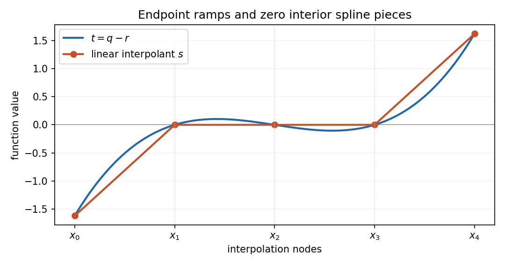

<h1 id="p/p3/solution">Solution</h1>

↑ **Parent:** [P3](../p3.md)

The [Lagrange interpolation polynomial](../../../../lagrange-polynomial.md)

$$
p(x)=\sum_{j=0}^nf_j\prod_{\substack{0\leq k\leq n\\k\ne j}}\frac{x-x_k}{x_j-x_k}
$$

has degree at most $n$ and takes the required value at each node, proving existence. If two such polynomials existed, their difference would have $n+1$ distinct roots despite degree at most $n$, so it would vanish identically. This proves uniqueness.

Define $P(x)=[(x-x_0)r(x)-(x-x_n)q(x)]/(x_n-x_0)$. It has degree at most $n$. At $x_0$ its value is $q(x_0)=f_0$, and at $x_n$ it is $r(x_n)=f_n$. At every interior node both $q$ and $r$ equal $f_i$, giving $P(x_i)=f_i$. Uniqueness therefore gives

$$
\boxed{p(x)=\frac{(x-x_0)r(x)-(x-x_n)q(x)}{x_n-x_0}}.
$$

If the data come from $x^m$ with $m\leq n$, uniqueness gives $p=x^m$. If $m<n$, that same [polynomial](../../../../polynomial-split.md) has degree at most $n-1$ and satisfies each smaller [interpolation](../../../../interpolation-split.md) problem, so $q=r=x^m$.

For the final claim assume $n\geq2$. Put $t=q-r$. Its node values are $t(x_0)=f_0-r(x_0)$, $t(x_i)=0$ for $1\leq i\leq n-1$, and $t(x_n)=q(x_n)-f_n$. The [linear spline](../../../../linear-spline.md) $s$ joining these values has a ramp on the first interval, is zero on all middle intervals, and has a ramp on the last. Thus

$$
\int_{x_0}^{x_n}(s')^2dx=\frac{(f_0-r(x_0))^2}{x_1-x_0}+\frac{(f_n-q(x_n))^2}{x_n-x_{n-1}}.
$$

On each node interval $s'$ is constant and $t-s$ vanishes at both ends. Hence $\int s'(t'-s')dx=0$ on that interval. Integrating the supplied identity and summing gives

$$
\int_{x_0}^{x_n}(t')^2dx-\int_{x_0}^{x_n}(s')^2dx=\int_{x_0}^{x_n}(t'-s')^2dx\geq0,
$$

which proves the claimed inequality and the [minimum Dirichlet energy of a linear interpolant](../../../../minimum-dirichlet-energy-of-a-linear-interpolant.md).

**[Figure 1](#p/p3/image-the-linear-spline-joining-the-polynomial-difference-at-its-nodes). The linear spline joining the polynomial difference at its nodes**. The polynomial difference vanishes at the interior nodes; its linear interpolant consists of endpoint ramps and a zero middle segment. Its slopes give the minimum Dirichlet energy among curves with those node values.

There is a source exception: with $n=1$, $q=f_0$ and $r=f_1$, so $t$ is constant and the left side of the asserted bound is zero. If $f_0\ne f_1$, its right side is $2(f_0-f_1)^2/(x_1-x_0)>0$. Thus **the final inequality requires $n\geq2$**, although the preceding [interpolation](../../../../interpolation-split.md) statements remain valid for $n=1$.

## ↑ Ancestors (12)

1. [P3](../p3.md)
2. [P](../../p.md)
3. [2004](../../../2004-split.md)
4. [Past exam of the options II course of the University of Oxford](../../../split.md)
5. [Options II course of the University of Oxford](../../../../options-ii-course-of-the-university-of-oxford.md)
6. [Year 2 of the mathematics course of the University of Oxford](../../../../year-2-of-the-mathematics-course-of-the-university-of-oxford.md)
7. [Mathematics course of the University of Oxford](../../../../mathematics-course-of-the-university-of-oxford.md)
8. [Undergraduate course of the University of Oxford](../../../../undergraduate-course-of-the-university-of-oxford.md)
9. [Course of the University of Oxford](../../../../course-of-the-university-of-oxford.md)
10. [University of Oxford](../../../../university-of-oxford-split.md)
11. [List of universities](../../../../list-of-universities.md)
12. [Codex Wiki](../../../../split.md)
