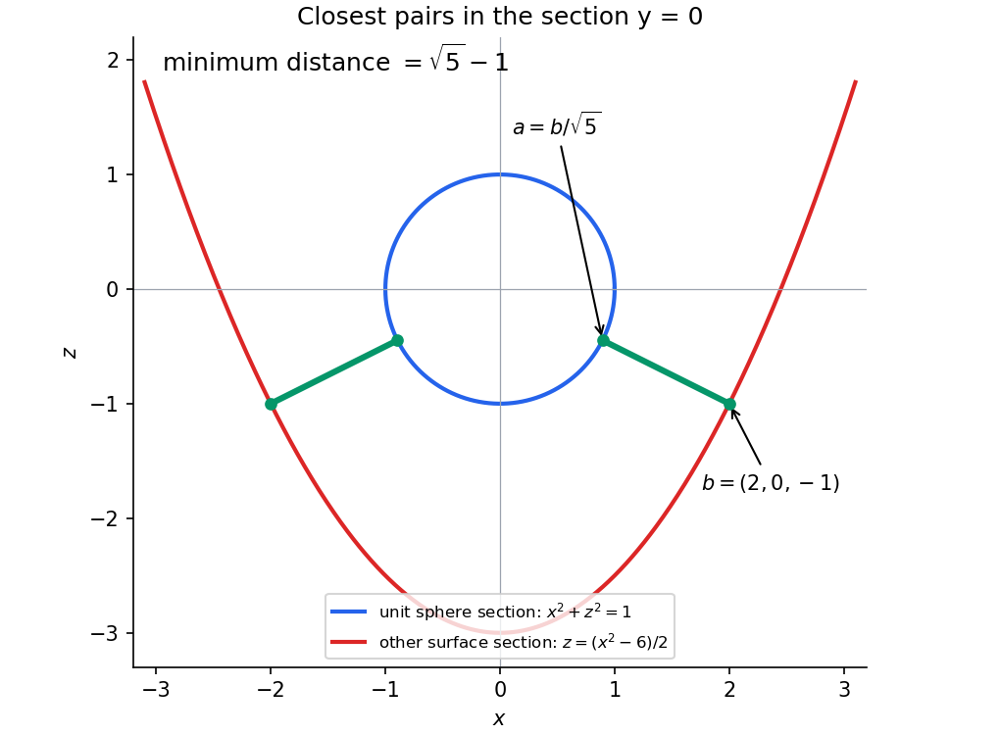
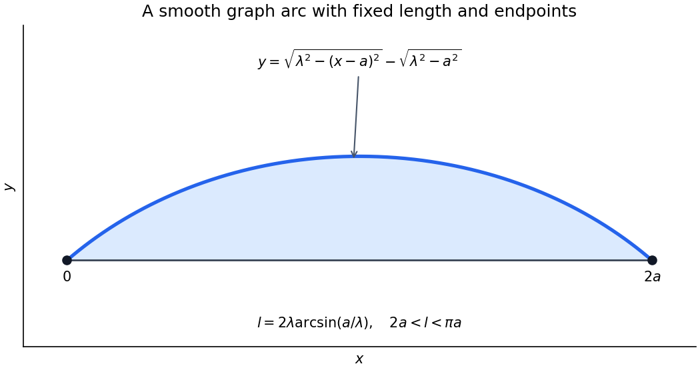

# 2005

↑ **Parent:** [Past exam of the options II course of the University of Oxford](../past-exam-of-the-options-ii-course-of-the-university-of-oxford.md)

This [University of Oxford](../university-of-oxford.md) Part A options paper covers fourteen printed sections and nineteen questions. [Source release](https://www.whatdotheyknow.com/request/maths_papers_2/response/1850333/attach/3/FOI%2020210708%201%20Data.zip?cookie_passthrough=1) The archive contains the complete editable eleven-page transcription. Bounded official-source searches found no advertised answers to this exact paper. All 30 source leaves and their unnumbered tasks are covered below. The source's mechanics potential is retained in the transcription, and its physical interpretation is qualified in the solution. The string-length and statistical-distribution assumptions are also made explicit where needed.

**Table of contents**

- [A](#a)
  - [2](#a/2)
    - [Solution](#a/2/solution)
- [B](#b)
  - [2](#b/2)
    - [Solution](#b/2/solution)
- [C](#c)
  - [2](#c/2)
    - [a](#c/2/a)
      - [i](#c/2/a/i)
        - [Solution](#c/2/a/i/solution)
      - [ii](#c/2/a/ii)
        - [Solution](#c/2/a/ii/solution)
    - [b](#c/2/b)
      - [i](#c/2/b/i)
        - [Solution](#c/2/b/i/solution)
      - [ii](#c/2/b/ii)
        - [Solution](#c/2/b/ii/solution)
      - [iii](#c/2/b/iii)
        - [Solution](#c/2/b/iii/solution)
- [D](#d)
  - [3](#d/3)
    - [i](#d/3/i)
      - [Solution](#d/3/i/solution)
    - [ii](#d/3/ii)
      - [Solution](#d/3/ii/solution)
    - [iii](#d/3/iii)
      - [Solution](#d/3/iii/solution)
  - [4](#d/4)
    - [i](#d/4/i)
      - [Solution](#d/4/i/solution)
    - [ii](#d/4/ii)
      - [Solution](#d/4/ii/solution)
    - [iii](#d/4/iii)
      - [Solution](#d/4/iii/solution)
- [E](#e)
  - [3](#e/3)
    - [Solution](#e/3/solution)
  - [4](#e/4)
    - [Solution](#e/4/solution)
- [F](#f)
  - [2](#f/2)
    - [Solution](#f/2/solution)
- [G](#g)
  - [2](#g/2)
    - [i](#g/2/i)
      - [Solution](#g/2/i/solution)
    - [ii](#g/2/ii)
      - [Solution](#g/2/ii/solution)
- [H](#h)
  - [2](#h/2)
    - [Solution](#h/2/solution)
- [J](#j)
  - [2](#j/2)
    - [Solution](#j/2/solution)
- [K](#k)
  - [3](#k/3)
    - [Solution](#k/3/solution)
  - [4](#k/4)
    - [Solution](#k/4/solution)
- [M](#m)
  - [3](#m/3)
    - [Solution](#m/3/solution)
- [N](#n)
  - [2](#n/2)
    - [i](#n/2/i)
      - [Solution](#n/2/i/solution)
    - [ii](#n/2/ii)
      - [Solution](#n/2/ii/solution)
- [O](#o)
  - [4](#o/4)
    - [Solution](#o/4/solution)
  - [5](#o/5)
    - [i](#o/5/i)
      - [Solution](#o/5/i/solution)
    - [ii](#o/5/ii)
      - [Solution](#o/5/ii/solution)
- [P](#p)
  - [3](#p/3)
    - [Solution](#p/3/solution)
  - [4](#p/4)
    - [Solution](#p/4/solution)

## A

↑ **Parent:** [2005](2005.md)

<h3 id="a/2">2</h3>

↑ **Parent:** [A](#a)

<h4 id="a/2/solution">Solution</h4>

↑ **Parent:** [2](#a/2)

Count the pairs $(g,\omega)$ for which $g$ fixes $\omega$. Counting first by [group elements](../group.md#group-element) gives $\sum_g\operatorname{Fix}(g)$, while counting first by points gives $\sum_\omega|\operatorname{Stab}(\omega)|$. On a [group orbit](../group-action.md#orbit-group-theory) of size $r$, [orbit-stabilizer theorem](../group-action.md#orbit-stabilizer-theorem) makes each [stabilizer](../group-action.md#stabilizer-subgroup) have size $|G|/r$, so that [group orbit](../group-action.md#orbit-group-theory) contributes $|G|$ to the second sum. Dividing by $|G|$ proves [Burnside's lemma](../representation-theory.md#burnside-s-lemma):

$$
\boxed{\text{number of orbits}=\frac1{|G|}\sum_{g\in G}\operatorname{Fix}(g).}
$$

A [tetrahedron](../euclidean-geometry.md#tetrahedron) has four vertices. A [rotational symmetry](../linear-algebra.md#rotational-symmetry) is determined by the [image](../set-theory.md#image-of-a-function) of one vertex, with four possibilities, and the cyclic orientation of the three vertices around it, with three possibilities. All these choices are realizable, so its [rotational symmetry group of a tetrahedron](../finite-group-theory.md#rotational-symmetry-group-of-a-tetrahedron) has order $12$. More explicitly, its elements are the identity, the two nontrivial [rotational symmetries](../linear-algebra.md#rotational-symmetry) around each of four vertex-to-opposite-face axes, and the half-turn about each of three axes through opposite edge midpoints. Thus there is **one element of order 1, eight of order 3, and three of order 2**. The induced [permutations](../combinatorics.md#permutation) of vertices are the [even permutations](../finite-group-theory.md#even-permutation), identifying the [group](../group.md) with $A_4$.

Apply the [group action](../group-action.md) to the [set](../set.md) of [edge colourings](../graph-coloring.md#edge-coloring). A colouring is fixed by a [rotational symmetry](../linear-algebra.md#rotational-symmetry) precisely when its colour is constant on each cycle of the induced edge [permutation](../combinatorics.md#permutation). The identity has six edge cycles and fixes $4^6$ colourings. A vertex-axis [rotational symmetry](../linear-algebra.md#rotational-symmetry) has two cycles of length three, fixing $4^2$. An opposite-edge half-turn fixes the two edges on its axis as [sets](../set.md) and exchanges the other four in two pairs, giving four cycles and $4^4$ fixed colourings. Therefore

$$
\boxed{\frac{4^6+8\cdot4^2+3\cdot4^4}{12}=416.}
$$

Reflections are excluded because the equivalence in the source uses [rotational symmetries](../linear-algebra.md#rotational-symmetry).

## B

↑ **Parent:** [2005](2005.md)

<h3 id="b/2">2</h3>

↑ **Parent:** [B](#b)

<h4 id="b/2/solution">Solution</h4>

↑ **Parent:** [2](#b/2)

Map the [integers](../integer.md) into a [field](../algebra.md#field) by $n\mapsto n1$. Its [kernel](../algebra.md#kernel-algebra) is a [prime ideal](../commutative-algebra.md#prime-ideal) of $\mathbb Z$, since the [image](../set-theory.md#image-of-a-function) has no [zero divisors](../mathematics.md#zero-divisor). Thus the [kernel](../algebra.md#kernel-algebra) is either zero or $(p)$ for a [prime](../prime-number.md) $p$. In the zero case, the map extends injectively to the [rational numbers](../number-theory.md#rational-number) by taking quotients of nonzero [integers](../integer.md). In the other case, its [image](../set-theory.md#image-of-a-function) is the [field](../algebra.md#field) $\mathbb F_p$. This proves the prime-field assertion.

A [finite field](../algebra.md#finite-field) cannot contain the infinite rational [field](../algebra.md#field), so it has [characteristic](../algebra.md#characteristic-of-a-field) $p$. It is a [finite-dimensional vector space](../vector-space.md#finite-dimensional-vector-space) over its [prime field](../algebra.md#prime-field) $\mathbb F_p$, say of [dimension](../vector-space.md#dimension-vector-space) $n\ge1$, and choosing a [basis](../vector-space.md#basis) counts its elements as

$$
\boxed{|F|=p^n.}
$$

For existence, put $q=p^n$ and take a [splitting field](../galois-theory.md#splitting-field) of $x^q-x$ over $\mathbb F_p$. Its [derivative](../calculus.md#derivative) is $-1$, so it has exactly $q$ distinct [polynomial roots](../polynomial.md#root-of-a-polynomial). The [polynomial roots](../polynomial.md#root-of-a-polynomial) are closed under [addition](../arithmetic.md#addition) and [multiplication](../arithmetic.md#multiplication) because the Frobenius identity gives $(u+v)^q=u^q+v^q$ and $(uv)^q=u^qv^q$. They include $0,1$, are closed under [additive inverses](../arithmetic.md#additive-inverse), and for a nonzero [polynomial root](../polynomial.md#root-of-a-polynomial) $u$, $(u^{-1})^q=(u^q)^{-1}=u^{-1}$. They therefore form a [field](../algebra.md#field) of exactly $q$ elements. Indeed this [field](../algebra.md#field) is the [splitting field](../galois-theory.md#splitting-field) because it contains all [polynomial roots](../polynomial.md#root-of-a-polynomial) and is generated by them.

In order 4, [characteristic](../algebra.md#characteristic-of-a-field) is 2. For $\omega\ne0,1$, the multiplicative [group](../group.md) has order 3, so $\omega^3=1$ and $\omega^2\ne1,\omega$. Factorization of $x^3-1$ gives $\omega^2+\omega+1=0$. The quadratic $x^2+x+1$ has no [polynomial root](../polynomial.md#root-of-a-polynomial) in $\mathbb F_2$ and is the [minimal polynomial](../linear-operator-theory.md#minimal-polynomial). Write $s=\omega^2=\omega+1$. The complete tables are

$$
\begin{array}{c|cccc}
+&0&1&\omega&s\\\hline
0&0&1&\omega&s\\
1&1&0&s&\omega\\
\omega&\omega&s&0&1\\
s&s&\omega&1&0
\end{array}
\qquad
\begin{array}{c|cccc}
\cdot&0&1&\omega&s\\\hline
0&0&0&0&0\\
1&0&1&\omega&s\\
\omega&0&\omega&s&1\\
s&0&s&1&\omega
\end{array}.
$$

For an element $\xi\ne0,1$ in order 8, the [tower law](../algebra.md#tower-law) makes $[\mathbb F_2(\xi):\mathbb F_2]$ divide3. It is not1, so its [minimal polynomial](../linear-operator-theory.md#minimal-polynomial) is an irreducible monic cubic. Its [constant term](../polynomial.md#constant-term) must be1. A cubic $x^3+ax^2+bx+1$ has no [polynomial root](../polynomial.md#root-of-a-polynomial) at 1 exactly when $a+b=1$, and absence of a [polynomial root](../polynomial.md#root-of-a-polynomial) is equivalent to cubic irreducibility. Consequently the two possibilities are

$$
\boxed{x^3+x+1\quad\text{and}\quad x^3+x^2+1.}
$$

Both occur: together with $x$ and $x+1$ they factor $x^8-x$ over $\mathbb F_2$, whose distinct [polynomial roots](../polynomial.md#root-of-a-polynomial) are exactly the eight elements of the [field](../algebra.md#field). Each cubic contributes its three [polynomial roots](../polynomial.md#root-of-a-polynomial).

## C

↑ **Parent:** [2005](2005.md)

<h3 id="c/2">2</h3>

↑ **Parent:** [C](#c)

<h4 id="c/2/a">a</h4>

↑ **Parent:** [2](#c/2)

<h5 id="c/2/a/i">i</h5>

↑ **Parent:** [A](#c/2/a)

<h6 id="c/2/a/i/solution">Solution</h6>

↑ **Parent:** [I](#c/2/a/i)

[Euler's totient function](../number-theory.md#euler-totient-function) $\phi(n)$ counts the [integers](../integer.md) $1\le a\le n$ [coprime](../divisibility.md#coprime-integers) to $n$, equivalently the invertible [residue](../analysis.md#residue) classes modulo $n$. Among $1,\ldots,p^e$, exactly the $p^{e-1}$ multiples of $p$ are not [coprime](../divisibility.md#coprime-integers) to the [prime power](../prime-number.md#prime-power). Hence

$$
\boxed{\phi(p^e)=p^e-p^{e-1}=p^e(1-1/p).}
$$

Factor $n=\prod_p p^{e_p}$. Its distinct prime-power factors are pairwise [coprime](../divisibility.md#coprime-integers), so the permitted [multiplicativity](../arithmetic-function.md#multiplicativity-of-an-arithmetic-function) gives

$$
\phi(n)=\prod_{p\mid n}p^{e_p}(1-1/p)
=\boxed{n\prod_{p\mid n}(1-1/p).}
$$

For $n=1$, the [empty product](../arithmetic.md#empty-product) is one and agrees with $\phi(1)=1$.

<h5 id="c/2/a/ii">ii</h5>

↑ **Parent:** [A](#c/2/a)

<h6 id="c/2/a/ii/solution">Solution</h6>

↑ **Parent:** [Ii](#c/2/a/ii)

Use [prime factorization](../prime-number.md#fundamental-theorem-of-arithmetic) and [multiplicativity](../arithmetic-function.md#multiplicativity-of-an-arithmetic-function) to check the identity one [prime](../prime-number.md) at a time. Fix $p$ and put $a=v_p(m)$, $b=v_p(n)$, $r=\min(a,b)$. The local factors to compare are

$$
\phi(p^{a+b})\phi(p^r)\quad\text{and}\quad
\phi(p^a)\phi(p^b)p^r.
$$

If either exponent is zero, $r=0$ and the equality follows from $\phi(1)=1$. If both are positive, the prime-power formula makes both sides

$$
p^{a+b+r-2}(p-1)^2.
$$

Multiplying the local identities over all [primes](../prime-number.md) and using $\gcd(m,n)=\prod_p p^{\min(v_p(m),v_p(n))}$ gives

$$
\boxed{\phi(mn)\phi(\gcd(m,n))=\phi(m)\phi(n)\gcd(m,n).}
$$

This accounts for repeated [prime factors](../prime-number.md#prime-factor) shared by the two inputs, which ordinary [coprime](../divisibility.md#coprime-integers) [multiplicativity](../arithmetic-function.md#multiplicativity-of-an-arithmetic-function) alone would not remove.

<h4 id="c/2/b">b</h4>

↑ **Parent:** [2](#c/2)

<h5 id="c/2/b/i">i</h5>

↑ **Parent:** [B](#c/2/b)

<h6 id="c/2/b/i/solution">Solution</h6>

↑ **Parent:** [I](#c/2/b/i)

[Fermat's little theorem](../number-theory.md#fermat-little-theorem) states that for a [prime](../prime-number.md) $p$ and an [integer](../integer.md) $a$ not divisible by $p$,

$$
\boxed{a^{p-1}\equiv1\pmod p.}
$$

Equivalently, $a^p\equiv a\pmod p$ for every [integer](../integer.md) $a$, with [divisibility](../divisibility.md) by $p$ allowed in that latter formulation.

<h5 id="c/2/b/ii">ii</h5>

↑ **Parent:** [B](#c/2/b)

<h6 id="c/2/b/ii/solution">Solution</h6>

↑ **Parent:** [Ii](#c/2/b/ii)

Since $n>1$, its [factorial](../combinatorics.md#factorial) is even, so $(n!)^2+1$ is odd and its [prime divisor](../prime-number.md#prime-factor) $p$ is odd. Also $p$ cannot divide $n!$, since it would then divide1. Modulo $p$,

$$
(n!)^2\equiv-1.
$$

Raise this equation to the [integer](../integer.md) power $(p-1)/2$. [Fermat's little theorem](../number-theory.md#fermat-little-theorem) gives

$$
1\equiv(n!)^{p-1}\equiv(-1)^{(p-1)/2}\pmod p.
$$

As $p$ is odd, $1$ and $-1$ are distinct [residues](../analysis.md#residue). Thus the exponent is even, and

$$
\boxed{p\equiv1\pmod4.}
$$

<h5 id="c/2/b/iii">iii</h5>

↑ **Parent:** [B](#c/2/b)

<h6 id="c/2/b/iii/solution">Solution</h6>

↑ **Parent:** [Iii](#c/2/b/iii)

If a [prime divisor](../prime-number.md#prime-factor) $p$ of $(n!)^2+1$ satisfied $p\le n$, it would divide $n!$ and therefore divide the difference $(n!)^2+1-(n!)^2=1$, impossible. Hence $p>n$.

Every [integer](../integer.md) $(n!)^2+1>1$ has a [prime divisor](../prime-number.md#prime-factor), and (ii) makes each of its [prime divisors](../prime-number.md#prime-factor) congruent to 1 modulo 4. Taking arbitrarily large $n$ produces such [primes](../prime-number.md) beyond every bound. Therefore

$$
\boxed{\text{There are infinitely many primes congruent to1 modulo4}.}
$$

Equivalently, if their list were finite, choosing $n$ at least its largest member would produce a new member larger than that supposed maximum.

## D

↑ **Parent:** [2005](2005.md)

<h3 id="d/3">3</h3>

↑ **Parent:** [D](#d)

<h4 id="d/3/i">i</h4>

↑ **Parent:** [3](#d/3)

<h5 id="d/3/i/solution">Solution</h5>

↑ **Parent:** [I](#d/3/i)

The [monotone convergence theorem](../measure-theory.md#monotone-convergence-theorem) says that if $0\le f_n\uparrow f$ [almost everywhere](../measure-theory.md#almost-everywhere) and the functions are [measurable](../measure-theory.md#measurability) on a [measure space](../measure.md#measure-space), then

$$
\int f=\lim_n\int f_n,
$$

with infinite [integrals](../integral.md) permitted. The limit is [measurable](../measure-theory.md#measurability) after the usual modification on any exceptional [null set](../measure-theory.md#null-set).

The [dominated convergence theorem](../measure-theory.md#dominated-convergence-theorem) says that if [measurable functions](../measure-theory.md#measurable-function) $f_n$ converge [almost everywhere](../measure-theory.md#almost-everywhere) to $f$ and satisfy $|f_n|\le g$ [almost everywhere](../measure-theory.md#almost-everywhere) for an integrable [nonnegative function](../function.md#nonnegative-function) $g$, then $f$ is integrable and

$$
\boxed{\int|f_n-f|\longrightarrow0,\qquad\int f_n\longrightarrow\int f.}
$$

The theorem applies equally to real or complex functions. In particular domination must be by one fixed [Lebesgue integrable function](../measure-theory.md#lebesgue-integrable-function), rather than by a different bound for each $n$.

<h4 id="d/3/ii">ii</h4>

↑ **Parent:** [3](#d/3)

<h5 id="d/3/ii/solution">Solution</h5>

↑ **Parent:** [Ii](#d/3/ii)

Put $G_N=\sum_{n=1}^N|f_n|$. These are nonnegative [measurable functions](../measure-theory.md#measurable-function) increasing to $G=\sum_{n=1}^\infty|f_n|$, possibly initially with value infinity. [Monotone convergence theorem](../measure-theory.md#monotone-convergence-theorem) gives

$$
\int_{\mathbb R}G=\lim_N\sum_{n=1}^N\int_{\mathbb R}|f_n|=K<\infty.
$$

An infinite value on a [set](../set.md) of [positive measure](../measure.md#positive-measure) would force an infinite [integral](../integral.md). Thus $G$ is finite [almost everywhere](../measure-theory.md#almost-everywhere) and, after setting it to zero on its null exceptional [set](../set.md) if desired, is integrable.

Where $G$ is finite, the real [series](../sequence-and-series.md#series-mathematics) $\sum_n f_n$ is [absolutely convergent](../sequence-and-series.md#absolute-convergence). Define its sum to be $h$ there and zero on the exceptional [null set](../measure-theory.md#null-set). Measurability follows as an almost-everywhere limit of [partial sums](../sequence-and-series.md#partial-sum), and $|h|\le G$ [almost everywhere](../measure-theory.md#almost-everywhere) gives integrability. Every [partial sum](../sequence-and-series.md#partial-sum) is dominated by $G$, so [dominated convergence theorem](../measure-theory.md#dominated-convergence-theorem) yields

$$
\boxed{\int_{\mathbb R}h=\lim_N\sum_{n=1}^N\int_{\mathbb R}f_n
=\sum_{n=1}^\infty\int_{\mathbb R}f_n.}
$$

In fact the [convergence](../calculus.md#convergence) is also in the integrable-function [norm](../normed-vector-space.md#norm):

$$
\left\|h-\sum_{n=1}^Nf_n\right\|_1
\le\sum_{n>N}\|f_n\|_1\longrightarrow0.
$$

<h4 id="d/3/iii">iii</h4>

↑ **Parent:** [3](#d/3)

<h5 id="d/3/iii/solution">Solution</h5>

↑ **Parent:** [Iii](#d/3/iii)

Use $|\sin(\alpha x)|\le|\alpha|x$ for $x\ge0$. For the source's functions,

$$
\int_{\mathbb R}|f_n(x)|\,dx
\le|\alpha|\int_0^\infty xe^{-nx}\,dx=\frac{|\alpha|}{n^2}.
$$

The last [integral](../integral.md) follows by the substitution $u=nx$ and [integration by parts](../calculus.md#integration-by-parts). Since $\sum_n n^{-2}$ converges, (ii) permits summing the [integrals](../integral.md) and identifies an integrable almost-everywhere sum.

For every $x>0$, the [geometric series](../sequence-and-series.md#geometric-series) gives

$$
\sum_{n=1}^\infty e^{-nx}\sin(\alpha x)
=\frac{\sin(\alpha x)}{e^x-1}.
$$

The functions vanish on $x\le0$, and the single endpoint does not change the [integral](../integral.md). Use the supplied [integral](../integral.md) of $f_n$ to obtain

$$
\boxed{\int_0^\infty\frac{\sin(\alpha x)}{e^x-1}\,dx
=\sum_{n=1}^\infty\frac{\alpha}{\alpha^2+n^2}.}
$$

The estimates include negative $\alpha$ through its absolute value, and the case $\alpha=0$ gives zero on both sides.

<h3 id="d/4">4</h3>

↑ **Parent:** [D](#d)

<h4 id="d/4/i">i</h4>

↑ **Parent:** [4](#d/4)

<h5 id="d/4/i/solution">Solution</h5>

↑ **Parent:** [I](#d/4/i)

[Fubini's theorem](../measure-theory.md#fubini-s-theorem) for the product of two [sigma-finite measure](../measure.md#sigma-finite-measure) spaces states that an integrable [measurable function](../measure-theory.md#measurable-function) on the product has integrable sections [almost everywhere](../measure-theory.md#almost-everywhere), the section [integrals](../integral.md) define [Lebesgue integrable functions](../measure-theory.md#lebesgue-integrable-function), and both [iterated integrals](../integral.md#iterated-integral) equal the product [integral](../integral.md). The integrability hypothesis is [absolute integrability](../measure-theory.md#integrability). For nonnegative [measurable functions](../measure-theory.md#measurable-function), [Tonelli's theorem](../measure-theory.md#tonelli-theorem) gives equality of the possibly [infinite product](../sequence-and-series.md#infinite-product) and [iterated integrals](../integral.md#iterated-integral) without first assuming finiteness.

The displayed function is **not [Lebesgue integrable](../measure-theory.md#lebesgue-integrable-function)**. Its value at the origin can be assigned arbitrarily, since a point is a [null set](../measure-theory.md#null-set). On $0<x<1$ and $0<y<x/2$,

$$
\left|\frac{x-y}{(x+y)^3}\right|
\ge\frac{x/2}{(3x/2)^3}=\frac4{27x^2}.
$$

Consequently [Tonelli's theorem](../measure-theory.md#tonelli-theorem) gives the divergent [lower bound](../set.md#lower-bound-in-a-partially-ordered-set)

$$
\int_0^1\int_0^1|f(x,y)|\,dy\,dx
\ge\frac2{27}\int_0^1\frac{dx}{x}=\infty.
$$

The signed [iterated integrals](../integral.md#iterated-integral) illustrate why the hypothesis matters. For $x>0$, $f(x,y)=\partial_y[y/(x+y)^2]$, so [integration](../integral.md) first in $y$ and then in $x$ gives $1/2$. Integrating first in $x$ gives $-1/2$, using $f(x,y)=-\partial_x[x/(x+y)^2]$. Exceptional boundary sections have [measure](../measure.md) zero. Thus finite iterated values do not establish product integrability.

<h4 id="d/4/ii">ii</h4>

↑ **Parent:** [4](#d/4)

<h5 id="d/4/ii/solution">Solution</h5>

↑ **Parent:** [Ii](#d/4/ii)

Choose [measurable](../measure-theory.md#measurability) versions of the two [Lebesgue integrable functions](../measure-theory.md#lebesgue-integrable-function) and consider $F(x,y)=g(x-y)h(y)$. Translation and the corresponding linear [change of variables](../multivariable-calculus.md#change-of-variables-formula) preserve Lebesgue measurability; one can first use Borel versions and then disregard the resulting null-set changes. [Tonelli's theorem](../measure-theory.md#tonelli-theorem) and [translation invariance](../physics.md#translation-invariance) give

$$
\int_{\mathbb R}\int_{\mathbb R}|g(x-y)h(y)|\,dx\,dy
=\int_{\mathbb R}|h(y)|\,\|g\|_1\,dy
=\|g\|_1\|h\|_1<\infty.
$$

[Fubini theorem](../measure-theory.md#fubini-s-theorem) therefore shows that the section in $y$ is integrable for [almost every](../measure-theory.md#almost-everywhere) $x$. Define $(g*h)(x)$ by that section [integral](../integral.md) where it exists and by zero on the exceptional [null set](../measure-theory.md#null-set). [Fubini theorem](../measure-theory.md#fubini-s-theorem) also makes this a [measurable](../measure-theory.md#measurability) [Lebesgue integrable function](../measure-theory.md#lebesgue-integrable-function), with

$$
\boxed{\|g*h\|_1\le\|g\|_1\|h\|_1.}
$$

Its almost-everywhere defining formula is precisely the desired [convolution](../fourier-analysis.md#convolution). This construction explains why an everywhere-existing pointwise [integral](../integral.md) is not required.

<h4 id="d/4/iii">iii</h4>

↑ **Parent:** [4](#d/4)

<h5 id="d/4/iii/solution">Solution</h5>

↑ **Parent:** [Iii](#d/4/iii)

For fixed real $t$, [multiplication](../arithmetic.md#multiplication) by $e^{itx}$ does not change the absolute value. The product integrability proved in (ii) therefore justifies [Fubini theorem](../measure-theory.md#fubini-s-theorem) in the following calculation. [Set](../set.md) $u=x-y$ in the inner [integral](../integral.md):

$$
\begin{aligned}
\widehat{g*h}(t)
&=\int_{\mathbb R}\int_{\mathbb R}g(x-y)h(y)e^{itx}\,dy\,dx\\
&=\int_{\mathbb R}h(y)\left[\int_{\mathbb R}g(x-y)e^{itx}\,dx\right]dy\\
&=\int_{\mathbb R}h(y)e^{ity}\left[\int_{\mathbb R}g(u)e^{itu}\,du\right]dy\\
&=\widehat g(t)\widehat h(t).
\end{aligned}
$$

Thus

$$
\boxed{\widehat{g*h}=\widehat g\,\widehat h.}
$$

The positive exponential convention in the source is used throughout; no normalization factor is introduced under that convention.

## E

↑ **Parent:** [2005](2005.md)

<h3 id="e/3">3</h3>

↑ **Parent:** [E](#e)

<h4 id="e/3/solution">Solution</h4>

↑ **Parent:** [3](#e/3)

The [product topology](../geometry-and-topology.md#product-topology) on $X\times Y$ has the [open](../topology.md#open-set) rectangles $U\times V$, with $U$ [open](../topology.md#open-set) in $X$ and $V$ [open](../topology.md#open-set) in $Y$, as a [topological basis](../topology.md#basis-of-a-topology). The projection preimages are $p_X^{-1}(U)=U\times Y$ and $p_Y^{-1}(V)=X\times V$, so both projections are [continuous](../calculus.md#continuous-function).

If $f:Z\to X\times Y$ is [continuous](../calculus.md#continuous-function), both coordinate compositions are [continuous](../calculus.md#continuous-function). Conversely, if both are [continuous](../calculus.md#continuous-function), then

$$
f^{-1}(U\times V)=(p_X\circ f)^{-1}(U)\cap(p_Y\circ f)^{-1}(V)
$$

is [open](../topology.md#open-set) for every basic rectangle, proving [continuity](../calculus.md#continuous-function) of $f$. Given [paths](../geometry-and-topology.md#continuous-path) between two chosen endpoints in each factor, their coordinatewise pair is therefore a [continuous path](../geometry-and-topology.md#continuous-path) in the product, proving that a product of [path-connected spaces](../geometry-and-topology.md#path-connected-space) is [path-connected](../geometry-and-topology.md#path-connected-space).

For the compact-neighborhood assertion, fix $x\in K$. For each $y\in L$, choose an [open](../topology.md#open-set) rectangle $U_y\times V_y$ containing $(x,y)$ inside $W$. [Compactness](../topology.md#compact-space) of $L$ chooses finitely many $V_{y_j}$ covering $L$. Put

$$
U_x=\bigcap_jU_{y_j},\qquad V_x=\bigcup_jV_{y_j}.
$$

Then $x\in U_x$, $L\subseteq V_x$, and $U_x\times V_x\subseteq W$: any point of $V_x$ belongs to one of those rectangles' second factors, while $U_x$ lies in every first factor.

[Compactness](../topology.md#compact-space) of $K$ now selects finitely many $U_{x_i}$ covering $K$. [Set](../set.md)

$$
U=\bigcup_iU_{x_i},\qquad V=\bigcap_iV_{x_i}.
$$

These are [open](../topology.md#open-set), contain $K$ and $L$, and if $(u,v)\in U\times V$, choose an $i$ with $u\in U_{x_i}$ and use $v\in V_{x_i}$. Hence

$$
\boxed{K\times L\subseteq U\times V\subseteq W.}
$$

If $K$ or $L$ is empty, take the corresponding [open](../topology.md#open-set) factor empty and the other factor the whole space; the assertions then hold directly. No [Hausdorff](../topology.md#hausdorff-space) assumption on the factors is needed.

<h3 id="e/4">4</h3>

↑ **Parent:** [E](#e)

<h4 id="e/4/solution">Solution</h4>

↑ **Parent:** [4](#e/4)

A [Hausdorff space](../topology.md#hausdorff-space) separates any two distinct points by disjoint [open neighborhoods](../topology.md#open-neighbourhood). For a subspace $A\subseteq X$, intersect such neighborhoods in $X$ with $A$ to obtain disjoint neighborhoods in the [subspace topology](../topology.md#subspace-topology). Thus subspaces inherit the [Hausdorff](../topology.md#hausdorff-space) property.

If $(z_1,z_2)$ lies off the diagonal of a [Hausdorff space](../topology.md#hausdorff-space)'s square, choose disjoint [open neighborhoods](../topology.md#open-neighbourhood) $U$ of $z_1$ and $V$ of $z_2$. The [open](../topology.md#open-set) rectangle $U\times V$ contains the pair and avoids the diagonal. Therefore its complement is [open](../topology.md#open-set) and the diagonal is [closed](../topology.md#closed-set).

The map $F:X\times Y\to Z\times Z$ given by $F(x,y)=(f(x),g(y))$ is [continuous](../calculus.md#continuous-function) by the coordinate criterion from E3. The equality locus is $F^{-1}(\Delta_Z)$ and is [closed](../topology.md#closed-set) as an [inverse image](../set-theory.md#preimage) of a [closed set](../topology.md#closed-set).

Let $q:X\to X/{\sim}$ be the [quotient map](../topology.md#quotient-map). If the [quotient](../arithmetic.md#quotient) is [Hausdorff](../topology.md#hausdorff-space), apply the same argument to $q$ in both coordinates:

$$
R=(q\times q)^{-1}(\Delta_{X/{\sim}})
$$

is [closed](../topology.md#closed-set) in $X\times X$.

Conversely suppose $R$ is [closed](../topology.md#closed-set) and $q$ is [open](../topology.md#open-set). Take two distinct [quotient](../arithmetic.md#quotient) points, with representatives $x,y$. Since $(x,y)\notin R$, an [open](../topology.md#open-set) rectangle $U\times V$ around it avoids $R$. The [images](../set-theory.md#image-of-a-function) $q(U)$ and $q(V)$ are [open](../topology.md#open-set) [quotient](../arithmetic.md#quotient) neighborhoods. They are disjoint, because a [quotient](../arithmetic.md#quotient) point in their [intersection](../set.md#set-intersection) would have equivalent representatives $u\in U$, $v\in V$, giving $(u,v)\in R$. Hence the [quotient](../arithmetic.md#quotient) is [Hausdorff](../topology.md#hausdorff-space). Thus **closedness of the relation and openness of the [quotient map](../topology.md#quotient-map) suffice for a [Hausdorff](../topology.md#hausdorff-space) [quotient](../arithmetic.md#quotient)**.

## F

↑ **Parent:** [2005](2005.md)

<h3 id="f/2">2</h3>

↑ **Parent:** [F](#f)

<h4 id="f/2/solution">Solution</h4>

↑ **Parent:** [2](#f/2)

A sufficient regular-level condition is $\nabla f(x)\ne0$ at every point with $f(x)=0$. The [implicit function theorem](../multivariable-calculus.md#implicit-function-theorem) then makes the zero level a two-dimensional [continuously differentiable](../multivariable-calculus.md#continuously-differentiable-function) [submanifold](../differential-geometry.md#submanifold). Its [tangent space](../tangent-vector.md#tangent-space) is

$$
\boxed{T_xS_f=\ker Df_x=\{v:\nabla f(x)\cdot v=0\}.}
$$

For a minimizing pair $(a,b)$ and any [tangent vector](../tangent-vector.md) $v\in T_aS_f$, take a [differentiable](../analysis.md#differentiable-function) [surface](../topological-surface.md) [curve](../topology.md#curve) $x(s)$ with $x(0)=a$, $x'(0)=v$. The function $\|x(s)-b\|^2$ has a minimum at zero, so its [derivative](../calculus.md#derivative) $2(a-b)\cdot v$ vanishes. Varying the other point similarly proves [orthogonality](../inner-product.md#orthogonal-vectors) to $T_bS_g$.

For the particular [surfaces](../topological-surface.md), minimize the distance from the origin to the second [surface](../topological-surface.md) first. Put $u=x^2$, $v=y^2$, so $u,v\ge0$ and $z=(u-v-6)/2$. Then

$$
\|(x,y,z)\|^2=u+v+\frac{(u-v-6)^2}{4}.
$$

Let $s=u-v$. Since $u+v\ge|s|$, this is at least $|s|+(s-6)^2/4$, with equality when one of $u,v$ is zero. For $s\ge0$, this quadratic has its minimum at $s=4$, with value 5. For $s\le0$, it decreases up to zero and has minimum9 on that half-line. The [global minimum](../analysis.md#global-minimum) is therefore5, attained at

$$
b=(2,0,-1)\quad\text{or}\quad(-2,0,-1).
$$

All points of this [surface](../topological-surface.md) lie outside the [unit sphere](../topology.md#unit-sphere). For any such $b$, the distance to the sphere is $\|b\|-1$, attained at $a=b/\|b\|$ by the [triangle inequality](../topological-analysis.md#triangle-inequality). Consequently

$$
\boxed{\operatorname{dist}(S_f,S_g)=\sqrt5-1,\qquad a=b/\sqrt5.}
$$

This is a global minimization, not merely a stationary-point calculation.

**[Figure 1](#f/2/image-nearest-points-on-the-two-surfaces-in-the-section-y-0). Nearest points on the two surfaces in the section $y=0$**.

## G

↑ **Parent:** [2005](2005.md)

<h3 id="g/2">2</h3>

↑ **Parent:** [G](#g)

<h4 id="g/2/i">i</h4>

↑ **Parent:** [2](#g/2)

<h5 id="g/2/i/solution">Solution</h5>

↑ **Parent:** [I](#g/2/i)

Write $I[y]=\int_a^bG(x,y,y')\,dx$. For endpoint-zero variations $\eta$, the [first variations](../calculus-of-variations.md#first-variation) are

$$
\delta J(\eta)=\int_a^b(F_y\eta+F_{y'}\eta')\,dx,\qquad
\delta I(\eta)=\int_a^b(G_y\eta+G_{y'}\eta')\,dx.
$$

For a normal constrained [extremal](../calculus-of-variations.md#extremal), choose a variation $\eta_0$ with $\delta I(\eta_0)\ne0$. Given any $\eta$, use the [implicit function theorem](../multivariable-calculus.md#implicit-function-theorem) to choose a small correction in the $\eta_0$ direction so that $y+t\eta+s(t)\eta_0$ preserves the constraint. Differentiating it and the stationarity condition at zero gives

$$
\delta J(\eta)=\lambda\delta I(\eta),\qquad
\lambda=\frac{\delta J(\eta_0)}{\delta I(\eta_0)}.
$$

Integrate the derivative-of-variation term by parts. Since the variations vanish at both endpoints, the [boundary term](../calculus.md#boundary-term) is zero. The [fundamental lemma of the calculus of variations](../calculus-of-variations.md#fundamental-lemma-of-the-calculus-of-variations) then gives

$$
\boxed{(F-\lambda G)_y-\frac d{dx}(F-\lambda G)_{y'}=0.}
$$

The regularity condition on the constraint is what permits the coefficient of $F$ to be normalized to 1. In a degenerate case, the general multiplier statement uses $\lambda_0F-\lambda_1G$ with the two coefficients not both zero; the source's displayed form is the normal case.

For a string described as a [function graph](../function.md#graph-of-a-function) $r(x)=(x,y(x))$, its arc-length element is $|r'(x)|\,dx=\sqrt{1+y'(x)^2}\,dx$. Inextensibility therefore gives

$$
\boxed{\int_0^{2a}\sqrt{1+y'^2}\,dx=l.}
$$

This also forces $l\ge2a$, with equality only for the straight [function graph](../function.md#graph-of-a-function).

<h4 id="g/2/ii">ii</h4>

↑ **Parent:** [2](#g/2)

<h5 id="g/2/ii/solution">Solution</h5>

↑ **Parent:** [Ii](#g/2/ii)

For the upper [function graph](../function.md#graph-of-a-function), the vertical cross-section of the enclosed region has length $y(x)$, so its [area](../differential-geometry.md#surface-area) is $J[y]=\int_0^{2a}y(x)\,dx$. A maximizing nonnegative arch therefore uses $F=y$ and $G=\sqrt{1+y'^2}$ in the normal [Euler-Lagrange equation](../analysis.md#euler-lagrange-equation). It becomes

$$
1+\lambda\frac d{dx}\left(\frac{y'}{\sqrt{1+y'^2}}\right)=0.
$$

Integrating once gives $y'/\sqrt{1+y'^2}=(c-x)/\lambda$. The concave upper branch has $\lambda>0$ and integrates to $y=\sqrt{\lambda^2-(x-c)^2}+d$. The equal zero endpoint heights force $c=a$ and $d=-\sqrt{\lambda^2-a^2}$. Hence

$$
\boxed{y(x)=\sqrt{\lambda^2-(x-a)^2}-\sqrt{\lambda^2-a^2}.}
$$

It is a [circular arc](../topology.md#circular-arc). To find its parameter, substitute into the length [integral](../integral.md): $\sqrt{1+y'^2}=\lambda/\sqrt{\lambda^2-(x-a)^2}$, giving

$$
\boxed{l=2\lambda\arcsin(a/\lambda).}
$$

This scalar equation determines $\lambda$ numerically when needed; no explicit solution is required.

The arch is a [global maximum](../function.md#global-maximum) in its smooth [function graph](../function.md#graph-of-a-function) regime. For $\lambda>0$, the integrand $y-\lambda\sqrt{1+y'^2}$ is concave and [strictly concave](../real-analysis.md#strictly-concave-function) in its slope. Its supporting-tangent inequality, integrated against any competing [function graph](../function.md#graph-of-a-function) with the same endpoint values, has [first-order term](../mathematical-logic.md#first-order-term) zero by the [Euler-Lagrange equation](../analysis.md#euler-lagrange-equation). Thus $J[y]-\lambda I[y]\le J[y_*]-\lambda I[y_*]$. On the fixed-length class this is $J[y]\le J[y_*]$; strict slope [concavity](../real-analysis.md#concave-function) also gives uniqueness.

The source leaves the length range implicit. A twice [continuously differentiable](../multivariable-calculus.md#continuously-differentiable-function) [function graph](../function.md#graph-of-a-function) of this form needs $\lambda>a$, giving **$2a<l<\pi a$**. At $l=2a$ the straight [function graph](../function.md#graph-of-a-function) is the degenerate solution. The semicircle limit $l=\pi a$ has vertical endpoint tangents and is outside that smooth [function graph](../function.md#graph-of-a-function) class. For $l>\pi a$, no arc in the claimed smooth [function graph](../function.md#graph-of-a-function) family exists, so the stated formula cannot describe a twice [continuously differentiable](../multivariable-calculus.md#continuously-differentiable-function) maximizing [function graph](../function.md#graph-of-a-function) under those unrestricted data. Allowing overhanging [curves](../topology.md#curve) changes the admissible class.

**[Figure 2](#g/2/ii/image-the-circular-arch-and-its-smooth-graph-length-range). The circular arch and its smooth graph length range**.

## H

↑ **Parent:** [2005](2005.md)

<h3 id="h/2">2</h3>

↑ **Parent:** [H](#h)

<h4 id="h/2/solution">Solution</h4>

↑ **Parent:** [2](#h/2)

Write the position of a mass element relative to the [centre of mass](../classical-mechanics.md#center-of-mass) as $r$. Expand its squared [velocity](../classical-mechanics.md#velocity) and integrate:

$$
T=\frac12\int|v_G+\omega\times r|^2\,dm
=\frac12M|v_G|^2+\frac12\int|\omega\times r|^2\,dm.
$$

The mixed term vanishes because $\int r\,dm=0$. Also

$$
L_G=\int r\times(\omega\times r)\,dm,\qquad
\omega\cdot L_G=\int|\omega\times r|^2\,dm,
$$

using the scalar triple-product identity. Therefore

$$
\boxed{T=\tfrac12M|v_G|^2+\tfrac12\omega\cdot L_G.}
$$

In [principal axes](../rigid-body-dynamics.md#principal-axis) the [inertia tensor](../rigid-body-dynamics.md#inertia-tensor) is diagonal, so the second term is $\tfrac12(A\omega_1^2+B\omega_2^2+C\omega_3^2)$. Substituting the three Euler-angle components given in the source gives its displayed kinetic-energy expression directly.

For $A=B$, the first two component squares have opposite mixed terms and sum to $\dot\theta^2+\dot\phi^2\sin^2\theta$. Put $n=\dot\psi+\dot\phi\cos\theta$. Using the orientation-dependent potential printed in the source therefore gives the formal model

$$
L=\tfrac12 A\dot\theta^2+\tfrac12 A\dot\phi^2\sin^2\theta+\tfrac12 Cn^2
+\tfrac12M(\dot x^2+\dot y^2+\dot z^2)-Mgz\cos\theta.
$$

The [cyclic coordinates](../lagrangian-mechanics.md#cyclic-coordinate) $x,y,\psi$ have conserved momenta $M\dot x,M\dot y,Cn$. Consequently $\dot x,\dot y,n$ are constant. The coordinate $\phi$ is also cyclic, with

$$
p_\phi=A\dot\phi\sin^2\theta+Cn\cos\theta.
$$

For imposed fixed tilt $\theta=\alpha\in(0,\pi/2)$, conservation of $n$ and $p_\phi$ forces $\dot\phi=\Omega$ constant. Impose the fixed-height condition $z=h$ in this formal constrained model. Its $\theta$ equation is

$$
A\ddot\theta-A\dot\phi^2\sin\theta\cos\theta
+Cn\dot\phi\sin\theta-Mgz\sin\theta=0.
$$

[Set](../set.md) the tilt constant and divide by its nonzero sine. This gives

$$
\boxed{A\Omega^2\cos\alpha-Cn\Omega+Mgh=0.}
$$

A real [polynomial root](../polynomial.md#root-of-a-polynomial) requires its [quadratic discriminant](../polynomial.md#quadratic-discriminant) to be nonnegative:

$$
\boxed{C^2n^2\ge4AMgh\cos\alpha.}
$$

When this condition holds the two algebraic rates are $(Cn\pm\sqrt{C^2n^2-4AMgh\cos\alpha})/(2A\cos\alpha)$.

There is a physical inconsistency in the printed data that must be kept distinct from this algebra. If $(x,y,z)$ are literally [Cartesian coordinates](../linear-algebra.md#cartesian-coordinate-system) of the [centre of mass](../classical-mechanics.md#center-of-mass) in uniform [gravity](../physics.md#gravity), the [gravitational potential](../newton-s-law-of-universal-gravitation.md#newtonian-potential-of-a-point-mass) is $Mgz$, not $Mgz\cos\theta$. The printed [Lagrangian](../calculus-of-variations.md#lagrangian) consequently does not follow from that Cartesian-height interpretation. Moreover its unconstrained $z$ equation is $\ddot z=-g\cos\theta$, so constant height at the indicated tilt requires a constraint reaction. The requested rate and [discriminant](../polynomial.md#discriminant) follow from the printed orientation-dependent potential with fixed height imposed; a standard heavy-top interpretation instead uses a height proportional to an axis distance times $\cos\theta$, with the reference point and corresponding inertia specified consistently. The kinetic-energy derivation is independent of this source inconsistency.

## J

↑ **Parent:** [2005](2005.md)

<h3 id="j/2">2</h3>

↑ **Parent:** [J](#j)

<h4 id="j/2/solution">Solution</h4>

↑ **Parent:** [2](#j/2)

[Set](../set.md) $u=r\psi$, choose $\alpha>0$ for a negative bound-state energy, and write $\kappa=2mK/\hbar^2$. Multiplying the radial equation by $r$ gives

$$
u''+\left[-\alpha^2+\frac\kappa r-\frac{\ell(\ell+1)}{r^2}\right]u=0.
$$

For $u=e^{-\alpha r}f$, its [second derivative](../calculus.md#second-derivative) is $e^{-\alpha r}(f''-2\alpha f'+\alpha^2f)$. Substitution cancels the two $\alpha^2$ terms and gives

$$
\boxed{f''-2\alpha f'-\frac{\ell(\ell+1)}{r^2}f+\frac\kappa r f=0.}
$$

For the physical hydrogen problem, the angular eigenvalue has $\ell$ a [nonnegative integer](../arithmetic.md#natural-number). Regularity at the origin selects the Frobenius exponent $u\sim r^{\ell+1}$, rather than the singular branch. Put

$$
f=r^{\ell+1}\sum_{j=0}^\infty c_jr^j.
$$

The equation for the [series](../sequence-and-series.md#series-mathematics) factor $v=f/r^{\ell+1}$ is $rv''+(2\ell+2-2\alpha r)v'+(\kappa-2\alpha(\ell+1))v=0$, and coefficient comparison yields

$$
c_{j+1}=\frac{2\alpha(j+\ell+1)-\kappa}{(j+1)(j+2\ell+2)}c_j.
$$

The regular confluent-hypergeometric solution generically grows like $e^{2\alpha r}$ in this [series](../sequence-and-series.md#series-mathematics) factor; after the extracted $e^{-\alpha r}$ it is not [normalizable](../wave-function.md#normalizable-wavefunction). A [bound state](../quantum-system.md#bound-state) requires termination at some degree $q\ge0$, namely $2\alpha(q+\ell+1)=\kappa$. Thus $n=q+\ell+1$ is an [integer](../integer.md) greater than $\ell$, and

$$
\boxed{\alpha=\frac{mK}{\hbar^2n},\qquad E_n=-\frac{mK^2}{2\hbar^2n^2}.}
$$

Regularity, normalizability and the [integer](../integer.md) angular index are the physical conditions selecting this spectrum; the [differential equation](../differential-equation.md) without those conditions would admit many other solutions.

For $n=1$, necessarily $\ell=0$ and $q=0$. With $a_0=\hbar^2/(mK)$,

$$
\boxed{f_1(r)=Cr,\qquad\psi_1(r)=Ce^{-r/a_0}.}
$$

A normalized spatial [ground state](../quantum-mechanics.md#ground-state) is $\Psi_1=(\pi a_0^3)^{-1/2}e^{-r/a_0}$. In [spherical coordinates](../multivariable-calculus.md#spherical-coordinate-system) the radial [probability](../probability-theory.md#probability) has weight $r^2dr$. Constants and the angular [integral](../integral.md) cancel in the tail ratio. The supplied [integral](../integral.md) with $\lambda=2/a_0$ gives

$$
\Pr(r>a_0)=\frac{\int_{a_0}^\infty r^2e^{-2r/a_0}\,dr}{\int_0^\infty r^2e^{-2r/a_0}\,dr}
=e^{-2}(1+2+2)=\boxed{5e^{-2}}.
$$

## K

↑ **Parent:** [2005](2005.md)

<h3 id="k/3">3</h3>

↑ **Parent:** [K](#k)

<h4 id="k/3/solution">Solution</h4>

↑ **Parent:** [3](#k/3)

[Milne-Thomson's circle theorem](../fluid-mechanics.md#milne-thomson-circle-theorem) inserts an impermeable circular boundary into a two-dimensional [irrotational](../multivariable-calculus.md#irrotational-vector-field) [incompressible flow](../fluid-mechanics.md#incompressible-flow). If $f(z)$ is analytic in a neighborhood of the [closed disc](../topology.md#closed-disc) and its flow singularities lie outside, the new complex potential outside $|z|=a$ is

$$
\boxed{w(z)=f(z)+\overline{f(a^2/\bar z)}.}
$$

Reflection and coefficient conjugation make the second term analytic outside the [circle](../topology.md#circle), with its image singularities inside. On $|z|=a$, $a^2/\bar z=z$, so the two terms sum to $2\operatorname{Re}f(z)$: the [streamfunction](../fluid-mechanics.md#stream-function) is constant there. Thus no [velocity](../classical-mechanics.md#velocity) crosses the [circle](../topology.md#circle). At infinity the image term tends to the constant $\overline{f(0)}$, which has no effect on [velocity](../classical-mechanics.md#velocity), and the far-field flow is retained. This proves the construction, with an additive potential constant immaterial.

Put $A=\mu e^{i\alpha}$, $B=\mu e^{-i\alpha}$. For the dipole the reflected potential is $B/(a^2/z-b)=Bz/(a^2-bz)$, giving

$$
\boxed{w(z)=\frac{A}{z-b}+\frac{Bz}{a^2-bz}.}
$$

Its image pole is $c=a^2/b$, inside the [cylinder](../geometry-and-topology.md#cylinder-geometry). The [complex velocity](../fluid-mechanics.md#complex-velocity) is

$$
w'(z)=-\frac A{(z-b)^2}+\frac{Ba^2}{(a^2-bz)^2}.
$$

Near $c$, the second term is $C(z-c)^{-2}$ with $C=Ba^2/b^2$, while $v_0(z)=-A/(z-b)^2$ is analytic there. The square of the pole term has no [residue](../analysis.md#residue), nor does $v_0^2$. The cross term has [residue](../analysis.md#residue) $2Cv_0'(c)$, so

$$
\operatorname{Res}_{z=c}(w')^2
=\frac{4ABa^2b}{(a^2-b^2)^3}
=-\frac{4\mu^2a^2b}{(b^2-a^2)^3}.
$$

Take the contour counterclockwise around the [cylinder](../geometry-and-topology.md#cylinder-geometry), as in the supplied [Blasius force theorem](../fluid-mechanics.md#blasius-force-theorem). The [residue theorem](../analysis.md#residue-theorem) gives $\tfrac12i\rho\oint(w')^2dz=-\pi\rho\operatorname{Res}(w')^2$. Therefore

$$
\boxed{F_x=\frac{4\pi\rho\mu^2a^2b}{(b^2-a^2)^3},\qquad F_y=0.}
$$

The force points toward the dipole. Its independence of dipole orientation follows from the product $AB=\mu^2$ in the sole [residue](../analysis.md#residue) contribution.

<h3 id="k/4">4</h3>

↑ **Parent:** [K](#k)

<h4 id="k/4/solution">Solution</h4>

↑ **Parent:** [4](#k/4)

[Irrotational](../multivariable-calculus.md#irrotational-vector-field) motion in this [simply connected](../algebraic-topology.md#simply-connected-space) fluid region has a [velocity potential](../fluid-mechanics.md#velocity-potential), $u=\nabla\phi$. [Incompressibility](../fluid-mechanics.md#incompressible-flow) gives $\nabla\cdot u=0$, hence $\Delta\phi=0$.

The moving [surface](../topological-surface.md) is a [material surface](../fluid-mechanics.md#material-surface): differentiating $y-\eta(x,t)=0$ along a particle gives $\eta_t+\phi_x\eta_x=\phi_y$ at $y=\eta$. Linearizing about a flat stationary [surface](../topological-surface.md) drops the product term and evaluates at zero, giving $\eta_t=\phi_y$ there. The [Unsteady Bernoulli equation](../euler-equations-for-an-inviscid-fluid.md#unsteady-bernoulli-equation), after dropping quadratic [velocity](../classical-mechanics.md#velocity) terms and absorbing the time-only constant into $\phi$, is $\phi_t+p/\rho+gy=0$. The linear [capillary pressure](../surface-tension.md#capillary-pressure) at the [surface](../topological-surface.md) is $p=-T\eta_{xx}$ relative to atmosphere, in the sign convention of the source. Therefore

$$
\boxed{\phi_y=\eta_t,\qquad\phi_t+g\eta-\frac T\rho\eta_{xx}=0\quad(y=0).}
$$

For $\eta=A\cos(kx-\omega t)$ choose the [harmonic potential](../energy.md#harmonic-potential) decaying at infinite depth,

$$
\phi=\frac{A\omega}{k}e^{ky}\sin(kx-\omega t),\qquad y<0.
$$

Its vertical [derivative](../calculus.md#derivative) at zero equals $A\omega\sin(kx-\omega t)=\eta_t$. Substitution into the dynamic condition gives $-\omega^2/k+g+Tk^2/\rho=0$. Thus

$$
\boxed{\omega^2=gk+\frac T\rho k^3,\qquad c=\frac\omega k=\sqrt{\frac gk+\frac T\rho k}.}
$$

The two positive terms are the gravitational and capillary contributions to the [restoring force](../force.md#restoring-force).

## M

↑ **Parent:** [2005](2005.md)

<h3 id="m/3">3</h3>

↑ **Parent:** [M](#m)

<h4 id="m/3/solution">Solution</h4>

↑ **Parent:** [3](#m/3)

[Independence](../random-variable.md#independent-random-variables) means $\Pr(X\in A,Y\in B)=\Pr(X\in A)\Pr(Y\in B)$ for all [Borel sets](../measure-theory.md#borel-set) $A,B$. For variables with a [joint density](../continuous-probability-distribution.md#joint-probability-density) this is equivalent to factorization of that density into the two marginal densities [almost everywhere](../measure-theory.md#almost-everywhere).

The inverse transformation is $x=uv$, $y=(1-u)v$, on $0<u<1$, $v>0$. Its absolute [Jacobian determinant](../multivariable-calculus.md#jacobian-determinant) is $v$. Multiplying the independent gamma densities by it gives

$$
f_{U,V}(u,v)=\frac{\lambda^{\alpha+\beta}}{\Gamma(\alpha)\Gamma(\beta)}
u^{\alpha-1}(1-u)^{\beta-1}v^{\alpha+\beta-1}e^{-\lambda v}.
$$

The density is zero outside that [support](../function.md#support). Integrating in $v$ with the [gamma integral](../complex-analysis.md#gamma-integral) gives

$$
\boxed{f_U(u)=\frac{\Gamma(\alpha+\beta)}{\Gamma(\alpha)\Gamma(\beta)}
u^{\alpha-1}(1-u)^{\beta-1},\quad0<u<1.}
$$

It is a beta density. Its normalization also proves the [beta integral](../complex-analysis.md#beta-integral) $\int_0^1u^{\alpha-1}(1-u)^{\beta-1}du=\Gamma(\alpha)\Gamma(\beta)/\Gamma(\alpha+\beta)$. The [joint density](../continuous-probability-distribution.md#joint-probability-density) consequently factors as this normalized beta density times

$$
\boxed{f_V(v)=\frac{\lambda^{\alpha+\beta}}{\Gamma(\alpha+\beta)}v^{\alpha+\beta-1}e^{-\lambda v},\quad v>0.}
$$

Thus $V$ is gamma with shape $\alpha+\beta$ and rate $\lambda$, and $U,V$ are independent.

Finally $X=UV$. All relevant first moments are finite, and [independence](../random-variable.md#independent-random-variables) gives $\mathbb E X=\mathbb E U\,\mathbb E V$, while $\mathbb E V=\mathbb E X+\mathbb E Y>0$. Hence

$$
\boxed{\mathbb E\frac X{X+Y}=\frac{\mathbb E X}{\mathbb E X+\mathbb E Y}=\frac\alpha{\alpha+\beta}.}
$$

This identity follows from the particular [beta-gamma independence](../continuous-probability-distribution.md#beta-gamma-independence) here; a general ratio of [random variables](../random-variable.md) would not permit moving [expectation](../expected-value.md) through division.

## N

↑ **Parent:** [2005](2005.md)

<h3 id="n/2">2</h3>

↑ **Parent:** [N](#n)

<h4 id="n/2/i">i</h4>

↑ **Parent:** [2](#n/2)

<h5 id="n/2/i/solution">Solution</h5>

↑ **Parent:** [I](#n/2/i)

Starting from a state $i$, let $\tau_i=\inf\{n\ge1:X_n=i\}$ be the [first return time](../markov-chain.md#first-return-time), with value infinity if no return occurs. The state is recurrent if $\Pr_i(\tau_i<\infty)=1$ and transient if this [probability](../probability-theory.md#probability) is less than 1. A [recurrent state](../markov-chain.md#recurrent-state) is [positive recurrent](../markov-chain.md#positive-recurrent-markov-chain) if $\mathbb E_i\tau_i<\infty$, and [null recurrent](../markov-chain.md#null-recurrent-state) if that [expectation](../expected-value.md) is infinite.

If $i$ and $j$ communicate, choose $r,s$ with $p_{ij}^{(r)}>0$ and $p_{ji}^{(s)}>0$. The [Chapman-Kolmogorov equations](../markov-process.md#chapman-kolmogorov-equation) give, for every $n$,

$$
p_{ii}^{(r+n+s)}\ge p_{ij}^{(r)}p_{jj}^{(n)}p_{ji}^{(s)}.
$$

If $j$ is recurrent, the supplied criterion makes $\sum_n p_{jj}^{(n)}$ infinite. Summing this inequality shows that $\sum_n p_{ii}^{(n)}$ is also infinite, so $i$ is recurrent. The same argument with the states exchanged gives the converse. Hence **recurrence and transience are class properties**: states in one [communicating class](../markov-chain.md#communicating-class) cannot have different answers to that dichotomy.

<h4 id="n/2/ii">ii</h4>

↑ **Parent:** [2](#n/2)

<h5 id="n/2/ii/solution">Solution</h5>

↑ **Parent:** [Ii](#n/2/ii)

Assume $N\ge2$, as required by the source's selection probabilities, and put $q=(1-p)/(N-1)$. Conditional on the red book's current position, the next independent selection determines its move without needing its earlier history. Selecting the red book moves it left, unless already leftmost. Selecting the plain book immediately to its right moves it right. Every other selection leaves its position unchanged. Thus this position process is a [Markov chain](../markov-chain.md) on $\{1,\ldots,N\}$, with

$$
P_{i,i-1}=p\ (i>1),\quad P_{i,i+1}=q\ (i<N),\quad
P_{i,i}=1-p-q\ (1<i<N),
$$

and boundary self-loop probabilities $P_{11}=1-q$, $P_{NN}=1-p$. These account for every selection and each row sums to one.

Stationarity at the first state gives $\pi_1=(1-q)\pi_1+p\pi_2$, hence $p\pi_2=q\pi_1$. When $N\ge3$, for the second state substitution of this identity into its stationarity equation gives $p\pi_3=q\pi_2$. More generally, summing stationarity over the [initial segment](../set.md#initial-segment) $\{1,\ldots,i\}$ equates its sole outward and inward [probability](../probability-theory.md#probability) flows:

$$
q\pi_i=p\pi_{i+1}\qquad(1\le i<N).
$$

Write $r=q/p$. Then $\pi_i=\pi_1r^{i-1}$. Normalization gives

$$
\boxed{\pi_i=\frac{(1-r)r^{i-1}}{1-r^N}\quad(r\ne1),\qquad
\pi_i=\frac1N\quad(r=1),\qquad r=\frac{1-p}{p(N-1)}.}
$$

The expression is positive also for $r>1$, since both numerator prefactor and denominator are negative. The uniform case is exactly $p=1/N$, when all books are equally likely to be selected. Since both neighboring transition probabilities are positive, the finite chain is irreducible; the displayed [stationary distribution](../markov-chain.md#stationary-distribution) is therefore unique.

## O

↑ **Parent:** [2005](2005.md)

<h3 id="o/4">4</h3>

↑ **Parent:** [O](#o)

<h4 id="o/4/solution">Solution</h4>

↑ **Parent:** [4](#o/4)

Minimize the [residual sum of squares](../linear-regression.md#residual-sum-of-squares) $\|Y-X\theta\|^2$. Differentiating gives the [normal equations](../normal-linear-model.md#normal-equation) $X^TX\widehat\theta=X^TY$. [Full column rank](../vector-space.md#full-column-rank) makes $X^TX$ positive definite and invertible, so the unique minimizer is

$$
\boxed{\widehat\theta=(X^TX)^{-1}X^TY.}
$$

Since $\mathbb EY=X\theta$, it is unbiased. The independent common-variance errors give $\operatorname{Cov}(Y)=\sigma^2I$, hence

$$
\boxed{\operatorname{Cov}(\widehat\theta)=\sigma^2(X^TX)^{-1}.}
$$

Independent [Gaussian errors](../probability-distribution.md#gaussian-error) with common [variance](../variance.md) are a sufficient condition for this [estimator](../statistical-modelling.md#estimator) also to be the maximum likelihood [estimator](../statistical-modelling.md#estimator): their log-likelihood differs from $-\|Y-X\theta\|^2/(2\sigma^2)$ by terms independent of $\theta$. Profiling an unknown common [variance](../variance.md) gives the same minimizer. Mean and [variance](../variance.md) assumptions alone do not specify a likelihood.

For the seven design points, $\bar x=0$ and $\overline{x^2}=4$. In increasing time order the [design matrix](../linear-regression.md#design-matrix) is

$$
X=\begin{pmatrix}
1&-3&5\\1&-2&0\\1&-1&-3\\1&0&-4\\1&1&-3\\1&2&0\\1&3&5
\end{pmatrix}.
$$

Its columns are mutually [orthogonal](../inner-product.md#orthogonal-vectors): the odd sums vanish and $\sum(x_i^2-4)=0$. Their squared lengths are $7,28,84$, respectively. Therefore

$$
X^TX=\operatorname{diag}(7,28,84),\qquad
\boxed{\operatorname{Var}(\widehat\alpha)=\frac{\sigma^2}7,\quad
\operatorname{Var}(\widehat\beta)=\frac{\sigma^2}{28},\quad
\operatorname{Var}(\widehat\gamma)=\frac{\sigma^2}{84}.}
$$

In particular $\widehat\gamma=\sum_i(x_i^2-4)Y_i/84$. Testing for a quadratic contribution means testing $H_0:\gamma=0$ against $\gamma\ne0$.

The cooling measurements are stated to have zero-mean errors and known common [variance](../variance.md), but normality is not explicitly assumed for them. Under the independent-error [linear regression model](../linear-regression.md#linear-regression-model) as stated, [Chebyshev's inequality](../probability-inequality.md#chebyshev-s-inequality) gives a valid conservative level-$\delta$ test: reject when

$$
\boxed{|\widehat\gamma|\ge\frac{\sigma}{\sqrt{84\delta}}.}
$$

Its null rejection [probability](../probability-theory.md#probability) is at most $\delta$ because the [estimator](../statistical-modelling.md#estimator) has mean zero and the calculated [variance](../variance.md). If [Gaussian errors](../probability-distribution.md#gaussian-error) are additionally assumed, the sharper exact test uses $Z=\sqrt{84}\widehat\gamma/\sigma\sim N(0,1)$ under the null and rejects for $|Z|>z_{1-\delta/2}$. With only seven observations, exact normal calibration cannot be deduced from the printed moment assumptions alone.

<h3 id="o/5">5</h3>

↑ **Parent:** [O](#o)

<h4 id="o/5/i">i</h4>

↑ **Parent:** [5](#o/5)

<h5 id="o/5/i/solution">Solution</h5>

↑ **Parent:** [I](#o/5/i)

For a sample of size $n\ge2$, define

$$
\overline X=\frac1n\sum_{i=1}^nX_i,\qquad
S^2=\frac1{n-1}\sum_{i=1}^n(X_i-\overline X)^2.
$$

For the zero-mean Gaussian sample, the standardized [vector](../vector-space.md#vector) $(X_1/\sigma,\ldots,X_n/\sigma)$ has independent [standard normal](../probability-distribution.md#standard-normal-distribution) coordinates. Apply an [orthogonal transformation](../linear-algebra.md#orthogonal-transformation) whose first row is $(1,\ldots,1)/\sqrt n$. The resulting coordinates $Z_1,\ldots,Z_n$ remain independent [standard normals](../probability-distribution.md#standard-normal-distribution): their [joint density](../continuous-probability-distribution.md#joint-probability-density) depends only on squared Euclidean length and the transformation has unit absolute Jacobian. Its first coordinate is $Z_1=\sqrt n\,\overline X/\sigma$, while [orthogonal decomposition](../hilbert-space.md#orthogonal-decomposition-by-a-closed-subspace) gives

$$
\sum_{j=2}^nZ_j^2=\frac1{\sigma^2}\sum_i(X_i-\overline X)^2
=\frac{(n-1)S^2}{\sigma^2}.
$$

Thus

$$
\boxed{\frac{\sqrt n}{\sigma}\overline X\sim N(0,1),\quad
\frac{n-1}{\sigma^2}S^2\sim\chi^2_{n-1},\quad\overline X\text{ and }S^2\text{ independent}.}
$$

The ratio of the first independent [standard normal](../probability-distribution.md#standard-normal-distribution) and the [square root](../algebra.md#square-root) of the normalized chi-square variable has a Student [probability distribution](../probability-distribution.md), giving

$$
\boxed{\frac{\sqrt n\,\overline X}{S}\sim t_{n-1}.}
$$

For the paired height observations, form one cross-minus-self difference per pot. The sampling units for this test are the fifteen differences, not thirty separate plant heights. Under the usual independent normal model for differences, a null mean of zero gives a $t_{14}$ statistic. The observed statistic is

$$
t_{\rm obs}=\frac{2.607}{4.713/\sqrt{15}}.
$$

For the two-sided alternative, reject at [significance level](../statistical-hypothesis-test.md#significance-level) $\delta$ if $|t_{\rm obs}|>t_{14,1-\delta/2}$. Its two-sided $p$-value is $2[1-F_{t_{14}}(|t_{\rm obs}|)]$. This uses the recorded values without performing the numerical calculation forbidden by the question. The normal difference model is what makes the small-sample Student calibration exact.

<h4 id="o/5/ii">ii</h4>

↑ **Parent:** [5](#o/5)

<h5 id="o/5/ii/solution">Solution</h5>

↑ **Parent:** [Ii](#o/5/ii)

For the positive-direction alternative, use the same paired statistic $t_{\rm obs}=2.607/(4.713/\sqrt{15})$, but reject at level $\delta$ only when $t_{\rm obs}>t_{14,1-\delta}$. Its one-sided $p$-value is

$$
\boxed{p_+=1-F_{t_{14}}(t_{\rm obs}).}
$$

Because the observed mean difference is positive and the null Student [probability distribution](../probability-distribution.md) is symmetric, the two-sided $p$-value is twice this upper-tail [probability](../probability-theory.md#probability), consistent with the supplied $0.05$ and $0.025$.

The two-sided value is the null-model [probability](../probability-theory.md#probability) of a [test statistic](../statistical-hypothesis-test.md#test-statistic) at least as far from zero in either direction as the observation. The one-sided value uses only the direction of larger cross-fertilized heights. They are probabilities under the assumed null [sampling distribution](../statistical-modelling.md#sampling-distribution), not posterior probabilities that the [null hypothesis](../statistical-hypothesis-test.md#null-hypothesis) is true.

At the reported precision, the two-sided result is on the conventional 5 percent boundary; rounding can matter for a strict numerical threshold. The one-sided result is significant at5 percent and [supports](../function.md#support) a positive mean difference if that directional alternative was chosen in advance. Choosing the direction after observing the sign would not justify using the smaller one-sided [probability](../probability-theory.md#probability) as a prespecified test. The paired design controls shared pot conditions, while the inference still relies on the [independence](../random-variable.md#independent-random-variables) and [probability distribution](../probability-distribution.md) assumptions for the differences.

## P

↑ **Parent:** [2005](2005.md)

<h3 id="p/3">3</h3>

↑ **Parent:** [P](#p)

<h4 id="p/3/solution">Solution</h4>

↑ **Parent:** [3](#p/3)

The elementary elimination step replaces row $i$ by row $i$ minus a multiple $m_{ij}$ of an earlier [pivot](../probability-and-statistics.md#pivotal-quantity) row $j$. With [coordinate vectors](../vector-space.md#coordinate-vector) $e_i$, its premultiplication [matrix](../vector-space.md#matrix) is

$$
E_{ij}=I-m_{ij}e_ie_j^T,\qquad i>j,
$$

and its inverse is $I+m_{ij}e_ie_j^T$, since $(e_ie_j^T)^2=0$. Choose $m_{ij}$ as the current entry below the [pivot](../probability-and-statistics.md#pivotal-quantity) divided by the current [pivot](../probability-and-statistics.md#pivotal-quantity). Required [pivots](../probability-and-statistics.md#pivotal-quantity) are assumed nonzero, consistently with elimination without [row interchanges](../numerical-linear-algebra.md#row-interchange).

For [dimension](../vector-space.md#dimension-vector-space) 4, first eliminate positions $(2,1),(3,1),(4,1)$, then $(3,2),(4,2)$, then $(4,3)$. Thus

$$
\boxed{U=E_{43}E_{42}E_{32}E_{41}E_{31}E_{21}A.}
$$

The rightmost operation acts first, and every multiplier is computed from the [matrix](../vector-space.md#matrix) at its own stage. For general $n$, the numbers of eliminations in successive columns are $n-1,n-2,\ldots,1$, totaling $n(n-1)/2$; a zero multiplier simply gives an identity operation.

The product $E$ is unit lower triangular and $U=EA$ is [upper triangular](../linear-algebra.md#upper-triangular-matrix). Its inverse $L=E^{-1}$ is unit lower triangular, so

$$
\boxed{A=LU.}
$$

The stored multiplier in position $(i,j)$ is the corresponding subdiagonal entry of $L$, as follows by reversing the pivot-row subtractions column by column.

If $A$ is upper Hessenberg, only the first subdiagonal can be nonzero below the diagonal. At stage $j$ only position $(j+1,j)$ needs elimination. Subtracting row $j$ cannot create lower entries further down because its entries before its [pivot](../probability-and-statistics.md#pivotal-quantity) are already zero. Hence only $n-1$ operations are needed. The inverse factors occur in increasing column order, and their [cross products](../vector-space.md#cross-product) vanish, giving

$$
L=I+\sum_{j=1}^{n-1}m_{j+1,j}e_{j+1}e_j^T,
$$

which is lower bidiagonal; $U$ is [upper triangular](../linear-algebra.md#upper-triangular-matrix), possibly dense above its diagonal.

If the [Hessenberg matrix](../vector-space.md#hessenberg-matrix) is also symmetric, it is tridiagonal. At each elimination step the [pivot](../probability-and-statistics.md#pivotal-quantity) row has no entries past its immediate superdiagonal, so the updated [matrix](../vector-space.md#matrix) retains that upper bandwidth. Thus **$L$ is lower bidiagonal and $U$ is upper bidiagonal**, with at most two nonzero entries in each row, as required.

<h3 id="p/4">4</h3>

↑ **Parent:** [P](#p)

<h4 id="p/4/solution">Solution</h4>

↑ **Parent:** [4](#p/4)

A real [inner product](../inner-product.md) is a bilinear symmetric form satisfying $(v,v)>0$ for every nonzero $v$, and $(0,0)=0$. Its [norm](../normed-vector-space.md#norm) is $\|v\|=\sqrt{(v,v)}$. An [orthogonal polynomial](../orthogonal-polynomial.md) family has nonzero members of exact degrees $0,1,\ldots,k$, with $(\phi_i,\phi_j)=0$ for different indices. Exact degree is part of this definition; merely belonging to the indicated [polynomial vector spaces](../polynomial.md#polynomial-vector-space) would not suffice.

Distinct degrees make $\phi_0,\ldots,\phi_{\ell-1}$ [linearly independent](../vector-space.md#linear-independence). There are $\ell$ of them in the $\ell$-dimensional space $\Pi_{\ell-1}$, so they form a [basis](../vector-space.md#basis). Any lower-degree [polynomial](../polynomial.md) is their [linear combination](../vector-space.md#linear-combination), and bilinearity therefore gives $(\phi_\ell,p)=0$ for every $p\in\Pi_{\ell-1}$.

Use the orthogonal-projection characterization: $p_*$ is the [best approximation](../normed-vector-space.md#best-approximation-in-a-normed-space) to $v$ in a finite-dimensional subspace $W$ exactly when $v-p_*$ is [orthogonal](../inner-product.md#orthogonal-vectors) to $W$. Here $v=\phi_\ell$ is already [orthogonal](../inner-product.md#orthogonal-vectors) to $W=\Pi_{\ell-1}$, so its unique [best approximation](../normed-vector-space.md#best-approximation-in-a-normed-space) is zero. For $\ell\ge1$, $\phi_{\ell-1}$ is nonzero and therefore cannot be that [best approximation](../normed-vector-space.md#best-approximation-in-a-normed-space). Directly,

$$
\|\phi_\ell-\phi_{\ell-1}\|^2
=\|\phi_\ell\|^2+\|\phi_{\ell-1}\|^2>\|\phi_\ell\|^2.
$$

For the specified weight, symmetry makes every odd moment vanish, while

$$
\int_{-1}^1|x|x^{2m}\,dx=2\int_0^1x^{2m+1}\,dx=\frac1{m+1}.
$$

Choose $\phi_0=1$ and $\phi_1=x$. A monic quadratic [orthogonal](../inner-product.md#orthogonal-vectors) to $x$ has no linear term by symmetry, and [orthogonality](../inner-product.md#orthogonal-vectors) to 1 requires $\int|x|(x^2-c)dx=1/2-c=0$. Thus a valid answer is

$$
\boxed{\phi_0=1,\qquad\phi_1=x,\qquad\phi_2=x^2-\tfrac12.}
$$

The weight vanishes only at one point, so a nonzero [polynomial](../polynomial.md) has positive squared [norm](../normed-vector-space.md#norm); the form is indeed positive definite on the [polynomial vector space](../polynomial.md#polynomial-vector-space). Nonzero rescalings of individual family members give equally valid unnormalized answers.

## ↑ Ancestors (9)

1. [Past exam of the options II course of the University of Oxford](../past-exam-of-the-options-ii-course-of-the-university-of-oxford.md)
2. [Options II course of the University of Oxford](../university-of-oxford.md#options-ii-course-of-the-university-of-oxford)
3. [Year 2 of the mathematics course of the University of Oxford](../university-of-oxford.md#year-2-of-the-mathematics-course-of-the-university-of-oxford)
4. [Mathematics course of the University of Oxford](../university-of-oxford.md#mathematics-course-of-the-university-of-oxford)
5. [Undergraduate course of the University of Oxford](../university-of-oxford.md#undergraduate-course-of-the-university-of-oxford)
6. [Course of the University of Oxford](../university-of-oxford.md#course-of-the-university-of-oxford)
7. [University of Oxford](../university-of-oxford.md)
8. [List of universities](../README.md#list-of-universities)
9. [Codex Wiki](../README.md)
