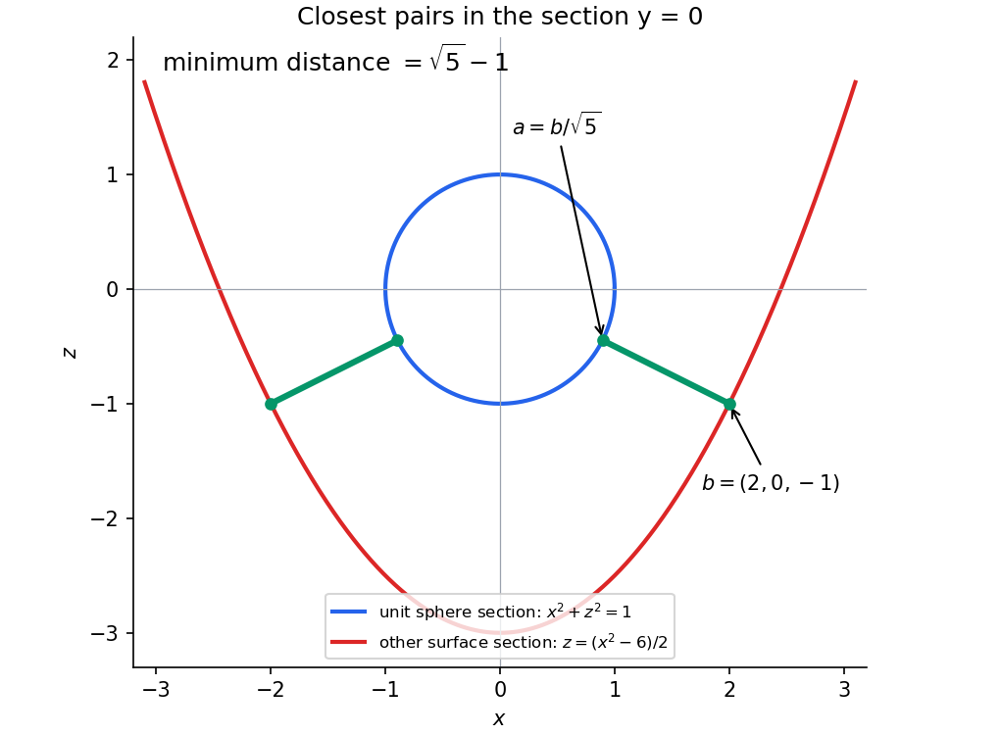

<h1 id="f/2/solution">Solution</h1>

↑ **Parent:** [2](../2.md)

A sufficient regular-level condition is $\nabla f(x)\ne0$ at every point with $f(x)=0$. The [implicit function theorem](../../../../implicit-function-theorem.md) then makes the zero level a two-dimensional [continuously differentiable](../../../../continuously-differentiable-function.md) [submanifold](../../../../submanifold.md). Its [tangent space](../../../../tangent-space.md) is

$$
\boxed{T_xS_f=\ker Df_x=\{v:\nabla f(x)\cdot v=0\}.}
$$

For a minimizing pair $(a,b)$ and any [tangent vector](../../../../tangent-vector-split.md) $v\in T_aS_f$, take a [differentiable](../../../../differentiable-function.md) [surface](../../../../topological-surface-split.md) [curve](../../../../curve.md) $x(s)$ with $x(0)=a$, $x'(0)=v$. The function $\|x(s)-b\|^2$ has a minimum at zero, so its [derivative](../../../../derivative.md) $2(a-b)\cdot v$ vanishes. Varying the other point similarly proves [orthogonality](../../../../orthogonal-vectors.md) to $T_bS_g$.

For the particular [surfaces](../../../../topological-surface-split.md), minimize the distance from the origin to the second [surface](../../../../topological-surface-split.md) first. Put $u=x^2$, $v=y^2$, so $u,v\ge0$ and $z=(u-v-6)/2$. Then

$$
\|(x,y,z)\|^2=u+v+\frac{(u-v-6)^2}{4}.
$$

Let $s=u-v$. Since $u+v\ge|s|$, this is at least $|s|+(s-6)^2/4$, with equality when one of $u,v$ is zero. For $s\ge0$, this quadratic has its minimum at $s=4$, with value 5. For $s\le0$, it decreases up to zero and has minimum9 on that half-line. The [global minimum](../../../../global-minimum.md) is therefore5, attained at

$$
b=(2,0,-1)\quad\text{or}\quad(-2,0,-1).
$$

All points of this [surface](../../../../topological-surface-split.md) lie outside the [unit sphere](../../../../unit-sphere.md). For any such $b$, the distance to the sphere is $\|b\|-1$, attained at $a=b/\|b\|$ by the [triangle inequality](../../../../triangle-inequality.md). Consequently

$$
\boxed{\operatorname{dist}(S_f,S_g)=\sqrt5-1,\qquad a=b/\sqrt5.}
$$

This is a global minimization, not merely a stationary-point calculation.

**[Figure 1](#f/2/image-nearest-points-on-the-two-surfaces-in-the-section-y-0). Nearest points on the two surfaces in the section $y=0$**.

## ↑ Ancestors (12)

1. [2](../2.md)
2. [F](../../f.md)
3. [2005](../../../2005-split.md)
4. [Past exam of the options II course of the University of Oxford](../../../split.md)
5. [Options II course of the University of Oxford](../../../../options-ii-course-of-the-university-of-oxford.md)
6. [Year 2 of the mathematics course of the University of Oxford](../../../../year-2-of-the-mathematics-course-of-the-university-of-oxford.md)
7. [Mathematics course of the University of Oxford](../../../../mathematics-course-of-the-university-of-oxford.md)
8. [Undergraduate course of the University of Oxford](../../../../undergraduate-course-of-the-university-of-oxford.md)
9. [Course of the University of Oxford](../../../../course-of-the-university-of-oxford.md)
10. [University of Oxford](../../../../university-of-oxford-split.md)
11. [List of universities](../../../../list-of-universities.md)
12. [Codex Wiki](../../../../split.md)
