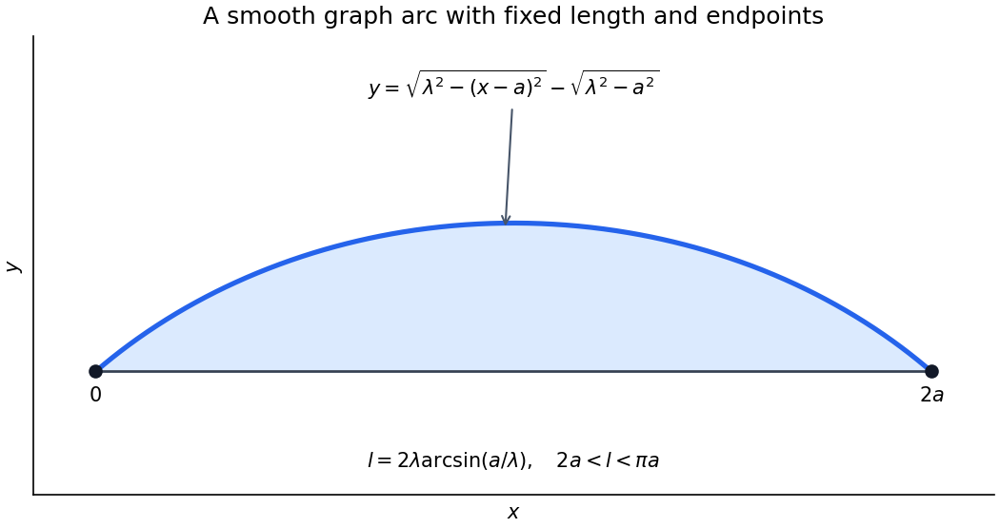

<h1 id="g/2/ii/solution">Solution</h1>

↑ **Parent:** [Ii](../ii.md)

For the upper [function graph](../../../../../graph-of-a-function.md), the vertical cross-section of the enclosed region has length $y(x)$, so its [area](../../../../../surface-area.md) is $J[y]=\int_0^{2a}y(x)\,dx$. A maximizing nonnegative arch therefore uses $F=y$ and $G=\sqrt{1+y'^2}$ in the normal [Euler-Lagrange equation](../../../../../euler-lagrange-equation.md). It becomes

$$
1+\lambda\frac d{dx}\left(\frac{y'}{\sqrt{1+y'^2}}\right)=0.
$$

Integrating once gives $y'/\sqrt{1+y'^2}=(c-x)/\lambda$. The concave upper branch has $\lambda>0$ and integrates to $y=\sqrt{\lambda^2-(x-c)^2}+d$. The equal zero endpoint heights force $c=a$ and $d=-\sqrt{\lambda^2-a^2}$. Hence

$$
\boxed{y(x)=\sqrt{\lambda^2-(x-a)^2}-\sqrt{\lambda^2-a^2}.}
$$

It is a [circular arc](../../../../../circular-arc.md). To find its parameter, substitute into the length [integral](../../../../../integral-split.md): $\sqrt{1+y'^2}=\lambda/\sqrt{\lambda^2-(x-a)^2}$, giving

$$
\boxed{l=2\lambda\arcsin(a/\lambda).}
$$

This scalar equation determines $\lambda$ numerically when needed; no explicit solution is required.

The arch is a [global maximum](../../../../../global-maximum.md) in its smooth [function graph](../../../../../graph-of-a-function.md) regime. For $\lambda>0$, the integrand $y-\lambda\sqrt{1+y'^2}$ is concave and [strictly concave](../../../../../strictly-concave-function.md) in its slope. Its supporting-tangent inequality, integrated against any competing [function graph](../../../../../graph-of-a-function.md) with the same endpoint values, has [first-order term](../../../../../first-order-term.md) zero by the [Euler-Lagrange equation](../../../../../euler-lagrange-equation.md). Thus $J[y]-\lambda I[y]\le J[y_*]-\lambda I[y_*]$. On the fixed-length class this is $J[y]\le J[y_*]$; strict slope [concavity](../../../../../concave-function.md) also gives uniqueness.

The source leaves the length range implicit. A twice [continuously differentiable](../../../../../continuously-differentiable-function.md) [function graph](../../../../../graph-of-a-function.md) of this form needs $\lambda>a$, giving **$2a<l<\pi a$**. At $l=2a$ the straight [function graph](../../../../../graph-of-a-function.md) is the degenerate solution. The semicircle limit $l=\pi a$ has vertical endpoint tangents and is outside that smooth [function graph](../../../../../graph-of-a-function.md) class. For $l>\pi a$, no arc in the claimed smooth [function graph](../../../../../graph-of-a-function.md) family exists, so the stated formula cannot describe a twice [continuously differentiable](../../../../../continuously-differentiable-function.md) maximizing [function graph](../../../../../graph-of-a-function.md) under those unrestricted data. Allowing overhanging [curves](../../../../../curve.md) changes the admissible class.

**[Figure 2](#g/2/ii/image-the-circular-arch-and-its-smooth-graph-length-range). The circular arch and its smooth graph length range**.

## ↑ Ancestors (13)

1. [Ii](../ii.md)
2. [2](../../2.md)
3. [G](../../../g.md)
4. [2005](../../../../2005-split.md)
5. [Past exam of the options II course of the University of Oxford](../../../../split.md)
6. [Options II course of the University of Oxford](../../../../../options-ii-course-of-the-university-of-oxford.md)
7. [Year 2 of the mathematics course of the University of Oxford](../../../../../year-2-of-the-mathematics-course-of-the-university-of-oxford.md)
8. [Mathematics course of the University of Oxford](../../../../../mathematics-course-of-the-university-of-oxford.md)
9. [Undergraduate course of the University of Oxford](../../../../../undergraduate-course-of-the-university-of-oxford.md)
10. [Course of the University of Oxford](../../../../../course-of-the-university-of-oxford.md)
11. [University of Oxford](../../../../../university-of-oxford-split.md)
12. [List of universities](../../../../../list-of-universities.md)
13. [Codex Wiki](../../../../../split.md)
