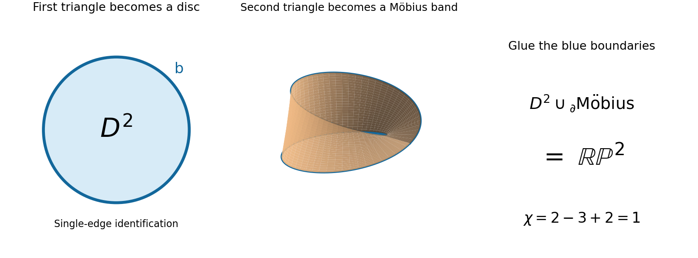
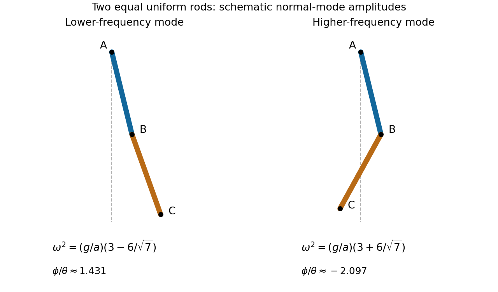
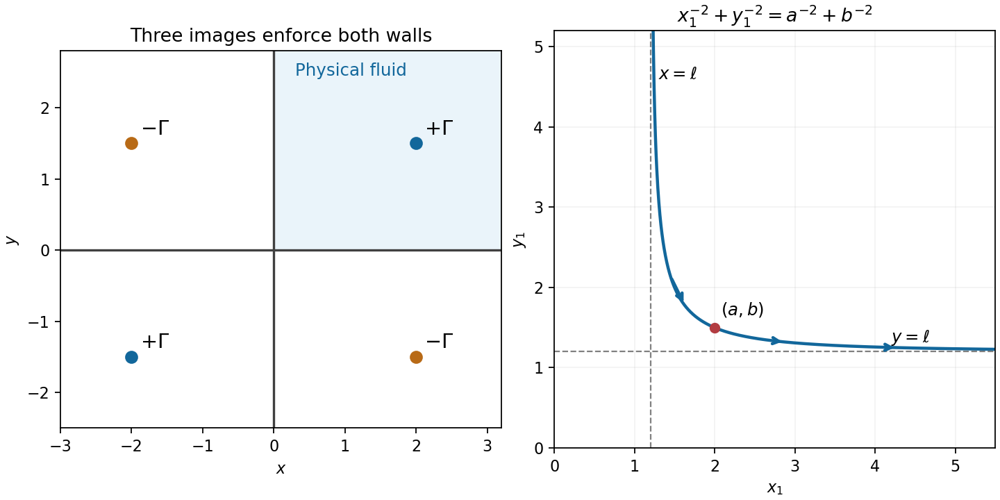

# 2006

↑ **Parent:** [Past exam of the options II course of the University of Oxford](../past-exam-of-the-options-ii-course-of-the-university-of-oxford.md)

**Table of contents**

- [A](#a)
  - [2](#a/2)
    - [Solution](#a/2/solution)
- [B](#b)
  - [2](#b/2)
    - [i](#b/2/i)
      - [Solution](#b/2/i/solution)
    - [ii](#b/2/ii)
      - [Solution](#b/2/ii/solution)
    - [iii](#b/2/iii)
      - [Solution](#b/2/iii/solution)
    - [a](#b/2/a)
      - [Solution](#b/2/a/solution)
    - [b](#b/2/b)
      - [Solution](#b/2/b/solution)
    - [c](#b/2/c)
      - [Solution](#b/2/c/solution)
- [C](#c)
  - [2](#c/2)
    - [Solution](#c/2/solution)
- [D](#d)
  - [3](#d/3)
    - [Solution](#d/3/solution)
  - [4](#d/4)
    - [a](#d/4/a)
      - [Solution](#d/4/a/solution)
    - [b](#d/4/b)
      - [Solution](#d/4/b/solution)
- [E](#e)
  - [3](#e/3)
    - [Solution](#e/3/solution)
  - [4](#e/4)
    - [i](#e/4/i)
      - [Solution](#e/4/i/solution)
    - [ii](#e/4/ii)
      - [Solution](#e/4/ii/solution)
- [F](#f)
  - [2](#f/2)
    - [i](#f/2/i)
      - [Solution](#f/2/i/solution)
    - [ii](#f/2/ii)
      - [Solution](#f/2/ii/solution)
    - [iii](#f/2/iii)
      - [Solution](#f/2/iii/solution)
- [G](#g)
  - [2](#g/2)
    - [Solution](#g/2/solution)
- [H](#h)
  - [2](#h/2)
    - [Solution](#h/2/solution)
- [J](#j)
  - [2](#j/2)
    - [Solution](#j/2/solution)
- [K](#k)
  - [3](#k/3)
    - [Solution](#k/3/solution)
  - [4](#k/4)
    - [Solution](#k/4/solution)
- [M](#m)
  - [3](#m/3)
    - [Solution](#m/3/solution)
- [N](#n)
  - [2](#n/2)
    - [i](#n/2/i)
      - [Solution](#n/2/i/solution)
    - [ii](#n/2/ii)
      - [Solution](#n/2/ii/solution)
- [O](#o)
  - [4](#o/4)
    - [Solution](#o/4/solution)
  - [5](#o/5)
    - [Solution](#o/5/solution)
- [P](#p)
  - [3](#p/3)
    - [Solution](#p/3/solution)
  - [4](#p/4)
    - [Solution](#p/4/solution)

## A

↑ **Parent:** [2006](2006.md)

<h3 id="a/2">2</h3>

↑ **Parent:** [A](#a)

<h4 id="a/2/solution">Solution</h4>

↑ **Parent:** [2](#a/2)

Right multiplication gives a right action $(Hx)\cdot g=Hxg$. To obtain a [homomorphism](../algebra.md#homomorphism) into [permutations](../combinatorics.md#permutation) with the usual function-composition convention, use the associated left action

$$
\rho(g)(Hx)=Hxg^{-1}.
$$

This is well-defined: replacing $x$ by $hx$, $h\in H$, does not change the image [coset](../group-theory.md#coset). Moreover $\rho(g)\rho(k)(Hx)=Hxk^{-1}g^{-1}=\rho(gk)(Hx)$, and each map is bijective with inverse $\rho(g^{-1})$.

An element $g$ is in the [kernel](../kernel-of-a-linear-map.md) precisely when $Hxg^{-1}=Hx$ for every $x\in G$. This says $xg^{-1}x^{-1}\in H$, equivalently $g\in x^{-1}Hx$. Hence

$$
\boxed{\ker\rho=\bigcap_{x\in G}x^{-1}Hx.}
$$

This is the largest [normal subgroup](../group-theory.md#normal-subgroup) of $G$ contained in $H$.

Now the index of $H$ is $q$, so $G/\ker\rho$ embeds into $S_q$. Its order therefore divides $q!$. Since $p>q$ is [prime](../prime-number.md), $p$ does not divide $q!$. From $|G|=pq$ it follows that $p$ divides $|\ker\rho|$. But $\ker\rho\subseteq H$ and $|H|=p$, forcing $\ker\rho=H$. Therefore **$H$ is normal**.

For the last case let $H=\langle b\rangle$. Normality makes [conjugation](../group-action.md#conjugation) by $a$ an [automorphism](../algebra.md#automorphism), so $a^{-1}ba=b^r$ with $r\in\{1,2,3,4\}$. Applying it twice and using $a^2=1$ gives $b=b^{r^2}$, so $r^2\equiv1\pmod5$. Thus $(r-1)(r+1)\equiv0\pmod5$, and

$$
\boxed{a^{-1}ba=b\ \text{or}\ b^{-1}.}
$$

Both possibilities are allowed; the order assumptions alone do not force the inverse case.

## B

↑ **Parent:** [2006](2006.md)

<h3 id="b/2">2</h3>

↑ **Parent:** [B](#b)

<h4 id="b/2/i">i</h4>

↑ **Parent:** [2](#b/2)

<h5 id="b/2/i/solution">Solution</h5>

↑ **Parent:** [I](#b/2/i)

An [irreducible polynomial](../polynomial.md#irreducible-polynomial) has positive degree, so its [ideal](../commutative-algebra.md#ideal) is proper: otherwise $1=fh$ would contradict degrees. Every nonzero class $[g]$ has a representative not divisible by $f$. Irreducibility gives $\gcd(g,f)=1$, and the [Euclidean algorithm](../number-theory.md#euclidean-algorithm) supplies [polynomials](../polynomial.md) $u,v$ with $ug+vf=1$. Passing to the [quotient](../arithmetic.md#quotient) gives $[u][g]=1$. Thus the [quotient](../arithmetic.md#quotient) is a nonzero [commutative ring](../commutative-algebra.md#commutative-ring) in which every nonzero element has an inverse, hence **a [field](../algebra.md#field)**. Constants embed injectively because no nonzero constant lies in the positive-degree [ideal](../commutative-algebra.md#ideal) $(f)$.

<h4 id="b/2/ii">ii</h4>

↑ **Parent:** [2](#b/2)

<h5 id="b/2/ii/solution">Solution</h5>

↑ **Parent:** [Ii](#b/2/ii)

[Polynomial division](../polynomial.md#polynomial-division) gives a unique remainder of degree less than $n$ in every [coset](../group-theory.md#coset). Thus the classes

$$
1,[x],\ldots,[x]^{n-1}
$$

span the [quotient](../arithmetic.md#quotient) as an $F$-vector space. A [linear combination](../vector-space.md#linear-combination) of them that vanishes would be a [polynomial](../polynomial.md) of degree less than $n$ divisible by $f$, so it is the zero [polynomial](../polynomial.md). They are therefore [linearly independent](../vector-space.md#linear-independence), proving

$$
\boxed{[K:F]=n.}
$$

<h4 id="b/2/iii">iii</h4>

↑ **Parent:** [2](#b/2)

<h5 id="b/2/iii/solution">Solution</h5>

↑ **Parent:** [Iii](#b/2/iii)

Take $a=[x]$. Every [quotient](../arithmetic.md#quotient) class is a [polynomial](../polynomial.md) expression in $a$ with coefficients from $F$, so $K=F[a]$. Substitution gives $f(a)=[f(x)]=0$. Thus

$$
\boxed{K=F[a],\qquad f(a)=0.}
$$

This constructs a [field](../algebra.md#field) containing a root even when no root existed in the original [field](../algebra.md#field).

<h4 id="b/2/a">a</h4>

↑ **Parent:** [2](#b/2)

<h5 id="b/2/a/solution">Solution</h5>

↑ **Parent:** [A](#b/2/a)

First address the general splitting-field request. A [splitting field](../galois-theory.md#splitting-field) is an extension in which the [polynomial](../polynomial.md) factors into linear factors and which is generated over the base [field](../algebra.md#field) by its roots. For a degree-$m$ [polynomial](../polynomial.md), adjoin a root of an [irreducible](../representation-theory.md#irreducible-representation) factor. The [quotient](../arithmetic.md#quotient) construction in the preceding parts gives an extension of degree at most $m$. Remove the resulting linear factor and repeat, now with a [polynomial](../polynomial.md) of degree $m-1$ over that extension. Induction and the [tower law](../algebra.md#tower-law) give

$$
[L:F]\leq m(m-1)\cdots1=m!.
$$

The resulting [field](../algebra.md#field) is generated by the roots and is a [splitting field](../galois-theory.md#splitting-field). Repeated roots or inseparability can only reduce the required degrees; separability was not used.

For the specified cubic, put $a=\sqrt[3]2$ and $\omega=e^{2\pi i/3}$. Its [splitting field](../galois-theory.md#splitting-field) is $\mathbb Q(a,\omega)$. [Eisenstein criterion](../commutative-algebra.md#eisenstein-criterion) at two gives $[\mathbb Q(a):\mathbb Q]=3$. This cubic [field](../algebra.md#field) is real and therefore does not contain the nonreal $\omega$, whose quadratic [polynomial](../polynomial.md) is $x^2+x+1$. Consequently

$$
\boxed{[\mathbb Q(a,\omega):\mathbb Q]=3\cdot2=6.}
$$

<h4 id="b/2/b">b</h4>

↑ **Parent:** [2](#b/2)

<h5 id="b/2/b/solution">Solution</h5>

↑ **Parent:** [B](#b/2/b)

Let $\zeta=e^{\pi i/4}$. Its odd powers are exactly the four roots, so $\mathbb Q(\zeta)$ is the [splitting field](../galois-theory.md#splitting-field). The [polynomial](../polynomial.md) $x^4+1$ is [irreducible](../representation-theory.md#irreducible-representation): after the invertible substitution $x\mapsto x+1$, it becomes $x^4+4x^3+6x^2+4x+2$, which satisfies [Eisenstein criterion](../commutative-algebra.md#eisenstein-criterion) at two. Hence

$$
\boxed{[\mathbb Q(\zeta):\mathbb Q]=4.}
$$

Equivalently the [field](../algebra.md#field) is $\mathbb Q(\sqrt2,i)$, since $\zeta=(1+i)/\sqrt2$, $\zeta^2=i$ and $\zeta+\zeta^{-1}=\sqrt2$.

<h4 id="b/2/c">c</h4>

↑ **Parent:** [2](#b/2)

<h5 id="b/2/c/solution">Solution</h5>

↑ **Parent:** [C](#b/2/c)

Factor

$$
x^4-x^2-2=(x^2-2)(x^2+1).
$$

The roots are $\pm\sqrt2,\pm i$, so the [splitting field](../galois-theory.md#splitting-field) is $\mathbb Q(\sqrt2,i)$. The real quadratic [field](../algebra.md#field) $\mathbb Q(\sqrt2)$ does not contain $i$, which adds a further degree two. Therefore

$$
\boxed{[\mathbb Q(\sqrt2,i):\mathbb Q]=4.}
$$

<h2 id="c">C</h2>

↑ **Parent:** [2006](2006.md)

<h3 id="c/2">2</h3>

↑ **Parent:** [C](#c)

<h4 id="c/2/solution">Solution</h4>

↑ **Parent:** [2](#c/2)

A [primitive root](../number-theory.md#primitive-root-modulo-n) modulo $p$ is an [integer](../integer.md) whose residue generates the multiplicative group $\mathbb F_p^\times$, equivalently has order $p-1$.

The [Chinese remainder theorem](../mathematics.md#chinese-remainder-theorem) states that, for pairwise coprime positive [integers](../integer.md) $m_1,\ldots,m_r$, the system $x\equiv a_i\pmod{m_i}$ has a unique solution modulo $M=\prod_i m_i$. For a constructive proof put $M_i=M/m_i$. Bézout's identity gives an [integer](../integer.md) $u_i$ with $M_i u_i\equiv1\pmod{m_i}$. Then $x=\sum_i a_iM_i u_i$ has all the required residues. If two solutions exist, their difference is divisible by every $m_i$; pairwise [coprimality](../divisibility.md#coprime-integers) makes it divisible by their product, proving uniqueness modulo $M$.

Here $3,5,7$ divide $p-1$, and none is zero modulo $p$. Choose a [primitive root](../number-theory.md#primitive-root-modulo-n) $g$ and exponents $a,b,c$ with

$$
3\equiv g^a,\qquad5\equiv g^b,\qquad7\equiv g^c\pmod p.
$$

Use the theorem with moduli $3,5,7$ to choose $r$ such that $r\equiv a\pmod3$, $r\equiv b\pmod5$, $r\equiv c\pmod7$. Define nonzero residues

$$
n=g^r,\qquad x=g^{(r-a)/3},\qquad
y=g^{(r-b)/5},\qquad z=g^{(r-c)/7}.
$$

The exponents are [integers](../integer.md); negative ones are interpreted using inverses in $\mathbb F_p^\times$. Taking [integer](../integer.md) representatives now gives

$$
\boxed{p\nmid n,\qquad n\equiv3x^3\equiv5y^5\equiv7z^7\pmod p.}
$$

The theorem aligns the exponent [modular congruences](../modular-arithmetic.md#modular-congruence), which is why a [primitive root](../number-theory.md#primitive-root-modulo-n) converts the three power conditions into a linear [modular congruence](../modular-arithmetic.md#modular-congruence) problem.

## D

↑ **Parent:** [2006](2006.md)

<h3 id="d/3">3</h3>

↑ **Parent:** [D](#d)

<h4 id="d/3/solution">Solution</h4>

↑ **Parent:** [3](#d/3)

The [monotone convergence theorem](../measure-theory.md#monotone-convergence-theorem) states that if $0\leq h_n\uparrow h$ pointwise almost everywhere and the functions are [measurable](../measure-theory.md#measurability), then $\int h_n\uparrow\int h$, allowing the value infinity.

Interpret the displayed densities as zero outside $(0,1)$, so no undefined logarithm is evaluated there. Each $f_k$ is nonnegative and [measurable](../measure-theory.md#measurability). With $x=e^{-t}$,

$$
\int_0^1-x^{2k}\log x\,dx
=\int_0^\infty t e^{-(2k+1)t}dt
=\boxed{\frac1{(2k+1)^2}},
$$

where the last equality is [integration by parts](../calculus.md#integration-by-parts). This is finite, proving [Lebesgue integrability](../measure-theory.md#integrability).

The nonnegative partial sums satisfy, for $0<x<1$,

$$
\sum_{k=0}^Nf_k(x)=-\log x\sum_{k=0}^Nx^{2k}
\ \uparrow\ -\frac{\log x}{1-x^2}=g(x).
$$

They vanish outside the interval as well. Monotone convergence therefore gives

$$
\boxed{\int_{\mathbb R}g(x)dx=\sum_{k=0}^\infty\frac1{(2k+1)^2}.}
$$

The series is finite by comparison with the convergent series $\sum_{j\geq1}j^{-2}$, whose convergence follows from the [integral test](../sequence-and-series.md#integral-test-for-convergence). Since $g\geq0$, this finite integral proves absolute [Lebesgue integrability](../measure-theory.md#integrability) as required.

<h3 id="d/4">4</h3>

↑ **Parent:** [D](#d)

<h4 id="d/4/a">a</h4>

↑ **Parent:** [4](#d/4)

<h5 id="d/4/a/solution">Solution</h5>

↑ **Parent:** [A](#d/4/a)

We first prove the differentiation theorem. Fix $t\in(0,b)$ and take nonzero $h\to0$ with $t+h\in(0,b)$. The [measurable](../measure-theory.md#measurability) difference quotients

$$
q_h(x)=\frac{f(x,t+h)-f(x,t)}h
$$

converge pointwise to $f_t(x,t)$. The [mean value theorem](../calculus.md#mean-value-theorem) and the assumed derivative bound give $|q_h(x)|\leq g(x)$. In particular $f_t(\cdot,t)$ is [measurable](../measure-theory.md#measurability) as a limit of quotients along a sequence, and its bound by $g$ proves integrability. The [dominated convergence theorem](../measure-theory.md#dominated-convergence-theorem), in its parameter-limit form, says that pointwise convergence with a common integrable bound permits convergence of the integrals. Applying it yields

$$
\boxed{\frac d{dt}\int_0^\infty f(x,t)dx
=\lim_{h\to0}\int_0^\infty q_h(x)dx
=\int_0^\infty f_t(x,t)dx.}
$$

The parameter-limit statement follows from the ordinary sequential theorem by applying it to every sequence of nonzero $h$ tending to zero.

For the specific function, $|f(x,t)|\leq e^{-x^2}$, which is integrable by the allowed fact. It is differentiable in $t$, with

$$
f_t(x,t)=-2xe^{-x^2}\sin(2xt),\qquad
|f_t(x,t)|\leq2xe^{-x^2}.
$$

The last majorant has integral one on $[0,\infty)$, using the substitution $u=x^2$. All three hypotheses therefore hold. The indicator of the parameter domain is one at every point under consideration and does not affect this derivative.

<h4 id="d/4/b">b</h4>

↑ **Parent:** [4](#d/4)

<h5 id="d/4/b/solution">Solution</h5>

↑ **Parent:** [B](#d/4/b)

The theorem gives

$$
F'(t)=-2\int_0^\infty xe^{-x^2}\sin(2xt)dx
=\int_0^\infty (e^{-x^2})'\sin(2xt)dx.
$$

[Integration by parts](../calculus.md#integration-by-parts) has zero boundary term: the sine vanishes at zero and the [Gaussian](../probability-distribution.md#normal-distribution) tends to zero at infinity. Hence $F'(t)=-2t\int_0^\infty e^{-x^2}\cos(2xt)dx=-2tF(t)$.

The same [Gaussian](../probability-distribution.md#normal-distribution) majorant and dominated convergence give [continuity](../calculus.md#continuous-function) at zero, where the allowed [Gaussian integral](../integral.md#gaussian-integral) gives $F(0)=\sqrt\pi/2$. The differential equation implies $(e^{t^2}F(t))'=0$; [continuity](../calculus.md#continuous-function) at zero fixes that constant. Thus

$$
\boxed{F(t)=\frac{\sqrt\pi}{2}e^{-t^2}\qquad(0\leq t<b).}
$$

## E

↑ **Parent:** [2006](2006.md)

<h3 id="e/3">3</h3>

↑ **Parent:** [E](#e)

<h4 id="e/3/solution">Solution</h4>

↑ **Parent:** [3](#e/3)

A subset is [compact](../topology.md#compact-space) if every cover of it by open sets of the ambient space has a [finite subcover](../topology.md#finite-subcover); equivalently use open sets of its [subspace topology](../topology.md#subspace-topology). A cover of $A\cup B$ separately covers $A$ and $B$. [Compactness](../topology.md#compact-space) of each supplies two finite collections, whose union is finite and covers $A\cup B$. If $A$ is closed in a [compact](../topology.md#compact-space) space, add the open complement of $A$ to any [open cover](../topology.md#open-cover) of $A$. [Compactness](../topology.md#compact-space) supplies a [finite subcover](../topology.md#finite-subcover) of the whole space, and discarding the complement leaves a finite cover of $A$.

For the enlarged space, every old open set is open in $C$ and has the same trace on $X$. The trace on $X$ of a new open set $V\cup\{\infty\}$ is $V$, which is open in $X$ because its complement is closed. Thus the induced topology on $X$ is exactly the original one.

Given an [open cover](../topology.md#open-cover) of $C$, choose a member containing infinity. It has the form $V\cup\{\infty\}$ with $K=X\setminus V$ [compact](../topology.md#compact-space). The remaining cover restricted to $K$ has a [finite subcover](../topology.md#finite-subcover). Together with the chosen infinity-neighborhood, these finitely many sets cover $C$. Hence **$C$ is [compact](../topology.md#compact-space)**, with no [Hausdorff](../topology.md#hausdorff-space) assumption needed.

Finally put $a=f(\infty)$. [Continuity](../calculus.md#continuous-function) makes $U=f^{-1}((a-\epsilon,a+\epsilon))$ open and containing infinity. Therefore $U=V\cup\{\infty\}$ with $W=X\setminus V$ [compact](../topology.md#compact-space) and closed in $X$. For every $x\in X\setminus W=V$ we have

$$
\boxed{|f(x)-a|<\epsilon.}
$$

This expresses convergence to the value at infinity outside [compact](../topology.md#compact-space) closed subsets.

<h3 id="e/4">4</h3>

↑ **Parent:** [E](#e)

<h4 id="e/4/i">i</h4>

↑ **Parent:** [4](#e/4)

<h5 id="e/4/i/solution">Solution</h5>

↑ **Parent:** [I](#e/4/i)

A [quotient map](../topology.md#quotient-map) $\pi:X\to Y$ is a [surjection](../algebra.md#surjective-function) such that $U\subseteq Y$ is open if and only if $\pi^{-1}(U)$ is open in $X$. Thus the topology on $Y$ is exactly the final topology induced by $\pi$.

For an open continuous [surjection](../algebra.md#surjective-function), [continuity](../calculus.md#continuous-function) gives one implication. For the other, if $\pi^{-1}(U)$ is open then $U=\pi(\pi^{-1}(U))$ is open by openness and [surjectivity](../algebra.md#surjective-function). Hence it is a [quotient map](../topology.md#quotient-map).

If $\pi:X\to Y$ and $\sigma:Y\to Z$ are [quotient maps](../topology.md#quotient-map), they are [surjective](../algebra.md#surjective-function) and

$$
(\sigma\circ\pi)^{-1}(U)=\pi^{-1}(\sigma^{-1}(U)).
$$

This set is open exactly when $\sigma^{-1}(U)$ is open, exactly when $U$ is open. Thus **the composition is a [quotient map](../topology.md#quotient-map)**.

For the factorization, [continuity](../calculus.md#continuous-function) of $g$ implies [continuity](../calculus.md#continuous-function) of $f=g\circ\pi$. Conversely, if $f$ is continuous and $U$ is open in $Z$, then $\pi^{-1}(g^{-1}(U))=f^{-1}(U)$ is open. The [quotient](../arithmetic.md#quotient) property makes $g^{-1}(U)$ open. This holds for every open $U$, so **$g$ is continuous**.

<h4 id="e/4/ii">ii</h4>

↑ **Parent:** [4](#e/4)

<h5 id="e/4/ii/solution">Solution</h5>

↑ **Parent:** [Ii](#e/4/ii)

The two singly marked sides of the first triangle are glued with their endpoints at $A$ matched. A cross-section parallel to the remaining side has its two endpoints identified, becoming a [circle](../topology.md#circle); the apex becomes its [cone](../euclidean-geometry.md#cone-geometry) point. Thus this [quotient](../arithmetic.md#quotient) triangle is a **[disc](../topology.md#topological-disc)**, whose boundary is the doubly marked edge.

In the second triangle, the two triply marked sides run consecutively along the boundary from $E$ through $D$ to $F$. Pairing these sides in the indicated directions introduces one reversal; its boundary word is $aa b^{-1}$, where $b$ is the remaining doubly marked edge. This is a **[Möbius band](../topological-surface.md#mobius-band)** with boundary $b$. One can obtain the usual rectangle model by cutting from the identified triple-edge seam to the midpoint of $b$ and opening the triangle.

The double markings glue the [disc](../topology.md#topological-disc) boundary to the boundary of that [Möbius band](../topological-surface.md#mobius-band). Capping a [Möbius band](../topological-surface.md#mobius-band) by a [disc](../topology.md#topological-disc) gives

$$
\boxed{\mathbb{RP}^2,\text{ the real projective plane}.}
$$

This description also verifies that the [quotient](../arithmetic.md#quotient) is a [closed surface](../smooth-manifold.md#closed-surface), including the vertices. As a check, the vertex classes are $\{A\}$ and $\{B,C,D,E,F\}$; there are three edge classes and two faces. The [Euler characteristic](../homology.md#euler-characteristic) is $2-3+2=1$, consistent with the [projective plane](../projective-space.md#projective-plane). The [Möbius band](../topological-surface.md#mobius-band) exhibits nonorientability directly.

**[Figure 1](#e/4/ii/image-the-identified-triangles-become-a-disc-and-a-mobius-band-joined-along-their-boundary). The identified triangles become a disc and a Möbius band joined along their boundary**.

## F

↑ **Parent:** [2006](2006.md)

<h3 id="f/2">2</h3>

↑ **Parent:** [F](#f)

<h4 id="f/2/i">i</h4>

↑ **Parent:** [2](#f/2)

<h5 id="f/2/i/solution">Solution</h5>

↑ **Parent:** [I](#f/2/i)

The [Fréchet derivative](../multivariable-calculus.md#frechet-derivative) at $a$ is the [linear map](../vector-space.md#linear-map) $Df_a:\mathbb R^n\to\mathbb R^k$ satisfying

$$
f(a+h)=f(a)+Df_a(h)+r(h),\qquad
\frac{\|r(h)\|}{\|h\|}\longrightarrow0.
$$

It is unique. When both derivatives exist, the [chain rule](../calculus.md#chain-rule) is $D(g\circ f)_a=Dg_{f(a)}\circ Df_a$.

For the square map,

$$
(A+\Delta)^2-A^2=A\Delta+\Delta A+\Delta^2.
$$

The remainder has norm at most $\|\Delta\|^2$ in a submultiplicative [matrix norm](../vector-space.md#matrix-norm), hence is $o(\|\Delta\|)$. Therefore

$$
\boxed{DS_A(\Delta)=A\Delta+\Delta A.}
$$

[Matrix](../vector-space.md#matrix) multiplication is not commutative, so the two terms cannot generally be combined as $2A\Delta$.

<h4 id="f/2/ii">ii</h4>

↑ **Parent:** [2](#f/2)

<h5 id="f/2/ii/solution">Solution</h5>

↑ **Parent:** [Ii](#f/2/ii)

For small $\|\Delta\|$, the [matrix](../vector-space.md#matrix) $A+\Delta=A(I+A^{-1}\Delta)$ remains invertible and its inverse is locally bounded, for example by the convergent [Neumann series](../banach-algebra.md#neumann-series) when $\|A^{-1}\Delta\|<1$. Applying the [resolvent identity](../banach-algebra.md#resolvent-identity) twice gives

$$
(A+\Delta)^{-1}
=A^{-1}-A^{-1}\Delta A^{-1}
+A^{-1}\Delta A^{-1}\Delta(A+\Delta)^{-1}.
$$

The last term is $O(\|\Delta\|^2)$ by that local bound. Hence the inverse map is differentiable, with

$$
\boxed{D\mathcal I_A(\Delta)=-A^{-1}\Delta A^{-1}.}
$$

This verifies the differentiability and its remainder, rather than only formally differentiating the identity $AA^{-1}=I$.

<h4 id="f/2/iii">iii</h4>

↑ **Parent:** [2](#f/2)

<h5 id="f/2/iii/solution">Solution</h5>

↑ **Parent:** [Iii](#f/2/iii)

First simplify the composite: $(S\circ\mathcal I\circ S)(A)=((A^2)^{-1})^2=A^{-4}$. Applying the [product rule](../calculus.md#product-rule) to four factors of $A^{-1}$, and the preceding inverse derivative to one factor at a time, gives

$$
\boxed{D(S\circ\mathcal I\circ S)_A(\Delta)
=-\sum_{j=1}^4 A^{-j}\Delta A^{-(5-j)}.}
$$

The four terms have left and right exponents $(1,4),(2,3),(3,2),(4,1)$. The same expression follows by composing $DS_{A^{-2}}$, $D\mathcal I_{A^2}$ and $DS_A$ in that order. Only when $\Delta$ commutes with $A$ can it be simplified to $-4A^{-5}\Delta$.

## G

↑ **Parent:** [2006](2006.md)

<h3 id="g/2">2</h3>

↑ **Parent:** [G](#g)

<h4 id="g/2/solution">Solution</h4>

↑ **Parent:** [2](#g/2)

Write $K[y]=\int_a^bG(x,y,y')dx$. At a regular constrained extremal, the [first variation](../calculus-of-variations.md#first-variation) of $K$ is not identically zero. Choose a variation $\zeta$ for which $\delta K[\zeta]\neq0$; the [implicit function theorem](../multivariable-calculus.md#implicit-function-theorem) supplies a correction in the $\zeta$ direction to each other variation so that $K$ remains one. Stationarity of $J$ on these corrected variations implies $\delta J=\lambda\delta K$ for one scalar $\lambda$.

Put $L=F-\lambda G$. [Integration by parts](../calculus.md#integration-by-parts) gives, for an arbitrary twice continuously differentiable variation $\eta$,

$$
0=\delta(J-\lambda K)[\eta]
=\int_a^b\left(L_y-\frac d{dx}L_{y'}\right)\eta\,dx
+[L_{y'}\eta]_a^b.
$$

Taking variations with zero endpoint values and using the stated [fundamental lemma of the calculus of variations](../calculus-of-variations.md#fundamental-lemma-of-the-calculus-of-variations) gives the [Euler-Lagrange equation](../analysis.md#euler-lagrange-equation). The remaining endpoint values are free and independent, giving the natural boundary conditions:

$$
\boxed{F_y-\lambda G_y-\frac d{dx}(F_{y'}-\lambda G_{y'})=0,\qquad
(F_{y'}-\lambda G_{y'})(a)=(F_{y'}-\lambda G_{y'})(b)=0.}
$$

If the constraint is not regular, the general multiplier statement permits an abnormal pair $\lambda_0F-\lambda_1G$ with $\lambda_0=0$; the source's general normal-form derivation implicitly excludes that case. In its quadratic example, regularity follows automatically from normalization: $\delta K[y]=2\int wy^2=2$.

For that example $L=py'^2-qy^2-\lambda wy^2$, so the equation and endpoint conditions reduce to

$$
(py')'+qy+\lambda wy=0,\qquad py'(a)=py'(b)=0.
$$

Multiply the equation by $y$ and integrate. The boundary term $[py'y]_a^b$ vanishes, giving

$$
-\int_a^bpy'^2dx+\int_a^bqy^2dx+\lambda\int_a^bwy^2dx=0.
$$

The last integral equals one, so **$\lambda=J[y]$**, the [functional](../calculus-of-variations.md#functional) value at the constrained extremal.

Finally multiply the equation for $y_1$ by $y_2$ and the equation for $y_2$ by $y_1$, then subtract and integrate. The derivative terms give only the vanishing boundary term $[p(y_2y_1'-y_1y_2')]_a^b$, while the $q$ terms cancel. Therefore $(\lambda_1-\lambda_2)\int_a^bwy_1y_2dx=0$. For distinct multipliers this proves

$$
\boxed{\int_a^bwy_1y_2dx=0.}
$$

## H

↑ **Parent:** [2006](2006.md)

<h3 id="h/2">2</h3>

↑ **Parent:** [H](#h)

<h4 id="h/2/solution">Solution</h4>

↑ **Parent:** [2](#h/2)

Use coordinates with the downward vertical as reference. The first rod's center is at $(a/2)(\sin\theta,-\cos\theta)$, so its translational plus rotational [kinetic energy](../energy.md#kinetic-energy) is $ma^2\dot\theta^2/6$. The second center is

$$
r_2=a(\sin\theta,-\cos\theta)+\frac a2(\sin\phi,-\cos\phi).
$$

Its squared speed is $a^2\dot\theta^2+a^2\dot\phi^2/4+a^2\dot\theta\dot\phi\cos(\theta-\phi)$. Adding its center-of-mass rotation, using [moment of inertia](../rigid-body-dynamics.md#moment-of-inertia) $ma^2/12$, gives the total

$$
T=\frac{ma^2}{6}[4\dot\theta^2+\dot\phi^2+3\dot\theta\dot\phi\cos(\theta-\phi)].
$$

The two center heights give $V=-mga(3\cos\theta+\cos\phi)/2$. Hence $L=T-V$ is exactly the stated [Lagrangian](../calculus-of-variations.md#lagrangian).

Small stable oscillations are about the downward [equilibrium](../dynamical-systems.md#equilibrium-point-of-a-dynamical-system) $\theta=\phi=0$. Retaining quadratic terms gives $T_2=\tfrac12\dot q^TM\dot q$ and $V_2=\tfrac12q^TKq$, where

$$
q=\begin{pmatrix}\theta\\\phi\end{pmatrix},\quad
M=ma^2\begin{pmatrix}4/3&1/2\\1/2&1/3\end{pmatrix},\qquad
K=\frac{mga}{2}\begin{pmatrix}3&0\\0&1\end{pmatrix}.
$$

A [normal mode](../wave-equation.md#normal-mode) $q=v e^{i\omega t}$ satisfies $(K-\omega^2M)v=0$. With $\kappa=a\omega^2/g$, the [determinant](../multilinear-algebra.md#determinant) equation is

$$
(9-8\kappa)(3-2\kappa)-9\kappa^2
=27-42\kappa+7\kappa^2=0.
$$

Thus the angular frequencies are

$$
\boxed{\omega_\pm=\sqrt{\frac ga\left(3\pm\frac6{\sqrt7}\right)}.}
$$

Both squared frequencies are positive. The [amplitude](../wave.md#wave-amplitude) ratio is $\phi/\theta=(9-8\kappa)/(3\kappa)$: it is positive in the lower-frequency mode and negative in the higher-frequency mode. The rods therefore swing in phase in the first mode and in opposite phase in the second.

**[Figure 2](#h/2/image-the-two-rod-normal-modes-have-positive-and-negative-relative-angular-amplitudes). The two-rod normal modes have positive and negative relative angular amplitudes**.

## J

↑ **Parent:** [2006](2006.md)

<h3 id="j/2">2</h3>

↑ **Parent:** [J](#j)

<h4 id="j/2/solution">Solution</h4>

↑ **Parent:** [2](#j/2)

In SI units the [Maxwell's equations](../maxwell-equations.md) in vacuum, with sources, are

$$
\nabla\cdot E=\rho/\epsilon_0,\quad \nabla\cdot B=0,\quad
\nabla\times E=-\partial_tB,\quad
\nabla\times B=\mu_0j+\mu_0\epsilon_0\partial_tE.
$$

Taking the divergence of the last equation and using [Gauss's law](../maxwell-equations.md#gauss-s-law) gives $\partial_t\rho+\nabla\cdot j=0$, the local [conservation of electric charge](../electric-charge.md#charge-conservation). Thus sources that violate [charge conservation](../electric-charge.md#charge-conservation) cannot satisfy all the [Maxwell's equations](../maxwell-equations.md). Equivalently, with this conservation law the curl evolution preserves the electric divergence constraint if it holds initially; [Faraday's law](../maxwell-equations.md#faraday-s-law-of-induction) similarly preserves $\nabla\cdot B=0$.

With $\rho=j=0$, use $\nabla\times(\nabla\times E)=\nabla(\nabla\cdot E)-\Delta E$ and substitute the two curl equations. This gives $-\Delta E=-\mu_0\epsilon_0\partial_t^2E$. Applying the same calculation to $B$ yields

$$
\boxed{\Delta E-c^{-2}E_{tt}=0,\qquad
\Delta B-c^{-2}B_{tt}=0,\quad c=(\mu_0\epsilon_0)^{-1/2}.}
$$

A monochromatic [plane wave](../wave-function.md#plane-wave) has one [angular frequency](../lagrangian-mechanics.md#angular-frequency) $\omega$ and constant-phase planes $\mathbf K\cdot r=\omega t-\text{constant}$, normal to the [wavevector](../elasticity-physics.md#wavevector) $\mathbf K$. Its [wavelength](../wave-equation.md#wavelength) is $2\pi/|\mathbf K|$.

For a nontrivial traveling wave with $\omega\neq0$, substitution of the displayed [electric field](../electric-field.md) into the divergence equation gives $\mathbf K\cdot e_1=\mathbf K\cdot e_2=0$. [Faraday's law](../maxwell-equations.md#faraday-s-law-of-induction) is satisfied by

$$
\boxed{B=\frac1\omega\,\mathbf K\times E,\qquad
\omega^2=c^2|\mathbf K|^2,\qquad \mathbf K\cdot e_1=\mathbf K\cdot e_2=0.}
$$

Indeed $\partial_tB=\mathbf K\times E_\phi$ and $\nabla\times E=-\mathbf K\times E_\phi$. The magnetic divergence is zero, while [Ampère's law](../maxwell-equations.md#ampere-s-circuital-law) reduces to $|\mathbf K|^2E_\phi/\omega=(\omega/c^2)E_\phi$, giving the [dispersion relation](../dispersion-relation.md). The amplitudes may be arbitrary transverse vectors; they need not be mutually orthogonal or have equal lengths. Their combination describes the [polarization](../wave.md#polarization-waves).

## K

↑ **Parent:** [2006](2006.md)

<h3 id="k/3">3</h3>

↑ **Parent:** [K](#k)

<h4 id="k/3/solution">Solution</h4>

↑ **Parent:** [3](#k/3)

Use the convention that a positive [vortex](../critical-phenomenon.md#phase-vortex) has counterclockwise [circulation](../vorticity.md#circulation-physics), with [complex potential of a two-dimensional potential flow](../fluid-mechanics.md#complex-potential-of-a-two-dimensional-potential-flow) $\Gamma\log(z-z_1)/(2\pi i)$. To make both coordinate axes [streamlines](../fluid-mechanics.md#streamline), place images of strength $-\Gamma$ at $\bar z_1$ and $-\bar z_1$, and strength $+\Gamma$ at $-z_1$. The resulting potential is

$$
\boxed{W(z)=\frac{\Gamma}{2\pi i}
\log\frac{(z-z_1)(z+z_1)}{(z-\bar z_1)(z+\bar z_1)}.}
$$

Additive constants and consistent logarithm branches do not affect velocity. The [quotient](../arithmetic.md#quotient) has unit modulus on either wall, so the [streamfunction](../fluid-mechanics.md#stream-function) is constant there and there is no normal flow.

The [vortex](../critical-phenomenon.md#phase-vortex) moves with the regular fluid velocity after removing its own singular [field](../algebra.md#field). Since $W'=u-iv$, evaluating the three image contributions at $z_1$ gives exactly

$$
\boxed{\frac{d\bar z_1}{dt}=-\frac{i\Gamma}{2\pi}
\left(\frac1{2z_1}-\frac1{z_1-\bar z_1}-\frac1{z_1+\bar z_1}\right).}
$$

The overall minus sign and the two reflected-term minus signs here agree with the source scan.

Write $z_1=x+iy$, with $x,y>0$. Taking real and imaginary parts yields

$$
\dot x=\frac{\Gamma x^2}{4\pi y(x^2+y^2)},\qquad
\dot y=-\frac{\Gamma y^2}{4\pi x(x^2+y^2)}.
$$

Dividing gives $dy/dx=-y^3/x^3$, which integrates to

$$
\boxed{\frac1{x^2}+\frac1{y^2}=\frac1{a^2}+\frac1{b^2}.}
$$

Put $\ell=ab/\sqrt{a^2+b^2}$. The first-quadrant branch has vertical and horizontal asymptotes $x=\ell$ and $y=\ell$. Its motion is to the right and downward: from large $y$ near the vertical asymptote toward large $x$ near the horizontal one. Both coordinates stay strictly positive, so no wall is crossed.

**[Figure 3](#k/3/image-the-three-image-vortices-and-the-decreasing-first-quadrant-vortex-path). The three image vortices and the decreasing first-quadrant vortex path**.

<h3 id="k/4">4</h3>

↑ **Parent:** [K](#k)

<h4 id="k/4/solution">Solution</h4>

↑ **Parent:** [4](#k/4)

The exact free-surface kinematic condition is $\eta_t+\phi_x\eta_x=\phi_y$ evaluated at $y=\eta$. Linearizing about a flat [surface](../topological-surface.md) at rest drops products of small quantities and evaluates at $y=0$, giving $\phi_y=\eta_t$. [Bernoulli's equation](../euler-equations-for-an-inviscid-fluid.md#bernoulli-equation) with constant atmospheric pressure gives $\phi_t+g\eta=0$ to the same order. The rigid bed has no normal flow, hence $\phi_y=0$ at $y=-h$.

In the fluid, [incompressibility](../fluid-mechanics.md#incompressible-flow) and the velocity-potential representation give $\Delta\phi=0$. For $k>0$, take

$$
\phi(x,y,t)=\frac{Ag}{\omega}
\frac{\cosh(k(y+h))}{\cosh(kh)}\sin(kx-\omega t).
$$

It is harmonic, satisfies the bed condition and the linear dynamic condition. At the [surface](../topological-surface.md) its vertical derivative is $Agk\tanh(kh)\sin(kx-\omega t)/\omega$, while $\eta_t=A\omega\sin(kx-\omega t)$. Therefore the kinematic condition is equivalent to

$$
\boxed{\omega^2=gk\tanh(kh),\qquad
c=\frac\omega k=\sqrt{\frac gk\tanh(kh)}.}
$$

Finally $\tanh q=q-q^3/3+O(q^5)$. Taking the square root gives

$$
\boxed{c=\sqrt{gh}\left(1-\frac16k^2h^2+O((kh)^4)\right).}
$$

The first term is nondispersive shallow-water speed; the next term is the leading finite-depth dispersion correction.

## M

↑ **Parent:** [2006](2006.md)

<h3 id="m/3">3</h3>

↑ **Parent:** [M](#m)

<h4 id="m/3/solution">Solution</h4>

↑ **Parent:** [3](#m/3)

For a [joint probability density function](../continuous-probability-distribution.md#joint-probability-density), [independence](../random-variable.md#independent-random-variables) is equivalent to $f(x,y)=f_X(x)f_Y(y)$ almost everywhere. The displayed density is valid for $|\rho|<1$. Complete the square:

$$
\frac{x^2-2\rho xy+y^2}{1-\rho^2}
=x^2+\frac{(y-\rho x)^2}{1-\rho^2}.
$$

Integrating the second normal factor over $y$ gives

$$
\boxed{f_X(x)=\frac1{\sqrt{2\pi}}e^{-x^2/2}.}
$$

Dividing the [joint probability density function](../continuous-probability-distribution.md#joint-probability-density) by this marginal yields the conditional law

$$
\boxed{Y\mid X=x\sim N(\rho x,1-\rho^2).}
$$

For $\rho=0$ the [joint probability density function](../continuous-probability-distribution.md#joint-probability-density) factors and the variables are independent. If $\rho\neq0$, the [conditional mean](../measure-theory.md#conditional-expectation) depends on $x$, so [independence](../random-variable.md#independent-random-variables) fails; equivalently their [covariance](../variance.md#covariance) is $\rho$.

Define $Z=(Y-\rho X)/\sqrt{1-\rho^2}$. In the change of variables $y=\rho x+\sqrt{1-\rho^2}z$, the Jacobian $\sqrt{1-\rho^2}$ cancels the remaining density factor, leaving the product of two [standard normal](../probability-distribution.md#standard-normal-distribution) densities. Thus $Z$ is [standard normal](../probability-distribution.md#standard-normal-distribution) and independent of $X$. One choice is

$$
\boxed{a=-\frac{\rho}{\sqrt{1-\rho^2}},\qquad
b=\frac1{\sqrt{1-\rho^2}}.}
$$

Changing both signs gives the other standardized choice. The density transformation proves [independence](../random-variable.md#independent-random-variables) directly rather than inferring it from zero [covariance](../variance.md#covariance) without a joint-normal justification.

## N

↑ **Parent:** [2006](2006.md)

<h3 id="n/2">2</h3>

↑ **Parent:** [N](#n)

<h4 id="n/2/i">i</h4>

↑ **Parent:** [2](#n/2)

<h5 id="n/2/i/solution">Solution</h5>

↑ **Parent:** [I](#n/2/i)

The [state space](../dynamical-systems.md#state-space) is $\{0,1,2,\ldots\}$. Write $q=1-p$. The nonzero transition probabilities are

$$
P(0,1)=1,\qquad P(j,0)=p,\quad P(j,j+1)=q\quad(j\geq1).
$$

The stationary equations give $\pi_1=\pi_0$ and $\pi_j=q^{j-1}\pi_0$ for $j\geq1$. Normalization gives $\pi_0[1+\sum_{j\geq1}q^{j-1}]=\pi_0(1+1/p)=1$, so

$$
\boxed{\pi_0=\frac p{1+p},\qquad
\pi_j=\frac{p(1-p)^{j-1}}{1+p}\quad(j\geq1).}
$$

The remaining equation $\pi_0=p\sum_{j\geq1}\pi_j$ is satisfied, confirming stationarity.

The chain is [irreducible](../representation-theory.md#irreducible-representation): every positive state can jump to zero, and zero can reach every state through consecutive immigration steps. A stationary probability distribution makes it [positive recurrent](../markov-chain.md#positive-recurrent-markov-chain). Returns to zero can have lengths two and three with positive probability, so it is also [aperiodic](../markov-chain.md#aperiodic-markov-chain). The Markov-chain ergodic theorem now gives the almost-sure long-run time proportion for $X_n>K$ as the stationary tail:

$$
\boxed{\sum_{j=K+1}^\infty\pi_j=\frac{(1-p)^K}{1+p}.}
$$

This time-average conclusion applies to the specified start at zero.

<h4 id="n/2/ii">ii</h4>

↑ **Parent:** [2](#n/2)

<h5 id="n/2/ii/solution">Solution</h5>

↑ **Parent:** [Ii](#n/2/ii)

[Independent increments](../stochastic-process.md#independent-increments) give independent Poisson variables $N[0,s]$ and $N(s,t]$ with means $\lambda s$ and $\lambda(t-s)$. Dividing their joint probability by $\mathbb P(N[0,t]=n)$ yields

$$
\mathbb P(N[0,s]=k\mid N[0,t]=n)
=\binom nk(s/t)^k(1-s/t)^{n-k},\quad0\leq k\leq n.
$$

Thus the [conditional distribution](../probability-theory.md#conditional-distribution) is [binomial distribution](../discrete-probability-distribution.md#binomial-distribution) with parameters $n,s/t$.

The event $T_i>s$ means that at most $i-1$ events have occurred by $s$. Consequently

$$
\boxed{\mathbb P(T_i>s\mid N[0,t]=n)
=\sum_{k=0}^{\min(i-1,n)}\binom nk(s/t)^k(1-s/t)^{n-k}.}
$$

For $1\leq i\leq n$, the conditional event time lies in $[0,t]$. Integrate its [survival function](../survival-analysis.md#survival-function) and substitute $u=s/t$:

$$
\mathbb E(T_i\mid N[0,t]=n)
=t\sum_{k=0}^{i-1}\binom nk\int_0^1u^k(1-u)^{n-k}du
=t\sum_{k=0}^{i-1}\frac1{n+1}
=\boxed{\frac{it}{n+1}}.
$$

The index range $i\leq n$ is implicit in the source's last assertion. For $i>n$, the $i$th event is after $t$, and independent future increments instead give expectation $t+(i-n)/\lambda$; the displayed $it/(n+1)$ formula does not apply.

## O

↑ **Parent:** [2006](2006.md)

<h3 id="o/4">4</h3>

↑ **Parent:** [O](#o)

<h4 id="o/4/solution">Solution</h4>

↑ **Parent:** [4](#o/4)

Minimize $\|Y-X\theta\|^2$. Differentiation gives the [normal equations](../normal-linear-model.md#normal-equation) $X^TX\widehat\theta=X^TY$. Full column rank makes $X^TX$ positive definite, so

$$
\boxed{\widehat\theta=(X^TX)^{-1}X^TY,\quad
\mathbb E\widehat\theta=\theta,\quad
\operatorname{Cov}(\widehat\theta)=\sigma^2(X^TX)^{-1}.}
$$

The expectation uses the zero error mean; the [covariance](../variance.md#covariance) uses $\operatorname{Cov}(\epsilon)=\sigma^2I$. With independent [Gaussian](../probability-distribution.md#normal-distribution) errors of common [variance](../variance.md), maximizing likelihood minimizes exactly the same residual sum of squares, so this is also the maximum likelihood estimator, whether the common [variance](../variance.md) is known or estimated.

For the quadratic design, decompose each group's residual sum of squares into its within-group constant plus the group size times the squared residual of its [sample mean](../variance.md#sample-mean). The three parameter combinations $\alpha$, $\alpha+\beta+\gamma$ and $\alpha-\beta+\gamma$ can fit all three group means exactly. Therefore

$$
\widehat\alpha=\overline Y_0,\qquad
\boxed{\widehat\beta=\frac{\overline Y_1-\overline Y_{-1}}2,\qquad
\widehat\gamma=\frac{\overline Y_1+\overline Y_{-1}-2\overline Y_0}2.}
$$

The group means are independent normal variables, with variances $\sigma^2/m,\sigma^2/n,\sigma^2/n$. Hence their two stated linear combinations are jointly normal, and

$$
\operatorname{Cov}(\widehat\beta,\widehat\gamma)
=\tfrac14(\sigma^2/n-\sigma^2/n)=0.
$$

Joint normality therefore proves **the two estimators are independent**. Their variances are $\sigma^2/(2n)$ and $\sigma^2/(2n)+\sigma^2/m$, respectively. Equal replication at the two off-center temperatures is what cancels the [covariance](../variance.md#covariance).

<h3 id="o/5">5</h3>

↑ **Parent:** [O](#o)

<h4 id="o/5/solution">Solution</h4>

↑ **Parent:** [5](#o/5)

A possibly [randomized statistical test](../statistical-hypothesis-test.md#randomized-statistical-test) has rejection probability $\varphi(x)\in[0,1]$ after observing $x$. Its [statistical power](../probability-and-statistics.md#statistical-power) at parameter $\theta$ is $\mathbb E_\theta\varphi$, and its [test size](../statistical-hypothesis-test.md#size-of-a-statistical-test) is the supremum of that [statistical power](../probability-and-statistics.md#statistical-power) over the null parameter set.

For simple hypotheses with densities $f_0,f_1$, the [Neyman-Pearson lemma](../statistical-hypothesis-test.md#neyman-pearson-lemma) states that a level-$\alpha$ test is most powerful if it rejects where $f_1>k f_0$, accepts where $f_1<k f_0$, and randomizes on equality to obtain null rejection probability $\alpha$. Here $k\geq0$ is chosen to reach that [test size](../statistical-hypothesis-test.md#size-of-a-statistical-test). To prove optimality, let $\varphi_*$ be this test and $\varphi$ any test of level at most $\alpha$. Pointwise,

$$
(\varphi_*-\varphi)(f_1-kf_0)\geq0.
$$

Integrating and using $\int(\varphi_*-\varphi)f_0\geq0$ gives $\mathbb E_1\varphi_*-\mathbb E_1\varphi\geq0$. This proves maximal [statistical power](../probability-and-statistics.md#statistical-power). For $k>0$, equality also forces any equally powerful test to use all its allowed [test size](../statistical-hypothesis-test.md#size-of-a-statistical-test) and agree with the indicated decisions away from the likelihood-ratio tie set, up to null sets.

For the Poisson sample, $S=\sum_iX_i\sim\operatorname{Poisson}(n\mu)$ and, for every fixed $\mu_1>\mu_0>0$, the [likelihood ratio](../statistical-hypothesis-test.md#likelihood-ratio) is

$$
e^{-n(\mu_1-\mu_0)}(\mu_1/\mu_0)^S.
$$

It increases strictly with $S$. Choose an [integer](../integer.md) $k$ so that $\mathbb P_{\mu_0}(S>k)\leq\alpha\leq\mathbb P_{\mu_0}(S\geq k)$, and reject for $S>k$, with boundary rejection probability

$$
\boxed{r=\frac{\alpha-\mathbb P_{\mu_0}(S>k)}
{\mathbb P_{\mu_0}(S=k)}\quad\text{when }S=k.}
$$

This has exact [test size](../statistical-hypothesis-test.md#size-of-a-statistical-test) $\alpha$. Its rejection ordering and calibration do not depend on which $\mu_1>\mu_0$ is selected, so the lemma proves it **uniformly most powerful** for the whole one-sided alternative. Randomization is generally needed for an exact arbitrary [test size](../statistical-hypothesis-test.md#size-of-a-statistical-test) in a discrete model.

For the approximate design, the [central limit theorem](../convergence-of-random-variables.md#central-limit-theorem) under $\mu_0=1$ gives critical sum $n+1.645\sqrt n$. Under $\mu_1$, the sum is approximately normal with mean $n\mu_1$ and [variance](../variance.md) $n\mu_1$. Target [statistical power](../probability-and-statistics.md#statistical-power) $0.9$ therefore gives

$$
\frac{n+1.645\sqrt n-n\mu_1}{\sqrt{n\mu_1}}\approx-1.282,
$$

or $\sqrt n(\mu_1-1)\approx1.645+1.282\sqrt{\mu_1}$. Thus the requested design expression is

$$
\boxed{n\approx\left(\frac{1.645+1.282\sqrt{\mu_1}}{\mu_1-1}\right)^2.}
$$

Round upward to obtain an [integer](../integer.md) design. This is a [normal approximation](../convergence-of-random-variables.md#normal-approximation) to the requested [statistical power](../probability-and-statistics.md#statistical-power), rather than an exact discrete sample-size guarantee; the exact Poisson test above provides its exact calibration.

## P

↑ **Parent:** [2006](2006.md)

<h3 id="p/3">3</h3>

↑ **Parent:** [P](#p)

<h4 id="p/3/solution">Solution</h4>

↑ **Parent:** [3](#p/3)

A real square [matrix](../vector-space.md#matrix) is orthogonal if $Q^TQ=I$. Then $\|Qx\|^2=x^TQ^TQx=x^Tx=\|x\|^2$, proving length preservation.

Define $J(i,j,\theta)$ to be identity outside rows and columns $i,j$, with block

$$
\begin{pmatrix}\cos\theta&\sin\theta\\-\sin\theta&\cos\theta\end{pmatrix}.
$$

The block's transpose times itself is identity because $\cos^2\theta+\sin^2\theta=1$ and the off-diagonal terms cancel. Thus $J$ is orthogonal, with [determinant](../multilinear-algebra.md#determinant) one.

For $r=\sqrt{x_i^2+x_j^2}>0$, choose $\cos\theta=x_i/r$, $\sin\theta=x_j/r$. Then $y_i=r$, $y_j=0$ and every other coordinate is unchanged. If $r=0$, choose $\theta=0$. This fixes the useful **nonnegative pivot convention**.

Apply the rotations to the current [matrix](../vector-space.md#matrix) in the displayed order from right to left. First $J(1,2)$ eliminates entry $(2,1)$; then $J(1,3)$ eliminates $(3,1)$ without changing row two. Finally $J(2,3)$ eliminates $(3,2)$ while preserving the zeros in column one. Thus

$$
\boxed{R=\begin{pmatrix}*&*&*\\0&*&*\\0&0&*\end{pmatrix},\qquad
Q=J(1,2)^TJ(1,3)^TJ(2,3)^T.}
$$

Inverting the product gives $A=QR$. Even if $A$ starts lower triangular, the row rotations generally create nonzero entries above the diagonal; there is no further universal simplification. For example $A=\left(\begin{smallmatrix}1&0&0\\1&1&0\\1&1&1\end{smallmatrix}\right)$ gives positive-pivot

$$
R=\begin{pmatrix}\sqrt3&2/\sqrt3&1/\sqrt3\\0&\sqrt{2/3}&1/\sqrt6\\0&0&1/\sqrt2\end{pmatrix},
$$

whose three entries above the diagonal are all nonzero.

If $A$ is orthogonal, $R$ is both [upper triangular](../linear-algebra.md#upper-triangular-matrix) and orthogonal. [Orthogonality](../inner-product.md#orthogonal-vectors) of its columns successively forces all off-diagonal entries to vanish and all diagonal entries to have absolute value one. The first two pivots are positive under our convention, and the rotations have [determinant](../multilinear-algebra.md#determinant) one. Therefore the precise result is

$$
\boxed{R=\operatorname{diag}(1,1,\det A).}
$$

Without a specified pivot-sign convention, the invariant statement is a diagonal [matrix](../vector-space.md#matrix) with entries $\pm1$ and product $\det A$.

<h3 id="p/4">4</h3>

↑ **Parent:** [P](#p)

<h4 id="p/4/solution">Solution</h4>

↑ **Parent:** [4](#p/4)

A [cubic spline](../uniform-approximation.md#cubic-spline) is a twice continuously differentiable function whose restriction to each knot interval is a [polynomial](../polynomial.md) of degree at most three. Its second derivative is continuous and piecewise linear. Natural endpoint conditions are $C''(x_0)=C''(x_n)=0$.

Linearity of both the piecewise-polynomial and smoothness conditions, and of the endpoint equations, makes the natural splines a [vector space](../vector-space.md) $V$. A continuous piecewise linear second derivative with zero endpoint values is determined freely by its $n-1$ interior nodal values. Integrating twice adds two arbitrary affine constants. Hence

$$
\boxed{\dim V=(n-1)+2=n+1.}
$$

This count includes the case of one interval.

An interpolating [spline](../uniform-approximation.md#spline-mathematics) has $S(x_i)=f_i$ at every node. Set $e=T-S$, so $e$ vanishes at all nodes. On each open knot interval $S^{(3)}$ is constant. Two integrations by parts give

$$
\int_{x_{i-1}}^{x_i}e''S''dx
=[e'S''-eS^{(3)}]_{x_{i-1}}^{x_i}.
$$

The terms containing $e$ vanish at nodes. When summed, the interior $e'S''$ terms cancel because $e'$ and $S''$ are continuous. The two outer terms vanish by the natural endpoint conditions. Thus

$$
\boxed{\int_{x_0}^{x_n}(T''-S'')S''dx=0.}
$$

Integrating the given square identity now yields the sharper energy decomposition

$$
\int_{x_0}^{x_n}(T'')^2dx
=\int_{x_0}^{x_n}(S'')^2dx+\int_{x_0}^{x_n}(T''-S'')^2dx.
$$

In particular **the natural interpolating [spline](../uniform-approximation.md#spline-mathematics) minimizes the squared-curvature integral**.

If $T$ is another natural interpolant, the same minimizing argument in both directions makes the two energies equal. The final nonnegative integral then vanishes, so $T''=S''$ everywhere by [continuity](../calculus.md#continuous-function). Their difference is affine and zero at all knots, including the two distinct endpoints, so $T=S$. This proves uniqueness.

It also supplies existence if needed: nodal evaluation is a [linear map](../vector-space.md#linear-map) from the $(n+1)$-dimensional space $V$ to $\mathbb R^{n+1}$. Its [kernel](../kernel-of-a-linear-map.md) is zero by the same argument with zero data and the zero competitor. It is therefore [surjective](../algebra.md#surjective-function), so every data vector has a natural [spline](../uniform-approximation.md#spline-mathematics) interpolant.

## ↑ Ancestors (9)

1. [Past exam of the options II course of the University of Oxford](../past-exam-of-the-options-ii-course-of-the-university-of-oxford.md)
2. [Options II course of the University of Oxford](../university-of-oxford.md#options-ii-course-of-the-university-of-oxford)
3. [Year 2 of the mathematics course of the University of Oxford](../university-of-oxford.md#year-2-of-the-mathematics-course-of-the-university-of-oxford)
4. [Mathematics course of the University of Oxford](../university-of-oxford.md#mathematics-course-of-the-university-of-oxford)
5. [Undergraduate course of the University of Oxford](../university-of-oxford.md#undergraduate-course-of-the-university-of-oxford)
6. [Course of the University of Oxford](../university-of-oxford.md#course-of-the-university-of-oxford)
7. [University of Oxford](../university-of-oxford.md)
8. [List of universities](../README.md#list-of-universities)
9. [Codex Wiki](../README.md)
