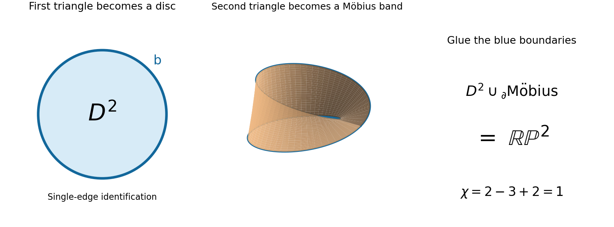

<h1 id="e/4/ii/solution">Solution</h1>

↑ **Parent:** [Ii](../ii.md)

The two singly marked sides of the first triangle are glued with their endpoints at $A$ matched. A cross-section parallel to the remaining side has its two endpoints identified, becoming a [circle](../../../../../circle.md); the apex becomes its [cone](../../../../../cone-geometry.md) point. Thus this [quotient](../../../../../quotient.md) triangle is a **[disc](../../../../../topological-disc.md)**, whose boundary is the doubly marked edge.

In the second triangle, the two triply marked sides run consecutively along the boundary from $E$ through $D$ to $F$. Pairing these sides in the indicated directions introduces one reversal; its boundary word is $aa b^{-1}$, where $b$ is the remaining doubly marked edge. This is a **[Möbius band](../../../../../mobius-band.md)** with boundary $b$. One can obtain the usual rectangle model by cutting from the identified triple-edge seam to the midpoint of $b$ and opening the triangle.

The double markings glue the [disc](../../../../../topological-disc.md) boundary to the boundary of that [Möbius band](../../../../../mobius-band.md). Capping a [Möbius band](../../../../../mobius-band.md) by a [disc](../../../../../topological-disc.md) gives

$$
\boxed{\mathbb{RP}^2,\text{ the real projective plane}.}
$$

This description also verifies that the [quotient](../../../../../quotient.md) is a [closed surface](../../../../../closed-surface.md), including the vertices. As a check, the vertex classes are $\{A\}$ and $\{B,C,D,E,F\}$; there are three edge classes and two faces. The [Euler characteristic](../../../../../euler-characteristic.md) is $2-3+2=1$, consistent with the [projective plane](../../../../../projective-plane.md). The [Möbius band](../../../../../mobius-band.md) exhibits nonorientability directly.

**[Figure 1](#e/4/ii/image-the-identified-triangles-become-a-disc-and-a-mobius-band-joined-along-their-boundary). The identified triangles become a disc and a Möbius band joined along their boundary**.

## ↑ Ancestors (13)

1. [Ii](../ii.md)
2. [4](../../4.md)
3. [E](../../../e.md)
4. [2006](../../../../2006-split.md)
5. [Past exam of the options II course of the University of Oxford](../../../../split.md)
6. [Options II course of the University of Oxford](../../../../../options-ii-course-of-the-university-of-oxford.md)
7. [Year 2 of the mathematics course of the University of Oxford](../../../../../year-2-of-the-mathematics-course-of-the-university-of-oxford.md)
8. [Mathematics course of the University of Oxford](../../../../../mathematics-course-of-the-university-of-oxford.md)
9. [Undergraduate course of the University of Oxford](../../../../../undergraduate-course-of-the-university-of-oxford.md)
10. [Course of the University of Oxford](../../../../../course-of-the-university-of-oxford.md)
11. [University of Oxford](../../../../../university-of-oxford-split.md)
12. [List of universities](../../../../../list-of-universities.md)
13. [Codex Wiki](../../../../../split.md)
