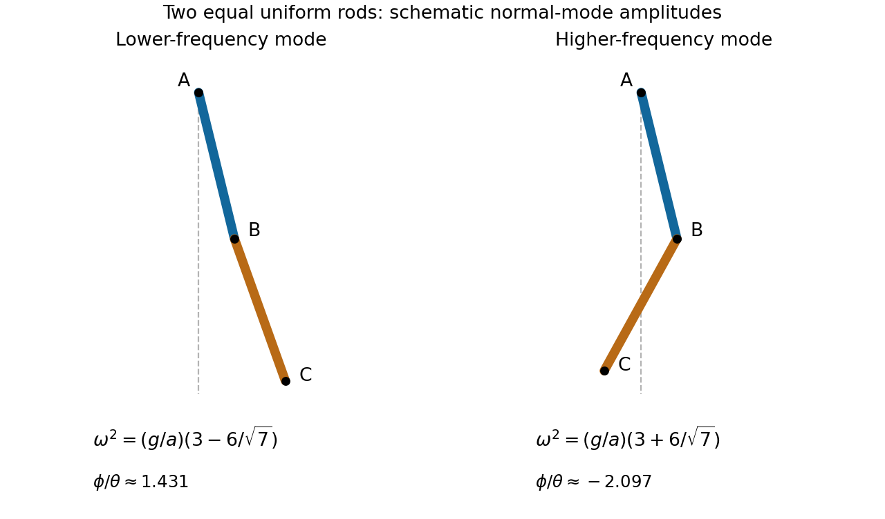

<h1 id="h/2/solution">Solution</h1>

↑ **Parent:** [2](../2.md)

Use coordinates with the downward vertical as reference. The first rod's center is at $(a/2)(\sin\theta,-\cos\theta)$, so its translational plus rotational [kinetic energy](../../../../kinetic-energy.md) is $ma^2\dot\theta^2/6$. The second center is

$$
r_2=a(\sin\theta,-\cos\theta)+\frac a2(\sin\phi,-\cos\phi).
$$

Its squared speed is $a^2\dot\theta^2+a^2\dot\phi^2/4+a^2\dot\theta\dot\phi\cos(\theta-\phi)$. Adding its center-of-mass rotation, using [moment of inertia](../../../../moment-of-inertia.md) $ma^2/12$, gives the total

$$
T=\frac{ma^2}{6}[4\dot\theta^2+\dot\phi^2+3\dot\theta\dot\phi\cos(\theta-\phi)].
$$

The two center heights give $V=-mga(3\cos\theta+\cos\phi)/2$. Hence $L=T-V$ is exactly the stated [Lagrangian](../../../../lagrangian.md).

Small stable oscillations are about the downward [equilibrium](../../../../equilibrium-point-of-a-dynamical-system.md) $\theta=\phi=0$. Retaining quadratic terms gives $T_2=\tfrac12\dot q^TM\dot q$ and $V_2=\tfrac12q^TKq$, where

$$
q=\begin{pmatrix}\theta\\\phi\end{pmatrix},\quad
M=ma^2\begin{pmatrix}4/3&1/2\\1/2&1/3\end{pmatrix},\qquad
K=\frac{mga}{2}\begin{pmatrix}3&0\\0&1\end{pmatrix}.
$$

A [normal mode](../../../../normal-mode.md) $q=v e^{i\omega t}$ satisfies $(K-\omega^2M)v=0$. With $\kappa=a\omega^2/g$, the [determinant](../../../../determinant.md) equation is

$$
(9-8\kappa)(3-2\kappa)-9\kappa^2
=27-42\kappa+7\kappa^2=0.
$$

Thus the angular frequencies are

$$
\boxed{\omega_\pm=\sqrt{\frac ga\left(3\pm\frac6{\sqrt7}\right)}.}
$$

Both squared frequencies are positive. The [amplitude](../../../../wave-amplitude.md) ratio is $\phi/\theta=(9-8\kappa)/(3\kappa)$: it is positive in the lower-frequency mode and negative in the higher-frequency mode. The rods therefore swing in phase in the first mode and in opposite phase in the second.

**[Figure 2](#h/2/image-the-two-rod-normal-modes-have-positive-and-negative-relative-angular-amplitudes). The two-rod normal modes have positive and negative relative angular amplitudes**.

## ↑ Ancestors (12)

1. [2](../2.md)
2. [H](../../h.md)
3. [2006](../../../2006-split.md)
4. [Past exam of the options II course of the University of Oxford](../../../split.md)
5. [Options II course of the University of Oxford](../../../../options-ii-course-of-the-university-of-oxford.md)
6. [Year 2 of the mathematics course of the University of Oxford](../../../../year-2-of-the-mathematics-course-of-the-university-of-oxford.md)
7. [Mathematics course of the University of Oxford](../../../../mathematics-course-of-the-university-of-oxford.md)
8. [Undergraduate course of the University of Oxford](../../../../undergraduate-course-of-the-university-of-oxford.md)
9. [Course of the University of Oxford](../../../../course-of-the-university-of-oxford.md)
10. [University of Oxford](../../../../university-of-oxford-split.md)
11. [List of universities](../../../../list-of-universities.md)
12. [Codex Wiki](../../../../split.md)
