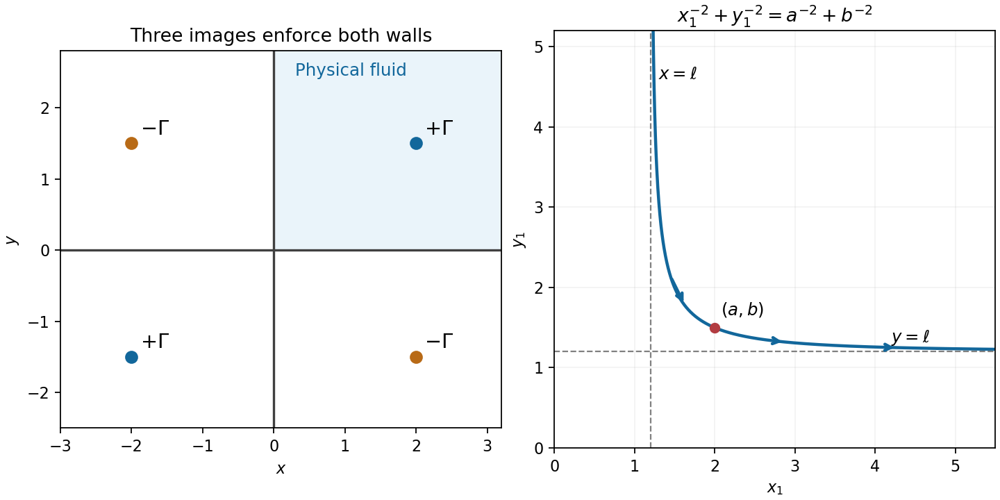

<h1 id="k/3/solution">Solution</h1>

↑ **Parent:** [3](../3.md)

Use the convention that a positive [vortex](../../../../phase-vortex.md) has counterclockwise [circulation](../../../../circulation-physics.md), with [complex potential of a two-dimensional potential flow](../../../../complex-potential-of-a-two-dimensional-potential-flow.md) $\Gamma\log(z-z_1)/(2\pi i)$. To make both coordinate axes [streamlines](../../../../streamline.md), place images of strength $-\Gamma$ at $\bar z_1$ and $-\bar z_1$, and strength $+\Gamma$ at $-z_1$. The resulting potential is

$$
\boxed{W(z)=\frac{\Gamma}{2\pi i}
\log\frac{(z-z_1)(z+z_1)}{(z-\bar z_1)(z+\bar z_1)}.}
$$

Additive constants and consistent logarithm branches do not affect velocity. The [quotient](../../../../quotient.md) has unit modulus on either wall, so the [streamfunction](../../../../stream-function.md) is constant there and there is no normal flow.

The [vortex](../../../../phase-vortex.md) moves with the regular fluid velocity after removing its own singular [field](../../../../field.md). Since $W'=u-iv$, evaluating the three image contributions at $z_1$ gives exactly

$$
\boxed{\frac{d\bar z_1}{dt}=-\frac{i\Gamma}{2\pi}
\left(\frac1{2z_1}-\frac1{z_1-\bar z_1}-\frac1{z_1+\bar z_1}\right).}
$$

The overall minus sign and the two reflected-term minus signs here agree with the source scan.

Write $z_1=x+iy$, with $x,y>0$. Taking real and imaginary parts yields

$$
\dot x=\frac{\Gamma x^2}{4\pi y(x^2+y^2)},\qquad
\dot y=-\frac{\Gamma y^2}{4\pi x(x^2+y^2)}.
$$

Dividing gives $dy/dx=-y^3/x^3$, which integrates to

$$
\boxed{\frac1{x^2}+\frac1{y^2}=\frac1{a^2}+\frac1{b^2}.}
$$

Put $\ell=ab/\sqrt{a^2+b^2}$. The first-quadrant branch has vertical and horizontal asymptotes $x=\ell$ and $y=\ell$. Its motion is to the right and downward: from large $y$ near the vertical asymptote toward large $x$ near the horizontal one. Both coordinates stay strictly positive, so no wall is crossed.

**[Figure 3](#k/3/image-the-three-image-vortices-and-the-decreasing-first-quadrant-vortex-path). The three image vortices and the decreasing first-quadrant vortex path**.

## ↑ Ancestors (12)

1. [3](../3.md)
2. [K](../../k.md)
3. [2006](../../../2006-split.md)
4. [Past exam of the options II course of the University of Oxford](../../../split.md)
5. [Options II course of the University of Oxford](../../../../options-ii-course-of-the-university-of-oxford.md)
6. [Year 2 of the mathematics course of the University of Oxford](../../../../year-2-of-the-mathematics-course-of-the-university-of-oxford.md)
7. [Mathematics course of the University of Oxford](../../../../mathematics-course-of-the-university-of-oxford.md)
8. [Undergraduate course of the University of Oxford](../../../../undergraduate-course-of-the-university-of-oxford.md)
9. [Course of the University of Oxford](../../../../course-of-the-university-of-oxford.md)
10. [University of Oxford](../../../../university-of-oxford-split.md)
11. [List of universities](../../../../list-of-universities.md)
12. [Codex Wiki](../../../../split.md)
