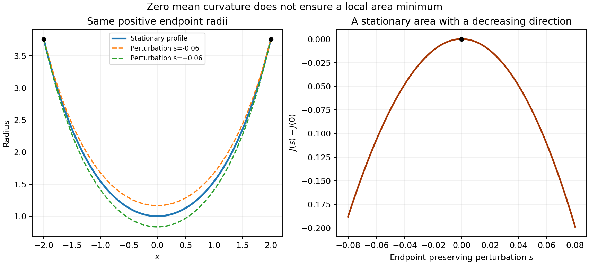

# 2007

↑ **Parent:** [Past exam of the options II course of the University of Oxford](../past-exam-of-the-options-ii-course-of-the-university-of-oxford.md)

Options II, Honour School of Mathematics; Friday 22 June 2007, 2.30pm–5.30pm. The full twelve-page source, including the original identification diagram and all nineteen questions, is privately transcribed from original Part A bundle pages 20–31, supplied through [the past-papers disclosure](https://www.whatdotheyknow.com/request/maths_past_papers_3). No exact worked-answer advertisement was found in the bounded availability check. Printed formulas that are false as stated are retained in the transcription; the corresponding solutions explain their corrections.

**Table of contents**

- [A](#a)
  - [A2](#a/a2)
    - [Solution](#a/a2/solution)
- [B](#b)
  - [B2](#b/b2)
    - [Solution](#b/b2/solution)
    - [i](#b/b2/i)
      - [Solution](#b/b2/i/solution)
    - [ii](#b/b2/ii)
      - [Solution](#b/b2/ii/solution)
    - [iii](#b/b2/iii)
      - [Solution](#b/b2/iii/solution)
    - [iv](#b/b2/iv)
      - [Solution](#b/b2/iv/solution)
    - [v](#b/b2/v)
      - [Solution](#b/b2/v/solution)
- [C](#c)
  - [C2](#c/c2)
    - [Solution](#c/c2/solution)
- [D](#d)
  - [D3](#d/d3)
    - [i](#d/d3/i)
      - [Solution](#d/d3/i/solution)
    - [ii](#d/d3/ii)
      - [Solution](#d/d3/ii/solution)
    - [iii](#d/d3/iii)
      - [Solution](#d/d3/iii/solution)
  - [D4](#d/d4)
    - [i](#d/d4/i)
      - [Solution](#d/d4/i/solution)
    - [ii](#d/d4/ii)
      - [Solution](#d/d4/ii/solution)
- [E](#e)
  - [E3](#e/e3)
    - [Solution](#e/e3/solution)
    - [a](#e/e3/a)
      - [Solution](#e/e3/a/solution)
    - [b](#e/e3/b)
      - [Solution](#e/e3/b/solution)
    - [c](#e/e3/c)
      - [Solution](#e/e3/c/solution)
    - [d](#e/e3/d)
      - [Solution](#e/e3/d/solution)
    - [e](#e/e3/e)
      - [Solution](#e/e3/e/solution)
  - [E4](#e/e4)
    - [a](#e/e4/a)
      - [Solution](#e/e4/a/solution)
    - [b](#e/e4/b)
      - [Solution](#e/e4/b/solution)
- [F](#f)
  - [F2](#f/f2)
    - [Solution](#f/f2/solution)
- [G](#g)
  - [G2](#g/g2)
    - [i](#g/g2/i)
      - [Solution](#g/g2/i/solution)
    - [ii](#g/g2/ii)
      - [Solution](#g/g2/ii/solution)
    - [iii](#g/g2/iii)
      - [Solution](#g/g2/iii/solution)
- [H](#h)
  - [H2](#h/h2)
    - [Solution](#h/h2/solution)
- [J](#j)
  - [J2](#j/j2)
    - [Solution](#j/j2/solution)
- [K](#k)
  - [K3](#k/k3)
    - [Solution](#k/k3/solution)
  - [K4](#k/k4)
    - [Solution](#k/k4/solution)
- [M](#m)
  - [M4](#m/m4)
    - [Solution](#m/m4/solution)
  - [M5](#m/m5)
    - [a](#m/m5/a)
      - [Solution](#m/m5/a/solution)
    - [b](#m/m5/b)
      - [Solution](#m/m5/b/solution)
- [O](#o)
  - [O4](#o/o4)
    - [Solution](#o/o4/solution)
  - [O5](#o/o5)
    - [Solution](#o/o5/solution)
- [P](#p)
  - [P3](#p/p3)
    - [a](#p/p3/a)
      - [Solution](#p/p3/a/solution)
    - [b](#p/p3/b)
      - [Solution](#p/p3/b/solution)
    - [c](#p/p3/c)
      - [Solution](#p/p3/c/solution)
    - [d](#p/p3/d)
      - [Solution](#p/p3/d/solution)
  - [P4](#p/p4)
    - [a](#p/p4/a)
      - [Solution](#p/p4/a/solution)
    - [b](#p/p4/b)
      - [Solution](#p/p4/b/solution)
    - [c](#p/p4/c)
      - [Solution](#p/p4/c/solution)
    - [d](#p/p4/d)
      - [Solution](#p/p4/d/solution)
    - [e](#p/p4/e)
      - [Solution](#p/p4/e/solution)
    - [f](#p/p4/f)
      - [Solution](#p/p4/f/solution)

## A

↑ **Parent:** [2007](2007.md)

<h3 id="a/a2">A2</h3>

↑ **Parent:** [A](#a)

<h4 id="a/a2/solution">Solution</h4>

↑ **Parent:** [A2](#a/a2)

Every nonzero vector can be extended to a [basis](../vector-space.md#basis), and the invertible map between two such bases carries the first vector to the second. The action is therefore transitive. Counting ordered bases gives

$$
|G|=(8-1)(8-2)(8-4)=168.
$$

The [stabilizer](../group-action.md#stabilizer-subgroup) $H$ of one nonzero vector consequently has order $168/7=24$. There are three planes containing that vector, corresponding to the three lines of the two-dimensional quotient space. Adapted bases show $H$ acts transitively on these planes, so the [stabilizer](../group-action.md#stabilizer-subgroup) of one such plane has order $24/3=8$.

Let $Q$ be any subgroup of order eight. Its [orbit](../dynamical-systems.md#orbit-dynamical-system) lengths on the seven nonzero vectors are powers of two. Since their sum is odd, at least one [orbit](../dynamical-systems.md#orbit-dynamical-system) has length one. Fix such a vector $v$. The action on the three planes through $v$ likewise has a fixed plane $P$. Thus $Q$ is contained in the [stabilizer](../group-action.md#stabilizer-subgroup) of the [flag](../vector-space.md#flag-linear-algebra) $\langle v\rangle\subset P$, and equality follows because that [stabilizer](../group-action.md#stabilizer-subgroup) already has order eight. The full [group](../group.md) acts transitively on these flags, so all the subgroups are conjugate.

There are $7\cdot3=21$ flags. To see they yield distinct subgroups, use the standard upper unitriangular matrices relative to an adapted [basis](../vector-space.md#basis). Their only common nonzero fixed vector is the first [basis](../vector-space.md#basis) vector: varying entries in positions $(1,2)$ and $(1,3)$ forces the other two coordinates to vanish. On the quotient by that line, varying position $(2,3)$ leaves only the line of the second [basis](../vector-space.md#basis) vector fixed. Hence this subgroup fixes exactly one full [flag](../vector-space.md#flag-linear-algebra). Conjugation transfers uniqueness to each [flag](../vector-space.md#flag-linear-algebra) [stabilizer](../group-action.md#stabilizer-subgroup), giving

$$
\boxed{21\text{ subgroups of order eight}}.
$$

## B

↑ **Parent:** [2007](2007.md)

<h3 id="b/b2">B2</h3>

↑ **Parent:** [B](#b)

<h4 id="b/b2/solution">Solution</h4>

↑ **Parent:** [B2](#b/b2)

An element is algebraic over $F$ if it is a zero of some nonzero polynomial in $F[x]$. An extension is algebraic if every element is algebraic. If $[K:F]=d<\infty$, the $d+1$ elements $1,\alpha,\ldots,\alpha^d$ are linearly dependent over $F$, proving every $\alpha\in K$ is algebraic.

The converse fails for the [algebraic closure](../algebra.md#algebraic-closure) $\overline{\mathbb Q}$ inside $\mathbb C$. All its elements are algebraic by definition, but it contains $2^{1/n}$ of degree $n$ for every positive integer $n$, since $x^n-2$ is irreducible by Eisenstein's criterion at two. A finite extension could not contain elements of unbounded degree, so this [algebraic extension](../algebra.md#algebraic-extension) is infinite.

<h4 id="b/b2/i">i</h4>

↑ **Parent:** [B2](#b/b2)

<h5 id="b/b2/i/solution">Solution</h5>

↑ **Parent:** [I](#b/b2/i)

All sixth roots of unity lie in $\mathbb Q(\zeta_6)$, with $\zeta_6=(1+\sqrt{-3})/2$. Its quadratic polynomial $x^2-x+1$ has no rational root, so

$$
\boxed{K=\mathbb Q(\sqrt{-3}),\qquad[K:\mathbb Q]=2}.
$$

<h4 id="b/b2/ii">ii</h4>

↑ **Parent:** [B2](#b/b2)

<h5 id="b/b2/ii/solution">Solution</h5>

↑ **Parent:** [Ii](#b/b2/ii)

A primitive seventh root generates all seventh roots, so the [splitting field](../galois-theory.md#splitting-field) is $\mathbb Q(\zeta_7)$. Its [minimal polynomial](../linear-operator-theory.md#minimal-polynomial) is the given irreducible [cyclotomic polynomial](../galois-theory.md#cyclotomic-polynomial) $1+x+\cdots+x^6$. Therefore $\boxed{[K:\mathbb Q]=6}$.

<h4 id="b/b2/iii">iii</h4>

↑ **Parent:** [B2](#b/b2)

<h5 id="b/b2/iii/solution">Solution</h5>

↑ **Parent:** [Iii](#b/b2/iii)

A primitive eighth root satisfies $\zeta_8=(1+i)/\sqrt2$, while $i=\zeta_8^2$ and $\sqrt2=\zeta_8+\zeta_8^{-1}$. Thus $K=\mathbb Q(i,\sqrt2)$. The real elements of $\mathbb Q(i)$ are rational, so it does not contain $\sqrt2$. The tower law gives

$$
\boxed{[K:\mathbb Q]=2\cdot2=4}.
$$

<h4 id="b/b2/iv">iv</h4>

↑ **Parent:** [B2](#b/b2)

<h5 id="b/b2/iv/solution">Solution</h5>

↑ **Parent:** [Iv](#b/b2/iv)

The cubic $x^3+x+1$ has no zero in $\mathbb F_2$, so is irreducible. Its quotient field has eight elements. Every nonzero element of that field satisfies $x^7=1$ by the order of its multiplicative [group](../group.md), so the polynomial splits there. It does not already split in the base field; a root of that irreducible cubic, which divides $x^7-1$, is needed. Hence

$$
\boxed{K\cong\mathbb F_8,\qquad[K:\mathbb F_2]=3}.
$$

<h4 id="b/b2/v">v</h4>

↑ **Parent:** [B2](#b/b2)

<h5 id="b/b2/v/solution">Solution</h5>

↑ **Parent:** [V](#b/b2/v)

In characteristic two, repeated squaring gives $x^8-1=(x-1)^8$. There is only the root one, already in the base field. Thus $\boxed{K=\mathbb F_2,\quad[K:\mathbb F_2]=1}$. Repeated roots do not require a larger [splitting field](../galois-theory.md#splitting-field).

## C

↑ **Parent:** [2007](2007.md)

<h3 id="c/c2">C2</h3>

↑ **Parent:** [C](#c)

<h4 id="c/c2/solution">Solution</h4>

↑ **Parent:** [C2](#c/c2)

[Wilson's theorem](../modular-arithmetic.md#wilson-s-theorem) states that for a prime $p$, $(p-1)!\equiv-1\pmod p$. For odd $p$, pair each nonzero [residue](../analysis.md#residue) with its multiplicative inverse. Only the self-inverse residues remain unpaired; $x^2=1$ in a field gives $x=\pm1$. Their product is $-1$, proving the result. For $p=2$ the assertion is immediate.

If composite $n\ge6$ is not the square of a prime, choose a prime divisor $p$ such that $p$ and $n/p$ are distinct. Both occur among the factors of $(n-1)!$, so their product $n$ divides it. In the remaining case $n=p^2$, $p\ge3$, and the two distinct factors $p,2p$ both occur in the factorial and have product divisible by $p^2$. Thus the factorial is zero modulo every such composite $n$.

For prime $n$, Wilson's congruence makes the numerator sine squared equal $\sin^2(\pi/n)$, so its ratio is one. For composite $n\ge6$, the numerator vanishes. The only exceptional composite in the sum is four; its ratio is $\sin^2(3\pi/2)/\sin^2(\pi/4)=2$. Therefore for $x\ge4$ the sum counts the primes plus two, and subtracting two gives exactly the required prime count. All statements concern the integers $2\le n\le\lfloor x\rfloor$.

## D

↑ **Parent:** [2007](2007.md)

<h3 id="d/d3">D3</h3>

↑ **Parent:** [D](#d)

<h4 id="d/d3/i">i</h4>

↑ **Parent:** [D3](#d/d3)

<h5 id="d/d3/i/solution">Solution</h5>

↑ **Parent:** [I](#d/d3/i)

A [coordinate transformation](../differential-geometry.md#smooth-transition-map) is a continuously differentiable bijection from the [open set](../topology.md#open-set) $U$ onto an open image, with continuously differentiable inverse. Equivalently one may specify a one-to-one continuously differentiable map whose [Jacobian determinant](../multivariable-calculus.md#jacobian-determinant) is everywhere nonzero; the [inverse function theorem](../multivariable-calculus.md#inverse-function-theorem) gives the corresponding smooth inverse on its image.

<h4 id="d/d3/ii">ii</h4>

↑ **Parent:** [D3](#d/d3)

<h5 id="d/d3/ii/solution">Solution</h5>

↑ **Parent:** [Ii](#d/d3/ii)

The change-of-variables formula is

$$
\boxed{\int_{T(U)}f(y)\,dy=\int_U f(T(x))|\det DT_x|\,dx}.
$$

For an integrable $f$, the transformed function with its absolute-Jacobian factor is integrable as well. The absolute value is essential because the integral does not depend on whether the coordinate change preserves [orientation](../algebraic-topology.md#orientation-of-a-simplex).

<h4 id="d/d3/iii">iii</h4>

↑ **Parent:** [D3](#d/d3)

<h5 id="d/d3/iii/solution">Solution</h5>

↑ **Parent:** [Iii](#d/d3/iii)

Use $u=x-y$, $v=x+y$. It sends the diamond-shaped open square onto $(-1,1)^2$, and the inverse Jacobian has absolute [determinant](../multilinear-algebra.md#determinant) $1/2$. On this rectangle $|u|<1$ and $v+2>1$, so the original function is measurable, bounded by one and supported on a finite-area set, proving integrability. The transformed integral separates:

$$
\int f^{2n}=\frac12\int_{-1}^1u^{2n}\,du\int_{-1}^1(v+2)^{-2n}\,dv
=\boxed{\frac{1-3^{1-2n}}{(2n+1)(2n-1)}}.
$$

The two one-dimensional integrals follow from the [fundamental theorem of calculus](../calculus.md#fundamental-theorem-of-calculus); Fubini's theorem applies by the established integrability.

<h3 id="d/d4">D4</h3>

↑ **Parent:** [D](#d)

<h4 id="d/d4/i">i</h4>

↑ **Parent:** [D4](#d/d4)

<h5 id="d/d4/i/solution">Solution</h5>

↑ **Parent:** [I](#d/d4/i)

The [dominated convergence theorem](../measure-theory.md#dominated-convergence-theorem) says that if measurable $f_n\to f$ almost everywhere and $|f_n|\le g$ for an integrable $g$, then $f$ is integrable, $\int|f_n-f|\to0$, and consequently $\int f_n\to\int f$.

First derive [Fatou's lemma](../measure-theory.md#fatou-s-lemma) from monotone convergence. For nonnegative $u_n$, the measurable functions $v_n=\inf_{j\ge n}u_j$ increase to $\liminf u_n$, and $\int v_n\le\inf_{j\ge n}\int u_j$. Monotone convergence therefore yields $\int\liminf u_n\le\liminf\int u_n$.

Now $f$ is measurable and $|f|\le g$ almost everywhere, so is integrable. Apply [Fatou's lemma](../measure-theory.md#fatou-s-lemma) to $u_n=2g-|f_n-f|\ge0$, which converges almost everywhere to $2g$:

$$
\int2g\le\liminf_n\left(\int2g-\int|f_n-f|\right)
=\int2g-\limsup_n\int|f_n-f|.
$$

The last integrals are nonnegative, so they tend to zero. Finally $|\int f_n-\int f|\le\int|f_n-f|\to0$. This argument also works for complex-valued functions.

<h4 id="d/d4/ii">ii</h4>

↑ **Parent:** [D4](#d/d4)

<h5 id="d/d4/ii/solution">Solution</h5>

↑ **Parent:** [Ii](#d/d4/ii)

At each $x>0$, eventually $x<n$, and the stipulated power limit gives $f_n(x)\to e^{-x}\sin x$. At nonpositive $x$ the functions vanish. On their positive support,

$$
|f_n(x)|\le(1-x/n)^n\le e^{-x}.
$$

The supplied integrable exponential therefore dominates the sequence. Dominated convergence gives

$$
\lim_n\int f_n=\int_0^\infty e^{-x}\sin x\,dx=\operatorname{Im}\frac1{1-i}=\boxed{\frac12}.
$$

The final improper integral is absolutely convergent, so agrees with its [Lebesgue integral](../measure-theory.md#lebesgue-integral).

## E

↑ **Parent:** [2007](2007.md)

<h3 id="e/e3">E3</h3>

↑ **Parent:** [E](#e)

<h4 id="e/e3/solution">Solution</h4>

↑ **Parent:** [E3](#e/e3)

[Compactness](../topology.md#compact-space) means every open cover has a finite subcover. [Connectedness](../geometry-and-topology.md#connected-space) means the space cannot be written as the union of two disjoint nonempty open sets. The [Hausdorff](../topology.md#hausdorff-space) property means every two distinct points have disjoint open neighbourhoods.

<h4 id="e/e3/a">a</h4>

↑ **Parent:** [E3](#e/e3)

<h5 id="e/e3/a/solution">Solution</h5>

↑ **Parent:** [A](#e/e3/a)

**True.** Pull an open cover of $Y$ back through $f$. Surjectivity makes those inverse images cover $X$. A finite subcover of the [compact](../topology.md#compact-space) space $X$ maps back to a finite subcover of $Y$. Thus a continuous image of a [compact](../topology.md#compact-space) space is [compact](../topology.md#compact-space).

<h4 id="e/e3/b">b</h4>

↑ **Parent:** [E3](#e/e3)

<h5 id="e/e3/b/solution">Solution</h5>

↑ **Parent:** [B](#e/e3/b)

**True.** A separation of $Y$ into two disjoint nonempty open sets would pull back to a separation of $X$: [continuity](../calculus.md#continuous-function) gives openness, and surjectivity gives nonemptiness. This contradicts [connectedness](../geometry-and-topology.md#connected-space) of $X$.

<h4 id="e/e3/c">c</h4>

↑ **Parent:** [E3](#e/e3)

<h5 id="e/e3/c/solution">Solution</h5>

↑ **Parent:** [C](#e/e3/c)

**True.** Every singleton in a [Hausdorff space](../topology.md#hausdorff-space) is closed. Thus $f^{-1}(\{y\})$ is closed in $X$ by [continuity](../calculus.md#continuous-function). A closed subset of a [compact](../topology.md#compact-space) space is [compact](../topology.md#compact-space), whether or not that [compact](../topology.md#compact-space) space is [Hausdorff](../topology.md#hausdorff-space). Hence every fibre is [compact](../topology.md#compact-space).

<h4 id="e/e3/d">d</h4>

↑ **Parent:** [E3](#e/e3)

<h5 id="e/e3/d/solution">Solution</h5>

↑ **Parent:** [D](#e/e3/d)

**False.** Take $X=[-1,1]$, $Y=[0,1]$ and $f(x)=x^2$, with their usual topologies. The domain is [compact](../topology.md#compact-space) and [connected](../geometry-and-topology.md#connected-space), the codomain is [Hausdorff](../topology.md#hausdorff-space), and the map is continuous and onto. But the fibre over one is $\{-1,1\}$, a disconnected two-point subspace.

<h4 id="e/e3/e">e</h4>

↑ **Parent:** [E3](#e/e3)

<h5 id="e/e3/e/solution">Solution</h5>

↑ **Parent:** [E](#e/e3/e)

**False.** Let $X$ be an indiscrete two-point space and $Y$ a one-point space. The constant map is continuous and onto; $X$ is [compact](../topology.md#compact-space) because it is finite and [connected](../geometry-and-topology.md#connected-space) because its only nonempty [open set](../topology.md#open-set) is the whole space. It is not [Hausdorff](../topology.md#hausdorff-space), since its two points have no disjoint nonempty neighbourhoods. The one-point codomain is [Hausdorff](../topology.md#hausdorff-space).

<h3 id="e/e4">E4</h3>

↑ **Parent:** [E](#e)

<h4 id="e/e4/a">a</h4>

↑ **Parent:** [E4](#e/e4)

<h5 id="e/e4/a/solution">Solution</h5>

↑ **Parent:** [A](#e/e4/a)

For the surjection $p$ to the set of equivalence classes, define a subset $V$ of the quotient to be open exactly when $p^{-1}(V)$ is open in $X$. Inverse images preserve the empty and full sets, arbitrary unions and finite intersections. Applying the topology axioms in $X$ proves this is a topology on the quotient, and it makes $p$ continuous.

The map need not be open. On $X=\mathbb R$, identify zero with one and leave every other point in its own class. The set $U=(-1/4,1/4)$ is open, but its [saturation](../model-theory.md#homogeneity-plus-realization-of-empty-set-types-implies-saturation) is

$$
p^{-1}(p(U))=U\cup\{1\},
$$

which is not open in $\mathbb R$. Thus $p(U)$ is not open in the [quotient topology](../topology.md#quotient-topology). [Continuity](../calculus.md#continuous-function) of a [quotient map](../topology.md#quotient-map) does not imply openness.

<h4 id="e/e4/b">b</h4>

↑ **Parent:** [E4](#e/e4)

<h5 id="e/e4/b/solution">Solution</h5>

↑ **Parent:** [B](#e/e4/b)

The surface is a **[Klein bottle](../topological-surface.md#klein-bottle)**. Here is a cell-count justification that keeps all the arrow directions. Name the corners of the first square $a,b,c,d$, beginning at its upper left and proceeding clockwise; name those of the second $e,f,g,h$ in the same way. The single-arrow gluing identifies $a$ with $e$ and $b$ with $h$. The triple-arrow gluing identifies $d$ with $h$ and $c$ with $g$. The first square's quadruple-arrow gluing identifies $b$ with $d$ and $c$ with $a$. The second square's double-arrow gluing identifies $e,f,g$ with one another. There are exactly two resulting vertex classes:

$$
\{a,c,e,f,g\},\qquad\{b,d,h\}.
$$

There are four edge classes and two faces, so the [Euler characteristic](../homology.md#euler-characteristic) is $2-4+2=0$. Every edge is paired and the corner links close into circles, giving a [compact](../topology.md#compact-space) surface without boundary; the cross-square identifications make it [connected](../geometry-and-topology.md#connected-space). It is nonorientable: the quadruple-arrow identification glues two boundary edges of the same square in the same boundary-traversal direction, so no [orientation](../algebraic-topology.md#orientation-of-a-simplex) of that face can extend across the gluing. The classification of [compact](../topology.md#compact-space) [connected](../geometry-and-topology.md#connected-space) surfaces now identifies the nonorientable surface of [Euler characteristic](../homology.md#euler-characteristic) zero as the [Klein bottle](../topological-surface.md#klein-bottle).

Geometrically, the internal identification in each square produces a [Möbius band](../topological-surface.md#mobius-band). The remaining single- and triple-arrow edges comprise their two boundary circles, which are glued together. The double of a [Möbius band](../topological-surface.md#mobius-band) is another description of the same [Klein bottle](../topological-surface.md#klein-bottle).

## F

↑ **Parent:** [2007](2007.md)

<h3 id="f/f2">F2</h3>

↑ **Parent:** [F](#f)

<h4 id="f/f2/solution">Solution</h4>

↑ **Parent:** [F2](#f/f2)

Differentiability at $a$ means that a linear map $L:V\to V_1$ satisfies

$$
\frac{\|f(a+h)-f(a)-Lh\|_1}{\|h\|}\longrightarrow0\quad(h\to0).
$$

This map is unique and is the total derivative $Df_a$. In finite dimensions linear maps are continuous.

The [Frobenius norm](../compact-operator.md#frobenius-norm) is submultiplicative. Expanding the noncommuting cube gives

$$
(A+H)^3=A^3+A^2H+AHA+HA^2+AH^2+HAH+H^2A+H^3.
$$

The last four terms have [norm](../normed-vector-space.md#norm) at most $3|A||H|^2+|H|^3=o(|H|)$. Thus

$$
\boxed{Df_A(H)=A^2H+AHA+HA^2}.
$$

If $|C|<1$, the [Neumann series](../banach-algebra.md#neumann-series) $\sum_{j\ge0}(-C)^j$ converges and is the inverse of $I+C$, as follows by multiplying its partial sums and letting the final power tend to zero. Its terms from degree two onwards have [norm](../normed-vector-space.md#norm) at most $|C|^2/(1-|C|)$. Hence $(I+C)^{-1}=I-C+O(|C|^2)$.

For invertible $A$, write $A+H=A(I+A^{-1}H)$. Whenever $|A^{-1}||H|<1$, this is invertible, proving the [general linear group](../group-theory.md#general-linear-group) is open. The same expansion gives

$$
(A+H)^{-1}=A^{-1}-A^{-1}HA^{-1}+O(|H|^2).
$$

Compose this inverse derivative with the cube derivative, setting $B=A^{-1}$. The result is

$$
\boxed{Dg_A(H)=-(A^{-3}HA^{-1}+A^{-2}HA^{-2}+A^{-1}HA^{-3})}.
$$

The three terms cannot generally be combined into a scalar-style $-3A^{-4}H$, because matrix factors need not commute.

This is the cubic case of the [Fréchet derivative of a negative matrix power](../multivariable-calculus.md#frechet-derivative-of-a-negative-matrix-power).

## G

↑ **Parent:** [2007](2007.md)

<h3 id="g/g2">G2</h3>

↑ **Parent:** [G](#g)

<h4 id="g/g2/i">i</h4>

↑ **Parent:** [G2](#g/g2)

<h5 id="g/g2/i/solution">Solution</h5>

↑ **Parent:** [I](#g/g2/i)

Parametrize the surface by $r(x,\theta)=(x,y(x)\cos\theta,y(x)\sin\theta)$, with $0\le\theta<2\pi$. Its tangent vectors are [orthogonal](../inner-product.md#orthogonal-vectors), of lengths $\sqrt{1+y'^2}$ and $y$. Thus the area element is $y\sqrt{1+y'^2}\,dx\,d\theta$. Integrating over the angle gives

$$
\boxed{J[y]=2\pi\int_{x_1}^{x_2}y\sqrt{1+y'^2}\,dx}.
$$

<h4 id="g/g2/ii">ii</h4>

↑ **Parent:** [G2](#g/g2)

<h5 id="g/g2/ii/solution">Solution</h5>

↑ **Parent:** [Ii](#g/g2/ii)

Discard the constant factor $2\pi$ when forming the [Euler-Lagrange equation](../analysis.md#euler-lagrange-equation). For $F=y\sqrt{1+y'^2}$ it becomes

$$
\sqrt{1+y'^2}-\frac d{dx}\frac{yy'}{\sqrt{1+y'^2}}=0,
\qquad yy''=1+y'^2.
$$

The [Beltrami identity](../analysis.md#beltrami-identity), since $F$ has no explicit $x$ dependence, gives $F-y'F_{y'}=y/\sqrt{1+y'^2}=C>0$. Combining with the differential equation yields $y''=y/C^2$. Its exponential solution has coefficients whose product is $C^2/4$, by $y'^2=y^2/C^2-1$. Positivity therefore puts it in the form

$$
\boxed{y(x)=C\cosh((x-K)/C),\qquad C>0}.
$$

Its constants must satisfy $y_1=C\cosh((x_1-K)/C)$ and $y_2=C\cosh((x_2-K)/C)$. Depending on the endpoint data, these equations may have no solution or more than one. A constant function can satisfy a formal first-integral equation but fails the full [Euler-Lagrange equation](../analysis.md#euler-lagrange-equation); it is not an extra extremal.

<h4 id="g/g2/iii">iii</h4>

↑ **Parent:** [G2](#g/g2)

<h5 id="g/g2/iii/solution">Solution</h5>

↑ **Parent:** [Iii](#g/g2/iii)

The functional is unbounded above. Let $y_0$ be the positive affine interpolant between the two endpoint values, and choose a smooth nonnegative function $\phi$ that vanishes at the endpoints and is positive somewhere inside. The admissible curves $y_M=y_0+M\phi$ satisfy

$$
J[y_M]\ge2\pi\int y_M\,dx\longrightarrow\infty.
$$

**The claimed minimum conclusion does not follow and is false in general.** A stationary point may have a negative [second variation](../calculus-of-variations.md#second-variation), even though the functional is unbounded above. Here is an explicit example within the allowed positive-[graph](../graph.md) class.

Take the stationary profile $y(x)=\cosh x$ on $[-2,2]$, and the endpoint-zero variation $\eta(x)=\cosh x-\cosh2$. For sufficiently small perturbation parameter $s$, $y+s\eta$ remains positive and preserves both endpoint values. Put $C=\cosh2$. Differentiating the area twice and integrating its mixed term by parts gives

$$
\frac{\delta^2J[\eta]}{2\pi}=\int_{-2}^2\operatorname{sech}^2x\,(\eta'^2-\eta^2)\,dx
=4C\arctan(\sinh2)-2(1+C^2)\tanh2.
$$

This is strictly negative: the first term is less than $2\pi C$, while $(C+C^{-1})\tanh2>\pi$. For example $e^2>7$ gives $C>7/2$ and $\tanh2>24/25$, whose product already exceeds $\pi$. Thus nearby positive profiles have smaller area. This [catenoid](../differential-geometry.md#catenoid) is **not a local minimum**.

The corrected conclusion is that any smooth positive minimizer, if attained, must have the [catenoid](../differential-geometry.md#catenoid) form. That necessary condition is not sufficient, and existence or stability requires a separate argument.

**[Figure 1](#g/g2/iii/image-a-catenoid-with-a-negative-second-variation). A catenoid with a negative second variation**. Endpoint-preserving positive perturbations of an extended catenoid lower the area; the stationary profile is not a local minimum.

## H

↑ **Parent:** [2007](2007.md)

<h3 id="h/h2">H2</h3>

↑ **Parent:** [H](#h)

<h4 id="h/h2/solution">Solution</h4>

↑ **Parent:** [H2](#h/h2)

Write $q=(x,X)^T$, $M=\begin{pmatrix}a&b\\b&c\end{pmatrix}$ and $K=\begin{pmatrix}\alpha&\beta\\\beta&\gamma\end{pmatrix}$. The linear equations are $M\ddot q+Kq=0$. A [normal mode](../wave-equation.md#normal-mode) has all coordinates oscillating with one frequency and fixed relative amplitudes, $q=v\cos(\omega t+\varphi)$. Its squared frequency solves

$$
\det(K-\omega^2M)=(\alpha-a\omega^2)(\gamma-c\omega^2)-(\beta-b\omega^2)^2=0,
$$

and its amplitude vector is a nonzero null vector of $K-\omega^2M$. The assumed distinct positive roots give two normal frequencies, their positive square roots.

For the rods let $\theta_1,\theta_2$ be their small inclinations from the downward vertical. To first order, $\theta_1=x/a$ and $\theta_2=(X-x)/(2a)$. The first rod has kinetic [energy](../energy.md) $m\dot x^2/6$. The second has centre-of-mass horizontal velocity $(\dot x+\dot X)/2$ and angular velocity $(\dot X-\dot x)/(2a)$, giving

$$
T_2=\frac m4(\dot x+\dot X)^2+\frac m{12}(\dot X-\dot x)^2.
$$

Together these give $T=m(3\dot x^2+2\dot x\dot X+2\dot X^2)/6$. The centre-of-mass height changes give

$$
V=\frac{mga}{4}\theta_1^2+mga(\theta_1^2+\theta_2^2)
=\frac{mg}{4a}(6x^2-2xX+X^2),
$$

proving the displayed quadratic [Lagrangian](../calculus-of-variations.md#lagrangian).

Here $M=(m/3)\begin{pmatrix}3&1\\1&2\end{pmatrix}$ and $K=(mg/(2a))\begin{pmatrix}6&-1\\-1&1\end{pmatrix}$. Set $\lambda=2a\omega^2/(3g)$. The [determinant](../multilinear-algebra.md#determinant) equation reduces to $5\lambda^2-17\lambda+5=0$, so

$$
\boxed{\omega_\pm^2=\frac{3g}{20a}(17\pm3\sqrt{21})}.
$$

The first row of the mode equation gives $X/x=(6-3\lambda)/(1+\lambda)$. The actual rod-angle ratio is therefore

$$
\frac{\theta_2}{\theta_1}=\frac{5-4\lambda}{2(1+\lambda)}.
$$

It is positive for the smaller root and negative for the larger root. Thus **the low-frequency mode has the rods in phase, and the high-frequency mode has them out of phase**. Using the rod-angle ratio is necessary because $X$ is the displacement of the end of the second rod, not that rod's inclination.

## J

↑ **Parent:** [2007](2007.md)

<h3 id="j/j2">J2</h3>

↑ **Parent:** [J](#j)

<h4 id="j/j2/solution">Solution</h4>

↑ **Parent:** [J2](#j/j2)

In vacuum, the source-free [Maxwell equations](../maxwell-equations.md) are $\nabla\cdot E=\nabla\cdot B=0$, $\nabla\times E=-\partial_tB$ and $\nabla\times B=c^{-2}\partial_tE$. Put $\vartheta=\omega(t-z/c)$ and denote the field amplitude by $E_0$. The corresponding travelling-wave [magnetic field](../magnetic-field.md) is

$$
\boxed{B=\frac{E_0}{c}(-\sin\vartheta,\cos\vartheta,0)}.
$$

Both divergences vanish because the fields have no longitudinal component and no dependence on the transverse coordinates. Direct differentiation gives $\nabla\times E=(\omega E_0/c)(\cos\vartheta,\sin\vartheta,0)=-\partial_tB$ and $\nabla\times B=(\omega E_0/c^2)(-\sin\vartheta,\cos\vartheta,0)=c^{-2}\partial_tE$.

Introducing potentials by $B=\nabla\times A$ and $E=-\nabla\phi-\partial_tA$ automatically satisfies the magnetic-divergence and Faraday equations. The remaining [Maxwell equations](../maxwell-equations.md) become equations for these potentials, with the usual gauge freedom. For $\omega\ne0$ take $\phi=0$ and

$$
A=\frac c\omega B=\frac{E_0}{\omega}(-\sin\vartheta,\cos\vartheta,0).
$$

Differentiation verifies both potential relations.

The electromagnetic force is $Q(E+v\times B)$. Confinement also supplies a normal reaction force. For motion in a plane of constant $z$, both $v$ and $B$ are tangent to the plane, so their cross product is normal and is balanced by that reaction. It does not enter the in-plane equation $m\ddot r=QE_0(\cos\vartheta,\sin\vartheta)$.

At the fixed plane, the solution with no uniform drift is

$$
r(t)=r_0-\frac{QE_0}{m\omega^2}(\cos\vartheta,\sin\vartheta).
$$

It is circular, with

$$
\boxed{R=\frac{|QE_0|}{m\omega^2}}.
$$

Other initial data can add a constant drift velocity; the question only asks for the possibility of circular motion.

## K

↑ **Parent:** [2007](2007.md)

<h3 id="k/k3">K3</h3>

↑ **Parent:** [K](#k)

<h4 id="k/k3/solution">Solution</h4>

↑ **Parent:** [K3](#k/k3)

Orient the body boundary counterclockwise. The outward normal from the body satisfies $n\,ds=(dy,-dx)$, so pressure gives

$$
F_x-iF_y=-i\oint_Cp\,d\bar z.
$$

For steady [irrotational flow](../vorticity.md#irrotational-flow), Bernoulli's equation makes $p+\rho|u|^2/2$ constant in the [connected](../geometry-and-topology.md#connected-space) fluid region. Its constant contribution integrates to zero. Write $q=w'=u-iv$. Impermeability says the velocity is tangent to the boundary, so $q\,dz=\bar q\,d\bar z$ there. Consequently

$$
F_x-iF_y=\frac{i\rho}2\oint_C|q|^2d\bar z=\boxed{\frac{i\rho}2\oint_Cq^2\,dz},
$$

which proves Blasius' theorem with this contour convention.

The background [stream function](../fluid-mechanics.md#stream-function) is the imaginary part of $w_0(z)=\alpha(z-c)^3$. Since its coefficients are real, the circle theorem gives

$$
\boxed{w(z)=\alpha\{(z-c)^3+(a^2/z-c)^3\}}.
$$

Its derivative is

$$
q=\alpha(3z^2-6cz+3c^2-3a^6z^{-4}+6ca^4z^{-3}-3c^2a^2z^{-2}).
$$

In $q^2$ the coefficient of $z^{-1}$ comes from the exponent pairs $(2,-3)$ and $(1,-2)$, including both orders. It is $36\alpha^2ca^4+36\alpha^2c^3a^2$. The [residue theorem](../analysis.md#residue-theorem) then gives

$$
\boxed{F_x=-36\pi\rho\alpha^2ca^2(a^2+c^2),\qquad F_y=0}.
$$

The vanishing transverse force also agrees with [reflection](../linear-algebra.md#reflection-mathematics) symmetry about the real axis.

<h3 id="k/k4">K4</h3>

↑ **Parent:** [K](#k)

<h4 id="k/k4/solution">Solution</h4>

↑ **Parent:** [K4](#k/k4)

A material interface obeys $\eta_t+\phi_{j,x}\eta_x=\phi_{j,y}$ at its actual height. Keeping only first-order terms and evaluating at the undisturbed interface gives $\phi_{1,y}=\phi_{2,y}=\eta_t$ at $y=0$. Linearized unsteady Bernoulli gives the pressure perturbation $-\rho_j(\phi_{j,t}+g\eta)$, after absorbing time-only constants into the potentials. Pressure [continuity](../calculus.md#continuous-function) therefore gives

$$
\boxed{\rho_1\phi_{1,t}-\rho_2\phi_{2,t}+g(\rho_1-\rho_2)\eta=0\quad\text{at }y=0}.
$$

For $\vartheta=kx-\omega t$, choose potentials decaying away from the interface:

$$
\phi_1=\frac{A\omega}{k}e^{ky}\sin\vartheta\quad(y<0),\qquad
\phi_2=-\frac{A\omega}{k}e^{-ky}\sin\vartheta\quad(y>0).
$$

They are harmonic and their normal derivatives equal $A\omega\sin\vartheta=\eta_t$ at zero. The dynamic condition reduces to

$$
\boxed{\omega^2=gk\frac{\rho_1-\rho_2}{\rho_1+\rho_2},\qquad c=\frac\omega k=\sqrt{\frac{g(\rho_1-\rho_2)}{k(\rho_1+\rho_2)}}}.
$$

If the denser fluid is above, the squared frequency is negative. The corresponding perturbations grow or decay exponentially instead of oscillating: this is [Rayleigh-Taylor instability](../continuum-mechanics.md#rayleigh-taylor-instability), with growing rate $\sqrt{gk(\rho_2-\rho_1)/(\rho_1+\rho_2)}$ in the ideal model without surface tension.

## M

↑ **Parent:** [2007](2007.md)

<h3 id="m/m4">M4</h3>

↑ **Parent:** [M](#m)

<h4 id="m/m4/solution">Solution</h4>

↑ **Parent:** [M4](#m/m4)

The [central limit theorem](../convergence-of-random-variables.md#central-limit-theorem) states that for independent identically distributed variables of finite mean $\mu$ and positive finite [variance](../variance.md) $\sigma^2$,

$$
\frac{\sum_{j=1}^nX_j-n\mu}{\sigma\sqrt n}\xrightarrow d N(0,1).
$$

For a continuous strictly increasing [cumulative distribution function](../probability-distribution.md#cumulative-distribution-function), its inverse is defined on $(0,1)$. Thus $\mathbb P(F(X)\le y)=\mathbb P(X\le F^{-1}(y))=y$ for $0<y<1$, proving the uniform law.

If $T=-\log(1-Y)$, then for $t\ge0$, $\mathbb P(T\le t)=\mathbb P(Y\le1-e^{-t})=1-e^{-t}$. Hence $f_T(t)=e^{-t}\mathbf1_{(0,\infty)}(t)$, an exponential density of rate one. Its first two moments are one and two, by [integration by parts](../calculus.md#integration-by-parts), so $\mathbb ET=1$ and $\operatorname{Var}T=1$.

Although the original variables may have different distributions, their separate transforms $Y_k=F_k(X_k)$ are independent and all uniform. Consequently $T_k=-\log(1-Y_k)$ are independent identically distributed exponentials of rate one, and the statistic is exactly

$$
Z_n=\frac{\sum_{k=1}^nT_k-n}{\sqrt n}.
$$

The stated [central limit theorem](../convergence-of-random-variables.md#central-limit-theorem) therefore yields $\boxed{Z_n\xrightarrow d N(0,1)}$.

<h3 id="m/m5">M5</h3>

↑ **Parent:** [M](#m)

<h4 id="m/m5/a">a</h4>

↑ **Parent:** [M5](#m/m5)

<h5 id="m/m5/a/solution">Solution</h5>

↑ **Parent:** [A](#m/m5/a)

A [Poisson process](../poisson-process.md) of rate $\lambda$ is a counting process starting at zero with independent stationary increments, with $N(t)-N(s)$ Poisson of mean $\lambda(t-s)$ for $t\ge s$, and right-continuous paths with unit jumps. Equivalently the small-interval probabilities are $\lambda h+o(h)$ for one event and $o(h)$ for two or more.

[Independence](../random-variable.md#independent-random-variables) of the two processes makes their joint increments over disjoint intervals independent. On an interval of length $h$, the sum of their independent Poisson increments has [probability generating function](../probability-distribution.md#probability-generating-function)

$$
e^{\alpha h(z-1)}e^{\beta h(z-1)}=e^{(\alpha+\beta)h(z-1)},
$$

so it is Poisson with mean $(\alpha+\beta)h$. Simultaneous arrivals have probability zero, so the sum retains unit jumps. It is therefore a [Poisson process](../poisson-process.md) of rate $\alpha+\beta$.

The first arrival times are independent exponential variables of rates $\alpha$ and $\beta$. For positive rates,

$$
\boxed{\mathbb P(\text{first arrival red})=\int_0^\infty\alpha e^{-\alpha t}e^{-\beta t}\,dt=\frac\alpha{\alpha+\beta}}.
$$

<h4 id="m/m5/b">b</h4>

↑ **Parent:** [M5](#m/m5)

<h5 id="m/m5/b/solution">Solution</h5>

↑ **Parent:** [B](#m/m5/b)

Stationarity at zero gives $\pi_0=q\pi_0+q\pi_1$, hence $\pi_1=(p/q)\pi_0$. At one, $\pi_1=p\pi_0+q\pi_2$; substituting $p\pi_0=q\pi_1$ gives $q\pi_2=p\pi_1$. More generally the interior equations are $\pi_i=p\pi_{i-1}+q\pi_{i+1}$. Induction gives

$$
\pi_i=(p/q)^i\pi_0.
$$

Since $p/q<1$, normalization of this [geometric series](../sequence-and-series.md#geometric-series) gives

$$
\boxed{\pi_i=(1-p/q)(p/q)^i,\qquad i=0,1,\ldots}.
$$

These probabilities satisfy [detailed balance](../markov-chain.md#detailed-balance) $\pi_ip=\pi_{i+1}q$, including the boundary balance with the holding probability. Thus they do define a [stationary distribution](../markov-chain.md#stationary-distribution). Irreducibility then gives its uniqueness.

## O

↑ **Parent:** [2007](2007.md)

<h3 id="o/o4">O4</h3>

↑ **Parent:** [O](#o)

<h4 id="o/o4/solution">Solution</h4>

↑ **Parent:** [O4](#o/o4)

Apart from its multinomial coefficient, the [likelihood](../maximum-likelihood-estimation.md#likelihood-function) is $\prod_{ij}\theta_{ij}^{n_{ij}}$. Maximizing its logarithm subject to $\sum\theta_{ij}=1$ gives $n_{ij}/\theta_{ij}$ equal to a common multiplier, which is $n$. Hence $\widehat\theta_{ij}=n_{ij}/n$.

Under [independence](../random-variable.md#independent-random-variables) the log [likelihood](../maximum-likelihood-estimation.md#likelihood-function) separates as $\sum_i n_{i\cdot}\log\phi_i+\sum_jn_{\cdot j}\log\rho_j$. The two normalization constraints give $\widehat\phi_i=n_{i\cdot}/n$ and $\widehat\rho_j=n_{\cdot j}/n$, so the fitted probabilities are $n_{i\cdot}n_{\cdot j}/n^2$. Therefore twice the difference of the maximized log likelihoods is

$$
\boxed{\Lambda=2\sum_{i,j}n_{ij}\log\frac{n_{ij}n}{n_{i\cdot}n_{\cdot j}}}.
$$

The unrestricted model has $rc-1$ free parameters and the [independence](../random-variable.md#independent-random-variables) model has $(r-1)+(c-1)$, leaving $(r-1)(c-1)=4$ [degrees of freedom](../classical-mechanics.md#degree-of-freedom) for the table. Under the null, the [likelihood](../maximum-likelihood-estimation.md#likelihood-function)-ratio statistic is asymptotically chi-squared with four [degrees of freedom](../classical-mechanics.md#degree-of-freedom). Since $25.192>18.467$, **reject [independence](../random-variable.md#independent-random-variables) at the 0.1% significance level**. This is evidence of association in the sampled variables; it does not by itself identify a causal direction.

<h3 id="o/o5">O5</h3>

↑ **Parent:** [O](#o)

<h4 id="o/o5/solution">Solution</h4>

↑ **Parent:** [O5](#o/o5)

Let $C$ be the clump size and put $q=e^{-\lambda t}$. The probability that all its members die, conditional on $C=n$, is $(1-q)^n$. Summing the [geometric series](../sequence-and-series.md#geometric-series) gives

$$
\mathbb P(\text{clump dead})=\sum_{n\ge1}(1-\theta)\theta^{n-1}(1-q)^n
=\frac{(1-\theta)(1-q)}{1-\theta(1-q)}.
$$

Subtracting from one yields $\boxed{p(t,\lambda)=q/(1-\theta+\theta q)}$, for $0\le\theta<1$.

Assuming independent clumps and independent repeats, the combined [likelihood](../maximum-likelihood-estimation.md#likelihood-function) is proportional to $p^R(1-p)^{N-R}$. For $0<R<N$ its unique maximizer is $\widehat p=R/N$. The relation between $p$ and $q$ is one-to-one, with $q=(1-\theta)p/(1-\theta p)$. For $t>0$ this gives

$$
\boxed{\widehat\lambda=\frac1t\log\frac{N-\theta R}{R(1-\theta)}}.
$$

If $R=N$, the estimate is the boundary value zero; if strictly positive rates are required, it is only a limiting supremum. If $R=0$, the [likelihood](../maximum-likelihood-estimation.md#likelihood-function) approaches its supremum as $\lambda\to\infty$ and there is no finite estimate. These boundary cases explain when the printed logarithmic expression is finite.

## P

↑ **Parent:** [2007](2007.md)

<h3 id="p/p3">P3</h3>

↑ **Parent:** [P](#p)

<h4 id="p/p3/a">a</h4>

↑ **Parent:** [P3](#p/p3)

<h5 id="p/p3/a/solution">Solution</h5>

↑ **Parent:** [A](#p/p3/a)

**The printed product omits the node with index zero.** The correct cardinal polynomial is

$$
L_k(x)=\prod_{\substack{0\le i\le n\\i\ne k}}\frac{x-x_i}{x_k-x_i}.
$$

For example, with two nodes zero and one, values zero and one, and both derivative data zero, the printed index range gives $L_1=1$ and its displayed interpolant is the constant one, which fails the value condition at zero. Thus the source formula cannot be proved literally.

With the corrected product, $L_k(x_j)=\delta_{kj}$. For $j\ne k$, $L_k^2$ has a double zero at $x_j$, so both [basis](../vector-space.md#basis) functions and their derivatives vanish there. At $x_k$, put $\ell=L_k'(x_k)$. The value [basis](../vector-space.md#basis) $H_k=L_k^2[1-2(x-x_k)\ell]$ satisfies $H_k(x_k)=1$ and $H_k'(x_k)=2\ell-2\ell=0$. The derivative [basis](../vector-space.md#basis) $K_k=L_k^2(x-x_k)$ satisfies $K_k(x_k)=0$ and $K_k'(x_k)=1$. Both have degree at most $2n+1$. Consequently

$$
\boxed{h(x)=\sum_{k=0}^n(f_kH_k(x)+g_kK_k(x))}
$$

has every prescribed value and derivative, proving membership in the interpolation class after the required index correction. This corrected Hermite interpolant is used in the following parts.

<h4 id="p/p3/b">b</h4>

↑ **Parent:** [P3](#p/p3)

<h5 id="p/p3/b/solution">Solution</h5>

↑ **Parent:** [B](#p/p3/b)

The difference $d=p-q$ has $d(x_i)=d'(x_i)=0$ at every node. [Rolle's theorem](../calculus.md#rolle-theorem) supplies an additional zero of $d'$ in each of the $n$ open intervals between successive nodes. Together with the $n+1$ nodal derivative zeros, these are $2n+1$ distinct zeros of $d'$, including the two endpoints. But $d'$ is a polynomial of degree at most $2n$, so it is identically zero. Since $d(x_0)=0$, $d$ is also identically zero.

Thus **the interpolation polynomial is unique**. Once $d'=0$ identically, it indeed has arbitrarily many zeros in the open interval as requested. The initial Rolle count naturally includes the endpoints, rather than initially supplying $2n+1$ open-interval zeros. Equivalently, every node is a double root of $d$, so a nonzero difference would be divisible by the degree-$2n+2$ polynomial $\prod_i(x-x_i)^2$, exceeding its allowed degree.

<h4 id="p/p3/c">c</h4>

↑ **Parent:** [P3](#p/p3)

<h5 id="p/p3/c/solution">Solution</h5>

↑ **Parent:** [C](#p/p3/c)

Use the corrected interpolant from part (a). The error has $e(x_i)=e'(x_i)=0$, and the chosen auxiliary function has $\phi(x_i)=\phi'(x_i)=0$ as well as $\phi(x)=0$. There are $n+2$ distinct zeros of $\phi$: all the nodes and the additional evaluation point. [Rolle's theorem](../calculus.md#rolle-theorem) supplies $n+1$ zeros of $\phi'$ between these ordered zeros. Together with its $n+1$ nodal zeros, this gives $2n+2$ distinct derivative zeros. Repeated Rolle applications therefore give an interior $\xi$ such that $\phi^{(2n+2)}(\xi)=0$.

**The extra claim that $x$ itself must be a zero of $\phi'$ is false.** For nodes zero and one and $f(t)=t^5$, the Hermite interpolant is $3t^3-2t^2$, so $e(t)=t^2(t-1)^2(t+2)$. The auxiliary function is then $\phi(t)=t^2(t-1)^2(t-x)$, and $\phi'(x)=x^2(x-1)^2\ne0$ at any interior evaluation point. The corrected zero count above is all that is needed.

Since $h$ has degree at most $2n+1$ and $\pi^2$ is monic of degree $2n+2$, differentiating the auxiliary function at the supplied $\xi$ gives

$$
0=f^{(2n+2)}(\xi)-\frac{e(x)}{\pi(x)^2}(2n+2)!.
$$

Hence

$$
\boxed{e(x)=\pi(x)^2\frac{f^{(2n+2)}(\xi)}{(2n+2)!}}.
$$

At interpolation nodes the error and the prefactor are zero, so the formula remains valid there as well.

<h4 id="p/p3/d">d</h4>

↑ **Parent:** [P3](#p/p3)

<h5 id="p/p3/d/solution">Solution</h5>

↑ **Parent:** [D](#p/p3/d)

The cubic Hermite interpolant to the exponential at zero and one is

$$
h(x)=(3-e)x^3+(2e-5)x^2+x+1.
$$

Its endpoint values are one and $e$, and its endpoint derivatives are also one and $e$. The remainder formula gives $e^x-h(x)=e^\xi x^2(x-1)^2/24$ for an interior $\xi$. On this interval $e^\xi\le e$ and $x(1-x)\le1/4$, so

$$
\boxed{|e^x-h(x)|\le\frac e{24}\left(\frac14\right)^2=\frac e{384}}.
$$

<h3 id="p/p4">P4</h3>

↑ **Parent:** [P](#p)

<h4 id="p/p4/a">a</h4>

↑ **Parent:** [P4](#p/p4)

<h5 id="p/p4/a/solution">Solution</h5>

↑ **Parent:** [A](#p/p4/a)

Gershgorin's theorem states that every complex [eigenvalue](../linear-operator-theory.md#eigenvalue) of a square matrix lies in at least one row disc

$$
D_i=\{z\in\mathbb C:|z-a_{ii}|\le R_i\},\qquad R_i=\sum_{j\ne i}|a_{ij}|.
$$

Let $Av=\lambda v$ with $v\ne0$, and choose an index $i$ where $|v_i|$ is maximal. Its row equation gives

$$
|\lambda-a_{ii}|\,|v_i|=\left|\sum_{j\ne i}a_{ij}v_j\right|\le\sum_{j\ne i}|a_{ij}|\,|v_i|.
$$

Dividing by the positive $|v_i|$ proves $\lambda\in D_i$. This proof applies to complex eigenvectors even when the matrix is real.

<h4 id="p/p4/b">b</h4>

↑ **Parent:** [P4](#p/p4)

<h5 id="p/p4/b/solution">Solution</h5>

↑ **Parent:** [B](#p/p4/b)

Gershgorin's second theorem states that a union of $k$ row discs separated from the union of all remaining discs contains exactly $k$ eigenvalues, counted with [algebraic multiplicity](../linear-operator-theory.md#algebraic-multiplicity). In particular a disc disjoint from every other disc contains exactly one [eigenvalue](../linear-operator-theory.md#eigenvalue). The same assertion holds for column discs by applying it to the transpose.

<h4 id="p/p4/c">c</h4>

↑ **Parent:** [P4](#p/p4)

<h5 id="p/p4/c/solution">Solution</h5>

↑ **Parent:** [C](#p/p4/c)

Assume $0<\epsilon<1/4$, as implied by its stipulated smallness, and use the nontrivial matrix range $n\ge3$. The row radii are $\epsilon$ at one, $r=1/4+\epsilon$ at each interior index, and $1/4$ at $n$. Since $2r<1$, all discs are disjoint. The second theorem therefore gives one [eigenvalue](../linear-operator-theory.md#eigenvalue) in each disc. Each such [eigenvalue](../linear-operator-theory.md#eigenvalue) is real: a nonreal [eigenvalue](../linear-operator-theory.md#eigenvalue) would have its distinct complex conjugate in the same disc, contradicting its count of one. Thus

$$
\boxed{|\lambda_1-1|\le\epsilon,\quad|\lambda_i-i|\le1/4+\epsilon\ (2\le i\le n-1),\quad|\lambda_n-n|\le1/4}.
$$

The eigenvalues are simple as well. An alternative reality argument is that a positive diagonal similarity makes this tridiagonal matrix symmetric, since its opposite off-diagonal entries have positive product.

<h4 id="p/p4/d">d</h4>

↑ **Parent:** [P4](#p/p4)

<h5 id="p/p4/d/solution">Solution</h5>

↑ **Parent:** [D](#p/p4/d)

The transpose has first radius $1/4$, interior radii $1/4+\epsilon$, and last radius $\epsilon$. These discs are again disjoint and each has one [eigenvalue](../linear-operator-theory.md#eigenvalue). Intersecting with the previous enclosures therefore improves the last bound to

$$
\boxed{n-\epsilon\le\lambda_n\le n+\epsilon}.
$$

The identification with the same last [eigenvalue](../linear-operator-theory.md#eigenvalue) is justified by separation from all the other integer-centred discs.

<h4 id="p/p4/e">e</h4>

↑ **Parent:** [P4](#p/p4)

<h5 id="p/p4/e/solution">Solution</h5>

↑ **Parent:** [E](#p/p4/e)

Put $R=\epsilon+\delta$. Only the first row disc changes: it now has radius $R$. The other discs keep radii $r_i=1/4+\epsilon$ for $2\le i\le n-1$ and $r_n=1/4$. They remain mutually disjoint. As $R$ grows, the first disc joins an initial segment of these discs. Define $m$ as the largest index joined to it, or one if no other disc is joined. The joining condition for index $i$ is

$$
R+r_i\ge i-1.
$$

For an interior index this starts at $\delta=i-5/4-2\epsilon$, and for the final index at $\delta=n-5/4-\epsilon$. Until its joining threshold, disc $i$ contains a unique real [eigenvalue](../linear-operator-theory.md#eigenvalue) and retains the bound $|\lambda_i-i|\le r_i$.

After the first $m$ discs have joined, the second theorem places exactly $m$ eigenvalues in their union and exactly one in each remaining disc. The cluster is bounded, for instance, by

$$
|z-1|\le\max\{R,m-1+r_m\}\quad(m\ge2),
$$

and by $|z-1|\le R$ when $m=1$. The union of the actual discs is a sharper enclosure. Once discs overlap, one cannot assign one [eigenvalue](../linear-operator-theory.md#eigenvalue) to each individual disc merely by its centre; the theorem counts the whole separated cluster.

<h4 id="p/p4/f">f</h4>

↑ **Parent:** [P4](#p/p4)

<h5 id="p/p4/f/solution">Solution</h5>

↑ **Parent:** [F](#p/p4/f)

**The endpoint bounds printed in this part are false.** Take $n=3$, $\epsilon=1/100$ and $\delta=9/10$, which obey $\delta<(n-1)/2-\epsilon=99/100$. The [characteristic polynomial](../linear-operator-theory.md#characteristic-polynomial) is

$$
P(z)=z^3-6z^2+\frac{2199}{200}z-\frac{4837}{800}.
$$

It has $P(101/100)=-31599/10^6<0$ and $P(5/4)=441/1600>0$, so it has a real root strictly between $1.01$ and $1.25$, outside the first printed interval. There is a unique [eigenvalue](../linear-operator-theory.md#eigenvalue) in the transpose's isolated first disc of radius $1/4$, identifying it as the first [eigenvalue](../linear-operator-theory.md#eigenvalue). Similarly $P(301/100)=-40999/10^6<0$ and $P(13/4)=41/64>0$ give a root above $3.01$, violating the last printed interval. The approximate three roots are $1.02675615$, $1.94385374$ and $3.02939011$.

There is nevertheless a corrected enclosure proving the claimed reality. Under the stated condition write $R=\epsilon+\delta<(n-1)/2$. The large first row disc is disjoint from the large last column disc, since their centres are $n-1$ apart and their radii are both $R$. Every [eigenvalue](../linear-operator-theory.md#eigenvalue) lies both in the row union and in the column union. It cannot belong to both large discs, so it lies in at least one of the fixed small discs

$$
S_1:\ |z-1|\le1/4,\qquad S_i:\ |z-i|\le1/4+\epsilon\ (2\le i\le n-1),\qquad S_n:\ |z-n|\le1/4.
$$

These fixed discs are pairwise disjoint. At $\delta=0$ each contains one [eigenvalue](../linear-operator-theory.md#eigenvalue). Eigenvalues depend continuously, as a multiset, on the entries; throughout the [connected](../geometry-and-topology.md#connected-space) allowed interval no [eigenvalue](../linear-operator-theory.md#eigenvalue) can move between these separated fixed sets while remaining in their union. Thus each still contains one, counted with multiplicity. Complex-conjugate pairing now proves each is real. The valid conclusion is

$$
\boxed{|\lambda_1-1|\le1/4,\quad|\lambda_i-i|\le1/4+\epsilon\ (2\le i\le n-1),\quad|\lambda_n-n|\le1/4}.
$$

The source's stronger width $\epsilon$ at both endpoints does not persist after adding the corner entry; it was valid for the unperturbed matrix only.

The enclosure method is [Complementary row and column Gershgorin isolation](../numerical-analysis.md#complementary-row-and-column-gershgorin-isolation).

## ↑ Ancestors (9)

1. [Past exam of the options II course of the University of Oxford](../past-exam-of-the-options-ii-course-of-the-university-of-oxford.md)
2. [Options II course of the University of Oxford](../university-of-oxford.md#options-ii-course-of-the-university-of-oxford)
3. [Year 2 of the mathematics course of the University of Oxford](../university-of-oxford.md#year-2-of-the-mathematics-course-of-the-university-of-oxford)
4. [Mathematics course of the University of Oxford](../university-of-oxford.md#mathematics-course-of-the-university-of-oxford)
5. [Undergraduate course of the University of Oxford](../university-of-oxford.md#undergraduate-course-of-the-university-of-oxford)
6. [Course of the University of Oxford](../university-of-oxford.md#course-of-the-university-of-oxford)
7. [University of Oxford](../university-of-oxford.md)
8. [List of universities](../README.md#list-of-universities)
9. [Codex Wiki](../README.md)
