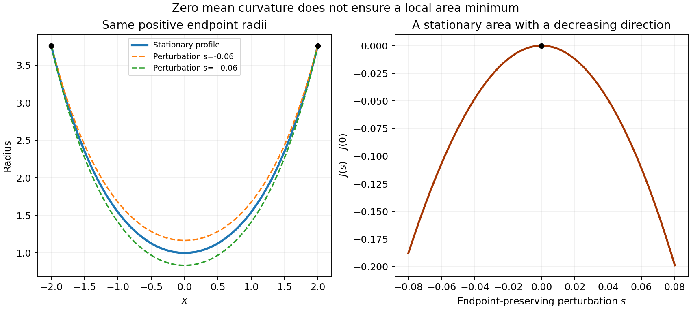

<h1 id="g/g2/iii/solution">Solution</h1>

↑ **Parent:** [Iii](../iii.md)

The functional is unbounded above. Let $y_0$ be the positive affine interpolant between the two endpoint values, and choose a smooth nonnegative function $\phi$ that vanishes at the endpoints and is positive somewhere inside. The admissible curves $y_M=y_0+M\phi$ satisfy

$$
J[y_M]\ge2\pi\int y_M\,dx\longrightarrow\infty.
$$

**The claimed minimum conclusion does not follow and is false in general.** A stationary point may have a negative [second variation](../../../../../second-variation.md), even though the functional is unbounded above. Here is an explicit example within the allowed positive-[graph](../../../../../graph-split.md) class.

Take the stationary profile $y(x)=\cosh x$ on $[-2,2]$, and the endpoint-zero variation $\eta(x)=\cosh x-\cosh2$. For sufficiently small perturbation parameter $s$, $y+s\eta$ remains positive and preserves both endpoint values. Put $C=\cosh2$. Differentiating the area twice and integrating its mixed term by parts gives

$$
\frac{\delta^2J[\eta]}{2\pi}=\int_{-2}^2\operatorname{sech}^2x\,(\eta'^2-\eta^2)\,dx
=4C\arctan(\sinh2)-2(1+C^2)\tanh2.
$$

This is strictly negative: the first term is less than $2\pi C$, while $(C+C^{-1})\tanh2>\pi$. For example $e^2>7$ gives $C>7/2$ and $\tanh2>24/25$, whose product already exceeds $\pi$. Thus nearby positive profiles have smaller area. This [catenoid](../../../../../catenoid.md) is **not a local minimum**.

The corrected conclusion is that any smooth positive minimizer, if attained, must have the [catenoid](../../../../../catenoid.md) form. That necessary condition is not sufficient, and existence or stability requires a separate argument.

**[Figure 1](#g/g2/iii/image-a-catenoid-with-a-negative-second-variation). A catenoid with a negative second variation**. Endpoint-preserving positive perturbations of an extended catenoid lower the area; the stationary profile is not a local minimum.

## ↑ Ancestors (13)

1. [Iii](../iii.md)
2. [G2](../../g2.md)
3. [G](../../../g.md)
4. [2007](../../../../2007-split.md)
5. [Past exam of the options II course of the University of Oxford](../../../../split.md)
6. [Options II course of the University of Oxford](../../../../../options-ii-course-of-the-university-of-oxford.md)
7. [Year 2 of the mathematics course of the University of Oxford](../../../../../year-2-of-the-mathematics-course-of-the-university-of-oxford.md)
8. [Mathematics course of the University of Oxford](../../../../../mathematics-course-of-the-university-of-oxford.md)
9. [Undergraduate course of the University of Oxford](../../../../../undergraduate-course-of-the-university-of-oxford.md)
10. [Course of the University of Oxford](../../../../../course-of-the-university-of-oxford.md)
11. [University of Oxford](../../../../../university-of-oxford-split.md)
12. [List of universities](../../../../../list-of-universities.md)
13. [Codex Wiki](../../../../../split.md)
