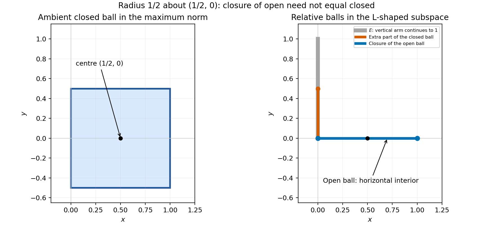

# 2008

↑ **Parent:** [Past exam of the options II course of the University of Oxford](../past-exam-of-the-options-ii-course-of-the-university-of-oxford.md)

Options II, Honour School of Mathematics Part A, Trinity Term; Thursday 19 June 2008, 9.30am–12.30pm. The full thirteen-page source, including its intact cover and all nineteen questions, is preserved in a private editable transcription. It was supplied through [the past-papers disclosure](https://www.whatdotheyknow.com/request/maths_past_papers_3), in original Part A bundle pages 80–92. Exact departmental worked answers are advertised for H2; that question is retained as an availability record rather than duplicated here. The bounded check found no exact answer advertisement for the other questions.

**Table of contents**

- [A](#a)
  - [A2](#a/a2)
    - [a](#a/a2/a)
      - [Solution](#a/a2/a/solution)
    - [b](#a/a2/b)
      - [i](#a/a2/b/i)
        - [Solution](#a/a2/b/i/solution)
      - [ii](#a/a2/b/ii)
        - [Solution](#a/a2/b/ii/solution)
      - [iii](#a/a2/b/iii)
        - [Solution](#a/a2/b/iii/solution)
- [B](#b)
  - [B2](#b/b2)
    - [Solution](#b/b2/solution)
- [C](#c)
  - [C2](#c/c2)
    - [Solution](#c/c2/solution)
- [D](#d)
  - [D3](#d/d3)
    - [a](#d/d3/a)
      - [i](#d/d3/a/i)
        - [Solution](#d/d3/a/i/solution)
      - [ii](#d/d3/a/ii)
        - [Solution](#d/d3/a/ii/solution)
    - [b](#d/d3/b)
      - [Solution](#d/d3/b/solution)
    - [c](#d/d3/c)
      - [i](#d/d3/c/i)
        - [Solution](#d/d3/c/i/solution)
      - [ii](#d/d3/c/ii)
        - [Solution](#d/d3/c/ii/solution)
  - [D4](#d/d4)
    - [a](#d/d4/a)
      - [Solution](#d/d4/a/solution)
    - [b](#d/d4/b)
      - [i](#d/d4/b/i)
        - [Solution](#d/d4/b/i/solution)
      - [ii](#d/d4/b/ii)
        - [Solution](#d/d4/b/ii/solution)
- [E](#e)
  - [E3](#e/e3)
    - [a](#e/e3/a)
      - [Solution](#e/e3/a/solution)
    - [b](#e/e3/b)
      - [Solution](#e/e3/b/solution)
    - [c](#e/e3/c)
      - [Solution](#e/e3/c/solution)
    - [d](#e/e3/d)
      - [Solution](#e/e3/d/solution)
  - [E4](#e/e4)
    - [a](#e/e4/a)
      - [Solution](#e/e4/a/solution)
    - [b](#e/e4/b)
      - [i](#e/e4/b/i)
        - [Solution](#e/e4/b/i/solution)
      - [ii](#e/e4/b/ii)
        - [Solution](#e/e4/b/ii/solution)
    - [c](#e/e4/c)
      - [Solution](#e/e4/c/solution)
- [F](#f)
  - [F2](#f/f2)
    - [a](#f/f2/a)
      - [Solution](#f/f2/a/solution)
    - [b](#f/f2/b)
      - [Solution](#f/f2/b/solution)
    - [c](#f/f2/c)
      - [Solution](#f/f2/c/solution)
- [G](#g)
  - [G2](#g/g2)
    - [Solution](#g/g2/solution)
- [H](#h)
  - [H2](#h/h2)
    - [a](#h/h2/a)
    - [b](#h/h2/b)
      - [i](#h/h2/b/i)
      - [ii](#h/h2/b/ii)
- [J](#j)
  - [J2](#j/j2)
    - [Solution](#j/j2/solution)
- [K](#k)
  - [K3](#k/k3)
    - [a](#k/k3/a)
      - [Solution](#k/k3/a/solution)
    - [b](#k/k3/b)
      - [Solution](#k/k3/b/solution)
    - [c](#k/k3/c)
      - [Solution](#k/k3/c/solution)
    - [Solution](#k/k3/solution)
  - [K4](#k/k4)
    - [Solution](#k/k4/solution)
- [M](#m)
  - [M4](#m/m4)
    - [Solution](#m/m4/solution)
  - [M5](#m/m5)
    - [a](#m/m5/a)
      - [Solution](#m/m5/a/solution)
    - [b](#m/m5/b)
      - [Solution](#m/m5/b/solution)
- [O](#o)
  - [O4](#o/o4)
    - [Solution](#o/o4/solution)
  - [O5](#o/o5)
    - [i](#o/o5/i)
      - [Solution](#o/o5/i/solution)
    - [ii](#o/o5/ii)
      - [Solution](#o/o5/ii/solution)
    - [Solution](#o/o5/solution)
- [P](#p)
  - [P3](#p/p3)
    - [a](#p/p3/a)
      - [Solution](#p/p3/a/solution)
    - [b](#p/p3/b)
      - [Solution](#p/p3/b/solution)
    - [c](#p/p3/c)
      - [Solution](#p/p3/c/solution)
    - [d](#p/p3/d)
      - [Solution](#p/p3/d/solution)
    - [e](#p/p3/e)
      - [Solution](#p/p3/e/solution)
  - [P4](#p/p4)
    - [a](#p/p4/a)
      - [Solution](#p/p4/a/solution)
    - [b](#p/p4/b)
      - [Solution](#p/p4/b/solution)
    - [c](#p/p4/c)
      - [Solution](#p/p4/c/solution)

## A

↑ **Parent:** [2008](2008.md)

<h3 id="a/a2">A2</h3>

↑ **Parent:** [A](#a)

<h4 id="a/a2/a">a</h4>

↑ **Parent:** [A2](#a/a2)

<h5 id="a/a2/a/solution">Solution</h5>

↑ **Parent:** [A](#a/a2/a)

An invertible matrix is an ordered [basis](../vector-space.md#basis) of $K^n$. After choosing $j$ independent columns, their span has $q^j$ elements, so the next column has $q^n-q^j$ choices. Thus

$$
\boxed{|\operatorname{GL}(n,q)|=\prod_{j=0}^{n-1}(q^n-q^j)}.
$$

<h4 id="a/a2/b">b</h4>

↑ **Parent:** [A2](#a/a2)

<h5 id="a/a2/b/i">i</h5>

↑ **Parent:** [B](#a/a2/b)

<h6 id="a/a2/b/i/solution">Solution</h6>

↑ **Parent:** [I](#a/a2/b/i)

For each flag choose an adapted [basis](../vector-space.md#basis): its first $n_i$ vectors span $V_i$, obtained by extending a [basis](../vector-space.md#basis) successively through the nested subspaces and finally through $V$. For two flags, the invertible [linear transformation](../vector-space.md#linear-map) taking one adapted [basis](../vector-space.md#basis) to the other takes each member of the first flag to the corresponding member of the second. Hence **the action is transitive**.

<h5 id="a/a2/b/ii">ii</h5>

↑ **Parent:** [B](#a/a2/b)

<h6 id="a/a2/b/ii/solution">Solution</h6>

↑ **Parent:** [Ii](#a/a2/b/ii)

**Yes.** Suppose $g$ maps the first flag to the second and has [determinant](../multilinear-algebra.md#determinant) $\delta\ne0$. Relative to an adapted [basis](../vector-space.md#basis) of the first flag, scaling its first [basis](../vector-space.md#basis) vector by $\delta^{-1}$ and fixing all others defines a transformation $h$ preserving that flag, with [determinant](../multilinear-algebra.md#determinant) $\delta^{-1}$. Then $gh$ still maps the first flag to the second and has [determinant](../multilinear-algebra.md#determinant) one. Thus the special linear [subgroup](../group.md#subgroup) acts transitively too.

<h5 id="a/a2/b/iii">iii</h5>

↑ **Parent:** [B](#a/a2/b)

<h6 id="a/a2/b/iii/solution">Solution</h6>

↑ **Parent:** [Iii](#a/a2/b/iii)

The [stabilizer](../group-action.md#stabilizer-subgroup) of the indicated flag consists of block upper triangular matrices with diagonal block sizes $1,2,2$. The diagonal blocks can be any elements of $\operatorname{GL}(1,q)$, $\operatorname{GL}(2,q)$ and $\operatorname{GL}(2,q)$. The upper off-diagonal blocks have $2+2+4=8$ arbitrary entries. Thus the [stabilizer](../group-action.md#stabilizer-subgroup) order is $(q-1)|\operatorname{GL}(2,q)|^2q^8$. The [orbit-stabilizer theorem](../group-action.md#orbit-stabilizer-theorem) gives

$$
\boxed{|\Omega|=\frac{|\operatorname{GL}(5,q)|}{(q-1)|\operatorname{GL}(2,q)|^2q^8}
=\frac{(q^5-1)(q^4-1)(q^3-1)}{(q-1)^2(q^2-1)}}.
$$

<h2 id="b">B</h2>

↑ **Parent:** [2008](2008.md)

<h3 id="b/b2">B2</h3>

↑ **Parent:** [B](#b)

<h4 id="b/b2/solution">Solution</h4>

↑ **Parent:** [B2](#b/b2)

The [characteristic of a field](../algebra.md#characteristic-of-a-field) is the least positive [integer](../integer.md) $p$ with $p1_F=0$, or zero if none exists. Finiteness forces a positive characteristic, since the sequence of [integer](../integer.md) multiples of one must repeat. If this least [integer](../integer.md) factored into two smaller positive factors, their nonzero field multiples would multiply to zero, contradicting the absence of zero divisors. Hence it is prime. The field is a [finite-dimensional vector space](../vector-space.md#finite-dimensional-vector-space) over its prime [subfield](../algebra.md#subfield) $\mathbb F_p$, so choosing a [basis](../vector-space.md#basis) gives $|F|=p^a$.

A nonzero [polynomial](../polynomial.md) of degree $n$ over a field has at most $n$ roots: each root supplies a linear factor by [polynomial](../polynomial.md) division, and induction applies to the quotient. In particular $X^n-1$ has at most $n$ roots. The elements of $F^\times$ whose orders divide $n$ are precisely those roots. The permitted finite-[group](../group.md) criterion therefore proves **$F^\times$ is cyclic**.

For the final assertion take an odd [Fermat prime](../prime-number.md#fermat-prime) $p=2^m+1$, $m\geq1$. Primality forces $m$ to be a power of two: an odd factor $s>1$ in $m=2^rs$ would factor $(2^{2^r})^s+1$ nontrivially. Since $2^m\equiv-1\pmod p$, the order of two divides $2m$ but not $m$. As $2m$ is a power of two, its only divisor not dividing $m$ is $2m$ itself. Thus

$$
\boxed{\operatorname{ord}_p(2)=2m}.
$$

It generates the full [group](../group.md) exactly when $2m=2^m$, which holds for $m=1,2$ and fails for $m\geq3$. Therefore the possibilities are **$p=3,5$**, equivalently $p\leq5$ among odd Fermat primes. The oddness is implicit in referring to two as a unit; $p=2$ is not an admissible case for that claim.

## C

↑ **Parent:** [2008](2008.md)

<h3 id="c/c2">C2</h3>

↑ **Parent:** [C](#c)

<h4 id="c/c2/solution">Solution</h4>

↑ **Parent:** [C2](#c/c2)

The $d$ distinct powers $1,a,\ldots,a^{d-1}$ all solve $X^d=1$. By the allowed root bound they are all its solutions. A [residue](../analysis.md#residue) $b$ of order $d$ must therefore equal $a^j$; conversely $\operatorname{ord}(a^j)=d/\gcd(d,j)$, because $d\mid jt$ characterizes the exponents $t$ with $(a^j)^t=1$. This proves the equivalence with $\gcd(d,j)=1$ and gives exactly $\varphi(d)$ elements of order $d$ whenever any such element exists.

To establish existence at the full order too, put $m=p-1$ and let $N_d$ count elements of order $d$. By [Lagrange's theorem for finite groups](../group-theory.md#lagrange-s-theorem), these orders divide $m$. The first result gives $N_d=0$ or $\varphi(d)$. Therefore

$$
m=\sum_{d\mid m}N_d\leq\sum_{d\mid m}\varphi(d)=m,
$$

using the standard divisor-sum identity for Euler's [function](../function.md). Equality forces every deficit to vanish, so $N_m=\boxed{\varphi(p-1)}$.

Finally let $h=g^{(p-1)/8}$, which has order eight. Its fourth power is the unique nonidentity square root of one, namely $-1$. Since $h^7=h^{-1}$,

$$
(h+h^{-1})^2=h^2+2+h^{-2}=2,
$$

because $h^{-2}=h^6=-h^2$. This proves **the stated [residue](../analysis.md#residue) squares to two**.

## D

↑ **Parent:** [2008](2008.md)

<h3 id="d/d3">D3</h3>

↑ **Parent:** [D](#d)

<h4 id="d/d3/a">a</h4>

↑ **Parent:** [D3](#d/d3)

<h5 id="d/d3/a/i">i</h5>

↑ **Parent:** [A](#d/d3/a)

<h6 id="d/d3/a/i/solution">Solution</h6>

↑ **Parent:** [I](#d/d3/a/i)

The [monotone convergence theorem](../measure-theory.md#monotone-convergence-theorem) says that if measurable functions satisfy $0\leq f_1\leq f_2\leq\cdots$ and converge pointwise to $f$, then $f$ is measurable and

$$
\boxed{\int f=\lim_n\int f_n},
$$

allowing the common value to be $+\infty$.

<h5 id="d/d3/a/ii">ii</h5>

↑ **Parent:** [A](#d/d3/a)

<h6 id="d/d3/a/ii/solution">Solution</h6>

↑ **Parent:** [Ii](#d/d3/a/ii)

**No.** Take $f_n=\mathbf1_{[n,n+1]}$. Each is nonnegative and integrable, and each integral is one. At every fixed real point the functions eventually vanish, so the pointwise limit is zero and its integral is zero. Monotonicity or another convergence hypothesis is essential.

<h4 id="d/d3/b">b</h4>

↑ **Parent:** [D3](#d/d3)

<h5 id="d/d3/b/solution">Solution</h5>

↑ **Parent:** [B](#d/d3/b)

The partial sums $S_N=\sum_{k=0}^Na_k$ are measurable, nonnegative and increasing. By the [monotone convergence theorem](../measure-theory.md#monotone-convergence-theorem),

$$
\boxed{\int\sum_{k=0}^\infty a_k=\sum_{k=0}^\infty\int a_k<\infty}.
$$

A nonnegative measurable [function](../function.md) with finite integral is finite almost everywhere: if it were infinite on a positive-measure set, every constant multiple of that set's indicator would be a lower bound, forcing an infinite integral. Thus the series **converges almost everywhere**.

<h4 id="d/d3/c">c</h4>

↑ **Parent:** [D3](#d/d3)

<h5 id="d/d3/c/i">i</h5>

↑ **Parent:** [C](#d/d3/c)

<h6 id="d/d3/c/i/solution">Solution</h6>

↑ **Parent:** [I](#d/d3/c/i)

Substitute $t=\log x$, with $dx=e^t\,dt$. The nonnegative integral becomes

$$
\int_0^\infty t e^{-(\alpha-1)t}\,dt=\frac1{(\alpha-1)^2},
$$

by scaling and [integration by parts](../calculus.md#integration-by-parts). The exponential decays because $\alpha>1$, with zero boundary term at infinity, proving integrability and

$$
\boxed{\int_1^\infty x^{-\alpha}\log x\,dx=(\alpha-1)^{-2}}.
$$

<h5 id="d/d3/c/ii">ii</h5>

↑ **Parent:** [C](#d/d3/c)

<h6 id="d/d3/c/ii/solution">Solution</h6>

↑ **Parent:** [Ii](#d/d3/c/ii)

For $x>1$, the geometric series gives

$$
\frac{\log x}{x^p(x-1)}=\sum_{k=0}^\infty x^{-(p+k+1)}\log x.
$$

All terms are nonnegative, so monotone convergence permits termwise integration. Part (i), with $\alpha=p+k+1>1$, gives

$$
\boxed{\int_1^\infty\frac{\log x}{x^p(x-1)}\,dx=\sum_{k=0}^\infty\frac1{(p+k)^2}}.
$$

This series is finite for $p>0$, which also proves integrability of the original nonnegative [function](../function.md).

<h3 id="d/d4">D4</h3>

↑ **Parent:** [D](#d)

<h4 id="d/d4/a">a</h4>

↑ **Parent:** [D4](#d/d4)

<h5 id="d/d4/a/solution">Solution</h5>

↑ **Parent:** [A](#d/d4/a)

On a product of sigma-finite measure spaces, [Tonelli's theorem](../measure-theory.md#tonelli-theorem) equates product and iterated integrals for a nonnegative measurable [function](../function.md), allowing infinite values. [Fubini's theorem](../measure-theory.md#fubini-s-theorem) says that an absolutely integrable measurable [function](../function.md) has integrable sections almost everywhere, their section integrals are integrable, and both iterated integrals equal the product integral. Absolute integrability may be checked first by applying Tonelli to the absolute value.

<h4 id="d/d4/b">b</h4>

↑ **Parent:** [D4](#d/d4)

<h5 id="d/d4/b/i">i</h5>

↑ **Parent:** [B](#d/d4/b)

<h6 id="d/d4/b/i/solution">Solution</h6>

↑ **Parent:** [I](#d/d4/b/i)

For fixed $n>0$, Tonelli and the allowed exponential integral give

$$
\int_0^n\int_0^\infty|\sin x|e^{-tx}\,dt\,dx=\int_0^n\frac{|\sin x|}x\,dx\leq n<\infty.
$$

The point $x=0$ is irrelevant to the integral. Fubini therefore permits reversing the signed integrals. Evaluating the elementary inner integral yields

$$
\int_0^n\frac{\sin x}x\,dx
=\int_0^\infty\frac{1-e^{-nt}(t\sin n+\cos n)}{1+t^2}\,dt.
$$

The first term has integral $\pi/2$. The absolute value of the remainder is at most

$$
\int_0^\infty e^{-nt}(t+1)\,dt=\frac1{n^2}+\frac1n\to0.
$$

Consequently **the improper integral tends to $\pi/2$**. The interchange was justified on each finite strip, without asserting absolute integrability on the infinite quadrant.

<h5 id="d/d4/b/ii">ii</h5>

↑ **Parent:** [B](#d/d4/b)

<h6 id="d/d4/b/ii/solution">Solution</h6>

↑ **Parent:** [Ii](#d/d4/b/ii)

**It is not Lebesgue integrable**, because its absolute integral diverges. On $I_k=[k\pi+\pi/6,k\pi+5\pi/6]$, one has $|\sin x|\geq1/2$ and $x\leq(k+1)\pi$. Thus

$$
\int_{I_k}\frac{|\sin x|}x\,dx\geq\frac1{3(k+1)}.
$$

These disjoint-interval lower bounds have a divergent harmonic sum. The finite improper value from part (i) is therefore conditional convergence, not Lebesgue integrability.

## E

↑ **Parent:** [2008](2008.md)

<h3 id="e/e3">E3</h3>

↑ **Parent:** [E](#e)

<h4 id="e/e3/a">a</h4>

↑ **Parent:** [E3](#e/e3)

<h5 id="e/e3/a/solution">Solution</h5>

↑ **Parent:** [A](#e/e3/a)

For a fixed centre $a$, the triangle inequality gives $|d(a,x)-d(a,y)|\leq d(x,y)$, so the distance-to-centre [function](../function.md) is [continuous](../calculus.md#continuous-function). Its [preimage](../set-theory.md#preimage) of $(-\infty,r]$ is the closed ball, hence is closed. Since that [closed set](../topology.md#closed-set) contains the corresponding open ball, it contains its closure:

$$
\boxed{\overline{B(a,r)}\subseteq\overline B(a,r)}.
$$

Here the bar on the right denotes a closed ball, while the bar on the left denotes closure.

<h4 id="e/e3/b">b</h4>

↑ **Parent:** [E3](#e/e3)

<h5 id="e/e3/b/solution">Solution</h5>

↑ **Parent:** [B](#e/e3/b)

The condition $\max(|x-1/2|,|y|)\leq1/2$ gives the closed square

$$
\boxed{[0,1]\times[-1/2,1/2]}.
$$

Its four edges and corners are included, as shown in the left panel of the figure below.

<h4 id="e/e3/c">c</h4>

↑ **Parent:** [E3](#e/e3)

<h5 id="e/e3/c/solution">Solution</h5>

↑ **Parent:** [C](#e/e3/c)

Intersect the ambient balls with $E$. All points on the vertical arm have distance at least $1/2$ from the centre, so the open ball is

$$
\boxed{(0,1)\times\{0\}}.
$$

The closed ball also contains the endpoints of that segment and the lower half of the vertical arm:

$$
\boxed{([0,1]\times\{0\})\cup(\{0\}\times[0,1/2])}.
$$

The closure of the open ball in $E$ is just $[0,1]\times\{0\}$. Both endpoints are limits of points in the open segment, whereas a vertical point of positive height has a small enough neighbourhood disjoint from it. Thus every point $(0,y)$ with $0<y\leq1/2$ witnesses strict containment.

**[Figure 1](#e/e3/c/image-ambient-and-relative-maximum-norm-balls). Ambient and relative maximum-norm balls**. The square on the left is the ambient closed ball. On the right, the open ball is the horizontal segment without its endpoints; its closure omits the additional vertical part of the relative closed ball.

<h4 id="e/e3/d">d</h4>

↑ **Parent:** [E3](#e/e3)

<h5 id="e/e3/d/solution">Solution</h5>

↑ **Parent:** [D](#e/e3/d)

Take radius $r>0$. Part (a) gives one containment. For a point $x$ with $\|x-a\|\leq r$, define $x_t=a+t(x-a)$ for $0\leq t<1$. Then $\|x_t-a\|=t\|x-a\|<r$, while $x_t\to x$ as $t\uparrow1$. Hence every point of the closed ball belongs to the closure of the open ball, proving **equality**. Positive radius is the standard open-ball convention; a zero-radius open ball would be empty.

<h3 id="e/e4">E4</h3>

↑ **Parent:** [E](#e)

<h4 id="e/e4/a">a</h4>

↑ **Parent:** [E4](#e/e4)

<h5 id="e/e4/a/solution">Solution</h5>

↑ **Parent:** [A](#e/e4/a)

In the usual [real line](../real-analysis.md#real-line), take $\boxed{F_n=[n,\infty)}$ for $n\geq1$. The sets are closed, nonempty and nested, but no real number belongs to all of them.

<h4 id="e/e4/b">b</h4>

↑ **Parent:** [E4](#e/e4)

<h5 id="e/e4/b/i">i</h5>

↑ **Parent:** [B](#e/e4/b)

<h6 id="e/e4/b/i/solution">Solution</h6>

↑ **Parent:** [I](#e/e4/b/i)

Every $K_n$ is closed in the [Hausdorff](../topology.md#hausdorff-space) ambient space, because it is [compact](../topology.md#compact-space). Inside the [compact](../topology.md#compact-space) space $K_1$, these sets have the [finite intersection property](../topology.md#finite-intersection-property): a finite [intersection](../set.md#set-intersection) equals the member with largest index and is nonempty. If the total [intersection](../set.md#set-intersection) were empty, their open complements would cover $K_1$; a finite [subcover](../topology.md#subcover) would contradict that property. Thus

$$
\boxed{\bigcap_nK_n\ne\varnothing}.
$$

<h5 id="e/e4/b/ii">ii</h5>

↑ **Parent:** [B](#e/e4/b)

<h6 id="e/e4/b/ii/solution">Solution</h6>

↑ **Parent:** [Ii](#e/e4/b/ii)

If no $K_n$ were contained in $U$, the sets $L_n=K_n\setminus U$ would be nonempty, nested and [compact](../topology.md#compact-space), since each is closed in $K_n$. Part (i) would supply a point in $\bigcap_nL_n$, belonging to every $K_n$ but not to $U$, a contradiction. Thus some $K_{n_0}\subseteq U$, and nesting gives **the same containment for every later index**.

<h4 id="e/e4/c">c</h4>

↑ **Parent:** [E4](#e/e4)

<h5 id="e/e4/c/solution">Solution</h5>

↑ **Parent:** [C](#e/e4/c)

The inclusion $f(\bigcap_nK_n)\subseteq\bigcap_nf(K_n)$ holds for every map. Conversely, let $y$ belong to the right side. The sets $L_n=K_n\cap f^{-1}(\{y\})$ are nonempty and nested. They are [compact](../topology.md#compact-space) because singletons are closed in a [Hausdorff](../topology.md#hausdorff-space) space and $f$ is [continuous](../calculus.md#continuous-function). By part (b)(i), some $x$ lies in every $L_n$. Then $x\in\bigcap_nK_n$ and $f(x)=y$, proving **equality of the two sets**.

## F

↑ **Parent:** [2008](2008.md)

<h3 id="f/f2">F2</h3>

↑ **Parent:** [F](#f)

<h4 id="f/f2/a">a</h4>

↑ **Parent:** [F2](#f/f2)

<h5 id="f/f2/a/solution">Solution</h5>

↑ **Parent:** [A](#f/f2/a)

A two-dimensional embedded submanifold is locally flattened by a continuously differentiable coordinate diffeomorphism of an ambient [open neighbourhood](../topology.md#open-neighbourhood) onto a coordinate plane, or equivalently locally admits a regular two-parameter chart. A tangent vector at $x$ is the velocity $\gamma'(0)$ of a differentiable curve in $M$ through $x$. All such vectors form the two-dimensional [tangent space](../tangent-vector.md#tangent-space) $T_xM$, the image of the differential of a regular parametrization. Normal vectors form its [orthogonal](../inner-product.md#orthogonal-vectors) complement $(T_xM)^\perp$ in $\mathbb R^3$, which has **dimension one**.

<h4 id="f/f2/b">b</h4>

↑ **Parent:** [F2](#f/f2)

<h5 id="f/f2/b/solution">Solution</h5>

↑ **Parent:** [B](#f/f2/b)

The defining [function](../function.md) $h(x)=x_1^2/a^2+x_2^2/b^2+x_3^2/c^2-1$ is smooth and has [gradient](../multivariable-calculus.md#gradient) $2(x_1/a^2,x_2/b^2,x_3/c^2)$. This cannot vanish on its zero level, since the origin does not lie there. The regular level-set theorem therefore makes $M$ a two-dimensional submanifold, with [tangent space](../tangent-vector.md#tangent-space) $\ker Dh(x)$ and normal space

$$
\boxed{(T_xM)^\perp=\operatorname{span}\{(x_1/a^2,x_2/b^2,x_3/c^2)\}}.
$$

<h4 id="f/f2/c">c</h4>

↑ **Parent:** [F2](#f/f2)

<h5 id="f/f2/c/solution">Solution</h5>

↑ **Parent:** [C](#f/f2/c)

The [Lagrange multiplier](../mathematical-optimization.md#lagrange-multiplier) condition says that at a constrained local extremum of a continuously differentiable objective on a regular surface $h=0$, its [gradient](../multivariable-calculus.md#gradient) is normal to the tangent plane: $\nabla f=\lambda\nabla h$ for some scalar multiplier.

First the box must be centred at zero. If the two face coordinates in one direction are $u_i,v_i$, subtracting the [ellipsoid](../euclidean-geometry.md#ellipsoid) equations for two vertices differing only in that coordinate gives $u_i^2=v_i^2$. A nondegenerate box has $u_i\ne v_i$, hence $u_i=-v_i$. Its positive half-sides $x,y,z$ therefore satisfy $x^2/a^2+y^2/b^2+z^2/c^2=1$ and its volume is $8xyz$.

The feasible closed octant is [compact](../topology.md#compact-space), the boundary gives zero volume, and some interior box has positive volume, so the maximum is interior. Apply multipliers to $\log(xyz)$ there:

$$
1/x=2\lambda x/a^2,\quad1/y=2\lambda y/b^2,\quad1/z=2\lambda z/c^2.
$$

Thus the three squared scaled coordinates are equal and sum to one. The unique positive solution gives

$$
\boxed{\text{side lengths }2a/\sqrt3,\ 2b/\sqrt3,\ 2c/\sqrt3;\qquad V_{\max}=\frac{8abc}{3\sqrt3}}.
$$

## G

↑ **Parent:** [2008](2008.md)

<h3 id="g/g2">G2</h3>

↑ **Parent:** [G](#g)

<h4 id="g/g2/solution">Solution</h4>

↑ **Parent:** [G2](#g/g2)

For the regular Sturm-Liouville setting assume $p$ is positive and continuously differentiable, $q,w$ are [continuous](../calculus.md#continuous-function), and $w>0$. Apply a multiplier to $J[y]-\lambda(\int_a^bwy^2-1)$. Its [first variation](../calculus-of-variations.md#first-variation), divided by two, is

$$
[p y'\eta]_a^b-\int_a^b[(py')'+qy+\lambda wy]\eta\,dx.
$$

Endpoint-vanishing variations and the allowed fundamental lemma give

$$
\boxed{-(py')'-qy=\lambda wy}.
$$

If an endpoint value is free, its [variation](../calculus-of-variations.md#variation) is arbitrary, giving the natural condition $py'=0$ at that endpoint. At a prescribed endpoint value the [variation](../calculus-of-variations.md#variation) vanishes there, so no additional natural condition is imposed.

For eigenfunctions $u,v$ with different eigenvalues, multiply their equations by $v,u$ and subtract after integration. The resulting boundary expression $[p(uv'-u'v)]_a^b$ vanishes under common homogeneous Dirichlet or common natural boundary conditions. Hence $(\lambda_u-\lambda_v)\int_a^bwuv=0$, proving weighted [orthogonality](../inner-product.md#orthogonal-vectors).

For the final Dirichlet problem the normalized stationary modes are

$$
\boxed{y_k(x)=\pm\sqrt2\sin(k\pi x),\qquad\lambda_k=k^2\pi^2-1,\quad k\geq1}.
$$

Solving $y''+(\lambda+1)y=0$ with both endpoint values zero gives these and excludes nonpositive $\lambda+1$. Distinct sine modes have zero integral product on $[0,1]$. Their Dirichlet values also make the same boundary expression vanish, which explains [orthogonality](../inner-product.md#orthogonal-vectors) even though their endpoint derivatives do not obey the natural conditions.

For global minimality, the Fourier sine expansion of an endpoint-vanishing [function](../function.md) and Parseval's identities give $\int y'^2=\sum k^2\pi^2a_k^2\geq\pi^2\sum a_k^2=\pi^2\int y^2$. Equality holds exactly in the first sine eigenspace. Therefore

$$
\boxed{\min J=\pi^2-1=\lambda_1,\qquad y=\pm\sqrt2\sin(\pi x)}.
$$

Distinct modes are [orthogonal](../inner-product.md#orthogonal-vectors); the two sign choices of the same minimum are not [orthogonal](../inner-product.md#orthogonal-vectors) to each other. This distinguishes the family of stationary modes from the two representatives of the minimizing eigenspace in the question's wording.

## H

↑ **Parent:** [2008](2008.md)

<h3 id="h/h2">H2</h3>

↑ **Parent:** [H](#h)

[The Oxford Classical Mechanics revision notice, page 1](https://users.ox.ac.uk/~math0391/CMrevision.pdf) explicitly lists AO2 H2 (2008) among the questions with departmental solutions available to Oxford students. Its three source-labelled answer locations are therefore excluded from the original-solution set. The complete source question remains in the private transcription.

<h4 id="h/h2/a">a</h4>

↑ **Parent:** [H2](#h/h2)

<h4 id="h/h2/b">b</h4>

↑ **Parent:** [H2](#h/h2)

<h5 id="h/h2/b/i">i</h5>

↑ **Parent:** [B](#h/h2/b)

<h5 id="h/h2/b/ii">ii</h5>

↑ **Parent:** [B](#h/h2/b)

## J

↑ **Parent:** [2008](2008.md)

<h3 id="j/j2">J2</h3>

↑ **Parent:** [J](#j)

<h4 id="j/j2/solution">Solution</h4>

↑ **Parent:** [J2](#j/j2)

The source-free [Maxwell equations](../maxwell-equations.md) in vacuum are

$$
\nabla\cdot E=\nabla\cdot B=0,\qquad \nabla\times E=-\partial_t B,\qquad \nabla\times B=c^{-2}\partial_t E.
$$

Their real and imaginary parts are exactly

$$
\nabla\cdot W=0,\qquad \nabla\times W=(i/c)\partial_t W,\qquad W=E+icB.
$$

Put $\theta=\omega t-K\cdot x$. Differentiating gives $\nabla\cdot W=(\Omega\cdot K)\sin\theta$ and $\nabla\times W=-(\Omega\times K)\sin\theta$, while $(i/c)\partial_tW=-i\omega\Omega\sin\theta/c$. Thus the necessary and sufficient conditions are

$$
\Omega\cdot K=0,\qquad \Omega\times K=i\omega\Omega/c.
$$

Here the complex dot product is bilinear, without [complex conjugation](../complex-analysis.md#complex-conjugation). Taking the dot product of the second equation with $\Omega$ gives $\Omega\cdot\Omega=0$. Crossing it with $K$ gives

$$
-|K|^2\Omega=(i\omega/c)^2\Omega,
$$

so, since $\Omega\ne0$, $|K|^2=\omega^2/c^2$. Writing $\Omega=e+icb$, the real conditions are

$$
\boxed{e\cdot K=b\cdot K=e\cdot b=0,\quad |e|=c|b|,\quad K\times e=\omega b,\quad K\times b=-\omega e/c^2}.
$$

Both physical fields are **linearly polarized**: $E=e\cos\theta$ and $B=b\cos\theta$ each oscillate along a fixed real direction. Combining two fields as $E+icB$ does not turn the electric field into a circularly polarized field.

## K

↑ **Parent:** [2008](2008.md)

<h3 id="k/k3">K3</h3>

↑ **Parent:** [K](#k)

<h4 id="k/k3/a">a</h4>

↑ **Parent:** [K3](#k/k3)

<h5 id="k/k3/a/solution">Solution</h5>

↑ **Parent:** [A](#k/k3/a)

The [Milne-Thomson circle theorem](../fluid-mechanics.md#milne-thomson-circle-theorem) says that, when $f$ is a [complex potential](../fluid-mechanics.md#complex-potential-of-a-two-dimensional-potential-flow) analytic inside and on $|z|=R$ and all its flow singularities are outside, the potential outside an impermeable circle is

$$
W(z)=f(z)+\overline{f(R^2/\bar z)}.
$$

The reflected expression is analytic in the exterior: conjugating a local power series turns its argument into $R^2/z$. It creates only interior image singularities. On $|z|=R$ we have $R^2/\bar z=z$, so $W=f+\bar f$ is real. The [stream function](../fluid-mechanics.md#stream-function) is therefore constant on the circle, which is the [impermeability condition](../viscous-fluid-flow.md#no-penetration-boundary-condition). At infinity the reflected term is $\overline{f(0)}+O(z^{-1})$, so it changes the velocity by $O(z^{-2})$ and leaves the imposed far flow unchanged. These observations prove the theorem, up to the irrelevant additive potential constant and with no extra [circulation](../vorticity.md#circulation-physics) introduced.

With $a=z_1$, $|a|>1$, and unit radius, it gives

$$
\boxed{W(z)=\frac{m}{z-a}+\frac{\bar m z}{1-\bar a z}}.
$$

The image dipole is at $1/\bar a$ with moment $-\bar m/\bar a^2$; writing the image term this way changes only an additive constant.

<h4 id="k/k3/b">b</h4>

↑ **Parent:** [K3](#k/k3)

<h5 id="k/k3/b/solution">Solution</h5>

↑ **Parent:** [B](#k/k3/b)

Reflection in the real axis replaces a dipole at $a$ with an image at $\bar a$ of moment $\bar m$. Reflection in the imaginary axis places the image at $-\bar a$ with moment $-\bar m$. Applying both reflections gives the image at $-a$ with moment $-m$. Thus

$$
\boxed{W(z)=\frac{m}{z-a}+\frac{\bar m}{z-\bar a}-\frac{\bar m}{z+\bar a}-\frac{m}{z+a}}.
$$

For example, on the real axis the first two terms are conjugates and the last two are conjugates. On the imaginary axis the first and third terms are conjugates, as are the second and fourth. The potential is real on each wall, so both walls are streamlines. The only singularity in the open first quadrant is the original dipole.

<h4 id="k/k3/c">c</h4>

↑ **Parent:** [K3](#k/k3)

<h5 id="k/k3/c/solution">Solution</h5>

↑ **Parent:** [C](#k/k3/c)

Reflection in the line $y=-x$ is $Rz=\overline{iz}=-i\bar z$. The printed expression has two conjugation bars: $w(z)+\overline{w(\overline{iz})}$. On the line $Rz=z$, this is $w(z)+\overline{w(z)}$, which is real; hence its [stream function](../fluid-mechanics.md#stream-function) vanishes there. Applying this reflection to the dipole gives

$$
\overline{\frac{m}{-i\bar z-a}}=\frac{\bar m}{iz-\bar a}=-\frac{i\bar m}{z+i\bar a}.
$$

Consequently

$$
\boxed{W(z)=\frac{m}{z-a}-\frac{i\bar m}{z+i\bar a}}.
$$

The image lies at $-i\bar a$, with moment $-i\bar m$, on the opposite side of the wall.

<h4 id="k/k3/solution">Solution</h4>

↑ **Parent:** [K3](#k/k3)

For each case omit the dipole's own singular field when evaluating the surrounding [complex velocity](../fluid-mechanics.md#complex-velocity). With the convention $W'=u-iv$ this gives $d\bar a/dt=W'_{\mathrm{image}}(a)$, which is the conjugated equation requested in the source. In case (a), differentiating $\bar m z/(1-\bar a z)$ gives

$$
\boxed{\frac{d\bar a}{dt}=\frac{\bar m}{(1-|a|^2)^2}}.
$$

For case (b), differentiate the three image terms:

$$
\boxed{\frac{d\bar a}{dt}=-\frac{\bar m}{(a-\bar a)^2}+\frac{\bar m}{(a+\bar a)^2}+\frac{m}{4a^2}
=\frac{\bar m}{4(\operatorname{Im}a)^2}+\frac{\bar m}{4(\operatorname{Re}a)^2}+\frac{m}{4a^2}}.
$$

For case (c), differentiation gives

$$
\boxed{\frac{d\bar a}{dt}=\frac{i\bar m}{(a+i\bar a)^2}=\frac{\bar m}{2(\operatorname{Re}a+\operatorname{Im}a)^2}}.
$$

The physical equation for $da/dt$ is the complex conjugate of the displayed equation. These expressions apply away from the walls, where the point-dipole model is nonsingular.

<h3 id="k/k4">K4</h3>

↑ **Parent:** [K](#k)

<h4 id="k/k4/solution">Solution</h4>

↑ **Parent:** [K4](#k/k4)

Put $\kappa=Q/(2\pi)$, $a=1+i$ and $b=1/\bar a=a/2$. The circle theorem gives, up to an additive constant,

$$
W(z)=\kappa\{\log(z-a)+\log(z-b)-\log z\},\qquad q(z)=W'(z)=\kappa\left\{\frac1{z-a}+\frac1{z-b}-\frac1z\right\}.
$$

Thus an image source lies at $b$ and an image sink at zero. With a counterclockwise contour around the cylinder, Blasius' force theorem is

$$
F_x-iF_y=\frac{i\rho}{2}\oint q(z)^2\,dz.
$$

If $q=s/(z-z_0)+h(z)$ locally, the [residue](../analysis.md#residue) of $q^2$ is $2s h(z_0)$. The enclosed poles are zero and $b$, with residues

$$
\operatorname{Res}_0q^2=2\kappa^2(1/a+1/b),\qquad
\operatorname{Res}_bq^2=2\kappa^2\{1/(b-a)-1/b\}.
$$

Their sum is $2\kappa^2\{1/a+1/(b-a)\}=-\kappa^2(1-i)$. The [residue theorem](../analysis.md#residue-theorem) therefore yields

$$
\boxed{F_x-iF_y=\frac{\rho Q^2}{4\pi}(1-i),\qquad F_x=F_y=\frac{\rho Q^2}{4\pi}}.
$$

The force points towards the source. For the moment formula the double poles also contribute: $\operatorname{Res}_{z_0}(zq^2)=s^2+2z_0s h(z_0)$. Hence

$$
\sum\operatorname{Res}(zq^2)=\kappa^2+\kappa^2+2\kappa^2b\{1/(b-a)-1/b\}=
2\kappa^2\frac{b}{b-a}=-2\kappa^2.
$$

It follows that $\oint zq^2\,dz=-4\pi i\kappa^2$ and

$$
\boxed{M=0,\qquad N=-2\pi\rho\kappa^2=-\frac{\rho Q^2}{2\pi}}.
$$

The zero [torque](../momentum.md#torque) agrees with pressure acting normally to a circle, hence radially through its centre.

## M

↑ **Parent:** [2008](2008.md)

<h3 id="m/m4">M4</h3>

↑ **Parent:** [M](#m)

<h4 id="m/m4/solution">Solution</h4>

↑ **Parent:** [M4](#m/m4)

The moment generating [function](../function.md) is $M_X(\theta)=\mathbb E(e^{\theta X})$ where finite. The [continuity](../calculus.md#continuous-function) theorem states that, if moment generating functions are finite on a common open interval containing zero and converge there to the moment generating [function](../function.md) of a probability law, the corresponding distributions converge weakly to that law.

Integrating the gamma density and using the gamma integral gives

$$
M_X(\theta)=\frac{\lambda^\alpha}{\Gamma(\alpha)}\int_0^\infty x^{\alpha-1}e^{-(\lambda-\theta)x}\,dx
=\left(\frac{\lambda}{\lambda-\theta}\right)^\alpha,\qquad\theta<\lambda.
$$

For a geometric waiting time, on $1,2,\ldots$, summing the geometric series gives

$$
M_Y(\theta)=\sum_{j\ge1}p(1-p)^{j-1}e^{j\theta}=
\frac{pe^\theta}{1-(1-p)e^\theta},\qquad \theta<-\log(1-p)
$$

when $0<p<1$. For $p=1$, $Y=1$ deterministically. The waiting times between successive heads are independent and identically distributed, so $N=Y_1+\cdots+Y_k$ and $M_N=M_Y^k$. Therefore

$$
M_{2pN}(\theta)=\left\{\frac{pe^{2p\theta}}{1-(1-p)e^{2p\theta}}\right\}^k
\longrightarrow (1-2\theta)^{-k}.
$$

Indeed the denominator is $p(1-2\theta)+O(p^2)$ and the numerator is $p+O(p^2)$. On any sufficiently small fixed neighbourhood of zero these moment generating functions exist for all sufficiently small $p$. The limit is the moment generating [function](../function.md) of a gamma law with **shape $k$ and rate $1/2$**, so

$$
\boxed{2pN\ \xrightarrow{d}\ \operatorname{Gamma}(k,1/2)}.
$$

<h3 id="m/m5">M5</h3>

↑ **Parent:** [M](#m)

<h4 id="m/m5/a">a</h4>

↑ **Parent:** [M5](#m/m5)

<h5 id="m/m5/a/solution">Solution</h5>

↑ **Parent:** [A](#m/m5/a)

Condition on $X_m=k$ and apply the [Markov property](../markov-chain.md#markov-property) and time homogeneity:

$$
p_{ij}(m+n)=\sum_{k\in S}\mathbb P_i(X_m=k)\mathbb P(X_{m+n}=j\mid X_m=k)
=\sum_{k\in S}p_{ik}(m)p_{kj}(n).
$$

Thus the transition matrices satisfy $P(m+n)=P(m)P(n)$; since $P(1)=P$ and $P(0)=I$, induction gives $P(n)=P^n$. Averaging over the initial state gives

$$
\boxed{\mathbb P(X_n=i)=(\mu P^n)_i}.
$$

If $\mu P=\mu$, induction gives $\mu P^n=\mu$, so this probability equals $\mu_i$ for every $n$. This is stationarity of the initial distribution.

<h4 id="m/m5/b">b</h4>

↑ **Parent:** [M5](#m/m5)

<h5 id="m/m5/b/solution">Solution</h5>

↑ **Parent:** [B](#m/m5/b)

A state $i$ is recurrent if the probability of returning to $i$ at a strictly positive time, starting at $i$, equals one. It is transient if that probability is less than one. If $i$ and $j$ communicate, choose $r,s$ with $p_{ji}(r)>0$ and $p_{ij}(s)>0$. Chapman-Kolmogorov gives

$$
p_{jj}(r+n+s)\ge p_{ji}(r)p_{ii}(n)p_{ij}(s).
$$

If $i$ is recurrent, summing over $n$ makes the right-hand side diverge, so the allowed recurrence criterion proves $j$ recurrent. Interchanging $i,j$ proves recurrence is shared throughout a [communicating class](../markov-chain.md#communicating-class), and therefore transience is shared too.

For the [simple random walk](../random-walk.md#simple-random-walk), an odd number of steps cannot return to its starting point, and

$$
p_{00}(2n)=\binom{2n}{n}[p(1-p)]^n\sim\frac{[4p(1-p)]^n}{\sqrt{\pi n}}.
$$

For $p=1/2$ the return series diverges like $\sum n^{-1/2}$, proving recurrence. For $0<p<1$, $p\ne1/2$, its tail is bounded by a convergent geometric series since $4p(1-p)<1$, proving transience. At $p=0$ or $1$ the walk is deterministic and never returns. Translation invariance transfers the conclusion to every state. Thus **recurrence holds exactly when $p=1/2$**.

## O

↑ **Parent:** [2008](2008.md)

<h3 id="o/o4">O4</h3>

↑ **Parent:** [O](#o)

<h4 id="o/o4/solution">Solution</h4>

↑ **Parent:** [O4](#o/o4)

For $S=\sum_i t_i$, the [likelihood](../maximum-likelihood-estimation.md#likelihood-function) is $L(\lambda)=\lambda^ne^{-\lambda S}$, and its log derivative is $n/\lambda-S$. Thus, almost surely,

$$
\widehat\lambda=n/S,\qquad I_{\rm full}(\lambda)=n/\lambda^2.
$$

The large-sample distribution is that of the estimator, rather than of the fixed parameter: $\sqrt n(\widehat\lambda-\lambda)\xrightarrow d N(0,\lambda^2)$. A [Wald confidence interval](../statistical-inference.md#wald-confidence-interval) is consequently

$$
\boxed{\widehat\lambda\ \pm\ z_{1-\alpha/2}\widehat\lambda/\sqrt n},
$$

intersected with the positive parameter space if necessary. The unadorned parameter in the source's distribution request is interpreted as this estimator.

A single aphid survives to $T$ with probability $r=e^{-\lambda T}$, independently of the others. Hence $N_T\sim\operatorname{Bin}(n,r)$, and

$$
L_T(\lambda)=\binom n{n_T}e^{-\lambda Tn_T}(1-e^{-\lambda T})^{n-n_T},\qquad
\widetilde\lambda=-\frac1T\log(n_T/n)
$$

for $0<n_T<n$. If $n_T=n$, the optimum is at the boundary $\lambda=0$; if $n_T=0$, the [likelihood](../maximum-likelihood-estimation.md#likelihood-function) increases to its supremum as $\lambda\to\infty$, so there is no finite maximum [likelihood](../maximum-likelihood-estimation.md#likelihood-function) estimate. [Fisher information](../statistical-modelling.md#fisher-information-matrix) transforms from the binomial probability parameter as

$$
I_T(\lambda)=\frac{n(r'(\lambda))^2}{r(1-r)}=\frac{nT^2}{e^{\lambda T}-1}.
$$

The given strict inequality shows

$$
\boxed{\frac{I_T(\lambda)}{I_{\rm full}(\lambda)}=\frac{(\lambda T)^2}{e^{\lambda T}-1}<1}.
$$

Thresholding discards information about how long each survival time is. The second experiment therefore has a larger information bound on [variance](../variance.md) and larger asymptotic uncertainty for an efficient estimator. This is an expected-information comparison, rather than a claim that every realised finite-sample [confidence interval](../statistical-inference.md#confidence-interval) must be wider.

<h3 id="o/o5">O5</h3>

↑ **Parent:** [O](#o)

<h4 id="o/o5/i">i</h4>

↑ **Parent:** [O5](#o/o5)

<h5 id="o/o5/i/solution">Solution</h5>

↑ **Parent:** [I](#o/o5/i)

[Independence](../random-variable.md#independent-random-variables) of the two samples makes their sample means independent normal random variables. A difference of independent normal random variables is normal, with the means subtracted and the variances added. Thus

$$
\boxed{\bar X-\bar Y\sim N\!\left(\mu_X-\mu_Y,\sigma^2(1/m+1/n)\right)}.
$$

<h4 id="o/o5/ii">ii</h4>

↑ **Parent:** [O5](#o/o5)

<h5 id="o/o5/ii/solution">Solution</h5>

↑ **Parent:** [Ii](#o/o5/ii)

For each normal sample, its [sample mean](../variance.md#sample-mean) is independent of its [sample variance](../statistical-inference.md#sample-variance), and the scaled residual sum of squares is chi-squared. [Independence](../random-variable.md#independent-random-variables) of the samples also makes their two residual sums independent. Adding their chi-squared distributions gives

$$
\frac{(m-1)S_X^2+(n-1)S_Y^2}{\sigma^2}\sim\chi^2_{m+n-2}.
$$

Consequently

$$
\boxed{d=(m+n-2)/\sigma^2,\qquad dS^2\sim\chi^2_{m+n-2}}.
$$

The pooled [variance](../variance.md) is also independent of the difference of sample means.

<h4 id="o/o5/solution">Solution</h4>

↑ **Parent:** [O5](#o/o5)

For a normal sample of size $m$,

$$
\bar X=\frac1m\sum_{i=1}^mX_i,\qquad S_X^2=\frac1{m-1}\sum_{i=1}^m(X_i-\bar X)^2.
$$

Then $\bar X\sim N(\mu_X,\sigma^2/m)$ and $cS_X^2\sim\chi^2_{m-1}$ with $c=(m-1)/\sigma^2$. These two statistics are independent.

Combining the difference distribution and pooled [variance](../variance.md) calculation gives, with $\nu=m+n-2$,

$$
T_*=\frac{\bar X-\bar Y-(\mu_X-\mu_Y)}{S\sqrt{1/m+1/n}}\sim t_\nu.
$$

**The printed statistic has the sign of the centering term reversed.** Its numerator subtracts $\mu_Y-\mu_X$, so it is not generally a central Student statistic; the corrected centering above is necessary. Under the [null hypothesis](../statistical-hypothesis-test.md#null-hypothesis) $\mu_X=\mu_Y$, the two expressions coincide, so the requested test is unaffected. Reject the two-sided null at significance level $\alpha$ when

$$
\left|\frac{\bar X-\bar Y}{S\sqrt{1/m+1/n}}\right|>t_{\nu,1-\alpha/2}.
$$

Here $\nu=8$ and $|T|=2.19<2.31$, so **do not reject at the 5% level**. This does not establish equality of the population means.

Age matching means that the two observations in a pair share an age effect, while ages vary across pairs. The independent, identically distributed two-sample model no longer represents this design: random pair effects induce within-pair dependence, and fixed differing ages can instead produce different individual means. Pairing by itself need not cause stochastic dependence when ages are treated as fixed. The appropriate alternative is a **[paired t-test](../statistical-hypothesis-test.md#paired-t-test)** on the within-pair differences. Removing shared age [variation](../calculus-of-variations.md#variation) can reduce the noise and improve power when age strongly affects volume and the members of a pair are positively associated. Improvement is not automatic, since the paired test also uses fewer [degrees of freedom](../classical-mechanics.md#degree-of-freedom).

## P

↑ **Parent:** [2008](2008.md)

<h3 id="p/p3">P3</h3>

↑ **Parent:** [P](#p)

<h4 id="p/p3/a">a</h4>

↑ **Parent:** [P3](#p/p3)

<h5 id="p/p3/a/solution">Solution</h5>

↑ **Parent:** [A](#p/p3/a)

The [norm](../normed-vector-space.md#norm) induced by a real [inner product](../inner-product.md) is

$$
\boxed{\|v\|=\sqrt{\langle v,v\rangle}}.
$$

Positive definiteness and homogeneity follow from the [inner product](../inner-product.md) axioms; Cauchy-Schwarz gives the triangle inequality by expanding $\|u+v\|^2$.

<h4 id="p/p3/b">b</h4>

↑ **Parent:** [P3](#p/p3)

<h5 id="p/p3/b/solution">Solution</h5>

↑ **Parent:** [B](#p/p3/b)

Use the usual weighted $L^2$ interpretation, identifying functions equal almost everywhere; on raw pointwise functions the displayed integral is only a [seminorm](../topological-vector-space.md#seminorm). Assume $q\in\Pi_k\subset V$. If $f-q$ is [orthogonal](../inner-product.md#orthogonal-vectors) to $\Pi_k$, then for every $p\in\Pi_k$,

$$
\|f-p\|^2=\|(f-q)+(q-p)\|^2=\|f-q\|^2+\|q-p\|^2\ge\|f-q\|^2.
$$

Conversely, suppose $q$ minimizes the error. For $r\in\Pi_k$ and every real $t$, compare $q$ with $q+tr$:

$$
0\le\|f-q-tr\|^2-\|f-q\|^2=-2t\langle f-q,r\rangle+t^2\|r\|^2.
$$

If the linear coefficient were nonzero, a sufficiently small $t$ with the appropriate sign would make the expression negative. Thus $\langle f-q,r\rangle=0$ for every $r$, proving **best approximation is equivalent to [orthogonality](../inner-product.md#orthogonal-vectors) of the residual**.

<h4 id="p/p3/c">c</h4>

↑ **Parent:** [P3](#p/p3)

<h5 id="p/p3/c/solution">Solution</h5>

↑ **Parent:** [C](#p/p3/c)

Write $q=A+Bx$ and $\ell=\log3$. [Orthogonality](../inner-product.md#orthogonal-vectors) of $x^2-q$ to $1$ and $x$ gives

$$
\begin{pmatrix}\ell&2\\2&4\end{pmatrix}\begin{pmatrix}A\\B\end{pmatrix}
=\begin{pmatrix}4\\26/3\end{pmatrix}.
$$

The [Gram matrix](../inner-product.md#gram-matrix) is positive definite, with [determinant](../multilinear-algebra.md#determinant) $4(\ell-1)>0$, so the solution is unique. Solving yields

$$
\boxed{q(x)=-\frac1{3(\log3-1)}+\left(\frac{13}{6}+\frac1{6(\log3-1)}\right)x}.
$$

<h4 id="p/p3/d">d</h4>

↑ **Parent:** [P3](#p/p3)

<h5 id="p/p3/d/solution">Solution</h5>

↑ **Parent:** [D](#p/p3/d)

The singular weight requires care about the space of admissible polynomials. Since $n\ge1$, $x^n$ has finite squared [norm](../normed-vector-space.md#norm). A [polynomial](../polynomial.md) $q$ has finite error relative to $x^n$ near zero exactly when $q(0)=0$: a nonzero constant term makes the integrand asymptotic to $q(0)^2/x$, whose integral diverges. If $q(0)=0$, the residual is $O(x)$ and the integrand is $O(x)$.

Thus **the full space $\Pi_{n-1}$ is not a subspace of $V$**, so the projection theorem cannot be applied to it as written. Nevertheless a unique best finite-error approximation does exist in

$$
W=\Pi_{n-1}\cap V=\operatorname{span}\{x,x^2,\ldots,x^{n-1}\}.
$$

For $n=1$, this is the zero space and the answer is $q=0$. For $n\ge2$, $W$ is finite dimensional and its [Gram matrix](../inner-product.md#gram-matrix) is positive definite, because a nonzero [polynomial](../polynomial.md) cannot vanish on an interval. Solving the normal equations therefore gives its unique [orthogonal projection](../hilbert-space.md#orthogonal-projection) of $x^n$. All omitted polynomials have infinite error, so this also minimizes the extended error over the full [polynomial](../polynomial.md) set. The distinction is **an invalid full-space projection premise, not nonexistence of every finite-error best approximation**. As throughout weighted $L^2$, use equivalence classes for the underlying measure.

<h4 id="p/p3/e">e</h4>

↑ **Parent:** [P3](#p/p3)

<h5 id="p/p3/e/solution">Solution</h5>

↑ **Parent:** [E](#p/p3/e)

The residual is [orthogonal](../inner-product.md#orthogonal-vectors) to $q\in\Pi_k$, so Pythagoras gives

$$
\|f\|^2=\|q\|^2+\|f-q\|^2\ge\|q\|^2.
$$

Taking nonnegative square roots proves $\boxed{\|q\|\le\|f\|}$.

<h3 id="p/p4">P4</h3>

↑ **Parent:** [P](#p)

<h4 id="p/p4/a">a</h4>

↑ **Parent:** [P4](#p/p4)

<h5 id="p/p4/a/solution">Solution</h5>

↑ **Parent:** [A](#p/p4/a)

A [QR factorization](../inner-product.md#qr-decomposition) is $A=QR$, where $Q^TQ=I$ and $R$ is upper triangular. If $A$ is [orthogonal](../inner-product.md#orthogonal-vectors), so is $R=Q^TA$. Its inverse is upper triangular, but $R^{-1}=R^T$ is lower triangular, forcing $R$ to be diagonal. [Orthogonality](../inner-product.md#orthogonal-vectors) then gives

$$
\boxed{R=\operatorname{diag}(\varepsilon_1,\ldots,\varepsilon_n),\quad\varepsilon_i\in\{1,-1\}}.
$$

With the customary positive diagonal convention, $R=I$.

<h4 id="p/p4/b">b</h4>

↑ **Parent:** [P4](#p/p4)

<h5 id="p/p4/b/solution">Solution</h5>

↑ **Parent:** [B](#p/p4/b)

Only the first and third coordinates occur in the first two columns. Normalize the first column to get $q_1=(4,0,3,0)^T/5$. Removing its component from the second column leaves $(21,0,-28,0)^T/5$, of length seven, so $q_2=(3,0,-4,0)^T/5$. The remaining orthonormal columns can be $q_3=e_2$ and $q_4=e_4$. Taking their dot products with the columns of $A$ gives

$$
\boxed{Q=\begin{pmatrix}4/5&3/5&0&0\\0&0&1&0\\3/5&-4/5&0&0\\0&0&0&1\end{pmatrix},\qquad
R=\begin{pmatrix}5&1&5&2\\0&7&10&-11\\0&0&9&6\\0&0&0&1\end{pmatrix}}.
$$

The columns of $Q$ are orthonormal, and direct multiplication gives the source matrix. Exploiting its two-coordinate first block avoids unnecessary four-dimensional elimination.

<h4 id="p/p4/c">c</h4>

↑ **Parent:** [P4](#p/p4)

<h5 id="p/p4/c/solution">Solution</h5>

↑ **Parent:** [C](#p/p4/c)

Starting with $A_0=A$, choose real shifts $\sigma_j$, factor $A_j-\sigma_jI=Q_jR_j$, and set

$$
A_{j+1}=R_jQ_j+\sigma_jI=Q_j^TA_jQ_j.
$$

Each step is an [orthogonal](../inner-product.md#orthogonal-vectors) similarity, so the eigenvalues are preserved and all iterates are similar. If $A_j^T=A_j$, transposing $Q_j^TA_jQ_j$ proves symmetry of $A_{j+1}$, completing the induction.

The given matrix is the [Householder reflection](../linear-algebra.md#householder-transformation)

$$
A=I-\frac2n\mathbf1\mathbf1^T.
$$

It has [eigenvalue](../linear-operator-theory.md#eigenvalue) $-1$ along $\mathbf1$ and $+1$ on its [orthogonal](../inner-product.md#orthogonal-vectors) complement, hence $A^TA=I$. In the positive-diagonal QR convention its unshifted factorization is $Q=A$, $R=I$, so the next iterate is again $A$. Thus **unshifted QR is stationary**, despite the matrix generally having nonzero off-diagonal entries. If arbitrary diagonal signs are allowed in $R$, a step can instead replace $A$ by $DAD$ for a diagonal sign matrix $D$; every off-diagonal magnitude remains unchanged. Such sign changes still make no progress towards diagonalization.

## ↑ Ancestors (9)

1. [Past exam of the options II course of the University of Oxford](../past-exam-of-the-options-ii-course-of-the-university-of-oxford.md)
2. [Options II course of the University of Oxford](../university-of-oxford.md#options-ii-course-of-the-university-of-oxford)
3. [Year 2 of the mathematics course of the University of Oxford](../university-of-oxford.md#year-2-of-the-mathematics-course-of-the-university-of-oxford)
4. [Mathematics course of the University of Oxford](../university-of-oxford.md#mathematics-course-of-the-university-of-oxford)
5. [Undergraduate course of the University of Oxford](../university-of-oxford.md#undergraduate-course-of-the-university-of-oxford)
6. [Course of the University of Oxford](../university-of-oxford.md#course-of-the-university-of-oxford)
7. [University of Oxford](../university-of-oxford.md)
8. [List of universities](../README.md#list-of-universities)
9. [Codex Wiki](../README.md)
