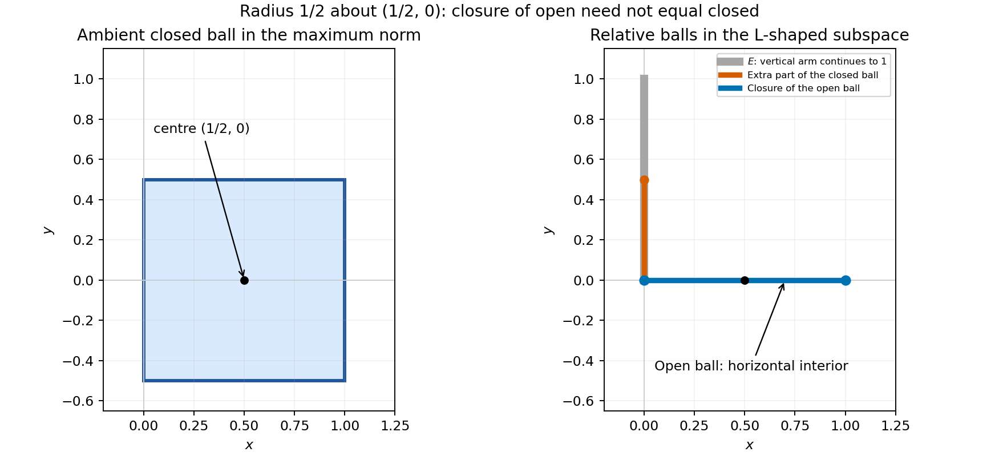

<h1 id="e/e3/c/solution">Solution</h1>

↑ **Parent:** [C](../c.md)

Intersect the ambient balls with $E$. All points on the vertical arm have distance at least $1/2$ from the centre, so the open ball is

$$
\boxed{(0,1)\times\{0\}}.
$$

The closed ball also contains the endpoints of that segment and the lower half of the vertical arm:

$$
\boxed{([0,1]\times\{0\})\cup(\{0\}\times[0,1/2])}.
$$

The closure of the open ball in $E$ is just $[0,1]\times\{0\}$. Both endpoints are limits of points in the open segment, whereas a vertical point of positive height has a small enough neighbourhood disjoint from it. Thus every point $(0,y)$ with $0<y\leq1/2$ witnesses strict containment.

**[Figure 1](#e/e3/c/image-ambient-and-relative-maximum-norm-balls). Ambient and relative maximum-norm balls**. The square on the left is the ambient closed ball. On the right, the open ball is the horizontal segment without its endpoints; its closure omits the additional vertical part of the relative closed ball.

## ↑ Ancestors (13)

1. [C](../c.md)
2. [E3](../../e3.md)
3. [E](../../../e.md)
4. [2008](../../../../2008-split.md)
5. [Past exam of the options II course of the University of Oxford](../../../../split.md)
6. [Options II course of the University of Oxford](../../../../../options-ii-course-of-the-university-of-oxford.md)
7. [Year 2 of the mathematics course of the University of Oxford](../../../../../year-2-of-the-mathematics-course-of-the-university-of-oxford.md)
8. [Mathematics course of the University of Oxford](../../../../../mathematics-course-of-the-university-of-oxford.md)
9. [Undergraduate course of the University of Oxford](../../../../../undergraduate-course-of-the-university-of-oxford.md)
10. [Course of the University of Oxford](../../../../../course-of-the-university-of-oxford.md)
11. [University of Oxford](../../../../../university-of-oxford-split.md)
12. [List of universities](../../../../../list-of-universities.md)
13. [Codex Wiki](../../../../../split.md)
