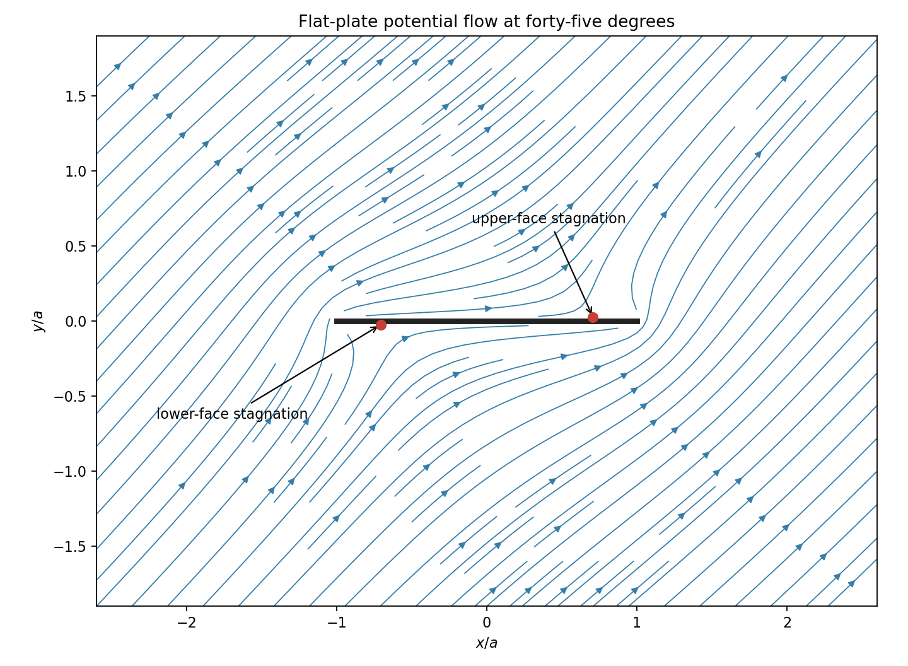

# 2009

↑ **Parent:** [Past exam of the options II course of the University of Oxford](../past-exam-of-the-options-ii-course-of-the-university-of-oxford.md)

Options II, Honour School of Mathematics Part A, Trinity Term; Thursday 25 June 2009, 9.30am–12.30pm. The private editable transcription preserves the intact cover and all nineteen questions across seventeen pages. The source was supplied through [the past-papers disclosure](https://www.whatdotheyknow.com/request/maths_past_papers_3), in original Part A bundle pages 141–157. No exact worked-answer advertisement was found in the bounded check. The Classical Mechanics revision advertisement names other years, so it does not establish availability for this year's question.

**Table of contents**

- [A](#a)
  - [A2](#a/a2)
    - [Solution](#a/a2/solution)
    - [a](#a/a2/a)
      - [Solution](#a/a2/a/solution)
    - [b](#a/a2/b)
      - [Solution](#a/a2/b/solution)
    - [i](#a/a2/i)
      - [Solution](#a/a2/i/solution)
    - [ii](#a/a2/ii)
      - [Solution](#a/a2/ii/solution)
    - [iii](#a/a2/iii)
      - [Solution](#a/a2/iii/solution)
    - [iv](#a/a2/iv)
      - [Solution](#a/a2/iv/solution)
- [B](#b)
  - [B2](#b/b2)
    - [i](#b/b2/i)
      - [Solution](#b/b2/i/solution)
    - [ii](#b/b2/ii)
      - [Solution](#b/b2/ii/solution)
    - [iii](#b/b2/iii)
      - [Solution](#b/b2/iii/solution)
- [C](#c)
  - [C2](#c/c2)
    - [i](#c/c2/i)
      - [Solution](#c/c2/i/solution)
    - [ii](#c/c2/ii)
      - [Solution](#c/c2/ii/solution)
    - [iii](#c/c2/iii)
      - [Solution](#c/c2/iii/solution)
    - [iv](#c/c2/iv)
      - [Solution](#c/c2/iv/solution)
    - [v](#c/c2/v)
      - [Solution](#c/c2/v/solution)
    - [vi](#c/c2/vi)
      - [Solution](#c/c2/vi/solution)
- [D](#d)
  - [D3](#d/d3)
    - [i](#d/d3/i)
      - [a](#d/d3/i/a)
        - [Solution](#d/d3/i/a/solution)
      - [b](#d/d3/i/b)
        - [Solution](#d/d3/i/b/solution)
    - [ii](#d/d3/ii)
      - [a](#d/d3/ii/a)
        - [Solution](#d/d3/ii/a/solution)
      - [b](#d/d3/ii/b)
        - [Solution](#d/d3/ii/b/solution)
    - [iii](#d/d3/iii)
      - [Solution](#d/d3/iii/solution)
  - [D4](#d/d4)
    - [i](#d/d4/i)
      - [Solution](#d/d4/i/solution)
    - [ii](#d/d4/ii)
      - [Solution](#d/d4/ii/solution)
    - [iii](#d/d4/iii)
      - [Solution](#d/d4/iii/solution)
- [E](#e)
  - [E3](#e/e3)
    - [a](#e/e3/a)
      - [i](#e/e3/a/i)
        - [Solution](#e/e3/a/i/solution)
      - [ii](#e/e3/a/ii)
        - [Solution](#e/e3/a/ii/solution)
      - [iii](#e/e3/a/iii)
        - [Solution](#e/e3/a/iii/solution)
    - [b](#e/e3/b)
      - [i](#e/e3/b/i)
        - [Solution](#e/e3/b/i/solution)
      - [ii](#e/e3/b/ii)
        - [Solution](#e/e3/b/ii/solution)
      - [iii](#e/e3/b/iii)
        - [Solution](#e/e3/b/iii/solution)
      - [iv](#e/e3/b/iv)
        - [α](#e/e3/b/iv/alpha)
          - [Solution](#e/e3/b/iv/alpha/solution)
        - [β](#e/e3/b/iv/beta)
          - [Solution](#e/e3/b/iv/beta/solution)
      - [v](#e/e3/b/v)
        - [Solution](#e/e3/b/v/solution)
  - [E4](#e/e4)
    - [a](#e/e4/a)
      - [i](#e/e4/a/i)
        - [Solution](#e/e4/a/i/solution)
      - [ii](#e/e4/a/ii)
        - [Solution](#e/e4/a/ii/solution)
      - [iii](#e/e4/a/iii)
        - [Solution](#e/e4/a/iii/solution)
    - [b](#e/e4/b)
      - [i](#e/e4/b/i)
        - [Solution](#e/e4/b/i/solution)
      - [ii](#e/e4/b/ii)
        - [Solution](#e/e4/b/ii/solution)
    - [c](#e/e4/c)
      - [Solution](#e/e4/c/solution)
- [F](#f)
  - [F2](#f/f2)
    - [a](#f/f2/a)
      - [Solution](#f/f2/a/solution)
    - [b](#f/f2/b)
      - [Solution](#f/f2/b/solution)
- [G](#g)
  - [G2](#g/g2)
    - [Solution](#g/g2/solution)
- [H](#h)
  - [H2](#h/h2)
    - [Solution](#h/h2/solution)
- [J](#j)
  - [J2](#j/j2)
    - [Solution](#j/j2/solution)
- [K](#k)
  - [K3](#k/k3)
    - [Solution](#k/k3/solution)
  - [K4](#k/k4)
    - [Solution](#k/k4/solution)
- [M](#m)
  - [M4](#m/m4)
    - [a](#m/m4/a)
      - [Solution](#m/m4/a/solution)
    - [b](#m/m4/b)
      - [Solution](#m/m4/b/solution)
    - [c](#m/m4/c)
      - [Solution](#m/m4/c/solution)
    - [d](#m/m4/d)
      - [i](#m/m4/d/i)
        - [Solution](#m/m4/d/i/solution)
      - [ii](#m/m4/d/ii)
        - [Solution](#m/m4/d/ii/solution)
    - [e](#m/m4/e)
      - [i](#m/m4/e/i)
        - [Solution](#m/m4/e/i/solution)
      - [ii](#m/m4/e/ii)
        - [Solution](#m/m4/e/ii/solution)
  - [M5](#m/m5)
    - [a](#m/m5/a)
      - [i](#m/m5/a/i)
        - [Solution](#m/m5/a/i/solution)
      - [ii](#m/m5/a/ii)
        - [Solution](#m/m5/a/ii/solution)
      - [iii](#m/m5/a/iii)
        - [Solution](#m/m5/a/iii/solution)
    - [b](#m/m5/b)
      - [Solution](#m/m5/b/solution)
      - [i](#m/m5/b/i)
        - [Solution](#m/m5/b/i/solution)
      - [ii](#m/m5/b/ii)
        - [Solution](#m/m5/b/ii/solution)
- [O](#o)
  - [O4](#o/o4)
    - [Solution](#o/o4/solution)
    - [i](#o/o4/i)
      - [Solution](#o/o4/i/solution)
    - [ii](#o/o4/ii)
      - [Solution](#o/o4/ii/solution)
  - [O5](#o/o5)
    - [Solution](#o/o5/solution)
    - [i](#o/o5/i)
      - [Solution](#o/o5/i/solution)
    - [ii](#o/o5/ii)
      - [Solution](#o/o5/ii/solution)
- [P](#p)
  - [P3](#p/p3)
    - [a](#p/p3/a)
      - [Solution](#p/p3/a/solution)
    - [b](#p/p3/b)
      - [Solution](#p/p3/b/solution)
    - [c](#p/p3/c)
      - [Solution](#p/p3/c/solution)
    - [d](#p/p3/d)
      - [Solution](#p/p3/d/solution)
  - [P4](#p/p4)
    - [a](#p/p4/a)
      - [Solution](#p/p4/a/solution)
    - [b](#p/p4/b)
      - [Solution](#p/p4/b/solution)
    - [c](#p/p4/c)
      - [Solution](#p/p4/c/solution)
    - [d](#p/p4/d)
      - [Solution](#p/p4/d/solution)

## A

↑ **Parent:** [2009](2009.md)

<h3 id="a/a2">A2</h3>

↑ **Parent:** [A](#a)

<h4 id="a/a2/solution">Solution</h4>

↑ **Parent:** [A2](#a/a2)

The [characteristic of a field](../algebra.md#characteristic-of-a-field) is the least positive [integer](../integer.md) $r$ with $r1_K=0$, or zero if none exists. In a [finite field](../algebra.md#finite-field) a positive such [integer](../integer.md) exists because the sequence $0,1_K,2\cdot1_K,\ldots$ must repeat.

The [prime subfield](../algebra.md#prime-field) is the [intersection](../set.md#set-intersection) of all subfields of $K$, equivalently the [subfield](../algebra.md#subfield) generated by $1_K$. In characteristic $p$ it is the copy of $\mathbb F_p$ formed by the multiples of $1_K$. Every [field automorphism](../galois-theory.md#field-automorphism) preserves $1_K$ and addition, so it fixes every element of this [subfield](../algebra.md#subfield).

Finally, once the order-$n$ [Frobenius automorphism](../non-archimedean-analysis.md#frobenius-automorphism) below is established, all its $n$ powers are distinct. Any automorphism fixes $F$ and is determined by its value at the generator $\lambda$. That value must be a root of the degree-$n$ [minimal polynomial](../linear-operator-theory.md#minimal-polynomial) of $\lambda$, so there are at most $n$ automorphisms. Hence

$$
\boxed{\operatorname{Aut}(K)=\langle\vartheta\rangle\cong C_n}.
$$

<h4 id="a/a2/a">a</h4>

↑ **Parent:** [A2](#a/a2)

<h5 id="a/a2/a/solution">Solution</h5>

↑ **Parent:** [A](#a/a2/a)

If the positive [characteristic](../algebra.md#characteristic-of-a-field) were composite, say $r=uv$ with $1<u,v<r$, then $(u1_K)(v1_K)=0$ while neither factor is zero, by minimality of $r$. This contradicts a [field](../algebra.md#field) having no [zero divisors](../mathematics.md#zero-divisor). Thus the characteristic is a **prime** $p$.

<h4 id="a/a2/b">b</h4>

↑ **Parent:** [A2](#a/a2)

<h5 id="a/a2/b/solution">Solution</h5>

↑ **Parent:** [B](#a/a2/b)

Regard $K$ as a [vector space](../vector-space.md) over its [prime subfield](../algebra.md#prime-field) $\mathbb F_p$. Since $K$ is finite, a maximal [linearly independent](../vector-space.md#linear-independence) list terminates and is a finite [basis](../vector-space.md#basis), of some dimension $n\geq1$. Each [field](../algebra.md#field) element has a unique coordinate vector in $\mathbb F_p^n$, so

$$
\boxed{|K|=p^n}.
$$

<h4 id="a/a2/i">i</h4>

↑ **Parent:** [A2](#a/a2)

<h5 id="a/a2/i/solution">Solution</h5>

↑ **Parent:** [I](#a/a2/i)

For a [simple field extension](../algebra.md#simple-field-extension), the powers $1,\lambda,\ldots,\lambda^{d-1}$ form a [basis](../vector-space.md#basis) when the [minimal polynomial](../linear-operator-theory.md#minimal-polynomial) has degree $d$: reduction modulo that [polynomial](../polynomial.md) spans the extension, and a relation of smaller degree would contradict minimality. Hence $[F(\lambda):F]=d$. The [field](../algebra.md#field) is $K$, whose dimension is $n$, giving **$d=n$**.

<h4 id="a/a2/ii">ii</h4>

↑ **Parent:** [A2](#a/a2)

<h5 id="a/a2/ii/solution">Solution</h5>

↑ **Parent:** [Ii](#a/a2/ii)

Define $\vartheta(x)=x^p$ for every $x\in K$. In characteristic $p$, all intermediate binomial coefficients vanish, so $\vartheta(x+y)=\vartheta(x)+\vartheta(y)$; multiplicativity and preservation of one are immediate. If $x^p=y^p$, then $(x-y)^p=0$ and the [field](../algebra.md#field) property gives $x=y$. Thus this [field homomorphism](../galois-theory.md#field-homomorphism) is injective, and finiteness makes it surjective. It is therefore a [field automorphism](../galois-theory.md#field-automorphism), sending $\lambda$ to $\lambda^p$ as required.

<h4 id="a/a2/iii">iii</h4>

↑ **Parent:** [A2](#a/a2)

<h5 id="a/a2/iii/solution">Solution</h5>

↑ **Parent:** [Iii](#a/a2/iii)

Here the iteration index is a positive [integer](../integer.md): $1\leq m<n$. If $\vartheta^m(\lambda)=\lambda$, then $\vartheta^m$ fixes $F$ and the generator, so it fixes all of $K$. Every element of $K$ would then solve $T^{p^m}-T=0$. A nonzero [polynomial](../polynomial.md) of degree $p^m$ over a [field](../algebra.md#field) has at most $p^m$ roots, contradicting $|K|=p^n>p^m$. Thus **$\vartheta^m(\lambda)\ne\lambda$**. The printed inequality alone omits positivity of $m$; at $m=0$ the claimed inequality would be false.

<h4 id="a/a2/iv">iv</h4>

↑ **Parent:** [A2](#a/a2)

<h5 id="a/a2/iv/solution">Solution</h5>

↑ **Parent:** [Iv](#a/a2/iv)

The [multiplicative group](../algebra.md#multiplicative-group-of-a-field) $K^\times$ has order $p^n-1$, so [Lagrange's theorem for finite groups](../group-theory.md#lagrange-s-theorem) gives $x^{p^n-1}=1$ for $x\ne0$. Including zero, $x^{p^n}=x$ for every $x\in K$. Therefore $\vartheta^n$ is the identity. No positive smaller power is the identity by part (iii), so

$$
\boxed{|\vartheta|=n}.
$$

For $n=1$ this says that Frobenius itself is the identity, as it should be.

<h2 id="b">B</h2>

↑ **Parent:** [2009](2009.md)

<h3 id="b/b2">B2</h3>

↑ **Parent:** [B](#b)

<h4 id="b/b2/i">i</h4>

↑ **Parent:** [B2](#b/b2)

<h5 id="b/b2/i/solution">Solution</h5>

↑ **Parent:** [I](#b/b2/i)

A [group action](../group-action.md) assigns to each $g\in G$ and $x\in\Omega$ a point $g\cdot x$ so that $1\cdot x=x$ and $(gh)\cdot x=g\cdot(h\cdot x)$. The [orbit](../dynamical-systems.md#orbit-dynamical-system) of $x$ is $Gx=\{g\cdot x:g\in G\}$. The action is [transitive](../set-theory.md#transitive-relation) if there is exactly one [orbit](../dynamical-systems.md#orbit-dynamical-system), equivalently any point can be carried to any other by some group element.

<h4 id="b/b2/ii">ii</h4>

↑ **Parent:** [B2](#b/b2)

<h5 id="b/b2/ii/solution">Solution</h5>

↑ **Parent:** [Ii](#b/b2/ii)

Let $G$ act by left multiplication on its five left cosets of $H$. This gives a [group homomorphism](../group-theory.md#group-homomorphism) $\varphi:G\to S_5$. Its [kernel](../kernel-of-a-linear-map.md) is the [core of a subgroup](../group-theory.md#core-group-theory), $\bigcap_{g\in G}gHg^{-1}$: an element fixes every coset precisely when all its conjugates lie in $H$. It is a [normal subgroup](../group-theory.md#normal-subgroup) contained in $H$, so the hypothesis forces the [kernel](../kernel-of-a-linear-map.md) to be trivial. Thus $G$ embeds in $S_5$.

The image has order $60$ and index two, hence is the [kernel](../kernel-of-a-linear-map.md) of a surjection $S_5\to C_2$. All transpositions are conjugate and generate $S_5$, so under any such surjection they must all have the same nonidentity image. This determines the map uniquely as the sign [homomorphism](../algebra.md#homomorphism). Its [kernel](../kernel-of-a-linear-map.md) is $A_5$, proving $G\cong A_5$.

To prove simplicity directly, the nonidentity [conjugacy classes](../group-action.md#conjugacy-class) in $A_5$ have sizes $15,20,12,12$. A double transposition has centralizer of order four in $A_5$; a three-cycle has centralizer of order three; a five-cycle has centralizer of order five, yielding the two classes of size twelve. The class sizes together with the identity account for all sixty elements. A [normal subgroup](../group-theory.md#normal-subgroup) must be a [union](../set.md#set-union) of these classes containing the identity, and its order must divide sixty. None of the proper nontrivial sums of these sizes with one is a divisor of sixty. Therefore **$A_5$, and hence $G$, is simple**.

<h4 id="b/b2/iii">iii</h4>

↑ **Parent:** [B2](#b/b2)

<h5 id="b/b2/iii/solution">Solution</h5>

↑ **Parent:** [Iii](#b/b2/iii)

Choose an inscribed regular [tetrahedron](../euclidean-geometry.md#tetrahedron) from one of the regular compounds of five tetrahedra in the [dodecahedron](../euclidean-geometry.md#dodecahedron), and let $H$ be its rotational stabilizer. Its twelve tetrahedral rotations preserve the [dodecahedron](../euclidean-geometry.md#dodecahedron). Concretely, with $\phi=(1+\sqrt5)/2$, use [dodecahedron](../euclidean-geometry.md#dodecahedron) vertices $(\pm1,\pm1,\pm1)$ together with cyclic coordinate placements of $(0,\pm\phi^{-1},\pm\phi)$. The [tetrahedron](../euclidean-geometry.md#tetrahedron) has the four cube vertices whose coordinate product is $+1$. Cyclic coordinate permutations and even numbers of coordinate sign changes preserve both vertex sets, have determinant $+1$, and give twelve distinct rotations. No other rotation can preserve this [tetrahedron](../euclidean-geometry.md#tetrahedron), because a regular [tetrahedron](../euclidean-geometry.md#tetrahedron) has only twelve orientation-preserving symmetries.

Their action on its four vertices is faithful and consists exactly of the even permutations: the eight rotations through $\pm120^\circ$ induce three-cycles, the three half-turns induce double transpositions, and there is the identity. Thus **$H\cong A_4$**, independently of part (ii).

Finally a nonidentity element of $H$ has order two or three. In the [dodecahedron](../euclidean-geometry.md#dodecahedron)'s full rotation group, all fifteen half-turns about opposite-edge axes form one [conjugacy class](../group-action.md#conjugacy-class), and all twenty third-turns about opposite-vertex axes form one [conjugacy class](../group-action.md#conjugacy-class). These geometric conjugacies follow by carrying the corresponding oriented axes to one another by rotations. A [normal subgroup](../group-theory.md#normal-subgroup) containing such an element must contain its whole class, which already has more than twelve elements. Hence no nonidentity [normal subgroup](../group-theory.md#normal-subgroup) of $G$ is contained in $H$, verifying the required extra property.

## C

↑ **Parent:** [2009](2009.md)

<h3 id="c/c2">C2</h3>

↑ **Parent:** [C](#c)

<h4 id="c/c2/i">i</h4>

↑ **Parent:** [C2](#c/c2)

<h5 id="c/c2/i/solution">Solution</h5>

↑ **Parent:** [I](#c/c2/i)

For an odd [prime number](../prime-number.md) $p$, the [Legendre symbol](../quadratic-residue.md#legendre-symbol) $(a/p)$ is zero if $p\mid a$, is $+1$ if $a$ is a nonzero square modulo $p$, and is $-1$ otherwise.

<h4 id="c/c2/ii">ii</h4>

↑ **Parent:** [C2](#c/c2)

<h5 id="c/c2/ii/solution">Solution</h5>

↑ **Parent:** [Ii](#c/c2/ii)

[Euler criterion](../quadratic-residue.md#euler-criterion) states that

$$
\boxed{\left(\frac ap\right)\equiv a^{(p-1)/2}\pmod p}.
$$

When $p\nmid a$, the power is congruent to $+1$ or $-1$, according as $a$ is or is not a [quadratic residue](../quadratic-residue.md).

<h4 id="c/c2/iii">iii</h4>

↑ **Parent:** [C2](#c/c2)

<h5 id="c/c2/iii/solution">Solution</h5>

↑ **Parent:** [Iii](#c/c2/iii)

[Gauss lemma for quadratic residues](../quadratic-residue.md#gauss-s-lemma-number-theory) states: for $p\nmid a$, take the least positive residues of $a,2a,\ldots,((p-1)/2)a$ modulo $p$, and let $s$ be the number greater than $p/2$. Then

$$
\boxed{\left(\frac ap\right)=(-1)^s}.
$$

<h4 id="c/c2/iv">iv</h4>

↑ **Parent:** [C2](#c/c2)

<h5 id="c/c2/iv/solution">Solution</h5>

↑ **Parent:** [Iv](#c/c2/iv)

For $a=2$, the least positive residues in [Gauss lemma for quadratic residues](../quadratic-residue.md#gauss-s-lemma-number-theory) are simply $2,4,\ldots,p-1$. The number exceeding $p/2$ is

$$
s=\frac{p-1}2-\left\lfloor\frac p4\right\rfloor.
$$

For $p\equiv1,3,5,7\pmod8$, respectively, this count is even, odd, odd, even. Substituting these parities into the lemma gives

$$
\boxed{\left(\frac2p\right)=\begin{cases}1,&p\equiv1,7\pmod8,\\-1,&p\equiv3,5\pmod8.\end{cases}}
$$

<h4 id="c/c2/v">v</h4>

↑ **Parent:** [C2](#c/c2)

<h5 id="c/c2/v/solution">Solution</h5>

↑ **Parent:** [V](#c/c2/v)

By multiplicativity of the [Legendre symbol](../quadratic-residue.md#legendre-symbol) and [Euler criterion](../quadratic-residue.md#euler-criterion),

$$
\left(\frac{-2}p\right)=\left(\frac{-1}p\right)\left(\frac2p\right)
=(-1)^{(p-1)/2}\left(\frac2p\right).
$$

Combining this with part (iv) yields

$$
\boxed{\left(\frac{-2}p\right)=\begin{cases}1,&p\equiv1,3\pmod8,\\-1,&p\equiv5,7\pmod8.\end{cases}}
$$

<h4 id="c/c2/vi">vi</h4>

↑ **Parent:** [C2](#c/c2)

<h5 id="c/c2/vi/solution">Solution</h5>

↑ **Parent:** [Vi](#c/c2/vi)

Suppose all primes congruent to $3$ modulo eight are $p_1,\ldots,p_r$, and put $N=p_1\cdots p_r$, an odd [integer](../integer.md). The [integer](../integer.md) $N^2+2$ is odd and congruent to three modulo eight. If a prime $q$ divides it, then $N^2\equiv-2\pmod q$ and $q\nmid N$, since a common divisor of $N$ and $N^2+2$ would divide two. Thus $(-2/q)=1$, so part (v) forces $q\equiv1$ or $3\pmod8$.

If all prime factors congruent to three had even multiplicity, their product, including the factors congruent to one, would be one modulo eight. Since $N^2+2$ is three modulo eight, at least one prime factor is congruent to three and occurs to odd multiplicity. But it is none of the $p_i$, since those divide $N$. This contradiction proves **infinitely many primes are congruent to three modulo eight**.

## D

↑ **Parent:** [2009](2009.md)

<h3 id="d/d3">D3</h3>

↑ **Parent:** [D](#d)

<h4 id="d/d3/i">i</h4>

↑ **Parent:** [D3](#d/d3)

<h5 id="d/d3/i/a">a</h5>

↑ **Parent:** [I](#d/d3/i)

<h6 id="d/d3/i/a/solution">Solution</h6>

↑ **Parent:** [A](#d/d3/i/a)

The [function](../function.md) is nonnegative and measurable, so [Lebesgue integrability](../measure-theory.md#integrability) is equivalent to finiteness of its integral. For $\alpha\ne-1$,

$$
\int_\varepsilon^1x^\alpha\,dx=\frac{1-\varepsilon^{\alpha+1}}{\alpha+1}.
$$

Letting $\varepsilon\downarrow0$ gives a finite limit exactly when $\alpha>-1$; at $\alpha=-1$ the integral is $-\log\varepsilon$ and diverges. By the [monotone convergence theorem](../measure-theory.md#monotone-convergence-theorem) for truncations,

$$
\boxed{\alpha>-1}.
$$

<h5 id="d/d3/i/b">b</h5>

↑ **Parent:** [I](#d/d3/i)

<h6 id="d/d3/i/b/solution">Solution</h6>

↑ **Parent:** [B](#d/d3/i/b)

For $\alpha\ne-1$,

$$
\int_1^Rx^\alpha\,dx=\frac{R^{\alpha+1}-1}{\alpha+1}.
$$

The limit as $R\to\infty$ is finite exactly when $\alpha<-1$; the case $\alpha=-1$ diverges logarithmically. Positivity and the [monotone convergence theorem](../measure-theory.md#monotone-convergence-theorem) identify these limits with the Lebesgue integral. Hence

$$
\boxed{\alpha<-1}.
$$

<h4 id="d/d3/ii">ii</h4>

↑ **Parent:** [D3](#d/d3)

<h5 id="d/d3/ii/a">a</h5>

↑ **Parent:** [Ii](#d/d3/ii)

<h6 id="d/d3/ii/a/solution">Solution</h6>

↑ **Parent:** [A](#d/d3/ii/a)

The [function](../function.md) is measurable and negative on this interval. Its absolute value obeys

$$
0\leq\frac{-x\log x}{(1+x)^2}\leq-x\log x,
\qquad\int_0^1-x\log x\,dx=\frac14.
$$

The final integral follows by [integration by parts](../calculus.md#integration-by-parts) and $x^2\log x\to0$ at zero. The [comparison test for integrals](../integral.md#comparison-test-for-integrals) proves **integrability**.

<h5 id="d/d3/ii/b">b</h5>

↑ **Parent:** [Ii](#d/d3/ii)

<h6 id="d/d3/ii/b/solution">Solution</h6>

↑ **Parent:** [B](#d/d3/ii/b)

For $x\geq1$, $(1+x)^2\leq4x^2$, so

$$
\frac{x\log x}{(1+x)^2}\geq\frac{\log x}{4x}\geq0.
$$

The integral of the lower bound from one to $R$ is $(\log R)^2/8$, which diverges. Thus the nonnegative [function](../function.md) has infinite integral and is **not integrable**.

<h4 id="d/d3/iii">iii</h4>

↑ **Parent:** [D3](#d/d3)

<h5 id="d/d3/iii/solution">Solution</h5>

↑ **Parent:** [Iii](#d/d3/iii)

The [function](../function.md) is [continuous](../calculus.md#continuous-function) and nonnegative, bounded above by $x$ on $(0,1)$ and by $xe^{-x}$ on $(1,\infty)$, so it is integrable. For $x>0$ the [geometric series](../sequence-and-series.md#geometric-series) gives

$$
\frac{x}{e^x+1}=\sum_{n=1}^\infty(-1)^{n-1}xe^{-nx}.
$$

The series is absolutely summable in integral because

$$
\sum_{n=1}^\infty\int_0^\infty xe^{-nx}\,dx
=\sum_{n=1}^\infty\frac1{n^2}<\infty.
$$

Each integral follows by substituting $t=nx$ and integrating $te^{-t}$ by parts. [Tonelli's theorem](../measure-theory.md#tonelli-theorem) applied to the absolute terms, followed by [Fubini's theorem](../measure-theory.md#fubini-s-theorem), therefore justifies termwise integration and gives

$$
\boxed{\int_0^\infty\frac{x}{e^x+1}\,dx=\sum_{n=1}^\infty\frac{(-1)^{n-1}}{n^2}}.
$$

<h3 id="d/d4">D4</h3>

↑ **Parent:** [D](#d)

<h4 id="d/d4/i">i</h4>

↑ **Parent:** [D4](#d/d4)

<h5 id="d/d4/i/solution">Solution</h5>

↑ **Parent:** [I](#d/d4/i)

On a product of sigma-finite [measure spaces](../measure.md#measure-space), [Tonelli's theorem](../measure-theory.md#tonelli-theorem) says that a nonnegative measurable [function](../function.md) has equal product and iterated integrals, allowing $+\infty$.

[Fubini's theorem](../measure-theory.md#fubini-s-theorem) says that if a measurable [function](../function.md) is absolutely integrable on the product, almost every section is integrable, the integrals of sections are integrable, and both iterated integrals equal the product integral. In particular, to establish absolute integrability one can first apply [Tonelli's theorem](../measure-theory.md#tonelli-theorem) to the absolute value and show its iterated integral is finite.

<h4 id="d/d4/ii">ii</h4>

↑ **Parent:** [D4](#d/d4)

<h5 id="d/d4/ii/solution">Solution</h5>

↑ **Parent:** [Ii](#d/d4/ii)

Both terms of each one-dimensional section are integrable by a positive scaling substitution, since $f\in L^1(0,\infty)$. For fixed $y>0$,

$$
\int_0^1g(x,y)\,dx
=\frac1y\left(\int_0^yf(t)\,dt-\int_0^{ay}f(t)\,dt\right)
=-\frac1y\int_y^{ay}f(t)\,dt<0.
$$

For fixed $x>0$,

$$
\int_1^\infty g(x,y)\,dy
=\frac1x\left(\int_x^\infty f(t)\,dt-\int_{ax}^\infty f(t)\,dt\right)
=\frac1x\int_x^{ax}f(t)\,dt>0.
$$

The strict inequalities hold because $a>1$ and the measurable integrand is strictly positive on each nonempty interval. If $g$ were integrable on the stated product domain, [Fubini's theorem](../measure-theory.md#fubini-s-theorem) would make both iterated integrals finite and equal. But the first order of integration would give a strictly negative value, and the other a strictly positive value. This contradiction proves **$g$ is not integrable on that product**.

<h4 id="d/d4/iii">iii</h4>

↑ **Parent:** [D4](#d/d4)

<h5 id="d/d4/iii/solution">Solution</h5>

↑ **Parent:** [Iii](#d/d4/iii)

The [function](../function.md) is nonnegative and [continuous](../calculus.md#continuous-function) on the positive quadrant. In [polar coordinates](../multivariable-calculus.md#polar-coordinates) its product integral is, by the nonnegative [change of variables formula](../multivariable-calculus.md#change-of-variables-formula) and [Tonelli's theorem](../measure-theory.md#tonelli-theorem),

$$
\int_0^{\pi/2}\int_0^\infty e^{-r^2}r^3(\cos\theta)^{3/2}(\sin\theta)^{1/2}\,dr\,d\theta.
$$

The angular factor is at most one, while the supplied radial integral is $1/2$, so the product integral is at most $\pi/4$ and is finite. This establishes integrability before any signed interchange is used.

Let $A$ denote the angular integral. The polar evaluation is $A/2$. In Cartesian coordinates [Fubini's theorem](../measure-theory.md#fubini-s-theorem) instead factors the integral as

$$
\left(\int_0^\infty e^{-x^2}x^{3/2}\,dx\right)
\left(\int_0^\infty e^{-y^2}y^{1/2}\,dy\right)
=\frac14\left(\int_0^\infty e^{-u}u^{1/4}\,du\right)
\left(\int_0^\infty e^{-v}v^{-1/4}\,dv\right),
$$

using $u=x^2$, $v=y^2$. All factors converge: their powers exceed $-1$ at zero and the exponential controls infinity. Equating the evaluations gives

$$
\boxed{A=\frac12\left(\int_0^\infty e^{-u}u^{1/4}\,du\right)\left(\int_0^\infty e^{-v}v^{-1/4}\,dv\right)}.
$$

## E

↑ **Parent:** [2009](2009.md)

<h3 id="e/e3">E3</h3>

↑ **Parent:** [E](#e)

<h4 id="e/e3/a">a</h4>

↑ **Parent:** [E3](#e/e3)

<h5 id="e/e3/a/i">i</h5>

↑ **Parent:** [A](#e/e3/a)

<h6 id="e/e3/a/i/solution">Solution</h6>

↑ **Parent:** [I](#e/e3/a/i)

A subset $U$ of a [metric space](../topological-analysis.md#metric-space) is [open](../topology.md#open-set) if every $x\in U$ has a radius $r>0$ with the [open ball](../topology.md#open-ball) $B_d(x,r)\subseteq U$.

<h5 id="e/e3/a/ii">ii</h5>

↑ **Parent:** [A](#e/e3/a)

<h6 id="e/e3/a/ii/solution">Solution</h6>

↑ **Parent:** [Ii](#e/e3/a/ii)

[Continuity at a point](../calculus.md#continuous-function) means: for every $\varepsilon>0$ there exists $\delta>0$ such that $d_X(x,x')<\delta$ implies $d_Y(f(x),f(x'))<\varepsilon$.

<h5 id="e/e3/a/iii">iii</h5>

↑ **Parent:** [A](#e/e3/a)

<h6 id="e/e3/a/iii/solution">Solution</h6>

↑ **Parent:** [Iii](#e/e3/a/iii)

The [function](../function.md) is [continuous](../calculus.md#continuous-function) if it is [continuous](../calculus.md#continuous-function) at every point of $X$. Equivalently, the [preimage](../set-theory.md#preimage) of each [open set](../topology.md#open-set) in $Y$ is open in $X$.

<h4 id="e/e3/b">b</h4>

↑ **Parent:** [E3](#e/e3)

<h5 id="e/e3/b/i">i</h5>

↑ **Parent:** [B](#e/e3/b)

<h6 id="e/e3/b/i/solution">Solution</h6>

↑ **Parent:** [I](#e/e3/b/i)

Nonnegativity and symmetry follow from $d$, and $d_a(x,y)=0$ with $x\ne y$ would force both $x=a$ and $y=a$, a contradiction. For the [triangle inequality](../topological-analysis.md#triangle-inequality), when the intermediate point $z$ is different from both endpoints,

$$
d_a(x,z)+d_a(z,y)=d(x,a)+2d(z,a)+d(a,y)\geq d_a(x,y).
$$

If $z$ equals an endpoint the inequality is immediate, and if $x=y$ its left target is zero. These cover every case, so **$d_a$ is a [metric](../topological-analysis.md#metric)**.

This is the [star metric centered at a point](../topological-analysis.md#star-metric-centered-at-a-point).

<h5 id="e/e3/b/ii">ii</h5>

↑ **Parent:** [B](#e/e3/b)

<h6 id="e/e3/b/ii/solution">Solution</h6>

↑ **Parent:** [Ii](#e/e3/b/ii)

If $x\ne b$, then $d_a(b,x)=d(b,a)+d(a,x)\geq d(b,a)$, so no such $x$ lies in the strict [open ball](../topology.md#open-ball). Its centre always does. Hence

$$
\boxed{B_{d_a}(b,d(b,a))=\{b\}}.
$$

Thus every point other than $a$ is isolated.

<h5 id="e/e3/b/iii">iii</h5>

↑ **Parent:** [B](#e/e3/b)

<h6 id="e/e3/b/iii/solution">Solution</h6>

↑ **Parent:** [Iii](#e/e3/b/iii)

The singleton calculation shows that every map out of $(X,d_a)$ is [continuous](../calculus.md#continuous-function) at each point other than $a$: use the domain ball consisting only of that point. Thus global [continuity](../calculus.md#continuous-function) in this [metric](../topological-analysis.md#metric) is equivalent to [continuity](../calculus.md#continuous-function) at $a$, proving $[\alpha]\Longleftrightarrow[\beta]$.

For every $x$, including $x=a$, one has $d_a(a,x)=d(a,x)$. Therefore the [open balls](../topology.md#open-ball) centred at $a$ are identical for $d_a$ and $d$. The epsilon-delta definitions of [continuity](../calculus.md#continuous-function) at $a$ are identical, giving $[\beta]\Longleftrightarrow[\gamma]$. Hence **all three conditions are equivalent**.

<h5 id="e/e3/b/iv">iv</h5>

↑ **Parent:** [B](#e/e3/b)

<h6 id="e/e3/b/iv/alpha">α</h6>

↑ **Parent:** [Iv](#e/e3/b/iv)

<h6 id="e/e3/b/iv/alpha/solution">Solution</h6>

↑ **Parent:** [Α](#e/e3/b/iv/alpha)

Every point of $A$ differs from $a$, so its singleton is an [open ball](../topology.md#open-ball) by part (ii). The [union](../set.md#set-union) of these singleton [open sets](../topology.md#open-set) is $A$. Thus **$A$ is open** whenever $a\notin A$.

<h6 id="e/e3/b/iv/beta">β</h6>

↑ **Parent:** [Iv](#e/e3/b/iv)

<h6 id="e/e3/b/iv/beta/solution">Solution</h6>

↑ **Parent:** [Β](#e/e3/b/iv/beta)

If $A$ is [open](../topology.md#open-set) and contains $a$, it contains some $d_a$-ball about $a$, which is exactly the corresponding $d$-ball. Conversely, if $B_d(a,\varepsilon)\subseteq A$, this is a $d_a$-neighbourhood of $a$, while every other point of $A$ has its open singleton inside $A$. Hence $A$ is [open](../topology.md#open-set). Thus the stated ball-containment condition is **necessary and sufficient**.

<h5 id="e/e3/b/v">v</h5>

↑ **Parent:** [B](#e/e3/b)

<h6 id="e/e3/b/v/solution">Solution</h6>

↑ **Parent:** [V](#e/e3/b/v)

Every point other than $a$ is isolated, so no such point can enter the [closure](../topology.md#closure-topology) unless it was already in $B$. The only possible extra point is $a$, and it lies in the closure precisely when every $d$-ball about $a$ meets $B$. Therefore the three answers, in the printed order, are

$$
\boxed{\overline B=B;\qquad\overline B=B;\qquad\overline B=B\cup\{a\}}.
$$

In the middle case, a ball of radius below $d(a,B)$ misses $B$; in the last case the infimum zero makes every positive-radius ball meet $B$. If $B$ is empty its closure is empty as usual, with the convention $d(a,\varnothing)=+\infty$.

<h3 id="e/e4">E4</h3>

↑ **Parent:** [E](#e)

<h4 id="e/e4/a">a</h4>

↑ **Parent:** [E4](#e/e4)

<h5 id="e/e4/a/i">i</h5>

↑ **Parent:** [A](#e/e4/a)

<h6 id="e/e4/a/i/solution">Solution</h6>

↑ **Parent:** [I](#e/e4/a/i)

A subset is [connected](../geometry-and-topology.md#connected-space) when its [subspace topology](../topology.md#subspace-topology) admits no separation into two disjoint nonempty [open sets](../topology.md#open-set). Equivalently, its only subsets that are both open and closed in that subspace are the empty set and the entire subset.

<h5 id="e/e4/a/ii">ii</h5>

↑ **Parent:** [A](#e/e4/a)

<h6 id="e/e4/a/ii/solution">Solution</h6>

↑ **Parent:** [Ii](#e/e4/a/ii)

A separation of $f(X)$ would pull back under the [continuous](../calculus.md#continuous-function) map to two disjoint nonempty [open sets](../topology.md#open-set) covering $X$: nonemptiness follows because their points belong to the image. This contradicts [connectedness](../geometry-and-topology.md#connected-space) of $X$. Hence **a [continuous](../calculus.md#continuous-function) image of a [connected](../geometry-and-topology.md#connected-space) space is [connected](../geometry-and-topology.md#connected-space)**.

<h5 id="e/e4/a/iii">iii</h5>

↑ **Parent:** [A](#e/e4/a)

<h6 id="e/e4/a/iii/solution">Solution</h6>

↑ **Parent:** [Iii](#e/e4/a/iii)

The underlying set of the [quotient space](../topology.md#quotient-topological-space) is the set of [equivalence classes](../set-theory.md#equivalence-class) $X/R$. With [quotient map](../topology.md#quotient-map) $q(x)=[x]$, its [quotient topology](../topology.md#quotient-topology) is defined by declaring $U\subseteq X/R$ open exactly when $q^{-1}(U)$ is open in $X$. This makes $q$ a [continuous](../calculus.md#continuous-function) surjection and is the finest [topology](../topology.md) with that property.

<h4 id="e/e4/b">b</h4>

↑ **Parent:** [E4](#e/e4)

<h5 id="e/e4/b/i">i</h5>

↑ **Parent:** [B](#e/e4/b)

<h6 id="e/e4/b/i/solution">Solution</h6>

↑ **Parent:** [I](#e/e4/b/i)

Let $C$ be any [equivalence class](../set-theory.md#equivalence-class). Since $A$ is both open and closed, $C\cap A$ is both open and closed in the [subspace topology](../topology.md#subspace-topology) on $C$. Its [connectedness](../geometry-and-topology.md#connected-space) makes $C\cap A$ either empty or all of $C$. Thus an [equivalence class](../set-theory.md#equivalence-class) meeting $A$ lies wholly in $A$. Hence **$A$ is saturated**, a [union](../set.md#set-union) of whole equivalence classes.

<h5 id="e/e4/b/ii">ii</h5>

↑ **Parent:** [B](#e/e4/b)

<h6 id="e/e4/b/ii/solution">Solution</h6>

↑ **Parent:** [Ii](#e/e4/b/ii)

If $X$ is [connected](../geometry-and-topology.md#connected-space), its [continuous](../calculus.md#continuous-function) quotient image is [connected](../geometry-and-topology.md#connected-space) by part (a). Conversely, suppose $X$ is disconnected. It has a nonempty proper subset $A$ both open and closed. Part (i) makes $A$ and its complement [saturated](../topology.md#saturation-of-a-subset), so $q^{-1}(q(A))=A$ and $q^{-1}(q(X\setminus A))=X\setminus A$. The [quotient topology](../topology.md#quotient-topology) therefore makes these disjoint nonempty images open, and they cover $X/R$. Thus the quotient is disconnected. This proves **the two spaces are [connected](../geometry-and-topology.md#connected-space) simultaneously**.

<h4 id="e/e4/c">c</h4>

↑ **Parent:** [E4](#e/e4)

<h5 id="e/e4/c/solution">Solution</h5>

↑ **Parent:** [C](#e/e4/c)

The difference map $(z,w)\mapsto z-w$ is [continuous](../calculus.md#continuous-function), and $X$ is its [preimage](../set-theory.md#preimage) of the [open set](../topology.md#open-set) $\mathbb C\setminus\{0\}$. Thus $X$ is open in the product.

The class of $(z,w)$ is $C_z=\{z\}\times(\mathbb C\setminus\{z\})$. A punctured plane is [path-connected](../geometry-and-topology.md#path-connected-space): two points can be joined by a polygonal path avoiding the deleted point. Consequently every class is [connected](../geometry-and-topology.md#connected-space).

The projection $\pi$ is onto, since $(z,z+1)\in X$ for every $z$. It is [continuous](../calculus.md#continuous-function) as a restricted coordinate projection. If $U$ is open in $X$, it is open in the product because $X$ itself is open. For a point $(z,w)\in U$, the product-[topology](../topology.md) [basis](../vector-space.md#basis) gives open sets $V,W$ with $(z,w)\in V\times W\subseteq U$. Then $V\subseteq\pi(U)$. Hence $\pi(U)$ is open.

The map is constant exactly on the equivalence classes, so it induces a bijection $\overline\pi:X/R\to\mathbb C$. It is [continuous](../calculus.md#continuous-function) by the defining property of the [quotient topology](../topology.md#quotient-topology). It is also open: for quotient-open $V$, $\overline\pi(V)=\pi(q^{-1}(V))$ is open. Thus

$$
\boxed{X/R\cong\mathbb C\text{ homeomorphically}}.
$$

The plane is [connected](../geometry-and-topology.md#connected-space), and the classes are [connected](../geometry-and-topology.md#connected-space), so part (b) now yields **$X$ is [connected](../geometry-and-topology.md#connected-space)**.

## F

↑ **Parent:** [2009](2009.md)

<h3 id="f/f2">F2</h3>

↑ **Parent:** [F](#f)

<h4 id="f/f2/a">a</h4>

↑ **Parent:** [F2](#f/f2)

<h5 id="f/f2/a/solution">Solution</h5>

↑ **Parent:** [A](#f/f2/a)

The $i$th [partial derivative](../multivariable-calculus.md#partial-derivative) is $\partial_if(x_0)=\lim_{t\to0}[f(x_0+te_i)-f(x_0)]/t$. The [directional derivative](../multivariable-calculus.md#directional-derivative) in direction $v$ is the same limit with $v$ in place of $e_i$, using the specified vector rather than normalizing it. [Differentiability](../analysis.md#differentiability) means that there is a linear map $L:\mathbb R^n\to\mathbb R$ with

$$
f(x_0+h)=f(x_0)+Lh+o(\|h\|).
$$

For $v=(v_1,v_2)$ with $v_1\ne0$, the difference quotient at the origin is $t v_2^3/v_1$, tending to zero. If $v_1=0$, the [function](../function.md) is identically zero on the directional line, again giving derivative zero. Thus **every [directional derivative](../multivariable-calculus.md#directional-derivative) exists and is zero**.

Along the curved path $(x,y)=(t^3,t)$, however, $f(t^3,t)=1$ for $t\ne0$, while $f(0,0)=0$. Hence the [function](../function.md) is **not [continuous](../calculus.md#continuous-function)** at the origin. [Differentiability](../analysis.md#differentiability) implies [continuity](../calculus.md#continuous-function), so it is **not differentiable** there either. Direction-by-direction limits alone do not control general approaches to a point.

<h4 id="f/f2/b">b</h4>

↑ **Parent:** [F2](#f/f2)

<h5 id="f/f2/b/solution">Solution</h5>

↑ **Parent:** [B](#f/f2/b)

For $x\ne y$, apply the scalar [mean value theorem](../calculus.md#mean-value-theorem) to $h(t)=\langle f(x+t(y-x)),z\rangle$ on $[0,1]$. It is [continuous](../calculus.md#continuous-function) on the closed interval and differentiable inside by the stated segment and regularity assumptions. The [chain rule](../calculus.md#chain-rule) gives

$$
h'(t)=\langle Df(x+t(y-x))(y-x),z\rangle.
$$

Thus $h(1)-h(0)=h'(\theta)$ for some $\theta\in(0,1)$, precisely the asserted identity. If $x=y$, both sides are zero when the zero-direction derivative is naturally taken as $Df(x)0$.

For the final claim, all partial derivatives tending to zero imply $\|\nabla g(x)\|\to0$ away from the origin. For a nonzero small vector $h$, the one-variable [function](../function.md) $t\mapsto g(th)$ is [continuous](../calculus.md#continuous-function) on $[0,1]$ by [continuity](../calculus.md#continuous-function) at zero and differentiable on $(0,1)$. Therefore

$$
g(h)-g(0)=\nabla g(\theta h)\cdot h
$$

for some $\theta\in(0,1)$. For any $\varepsilon>0$, if $\|h\|$ is sufficiently small, the entire punctured segment has [gradient](../multivariable-calculus.md#gradient) [norm](../normed-vector-space.md#norm) below $\varepsilon$. Hence $|g(h)-g(0)|\leq\varepsilon\|h\|$, proving

$$
\boxed{Dg(0)=0}.
$$

This argument does not presuppose [differentiability](../analysis.md#differentiability) at the origin.

## G

↑ **Parent:** [2009](2009.md)

<h3 id="g/g2">G2</h3>

↑ **Parent:** [G](#g)

<h4 id="g/g2/solution">Solution</h4>

↑ **Parent:** [G2](#g/g2)

For fixed endpoints and a regular integral constraint, [Lagrange multipliers](../mathematical-optimization.md#lagrange-multiplier) replace the constrained stationarity problem by stationarity of $I-\lambda J$, with constant $\lambda$. Writing $H=F-\lambda G$, the [Euler-Lagrange equation](../analysis.md#euler-lagrange-equation) is $H_y-(d/dx)H_{y'}=0$. Regularity here means the [first variation](../calculus-of-variations.md#first-variation) of $J$ is not identically zero; abnormal constraint extrema otherwise need separate consideration.

If $H$ has no explicit $x$ dependence, then

$$
\frac d{dx}(y'H_{y'}-H)=y'\left(\frac d{dx}H_{y'}-H_y\right)=0.
$$

This is the [Beltrami identity](../analysis.md#beltrami-identity), giving the required constant of integration.

For the chain, $ds=\sqrt{1+y'^2}\,dx$, so its fixed [arc length](../riemannian-geometry.md#arc-length) is exactly $J[y]=L$, and its gravitational [energy](../energy.md) is $\rho g\int_{-a}^a y\sqrt{1+y'^2}\,dx$. The positive constant $\rho g$ can be suppressed in minimization. Use

$$
H=(y-\lambda)\sqrt{1+y'^2}.
$$

The equation, with a consistent sign convention for the multiplier, is

$$
\boxed{\sqrt{1+y'^2}-\frac d{dx}\left(\frac{(y-\lambda)y'}{\sqrt{1+y'^2}}\right)=0}.
$$

The first integral becomes $(y-\lambda)/\sqrt{1+y'^2}=c$. It implies $y''=(1+y'^2)/(y-\lambda)$; solving gives

$$
y=\lambda+c\cosh((x-x_0)/c).
$$

The equal endpoint heights force $x_0=0$, by evenness and strict increase of $\cosh$ on the positive half-line. Thus the extrema have the asserted [catenary](../analysis.md#catenary) form. The length and height conditions give

$$
\boxed{L=2c\sinh(a/c),\qquad\lambda=b-c\cosh(a/c)}.
$$

For the hanging minimum choose $c>0$, the upward-convex branch lying below its endpoints. For $L>2a$ this positive $c$ is unique: writing $t=a/c$, the ratio $L/(2a)=\sinh(t)/t$ increases continuously from one to infinity. The negative-$c$ branch describes an upward arch, not the hanging minimum. If $L=2a$, only the horizontal straight chain is admissible and is the limiting degenerate case; $L<2a$ is impossible.

## H

↑ **Parent:** [2009](2009.md)

<h3 id="h/h2">H2</h3>

↑ **Parent:** [H](#h)

<h4 id="h/h2/solution">Solution</h4>

↑ **Parent:** [H2](#h/h2)

The lower particle has position $(x+l\sin\theta,-l\cos\theta)$, so its squared speed is $\dot x^2+2l\cos\theta\,\dot x\dot\theta+l^2\dot\theta^2$. The bead contributes $m_1\dot x^2/2$ to the [kinetic energy](../energy.md#kinetic-energy). The two equal springs have combined [potential energy](../energy.md#potential-energy) $kx^2$ up to a constant: their lengths are $a+x$ and $a-x$, and equal natural lengths cancel the linear terms in the sum of their squared extensions. The gravitational potential is $-m_2gl\cos\theta$. Therefore

$$
L=\frac12(m_1+m_2)\dot x^2+m_2l\cos\theta\,\dot x\dot\theta+\frac12m_2l^2\dot\theta^2-kx^2+m_2gl\cos\theta.
$$

There is no explicit time dependence, so the total [energy](../energy.md)

$$
E=\frac12(m_1+m_2)\dot x^2+m_2l\cos\theta\,\dot x\dot\theta+\frac12m_2l^2\dot\theta^2+kx^2-m_2gl\cos\theta
$$

is conserved. The [Euler-Lagrange equations](../analysis.md#euler-lagrange-equation) are

$$
(m_1+m_2)\ddot x+m_2l\cos\theta\,\ddot\theta-m_2l\sin\theta\,\dot\theta^2+2kx=0,
$$

$$
m_2l\cos\theta\,\ddot x+m_2l^2\ddot\theta+m_2gl\sin\theta=0.
$$

At rest these require $x=0$ and $\sin\theta=0$, giving the downward and upward positions $\theta=0,\pi$ modulo $2\pi$. The downward position has positive-definite quadratic potential and is stable, whereas the upward position has a negative angular potential curvature.

Keeping terms of second order about the stable position and dropping a constant gives

$$
L_2=\frac12(m_1+m_2)\dot x^2+m_2l\dot x\dot\theta+\frac12m_2l^2\dot\theta^2-kx^2-\frac12m_2gl\theta^2.
$$

For unit parameters the [mass matrix](../finite-element-method.md#mass-matrix) and [stiffness matrix](../finite-element-method.md#stiffness-matrix) are $M=\begin{pmatrix}2&1\\1&1\end{pmatrix}$ and $K=\begin{pmatrix}2&0\\0&1\end{pmatrix}$. A [normal mode](../wave-equation.md#normal-mode) with squared frequency $s$ requires

$$
0=\det(K-sM)=(2-2s)(1-s)-s^2=s^2-4s+2.
$$

Thus the positive [angular frequencies](../lagrangian-mechanics.md#angular-frequency) are

$$
\boxed{\omega_-=\sqrt{2-\sqrt2},\qquad\omega_+=\sqrt{2+\sqrt2}}.
$$

## J

↑ **Parent:** [2009](2009.md)

<h3 id="j/j2">J2</h3>

↑ **Parent:** [J](#j)

<h4 id="j/j2/solution">Solution</h4>

↑ **Parent:** [J2](#j/j2)

In SI units, [Maxwell's equations](../maxwell-equations.md) are

$$
\nabla\cdot\mathbf E=\rho_e/\epsilon_0,\quad\nabla\cdot\mathbf B=0,\quad
\nabla\times\mathbf E=-\partial_t\mathbf B,\quad
\nabla\times\mathbf B=\mu_0\mathbf J+\mu_0\epsilon_0\partial_t\mathbf E.
$$

Dotting the last equation with $\mathbf E/\mu_0$, and using the curl equation for $\mathbf E$, gives

$$
\partial_t\left(\frac{\epsilon_0}2|\mathbf E|^2+\frac1{2\mu_0}|\mathbf B|^2\right)
=-\mathbf E\cdot\mathbf J-\frac1{\mu_0}\nabla\cdot(\mathbf E\times\mathbf B).
$$

Integrate over the fixed region and apply the [divergence theorem](../multivariable-calculus.md#divergence-theorem). This proves [Poynting's theorem](../electromagnetic-wave.md#poynting-theorem): the rate of increase of electromagnetic [energy](../energy.md) stored inside, plus the outward [Poynting flux](../electromagnetic-wave.md#poynting-flux), plus the rate of work on charges, is zero. The last term need not be positive for arbitrary externally driven currents; when positive it is power transferred from the [field](../algebra.md#field) to matter.

For the travelling wave put $\varphi=kz-\omega t$. A purely oscillatory [magnetic field](../magnetic-field.md) satisfying [Faraday's law](../maxwell-equations.md#faraday-s-law-of-induction) is

$$
\mathbf B=(0,(k\alpha/\omega)\cos\varphi,0).
$$

Both divergences vanish. The [vacuum](../physics.md#vacuum) [Ampère-Maxwell law](../maxwell-equations.md#ampere-s-circuital-law) then requires $k^2=\mu_0\epsilon_0\omega^2$, so with the positive constants in the question,

$$
\boxed{\omega=ck,\quad c=(\mu_0\epsilon_0)^{-1/2},\quad\mathbf B=(0,(\alpha/c)\cos\varphi,0)}.
$$

A superposed static background is not part of the pure plane-wave solution. The electric and magnetic [energy](../energy.md) contributions are equal, giving

$$
\mathcal U=\epsilon_0\alpha^2\cos^2\varphi,\qquad
\mathbf P=\frac{\alpha^2}{\mu_0c}\cos^2\varphi\,\mathbf e_z
=c\mathcal U\,\mathbf e_z.
$$

Consequently $\boxed{|\mathbf P|=c\mathcal U}$ pointwise, including the nodes where both sides vanish.

## K

↑ **Parent:** [2009](2009.md)

<h3 id="k/k3">K3</h3>

↑ **Parent:** [K](#k)

<h4 id="k/k3/solution">Solution</h4>

↑ **Parent:** [K3](#k/k3)

Orient the body boundary counterclockwise. Its outward body normal satisfies $n\,ds=(dy,-dx)$, so the pressure force has complex form

$$
F_x-iF_y=-i\oint p\,d\overline z.
$$

By steady [Bernoulli's equation](../euler-equations-for-an-inviscid-fluid.md#bernoulli-equation), $p=p_\infty+\rho(U_\infty^2-|q|^2)/2$, where $q=w'=u-iv$. Constant terms integrate to zero around a closed curve. On an impermeable boundary, velocity is tangent, so $q\,dz=\overline q\,d\overline z$. Therefore $|q|^2d\overline z=q^2dz$, yielding the [Blasius force theorem](../fluid-mechanics.md#blasius-force-theorem)

$$
\boxed{F_x-iF_y=\frac{i\rho}2\oint q^2\,dz}.
$$

For a slit body, the contour encloses both faces and the tips, interpreted by a limiting exterior contour.

Choose the analytic branch $s(z)=\sqrt{z^2-a^2}$ outside the slit with $s(z)\sim z$ at infinity. It may be written $\sqrt{z-a}\sqrt{z+a}$ using the principal individual square roots. For $-a<x<a$, approaching from above gives $s_+(x)=i\sqrt{a^2-x^2}$, and from below gives $s_-(x)=-i\sqrt{a^2-x^2}$.

Now

$$
q(z)=\cos\alpha-i\frac z{s(z)}\sin\alpha
=e^{-i\alpha}-\frac{ia^2\sin\alpha}{2z^2}+O(z^{-4}).
$$

There is no $z^{-1}$ term in $q^2$. Since $q^2$ is analytic in the exterior, enlarging the contour to a large circle shows its integral is zero. Thus

$$
\boxed{F_x=F_y=0}.
$$

This total-force argument retains the slit-tip contribution automatically.

On the upper face, $q_+(x)=\cos\alpha-x\sin\alpha/\sqrt{a^2-x^2}$; on the lower face, $q_-(x)=\cos\alpha+x\sin\alpha/\sqrt{a^2-x^2}$. For $0<\alpha\leq\pi/2$, their zeros are

$$
\boxed{x=a\cos\alpha\text{ on the upper face},\qquad x=-a\cos\alpha\text{ on the lower face}}.
$$

They are distinct face points even at $\alpha=\pi/2$, when both have coordinate zero. At $\alpha=0$, $w=z$ and $q=1$ everywhere in the exterior: there are no velocity-zero stagnation points. The limiting positions at the two tips must not be substituted into a singular expression and treated as zeros.

For the sketch at $\alpha=\pi/4$, the far-[field](../algebra.md#field) velocity is $(1,1)/\sqrt2$, and streamlines are levels of $\operatorname{Im}w$. The plate is the zero-stream-[function](../function.md) boundary, with the two stagnation points at $\pm a/\sqrt2$ on the indicated faces.

**[Figure 1](#k/k3/image-potential-flow-past-a-flat-plate-at-forty-five-degrees). Potential flow past a flat plate at forty-five degrees**. The arrows show the flow direction. Marked stagnation points lie on different faces of the plate; both edges are singular in this non-circulating ideal flow.

<h3 id="k/k4">K4</h3>

↑ **Parent:** [K](#k)

<h4 id="k/k4/solution">Solution</h4>

↑ **Parent:** [K4](#k/k4)

For a short channel slice, the fluid volume per unit length is $b(H+\eta)$ and the axial [volume flux](../fluid-mechanics.md#volumetric-flow-rate) is $b(H+\eta)u$. The quasi-one-dimensional [conservation of mass](../continuum-mechanics.md#mass-conservation) equation is therefore

$$
\partial_t[b(H+\eta)]+\partial_x[b(H+\eta)u]=0.
$$

Neglecting products of perturbations gives $\eta_t+(H/b)(bu)_x=0$. This uses the section-averaged approximation stipulated in the problem; small transverse velocities ensure impermeability of varying-width walls but are not leading axial terms.

The [Euler equations](../euler-equations-for-an-inviscid-fluid.md) are $\partial_t\mathbf u+(\mathbf u\cdot\nabla)\mathbf u=-\rho^{-1}\nabla p-g\mathbf e_z$. For [irrotational flow](../vorticity.md#irrotational-flow), $\mathbf u=\nabla\phi$ and $(\mathbf u\cdot\nabla)\mathbf u=\nabla(|\nabla\phi|^2/2)$, so

$$
\phi_t+\frac12|\nabla\phi|^2+\frac p\rho+gz=C(t).
$$

At the zero-pressure free surface, linearization about rest gives $\phi_t+g\eta=C(t)$; differentiate in $x$ to get $u_t+g\eta_x=0$. Differentiating the mass equation in time and substituting gives

$$
\boxed{\eta_{tt}=\frac{gH}b(b\eta_x)_x}.
$$

Put $c_0=\sqrt{gH}$. For the exponential width, a time-harmonic amplitude satisfies

$$
N''+\mu N'+\frac{\omega^2}{c_0^2}N=0.
$$

Writing $N=e^{-\mu x/2}V$ removes the first derivative and gives $V''+k^2V=0$, where $k^2=\omega^2/c_0^2-\mu^2/4$. A nonzero real wavenumber, and hence a spatially travelling phase, exists precisely when

$$
\boxed{\omega>\frac\mu2\sqrt{gH}}.
$$

For this case an outward-going solution matching the oscillating boundary is

$$
U(x)=u_0e^{-\mu x/2-ikx},\qquad
N(x)=\frac H\omega(k+i\mu/2)U(x).
$$

Substitution in both linear equations verifies it, and $\operatorname{Im}(U(0)e^{i\omega t})=u_0\sin\omega t$. Below the cutoff the spatial exponents are real, giving evanescent responses; at equality the repeated-root solution has no travelling spatial phase.

This is the [cutoff frequency in an exponentially widening shallow-water channel](../mathematical-physics.md#cutoff-frequency-in-an-exponentially-widening-shallow-water-channel).

## M

↑ **Parent:** [2009](2009.md)

<h3 id="m/m4">M4</h3>

↑ **Parent:** [M](#m)

<h4 id="m/m4/a">a</h4>

↑ **Parent:** [M4](#m/m4)

<h5 id="m/m4/a/solution">Solution</h5>

↑ **Parent:** [A](#m/m4/a)

The [moment-generating function](../probability-distribution.md#moment-generating-function) is $M_X(\theta)=\mathbb E(e^{\theta X})$ for those real $\theta$ where this [expectation](../expected-value.md) is finite. When it exists on a neighbourhood of zero it determines the distribution, and its derivatives at zero give the corresponding moments.

<h4 id="m/m4/b">b</h4>

↑ **Parent:** [M4](#m/m4)

<h5 id="m/m4/b/solution">Solution</h5>

↑ **Parent:** [B](#m/m4/b)

A [Poisson process](../poisson-process.md) of rate $\lambda>0$ is a counting process with $N_0=0$, independent stationary increments, and $N_t-N_s\sim\operatorname{Poisson}(\lambda(t-s))$ for $0\leq s<t$, with the usual right-[continuous](../calculus.md#continuous-function) unit-jump sample paths.

<h4 id="m/m4/c">c</h4>

↑ **Parent:** [M4](#m/m4)

<h5 id="m/m4/c/solution">Solution</h5>

↑ **Parent:** [C](#m/m4/c)

The interarrival times are [independent and identically distributed](../random-variable.md#independent-and-identically-distributed-random-variables) with [exponential distribution](../continuous-probability-distribution.md#exponential-distribution) of rate $\lambda$: for any finite $k$ their joint density is $\lambda^k\exp(-\lambda\sum_{j=1}^kx_j)$ on $x_j>0$. In particular

$$
M_{X_1}(\theta)=\int_0^\infty\lambda e^{-(\lambda-\theta)x}\,dx
=\boxed{\frac\lambda{\lambda-\theta}},\qquad\theta<\lambda.
$$

<h4 id="m/m4/d">d</h4>

↑ **Parent:** [M4](#m/m4)

<h5 id="m/m4/d/i">i</h5>

↑ **Parent:** [D](#m/m4/d)

<h6 id="m/m4/d/i/solution">Solution</h6>

↑ **Parent:** [I](#m/m4/d/i)

Use independent colour marks, also independent of arrival times, as in the standard marked-process model. Let $K$ be the index of the first white arrival. Then $\mathbb P(K=k)=p(1-p)^{k-1}$ and $K$ is independent of the interarrival times. Thus $T=\sum_{j=1}^KX_j$. Conditional on $K$, [independence](../random-variable.md#independent-random-variables) makes its [moment-generating function](../probability-distribution.md#moment-generating-function) a power of $M_X$, and summing the [geometric series](../sequence-and-series.md#geometric-series) gives

$$
M_T(\theta)=\sum_{k=1}^\infty p(1-p)^{k-1}\left(\frac\lambda{\lambda-\theta}\right)^k
=\boxed{\frac{p\lambda}{p\lambda-\theta}},\qquad\theta<p\lambda.
$$

This is the [exponential distribution](../continuous-probability-distribution.md#exponential-distribution) of rate $p\lambda$, so $T\sim\operatorname{Exp}(p\lambda)$. The calculation assumes $p>0$; if $p=0$, there is no white arrival and $T=+\infty$ almost surely.

<h5 id="m/m4/d/ii">ii</h5>

↑ **Parent:** [D](#m/m4/d)

<h6 id="m/m4/d/ii/solution">Solution</h6>

↑ **Parent:** [Ii](#m/m4/d/ii)

Write $Z_t=\sum_{j=1}^{N_t}Y_j$, with an empty sum equal to zero. Conditioning on the independent [Poisson random variable](../discrete-probability-distribution.md#poisson-distribution) $N_t$, the [moment-generating function](../probability-distribution.md#moment-generating-function) is

$$
\mathbb E e^{\theta Z_t}=\sum_{n=0}^\infty e^{-\lambda t}\frac{(\lambda t)^n}{n!}M_Y(\theta)^n
=\boxed{\exp\{\lambda t(M_Y(\theta)-1)\}}.
$$

This is the [compound Poisson distribution](../actuarial-statistics.md#compound-poisson-distribution). Differentiating its log moment-generating [function](../function.md) at zero, when the first two moments are finite, gives

$$
\boxed{\mathbb E Z_t=\lambda t\mathbb EY,\qquad\operatorname{Var}(Z_t)=\lambda t\mathbb E(Y^2)}.
$$

The [variance](../variance.md) includes variability in the number of coaches, and so uses the second moment, not merely $\operatorname{Var}(Y)$.

<h4 id="m/m4/e">e</h4>

↑ **Parent:** [M4](#m/m4)

<h5 id="m/m4/e/i">i</h5>

↑ **Parent:** [E](#m/m4/e)

<h6 id="m/m4/e/i/solution">Solution</h6>

↑ **Parent:** [I](#m/m4/e/i)

Since $\mathbb EN_t=\operatorname{Var}(N_t)=\lambda t$, use the [Poisson moment-generating function](../discrete-probability-distribution.md#moment-generating-function-of-a-poisson-distribution) to get, for $t>0$,

$$
\boxed{M_{U_t}(\theta)=\exp\left\{\lambda t\left(e^{\theta/\sqrt{\lambda t}}-1-\frac\theta{\sqrt{\lambda t}}\right)\right\}}.
$$

This is finite for every real $\theta$.

<h5 id="m/m4/e/ii">ii</h5>

↑ **Parent:** [E](#m/m4/e)

<h6 id="m/m4/e/ii/solution">Solution</h6>

↑ **Parent:** [Ii](#m/m4/e/ii)

For each fixed $\theta$, the [Taylor expansion](../calculus.md#taylor-expansion) of the exponential yields

$$
\log M_{U_t}(\theta)=\frac{\theta^2}2+O((\lambda t)^{-1/2})\ \longrightarrow\ \frac{\theta^2}2.
$$

The limiting moment-generating [function](../function.md) $e^{\theta^2/2}$ is that of the standard [normal distribution](../probability-distribution.md#normal-distribution) and is finite around zero. The [moment-generating function continuity theorem](../probability-distribution.md#convergence-theorem-for-moment-generating-functions) therefore gives

$$
\boxed{U_t\xrightarrow{d}N(0,1)}.
$$

<h3 id="m/m5">M5</h3>

↑ **Parent:** [M](#m)

<h4 id="m/m5/a">a</h4>

↑ **Parent:** [M5](#m/m5)

<h5 id="m/m5/a/i">i</h5>

↑ **Parent:** [A](#m/m5/a)

<h6 id="m/m5/a/i/solution">Solution</h6>

↑ **Parent:** [I](#m/m5/a/i)

For $i\notin A$, the event of ever reaching $A$ can be conditioned on the first step. Given $X_1=j$, its remaining [hitting probability](../markov-chain.md#hitting-probability) is $h_j$ by the [Markov property](../markov-chain.md#markov-property), including $h_j=1$ if $j\in A$. The [law of total probability](../probability-space.md#law-of-total-probability) thus gives

$$
\boxed{h_i=\sum_jp_{ij}h_j}.
$$

For $i\in A$ the definition uses time zero and gives $h_i=1$, so the harmonic equation is needed only outside $A$.

<h5 id="m/m5/a/ii">ii</h5>

↑ **Parent:** [A](#m/m5/a)

<h6 id="m/m5/a/ii/solution">Solution</h6>

↑ **Parent:** [Ii](#m/m5/a/ii)

First assume $0<q<p<1$. Stop the nearest-neighbour walk on reaching zero or a finite upper level $L>i$. Its probability $h_i^{(L)}$ of reaching zero first solves $h_i^{(L)}=ph_{i+1}^{(L)}+qh_{i-1}^{(L)}$, with boundary values one and zero. Solving this second-order recurrence gives

$$
h_i^{(L)}=\frac{(q/p)^i-(q/p)^L}{1-(q/p)^L}.
$$

Absorption in the finite interval occurs almost surely: from every interior state there is a uniformly positive probability of an absorbing run within $L$ steps. As $L\to\infty$, the events of hitting zero before $L$ increase to the event of ever hitting zero, since a path reaching zero at a finite time has a finite maximum before then. Consequently

$$
\boxed{h_i=(q/p)^i}.
$$

This limiting argument selects the actual [hitting probability](../markov-chain.md#hitting-probability), rather than just an arbitrary bounded solution of the infinite recurrence. If $q=0$, the walk moves deterministically upwards from positive states and the probability is zero there; from state zero it is one. These agree with the formula interpreted separately at $i=0$.

<h5 id="m/m5/a/iii">iii</h5>

↑ **Parent:** [A](#m/m5/a)

<h6 id="m/m5/a/iii/solution">Solution</h6>

↑ **Parent:** [Iii](#m/m5/a/iii)

After a first step to $+1$, the walk moves away from zero with probability $3/4$ and towards it with probability $1/4$, so the previous result gives return probability $1/3$. After a first step to $-1$, reflect the line: movement away from zero has probability $2/3$ and towards zero $1/3$, giving return probability $1/2$. Weighting by the first-step probabilities gives

$$
\boxed{\mathbb P_0(\text{return to }0)=\frac13\cdot\frac13+\frac23\cdot\frac12=\frac49}.
$$

<h4 id="m/m5/b">b</h4>

↑ **Parent:** [M5](#m/m5)

<h5 id="m/m5/b/solution">Solution</h5>

↑ **Parent:** [B](#m/m5/b)

All entries must lie between zero and one. The tightest restriction comes from $p_{01}=\lambda$, so together with the given positivity the parameter range is

$$
\boxed{0<\lambda\leq1}.
$$

<h5 id="m/m5/b/i">i</h5>

↑ **Parent:** [B](#m/m5/b)

<h6 id="m/m5/b/i/solution">Solution</h6>

↑ **Parent:** [I](#m/m5/b/i)

Every finite upward path has positive probability, since each upward transition probability is positive. Every state $i\geq1$ has a positive transition probability to zero because $\lambda/(i+1)<1$. From zero one can therefore reach every state, and from any state return to zero and then reach any other. Hence the chain is [irreducible](../representation-theory.md#irreducible-representation).

If $\lambda<1$, state zero has a positive self-loop, so its period is one. If $\lambda=1$, that self-loop disappears, but the paths $0\to1\to0$ and $0\to1\to2\to0$ have positive probabilities and lengths two and three. Their greatest common divisor is one. Thus zero has period one in this boundary case too; irreducibility makes the whole chain **[aperiodic](../markov-chain.md#aperiodic-markov-chain)**.

<h5 id="m/m5/b/ii">ii</h5>

↑ **Parent:** [B](#m/m5/b)

<h6 id="m/m5/b/ii/solution">Solution</h6>

↑ **Parent:** [Ii](#m/m5/b/ii)

For $j\geq1$, the only incoming transition is from $j-1$, so a [stationary distribution](../markov-chain.md#stationary-distribution) must satisfy

$$
\pi_j=\pi_{j-1}\frac\lambda j=\pi_0\frac{\lambda^j}{j!}.
$$

Normalization gives $\pi_0e^\lambda=1$, hence

$$
\boxed{\pi_j=e^{-\lambda}\frac{\lambda^j}{j!},\qquad j\geq0}.
$$

The zero-state balance also holds: $\sum_i\pi_i(1-\lambda/(i+1))=1-\sum_{j\geq1}\pi_j=\pi_0$. Thus the Poisson distribution is indeed stationary, including when $\lambda=1$. Irreducibility gives uniqueness.

## O

↑ **Parent:** [2009](2009.md)

<h3 id="o/o4">O4</h3>

↑ **Parent:** [O](#o)

<h4 id="o/o4/solution">Solution</h4>

↑ **Parent:** [O4](#o/o4)

Minimizing the sum of squared residuals gives the [normal equations for linear least squares](../linear-regression.md#normal-equations-for-linear-least-squares), $X^TX\widehat\theta=X^TY$. Full column rank makes $X^TX$ positive definite and invertible, so the unique minimizer is

$$
\boxed{\widehat\theta=AY,\qquad A=(X^TX)^{-1}X^T}.
$$

Because $\mathbb EY=X\theta$ and $\operatorname{Cov}(Y)=\sigma^2I_n$, one has $AX=I_p$ and

$$
\mathbb E\widehat\theta=\theta,\qquad
\operatorname{Cov}(\widehat\theta)=\sigma^2AA^T
=\boxed{\sigma^2(X^TX)^{-1}}.
$$

For the alternative linear estimator the corresponding general formulas are

$$
\boxed{\mathbb E(DY)=DX\theta,\qquad\operatorname{Cov}(DY)=\sigma^2DD^T}.
$$

No normality assumption on the errors is needed for these claims.

<h4 id="o/o4/i">i</h4>

↑ **Parent:** [O4](#o/o4)

<h5 id="o/o4/i/solution">Solution</h5>

↑ **Parent:** [I](#o/o4/i)

[Unbiasedness](../statistical-modelling.md#unbiased-estimator) of an estimator means unbiasedness for every parameter value, not just one chosen $\theta$. Thus $DX\theta=\theta$ for every $\theta\in\mathbb R^p$. Evaluating this identity on a [basis](../vector-space.md#basis), or identifying the two linear maps, gives

$$
\boxed{DX=I_p}.
$$

<h4 id="o/o4/ii">ii</h4>

↑ **Parent:** [O4](#o/o4)

<h5 id="o/o4/ii/solution">Solution</h5>

↑ **Parent:** [Ii](#o/o4/ii)

Put $D^*=D-A$, with $A=(X^TX)^{-1}X^T$. Then $D^*X=0$, and therefore $D^*A^T=D^*X(X^TX)^{-1}=0$; its transpose also vanishes. Expanding gives

$$
DD^T=(A+D^*)(A+D^*)^T=(X^TX)^{-1}+D^*D^{*T}.
$$

Hence

$$
\boxed{\operatorname{Cov}(\widetilde\theta)=\sigma^2\left((X^TX)^{-1}+D^*D^{*T}\right)}.
$$

The difference from the least-squares covariance is positive semidefinite, since $v^TD^*D^{*T}v=\|D^{*T}v\|^2\geq0$. In particular its $i$th diagonal entry is $\sigma^2\sum_j(D^*_{ij})^2$, proving every stated [variance](../variance.md) inequality. For estimating $\theta_1$, **prefer least squares**: among linear unbiased estimators it has minimum [variance](../variance.md), and therefore minimum mean squared error in that class. A competitor can tie if the first row of $D^*$ is zero. This is the [Gauss-Markov theorem](../normal-linear-model.md#gauss-markov-theorem); it does not assert optimality against all biased or nonlinear estimators.

<h3 id="o/o5">O5</h3>

↑ **Parent:** [O](#o)

<h4 id="o/o5/solution">Solution</h4>

↑ **Parent:** [O5](#o/o5)

For unrestricted category probabilities, the [log-likelihood](../maximum-likelihood-estimation.md#log-likelihood) is $\sum_i n_i\log\pi_i$ subject to $\sum_i\pi_i=1$. A multiplier gives $n_i/\pi_i$ constant, hence the unique maximum, because all counts are positive and the [log-likelihood](../maximum-likelihood-estimation.md#log-likelihood) is strictly concave:

$$
\boxed{\widehat\pi_i=n_i/n}.
$$

The [likelihood ratio test](../statistical-hypothesis-test.md#likelihood-ratio-test) compares this saturated maximum with the maximum under the parametric model. Twice the log ratio is

$$
2\sum_i n_i\log\frac{n_i/n}{\pi_i(\widehat\theta)}=\Lambda(\widehat\theta).
$$

For $k$ bins and one regular fitted parameter, its usual large-sample reference distribution is $\chi^2_{k-2}$; reject for a sufficiently large value. Under a fully specified parameter $\theta_0$, use $\Lambda(\theta_0)$ and $\chi^2_{k-1}$. This relies on an identifiable interior fit and adequate expected bin counts.

For individual ungrouped abundances, let $S$ be the number of species and $T$ the total number of individuals. The logarithmic-series model gives

$$
\ell(\theta)=-S\log[-\log(1-\theta)]+T\log\theta+C,\qquad0<\theta<1.
$$

Its score vanishes when

$$
\boxed{\frac{-\widehat\theta}{(1-\widehat\theta)\log(1-\widehat\theta)}=\frac TS}.
$$

The left side increases continuously from one to infinity. One way to see strict increase is to set $t=-\log(1-\theta)>0$, making it $(e^t-1)/t$, whose derivative is positive because $e^t(t-1)+1$ increases from zero. The score has the sign of $T/S$ minus this increasing [function](../function.md), so this is the unique maximum. Bisection on $(0,1)$ is a robust numerical method; Newton's method is another option.

There are two fits implicit in the supplied presentation. Using the ungrouped sufficient statistics gives $\widehat\theta_{\rm full}\approx0.944228$. By contrast the displayed ten-bin deviance is minimized near **$0.93$**, so that is the table-based estimate $\widehat\theta_{\rm grouped}$. Grouping the upper tail discards its detailed abundance total; minimizing the grouped deviance maximizes the grouped likelihood, not the ungrouped likelihood used in the preceding score equation. The estimates therefore need not agree. The following table-based decisions use its grouped-fit convention.

<h4 id="o/o5/i">i</h4>

↑ **Parent:** [O5](#o/o5)

<h5 id="o/o5/i/solution">Solution</h5>

↑ **Parent:** [I](#o/o5/i)

The displayed table has ten categories, including one pooled upper-tail category. With the parameter fixed, no model parameter is fitted and the appropriate reference degrees of freedom are $10-1=9$. The supplied statistic is $15.59$, below the stated five-percent critical value $16.92$. Hence **do not reject the specified log-series model at the five-percent level**. Using eight degrees of freedom here would incorrectly charge a fitted parameter to a fully specified null.

<h4 id="o/o5/ii">ii</h4>

↑ **Parent:** [O5](#o/o5)

<h5 id="o/o5/ii/solution">Solution</h5>

↑ **Parent:** [Ii](#o/o5/ii)

For the one-parameter fit to ten grouped categories, the usual reference degrees of freedom are $10-1-1=8$. The table minimum is about $8.29$, far below the supplied critical value $15.51$, so **do not reject the fitted log-series model at the five-percent level**.

This standard grouped likelihood-ratio calibration uses the grouped maximum, approximately $0.93$, as the preceding answer explains. If the ungrouped estimate from the total abundance is inserted into a grouped statistic instead, the usual automatic loss of exactly one chi-squared degree of freedom is not justified by that same grouped-likelihood argument. The problem's table-based decision should therefore be kept distinct from that alternative procedure.

## P

↑ **Parent:** [2009](2009.md)

<h3 id="p/p3">P3</h3>

↑ **Parent:** [P](#p)

<h4 id="p/p3/a">a</h4>

↑ **Parent:** [P3](#p/p3)

<h5 id="p/p3/a/solution">Solution</h5>

↑ **Parent:** [A](#p/p3/a)

Interpolation means $p_n(x_i)=f(x_i)$ for every node. Define the [Lagrange basis polynomials](../interpolation.md#lagrange-cardinal-polynomial)

$$
\ell_i(x)=\prod_{j\ne i}\frac{x-x_j}{x_i-x_j}.
$$

Distinctness of the nodes makes every denominator nonzero, and $\ell_i(x_j)=\delta_{ij}$. Thus

$$
\boxed{p_n(x)=\sum_{i=0}^nf(x_i)\ell_i(x)}
$$

is a [polynomial](../polynomial.md) of degree at most $n$ with the required values. If two such polynomials existed, their difference would have $n+1$ distinct roots while having degree at most $n$; the [polynomial](../polynomial.md) root bound makes it identically zero. Hence existence and uniqueness hold. The actual degree can be smaller than $n$, despite the conventional name.

<h4 id="p/p3/b">b</h4>

↑ **Parent:** [P3](#p/p3)

<h5 id="p/p3/b/solution">Solution</h5>

↑ **Parent:** [B](#p/p3/b)

Multiplication by the displayed [Vandermonde matrix](../galois-theory.md#vandermonde-matrix) maps the coefficient vector of a [polynomial](../polynomial.md) of degree at most $n$ to its vector of values at the nodes. Part (a) proves that every vector of node values is attained uniquely, so this square linear map is bijective. Therefore **$A_n$ is invertible**. Equivalently, a [kernel](../kernel-of-a-linear-map.md) vector would define a [polynomial](../polynomial.md) of degree at most $n$ with $n+1$ distinct roots and would have to vanish.

<h4 id="p/p3/c">c</h4>

↑ **Parent:** [P3](#p/p3)

<h5 id="p/p3/c/solution">Solution</h5>

↑ **Parent:** [C](#p/p3/c)

If $x$ is a node the error and the product both vanish, and any interior $\xi$ works. Otherwise put $\omega(t)=\prod_{i=0}^n(t-x_i)$ and $C=(f(x)-p_n(x))/\omega(x)$. The [function](../function.md)

$$
R(t)=f(t)-p_n(t)-C\omega(t)
$$

has $n+2$ distinct zeros, at the nodes and at $x$. Repeated [Rolle's theorem](../calculus.md#rolle-theorem) gives a point $\xi$ between the extreme zeros, and therefore in $(a,b)$, where $R^{(n+1)}(\xi)=0$. Since $p_n^{(n+1)}=0$ and $\omega^{(n+1)}=(n+1)!$, one gets $C=f^{(n+1)}(\xi)/(n+1)!$. Substitution gives

$$
\boxed{f(x)-p_n(x)=\frac{f^{(n+1)}(\xi)}{(n+1)!}\prod_{i=0}^n(x-x_i)}.
$$

<h4 id="p/p3/d">d</h4>

↑ **Parent:** [P3](#p/p3)

<h5 id="p/p3/d/solution">Solution</h5>

↑ **Parent:** [D](#p/p3/d)

Every derivative of order $n+1$ of $\sin(2x)$ has absolute value at most $2^{n+1}$. The equally spaced nodes are symmetric about $1/2$. Pair each node $a\leq1/2$ with $1-a$; for $x\in[0,1]$,

$$
|(x-a)(x-(1-a))|=|(x-1/2)^2-(a-1/2)^2|\leq\frac14.
$$

If an unpaired middle node remains, its factor satisfies $|x-1/2|\leq1/2$. Consequently the complete nodal product is at most $2^{-(n+1)}$. The error formula actually gives the stronger estimate

$$
\|f-p_n\|_\infty\leq\frac1{(n+1)!}\leq\boxed{\frac{2^{\lfloor(n+1)/2\rfloor}}{(n+1)!}}.
$$

The first bound tends to zero, proving **[uniform convergence](../sequence-and-series.md#uniform-convergence)** on the whole interval. There is no appeal to a general claim that equispaced interpolation always converges; the derivative and symmetric-product bounds are particular to this [analytic function](../holomorphic-function.md) and these nodes.

<h3 id="p/p4">P4</h3>

↑ **Parent:** [P](#p)

<h4 id="p/p4/a">a</h4>

↑ **Parent:** [P4](#p/p4)

<h5 id="p/p4/a/solution">Solution</h5>

↑ **Parent:** [A](#p/p4/a)

Let $P=vv^T/(v^Tv)$, which is a nonzero symmetric [orthogonal projection](../hilbert-space.md#orthogonal-projection): $P^T=P$ and $P^2=P$. Then $H_{v,\alpha}=I-\alpha P$ is symmetric and

$$
H_{v,\alpha}^TH_{v,\alpha}=(I-\alpha P)^2=I+(\alpha^2-2\alpha)P.
$$

Since $P\ne0$, this equals the identity exactly when $\alpha(\alpha-2)=0$. Thus

$$
\boxed{H_{v,\alpha}\text{ is orthogonal}\iff\alpha\in\{0,2\}}.
$$

<h4 id="p/p4/b">b</h4>

↑ **Parent:** [P4](#p/p4)

<h5 id="p/p4/b/solution">Solution</h5>

↑ **Parent:** [B](#p/p4/b)

If $x\in S_v$, then $v^Tx=0$ and the defining formula immediately gives $H_vx=x$. For arbitrary $x$,

$$
v^TH_vx=v^Tx-2\frac{v^Tv}{v^Tv}v^Tx=-v^Tx.
$$

Thus the [Householder reflection](../linear-algebra.md#householder-transformation) fixes the hyperplane perpendicular to $v$ pointwise and reverses the component along its normal.

<h4 id="p/p4/c">c</h4>

↑ **Parent:** [P4](#p/p4)

<h5 id="p/p4/c/solution">Solution</h5>

↑ **Parent:** [C](#p/p4/c)

Let $r=\|x\|>0$. Choose $c=-r$ if $x_1\geq0$ and $c=r$ if $x_1<0$, and set $v=x-ce_1$. This opposite-sign choice ensures $v\ne0$. Because $c^2=r^2$,

$$
v^Tx=r^2-cx_1,\qquad v^Tv=2(r^2-cx_1).
$$

Therefore

$$
\boxed{H_vx=x-2v\frac{v^Tx}{v^Tv}=x-v=ce_1}.
$$

The denominator is positive, including when $x$ already lies on the first coordinate axis.

<h4 id="p/p4/d">d</h4>

↑ **Parent:** [P4](#p/p4)

<h5 id="p/p4/d/solution">Solution</h5>

↑ **Parent:** [D](#p/p4/d)

Apply successive [Householder reflections](../linear-algebra.md#householder-transformation) supported on smaller trailing coordinate sets. At step $k=1,\ldots,n-2$, let $x$ be the entries in rows $k+1,\ldots,n$ of column $k$ of the current [symmetric matrix](../linear-algebra.md#symmetric-matrix). If $x\ne0$, part (c) gives an orthogonal reflection $H$ taking it to $ce_1$; if $x=0$, use the identity. Embed this as $Q_k=\operatorname{diag}(I_k,H)$ and replace the current matrix by $Q_k^TAQ_k$.

The first $k$ columns are unchanged by right multiplication. Left multiplication turns the tail of column $k$ into a vector supported only in row $k+1$. Previously treated columns have zero entries throughout this trailing coordinate set, so their zeros are preserved. Symmetry makes the matching row zeros appear as well. After the final step all entries below the first subdiagonal, and by symmetry above the first superdiagonal, vanish.

The product $Q=Q_1\cdots Q_{n-2}$ is orthogonal, and

$$
\boxed{Q^TAQ\text{ is tridiagonal}}.
$$

Restricting each transformation to its trailing coordinates is what preserves earlier zero patterns.

## ↑ Ancestors (9)

1. [Past exam of the options II course of the University of Oxford](../past-exam-of-the-options-ii-course-of-the-university-of-oxford.md)
2. [Options II course of the University of Oxford](../university-of-oxford.md#options-ii-course-of-the-university-of-oxford)
3. [Year 2 of the mathematics course of the University of Oxford](../university-of-oxford.md#year-2-of-the-mathematics-course-of-the-university-of-oxford)
4. [Mathematics course of the University of Oxford](../university-of-oxford.md#mathematics-course-of-the-university-of-oxford)
5. [Undergraduate course of the University of Oxford](../university-of-oxford.md#undergraduate-course-of-the-university-of-oxford)
6. [Course of the University of Oxford](../university-of-oxford.md#course-of-the-university-of-oxford)
7. [University of Oxford](../university-of-oxford.md)
8. [List of universities](../README.md#list-of-universities)
9. [Codex Wiki](../README.md)
