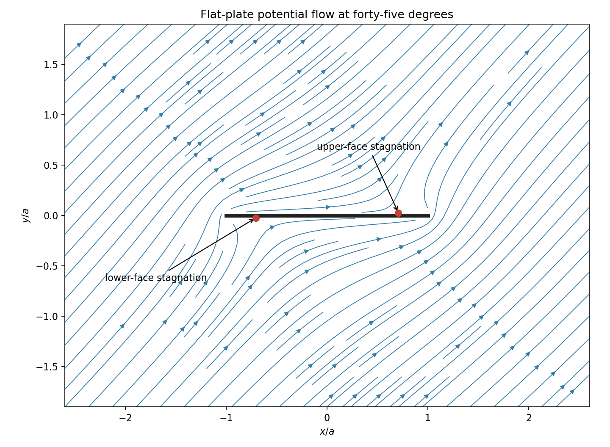

<h1 id="k/k3/solution">Solution</h1>

↑ **Parent:** [K3](../k3.md)

Orient the body boundary counterclockwise. Its outward body normal satisfies $n\,ds=(dy,-dx)$, so the pressure force has complex form

$$
F_x-iF_y=-i\oint p\,d\overline z.
$$

By steady [Bernoulli's equation](../../../../bernoulli-equation.md), $p=p_\infty+\rho(U_\infty^2-|q|^2)/2$, where $q=w'=u-iv$. Constant terms integrate to zero around a closed curve. On an impermeable boundary, velocity is tangent, so $q\,dz=\overline q\,d\overline z$. Therefore $|q|^2d\overline z=q^2dz$, yielding the [Blasius force theorem](../../../../blasius-force-theorem.md)

$$
\boxed{F_x-iF_y=\frac{i\rho}2\oint q^2\,dz}.
$$

For a slit body, the contour encloses both faces and the tips, interpreted by a limiting exterior contour.

Choose the analytic branch $s(z)=\sqrt{z^2-a^2}$ outside the slit with $s(z)\sim z$ at infinity. It may be written $\sqrt{z-a}\sqrt{z+a}$ using the principal individual square roots. For $-a<x<a$, approaching from above gives $s_+(x)=i\sqrt{a^2-x^2}$, and from below gives $s_-(x)=-i\sqrt{a^2-x^2}$.

Now

$$
q(z)=\cos\alpha-i\frac z{s(z)}\sin\alpha
=e^{-i\alpha}-\frac{ia^2\sin\alpha}{2z^2}+O(z^{-4}).
$$

There is no $z^{-1}$ term in $q^2$. Since $q^2$ is analytic in the exterior, enlarging the contour to a large circle shows its integral is zero. Thus

$$
\boxed{F_x=F_y=0}.
$$

This total-force argument retains the slit-tip contribution automatically.

On the upper face, $q_+(x)=\cos\alpha-x\sin\alpha/\sqrt{a^2-x^2}$; on the lower face, $q_-(x)=\cos\alpha+x\sin\alpha/\sqrt{a^2-x^2}$. For $0<\alpha\leq\pi/2$, their zeros are

$$
\boxed{x=a\cos\alpha\text{ on the upper face},\qquad x=-a\cos\alpha\text{ on the lower face}}.
$$

They are distinct face points even at $\alpha=\pi/2$, when both have coordinate zero. At $\alpha=0$, $w=z$ and $q=1$ everywhere in the exterior: there are no velocity-zero stagnation points. The limiting positions at the two tips must not be substituted into a singular expression and treated as zeros.

For the sketch at $\alpha=\pi/4$, the far-[field](../../../../field.md) velocity is $(1,1)/\sqrt2$, and streamlines are levels of $\operatorname{Im}w$. The plate is the zero-stream-[function](../../../../function-split.md) boundary, with the two stagnation points at $\pm a/\sqrt2$ on the indicated faces.

**[Figure 1](#k/k3/image-potential-flow-past-a-flat-plate-at-forty-five-degrees). Potential flow past a flat plate at forty-five degrees**. The arrows show the flow direction. Marked stagnation points lie on different faces of the plate; both edges are singular in this non-circulating ideal flow.

## ↑ Ancestors (12)

1. [K3](../k3.md)
2. [K](../../k.md)
3. [2009](../../../2009-split.md)
4. [Past exam of the options II course of the University of Oxford](../../../split.md)
5. [Options II course of the University of Oxford](../../../../options-ii-course-of-the-university-of-oxford.md)
6. [Year 2 of the mathematics course of the University of Oxford](../../../../year-2-of-the-mathematics-course-of-the-university-of-oxford.md)
7. [Mathematics course of the University of Oxford](../../../../mathematics-course-of-the-university-of-oxford.md)
8. [Undergraduate course of the University of Oxford](../../../../undergraduate-course-of-the-university-of-oxford.md)
9. [Course of the University of Oxford](../../../../course-of-the-university-of-oxford.md)
10. [University of Oxford](../../../../university-of-oxford-split.md)
11. [List of universities](../../../../list-of-universities.md)
12. [Codex Wiki](../../../../split.md)
