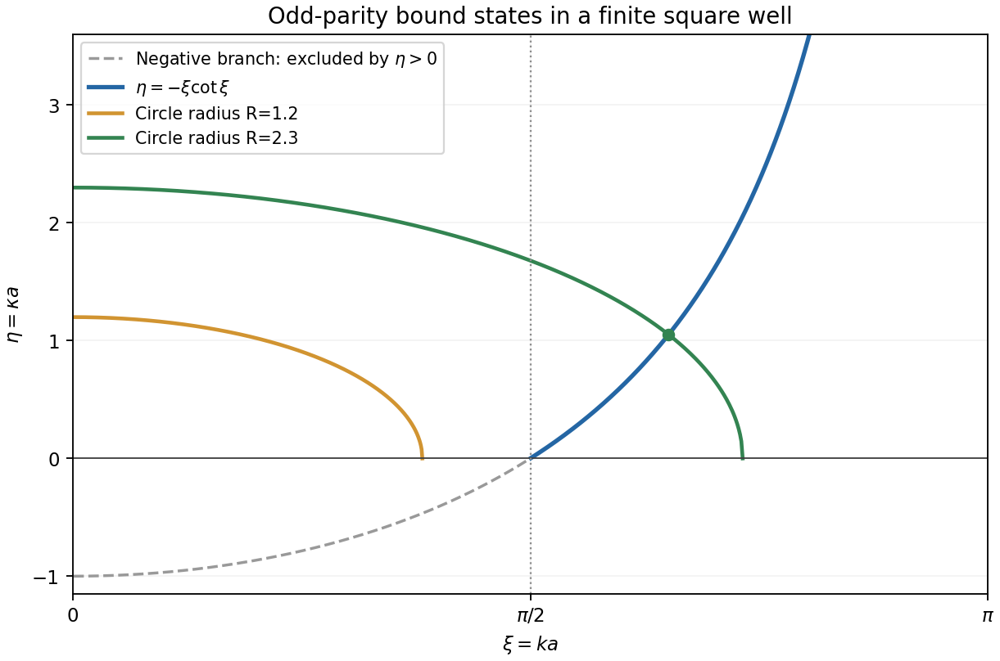

# 2010

↑ **Parent:** [Past exam of the options II course of the University of Oxford](../past-exam-of-the-options-ii-course-of-the-university-of-oxford.md)

Options II, Honour School of Mathematics Part A, Trinity Term; Thursday 24 June 2010, 9.30am–12.30pm. The complete fifteen-page source was supplied through [the past-papers disclosure](https://www.whatdotheyknow.com/request/maths_past_papers_3), in original Part A bundle pages 213–227. The private editable transcription retains the complete cover and every printed question.

New solutions cover the eighteen questions without an exact worked-answer advertisement found in the bounded check. H2 is recorded separately because Oxford explicitly advertises its solutions for Oxford students in [the Classical Mechanics revision notes](https://users.ox.ac.uk/~math0391/CMrevision.pdf). No new solution is supplied for that question.

**Table of contents**

- [A](#a)
  - [A2](#a/a2)
    - [1](#a/a2/1)
      - [Solution](#a/a2/1/solution)
    - [2](#a/a2/2)
      - [Solution](#a/a2/2/solution)
    - [3](#a/a2/3)
      - [Solution](#a/a2/3/solution)
    - [4](#a/a2/4)
      - [Solution](#a/a2/4/solution)
- [B](#b)
  - [B2](#b/b2)
    - [a](#b/b2/a)
      - [Solution](#b/b2/a/solution)
    - [b](#b/b2/b)
      - [Solution](#b/b2/b/solution)
    - [c](#b/b2/c)
      - [Solution](#b/b2/c/solution)
    - [d](#b/b2/d)
      - [Solution](#b/b2/d/solution)
    - [e](#b/b2/e)
      - [Solution](#b/b2/e/solution)
- [C](#c)
  - [C2](#c/c2)
    - [i](#c/c2/i)
      - [Solution](#c/c2/i/solution)
    - [ii](#c/c2/ii)
      - [Solution](#c/c2/ii/solution)
    - [iii](#c/c2/iii)
      - [Solution](#c/c2/iii/solution)
    - [iv](#c/c2/iv)
      - [Solution](#c/c2/iv/solution)
    - [v](#c/c2/v)
      - [Solution](#c/c2/v/solution)
- [D](#d)
  - [D3](#d/d3)
    - [Solution](#d/d3/solution)
    - [1](#d/d3/1)
      - [Solution](#d/d3/1/solution)
    - [2](#d/d3/2)
      - [Solution](#d/d3/2/solution)
  - [D4](#d/d4)
    - [Solution](#d/d4/solution)
    - [1](#d/d4/1)
      - [a](#d/d4/1/a)
        - [Solution](#d/d4/1/a/solution)
      - [b](#d/d4/1/b)
        - [Solution](#d/d4/1/b/solution)
    - [2](#d/d4/2)
      - [Solution](#d/d4/2/solution)
- [E](#e)
  - [E3](#e/e3)
    - [a](#e/e3/a)
      - [i](#e/e3/a/i)
        - [Solution](#e/e3/a/i/solution)
      - [ii](#e/e3/a/ii)
        - [Solution](#e/e3/a/ii/solution)
      - [iii](#e/e3/a/iii)
        - [Solution](#e/e3/a/iii/solution)
    - [b](#e/e3/b)
      - [i](#e/e3/b/i)
        - [Solution](#e/e3/b/i/solution)
      - [ii](#e/e3/b/ii)
        - [Solution](#e/e3/b/ii/solution)
      - [iii](#e/e3/b/iii)
        - [Solution](#e/e3/b/iii/solution)
      - [iv](#e/e3/b/iv)
        - [Solution](#e/e3/b/iv/solution)
  - [E4](#e/e4)
    - [a](#e/e4/a)
      - [i](#e/e4/a/i)
        - [Solution](#e/e4/a/i/solution)
      - [ii](#e/e4/a/ii)
        - [Solution](#e/e4/a/ii/solution)
      - [iii](#e/e4/a/iii)
        - [Solution](#e/e4/a/iii/solution)
      - [iv](#e/e4/a/iv)
        - [Solution](#e/e4/a/iv/solution)
      - [v](#e/e4/a/v)
        - [Solution](#e/e4/a/v/solution)
    - [b](#e/e4/b)
      - [i](#e/e4/b/i)
        - [Solution](#e/e4/b/i/solution)
      - [ii](#e/e4/b/ii)
        - [Solution](#e/e4/b/ii/solution)
    - [c](#e/e4/c)
      - [i](#e/e4/c/i)
        - [Solution](#e/e4/c/i/solution)
      - [ii](#e/e4/c/ii)
        - [Solution](#e/e4/c/ii/solution)
- [F](#f)
  - [F2](#f/f2)
    - [a](#f/f2/a)
      - [Solution](#f/f2/a/solution)
    - [b](#f/f2/b)
      - [Solution](#f/f2/b/solution)
    - [c](#f/f2/c)
      - [1](#f/f2/c/1)
        - [Solution](#f/f2/c/1/solution)
      - [2](#f/f2/c/2)
        - [Solution](#f/f2/c/2/solution)
- [G](#g)
  - [G2](#g/g2)
    - [Solution](#g/g2/solution)
- [H](#h)
  - [H2](#h/h2)
- [J](#j)
  - [J2](#j/j2)
    - [Solution](#j/j2/solution)
- [K](#k)
  - [K3](#k/k3)
    - [Solution](#k/k3/solution)
  - [K4](#k/k4)
    - [Solution](#k/k4/solution)
- [M](#m)
  - [M4](#m/m4)
    - [a](#m/m4/a)
      - [i](#m/m4/a/i)
        - [Solution](#m/m4/a/i/solution)
      - [ii](#m/m4/a/ii)
        - [Solution](#m/m4/a/ii/solution)
      - [iii](#m/m4/a/iii)
        - [Solution](#m/m4/a/iii/solution)
    - [b](#m/m4/b)
      - [Solution](#m/m4/b/solution)
  - [M5](#m/m5)
    - [a](#m/m5/a)
      - [i](#m/m5/a/i)
        - [Solution](#m/m5/a/i/solution)
      - [ii](#m/m5/a/ii)
        - [Solution](#m/m5/a/ii/solution)
    - [b](#m/m5/b)
      - [Solution](#m/m5/b/solution)
    - [c](#m/m5/c)
      - [Solution](#m/m5/c/solution)
    - [d](#m/m5/d)
      - [Solution](#m/m5/d/solution)
    - [e](#m/m5/e)
      - [i](#m/m5/e/i)
        - [Solution](#m/m5/e/i/solution)
      - [ii](#m/m5/e/ii)
        - [Solution](#m/m5/e/ii/solution)
- [O](#o)
  - [O4](#o/o4)
    - [a](#o/o4/a)
      - [Solution](#o/o4/a/solution)
    - [b](#o/o4/b)
      - [i](#o/o4/b/i)
        - [Solution](#o/o4/b/i/solution)
      - [ii](#o/o4/b/ii)
        - [Solution](#o/o4/b/ii/solution)
      - [iii](#o/o4/b/iii)
        - [Solution](#o/o4/b/iii/solution)
      - [iv](#o/o4/b/iv)
        - [Solution](#o/o4/b/iv/solution)
  - [O5](#o/o5)
    - [a](#o/o5/a)
      - [Solution](#o/o5/a/solution)
    - [b](#o/o5/b)
      - [Solution](#o/o5/b/solution)
- [P](#p)
  - [P3](#p/p3)
    - [a](#p/p3/a)
      - [Solution](#p/p3/a/solution)
    - [b](#p/p3/b)
      - [Solution](#p/p3/b/solution)
    - [c](#p/p3/c)
      - [Solution](#p/p3/c/solution)
    - [d](#p/p3/d)
      - [i](#p/p3/d/i)
        - [Solution](#p/p3/d/i/solution)
      - [ii](#p/p3/d/ii)
        - [Solution](#p/p3/d/ii/solution)
      - [iii](#p/p3/d/iii)
        - [Solution](#p/p3/d/iii/solution)
  - [P4](#p/p4)
    - [a](#p/p4/a)
      - [Solution](#p/p4/a/solution)
    - [b](#p/p4/b)
      - [Solution](#p/p4/b/solution)
    - [c](#p/p4/c)
      - [Solution](#p/p4/c/solution)

## A

↑ **Parent:** [2010](2010.md)

<h3 id="a/a2">A2</h3>

↑ **Parent:** [A](#a)

<h4 id="a/a2/1">1</h4>

↑ **Parent:** [A2](#a/a2)

<h5 id="a/a2/1/solution">Solution</h5>

↑ **Parent:** [1](#a/a2/1)

The extension $K/F$ is a [vector space](../vector-space.md) over $F$. Since $K$ is finite, a maximal linearly independent subset is finite and spans it; let its size be $d$. Relative to this [basis](../vector-space.md#basis), every element of $K$ has a unique list of $d$ coefficients in $F$. There are $q$ choices for each coefficient, so

$$
\boxed{|K|=q^d,\qquad d=[K:F].}
$$

The inclusion $F\subseteq K$ makes $d\geq1$.

<h4 id="a/a2/2">2</h4>

↑ **Parent:** [A2](#a/a2)

<h5 id="a/a2/2/solution">Solution</h5>

↑ **Parent:** [2](#a/a2/2)

Write $Q=q^m$ and take a [splitting field](../galois-theory.md#splitting-field) $L$ of $X^Q-X$ over $F$. Its [formal derivative](../galois-theory.md#formal-derivative) is $-1$, since the characteristic divides $Q$, so it has $Q$ distinct [roots](../semisimple-lie-algebra.md#root-of-a-root-system) in $L$. Let $K$ be their set. The [Frobenius endomorphism](../galois-theory.md#frobenius-endomorphism) identity gives

$$
(u+v)^Q=u^Q+v^Q,\qquad(uv)^Q=u^Qv^Q.
$$

Thus $K$ contains $0,1$ and is closed under addition, negatives and multiplication. If $u\neq0$ belongs to $K$, then $(u^{-1})^Q=(u^Q)^{-1}=u^{-1}$, so it is closed under inverses too. Hence $K$ is a [field](../algebra.md#field) with exactly $Q$ elements. Every $c\in F$ satisfies $c^q=c$ by [Lagrange's theorem for finite groups](../group-theory.md#lagrange-s-theorem) applied to $F^\times$, together with the zero case; iterating gives $c^Q=c$. Therefore

$$
\boxed{F\subseteq K,\qquad |K|=q^m.}
$$

<h4 id="a/a2/3">3</h4>

↑ **Parent:** [A2](#a/a2)

<h5 id="a/a2/3/solution">Solution</h5>

↑ **Parent:** [3](#a/a2/3)

By the allowed finite multiplicative-[subgroup](../group.md#subgroup) theorem, the [group](../group.md) $K^\times$ is cyclic. Let $z$ generate it. Every nonzero element of $K$ is a power of $z$, hence belongs to $F(z)$; zero belongs as well. Since the reverse inclusion is automatic,

$$
\boxed{K=F(z).}
$$

Thus a finite extension of a [finite field](../algebra.md#finite-field) is a [simple field extension](../algebra.md#simple-field-extension).

<h4 id="a/a2/4">4</h4>

↑ **Parent:** [A2](#a/a2)

<h5 id="a/a2/4/solution">Solution</h5>

↑ **Parent:** [4](#a/a2/4)

For $\alpha\neq0$, [Lagrange's theorem for finite groups](../group-theory.md#lagrange-s-theorem) in $K^\times$, whose order is $q^m-1$, gives $\alpha^{q^m-1}=1$. The zero element satisfies the equation too, so every $\alpha\in K$ has $\alpha^{q^m}=\alpha$.

Now let $f\in F[X]$ be irreducible of degree $m$. The quotient $F[X]/(f)$ is a [field](../algebra.md#field) with $q^m$ elements, by its [basis](../vector-space.md#basis) $1,\overline X,\ldots,\overline X^{m-1}$. Its element $\overline X$ therefore satisfies $\overline X^{q^m}-\overline X=0$. This means precisely that $X^{q^m}-X$ lies in the ideal $(f)$, giving

$$
\boxed{f(X)\mid X^{q^m}-X.}
$$

## B

↑ **Parent:** [2010](2010.md)

<h3 id="b/b2">B2</h3>

↑ **Parent:** [B](#b)

<h4 id="b/b2/a">a</h4>

↑ **Parent:** [B2](#b/b2)

<h5 id="b/b2/a/solution">Solution</h5>

↑ **Parent:** [A](#b/b2/a)

With $N\triangleleft G$, the internal [semidirect product](../group-theory.md#semidirect-product) conditions are $G=NH$ and $N\cap H=\{1\}$. Every element then has a unique expression $nh$. The extra data needed to reconstruct the [group](../group.md) are the [conjugation](../group-action.md#conjugation) action

$$
\phi:H\to\operatorname{Aut}(N),\qquad\phi_h(n)=hnh^{-1}.
$$

On the set $N\times H$, the external [semidirect product](../group-theory.md#semidirect-product) $N\rtimes_\phi H$ has multiplication

$$
\boxed{(n,h)(n',h')=(n\phi_h(n'),hh').}
$$

The map $(n,h)\mapsto nh$ identifies it with $G$. A direct product results when this action is trivial.

For example, $S_3=A_3\rtimes\langle(12)\rangle\cong C_3\rtimes C_2$. The two [subgroups](../group.md#subgroup) intersect trivially and their orders multiply to six, so they generate $S_3$. [Conjugation](../group-action.md#conjugation) by the transposition inverts the three-cycle. This action is nontrivial, and $S_3$ is nonabelian whereas $C_3\times C_2$ is abelian, so this is not their direct product.

<h4 id="b/b2/b">b</h4>

↑ **Parent:** [B2](#b/b2)

<h5 id="b/b2/b/solution">Solution</h5>

↑ **Parent:** [B](#b/b2/b)

Use composition from right to left. Applying $(C,d)$ and then $(A,b)$ gives

$$
v\mapsto A(Cv+d)+b=ACv+(Ad+b),
$$

so

$$
\boxed{(A,b)(C,d)=(AC,Ad+b).}
$$

The product remains an affine transformation because $AC$ is invertible. Composition of functions is associative. The identity is $(I,0)$, and solving $w=Av+b$ gives the inverse

$$
\boxed{(A,b)^{-1}=(A^{-1},-A^{-1}b).}
$$

Thus these transformations form the [affine group](../lie-theory.md#affine-group). The representation by $(A,b)$ is unique: evaluating at zero determines $b$, and then evaluating on the standard [basis](../vector-space.md#basis) determines $A$.

<h4 id="b/b2/c">c</h4>

↑ **Parent:** [B2](#b/b2)

<h5 id="b/b2/c/solution">Solution</h5>

↑ **Parent:** [C](#b/b2/c)

Embed $\operatorname{GL}_n(F)$ by $A\mapsto(A,0)$. The multiplication and inverse formulas show that this is an injective [group homomorphism](../group-theory.md#group-homomorphism), so its image $H$ is a [subgroup](../group.md#subgroup). The translations form $N=\{(I,c):c\in F^n\}$, with $(I,c)(I,d)=(I,c+d)$ and inverse $(I,-c)$. Hence $N$ is isomorphic to the additive [group](../group.md) of $F^n$.

For an arbitrary affine transformation,

$$
\boxed{(A,b)(I,c)(A,b)^{-1}=(I,Ac).}
$$

[Conjugation](../group-action.md#conjugation) therefore preserves $N$, proving that $N$ is normal in $G$.

<h4 id="b/b2/d">d</h4>

↑ **Parent:** [B2](#b/b2)

<h5 id="b/b2/d/solution">Solution</h5>

↑ **Parent:** [D](#b/b2/d)

Every affine transformation factors as

$$
(A,b)=(I,b)(A,0),
$$

so $G=NH$. A translation fixing zero has zero translation vector, so $H\cap N=\{(I,0)\}$. Together with normality from part (c), these are the internal [semidirect product](../group-theory.md#semidirect-product) conditions. Thus

$$
\boxed{G\cong(F^n,+)\rtimes\operatorname{GL}_n(F).}
$$

The reconstruction data are the additive [group](../group.md) $F^n$, the linear [group](../group.md) $\operatorname{GL}_n(F)$, and its standard action $A:c\mapsto Ac$ on translations. In pair notation $(b,A)$, the product is $(b,A)(d,C)=(b+Ad,AC)$, equivalent to the formula in part (b).

<h4 id="b/b2/e">e</h4>

↑ **Parent:** [B2](#b/b2)

<h5 id="b/b2/e/solution">Solution</h5>

↑ **Parent:** [E](#b/b2/e)

There are $p^n$ possible translation vectors. An [invertible matrix](../linear-algebra.md#invertible-matrix) is specified by an ordered [basis](../vector-space.md#basis) of $\mathbb F_p^n$. Its first column can be any nonzero vector, giving $p^n-1$ choices. After choosing $i$ independent columns, their span has $p^i$ elements, so the next column has $p^n-p^i$ choices. Therefore

$$
\boxed{|G|=p^n|\operatorname{GL}_n(\mathbb F_p)|
=p^n\prod_{i=0}^{n-1}(p^n-p^i).}
$$

<h2 id="c">C</h2>

↑ **Parent:** [2010](2010.md)

<h3 id="c/c2">C2</h3>

↑ **Parent:** [C](#c)

<h4 id="c/c2/i">i</h4>

↑ **Parent:** [C2](#c/c2)

<h5 id="c/c2/i/solution">Solution</h5>

↑ **Parent:** [I](#c/c2/i)

A [primitive root modulo $p$](../number-theory.md#primitive-root-modulo-n) is a [residue](../analysis.md#residue) class generating the cyclic multiplicative [group](../group.md) $(\mathbb Z/p\mathbb Z)^\times$, so its order is $p-1$. If $g$ is one generator, all generators are $g^j$ with $\gcd(j,p-1)=1$. Thus the number is

$$
\boxed{\varphi(p-1),}
$$

where $\varphi$ is [Euler's totient function](../number-theory.md#euler-totient-function). This includes $p=2$, with $\varphi(1)=1$.

<h4 id="c/c2/ii">ii</h4>

↑ **Parent:** [C2](#c/c2)

<h5 id="c/c2/ii/solution">Solution</h5>

↑ **Parent:** [Ii](#c/c2/ii)

For $n\geq1$, the zero [residue](../analysis.md#residue) contributes zero. Write $S=\sum_{x\in\mathbb F_p^\times}x^n$. Multiplication by any nonzero $\alpha$ permutes these residues, so $S=\alpha^nS$ in $\mathbb F_p$. If $(p-1)\nmid n$, choose a [primitive root](../number-theory.md#primitive-root-modulo-n) $g$; then $g^n\neq1$, and $(1-g^n)S=0$ forces $S=0$.

If $(p-1)\mid n$, every nonzero $x$ has $x^n=1$, so $S=p-1\equiv-1\pmod p$. Therefore

$$
\boxed{\sum_{x=1}^p x^n\equiv
\begin{cases}0,&(p-1)\nmid n,\\-1,&(p-1)\mid n\end{cases}\pmod p\quad(n\geq1).}
$$

The source also lists $n=0$, although its premise assumes $n\geq1$. For that separate case, the [integer](../integer.md) sum has $p$ terms each equal to one, so it is zero modulo $p$.

<h4 id="c/c2/iii">iii</h4>

↑ **Parent:** [C2](#c/c2)

<h5 id="c/c2/iii/solution">Solution</h5>

↑ **Parent:** [Iii](#c/c2/iii)

The [Legendre symbol](../quadratic-residue.md#legendre-symbol) equal to $1$ says that $a$ is a nonzero square modulo $p$. Choose one [root](../semisimple-lie-algebra.md#root-of-a-root-system) $r\neq0$. Then $-r$ is another [root](../semisimple-lie-algebra.md#root-of-a-root-system), distinct because $p$ is odd. Any solution $x$ satisfies

$$
0=x^2-r^2=(x-r)(x+r)
$$

in the [field](../algebra.md#field) $\mathbb F_p$, so $x=r$ or $x=-r$. Thus there are

$$
\boxed{2\text{ solutions}.}
$$

<h4 id="c/c2/iv">iv</h4>

↑ **Parent:** [C2](#c/c2)

<h5 id="c/c2/iv/solution">Solution</h5>

↑ **Parent:** [Iv](#c/c2/iv)

Let $R$ be the sum of the nonzero [quadratic residues](../quadratic-residue.md). Each has two square [roots](../semisimple-lie-algebra.md#root-of-a-root-system) by part (iii), so

$$
2R\equiv\sum_{x=1}^{p-1}x^2\equiv0\pmod p,
$$

where part (ii) applies because $p>3$ makes $p-1$ not divide $2$. Since $2$ is invertible modulo $p$, $R\equiv0$.

The sum of all nonzero classes is $p(p-1)/2\equiv0\pmod p$. Subtracting $R$ shows that the sum of [quadratic nonresidues](../quadratic-residue.md#quadratic-nonresidue) is also zero. Consequently **both requested sums vanish modulo $p$**.

<h4 id="c/c2/v">v</h4>

↑ **Parent:** [C2](#c/c2)

<h5 id="c/c2/v/solution">Solution</h5>

↑ **Parent:** [V](#c/c2/v)

Part (ii), with exponent $30$, shows that a prime $q$ fails to divide the sum precisely when $q-1$ divides $30$. The positive divisors are $1,2,3,5,6,10,15,30$. Adding one gives $2,3,4,6,7,11,16,31$, of which the primes are

$$
\boxed{q\in\{2,3,7,11,31\}.}
$$

For these primes the sum is $-1$ modulo $q$; for every other prime it is zero.

<h2 id="d">D</h2>

↑ **Parent:** [2010](2010.md)

<h3 id="d/d3">D3</h3>

↑ **Parent:** [D](#d)

<h4 id="d/d3/solution">Solution</h4>

↑ **Parent:** [D3](#d/d3)

The [monotone convergence theorem](../measure-theory.md#monotone-convergence-theorem) states that for nonnegative measurable functions $f_n\uparrow f$ almost everywhere, $\int f=\lim_n\int f_n$, allowing the value $+\infty$.

The [dominated convergence theorem](../measure-theory.md#dominated-convergence-theorem) states that if measurable functions $f_n\to f$ almost everywhere and $|f_n|\leq g$ almost everywhere for some integrable $g$, then $f$ is integrable and $\int f_n\to\int f$. In fact $\int|f_n-f|\to0$ as well. Both statements apply on any [measure space](../measure.md#measure-space).

<h4 id="d/d3/1">1</h4>

↑ **Parent:** [D3](#d/d3)

<h5 id="d/d3/1/solution">Solution</h5>

↑ **Parent:** [1](#d/d3/1)

Apply the [monotone convergence theorem](../measure-theory.md#monotone-convergence-theorem) to $s_N=\sum_{k=1}^N|a_k|$. Its limit $s$ satisfies

$$
\int s=\sum_{k=1}^\infty\int|a_k|<\infty.
$$

Thus $s$ is finite almost everywhere, which proves [absolute convergence](../sequence-and-series.md#absolute-convergence) of $\sum_k a_k$ almost everywhere. Define its sum $a$ there, and set $a=0$ on the exceptional [null set](../measure-theory.md#null-set). Then $|a|\leq s$, so $a$ is integrable. The partial sums of $\sum_k a_k$ are also dominated by $s$; [dominated convergence](../measure-theory.md#dominated-convergence-theorem) gives

$$
\boxed{\int\sum_{k=1}^\infty a_k=\lim_{N\to\infty}\sum_{k=1}^N\int a_k
=\sum_{k=1}^\infty\int a_k.}
$$

The series of integrals converges absolutely, since $|\int a_k|\leq\int|a_k|$.

<h4 id="d/d3/2">2</h4>

↑ **Parent:** [D3](#d/d3)

<h5 id="d/d3/2/solution">Solution</h5>

↑ **Parent:** [2](#d/d3/2)

For $0<x<1$, expand $(1-x)^{-2}=\sum_{k\geq1}kx^{k-1}$. Multiplying by $(\log x)^2$ gives nonnegative terms, so the [monotone convergence theorem](../measure-theory.md#monotone-convergence-theorem) permits termwise integration. Put $x=e^{-t}$ to obtain

$$
\int_0^1x^{k-1}(\log x)^2\,dx
=\int_0^\infty t^2e^{-kt}\,dt=\frac2{k^3},
$$

where scaling followed by two integrations by parts evaluates the last integral. Hence

$$
\boxed{\int_0^1\left(\frac{\log x}{1-x}\right)^2dx
=2\sum_{k=1}^\infty\frac1{k^2}=\frac{\pi^2}{3}.}
$$

The finite value also establishes integrability at both endpoints.

<h3 id="d/d4">D4</h3>

↑ **Parent:** [D](#d)

<h4 id="d/d4/solution">Solution</h4>

↑ **Parent:** [D4](#d/d4)

A sufficient [differentiation under the integral sign](../analysis.md#differentiation-under-the-integral-sign) theorem is the following local domination criterion. Suppose $u(t,\cdot)$ is measurable for each $t$, $u(t_0,\cdot)$ is integrable at one point of a neighborhood $J$ of $t_0$, and for almost every $x$ the function $u(\cdot,x)$ is differentiable on $J$. Assume an integrable function $g_J$ satisfies $|\partial_tu(t,x)|\leq g_J(x)$ for $t\in J$ and almost every $x$. Then $I$ is differentiable on the interior of $J$ and

$$
\boxed{I'(t)=\int_E\partial_tu(t,x)\,dx.}
$$

The [mean value theorem](../calculus.md#mean-value-theorem) bounds the difference quotients by $g_J$, and the [dominated convergence theorem](../measure-theory.md#dominated-convergence-theorem) passes their pointwise limit through the integral. Applying this criterion locally throughout $(a,b)$ proves [differentiability](../analysis.md#differentiability) there. One may impose the stronger condition that every $u(t,\cdot)$ is integrable from the outset.

<h4 id="d/d4/1">1</h4>

↑ **Parent:** [D4](#d/d4)

<h5 id="d/d4/1/a">a</h5>

↑ **Parent:** [1](#d/d4/1)

<h6 id="d/d4/1/a/solution">Solution</h6>

↑ **Parent:** [A](#d/d4/1/a)

For every [integer](../integer.md) $j\geq0$, the $j$th derivative with respect to $t$ of $\cos(t\cos x)$ is $(\cos x)^j$ times a sine or cosine with a sign. Its absolute value is at most $1$ on the finite [interval](../real-analysis.md#interval-mathematics) $[0,\pi/2]$. This is an integrable dominating function independent of $t$. Repeated [differentiation under the integral sign](../analysis.md#differentiation-under-the-integral-sign) is therefore justified for every order, giving **$J_0\in C^\infty(\mathbb R)$**.

<h5 id="d/d4/1/b">b</h5>

↑ **Parent:** [1](#d/d4/1)

<h6 id="d/d4/1/b/solution">Solution</h6>

↑ **Parent:** [B](#d/d4/1/b)

Differentiating the integral representation gives

$$
J_0'(t)=-\frac2\pi\int_0^{\pi/2}\cos x\sin(t\cos x)\,dx,
\qquad
J_0''(t)+J_0(t)=\frac2\pi\int_0^{\pi/2}\sin^2x\cos(t\cos x)\,dx.
$$

Now integrate the derivative

$$
\frac d{dx}\big(\sin x\sin(t\cos x)\big)
=\cos x\sin(t\cos x)-t\sin^2x\cos(t\cos x).
$$

The boundary terms vanish at both endpoints. Consequently $J_0'(t)=-t(J_0''(t)+J_0(t))$, proving

$$
\boxed{tJ_0''(t)+J_0'(t)+tJ_0(t)=0.}
$$

The identity includes $t=0$, where it reads $J_0'(0)=0$.

<h4 id="d/d4/2">2</h4>

↑ **Parent:** [D4](#d/d4)

<h5 id="d/d4/2/solution">Solution</h5>

↑ **Parent:** [2](#d/d4/2)

A naive absolute bound on the original derivative would be $1/x$, which is not integrable on $[1,\infty)$. Instead make the change of variable $s=tx$, valid for $t>0$:

$$
K(t)=t\int_t^\infty\frac{\cos s}{s^2}\,ds.
$$

The integral is absolutely convergent for every positive lower endpoint. Its integrand is continuous there, so the [fundamental theorem of calculus](../calculus.md#fundamental-theorem-of-calculus) gives

$$
\frac d{dt}\int_t^\infty\frac{\cos s}{s^2}\,ds=-\frac{\cos t}{t^2}.
$$

The product rule now yields

$$
\boxed{K'(t)=\int_t^\infty\frac{\cos s}{s^2}\,ds-\frac{\cos t}{t}
=\frac{K(t)-\cos t}{t}.}
$$

This proves [differentiability](../analysis.md#differentiability) and the equation without an unjustified differentiation of a conditionally convergent derivative integral.

<h2 id="e">E</h2>

↑ **Parent:** [2010](2010.md)

<h3 id="e/e3">E3</h3>

↑ **Parent:** [E](#e)

<h4 id="e/e3/a">a</h4>

↑ **Parent:** [E3](#e/e3)

<h5 id="e/e3/a/i">i</h5>

↑ **Parent:** [A](#e/e3/a)

<h6 id="e/e3/a/i/solution">Solution</h6>

↑ **Parent:** [I](#e/e3/a/i)

A subset $A$ is [connected](../geometry-and-topology.md#connected-space) if its [subspace topology](../topology.md#subspace-topology) admits no separation into two disjoint nonempty relatively open subsets. Equivalently, every [continuous map](../topology.md#continuous-map) $A\to\{0,1\}$, with the target discrete, is constant: a nonconstant map gives the separation by its two fibers, and a separation defines such a map.

<h5 id="e/e3/a/ii">ii</h5>

↑ **Parent:** [A](#e/e3/a)

<h6 id="e/e3/a/ii/solution">Solution</h6>

↑ **Parent:** [Ii](#e/e3/a/ii)

The connected subsets of the usual real line are **the empty set and all [intervals](../real-analysis.md#interval-mathematics)**, including singletons, bounded [intervals](../real-analysis.md#interval-mathematics) of any endpoint type, rays, and the whole line. Equivalently, a nonempty subset is connected exactly when it contains every point between any two of its points.

<h5 id="e/e3/a/iii">iii</h5>

↑ **Parent:** [A](#e/e3/a)

<h6 id="e/e3/a/iii/solution">Solution</h6>

↑ **Parent:** [Iii](#e/e3/a/iii)

Use the characterization by continuous maps to the discrete two-point space. Let $A=\bigcup_iA_i$ and let $f:A\to\{0,1\}$ be continuous. Its restriction to each connected $A_i$ is constant. Since $A_i\cap A_j\neq\varnothing$, those two constants agree for every pair $i,j$. Hence $f$ is constant on their union. Thus **the union is connected**. If the indexing set is empty, the union is empty and is connected directly.

<h4 id="e/e3/b">b</h4>

↑ **Parent:** [E3](#e/e3)

<h5 id="e/e3/b/i">i</h5>

↑ **Parent:** [B](#e/e3/b)

<h6 id="e/e3/b/i/solution">Solution</h6>

↑ **Parent:** [I](#e/e3/b/i)

Let

$$
\boxed{K_a=\bigcup\{S\subseteq X:S\text{ is connected and }a\in S\}.}
$$

This family is nonempty because it contains $\{a\}$. All its members intersect at $a$, so part (a)(iii) proves that $K_a$ is connected. It contains $a$ and, by its construction, contains every connected subset containing $a$. Thus it has exactly the required largest-subset property. This is the [connected component](../geometry-and-topology.md#connected-component) containing $a$.

<h5 id="e/e3/b/ii">ii</h5>

↑ **Parent:** [B](#e/e3/b)

<h6 id="e/e3/b/ii/solution">Solution</h6>

↑ **Parent:** [Ii](#e/e3/b/ii)

Suppose two components $K$ and $L$ intersect. Their union is connected by part (a)(iii). It contains the point used to define $K$, so maximality forces $K\cup L\subseteq K$, giving $L\subseteq K$. The same reasoning with $L$ gives $K\subseteq L$. Hence $K=L$. Thus **distinct [connected components](../geometry-and-topology.md#connected-component) are disjoint**.

<h5 id="e/e3/b/iii">iii</h5>

↑ **Parent:** [B](#e/e3/b)

<h6 id="e/e3/b/iii/solution">Solution</h6>

↑ **Parent:** [Iii](#e/e3/b/iii)

Let $C$ be a component of the [open set](../topology.md#open-set) $X\subseteq\mathbb R$. Being a connected subset of the real line, $C$ is an [interval](../real-analysis.md#interval-mathematics). For any $x\in C$, openness of $X$ gives $\epsilon>0$ with $(x-\epsilon,x+\epsilon)\subseteq X$. This [interval](../real-analysis.md#interval-mathematics) is connected and meets $C$, so their union is connected. Maximality of $C$ makes the entire [interval](../real-analysis.md#interval-mathematics) lie in $C$. Thus every point of $C$ is interior, so **each component is an open [interval](../real-analysis.md#interval-mathematics)**, allowing unbounded endpoints.

<h5 id="e/e3/b/iv">iv</h5>

↑ **Parent:** [B](#e/e3/b)

<h6 id="e/e3/b/iv/solution">Solution</h6>

↑ **Parent:** [Iv](#e/e3/b/iv)

Every point belongs to its component, so the components cover $X$; by part (ii) they are pairwise disjoint, and by part (iii) they are nonempty open [intervals](../real-analysis.md#interval-mathematics). Each contains a [rational number](../number-theory.md#rational-number). Fix an enumeration of $\mathbb Q$ and choose the first rational belonging to each component. Distinct components receive distinct rationals, giving an [injection](../algebra.md#injective-function) from the component family into a [countable set](../cardinal-number.md#countable-set). Therefore

$$
\boxed{X\text{ is a countable union of pairwise disjoint open intervals}.}
$$

The empty [open set](../topology.md#open-set) is represented by the empty union.

<h3 id="e/e4">E4</h3>

↑ **Parent:** [E](#e)

<h4 id="e/e4/a">a</h4>

↑ **Parent:** [E4](#e/e4)

<h5 id="e/e4/a/i">i</h5>

↑ **Parent:** [A](#e/e4/a)

<h6 id="e/e4/a/i/solution">Solution</h6>

↑ **Parent:** [I](#e/e4/a/i)

A subset $K$ of a [topological space](../topology.md#topological-space) is [compact](../topology.md#compact-space) if every cover of $K$ by open subsets of the ambient space has a finite subcover. This is equivalent to [compactness](../topology.md#compact-space) of $K$ with its [subspace topology](../topology.md#subspace-topology).

<h5 id="e/e4/a/ii">ii</h5>

↑ **Parent:** [A](#e/e4/a)

<h6 id="e/e4/a/ii/solution">Solution</h6>

↑ **Parent:** [Ii](#e/e4/a/ii)

A subset $B$ of a [metric space](../topological-analysis.md#metric-space) is [bounded](../topological-analysis.md#bounded-set) if it lies in some ball of finite radius: there are $x_0$ in the space and $R<\infty$ with $d(x,x_0)\leq R$ for every $x\in B$. For a nonempty subset, this is equivalent to finite [diameter](../topological-analysis.md#diameter), $\sup_{x,y\in B}d(x,y)<\infty$. The empty subset is bounded by convention.

<h5 id="e/e4/a/iii">iii</h5>

↑ **Parent:** [A](#e/e4/a)

<h6 id="e/e4/a/iii/solution">Solution</h6>

↑ **Parent:** [Iii](#e/e4/a/iii)

In an arbitrary [topological space](../topology.md#topological-space), compact need not imply closed. In a two-point indiscrete space, a singleton is compact but not closed. Closed need not imply compact either: $\mathbb R$ is closed in itself but the cover $\{(-n,n):n\geq1\}$ has no finite subcover. One general theorem that does hold is that a closed subset $F$ of a [compact space](../topology.md#compact-space) $K$ is compact: adjoin $K\setminus F$ to any relative open cover of $F$, take a finite cover of $K$, and discard that additional set.

In a [Hausdorff space](../topology.md#hausdorff-space), every compact subset $K$ is closed. For $y\notin K$, separate $y$ from each $x\in K$ by disjoint [open sets](../topology.md#open-set) $V_x$ about $y$ and $U_x$ about $x$. Finitely many $U_x$ cover $K$; the intersection of their corresponding $V_x$ is a neighborhood of $y$ disjoint from $K$. Thus the complement of $K$ is open. The converse still fails, as the real-line example shows.

In every [metric space](../topological-analysis.md#metric-space), compact subsets are bounded. Cover a nonempty $K$ by unit balls centered on $K$ and take a finite subcover; the [triangle inequality](../topological-analysis.md#triangle-inequality) bounds all points relative to any one of the finitely many centers. The converse fails even for closed bounded subsets of general metric spaces. An infinite set with discrete metric $d(x,y)=1$ for distinct points is closed and bounded in itself, but its cover by singleton balls has no finite subcover. Thus **compact implies closed and bounded in a [metric space](../topological-analysis.md#metric-space), while closed and bounded need not imply compact**.

<h5 id="e/e4/a/iv">iv</h5>

↑ **Parent:** [A](#e/e4/a)

<h6 id="e/e4/a/iv/solution">Solution</h6>

↑ **Parent:** [Iv](#e/e4/a/iv)

By the [Heine-Borel theorem](../topology.md#heine-borel-theorem), a subset of $\mathbb R$ is compact exactly when it is closed and bounded. Consequently the compact [intervals](../real-analysis.md#interval-mathematics) are

$$
\boxed{[u,v]\quad\text{with finite }u\leq v,}
$$

including singleton [intervals](../real-analysis.md#interval-mathematics). The empty [interval](../real-analysis.md#interval-mathematics) is compact too, if included in the [interval](../real-analysis.md#interval-mathematics) convention. Nonempty open, proper half-open, and unbounded [intervals](../real-analysis.md#interval-mathematics) are not compact.

<h5 id="e/e4/a/v">v</h5>

↑ **Parent:** [A](#e/e4/a)

<h6 id="e/e4/a/v/solution">Solution</h6>

↑ **Parent:** [V](#e/e4/a/v)

For any topological target $Y$, **$f(K)$ is compact**. Pull an open cover of $f(K)$ back by $f$, take a finite subcover of $K$, and map the covering statement forward. Without a separation assumption on $Y$, the image need not be closed, as a constant map into a nonclosed singleton of an indiscrete space shows.

If $Y$ is a [metric space](../topological-analysis.md#metric-space), $f(K)$ is also closed in $Y$, bounded, [totally bounded](../topological-analysis.md#totally-bounded-space), complete with its inherited metric, and sequentially compact. Closedness uses the Hausdorff theorem from part (iii); total boundedness follows by taking finite subcovers of the covers by balls of any fixed radius. Compact metric spaces are sequentially compact, and a [Cauchy sequence](../sequence-and-series.md#cauchy-sequence) with a convergent subsequence converges to the same limit, proving [completeness](../topological-analysis.md#completeness). These properties are asserted for the image subset, without requiring the whole ambient [metric space](../topological-analysis.md#metric-space) to be complete.

<h4 id="e/e4/b">b</h4>

↑ **Parent:** [E4](#e/e4)

<h5 id="e/e4/b/i">i</h5>

↑ **Parent:** [B](#e/e4/b)

<h6 id="e/e4/b/i/solution">Solution</h6>

↑ **Parent:** [I](#e/e4/b/i)

A sequence $(x_n)$ in a [metric space](../topological-analysis.md#metric-space) is a [Cauchy sequence](../sequence-and-series.md#cauchy-sequence) if

$$
\boxed{\forall\epsilon>0\ \exists N\ \forall m,n\geq N: d(x_m,x_n)<\epsilon.}
$$

This compares sufficiently late terms with each other; it does not assume the existence of a limit in the space.

<h5 id="e/e4/b/ii">ii</h5>

↑ **Parent:** [B](#e/e4/b)

<h6 id="e/e4/b/ii/solution">Solution</h6>

↑ **Parent:** [Ii](#e/e4/b/ii)

A [metric space](../topological-analysis.md#metric-space) is [complete](../topological-analysis.md#complete-metric-space) if **every [Cauchy sequence](../sequence-and-series.md#cauchy-sequence) in it converges to a point of that same space**. A limit in a larger ambient completion is insufficient for this definition.

<h4 id="e/e4/c">c</h4>

↑ **Parent:** [E4](#e/e4)

<h5 id="e/e4/c/i">i</h5>

↑ **Parent:** [C](#e/e4/c)

<h6 id="e/e4/c/i/solution">Solution</h6>

↑ **Parent:** [I](#e/e4/c/i)

**Yes.** A [Cauchy sequence](../sequence-and-series.md#cauchy-sequence) in the supremum [norm](../normed-vector-space.md#norm) converges in the given complete space $B([0,1])$ to a bounded function $f$. Supremum-[norm](../normed-vector-space.md#norm) convergence is [uniform convergence](../sequence-and-series.md#uniform-convergence). The uniform limit of continuous functions is continuous: for a point $x_0$ and tolerance $\epsilon$, choose a continuous $f_n$ within $\epsilon/3$ of $f$ uniformly, then use its [continuity](../calculus.md#continuous-function) at $x_0$ and the [triangle inequality](../topological-analysis.md#triangle-inequality). Hence $f\in C([0,1])$. Thus $C([0,1])$ is a closed, complete subspace of $B([0,1])$.

<h5 id="e/e4/c/ii">ii</h5>

↑ **Parent:** [C](#e/e4/c)

<h6 id="e/e4/c/ii/solution">Solution</h6>

↑ **Parent:** [Ii](#e/e4/c/ii)

**Yes.** [Continuity](../calculus.md#continuous-function) and nonvanishing on the compact [interval](../real-analysis.md#interval-mathematics) give constants

$$
0<m=\min_{[0,1]}|\alpha|\leq\max_{[0,1]}|\alpha|=M<\infty.
$$

Consequently

$$
\boxed{m\|f-g\|_\infty\leq d_\alpha(f,g)\leq M\|f-g\|_\infty.}
$$

A $d_\alpha$-[Cauchy sequence](../sequence-and-series.md#cauchy-sequence) is therefore supremum-[norm](../normed-vector-space.md#norm) Cauchy and has a continuous uniform limit $f$ by part (i). The upper bound then makes it converge to $f$ also in $d_\alpha$. Equivalently, multiplication by $\alpha$ is an isometry from this weighted space onto ordinary $C([0,1])$, since division by the continuous nonvanishing $\alpha$ gives its inverse.

This is [completeness of a continuous weighted uniform norm](../normed-vector-space.md#completeness-of-a-continuous-weighted-uniform-norm).

## F

↑ **Parent:** [2010](2010.md)

<h3 id="f/f2">F2</h3>

↑ **Parent:** [F](#f)

<h4 id="f/f2/a">a</h4>

↑ **Parent:** [F2](#f/f2)

<h5 id="f/f2/a/solution">Solution</h5>

↑ **Parent:** [A](#f/f2/a)

[Differentiability](../analysis.md#differentiability) at $x_0$ means that a [linear map](../vector-space.md#linear-map) $A:\mathbb R^n\to\mathbb R^m$ exists with

$$
f(x_0+h)=f(x_0)+Ah+o(\|h\|).
$$

The map $A=Df(x_0)$ is the [total derivative](../calculus.md#total-derivative). A [linear map](../vector-space.md#linear-map) between these finite-dimensional spaces is bounded, so $\|f(x_0+h)-f(x_0)\|\leq\|A\|\|h\|+o(\|h\|)\to0$. Thus [differentiability](../analysis.md#differentiability) implies [continuity](../calculus.md#continuous-function).

For the displayed two-variable function,

$$
0\leq\frac{x^4}{\sqrt{x^4+y^2}}\leq x^2\leq x^2+y^2.
$$

Writing $r=\sqrt{x^2+y^2}$ gives $|f(x,y)|/r\leq r\to0$. Therefore **it is differentiable at the origin, with derivative zero**.

Finally, put $h=x-x_0$, write $f(x_0+h)=Ah+r(h)$ with $r(h)=o(\|h\|)$, and $g(x_0+h)=g(x_0)+s(h)$ with $s(h)=o(1)$. Since $f(x_0)=0$,

$$
F(x_0+h)=\langle Ah,g(x_0)\rangle
+\langle Ah,s(h)\rangle+\langle r(h),g(x_0)+s(h)\rangle.
$$

By the [Cauchy-Schwarz inequality](../probability-and-statistics.md#cauchy-schwarz-inequality) the last two terms are $o(\|h\|)$: $A$ is bounded and $g(x_0)+s(h)$ stays bounded. Hence

$$
\boxed{DF(x_0)h=\langle Df(x_0)h,g(x_0)\rangle.}
$$

Only [continuity](../calculus.md#continuous-function) of $g$ at $x_0$ is needed, because the vanishing of $f(x_0)$ removes the term which would otherwise require differentiating $g$.

<h4 id="f/f2/b">b</h4>

↑ **Parent:** [F2](#f/f2)

<h5 id="f/f2/b/solution">Solution</h5>

↑ **Parent:** [B](#f/f2/b)

A $C^1$ [embedded submanifold](../smooth-manifold.md#embedded-submanifold) $M\subseteq\mathbb R^n$ of dimension $n-1$ is locally the graph of a $C^1$ function of $n-1$ coordinates after a change of coordinates. Equivalently, near each point $x_0\in M$ it is a regular level set $\{x:h(x)=0\}$ of a $C^1$ scalar function with $\nabla h(x_0)\neq0$.

The [Lagrange multiplier](../mathematical-optimization.md#lagrange-multiplier) theorem says that if a $C^1$ function $F$ has a constrained local extremum at $x_0$ on such a level set, then

$$
\boxed{\nabla F(x_0)=\lambda\nabla h(x_0)}
$$

for some real $\lambda$. Indeed the derivative of $F$ must vanish on the [tangent space](../tangent-vector.md#tangent-space) $T_{x_0}M=\ker Dh(x_0)$, whose normal space is the line spanned by $\nabla h(x_0)$. The nonzero-gradient condition is essential.

<h4 id="f/f2/c">c</h4>

↑ **Parent:** [F2](#f/f2)

<h5 id="f/f2/c/1">1</h5>

↑ **Parent:** [C](#f/f2/c)

<h6 id="f/f2/c/1/solution">Solution</h6>

↑ **Parent:** [1](#f/f2/c/1)

Work on the positive orthant, where all real powers in $g$ are defined. To justify a global maximum, enlarge the constraint set to the compact simplex

$$
K=\{x_i\geq0:\sum_i p_ix_i=1\}.
$$

It is closed and bounded since $x_i\leq1/p_i$. The product $g$ extends continuously to $K$, is zero at every boundary point where a coordinate vanishes, and equals $1$ at $(1,\ldots,1)$. Hence a maximum exists and lies in the positive interior. For $n=1$ the constraint gives $x_1=1$ directly.

For $n\geq2$, at an interior maximum the [Lagrange multiplier](../mathematical-optimization.md#lagrange-multiplier) equations are

$$
\partial_i g=\frac{p_ig}{x_i}=\lambda p_i.
$$

All $p_i$ and $g$ are positive, so all $x_i$ are equal. The constraint and $\sum_i p_i=1$ make their common value $1$. Thus the only possible maximizer has value $1$, proving

$$
\boxed{g(x)\leq1\quad\text{on }M,}
$$

with equality exactly when every $x_i=1$. The source writes $g$ on all of $\mathbb R^n$; for general noninteger exponents its relevant real-valued domain is the positive orthant used here.

<h5 id="f/f2/c/2">2</h5>

↑ **Parent:** [C](#f/f2/c)

<h6 id="f/f2/c/2/solution">Solution</h6>

↑ **Parent:** [2](#f/f2/c/2)

Let $S=\sum_i p_ia_i>0$ and set $x_i=a_i/S$. Then $x_i>0$ and $\sum_i p_ix_i=1$, so part (1) gives

$$
1\geq\prod_i x_i^{p_i}
=\frac{\prod_i a_i^{p_i}}{S^{\sum_i p_i}}
=\frac{\prod_i a_i^{p_i}}S.
$$

Therefore the [weighted arithmetic-geometric mean inequality](../mathematical-optimization.md#weighted-arithmetic-geometric-mean-inequality) is

$$
\boxed{\prod_i a_i^{p_i}\leq\sum_i p_ia_i.}
$$

Equality holds exactly when all $a_i$ are equal, by the equality case in part (1).

## G

↑ **Parent:** [2010](2010.md)

<h3 id="g/g2">G2</h3>

↑ **Parent:** [G](#g)

<h4 id="g/g2/solution">Solution</h4>

↑ **Parent:** [G2](#g/g2)

At a regular constrained extremal, the first variations satisfy $\delta I=\lambda\delta J$ for a constant [Lagrange multiplier](../mathematical-optimization.md#lagrange-multiplier) $\lambda$. One way to justify this is to choose a variation for which $\delta J\neq0$, use it to correct any other variation to preserve the constraint by the [implicit function theorem](../multivariable-calculus.md#implicit-function-theorem), and differentiate $I$ along that corrected family. This gives the same ratio $\lambda$ for all variations. The exceptional case $\delta J=0$ for every variation requires the usual separate abnormal-extremal analysis.

Set $L=F-\lambda G$. Integration by parts in its [first variation](../calculus-of-variations.md#first-variation) gives

$$
\delta(I-\lambda J)
=\left[L_{y'}\eta\right]_a^b+
\int_a^b\left(L_y-\frac d{dx}L_{y'}\right)\eta\,dx.
$$

Taking compactly supported variations and applying the [fundamental lemma of the calculus of variations](../calculus-of-variations.md#fundamental-lemma-of-the-calculus-of-variations) yields the [Euler-Lagrange equation](../analysis.md#euler-lagrange-equation). For the quadratic integrands, it is

$$
\boxed{(py')'+(q+\lambda r)y=0,}
$$

or $\mathcal Ly=\lambda ry$ with $\mathcal L y=-(py')'-qy$. If endpoint values are free, independent endpoint variations give the natural conditions

$$
\boxed{p(a)y'(a)=p(b)y'(b)=0.}
$$

At a prescribed endpoint the variation instead vanishes and no natural condition is added there.

Under these natural conditions, integration by parts gives

$$
2I=\int_a^b(py'^2-qy^2)\,dx
=[py'y]_a^b+\int_a^by\mathcal Ly\,dx
=\lambda\int_a^bry^2\,dx=2\lambda J.
$$

Hence $\boxed{I=\lambda J}$. For two solutions satisfying the same natural conditions, subtract their cross-multiplied equations and integrate:

$$
(\lambda_m-\lambda_n)\int_a^bry_my_n\,dx
=\int_a^b(y_n\mathcal Ly_m-y_m\mathcal Ly_n)\,dx=0.
$$

The final equality is the vanishing endpoint boundary form. Thus distinct [eigenvalues](../linear-operator-theory.md#eigenvalue) give

$$
\boxed{\int_a^b r y_m y_n\,dx=0.}
$$

The same argument works for other common homogeneous boundary conditions making that boundary form zero.

In the Legendre case, $((1-x^2)y_n')'+\lambda_ny_n=0$. Comparing coefficients of $x^n$ in a degree-$n$ solution gives $\lambda_n=n(n+1)$, so different degrees have different [eigenvalues](../linear-operator-theory.md#eigenvalue). A degree-zero solution is $y_0=C_0$. A linear solution $Ax+B$ must be orthogonal to the nonzero constant solution, so $B=0$ and $y_1=C_1x$. Write $y_2=Ax^2+Bx+C$. [Orthogonality](../inner-product.md#orthogonal-vectors) to $x$ gives $B=0$, and [orthogonality](../inner-product.md#orthogonal-vectors) to $1$ gives $2A/3+2C=0$. Therefore

$$
\boxed{y_2=C_2\frac{3x^2-1}{2}.}
$$

The constants are free [normalization](../mathematics.md#normalization) factors; for solutions of the stated exact degrees they are nonzero. The natural endpoint conditions hold automatically for these [polynomials](../polynomial.md) because $p(\pm1)=0$.

## H

↑ **Parent:** [2010](2010.md)

<h3 id="h/h2">H2</h3>

↑ **Parent:** [H](#h)

Oxford advertises worked solutions to this exact question for its students in [the Classical Mechanics revision notes](https://users.ox.ac.uk/~math0391/CMrevision.pdf). It is intentionally omitted from the newly authored solutions.

## J

↑ **Parent:** [2010](2010.md)

<h3 id="j/j2">J2</h3>

↑ **Parent:** [J](#j)

<h4 id="j/j2/solution">Solution</h4>

↑ **Parent:** [J2](#j/j2)

The stationary [Schrödinger equation](../mathematical-physics.md#schrodinger-equation) is

$$
-\frac{\hbar^2}{2m}\psi''(x)+V(x)\psi(x)=E\psi(x).
$$

A nonzero bound-state [wave function](../wave-function.md) has $\int_{\mathbb R}|\psi|^2dx<\infty$, so it can be rescaled to have integral one. Odd [parity](../quantum-mechanics.md#parity) means $\psi(-x)=-\psi(x)$.

For $-V_0<E<0$, set $k=\sqrt{2m(V_0+E)}/\hbar>0$ and $\kappa=\sqrt{-2mE}/\hbar>0$. Oddness removes the interior cosine solution, and normalizability removes the growing exponentials outside. A continuous odd candidate can therefore be written

$$
\psi(x)=A\begin{cases}
-\sin(ka)e^{\kappa(x+a)},&x\leq-a,\\
\sin(kx),&|x|<a,\\
\sin(ka)e^{-\kappa(x-a)},&x\geq a.
\end{cases}
$$

[Continuity](../calculus.md#continuous-function) of the derivative at $a$ gives $k\cos(ka)=-\kappa\sin(ka)$; oddness gives the other boundary condition. A nonzero solution cannot have $\sin(ka)=0$, since the derivative condition would then force its interior coefficient to vanish. Thus, with $\xi=ka$ and $\eta=\kappa a$,

$$
\boxed{\eta=-\xi\cot\xi,\qquad
\xi^2+\eta^2=\frac{2mV_0a^2}{\hbar^2}.}
$$

Physical [bound states](../quantum-system.md#bound-state) require $\xi,\eta>0$. On $0<\xi<\pi/2$, the cotangent condition gives negative $\eta$, so no physical intersection occurs. On $(\pi/2,\pi)$, the curve $-\xi\cot\xi$ rises from zero to positive infinity, while the positive quadrant of the circle decreases. Their first intersection exists exactly when the circle radius $R=\sqrt{2mV_0a^2/\hbar^2}$ exceeds $\pi/2$.

**[Figure 1](#j/j2/image-odd-parity-finite-well-energies-from-a-circle-and-a-cotangent-curve). Odd-parity finite-well energies from a circle and a cotangent curve**. Only positive eta gives a bound state. A circle of radius below pi over two misses the positive cotangent branch, while a larger circle intersects it.

In particular,

$$
\boxed{2mV_0<\left(\frac{\pi\hbar}{2a}\right)^2
\ \Longrightarrow\ \text{no odd-parity bound state}.}
$$

There is also no normalizable odd state at equality: the putative intersection has $\eta=0$, hence $E=0$, and its exterior tail does not decay. Higher positive branches begin beyond this first [interval](../real-analysis.md#interval-mathematics) and require still larger $R$.

## K

↑ **Parent:** [2010](2010.md)

<h3 id="k/k3">K3</h3>

↑ **Parent:** [K](#k)

<h4 id="k/k3/solution">Solution</h4>

↑ **Parent:** [K3](#k/k3)

The [Milne-Thomson circle theorem](../fluid-mechanics.md#milne-thomson-circle-theorem) says that if a complex potential $f(z)$ has no singularities on or inside $|z|=a$, then a circular impermeable boundary can be introduced by taking

$$
W(z)=f(z)+f^*(a^2/z),\qquad f^*(w)=\overline{f(\overline w)}.
$$

The new singularities are the reflected ones inside the circle. On $|z|=a$, $a^2/z=\overline z$, so $W(z)=f(z)+\overline{f(z)}$ is real; the [stream function](../fluid-mechanics.md#stream-function) is constant and there is no normal velocity. At infinity the added term tends to $f^*(0)$, a harmless potential constant, so it preserves the far-[field](../algebra.md#field) flow. This proves the theorem with zero added net [circulation](../vorticity.md#circulation-physics) about the cylinder. A logarithmic term may then specify a different cylinder [circulation](../vorticity.md#circulation-physics).

For $f(z)=-i\Gamma\log(z-b)/(2\pi)$, put $c=a^2/b$. The reflected term is

$$
f^*(a^2/z)=\frac{i\Gamma}{2\pi}\log(a^2/z-b)
=\frac{i\Gamma}{2\pi}\log(z-c)-\frac{i\Gamma}{2\pi}\log z+\text{constant},
$$

with locally consistent logarithm branches. The circle-theorem solution has zero cylinder [circulation](../vorticity.md#circulation-physics): its image [vortex](../critical-phenomenon.md#phase-vortex) at $c$ and its central [vortex](../critical-phenomenon.md#phase-vortex) cancel. To impose [circulation](../vorticity.md#circulation-physics) $-\Gamma$, add $i\Gamma\log z/(2\pi)$. The result is

$$
\boxed{w(z)=-\frac{i\Gamma}{2\pi}\log(z-b)
+\frac{i\Gamma}{2\pi}\log(z-c)+\text{constant}.}
$$

It consists of the physical [vortex](../critical-phenomenon.md#phase-vortex) and an opposite image [vortex](../critical-phenomenon.md#phase-vortex) inside the obstacle. On the circle, $|z-b|=(b/a)|z-c|$, so its [stream function](../fluid-mechanics.md#stream-function) is indeed constant.

The [complex velocity](../fluid-mechanics.md#complex-velocity) is

$$
q(z)=w'(z)=-\frac{i\Gamma}{2\pi}
\left(\frac1{z-b}-\frac1{z-c}\right).
$$

Inside the positively oriented obstacle contour, $q^2$ has only the double pole at $c$. Its [residue](../analysis.md#residue) is

$$
\operatorname{Res}_{z=c}q(z)^2
=\left.\frac d{dz}\left[-\frac{\Gamma^2(b-c)^2}{4\pi^2(z-b)^2}\right]\right|_{z=c}
=-\frac{\Gamma^2}{2\pi^2(b-c)}.
$$

The [residue theorem](../analysis.md#residue-theorem) and the supplied [Blasius force theorem](../fluid-mechanics.md#blasius-force-theorem) therefore give

$$
F_x-iF_y=\frac{i\rho}{2}(2\pi i)\left[-\frac{\Gamma^2}{2\pi^2(b-c)}\right]
=\frac{\rho\Gamma^2}{2\pi(b-c)}.
$$

Consequently

$$
\boxed{F_x=\frac{\rho\Gamma^2b}{2\pi(b^2-a^2)},\qquad F_y=0.}
$$

The force points toward the held [vortex](../critical-phenomenon.md#phase-vortex), independent of the sign of its [circulation](../vorticity.md#circulation-physics).

The residue calculation is the [force on a circular cylinder from a held exterior vortex](../fluid-mechanics.md#force-on-a-circular-cylinder-from-a-held-exterior-vortex).

<h3 id="k/k4">K4</h3>

↑ **Parent:** [K](#k)

<h4 id="k/k4/solution">Solution</h4>

↑ **Parent:** [K4](#k/k4)

The [conformal map](../geometry-and-topology.md#conformal-map) $\zeta=z^3$ sends the wedge $0<\arg z<\pi/3$ to the upper half-plane. The physical [vortex](../critical-phenomenon.md#phase-vortex) maps to $\zeta=c^3$; an opposite image [vortex](../critical-phenomenon.md#phase-vortex) at $\overline c^{,3}$ makes the real axis a streamline. Pulling this potential back gives

$$
w(z)=-\frac{i\Gamma}{2\pi}\log(z^3-c^3)
+\frac{i\Gamma}{2\pi}\log(z^3-\overline c^{,3}).
$$

Since $z^3-c^3=(z-c)(z^2+cz+c^2)$, splitting the first logarithm, up to an additive constant, gives exactly the required form. The image construction enforces zero normal velocity on both rays.

To find the [vortex](../critical-phenomenon.md#phase-vortex) motion, hold $c$ fixed while differentiating with respect to $z$, remove the self-induced singular term $-i\Gamma/(2\pi(z-c))$, and then evaluate at $z=c$. The remaining [complex velocity](../fluid-mechanics.md#complex-velocity) is

$$
\frac{i\Gamma}{2\pi}\left[-\frac{2c+c}{c^2+c^2+c^2}
+\frac{3c^2}{c^3-\overline c^{,3}}\right].
$$

A [complex velocity](../fluid-mechanics.md#complex-velocity) $u-iv$ equals $d\overline c/dt$, rather than $dc/dt$. Thus

$$
\boxed{\frac{d\overline c}{dt}=\frac{i\Gamma}{2\pi}
\left(-\frac1c+\frac{3c^2}{c^3-\overline c^{,3}}\right).}
$$

The overbar on the source derivative is essential to the trajectory calculation.

Write $c=re^{i\theta}$. Since $c^3-\overline c^{,3}=2ir^3\sin(3\theta)$, multiply the equation by $e^{i\theta}$ to obtain

$$
\dot r-ir\dot\theta
=\frac{3\Gamma}{4\pi r}\cot(3\theta)+\frac{i\Gamma}{4\pi r}.
$$

Taking real and imaginary parts gives

$$
\dot r=\frac{3\Gamma}{4\pi r}\cot(3\theta),\qquad
\dot\theta=-\frac{\Gamma}{4\pi r^2}.
$$

Therefore

$$
\frac d{dt}\big(r\sin(3\theta)\big)
=\dot r\sin(3\theta)+3r\cos(3\theta)\dot\theta=0,
$$

proving the trajectory invariant

$$
\boxed{r\sin(3\theta)=\text{constant}.}
$$

The calculation also covers $\Gamma=0$, when the [vortex](../critical-phenomenon.md#phase-vortex) position is stationary.

This is the sixty-degree case of a [point vortex in a wedge](../vorticity.md#point-vortex-in-a-wedge).

## M

↑ **Parent:** [2010](2010.md)

<h3 id="m/m4">M4</h3>

↑ **Parent:** [M](#m)

<h4 id="m/m4/a">a</h4>

↑ **Parent:** [M4](#m/m4)

<h5 id="m/m4/a/i">i</h5>

↑ **Parent:** [A](#m/m4/a)

<h6 id="m/m4/a/i/solution">Solution</h6>

↑ **Parent:** [I](#m/m4/a/i)

Away from the null event $X=0$, the inverse transformation is $x=u$, $y=uv$. Its [Jacobian determinant](../multivariable-calculus.md#jacobian-determinant) is $u$, so its absolute value is $|u|$. [Independence](../random-variable.md#independent-random-variables) therefore gives the joint density

$$
\boxed{f_{U,V}(u,v)=|u|f(u)g(uv).}
$$

A value at $u=0$ may be assigned arbitrarily without changing the distribution.

<h5 id="m/m4/a/ii">ii</h5>

↑ **Parent:** [A](#m/m4/a)

<h6 id="m/m4/a/ii/solution">Solution</h6>

↑ **Parent:** [Ii](#m/m4/a/ii)

Integrate the joint density over $u$:

$$
f_V(v)=\int_{-\infty}^{\infty}|u|f(u)g(uv)\,du.
$$

Since both original densities are even, substitution $u\mapsto-u$ shows that the negative and positive halves contribute equally. Hence

$$
\boxed{f_V(v)=2\int_0^\infty u f(u)g(uv)\,du.}
$$

<h5 id="m/m4/a/iii">iii</h5>

↑ **Parent:** [A](#m/m4/a)

<h6 id="m/m4/a/iii/solution">Solution</h6>

↑ **Parent:** [Iii](#m/m4/a/iii)

For positive standard deviations $a,b$, substitute the two normal densities:

$$
f_V(v)=\frac1{\pi ab}\int_0^\infty u\exp\left[-\frac{u^2}{2}\left(a^{-2}+v^2b^{-2}\right)\right]du.
$$

The integral is $1/(a^{-2}+v^2b^{-2})$, by substituting the exponent's quadratic argument. Thus, with $c=b/a$,

$$
\boxed{f_V(v)=\frac{ab}{\pi(b^2+a^2v^2)}=\frac c{\pi(c^2+v^2)}.}
$$

This is a centered [Cauchy distribution](../probability-distribution.md#cauchy-distribution) of scale $c$. Since $P(X=0)=0$, the desired probability is

$$
\boxed{P(|Y|<|X|)=P(|V|<1)
=\frac2\pi\arctan\frac1c=\frac2\pi\arctan\frac ab.}
$$

<h4 id="m/m4/b">b</h4>

↑ **Parent:** [M4](#m/m4)

<h5 id="m/m4/b/solution">Solution</h5>

↑ **Parent:** [B](#m/m4/b)

Take $U=Y$ and $V=XY^2$. The inverse is $y=u$, $x=v/u^2$, with absolute Jacobian $u^{-2}$. The original unit-square support becomes $0<u<1$ and $0<v<u^2$, so the joint density is $u^{-2}$ there. For a fixed $0<v<1$, the admissible range is $\sqrt v<u<1$. Therefore

$$
\boxed{f_V(v)=\begin{cases}v^{-1/2}-1,&0<v<1,\\0,&\text{otherwise}.\end{cases}}
$$

It is nonnegative and integrates to $\int_0^1(v^{-1/2}-1)dv=1$, as required.

<h3 id="m/m5">M5</h3>

↑ **Parent:** [M](#m)

<h4 id="m/m5/a">a</h4>

↑ **Parent:** [M5](#m/m5)

<h5 id="m/m5/a/i">i</h5>

↑ **Parent:** [A](#m/m5/a)

<h6 id="m/m5/a/i/solution">Solution</h6>

↑ **Parent:** [I](#m/m5/a/i)

A time-homogeneous [Markov chain](../markov-chain.md) on a countable [state space](../dynamical-systems.md#state-space) $S$ is a sequence of $S$-valued [random variables](../random-variable.md) for which, for every positive-probability finite history,

$$
P(X_{n+1}=j\mid X_0=i_0,\ldots,X_n=i)
=P(X_{n+1}=j\mid X_n=i)=P_{ij}.
$$

Thus the conditional next-step law depends only on the current state, and the transition probabilities do not depend on time.

<h5 id="m/m5/a/ii">ii</h5>

↑ **Parent:** [A](#m/m5/a)

<h6 id="m/m5/a/ii/solution">Solution</h6>

↑ **Parent:** [Ii](#m/m5/a/ii)

The [transition matrix](../markov-chain.md#stochastic-matrix) is $P=(P_{ij})_{i,j\in S}$, where $P_{ij}=P(X_{n+1}=j\mid X_n=i)$. Its entries are nonnegative and each row sums to one. On states absent from a particular initial law, these probabilities specify the same chain when started from that state.

<h4 id="m/m5/b">b</h4>

↑ **Parent:** [M5](#m/m5)

<h5 id="m/m5/b/solution">Solution</h5>

↑ **Parent:** [B](#m/m5/b)

For $n=0$, the transition probabilities are the entries of the identity $P^0$. Suppose the formula holds for $n$. Conditioning on $X_n=k$ and using the [Markov property](../markov-chain.md#markov-property) gives

$$
P(X_{n+1}=j\mid X_0=i)
=\sum_{k\in S}P(X_n=k\mid X_0=i)P_{kj}
=\sum_k(P^n)_{ik}P_{kj}=(P^{n+1})_{ij}.
$$

The countable sums have nonnegative terms, so they are justified by the [law of total probability](../probability-space.md#law-of-total-probability). Induction proves

$$
\boxed{P(X_n=j\mid X_0=i)=(P^n)_{ij}.}
$$

<h4 id="m/m5/c">c</h4>

↑ **Parent:** [M5](#m/m5)

<h5 id="m/m5/c/solution">Solution</h5>

↑ **Parent:** [C](#m/m5/c)

Conditioning on the initial state gives

$$
\boxed{P(X_n=i)=\sum_{j\in S}\lambda_j(P^n)_{ji}=(\lambda P^n)_i.}
$$

Thus the row-vector distribution at time $n$ is $\lambda P^n$.

<h4 id="m/m5/d">d</h4>

↑ **Parent:** [M5](#m/m5)

<h5 id="m/m5/d/solution">Solution</h5>

↑ **Parent:** [D](#m/m5/d)

If $\lambda P=\lambda$, induction gives $\lambda P^n=\lambda$ for every $n\geq0$. Part (c) then makes the distribution of every $X_n$ equal to $\lambda$. Such a probability row vector is a [stationary distribution](../markov-chain.md#stationary-distribution).

<h4 id="m/m5/e">e</h4>

↑ **Parent:** [M5](#m/m5)

<h5 id="m/m5/e/i">i</h5>

↑ **Parent:** [E](#m/m5/e)

<h6 id="m/m5/e/i/solution">Solution</h6>

↑ **Parent:** [I](#m/m5/e/i)

For $i\geq1$, the stationarity equation is

$$
\pi_i=a\pi_{i-1}+(1-a-b)\pi_i+b\pi_{i+1},
$$

which rearranges to the stated recurrence. At zero,

$$
\pi_0=(1-a)\pi_0+b\pi_1,
\qquad\boxed{b\pi_1=a\pi_0.}
$$

Define the adjacent probability current $J_i=a\pi_i-b\pi_{i+1}$. The recurrence says $J_i=J_{i-1}$, and the boundary equation says $J_0=0$. Hence $\pi_{i+1}=(a/b)\pi_i$ for all $i$. Since $\rho=a/b<1$, [normalization](../mathematics.md#normalization) gives

$$
\boxed{\pi_i=(1-\rho)\rho^i,\qquad\rho=\frac ab,\quad i\geq0.}
$$

The adjacent balance equations also verify stationarity directly. If $a=0$, this formula means the point mass at zero; otherwise the [birth-death chain](../markov-chain.md#birth-death-chain) is irreducible and this is its unique stationary [probability distribution](../probability-distribution.md).

<h5 id="m/m5/e/ii">ii</h5>

↑ **Parent:** [E](#m/m5/e)

<h6 id="m/m5/e/ii/solution">Solution</h6>

↑ **Parent:** [Ii](#m/m5/e/ii)

Let $T_0^+=\inf\{n\geq1:X_n=0\}$. For $a>0$, the chain is irreducible and its stationary [probability distribution](../probability-distribution.md) makes it positive recurrent. The mean-return-time identity gives

$$
\boxed{\mathbb E_0T_0^+=\frac1{\pi_0}=\frac b{b-a}.}
$$

This counts a self-loop at zero as a return after one time unit, as “next zero” requires. Equivalently, with probability $1-a$ that immediate return occurs; with probability $a$ the chain moves to one and then has mean hitting time $1/(b-a)$ back to zero, giving $1+a/(b-a)$. If $a=0$, the return is deterministically at time one and the displayed formula still equals one.

## O

↑ **Parent:** [2010](2010.md)

<h3 id="o/o4">O4</h3>

↑ **Parent:** [O](#o)

<h4 id="o/o4/a">a</h4>

↑ **Parent:** [O4](#o/o4)

<h5 id="o/o4/a/solution">Solution</h5>

↑ **Parent:** [A](#o/o4/a)

The [maximum-likelihood estimator](../maximum-likelihood-estimation.md) is a maximizer

$$
\widehat\theta\in\operatorname*{arg\,max}_{\theta}\ L_n(\theta),
\qquad L_n(\theta)=\prod_{i=1}^nf(X_i;\theta).
$$

Writing $\ell_n=\log L_n$ and the score $S_n=\nabla_\theta\ell_n$, the expected [Fisher information](../statistical-modelling.md#fisher-information-matrix) [matrix](../vector-space.md#matrix) is

$$
\mathcal I_n(\theta)=\mathbb E_\theta[S_nS_n^T]
=-\mathbb E_\theta[\nabla_\theta^2\ell_n],
$$

where the equality uses the usual regularity conditions. For independent identically distributed observations, $\mathcal I_n=n\mathcal I_1$.

Under the standard identifiability, interior-parameter, [differentiability](../analysis.md#differentiability) and nonsingular-information assumptions, the large-sample distribution is

$$
\boxed{\sqrt n(\widehat\theta-\theta)\xrightarrow d
N(0,\mathcal I_1(\theta)^{-1}),}
$$

or approximately $\widehat\theta\sim N(\theta,\mathcal I_n(\theta)^{-1})$. Boundary parameters need not obey this regular approximation.

<h4 id="o/o4/b">b</h4>

↑ **Parent:** [O4](#o/o4)

<h5 id="o/o4/b/i">i</h5>

↑ **Parent:** [B](#o/o4/b)

<h6 id="o/o4/b/i/solution">Solution</h6>

↑ **Parent:** [I](#o/o4/b/i)

The two totals are independent, with $n\sim\operatorname{Bin}(2N,q)$ and $m\sim\operatorname{Bin}(2M,p)$. Their joint likelihood is

$$
L(p,q)=\binom{2N}nq^n(1-q)^{2N-n}
\binom{2M}mp^m(1-p)^{2M-m}.
$$

Differentiating the separated [log-likelihood](../maximum-likelihood-estimation.md#log-likelihood) gives

$$
\boxed{\widehat p=\frac m{2M},\qquad\widehat q=\frac n{2N}.}
$$

These formulas include all-zero or all-one totals as boundary maxima. For interior $p,q$, the [Fisher information](../statistical-modelling.md#fisher-information-matrix) in the ordered parameter vector $(p,q)$ is

$$
\mathcal I(p,q)=\begin{pmatrix}
\dfrac{2M}{p(1-p)}&0\\[2mm]
0&\dfrac{2N}{q(1-q)}
\end{pmatrix}.
$$

The off-diagonal entries vanish because the likelihood separates, and the two estimates are independent even at finite sample size. For large $M,N$, their joint distribution is approximately

$$
\boxed{\begin{pmatrix}\widehat p\\\widehat q\end{pmatrix}
\sim N\left(\begin{pmatrix}p\\q\end{pmatrix},
\begin{pmatrix}p(1-p)/(2M)&0\\0&q(1-q)/(2N)\end{pmatrix}\right).}
$$

<h5 id="o/o4/b/ii">ii</h5>

↑ **Parent:** [B](#o/o4/b)

<h6 id="o/o4/b/ii/solution">Solution</h6>

↑ **Parent:** [Ii](#o/o4/b/ii)

A linear combination of independent normal variables is normal; the corresponding asymptotic statement follows from the joint [central limit theorem](../convergence-of-random-variables.md#central-limit-theorem) and the [continuous mapping theorem](../convergence-of-random-variables.md#continuous-mapping-theorem). Thus

$$
\boxed{\widehat p-\widehat q\ \approx\ N\left(p-q,
\frac{p(1-p)}{2M}+\frac{q(1-q)}{2N}\right).}
$$

The two variances add because of [independence](../random-variable.md#independent-random-variables). This approximation assumes both sample sizes grow and the true probabilities are interior.

<h5 id="o/o4/b/iii">iii</h5>

↑ **Parent:** [B](#o/o4/b)

<h6 id="o/o4/b/iii/solution">Solution</h6>

↑ **Parent:** [Iii](#o/o4/b/iii)

Under the null, replace both parameters by a common $r$. The likelihood becomes

$$
L_0(r)=\binom{2N}n\binom{2M}m
r^{n+m}(1-r)^{2(N+M)-n-m}.
$$

The pooled maximum-likelihood estimate is

$$
\boxed{\widehat r=\frac{n+m}{2(N+M)}.}
$$

Under an interior null $p=q=r$, part (ii) gives a centered asymptotic normal difference with [variance](../variance.md) $r(1-r)(1/(2M)+1/(2N))$. The [law of large numbers](../convergence-of-random-variables.md#law-of-large-numbers) makes $\widehat r\to r$ in probability. By Slutsky's theorem, replacing $r$ by this consistent estimate gives

$$
\boxed{Z=\frac{\widehat p-\widehat q}
{\sqrt{(1/(2M)+1/(2N))\widehat r(1-\widehat r)}}\xrightarrow dN(0,1).}
$$

For the two-sided alternative, reject when $|Z|>z_{1-\alpha/2}$, the corresponding standard-normal [quantile](../probability-distribution.md#quantile-function). This has asymptotic [significance level](../statistical-hypothesis-test.md#significance-level) $\alpha$.

<h5 id="o/o4/b/iv">iv</h5>

↑ **Parent:** [B](#o/o4/b)

<h6 id="o/o4/b/iv/solution">Solution</h6>

↑ **Parent:** [Iv](#o/o4/b/iv)

For a two-sided 5% test, the critical values are $\pm1.96$. Since $|-1.89|<1.96$, **do not reject the null at the 5% level**.

For the prespecified directional alternative $q>p$, the numerator $\widehat p-\widehat q$ tends to be negative. Use the lower-tail critical region $Z<-1.64$ at the 5% level. Since $-1.89<-1.64$, **reject in favor of $q>p$ in the one-sided test**. The direction should be chosen from the additional scientific information rather than selected after inspecting the sign of this same statistic.

<h3 id="o/o5">O5</h3>

↑ **Parent:** [O](#o)

<h4 id="o/o5/a">a</h4>

↑ **Parent:** [O5](#o/o5)

<h5 id="o/o5/a/solution">Solution</h5>

↑ **Parent:** [A](#o/o5/a)

The [significance level](../statistical-hypothesis-test.md#significance-level) of a test is a bound $\alpha$ on its probability of rejecting a true null; for a composite null the bound is uniform over its parameter values. Its power at an alternative parameter is its rejection probability under that parameter.

The [Neyman-Pearson lemma](../statistical-hypothesis-test.md#neyman-pearson-lemma) concerns a simple null density $f_0$ and a simple alternative density $f_1$ for the whole sample. Among tests of size at most $\alpha$, a most powerful test rejects where $f_1>kf_0$, accepts where $f_1<kf_0$, and if necessary randomizes on equality so that its size is $\alpha$. Let its rejection probability function be $\phi_*$, with $0\leq\phi_*\leq1$, and let $\phi$ be any competing test of size at most $\alpha$.

Pointwise,

$$
(\phi_* -\phi)(f_1-kf_0)\geq0:
$$

on the rejection side both factors are nonnegative, and on the acceptance side both are nonpositive. Integrating gives

$$
\int\phi_*f_1-\int\phi f_1
\geq k\left(\int\phi_*f_0-\int\phi f_0\right)\geq0.
$$

Thus the likelihood-ratio test has at least as much power as any competitor. Even when the sample has a continuous density, the [likelihood ratio](../statistical-hypothesis-test.md#likelihood-ratio) can have an atom, so boundary randomization may still be necessary in the general statement. For the exponential test below the statistic has a continuous distribution and no randomization is needed.

<h4 id="o/o5/b">b</h4>

↑ **Parent:** [O5](#o/o5)

<h5 id="o/o5/b/solution">Solution</h5>

↑ **Parent:** [B](#o/o5/b)

For a fixed alternative $0<\lambda<\lambda_0$, the joint [likelihood ratio](../statistical-hypothesis-test.md#likelihood-ratio) is

$$
\frac{L(\lambda)}{L(\lambda_0)}
=\left(\frac\lambda{\lambda_0}\right)^n
\exp\left((\lambda_0-\lambda)\sum_i x_i\right).
$$

It is strictly increasing in $S=\sum_i x_i$. By the [Neyman-Pearson lemma](../statistical-hypothesis-test.md#neyman-pearson-lemma), the most powerful level-$\alpha$ rejection region is therefore $S\geq c_\alpha$. Under the null, $S\sim\operatorname{Gamma}(n,\lambda_0)$ with the second parameter interpreted as a rate. Its continuous distribution gives

$$
\boxed{c_\alpha=q(1-\alpha;n,\lambda_0).}
$$

This threshold depends on the null and $\alpha$, but not on the particular smaller alternative $\lambda$. Thus the same test is most powerful for every $0<\lambda<\lambda_0$, making it [uniformly most powerful](../statistical-hypothesis-test.md#uniformly-most-powerful-test).

Under a true alternative $\lambda$, $S\sim\operatorname{Gamma}(n,\lambda)$, so its attained power is

$$
\boxed{Q(\lambda)=1-F(q(1-\alpha;n,\lambda_0);n,\lambda).}
$$

For each $\lambda<\lambda_0$, the [Neyman-Pearson lemma](../statistical-hypothesis-test.md#neyman-pearson-lemma) bounds the power of every other level-$\alpha$ test by this value. Hence the displayed function is not only an upper bound but the attainable power envelope on the specified alternative.

## P

↑ **Parent:** [2010](2010.md)

<h3 id="p/p3">P3</h3>

↑ **Parent:** [P](#p)

<h4 id="p/p3/a">a</h4>

↑ **Parent:** [P3](#p/p3)

<h5 id="p/p3/a/solution">Solution</h5>

↑ **Parent:** [A](#p/p3/a)

A best approximation to $x$ from $U_n$ is a vector $u_*\in U_n$ such that

$$
\boxed{\|x-u_*\|=\inf_{u\in U_n}\|x-u\|.}
$$

The definition requires attainment of the infimum. This finite-dimensional subspace does have such an approximation, as the explicit projection below shows; [completeness](../topological-analysis.md#completeness) of the whole inner-product space is unnecessary.

<h4 id="p/p3/b">b</h4>

↑ **Parent:** [P3](#p/p3)

<h5 id="p/p3/b/solution">Solution</h5>

↑ **Parent:** [B](#p/p3/b)

Expand both squared norms using the [inner product](../inner-product.md):

$$
\|x\pm y\|^2=\|x\|^2+\|y\|^2\pm2\operatorname{Re}\langle x,y\rangle.
$$

Adding cancels the cross terms, giving the [parallelogram law](../quadratic-form.md#parallelogram-law)

$$
\boxed{\|x-y\|^2+\|x+y\|^2=2(\|x\|^2+\|y\|^2).}
$$

The real part may be omitted in a real inner-product space.

<h4 id="p/p3/c">c</h4>

↑ **Parent:** [P3](#p/p3)

<h5 id="p/p3/c/solution">Solution</h5>

↑ **Parent:** [C](#p/p3/c)

Suppose $u,v\in U_n$ both minimize the distance, with common value $d$. Apply the parallelogram identity to $x-u$ and $x-v$:

$$
4\left\|x-\frac{u+v}2\right\|^2+\|u-v\|^2=4d^2.
$$

The midpoint belongs to the linear subspace $U_n$, so its distance from $x$ is at least $d$. It follows that $\|u-v\|^2\leq0$, hence $u=v$. Thus **the best approximation is unique**.

<h4 id="p/p3/d">d</h4>

↑ **Parent:** [P3](#p/p3)

<h5 id="p/p3/d/i">i</h5>

↑ **Parent:** [D](#p/p3/d)

<h6 id="p/p3/d/i/solution">Solution</h6>

↑ **Parent:** [I](#p/p3/d/i)

Let $v=\sum_{k=1}^n\langle x,e_k\rangle e_k$, using the convention that the [inner product](../inner-product.md) is linear in its first argument. Orthonormality gives

$$
\langle x-v,e_j\rangle=\langle x,e_j\rangle-\sum_k\langle x,e_k\rangle\langle e_k,e_j\rangle=0
$$

for every $j$. Hence $x-v$ is orthogonal to $U_n$. For any $u\in U_n$, the Pythagorean identity gives $\|x-u\|^2=\|x-v\|^2+\|v-u\|^2$, so $v$ is the unique best approximation. Therefore

$$
\boxed{P_nx=\sum_{k=1}^n\langle x,e_k\rangle e_k.}
$$

<h5 id="p/p3/d/ii">ii</h5>

↑ **Parent:** [D](#p/p3/d)

<h6 id="p/p3/d/ii/solution">Solution</h6>

↑ **Parent:** [Ii](#p/p3/d/ii)

Expand the [norm](../normed-vector-space.md#norm) of the orthonormal-[basis](../vector-space.md#basis) expression. All cross terms vanish and $\|e_k\|=1$, so

$$
\boxed{\|P_nx\|^2=\sum_{k=1}^n|\langle x,e_k\rangle|^2.}
$$

<h5 id="p/p3/d/iii">iii</h5>

↑ **Parent:** [D](#p/p3/d)

<h6 id="p/p3/d/iii/solution">Solution</h6>

↑ **Parent:** [Iii](#p/p3/d/iii)

The residual $x-P_nx$ is orthogonal to $P_nx\in U_n$. Thus the [Pythagorean theorem](../euclidean-geometry.md#pythagorean-theorem) gives $\|x\|^2=\|x-P_nx\|^2+\|P_nx\|^2$. Substitute part (ii) and rearrange:

$$
\boxed{\|x-P_nx\|^2=\|x\|^2-\sum_{k=1}^n|\langle x,e_k\rangle|^2.}
$$

Nonnegativity of the left-hand side also gives the finite form of [Bessel's inequality](../hilbert-space.md#bessel-s-inequality).

<h3 id="p/p4">P4</h3>

↑ **Parent:** [P](#p)

<h4 id="p/p4/a">a</h4>

↑ **Parent:** [P4](#p/p4)

<h5 id="p/p4/a/solution">Solution</h5>

↑ **Parent:** [A](#p/p4/a)

Assume the usual nondegenerate [interval](../real-analysis.md#interval-mathematics) $a<b$. The integral is bilinear and symmetric because the functions and weight are real. It is nonnegative on $(f,f)$. If $f$ is nonzero at a point, [continuity](../calculus.md#continuous-function) makes $|f|$ bounded below by a positive number on a nontrivial relative [interval](../real-analysis.md#interval-mathematics) nearby, and the positive continuous weight is also bounded below there. Hence $\int_a^bf^2w>0$. Thus the formula is positive definite and defines an [inner product](../inner-product.md).

The functions are orthogonal precisely when

$$
\boxed{\langle f,g\rangle=\int_a^bf(x)g(x)w(x)\,dx=0.}
$$

A singleton [interval](../real-analysis.md#interval-mathematics) would make this integral zero for every function, so the condition $a<b$ is necessary.

<h4 id="p/p4/b">b</h4>

↑ **Parent:** [P4](#p/p4)

<h5 id="p/p4/b/solution">Solution</h5>

↑ **Parent:** [B](#p/p4/b)

The intended orthogonal-[polynomial](../polynomial.md) convention is **$\deg p_k=k$**. An arbitrary [orthonormal basis](../inner-product.md#orthonormal-basis) without this degree ordering does not satisfy the claim: permuting a standard [basis](../vector-space.md#basis) can place the nonzero constant [polynomial](../polynomial.md) last, where it has no [roots](../semisimple-lie-algebra.md#root-of-a-root-system) rather than $n+1$. The following proof uses the required degree ordering.

It makes $p_k$ orthogonal to every [polynomial](../polynomial.md) of degree less than $k$, since $p_0,\ldots,p_{k-1}$ form a [basis](../vector-space.md#basis) of that lower-degree space. Let $c_1,\ldots,c_r$ be the distinct [roots](../semisimple-lie-algebra.md#root-of-a-root-system) in $(a,b)$ at which $p_k$ changes sign, and put $q(x)=\prod_{j=1}^r(x-c_j)$, with $q=1$ if $r=0$. The product $p_kq$ has constant sign on $(a,b)$ except at its finitely many zeros: each sign change of $p_k$ is canceled by that of $q$.

If $r<k$, then $q$ has degree below $k$, so [orthogonality](../inner-product.md#orthogonal-vectors) gives $\int_a^bp_kqw=0$. But a nonzero constant-sign continuous product against the positive weight has a nonzero integral, a contradiction. Thus $r\geq k$. Since $\deg p_k=k$, there are exactly $k$ such [roots](../semisimple-lie-algebra.md#root-of-a-root-system), all simple, with no additional endpoint [roots](../semisimple-lie-algebra.md#root-of-a-root-system). In particular

$$
\boxed{p_k\text{ has exactly }k\text{ distinct roots, all in }(a,b).}
$$

This also includes $k=0$, where the [polynomial](../polynomial.md) is nonzero constant and has no [roots](../semisimple-lie-algebra.md#root-of-a-root-system).

<h4 id="p/p4/c">c</h4>

↑ **Parent:** [P4](#p/p4)

<h5 id="p/p4/c/solution">Solution</h5>

↑ **Parent:** [C](#p/p4/c)

Use the intended degree ordering from part (b). Let $\ell_j$ be the degree-$n$ Lagrange cardinal [polynomial](../polynomial.md) at the distinct [roots](../semisimple-lie-algebra.md#root-of-a-root-system) $x_0,\ldots,x_n$ of $p_{n+1}$:

$$
\ell_j(x)=\prod_{i\neq j}\frac{x-x_i}{x_j-x_i},\qquad
w_j=\int_a^b\ell_j(x)w(x)\,dx.
$$

For any $f\in\Pi_{2n+1}$, [polynomial division](../polynomial.md#polynomial-division) gives $f=sp_{n+1}+r$ with $\deg s\leq n$ and $\deg r\leq n$. [Orthogonality](../inner-product.md#orthogonal-vectors) of $p_{n+1}$ to $\Pi_n$ makes the integral of $sp_{n+1}$ zero, and that product also vanishes at every quadrature node. Meanwhile $r=\sum_jr(x_j)\ell_j$ by interpolation. Consequently

$$
\boxed{\int_a^bf(x)w(x)\,dx=\int_a^br(x)w(x)\,dx
=\sum_{j=0}^nw_jf(x_j).}
$$

Thus the rule is exact up to degree $2n+1$. To determine the sign of a weight, apply exactness to $\ell_j^2$, of degree $2n$:

$$
\boxed{w_j=\sum_iw_i\ell_j(x_i)^2
=\int_a^b\ell_j(x)^2w(x)\,dx>0.}
$$

The inequality is strict because $\ell_j$ is a nonzero [polynomial](../polynomial.md) and the weight is positive. This is the [Gaussian quadrature](../numerical-analysis.md#gaussian-quadrature) construction; the source asks only for nonnegative weights, and the proof gives positivity.

## ↑ Ancestors (9)

1. [Past exam of the options II course of the University of Oxford](../past-exam-of-the-options-ii-course-of-the-university-of-oxford.md)
2. [Options II course of the University of Oxford](../university-of-oxford.md#options-ii-course-of-the-university-of-oxford)
3. [Year 2 of the mathematics course of the University of Oxford](../university-of-oxford.md#year-2-of-the-mathematics-course-of-the-university-of-oxford)
4. [Mathematics course of the University of Oxford](../university-of-oxford.md#mathematics-course-of-the-university-of-oxford)
5. [Undergraduate course of the University of Oxford](../university-of-oxford.md#undergraduate-course-of-the-university-of-oxford)
6. [Course of the University of Oxford](../university-of-oxford.md#course-of-the-university-of-oxford)
7. [University of Oxford](../university-of-oxford.md)
8. [List of universities](../README.md#list-of-universities)
9. [Codex Wiki](../README.md)
