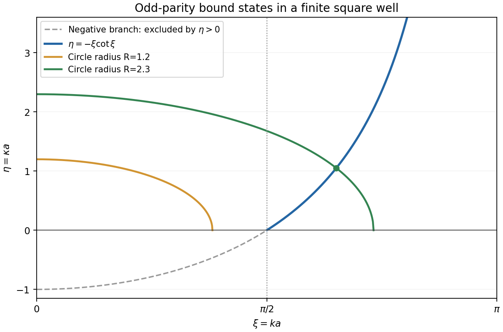

<h1 id="j/j2/solution">Solution</h1>

↑ **Parent:** [J2](../j2.md)

The stationary [Schrödinger equation](../../../../schrodinger-equation.md) is

$$
-\frac{\hbar^2}{2m}\psi''(x)+V(x)\psi(x)=E\psi(x).
$$

A nonzero bound-state [wave function](../../../../wave-function-split.md) has $\int_{\mathbb R}|\psi|^2dx<\infty$, so it can be rescaled to have integral one. Odd [parity](../../../../parity.md) means $\psi(-x)=-\psi(x)$.

For $-V_0<E<0$, set $k=\sqrt{2m(V_0+E)}/\hbar>0$ and $\kappa=\sqrt{-2mE}/\hbar>0$. Oddness removes the interior cosine solution, and normalizability removes the growing exponentials outside. A continuous odd candidate can therefore be written

$$
\psi(x)=A\begin{cases}
-\sin(ka)e^{\kappa(x+a)},&x\leq-a,\\
\sin(kx),&|x|<a,\\
\sin(ka)e^{-\kappa(x-a)},&x\geq a.
\end{cases}
$$

[Continuity](../../../../continuous-function.md) of the derivative at $a$ gives $k\cos(ka)=-\kappa\sin(ka)$; oddness gives the other boundary condition. A nonzero solution cannot have $\sin(ka)=0$, since the derivative condition would then force its interior coefficient to vanish. Thus, with $\xi=ka$ and $\eta=\kappa a$,

$$
\boxed{\eta=-\xi\cot\xi,\qquad
\xi^2+\eta^2=\frac{2mV_0a^2}{\hbar^2}.}
$$

Physical [bound states](../../../../bound-state.md) require $\xi,\eta>0$. On $0<\xi<\pi/2$, the cotangent condition gives negative $\eta$, so no physical intersection occurs. On $(\pi/2,\pi)$, the curve $-\xi\cot\xi$ rises from zero to positive infinity, while the positive quadrant of the circle decreases. Their first intersection exists exactly when the circle radius $R=\sqrt{2mV_0a^2/\hbar^2}$ exceeds $\pi/2$.

**[Figure 1](#j/j2/image-odd-parity-finite-well-energies-from-a-circle-and-a-cotangent-curve). Odd-parity finite-well energies from a circle and a cotangent curve**. Only positive eta gives a bound state. A circle of radius below pi over two misses the positive cotangent branch, while a larger circle intersects it.

In particular,

$$
\boxed{2mV_0<\left(\frac{\pi\hbar}{2a}\right)^2
\ \Longrightarrow\ \text{no odd-parity bound state}.}
$$

There is also no normalizable odd state at equality: the putative intersection has $\eta=0$, hence $E=0$, and its exterior tail does not decay. Higher positive branches begin beyond this first [interval](../../../../interval-mathematics.md) and require still larger $R$.

## ↑ Ancestors (12)

1. [J2](../j2.md)
2. [J](../../j.md)
3. [2010](../../../2010-split.md)
4. [Past exam of the options II course of the University of Oxford](../../../split.md)
5. [Options II course of the University of Oxford](../../../../options-ii-course-of-the-university-of-oxford.md)
6. [Year 2 of the mathematics course of the University of Oxford](../../../../year-2-of-the-mathematics-course-of-the-university-of-oxford.md)
7. [Mathematics course of the University of Oxford](../../../../mathematics-course-of-the-university-of-oxford.md)
8. [Undergraduate course of the University of Oxford](../../../../undergraduate-course-of-the-university-of-oxford.md)
9. [Course of the University of Oxford](../../../../course-of-the-university-of-oxford.md)
10. [University of Oxford](../../../../university-of-oxford-split.md)
11. [List of universities](../../../../list-of-universities.md)
12. [Codex Wiki](../../../../split.md)
