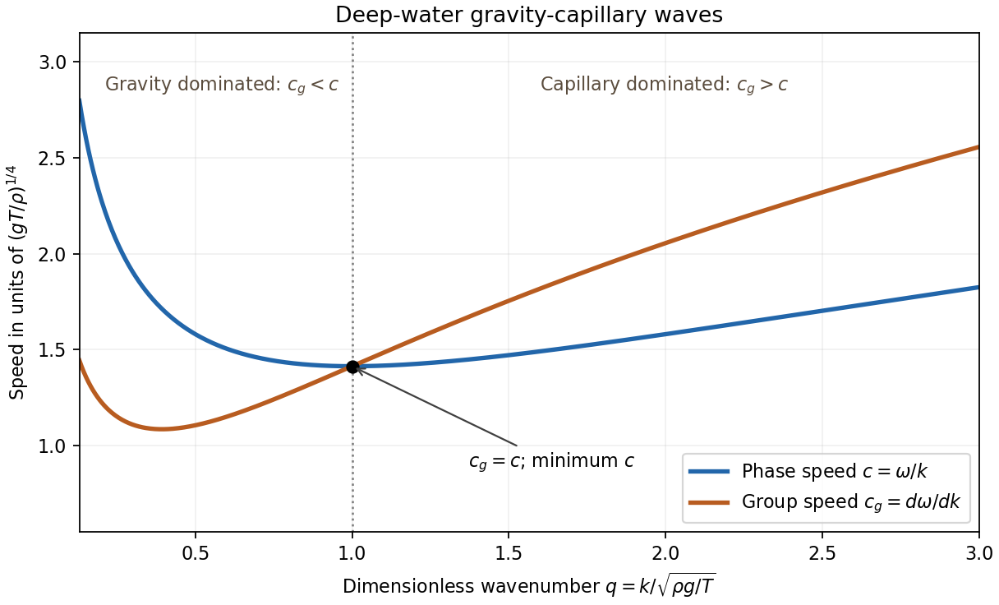

# 2011

↑ **Parent:** [Past exam of the options II course of the University of Oxford](../past-exam-of-the-options-ii-course-of-the-university-of-oxford.md)

Options II, Honour School of Mathematics Part A, Trinity Term; Thursday 30 June 2011, 9.30am–12.30pm. The complete sixteen-page source was supplied through [the past-papers disclosure](https://www.whatdotheyknow.com/request/maths_past_papers_3), in original Part A bundle pages 282–297. The private editable transcription retains the complete cover and every printed question.

New solutions cover the eighteen questions without an exact worked-answer advertisement found in the bounded availability check. H2 is recorded separately because Oxford explicitly advertises solutions for its students in [the Classical Mechanics revision notes](https://users.ox.ac.uk/~math0391/CMrevision.pdf). No new solution is supplied for that question.

**Table of contents**

- [A](#a)
  - [A2](#a/a2)
    - [a](#a/a2/a)
      - [Solution](#a/a2/a/solution)
    - [b](#a/a2/b)
      - [Solution](#a/a2/b/solution)
    - [c](#a/a2/c)
      - [Solution](#a/a2/c/solution)
- [B](#b)
  - [B2](#b/b2)
    - [a](#b/b2/a)
      - [Solution](#b/b2/a/solution)
    - [b](#b/b2/b)
      - [Solution](#b/b2/b/solution)
    - [c](#b/b2/c)
      - [Solution](#b/b2/c/solution)
    - [d](#b/b2/d)
      - [Solution](#b/b2/d/solution)
- [C](#c)
  - [C2](#c/c2)
    - [a](#c/c2/a)
      - [i](#c/c2/a/i)
        - [Solution](#c/c2/a/i/solution)
      - [ii](#c/c2/a/ii)
        - [Solution](#c/c2/a/ii/solution)
      - [iii](#c/c2/a/iii)
        - [Solution](#c/c2/a/iii/solution)
      - [iv](#c/c2/a/iv)
        - [Solution](#c/c2/a/iv/solution)
    - [b](#c/c2/b)
      - [i](#c/c2/b/i)
        - [Solution](#c/c2/b/i/solution)
      - [ii](#c/c2/b/ii)
        - [Solution](#c/c2/b/ii/solution)
    - [c](#c/c2/c)
      - [i](#c/c2/c/i)
        - [Solution](#c/c2/c/i/solution)
      - [ii](#c/c2/c/ii)
        - [Solution](#c/c2/c/ii/solution)
      - [iii](#c/c2/c/iii)
        - [Solution](#c/c2/c/iii/solution)
- [D](#d)
  - [D3](#d/d3)
    - [a](#d/d3/a)
      - [i](#d/d3/a/i)
        - [Solution](#d/d3/a/i/solution)
      - [ii](#d/d3/a/ii)
        - [Solution](#d/d3/a/ii/solution)
    - [b](#d/d3/b)
      - [i](#d/d3/b/i)
        - [Solution](#d/d3/b/i/solution)
      - [ii](#d/d3/b/ii)
        - [Solution](#d/d3/b/ii/solution)
  - [D4](#d/d4)
    - [a](#d/d4/a)
      - [Solution](#d/d4/a/solution)
    - [b](#d/d4/b)
      - [Solution](#d/d4/b/solution)
    - [c](#d/d4/c)
      - [Solution](#d/d4/c/solution)
    - [d](#d/d4/d)
      - [Solution](#d/d4/d/solution)
- [E](#e)
  - [E3](#e/e3)
    - [Solution](#e/e3/solution)
  - [E4](#e/e4)
    - [Solution](#e/e4/solution)
- [F](#f)
  - [F2](#f/f2)
    - [a](#f/f2/a)
      - [i](#f/f2/a/i)
        - [Solution](#f/f2/a/i/solution)
      - [ii](#f/f2/a/ii)
        - [Solution](#f/f2/a/ii/solution)
      - [iii](#f/f2/a/iii)
        - [Solution](#f/f2/a/iii/solution)
    - [b](#f/f2/b)
      - [i](#f/f2/b/i)
        - [Solution](#f/f2/b/i/solution)
      - [ii](#f/f2/b/ii)
        - [Solution](#f/f2/b/ii/solution)
      - [iii](#f/f2/b/iii)
        - [Solution](#f/f2/b/iii/solution)
      - [iv](#f/f2/b/iv)
        - [Solution](#f/f2/b/iv/solution)
- [G](#g)
  - [G2](#g/g2)
    - [Solution](#g/g2/solution)
- [H](#h)
  - [H2](#h/h2)
- [J](#j)
  - [J2](#j/j2)
    - [Solution](#j/j2/solution)
- [K](#k)
  - [K3](#k/k3)
    - [Solution](#k/k3/solution)
  - [K4](#k/k4)
    - [Solution](#k/k4/solution)
- [M](#m)
  - [M4](#m/m4)
    - [a](#m/m4/a)
      - [i](#m/m4/a/i)
        - [Solution](#m/m4/a/i/solution)
      - [ii](#m/m4/a/ii)
        - [Solution](#m/m4/a/ii/solution)
    - [b](#m/m4/b)
      - [i](#m/m4/b/i)
        - [Solution](#m/m4/b/i/solution)
      - [ii](#m/m4/b/ii)
        - [Solution](#m/m4/b/ii/solution)
      - [iii](#m/m4/b/iii)
        - [Solution](#m/m4/b/iii/solution)
      - [iv](#m/m4/b/iv)
        - [Solution](#m/m4/b/iv/solution)
      - [v](#m/m4/b/v)
        - [Solution](#m/m4/b/v/solution)
    - [c](#m/m4/c)
      - [Solution](#m/m4/c/solution)
    - [d](#m/m4/d)
      - [Solution](#m/m4/d/solution)
  - [M5](#m/m5)
    - [a](#m/m5/a)
      - [i](#m/m5/a/i)
        - [Solution](#m/m5/a/i/solution)
      - [ii](#m/m5/a/ii)
        - [Solution](#m/m5/a/ii/solution)
      - [iii](#m/m5/a/iii)
        - [Solution](#m/m5/a/iii/solution)
      - [iv](#m/m5/a/iv)
        - [Solution](#m/m5/a/iv/solution)
      - [v](#m/m5/a/v)
        - [Solution](#m/m5/a/v/solution)
      - [vi](#m/m5/a/vi)
        - [Solution](#m/m5/a/vi/solution)
    - [b](#m/m5/b)
      - [i](#m/m5/b/i)
        - [Solution](#m/m5/b/i/solution)
      - [ii](#m/m5/b/ii)
        - [Solution](#m/m5/b/ii/solution)
- [O](#o)
  - [O4](#o/o4)
    - [a](#o/o4/a)
      - [Solution](#o/o4/a/solution)
    - [b](#o/o4/b)
      - [Solution](#o/o4/b/solution)
    - [c](#o/o4/c)
      - [Solution](#o/o4/c/solution)
  - [O5](#o/o5)
    - [a](#o/o5/a)
      - [Solution](#o/o5/a/solution)
    - [b](#o/o5/b)
      - [Solution](#o/o5/b/solution)
    - [c](#o/o5/c)
      - [Solution](#o/o5/c/solution)
    - [d](#o/o5/d)
      - [Solution](#o/o5/d/solution)
- [P](#p)
  - [P3](#p/p3)
    - [a](#p/p3/a)
      - [Solution](#p/p3/a/solution)
    - [b](#p/p3/b)
      - [Solution](#p/p3/b/solution)
    - [c](#p/p3/c)
      - [Solution](#p/p3/c/solution)
    - [d](#p/p3/d)
      - [Solution](#p/p3/d/solution)
  - [P4](#p/p4)
    - [a](#p/p4/a)
      - [Solution](#p/p4/a/solution)
    - [b](#p/p4/b)
      - [Solution](#p/p4/b/solution)
    - [c](#p/p4/c)
      - [Solution](#p/p4/c/solution)
    - [d](#p/p4/d)
      - [Solution](#p/p4/d/solution)

## A

↑ **Parent:** [2011](2011.md)

<h3 id="a/a2">A2</h3>

↑ **Parent:** [A](#a)

<h4 id="a/a2/a">a</h4>

↑ **Parent:** [A2](#a/a2)

<h5 id="a/a2/a/solution">Solution</h5>

↑ **Parent:** [A](#a/a2/a)

A [splitting field](../galois-theory.md#splitting-field) of $f$ over $F$ is a [field extension](../algebra.md#field-extension) $K/F$ in which $f$ is a product of linear factors and which is generated over $F$ by its roots. The generation condition rules out adjoining unrelated elements.

For existence, induct on the [degree of a polynomial](../polynomial.md#degree-of-a-polynomial). Choose an [irreducible polynomial](../polynomial.md#irreducible-polynomial) divisor $p$ of $f$. The [quotient ring](../commutative-algebra.md#quotient-ring) $F[X]/(p)$ is a [field](../algebra.md#field) because $(p)$ is a [maximal ideal](../commutative-algebra.md#maximal-ideal); the class $\alpha$ of $X$ is a [root](../semisimple-lie-algebra.md#root-of-a-root-system) of $p$, hence of $f$. Over this [field extension](../algebra.md#field-extension), divide out $X-\alpha$ and apply induction to the remaining [polynomial](../polynomial.md). This gives an extension in which $f$ splits. Inside it, the [subfield](../algebra.md#subfield) generated by all roots is a [splitting field](../galois-theory.md#splitting-field). The induction starts with a linear [polynomial](../polynomial.md), whose [splitting field](../galois-theory.md#splitting-field) is already $F$. Thus **every positive-degree [polynomial](../polynomial.md) has a splitting [field](../algebra.md#field)**; being monic is unnecessary for existence.

<h4 id="a/a2/b">b</h4>

↑ **Parent:** [A2](#a/a2)

<h5 id="a/a2/b/solution">Solution</h5>

↑ **Parent:** [B](#a/a2/b)

The cubic has no [root](../semisimple-lie-algebra.md#root-of-a-root-system) in $\mathbb F_2$, since its values at $0$ and $1$ are both $1$. A cubic over a [field](../algebra.md#field) is [irreducible](../polynomial.md#irreducible-polynomial) precisely when it has no [root](../semisimple-lie-algebra.md#root-of-a-root-system). Consequently

$$
K=\mathbb F_2[\alpha],\qquad \alpha^3+\alpha+1=0,
$$

is a [field extension](../algebra.md#field-extension) of [degree](../algebra.md#degree-of-a-field-extension) $3$, with eight elements. The [Frobenius endomorphism](../galois-theory.md#frobenius-endomorphism) $x\mapsto x^2$ takes a [root](../semisimple-lie-algebra.md#root-of-a-root-system) of a [polynomial](../polynomial.md) over $\mathbb F_2$ to another [root](../semisimple-lie-algebra.md#root-of-a-root-system), so the roots are $\alpha,\alpha^2,\alpha^4$. They are distinct: equality between any two would make the [Frobenius endomorphism](../galois-theory.md#frobenius-endomorphism) orbit have length less than $3$, contradicting the [minimal polynomial](../linear-operator-theory.md#minimal-polynomial) of $\alpha$. They all lie in $K$, and one of them generates $K$. Hence

$$
\boxed{K\cong\mathbb F_8,\qquad [K:\mathbb F_2]=3.}
$$

<h4 id="a/a2/c">c</h4>

↑ **Parent:** [A2](#a/a2)

<h5 id="a/a2/c/solution">Solution</h5>

↑ **Parent:** [C](#a/a2/c)

The roots are $\pm\sqrt2$ and $\pm\sqrt3$, so the [splitting field](../galois-theory.md#splitting-field) is $K=\mathbb Q(\sqrt2,\sqrt3)$. The first adjunction has [degree](../algebra.md#degree-of-a-field-extension) $2$. To see that the second does too, suppose $\sqrt3=u+v\sqrt2$ with $u,v\in\mathbb Q$. Squaring and comparing rational and irrational parts gives $uv=0$ and $u^2+2v^2=3$. If $v=0$, then $u^2=3$; if $u=0$, then $v^2=3/2$. Neither is a rational square, as follows by comparing prime exponents in numerator and denominator. Thus $\sqrt3\notin\mathbb Q(\sqrt2)$. The [tower law](../algebra.md#tower-law) now yields

$$
\boxed{[K:\mathbb Q]=4,\qquad K=\mathbb Q(\sqrt2,\sqrt3).}
$$

A [basis](../vector-space.md#basis) is $1,\sqrt2,\sqrt3,\sqrt6$.

<h2 id="b">B</h2>

↑ **Parent:** [2011](2011.md)

<h3 id="b/b2">B2</h3>

↑ **Parent:** [B](#b)

<h4 id="b/b2/a">a</h4>

↑ **Parent:** [B2](#b/b2)

<h5 id="b/b2/a/solution">Solution</h5>

↑ **Parent:** [A](#b/b2/a)

A [composition series](../finite-group-theory.md#composition-series) is a finite chain

$$
1=G_0\triangleleft G_1\triangleleft\cdots\triangleleft G_r=G
$$

whose inclusions are strict and whose [quotients](../group-theory.md#quotient-group) $G_i/G_{i-1}$ are [simple](../finite-group-theory.md#simple-group). These [quotients](../group-theory.md#quotient-group) are the [composition factors](../module-theory.md#composition-factor). The [normal subgroup](../group-theory.md#normal-subgroup) condition is relative to the next member, rather than necessarily to all of $G$.

Induct on the order of a [finite group](../group.md#finite-group). The trivial [group](../group.md) has the empty [composition series](../finite-group-theory.md#composition-series). Otherwise choose a [maximal normal subgroup](../group-theory.md#maximal-normal-subgroup) $N\lneq G$, which exists because there are finitely many subgroups. The [subgroup correspondence theorem](../group-theory.md#subgroup-correspondence-theorem) identifies [normal subgroups](../group-theory.md#normal-subgroup) of $G/N$ with [normal subgroups](../group-theory.md#normal-subgroup) of $G$ containing $N$, so maximality makes $G/N$ a [simple group](../finite-group-theory.md#simple-group). By induction $N$ has a [composition series](../finite-group-theory.md#composition-series); appending $G$ gives one for $G$.

For example, the nonabelian [symmetric group](../finite-group-theory.md#symmetric-group) $S_3$ has

$$
1\triangleleft A_3\triangleleft S_3,
$$

with [composition factors](../module-theory.md#composition-factor) $C_3$ and $C_2$, both [abelian](../group.md#abelian-group).

<h4 id="b/b2/b">b</h4>

↑ **Parent:** [B2](#b/b2)

<h5 id="b/b2/b/solution">Solution</h5>

↑ **Parent:** [B](#b/b2/b)

In the [Klein four-group](../finite-group-theory.md#klein-four-group) $V=\{1,a,b,ab\}$, the chains

$$
1\triangleleft\langle a\rangle\triangleleft V,
\qquad
1\triangleleft\langle b\rangle\triangleleft V
$$

are distinct [composition series](../finite-group-theory.md#composition-series). All their [composition factors](../module-theory.md#composition-factor) are $C_2$.

The [Jordan–Hölder theorem](../finite-group-theory.md#jordan-holder-theorem) states that any two [composition series](../finite-group-theory.md#composition-series) of a [group](../group.md) have the same length and the same [composition factors](../module-theory.md#composition-factor) up to permutation and [group isomorphism](../algebra.md#group-isomorphism). Thus the [subgroup](../group.md#subgroup) chains may differ, while the multiset of simple [quotients](../group-theory.md#quotient-group) is intrinsic.

<h4 id="b/b2/c">c</h4>

↑ **Parent:** [B2](#b/b2)

<h5 id="b/b2/c/solution">Solution</h5>

↑ **Parent:** [C](#b/b2/c)

Write $C_n=\langle g\rangle$ and set $N=\langle g^p\rangle$. The [order](../group-theory.md#order-of-a-group-element) of $g^p$ is $n/\gcd(n,p)=m$, so $N\cong C_m$. Every [subgroup](../group.md#subgroup) of an [abelian group](../group.md#abelian-group) is a [normal subgroup](../group-theory.md#normal-subgroup). The [quotient group](../group-theory.md#quotient-group) $C_n/N$ is generated by $gN$ and has order $n/m=p$, hence is $C_p$ and is a [simple group](../finite-group-theory.md#simple-group). By the [subgroup correspondence theorem](../group-theory.md#subgroup-correspondence-theorem), there is no proper [normal subgroup](../group-theory.md#normal-subgroup) strictly between $N$ and $C_n$. Therefore **$N$ is a maximal [normal subgroup](../group-theory.md#normal-subgroup)** with the required [quotient group](../group-theory.md#quotient-group).

<h4 id="b/b2/d">d</h4>

↑ **Parent:** [B2](#b/b2)

<h5 id="b/b2/d/solution">Solution</h5>

↑ **Parent:** [D](#b/b2/d)

Suppose

$$
n=p_1\cdots p_r=q_1\cdots q_s
$$

are two factorizations into primes. Repeatedly apply the cyclic-[subgroup](../group.md#subgroup) construction of part (c), first removing $p_r$, then $p_{r-1}$, and so on. This constructs a [composition series](../finite-group-theory.md#composition-series) for $C_n$ whose [composition factors](../module-theory.md#composition-factor) are $C_{p_1},\ldots,C_{p_r}$. The second factorization constructs another [composition series](../finite-group-theory.md#composition-series) with [composition factors](../module-theory.md#composition-factor) $C_{q_1},\ldots,C_{q_s}$.

By the [Jordan–Hölder theorem](../finite-group-theory.md#jordan-holder-theorem), $r=s$ and these [composition factors](../module-theory.md#composition-factor) agree up to [group isomorphism](../algebra.md#group-isomorphism) and permutation. Since isomorphic [finite groups](../group.md#finite-group) have the same order, the corresponding primes agree. This proves **uniqueness of [prime factorization](../prime-number.md#fundamental-theorem-of-arithmetic) up to permutation**, using existence of prime factorizations but not their uniqueness.

<h2 id="c">C</h2>

↑ **Parent:** [2011](2011.md)

<h3 id="c/c2">C2</h3>

↑ **Parent:** [C](#c)

<h4 id="c/c2/a">a</h4>

↑ **Parent:** [C2](#c/c2)

<h5 id="c/c2/a/i">i</h5>

↑ **Parent:** [A](#c/c2/a)

<h6 id="c/c2/a/i/solution">Solution</h6>

↑ **Parent:** [I](#c/c2/a/i)

For an odd [prime number](../prime-number.md) $p$, a nonzero class $a\pmod p$ is a [quadratic residue](../quadratic-residue.md) if $a\equiv x^2\pmod p$ for some [integer](../integer.md) $x$ not divisible by $p$. The [Legendre symbol](../quadratic-residue.md#legendre-symbol) is

$$
\left(\frac ap\right)=
\begin{cases}
0,&p\mid a,\\
1,&a\text{ is a nonzero square modulo }p,\\
-1,&a\text{ is a nonsquare modulo }p.
\end{cases}
$$

When discussing solvability of $x^2\equiv a\pmod p$ without a coprimality assumption, zero is also a square. This convention matters in the final local characterization of [integer](../integer.md) squares.

<h5 id="c/c2/a/ii">ii</h5>

↑ **Parent:** [A](#c/c2/a)

<h6 id="c/c2/a/ii/solution">Solution</h6>

↑ **Parent:** [Ii](#c/c2/a/ii)

The [Euler criterion](../quadratic-residue.md#euler-criterion) states that for an odd [prime number](../prime-number.md) $p$ and $p\nmid a$,

$$
\boxed{a^{(p-1)/2}\equiv\left(\frac ap\right)\pmod p.}
$$

The same [modular congruence](../modular-arithmetic.md#modular-congruence) remains true when $p\mid a$, with both sides zero.

<h5 id="c/c2/a/iii">iii</h5>

↑ **Parent:** [A](#c/c2/a)

<h6 id="c/c2/a/iii/solution">Solution</h6>

↑ **Parent:** [Iii](#c/c2/a/iii)

For distinct odd [primes](../prime-number.md) $p$ and $q$, [quadratic reciprocity](../number-theory.md#quadratic-reciprocity) states

$$
\boxed{\left(\frac pq\right)\left(\frac qp\right)=(-1)^{(p-1)(q-1)/4}.}
$$

The supplementary laws are

$$
\left(\frac{-1}p\right)=(-1)^{(p-1)/2},\qquad
\left(\frac2p\right)=(-1)^{(p^2-1)/8}.
$$

<h5 id="c/c2/a/iv">iv</h5>

↑ **Parent:** [A](#c/c2/a)

<h6 id="c/c2/a/iv/solution">Solution</h6>

↑ **Parent:** [Iv](#c/c2/a/iv)

If $p$ divides $a$ or $b$, both sides of the claimed [multiplicativity](../arithmetic-function.md#multiplicativity-of-an-arithmetic-function) identity are zero. Otherwise the [Euler criterion](../quadratic-residue.md#euler-criterion) gives

$$
\left(\frac{ab}p\right)\equiv (ab)^{(p-1)/2}
\equiv a^{(p-1)/2}b^{(p-1)/2}
\equiv\left(\frac ap\right)\left(\frac bp\right)\pmod p.
$$

Each side is $1$ or $-1$. Since $p$ is odd, these two integers represent different residue classes. Hence the [modular congruence](../modular-arithmetic.md#modular-congruence) gives equality:

$$
\boxed{\left(\frac{ab}p\right)=\left(\frac ap\right)\left(\frac bp\right).}
$$

<h4 id="c/c2/b">b</h4>

↑ **Parent:** [C2](#c/c2)

<h5 id="c/c2/b/i">i</h5>

↑ **Parent:** [B](#c/c2/b)

<h6 id="c/c2/b/i/solution">Solution</h6>

↑ **Parent:** [I](#c/c2/b/i)

For odd $m,n$,

$$
\frac{mn-1}2-\frac{m-1}2-\frac{n-1}2
=\frac{(m-1)(n-1)}2
$$

is even. Induction over the prime factors of $b$, repeated according to multiplicity, therefore gives

$$
\frac{b-1}2\equiv\sum_{j=1}^r\frac{p_j-1}2\pmod2.
$$

Using the supplementary law for each [Legendre symbol](../quadratic-residue.md#legendre-symbol) in the definition of the [Jacobi symbol](../number-theory.md#jacobi-symbol),

$$
\left(\frac{-1}b\right)=\prod_j(-1)^{(p_j-1)/2}
=\boxed{(-1)^{(b-1)/2}}.
$$

For $b=1$, the empty product and the displayed expression are both $1$.

<h5 id="c/c2/b/ii">ii</h5>

↑ **Parent:** [B](#c/c2/b)

<h6 id="c/c2/b/ii/solution">Solution</h6>

↑ **Parent:** [Ii](#c/c2/b/ii)

If $\gcd(b,c)>1$, both [Jacobi symbols](../number-theory.md#jacobi-symbol) vanish, so the formula holds. Otherwise write $b=\prod_i p_i$ and $c=\prod_j q_j$, retaining repeated factors. [Multiplicativity of the Jacobi symbol](../number-theory.md#multiplicativity-of-the-jacobi-symbol) and [quadratic reciprocity](../number-theory.md#quadratic-reciprocity) give

$$
\left(\frac bc\right)
=\prod_{i,j}\left(\frac{p_i}{q_j}\right)
=\prod_{i,j}\left(\frac{q_j}{p_i}\right)
(-1)^{\sum_{i,j}(p_i-1)(q_j-1)/4}.
$$

The exponent is

$$
\left(\sum_i\frac{p_i-1}2\right)
\left(\sum_j\frac{q_j-1}2\right)
\equiv\frac{b-1}2\frac{c-1}2\pmod2
$$

by the parity identity from part (i). The product of the reversed [Legendre symbols](../quadratic-residue.md#legendre-symbol) is $(c/b)$. Thus the [Jacobi reciprocity law](../number-theory.md#jacobi-reciprocity-law) is

$$
\boxed{\left(\frac bc\right)=\left(\frac cb\right)(-1)^{(b-1)(c-1)/4}.}
$$

This also covers $b=1$ or $c=1$ by empty products.

<h4 id="c/c2/c">c</h4>

↑ **Parent:** [C2](#c/c2)

<h5 id="c/c2/c/i">i</h5>

↑ **Parent:** [C](#c/c2/c)

<h6 id="c/c2/c/i/solution">Solution</h6>

↑ **Parent:** [I](#c/c2/c/i)

Here $b$ is odd and nonzero. Choose $k=4|b|-1$. This is a positive odd [integer](../integer.md), $k\equiv3\pmod4$, and $\gcd(k,b)=1$. By [multiplicativity of the Jacobi symbol](../number-theory.md#multiplicativity-of-the-jacobi-symbol),

$$
\left(\frac ak\right)=\left(\frac{-1}k\right)\left(\frac bk\right)^2
=(-1)^{(k-1)/2}\cdot1=\boxed{-1}.
$$

The coprimality condition ensures that the squared [Jacobi symbol](../number-theory.md#jacobi-symbol) is $1$ rather than $0$.

<h5 id="c/c2/c/ii">ii</h5>

↑ **Parent:** [C](#c/c2/c)

<h6 id="c/c2/c/ii/solution">Solution</h6>

↑ **Parent:** [Ii](#c/c2/c/ii)

Choose a nonzero [quadratic nonresidue](../quadratic-residue.md#quadratic-nonresidue) $c\pmod q$. There is one because the squaring map on $\mathbb F_q^\times$ is two-to-one, so exactly half its elements are squares. The moduli $4,q,b$ are pairwise [coprime](../divisibility.md#coprime-integers), so the [Chinese remainder theorem](../mathematics.md#chinese-remainder-theorem) gives a positive [integer](../integer.md) $k$ satisfying

$$
k\equiv1\pmod4,\qquad k\equiv c\pmod q,\qquad k\equiv1\pmod b.
$$

When $b=1$, the last condition is vacuous. In particular $k$ is odd and [coprime](../divisibility.md#coprime-integers) to $qb$. Since $k\equiv1\pmod4$, [Jacobi reciprocity](../number-theory.md#jacobi-reciprocity-law) gives

$$
\left(\frac qk\right)=\left(\frac kq\right)=-1,
\qquad
\left(\frac bk\right)=\left(\frac kb\right)=1,
\qquad
\left(\frac{-1}k\right)=1.
$$

As $t$ is odd, [multiplicativity of the Jacobi symbol](../number-theory.md#multiplicativity-of-the-jacobi-symbol) now yields

$$
\boxed{\left(\frac ak\right)=\left(\frac{\pm1}k\right)
\left(\frac qk\right)^t\left(\frac bk\right)=-1.}
$$

<h5 id="c/c2/c/iii">iii</h5>

↑ **Parent:** [C](#c/c2/c)

<h6 id="c/c2/c/iii/solution">Solution</h6>

↑ **Parent:** [Iii](#c/c2/c/iii)

Every [integer](../integer.md) square remains a square modulo every [prime number](../prime-number.md), including the zero class at its prime divisors. Conversely, let $a$ be an odd [integer](../integer.md) which is not an [integer](../integer.md) square. If $a$ is the negative of a square, part (i) supplies an odd $k$ with $(a/k)=-1$. In every other case, the [prime factorization](../prime-number.md#fundamental-theorem-of-arithmetic) of $|a|$ has an odd exponent $t$ at some odd prime $q$. Write $a=\pm q^t b$ with $b>0$ odd and $\gcd(q,b)=1$, and apply part (ii).

In either case, factor the resulting $k$ into primes. Since its [Jacobi symbol](../number-theory.md#jacobi-symbol) is a product of [Legendre symbols](../quadratic-residue.md#legendre-symbol) and equals $-1$, at least one prime factor $p$ has $(a/p)=-1$. Thus $a$ is not a square modulo that prime. This proves **an odd [integer](../integer.md) is an [integer](../integer.md) square exactly when it is a square modulo every prime**. If the phrase [quadratic residue](../quadratic-residue.md) is restricted to nonzero residue classes, the final statement must instead say “a square modulo every prime”; for example, $9$ reduces to zero modulo $3$.

<h2 id="d">D</h2>

↑ **Parent:** [2011](2011.md)

<h3 id="d/d3">D3</h3>

↑ **Parent:** [D](#d)

<h4 id="d/d3/a">a</h4>

↑ **Parent:** [D3](#d/d3)

<h5 id="d/d3/a/i">i</h5>

↑ **Parent:** [A](#d/d3/a)

<h6 id="d/d3/a/i/solution">Solution</h6>

↑ **Parent:** [I](#d/d3/a/i)

**False.** Take the bounded [measurable function](../measure-theory.md#measurable-function)

$$
k(x)=\begin{cases}(1+x)^{-1},&x>0,\\0,&x\leq0.\end{cases}
$$

It tends to zero at positive infinity, but

$$
\int_0^R|k(x)|\,dx=\log(1+R)\longrightarrow\infty.
$$

Thus decay to zero alone does not imply [Lebesgue integrability](../measure-theory.md#integrability).

<h5 id="d/d3/a/ii">ii</h5>

↑ **Parent:** [A](#d/d3/a)

<h6 id="d/d3/a/ii/solution">Solution</h6>

↑ **Parent:** [Ii](#d/d3/a/ii)

**False.** Let

$$
k=\mathbf1_{\bigcup_{n\geq1}[n,n+2^{-n-2}]}.
$$

This is a bounded [measurable function](../measure-theory.md#measurable-function), and the intervals are disjoint, so

$$
\int_0^\infty|k(x)|\,dx=\sum_{n\geq1}2^{-n-2}<\infty.
$$

Nevertheless $k(n)=1$ for every positive [integer](../integer.md) $n$, while $k(n+1/2)=0$. Hence it has no limit at infinity. Narrow spikes separate [Lebesgue integrability](../measure-theory.md#integrability) from pointwise decay.

<h4 id="d/d3/b">b</h4>

↑ **Parent:** [D3](#d/d3)

<h5 id="d/d3/b/i">i</h5>

↑ **Parent:** [B](#d/d3/b)

<h6 id="d/d3/b/i/solution">Solution</h6>

↑ **Parent:** [I](#d/d3/b/i)

Set $H=\int_0^\pi|h(t)|\,dt<\infty$. By [periodicity](../function.md#periodic-function) and [countable additivity](../measure.md#countable-additivity) of the [Lebesgue integral](../measure-theory.md#lebesgue-integral) of a nonnegative function,

$$
\begin{aligned}
\int_0^\infty e^{-\beta x}|h(x)|\,dx
&=\sum_{k=0}^\infty e^{-\beta k\pi}
\int_0^\pi e^{-\beta t}|h(t)|\,dt\\
&\leq H\sum_{k=0}^\infty e^{-\beta k\pi}
=\frac{H}{1-e^{-\beta\pi}}<\infty.
\end{aligned}
$$

Thus **$f$ is Lebesgue integrable** for every $\beta>0$.

<h5 id="d/d3/b/ii">ii</h5>

↑ **Parent:** [B](#d/d3/b)

<h6 id="d/d3/b/ii/solution">Solution</h6>

↑ **Parent:** [Ii](#d/d3/b/ii)

Use the nonnegative-part convention $h=h^+-h^-$, where $h^+=\max(h,0)$ and $h^-=\max(-h,0)$. The zero-mean assumption gives

$$
A=\int_0^\pi h^+=\int_0^\pi h^-.
$$

For $k\geq1$, write the [integral](../integral.md) over the $k$th period as $I_k=P_k-N_k$, where

$$
P_k=\int_0^\pi\frac{h^+(t)}{k\pi+t}\,dt,
\qquad N_k=\int_0^\pi\frac{h^-(t)}{k\pi+t}\,dt.
$$

Both $P_k$ and $N_k$ lie in the [interval](../real-analysis.md#interval-mathematics) $[A/((k+1)\pi),A/(k\pi)]$. Their difference therefore satisfies the stronger estimate

$$
|I_k|\leq\frac{A}{\pi k(k+1)}\leq\frac{A}{\pi k^2}.
$$

Consequently $\sum_{k\geq1}I_k$ converges absolutely as a [series](../sequence-and-series.md#series-mathematics) of numbers, proving the requested limit of integrals over whole periods. This does not assert absolute integrability of the original function: the cancellation took place inside each period.

Indeed, setting $B=\int_0^\pi|h(t)|\,dt$, we have

$$
\int_{k\pi}^{(k+1)\pi}|g(x)|\,dx
\geq\frac{B}{(k+1)\pi}.
$$

The [harmonic series](../sequence-and-series.md#harmonic-series) diverges, so $g$ is [Lebesgue integrable](../measure-theory.md#integrability) only if $B=0$. Conversely $B=0$ means $h=0$ almost everywhere on one period, and hence on all periods, so $g=0$ almost everywhere. Therefore

$$
\boxed{g\in L^1(\pi,\infty)\iff h=0\text{ almost everywhere}.}
$$

This is an example of [integrating a mean-zero periodic function divided by x](../real-analysis.md#integrating-a-mean-zero-periodic-function-divided-by-x).

<h3 id="d/d4">D4</h3>

↑ **Parent:** [D](#d)

<h4 id="d/d4/a">a</h4>

↑ **Parent:** [D4](#d/d4)

<h5 id="d/d4/a/solution">Solution</h5>

↑ **Parent:** [A](#d/d4/a)

The [monotone convergence theorem](../measure-theory.md#monotone-convergence-theorem) states that if $f_n$ are nonnegative [measurable functions](../measure-theory.md#measurable-function) on a [measure space](../measure.md#measure-space) and $f_n\uparrow f$ almost everywhere, then

$$
\boxed{\int f\,d\mu=\lim_{n\to\infty}\int f_n\,d\mu.}
$$

Either side is allowed to be $+\infty$; no integrable dominating function is required.

<h4 id="d/d4/b">b</h4>

↑ **Parent:** [D4](#d/d4)

<h5 id="d/d4/b/solution">Solution</h5>

↑ **Parent:** [B](#d/d4/b)

The partial sums $s_n=\sum_{k=1}^n a_k$ are nonnegative [measurable functions](../measure-theory.md#measurable-function) and increase to an extended-valued function $s$. By the [monotone convergence theorem](../measure-theory.md#monotone-convergence-theorem),

$$
\int_{\mathbb R}s(x)\,dx
=\lim_{n\to\infty}\sum_{k=1}^n\int_{\mathbb R}a_k(x)\,dx
=\sum_{k=1}^\infty\int_{\mathbb R}a_k(x)\,dx<\infty.
$$

A nonnegative function with finite [Lebesgue integral](../measure-theory.md#lebesgue-integral) cannot equal $+\infty$ on a set of positive measure: otherwise its [integral](../integral.md) would exceed $M$ times that measure for every $M>0$. Thus the [series](../sequence-and-series.md#series-mathematics) converges to a finite value almost everywhere. Redefine it to be zero on the exceptional [null set](../measure-theory.md#null-set) if a finite-valued representative is desired. The resulting function is [Lebesgue integrable](../measure-theory.md#integrability), with

$$
\boxed{\int\sum_{k=1}^\infty a_k=\sum_{k=1}^\infty\int a_k.}
$$

<h4 id="d/d4/c">c</h4>

↑ **Parent:** [D4](#d/d4)

<h5 id="d/d4/c/solution">Solution</h5>

↑ **Parent:** [C](#d/d4/c)

Put $x=e^{-t}$. Then

$$
\int_0^1(x\log x)^k\,dx
=(-1)^k\int_0^\infty t^k e^{-(k+1)t}\,dt
=\boxed{\frac{(-1)^k k!}{(k+1)^{k+1}}},
$$

where the second substitution is $u=(k+1)t$ and the final [integral](../integral.md) is the given [gamma function](../complex-analysis.md#gamma-function) value. The formula also holds for $k=0$, with value $1$.

For $0<x<1$, the [exponential function](../calculus.md#exponential-function) expansion gives

$$
x^{-x}=e^{-x\log x}=\sum_{k=0}^\infty\frac{(-x\log x)^k}{k!}.
$$

Every term is nonnegative. By the [monotone convergence theorem](../measure-theory.md#monotone-convergence-theorem), integration can be interchanged with summation, and hence

$$
\int_0^1x^{-x}\,dx
=\sum_{k=0}^\infty\frac1{(k+1)^{k+1}}
=\boxed{\sum_{j=1}^\infty\frac1{j^j}}.
$$

This identity is one form of [Sophomore's dream](../integral.md#sophomore-s-dream).

<h4 id="d/d4/d">d</h4>

↑ **Parent:** [D4](#d/d4)

<h5 id="d/d4/d/solution">Solution</h5>

↑ **Parent:** [D](#d/d4/d)

Expand $x^x=e^{x\log x}$. The absolute values of all terms have total [integral](../integral.md)

$$
\sum_{k=0}^\infty\frac1{k!}\int_0^1|x\log x|^k\,dx
=\sum_{j=1}^\infty j^{-j}<\infty.
$$

The [series](../sequence-and-series.md#series-mathematics) converges, for instance because $j^{-j}\leq2^{-j}$ for $j\geq2$. Part (b) applied to the absolute values, followed by subtraction of positive and negative parts, therefore justifies termwise integration. It gives the other [Sophomore's dream](../integral.md#sophomore-s-dream) identity:

$$
\boxed{\int_0^1x^x\,dx=\sum_{j=1}^\infty\frac{(-1)^{j-1}}{j^j}.}
$$

Equivalently, the partial sums are dominated by $e^{|x\log x|}\leq e^{1/e}$, so the [dominated convergence theorem](../measure-theory.md#dominated-convergence-theorem) gives the same justification.

## E

↑ **Parent:** [2011](2011.md)

<h3 id="e/e3">E3</h3>

↑ **Parent:** [E](#e)

<h4 id="e/e3/solution">Solution</h4>

↑ **Parent:** [E3](#e/e3)

A [connected space](../geometry-and-topology.md#connected-space) has no expression as the union of two disjoint nonempty [open subsets](../topology.md#open-set). A [continuous](../calculus.md#continuous-function) [surjection](../algebra.md#surjective-function) to the two-point [discrete space](../topology.md#discrete-space) would pull back its singleton sets to such a separation. Conversely, a separation $X=U\sqcup V$ defines a [continuous](../calculus.md#continuous-function) [surjection](../algebra.md#surjective-function) by taking the values $0$ on $U$ and $1$ on $V$. Thus these two conditions are equivalent, including for the empty space.

If a subset $S\subseteq\mathbb R$ contains $a<c$ but omits some $b$ between them, its intersections with $(-\infty,b)$ and $(b,\infty)$ separate it. Hence every nonempty [connected](../geometry-and-topology.md#connected-space) subset is an [interval](../real-analysis.md#interval-mathematics). Conversely, let an [interval](../real-analysis.md#interval-mathematics) $I$ have a separation and choose $a<b$ in its opposite sides. Restrict the associated two-valued [continuous function](../calculus.md#continuous-function) to $[a,b]\subseteq I$ and regard it as a real-valued function. The [intermediate value theorem](../calculus.md#intermediate-value-theorem) forces the value $1/2$, a contradiction. Singletons and the empty set are [connected](../geometry-and-topology.md#connected-space) directly.

For the union assertion, let $u:X\to\{0,1\}$ be [continuous](../calculus.md#continuous-function). Each restriction $u|_{A_i}$ is constant because $A_i$ is [connected](../geometry-and-topology.md#connected-space). Since every pair of the $A_i$ intersects, these constants agree, so $u$ is constant on $X$. There is no [continuous](../calculus.md#continuous-function) [surjection](../algebra.md#surjective-function), and $X$ is [connected](../geometry-and-topology.md#connected-space). The empty indexing case gives $X=\varnothing$ and is harmless.

To apply this to the plane, for each $t\in\mathbb R$ take the union of the horizontal line at height $t$ with the vertical axis. Its two lines are [connected](../geometry-and-topology.md#connected-space) and intersect; all such unions share the vertical axis and cover $\mathbb R^2$. Thus the plane is [connected](../geometry-and-topology.md#connected-space). For the punctured plane, take, for every $r>0$, the circle of radius $r$ together with the positive horizontal ray. The circle is the [continuous image](../geometry-and-topology.md#continuous-image-of-a-connected-space) of $[0,2\pi]$, and intersects that [connected](../geometry-and-topology.md#connected-space) ray. These unions share the ray and cover $\mathbb R^2\setminus\{0\}$, so the punctured plane is [connected](../geometry-and-topology.md#connected-space) too. Translation gives the same conclusion after removing any one point.

Finally, suppose $g:\mathbb R^2\to\mathbb R$ were a [continuous](../calculus.md#continuous-function) [injection](../algebra.md#injective-function). Its image $I$ is a [connected](../geometry-and-topology.md#connected-space) [interval](../real-analysis.md#interval-mathematics) with at least three points. Choose an interior point $c$ of $I$ and its unique preimage $p$. The restriction of $g$ to $\mathbb R^2\setminus\{p\}$ is a [continuous](../calculus.md#continuous-function) [surjection](../algebra.md#surjective-function) onto $I\setminus\{c\}$. Its domain is [connected](../geometry-and-topology.md#connected-space), whereas its image is separated by the two half-lines on either side of $c$. This contradicts preservation of [connectedness](../geometry-and-topology.md#connected-space) under [continuous images](../geometry-and-topology.md#continuous-image-of-a-connected-space). Therefore **no continuous [injection](../algebra.md#injective-function) of the plane into the line exists**.

<h3 id="e/e4">E4</h3>

↑ **Parent:** [E](#e)

<h4 id="e/e4/solution">Solution</h4>

↑ **Parent:** [E4](#e/e4)

A [metric space](../topological-analysis.md#metric-space) is [sequentially compact](../geometry-and-topology.md#sequentially-compact-space) if every sequence has a [convergent](../sequence-and-series.md#convergent-sequence) [subsequence](../sequence-and-series.md#subsequence) whose limit belongs to the space. A [limit point](../topology.md#limit-point) $\ell$ of $S$ is a point for which every open ball about $\ell$ contains a point of $S$ other than $\ell$.

Let $(x_n)$ lie in a [compact](../topology.md#compact-space) [metric space](../topological-analysis.md#metric-space). If one value occurs infinitely often, take a constant [subsequence](../sequence-and-series.md#subsequence). Otherwise its set of values $S$ is infinite. If $S$ had no [limit point](../topology.md#limit-point), every point of the space would have a neighborhood containing at most one member of $S$. A finite subcover of these neighborhoods would force $S$ finite, a contradiction. Thus $S$ has a [limit point](../topology.md#limit-point); the stated [subsequence](../sequence-and-series.md#subsequence) result supplies a [convergent](../sequence-and-series.md#convergent-sequence) [subsequence](../sequence-and-series.md#subsequence). This proves [sequential compactness](../geometry-and-topology.md#sequentially-compact-space).

Assume now that $X$ is nonempty, as is necessary for the requested minimum and [fixed point](../function.md#fixed-point). The function $r(x)=d(f(x),x)$ is [continuous](../calculus.md#continuous-function), as a [composition](../function.md#function-composition) of $x\mapsto(f(x),x)$ with the [metric](../topological-analysis.md#metric). The [extreme value theorem](../real-analysis.md#extreme-value-theorem) on a [compact space](../topology.md#compact-space) implies that $r$ attains its infimum, say at $p$. If $f(p)\neq p$, strict decrease of distances gives

$$
r(f(p))=d(f^2(p),f(p))<d(f(p),p)=r(p),
$$

contradicting minimality. Thus $f(p)=p$. If $p,q$ were distinct [fixed points](../function.md#fixed-point), then $d(p,q)=d(f(p),f(q))<d(p,q)$, another contradiction. Hence **there is exactly one [fixed point](../function.md#fixed-point)**. This is the [fixed point theorem for a strictly distance-decreasing map on a compact metric space](../topological-analysis.md#fixed-point-theorem-for-a-strictly-distance-decreasing-map-on-a-compact-metric-space).

[Compactness](../topology.md#compact-space) is essential. On $\mathbb R$, take

$$
\boxed{f(x)=\log(1+e^x).}
$$

Here $f(x)-x=\log(1+e^{-x})>0$, so there is no [fixed point](../function.md#fixed-point). Nevertheless $0<f'(x)=e^x/(1+e^x)<1$ everywhere, and the [mean value theorem](../calculus.md#mean-value-theorem) gives $|f(x)-f(y)|<|x-y|$ for distinct $x,y$. There is no uniform [Lipschitz](../real-analysis.md#lipschitz-continuity) constant less than $1$, since $f'(x)\to1$ as $x\to\infty$.

## F

↑ **Parent:** [2011](2011.md)

<h3 id="f/f2">F2</h3>

↑ **Parent:** [F](#f)

<h4 id="f/f2/a">a</h4>

↑ **Parent:** [F2](#f/f2)

<h5 id="f/f2/a/i">i</h5>

↑ **Parent:** [A](#f/f2/a)

<h6 id="f/f2/a/i/solution">Solution</h6>

↑ **Parent:** [I](#f/f2/a/i)

Writing $f=(f_1,\ldots,f_m)$, the $j$th [partial derivative](../multivariable-calculus.md#partial-derivative) at $x$ is the vector limit

$$
\partial_j f(x)=\lim_{t\to0}\frac{f(x+te_j)-f(x)}t,
$$

when it exists. The [total derivative](../calculus.md#total-derivative) is a [linear map](../vector-space.md#linear-map) $Df(x):\mathbb R^n\to\mathbb R^m$ satisfying

$$
f(x+h)=f(x)+Df(x)h+o(\|h\|).
$$

The [Jacobian matrix](../multivariable-calculus.md#jacobian-matrix) has entries $J_f(x)_{ij}=\partial_j f_i(x)$. If the [total derivative](../calculus.md#total-derivative) exists, its matrix in the standard [bases](../vector-space.md#basis) is precisely $J_f(x)$, because substitution of $h=te_j$ identifies every column. Existence of the [partial derivatives](../multivariable-calculus.md#partial-derivative) alone does not in general imply existence of the [total derivative](../calculus.md#total-derivative).

<h5 id="f/f2/a/ii">ii</h5>

↑ **Parent:** [A](#f/f2/a)

<h6 id="f/f2/a/ii/solution">Solution</h6>

↑ **Parent:** [Ii](#f/f2/a/ii)

For a scalar-valued differentiable function, its [gradient](../multivariable-calculus.md#gradient) is the column vector

$$
\nabla f(x)=\begin{pmatrix}\partial_1f(x)\\\vdots\\\partial_nf(x)\end{pmatrix}.
$$

It represents the [total derivative](../calculus.md#total-derivative) by the [Euclidean inner product](../inner-product.md#dot-product):

$$
\boxed{Df(x)h=\nabla f(x)\cdot h.}
$$

Thus $J_f(x)=\nabla f(x)^T$ is a row matrix; the [gradient](../multivariable-calculus.md#gradient) and the [total derivative](../calculus.md#total-derivative) represent the same first-order information but have different types.

<h5 id="f/f2/a/iii">iii</h5>

↑ **Parent:** [A](#f/f2/a)

<h6 id="f/f2/a/iii/solution">Solution</h6>

↑ **Parent:** [Iii](#f/f2/a/iii)

The [chain rule](../calculus.md#chain-rule) states that $f\circ g$ is differentiable at $x$ and

$$
\boxed{D(f\circ g)(x)=Df(g(x))\circ Dg(x).}
$$

In terms of [Jacobian matrices](../multivariable-calculus.md#jacobian-matrix),

$$
\boxed{J_{f\circ g}(x)=J_f(g(x))J_g(x).}
$$

The factors have dimensions $k\times m$ and $m\times n$, respectively, giving the required $k\times n$ [Jacobian matrix](../multivariable-calculus.md#jacobian-matrix).

<h4 id="f/f2/b">b</h4>

↑ **Parent:** [F2](#f/f2)

<h5 id="f/f2/b/i">i</h5>

↑ **Parent:** [B](#f/f2/b)

<h6 id="f/f2/b/i/solution">Solution</h6>

↑ **Parent:** [I](#f/f2/b/i)

Differentiating the reciprocal of $1+x^2+y^2$ gives the [gradient](../multivariable-calculus.md#gradient)

$$
\boxed{\nabla f(x,y)=\frac{-2}{(1+x^2+y^2)^2}\begin{pmatrix}x\\y\end{pmatrix}.}
$$

<h5 id="f/f2/b/ii">ii</h5>

↑ **Parent:** [B](#f/f2/b)

<h6 id="f/f2/b/ii/solution">Solution</h6>

↑ **Parent:** [Ii](#f/f2/b/ii)

At $(-1,0)$ the [gradient](../multivariable-calculus.md#gradient) is $(1/2,0)^T$. Therefore the [total derivative](../calculus.md#total-derivative) is the [linear map](../vector-space.md#linear-map)

$$
\boxed{Df(-1,0)(h,k)=\frac h2,}
$$

represented by the [Jacobian matrix](../multivariable-calculus.md#jacobian-matrix) $\begin{pmatrix}1/2&0\end{pmatrix}$.

<h5 id="f/f2/b/iii">iii</h5>

↑ **Parent:** [B](#f/f2/b)

<h6 id="f/f2/b/iii/solution">Solution</h6>

↑ **Parent:** [Iii](#f/f2/b/iii)

The [total derivative](../calculus.md#total-derivative) of $g$ sends a scalar increment $s$ to

$$
Dg(t)s=s\begin{pmatrix}\cos t\\-\sin t\end{pmatrix}.
$$

Since $\sin^2t+\cos^2t=1$, the [function composition](../function.md#function-composition) $f\circ g$ is constantly $1/2$, so $D(f\circ g)(t)=0$. Directly, the [Jacobian matrix](../multivariable-calculus.md#jacobian-matrix) product is

$$
J_f(g(t))J_g(t)=
\begin{pmatrix}-\sin t/2&-\cos t/2\end{pmatrix}
\begin{pmatrix}\cos t\\-\sin t\end{pmatrix}=0.
$$

This verifies the [chain rule](../calculus.md#chain-rule) at every $t$.

<h5 id="f/f2/b/iv">iv</h5>

↑ **Parent:** [B](#f/f2/b)

<h6 id="f/f2/b/iv/solution">Solution</h6>

↑ **Parent:** [Iv](#f/f2/b/iv)

The [partial derivatives](../multivariable-calculus.md#partial-derivative) satisfy a global bound of $1$ in absolute value. For example,

$$
|\partial_xf(x,y)|\leq\frac{2|x|}{(1+x^2)^2}\leq1,
$$

because $2|x|\leq1+x^2$ and $1+x^2\geq1$; the same argument applies to $\partial_y f$. Apply the one-dimensional [mean value theorem](../calculus.md#mean-value-theorem) first along a horizontal segment and then along a vertical segment:

$$
\begin{aligned}
|f(x,y)-f(u,v)|
&\leq|f(x,y)-f(u,y)|+|f(u,y)-f(u,v)|\\
&\leq\boxed{|x-u|+|y-v|}.
\end{aligned}
$$

Thus $f$ is [Lipschitz](../real-analysis.md#lipschitz-continuity) with constant $1$ for the coordinate-sum [norm](../normed-vector-space.md#norm).

## G

↑ **Parent:** [2011](2011.md)

<h3 id="g/g2">G2</h3>

↑ **Parent:** [G](#g)

<h4 id="g/g2/solution">Solution</h4>

↑ **Parent:** [G2](#g/g2)

For a regular [isoperimetric constraint](../analysis.md#isoperimetric-constraint), introduce a constant [Lagrange multiplier](../mathematical-optimization.md#lagrange-multiplier) $\lambda$ and set $L=F-\lambda G$. With fixed endpoint values, the [Euler-Lagrange equation](../analysis.md#euler-lagrange-equation) is

$$
\boxed{L_y-\frac d{dx}L_{y'}=0.}
$$

If $F$ and $G$ have no explicit $x$ dependence, the [Beltrami identity](../analysis.md#beltrami-identity) gives the [first integral](../differential-equation.md#first-integral)

$$
L-y'L_{y'}=\text{constant}.
$$

The regularity assumption excludes the exceptional case in which the constraint itself has zero [first variation](../calculus-of-variations.md#first-variation) for every admissible perturbation.

Parametrize the [surface of revolution](../differential-geometry.md#surface-of-revolution) by $r(z,\theta)=(f(z)\cos\theta,f(z)\sin\theta,z)$. The magnitude of $r_z\times r_\theta$ is $f\sqrt{1+f'^2}$. Integrating the resulting [surface area](../differential-geometry.md#surface-area) element over $\theta$, and integrating the circular cross-sectional areas for the [volume](../geometry-and-topology.md#volume), gives

$$
A=2\pi\int_a^b f\sqrt{1+f'^2}\,dz,
\qquad V=\pi\int_a^b f^2\,dz.
$$

Here $f\geq0$ because it is a radius. For a regular connected closed surface, take $f>0$ in the interior; the closing endpoints can have unbounded $f'$ even when the surface itself is smooth.

After dividing $A-\lambda V$ by $\pi$, its integrand is $L=2f\sqrt{1+f'^2}-\lambda f^2$. The [Euler-Lagrange equation](../analysis.md#euler-lagrange-equation) and [Beltrami identity](../analysis.md#beltrami-identity) become

$$
\sqrt{1+f'^2}-\lambda f-
\frac d{dz}\left(\frac{ff'}{\sqrt{1+f'^2}}\right)=0,
\qquad
\frac{2f}{\sqrt{1+f'^2}}-\lambda f^2=C.
$$

As $f$ tends to zero at an endpoint, $0\leq2f/\sqrt{1+f'^2}\leq2f$ also tends to zero, so $C=0$. On the positive interior this implies $\lambda>0$ and, writing $R=2/\lambda$,

$$
1+f'^2=\frac{R^2}{f^2}.
$$

The [Euler-Lagrange equation](../analysis.md#euler-lagrange-equation) also yields $f''=-R^2/f^3$. Therefore

$$
(f^2)''=2(f'^2+ff'')=-2,
$$

including at the maximum where $f'=0$. Integrating and using the [first integral](../differential-equation.md#first-integral) gives

$$
f(z)^2=R^2-(z-z_0)^2.
$$

Thus the regular extremal is a [sphere](../euclidean-geometry.md#sphere). The two zeros fix its center and radius:

$$
\boxed{z_0=\frac{a+b}2,\qquad R=\frac{b-a}2,\qquad\lambda=\frac2R=\frac4{b-a}.}
$$

Equivalently, the prescribed [volume](../geometry-and-topology.md#volume) fixes $R=(3V/(4\pi))^{1/3}$. If $a,b$ are fixed in advance, their separation and the prescribed [volume](../geometry-and-topology.md#volume) must be compatible with these equations; there is no positive regular stationary profile of the stated type for an incompatible [volume](../geometry-and-topology.md#volume).

For minimality, the three-dimensional [isoperimetric inequality](../euclidean-geometry.md#isoperimetric-inequality) states that every sufficiently regular closed surface enclosing [volume](../geometry-and-topology.md#volume) $V$ has

$$
A^3\geq36\pi V^2,
$$

with equality precisely for a [sphere](../euclidean-geometry.md#sphere). Our extremal has $A=4\pi R^2$ and $V=4\pi R^3/3$, so it attains equality and is a **global minimum of area at the fixed [volume](../geometry-and-topology.md#volume)**. This also makes clear the connected-surface assumption behind uniqueness: allowing several disconnected components introduces stationary collections of spheres, rather than the single positive generating profile used here.

## H

↑ **Parent:** [2011](2011.md)

<h3 id="h/h2">H2</h3>

↑ **Parent:** [H](#h)

Oxford advertises worked solutions to this exact question for its students in [the Classical Mechanics revision notes](https://users.ox.ac.uk/~math0391/CMrevision.pdf). This question is intentionally omitted from the newly authored solutions.

## J

↑ **Parent:** [2011](2011.md)

<h3 id="j/j2">J2</h3>

↑ **Parent:** [J](#j)

<h4 id="j/j2/solution">Solution</h4>

↑ **Parent:** [J2](#j/j2)

The stationary [Schrödinger equation](../mathematical-physics.md#schrodinger-equation) is

$$
-\frac{\hbar^2}{2m}\Delta\psi+V\psi=E\psi.
$$

The [Laplacian](../multivariable-calculus.md#laplacian) represents the kinetic-[energy](../energy.md) operator. For a [spherically symmetric function](../multivariable-calculus.md#spherically-symmetric-function), $\Delta\psi=\psi''+2\psi'/r$. The attractive [Coulomb potential](../electrostatics.md#coulomb-potential-energy) of the nucleus is $V=-q^2/(4\pi\epsilon_0r)$; $E$ is the [energy](../energy.md) [eigenvalue](../linear-operator-theory.md#eigenvalue). Multiplication by $-2m/\hbar^2$ produces the displayed radial equation with [Bohr radius](../mathematical-physics.md#bohr-radius)

$$
\boxed{a=\frac{4\pi\epsilon_0\hbar^2}{mq^2}.}
$$

For a normalizable bound state, write $\kappa^2=-2mE/\hbar^2$ and take $\lambda>0$. Substitution of $\psi=(A+Br)e^{-\lambda r}$ in

$$
\psi''+\frac2r\psi'+\left(\frac2{ar}-\kappa^2\right)\psi=0
$$

gives, after division by the exponential, the coefficients

$$
\begin{array}{c|c}
r&(\lambda^2-\kappa^2)B\\
1&(\lambda^2-\kappa^2)A-4\lambda B+2B/a\\
1/r&2B-2\lambda A+2A/a.
\end{array}
$$

If $B=0$ and $A\neq0$, these force $\lambda=1/a$ and $\kappa=\lambda$. If $B\neq0$, the first coefficient gives $\kappa^2=\lambda^2$, the second gives $\lambda=1/(2a)$, and the third gives $B=-A/(2a)$. Up to nonzero scalar factors, the two radial bound states and their energies are consequently

$$
\boxed{\begin{aligned}
\psi_1(r)&=e^{-r/a},& E_1&=-\frac{\hbar^2}{2ma^2},\\
\psi_2(r)&=(r-2a)e^{-r/(2a)},&E_2&=-\frac{\hbar^2}{8ma^2}.
\end{aligned}}
$$

They are linearly independent as functions and correspond to different [energy](../energy.md) [eigenvalues](../linear-operator-theory.md#eigenvalue). Strictly, they are not two solutions of one fixed-[energy](../energy.md) differential equation: each is a solution at its own [energy](../energy.md).

For the higher-[energy](../energy.md) state, the spherical [Born rule](../wave-function.md#born-rule) includes the radial factor $4\pi r^2$. Its normalization constant and the angular factor cancel in the ratio

$$
P(r<a)=\frac{\int_0^a r^2(r-2a)^2e^{-r/a}\,dr}
{\int_0^\infty r^2(r-2a)^2e^{-r/a}\,dr}.
$$

The given [integral](../integral.md) formula makes the denominator $8a^5$ and the numerator $8a^5-21a^5/e$. Thus

$$
\boxed{P(r<a)=1-\frac{21}{8e}.}
$$

## K

↑ **Parent:** [2011](2011.md)

<h3 id="k/k3">K3</h3>

↑ **Parent:** [K](#k)

<h4 id="k/k3/solution">Solution</h4>

↑ **Parent:** [K3](#k/k3)

On $\zeta=ae^{i\theta}$, the [Joukowski map](../geometry-and-topology.md#joukowski-map) gives $z=2a\cos\theta$, so the image is the segment $S=[-2a,2a]$. Solving the resulting quadratic gives the inverse candidates

$$
\zeta=\frac12\left(z\pm\sqrt{z^2-4a^2}\right).
$$

On $D=\mathbb C\setminus[-2a,2a]$, choose the analytic square [root](../semisimple-lie-algebra.md#root-of-a-root-system) $s(z)$ of $z^2-4a^2$ characterized by $s(z)/z\to1$ at infinity. One explicit definition is

$$
s(z)=(z+2a)\sqrt{\frac{z-2a}{z+2a}},
$$

where the square [root](../semisimple-lie-algebra.md#root-of-a-root-system) on the right is the [principal square root](../analysis.md#principal-square-root-of-a-complex-number). Its argument never lies on the nonpositive real axis for $z\in D$, so this defines the required [holomorphic function](../holomorphic-function.md). Then $g(z)=(z+s(z))/2\sim z$.

The two quadratic roots have product $a^2$. For $z\notin S$, neither [root](../semisimple-lie-algebra.md#root-of-a-root-system) lies on $|\zeta|=a$, since that circle maps into $S$. Consequently exactly one [root](../semisimple-lie-algebra.md#root-of-a-root-system) lies outside the circle, and it is the branch $g$ chosen at infinity. Also, if two exterior points have the same image, then

$$
(\zeta_1-\zeta_2)\left(1-\frac{a^2}{\zeta_1\zeta_2}\right)=0,
$$

whose second factor cannot vanish. Thus the [Joukowski map](../geometry-and-topology.md#joukowski-map) is a [conformal map](../geometry-and-topology.md#conformal-map) from $|\zeta|>a$ onto $D$, and $g$ is [conformal](../geometry-and-topology.md#conformal-map) throughout $D$. The two endpoints are branch points and are excluded.

The [complex potential](../fluid-mechanics.md#complex-potential-of-a-two-dimensional-potential-flow) in the circle plane is the sum of the [uniform flow](../fluid-mechanics.md#uniform-flow) term $Ue^{-i\alpha}\zeta$, its circle-image term $Ua^2e^{i\alpha}/\zeta$, and the [point vortex](../vorticity.md#line-vortex) term $-i\Gamma\log\zeta/(2\pi)$. On $\zeta=ae^{i\theta}$, the first two sum to $2Ua\cos(\theta-\alpha)$, which is real, while the imaginary part of the vortex term is the constant $-\Gamma\log a/(2\pi)$. Hence the circle is a streamline, giving no normal flow. At infinity the first term gives the required [uniform flow](../fluid-mechanics.md#uniform-flow); the logarithmic term supplies circulation $\Gamma$. The potential may be multivalued by a real constant, but its velocity is single-valued.

Conformal transport therefore gives

$$
\boxed{w(z)=U\left(g(z)e^{-i\alpha}+\frac{a^2e^{i\alpha}}{g(z)}\right)
-\frac{i\Gamma}{2\pi}\log g(z).}
$$

In the frame where the plate is horizontal, its length is $4a$ and the stream has angle $\alpha$; rotating the frame gives the equivalent incidence description. The [complex velocity](../fluid-mechanics.md#complex-velocity) is

$$
\frac{dw}{dz}=\frac{W'(\zeta)}{1-a^2/\zeta^2}.
$$

At the trailing edge $z=2a$, corresponding to $\zeta=a$, the denominator has a simple zero. Finite velocity requires

$$
0=W'(a)=-2iU\sin\alpha-\frac{i\Gamma}{2\pi a},
$$

so the [Kutta condition](../fluid-mechanics.md#kutta-condition) is

$$
\boxed{\Gamma=-4\pi Ua\sin\alpha.}
$$

With this choice, cancellation of the common zero gives

$$
\left.\frac{dw}{dz}\right|_{z=2a}
=\frac{W''(a)}{2/a}
=Ue^{i\alpha}+\frac{i\Gamma}{4\pi a}
=\boxed{U\cos\alpha}.
$$

Thus the limiting velocity has zero transverse component and is tangent to the plate.

<h3 id="k/k4">K4</h3>

↑ **Parent:** [K](#k)

<h4 id="k/k4/solution">Solution</h4>

↑ **Parent:** [K4](#k/k4)

The [free surface](../fluid-mechanics.md#free-surface) is material, so applying the material [derivative](../calculus.md#derivative) to $y-\eta(x,t)$ gives the exact [kinematic boundary condition](../fluid-mechanics.md#kinematic-boundary-condition)

$$
\boxed{\eta_t+\phi_x\eta_x=\phi_y\quad\text{at }y=\eta.}
$$

For an [incompressible fluid](../fluid-mechanics.md#incompressible-flow) with constant density, the [Euler equations](../euler-equations-for-an-inviscid-fluid.md) are

$$
\partial_t\boldsymbol u+(\boldsymbol u\cdot\nabla)\boldsymbol u
=-\rho^{-1}\nabla p-g\boldsymbol e_y.
$$

Since the flow is [irrotational](../vorticity.md#irrotational-flow), $\boldsymbol u=\nabla\phi$ and $(\boldsymbol u\cdot\nabla)\boldsymbol u=\nabla(|\nabla\phi|^2/2)$. Integrating the resulting [gradient](../multivariable-calculus.md#gradient) equation gives a function of time on the right of [Bernoulli equation](../euler-equations-for-an-inviscid-fluid.md#bernoulli-equation). Adding a time-dependent constant to $\phi$ removes that function, without changing velocity, and choosing the atmospheric-pressure reference gives

$$
\phi_t+\frac12|\nabla\phi|^2+gy+\frac{p-p_a}\rho=0.
$$

The pressure immediately above the surface is atmospheric; the liquid-side pressure includes the stated [surface tension](../surface-tension.md) jump.

At first order in wave amplitude, the products $\phi_x\eta_x$ and $|\nabla\phi|^2$, the slope-squared correction to curvature, and displacement corrections in evaluating $\phi$ at $y=\eta$ are all higher order. Hence, on $y=0$,

$$
\phi_y=\eta_t,\qquad
\phi_t+g\eta-\frac T\rho\eta_{xx}=0.
$$

For $\eta=A\cos(kx-\omega t)$, a harmonic [velocity potential](../fluid-mechanics.md#velocity-potential) decaying as $y\to-\infty$ and satisfying the first condition is

$$
\phi=\frac{A\omega}{k}e^{ky}\sin(kx-\omega t).
$$

Indeed $\Delta\phi=0$ and $\phi_y|_0=A\omega\sin(kx-\omega t)=\eta_t$. Substituting in the second condition yields the [dispersion relation](../dispersion-relation.md) for a [gravity-capillary wave](../surface-tension.md#gravity-capillary-wave):

$$
\boxed{\omega^2=gk+\frac T\rho k^3.}
$$

Taking the positive-frequency branch, the [phase velocity](../dispersion-relation.md#phase-velocity) and [group velocity](../dispersion-relation.md#group-velocity) are

$$
c=\frac\omega k=\sqrt{\frac gk+\frac T\rho k},
\qquad
c_g=\frac{d\omega}{dk}=\frac{g+3Tk^2/\rho}{2\omega}.
$$

Subtracting gives

$$
c_g-c=\frac{Tk^2/\rho-g}{2\omega}.
$$

Since $\omega>0$,

$$
\boxed{c_g>c\iff k>\sqrt{\rho g/T}.}
$$

The threshold is also the wavenumber at the [minimum phase speed of a gravity-capillary wave](../surface-tension.md#minimum-phase-speed-of-a-gravity-capillary-wave).

**[Figure 1](#k/k4/image-phase-and-group-speeds-of-deep-water-gravity-capillary-waves). Phase and group speeds of deep-water gravity-capillary waves**. The curves meet at dimensionless wavenumber one, where the phase speed is minimal.

## M

↑ **Parent:** [2011](2011.md)

<h3 id="m/m4">M4</h3>

↑ **Parent:** [M](#m)

<h4 id="m/m4/a">a</h4>

↑ **Parent:** [M4](#m/m4)

<h5 id="m/m4/a/i">i</h5>

↑ **Parent:** [A](#m/m4/a)

<h6 id="m/m4/a/i/solution">Solution</h6>

↑ **Parent:** [I](#m/m4/a/i)

The [moment-generating function](../probability-distribution.md#moment-generating-function) is $M_X(t)=\mathbb E(e^{tX})$ at real $t$ for which this [expectation](../expected-value.md) is finite. The [characteristic function](../characteristic-function.md) is

$$
\boxed{\varphi_X(t)=\mathbb E(e^{itX}),\qquad t\in\mathbb R.}
$$

Unlike the [moment-generating function](../probability-distribution.md#moment-generating-function), the [characteristic function](../characteristic-function.md) always exists, because $|e^{itX}|=1$.

<h5 id="m/m4/a/ii">ii</h5>

↑ **Parent:** [A](#m/m4/a)

<h6 id="m/m4/a/ii/solution">Solution</h6>

↑ **Parent:** [Ii](#m/m4/a/ii)

Use the [characteristic function](../characteristic-function.md) to establish [convergence in distribution](../convergence-of-random-variables.md#convergence-in-distribution) by the [Lévy continuity theorem](../characteristic-function.md#levy-continuity-theorem), especially when exponential moments do not exist; a [Cauchy distribution](../probability-distribution.md#cauchy-distribution), for example, has a [characteristic function](../characteristic-function.md) but no finite [moment-generating function](../probability-distribution.md#moment-generating-function) on a neighborhood of zero.

Use the [moment-generating function](../probability-distribution.md#moment-generating-function) for an exponential-tail estimate: for $t>0$ with $M_X(t)<\infty$, [Markov inequality](../probability-inequality.md#markov-s-inequality) gives

$$
P(X\geq x)\leq e^{-tx}M_X(t).
$$

Optimizing over $t$ produces a [Chernoff bound](../probability-inequality.md#chernoff-bound). The modulus-one [characteristic function](../characteristic-function.md) does not directly give this positive exponential bound.

<h4 id="m/m4/b">b</h4>

↑ **Parent:** [M4](#m/m4)

<h5 id="m/m4/b/i">i</h5>

↑ **Parent:** [B](#m/m4/b)

<h6 id="m/m4/b/i/solution">Solution</h6>

↑ **Parent:** [I](#m/m4/b/i)

The [binomial series](../sequence-and-series.md#binomial-series) gives, for $|z|<14/5$,

$$
(14-5z)^{-1/2}
=\frac1{\sqrt{14}}\sum_{n=0}^\infty
\frac{\binom{2n}n}{4^n}\left(\frac5{14}\right)^n z^n.
$$

All coefficients are nonnegative, and $g(1)=2/3+1/3=1$. Thus define

$$
P(T=0)=\frac23+\frac1{\sqrt{14}},\qquad
P(T=n)=\frac1{\sqrt{14}}\binom{2n}n\left(\frac5{56}\right)^n\quad(n\geq1).
$$

These numbers sum to $1$, so they define a [probability distribution](../probability-distribution.md) on the nonnegative integers with the desired [probability generating function](../probability-distribution.md#probability-generating-function).

<h5 id="m/m4/b/ii">ii</h5>

↑ **Parent:** [B](#m/m4/b)

<h6 id="m/m4/b/ii/solution">Solution</h6>

↑ **Parent:** [Ii](#m/m4/b/ii)

Differentiate the [probability generating function](../probability-distribution.md#probability-generating-function):

$$
g'(z)=\frac52(14-5z)^{-3/2},\qquad
g''(z)=\frac{75}4(14-5z)^{-5/2}.
$$

Therefore

$$
\mathbb ET=g'(1)=\frac5{54},\qquad
\mathbb E[T(T-1)]=g''(1)=\frac{25}{324}.
$$

Using the relation between the second factorial moment and [variance](../variance.md),

$$
\boxed{\operatorname{Var}(T)=g''(1)+g'(1)-g'(1)^2
=\frac{235}{1458}.}
$$

<h5 id="m/m4/b/iii">iii</h5>

↑ **Parent:** [B](#m/m4/b)

<h6 id="m/m4/b/iii/solution">Solution</h6>

↑ **Parent:** [Iii](#m/m4/b/iii)

For a nonnegative [random variable](../random-variable.md) $Z$ and $u>0$, [Markov inequality](../probability-inequality.md#markov-s-inequality) states

$$
\boxed{P(Z\geq u)\leq\frac{\mathbb EZ}{u}.}
$$

It follows by taking expectations in $Z\geq u\mathbf1_{\{Z\geq u\}}$. A finite [expectation](../expected-value.md) makes the bound informative.

<h5 id="m/m4/b/iv">iv</h5>

↑ **Parent:** [B](#m/m4/b)

<h6 id="m/m4/b/iv/solution">Solution</h6>

↑ **Parent:** [Iv](#m/m4/b/iv)

Since $2$ lies inside the radius $14/5$ of the [probability generating function](../probability-distribution.md#probability-generating-function), its nonnegative [series](../sequence-and-series.md#series-mathematics) converges at $2$, and

$$
\boxed{\mathbb E(2^T)=g(2)=\frac23+\frac12=\frac76.}
$$

<h5 id="m/m4/b/v">v</h5>

↑ **Parent:** [B](#m/m4/b)

<h6 id="m/m4/b/v/solution">Solution</h6>

↑ **Parent:** [V](#m/m4/b/v)

Apply [Markov inequality](../probability-inequality.md#markov-s-inequality) to the nonnegative [random variable](../random-variable.md) $2^T$. On $\{T\geq5\}$ it is at least $32$, so

$$
\boxed{P(T\geq5)\leq\frac{\mathbb E(2^T)}{32}=\frac7{192}<0.05.}
$$

This exponential bound is substantially stronger here than applying [Markov inequality](../probability-inequality.md#markov-s-inequality) directly to $T$.

<h4 id="m/m4/c">c</h4>

↑ **Parent:** [M4](#m/m4)

<h5 id="m/m4/c/solution">Solution</h5>

↑ **Parent:** [C](#m/m4/c)

At a fixed index, [independence](../random-variable.md#independent-random-variables) and uniformity give

$$
p=P(X_s=Y_s)=\sum_{j=0}^{k-1}\frac1{k^2}=\frac1k.
$$

The match indicators are independent [Bernoulli trials](../discrete-probability-distribution.md#bernoulli-trial). Thus the waiting times between successive matches are independent [geometric](../discrete-probability-distribution.md#geometric-distribution) variables on $\{1,2,\ldots\}$ with success [probability](../probability-theory.md#probability) $p$. Their [moment-generating function](../probability-distribution.md#moment-generating-function) is

$$
\sum_{r=1}^\infty p(1-p)^{r-1}e^{tr}
=\frac{pe^t}{1-(1-p)e^t},
$$

provided $(1-p)e^t<1$. Since $S_m$ is the sum of $m$ such waiting times,

$$
\boxed{M_{S_m}(t)=\left(\frac{e^t}{k-(k-1)e^t}\right)^m,
\qquad\mathbb ES_m=mk.}
$$

For $k>1$, the finite domain is $t<\log(k/(k-1))$. For $k=1$, every index is a match, so $S_m=m$ deterministically and the [moment-generating function](../probability-distribution.md#moment-generating-function) is $e^{mt}$ for every real $t$.

<h4 id="m/m4/d">d</h4>

↑ **Parent:** [M4](#m/m4)

<h5 id="m/m4/d/solution">Solution</h5>

↑ **Parent:** [D](#m/m4/d)

For $x\geq0$, the [geometric distribution](../discrete-probability-distribution.md#geometric-distribution) tail gives

$$
P(T_k>x)=P(S_1>kx)
=\left(1-\frac1k\right)^{\lfloor kx\rfloor}
\longrightarrow e^{-x}.
$$

For $x<0$, $P(T_k\leq x)=0$. The limiting [cumulative distribution function](../probability-distribution.md#cumulative-distribution-function) is therefore $0$ for negative $x$ and $1-e^{-x}$ for nonnegative $x$, and it is continuous everywhere. This proves

$$
\boxed{T_k\xrightarrow{d}\operatorname{Exp}(1),}
$$

with rate parameter $1$ and mean $1$.

<h3 id="m/m5">M5</h3>

↑ **Parent:** [M](#m)

<h4 id="m/m5/a">a</h4>

↑ **Parent:** [M5](#m/m5)

<h5 id="m/m5/a/i">i</h5>

↑ **Parent:** [A](#m/m5/a)

<h6 id="m/m5/a/i/solution">Solution</h6>

↑ **Parent:** [I](#m/m5/a/i)

Given $X_n=k>0$, the number remaining next time is uniform on $\{0,\ldots,k-1\}$ and is independent of earlier choices; given $X_n=0$, the next state is $0$. Thus the conditional law of $X_{n+1}$ depends only on $X_n$, which is the [Markov property](../markov-chain.md#markov-property).

By contrast, observing only the last number removed generally loses information about the remaining stock. For $N\geq3$, compare the two positive-[probability](../probability-theory.md#probability) histories

$$
(Y_1,Y_2)=(1,1),\qquad (Y_1,Y_2)=(N-1,1).
$$

Both have $Y_2=1$, but the first leaves $N-2>0$ stickers, so $P(Y_3>0\mid Y_1=1,Y_2=1)=1$, whereas the second leaves none, so $P(Y_3>0\mid Y_1=N-1,Y_2=1)=0$. Hence $(Y_n)$ fails the [Markov property](../markov-chain.md#markov-property).

The qualification $N\geq3$ is necessary if a [Markov chain](../markov-chain.md) is allowed to have time-dependent transitions. For $N=1$, the removal sequence is the deterministic, time-homogeneous [Markov chain](../markov-chain.md) $1,0,0,\ldots$. For $N=2$, it is a time-inhomogeneous [Markov chain](../markov-chain.md), although it is not time-homogeneous on its observed removal states: a removal of $1$ at the first step forces another removal of $1$, whereas a removal of $1$ at the second step forces $0$ next. The blanket non-Markov claim should therefore be understood in the generic, nondegenerate setting.

<h5 id="m/m5/a/ii">ii</h5>

↑ **Parent:** [A](#m/m5/a)

<h6 id="m/m5/a/ii/solution">Solution</h6>

↑ **Parent:** [Ii](#m/m5/a/ii)

The [state space](../dynamical-systems.md#state-space) is $\{0,1,\ldots,N\}$, with initial state $X_1=N$. With rows indexed by the current state and columns by the next state, the [transition matrix](../markov-chain.md#stochastic-matrix) is

$$
\boxed{P_{ij}=\begin{cases}
1,&i=j=0,\\
1/i,&1\leq i\leq N,\quad0\leq j<i,\\
0,&\text{otherwise}.
\end{cases}}
$$

The state strictly decreases at each step until absorption at $0$.

<h5 id="m/m5/a/iii">iii</h5>

↑ **Parent:** [A](#m/m5/a)

<h6 id="m/m5/a/iii/solution">Solution</h6>

↑ **Parent:** [Iii](#m/m5/a/iii)

For a [Markov chain](../markov-chain.md) started at state $i$, let $\tau_i^+=\inf\{n\geq1:X_n=i\}$ denote the first positive return time, using time $0$ for the starting state. A [recurrent state](../markov-chain.md#recurrent-state) has $P_i(\tau_i^+<\infty)=1$; a [transient state](../markov-chain.md#transient-state) has return [probability](../probability-theory.md#probability) strictly less than $1$. An [absorbing state](../markov-chain.md#absorbing-state) satisfies $P_{ii}=1$, so the chain remains there forever after arrival and it is necessarily a [recurrent state](../markov-chain.md#recurrent-state).

<h5 id="m/m5/a/iv">iv</h5>

↑ **Parent:** [A](#m/m5/a)

<h6 id="m/m5/a/iv/solution">Solution</h6>

↑ **Parent:** [Iv](#m/m5/a/iv)

State $0$ is an [absorbing state](../markov-chain.md#absorbing-state) and a [recurrent state](../markov-chain.md#recurrent-state). From every positive state, the stock decreases strictly at the next step and can never increase, so a return to that positive state is impossible. Thus **all positive states are transient**, with return [probability](../probability-theory.md#probability) zero. Starting from $N$, absorption occurs within at most $N$ sticker-taking children.

<h5 id="m/m5/a/v">v</h5>

↑ **Parent:** [A](#m/m5/a)

<h6 id="m/m5/a/v/solution">Solution</h6>

↑ **Parent:** [V](#m/m5/a/v)

Let $e_k$ be the expected number of children receiving a sticker when $k$ remain. A first-step decomposition gives

$$
e_0=0,\qquad e_k=1+\frac1k\sum_{j=0}^{k-1}e_j\quad(k\geq1).
$$

Subtracting the equations for $ke_k$ and $(k-1)e_{k-1}$ gives $e_k-e_{k-1}=1/k$. Hence $e_k=H_k$, the $k$th [harmonic number](../analytic-number-theory.md#harmonic-number). In particular

$$
\boxed{e_4=1+\frac12+\frac13+\frac14=\frac{25}{12}.}
$$

Every visit before absorption counts exactly one child who receives at least one sticker.

The same first-step argument applies to the [uniform depletion Markov chain](../markov-chain.md#uniform-depletion-markov-chain) at every initial stock size.

<h5 id="m/m5/a/vi">vi</h5>

↑ **Parent:** [A](#m/m5/a)

<h6 id="m/m5/a/vi/solution">Solution</h6>

↑ **Parent:** [Vi](#m/m5/a/vi)

After the first child, $X_2$ is uniform on $\{0,\ldots,N-1\}$. Conditional on $X_2=k\geq1$, the mean number removed is $(k+1)/2$; conditional on $X_2=0$, it is zero. The [law of total expectation](../measure-theory.md#law-of-total-expectation) therefore gives

$$
\begin{aligned}
\mathbb EY_2
&=\frac1N\sum_{k=1}^{N-1}\frac{k+1}2\\
&=\boxed{\frac{(N-1)(N+2)}{4N}}.
\end{aligned}
$$

For $N=1$, the sum is empty and the same formula gives zero.

<h4 id="m/m5/b">b</h4>

↑ **Parent:** [M5](#m/m5)

<h5 id="m/m5/b/i">i</h5>

↑ **Parent:** [B](#m/m5/b)

<h6 id="m/m5/b/i/solution">Solution</h6>

↑ **Parent:** [I](#m/m5/b/i)

Use the [state space](../dynamical-systems.md#state-space) $\{1,\ldots,N\}$, since an empty box is refilled immediately. The [probability](../probability-theory.md#probability) that formerly led from $i$ to $0$ now leads to $N$. Thus the [transition matrix](../markov-chain.md#stochastic-matrix) is

$$
\boxed{P_{ij}=\begin{cases}
1/i,&1\leq j<i,\\
1/i,&j=N,\\
0,&\text{otherwise}.
\end{cases}}
$$

For $i=N$, the second line includes the self-loop obtained when all stickers are taken. When $N=1$, this is simply the one-state [Markov chain](../markov-chain.md).

<h5 id="m/m5/b/ii">ii</h5>

↑ **Parent:** [B](#m/m5/b)

<h6 id="m/m5/b/ii/solution">Solution</h6>

↑ **Parent:** [Ii](#m/m5/b/ii)

Let $Q=H_N$ and define

$$
\pi_N=\frac1Q,\qquad
\pi_k=\frac1{(k+1)Q}\quad(1\leq k<N).
$$

The probabilities sum to $Q^{-1}(1+\sum_{k=1}^{N-1}(k+1)^{-1})=1$. For $k<N$, the incoming [probability](../probability-theory.md#probability) is

$$
(\pi P)_k=\sum_{j=k+1}^{N}\frac{\pi_j}{j}
=\frac1Q\left(\sum_{j=k+1}^{N-1}\frac1{j(j+1)}+\frac1N\right)
=\frac1{(k+1)Q}=\pi_k,
$$

using a telescoping sum. Similarly,

$$
(\pi P)_N=\sum_{j=1}^N\frac{\pi_j}{j}
=\frac1Q\left(\sum_{j=1}^{N-1}\frac1{j(j+1)}+\frac1N\right)
=\frac1Q=\pi_N.
$$

Thus $\pi$ is a [stationary distribution](../markov-chain.md#stationary-distribution). Every state can reach $N$ in one step, and $N$ can reach every lower positive state in one step, so the chain is [irreducible](../markov-chain.md#irreducible-markov-chain). The self-loop at $N$ has [probability](../probability-theory.md#probability) $1/N>0$, hence the chain is [aperiodic](../markov-chain.md#aperiodic-markov-chain). The convergence theorem for a finite irreducible aperiodic [Markov chain](../markov-chain.md) now gives

$$
\boxed{\lim_{n\to\infty}P(X_n=k)=\pi_k.}
$$

For $N=1$, the conclusion follows directly from the single absorbing/refilled state.

This is the limiting law of the [uniform depletion and refill Markov chain](../markov-chain.md#uniform-depletion-and-refill-markov-chain).

## O

↑ **Parent:** [2011](2011.md)

<h3 id="o/o4">O4</h3>

↑ **Parent:** [O](#o)

<h4 id="o/o4/a">a</h4>

↑ **Parent:** [O4](#o/o4)

<h5 id="o/o4/a/solution">Solution</h5>

↑ **Parent:** [A](#o/o4/a)

Ignoring a factor independent of the parameters, the [likelihood function](../maximum-likelihood-estimation.md#likelihood-function) is

$$
L(\theta)=\prod_{i,j}\theta_{ij}^{n_{ij}},\qquad
\ell(\theta)=\sum_{i,j}n_{ij}\log\theta_{ij}.
$$

Since every count is positive, a boundary value $\theta_{ij}=0$ has zero likelihood. At an interior optimum, a [Lagrange multiplier](../mathematical-optimization.md#lagrange-multiplier) for $\sum\theta_{ij}=1$ gives $n_{ij}/\theta_{ij}=\lambda$. Summing the resulting $\theta_{ij}=n_{ij}/\lambda$ gives $\lambda=N$, so

$$
\boxed{\widehat\theta_{ij}=\frac{n_{ij}}N.}
$$

The log [likelihood function](../maximum-likelihood-estimation.md#likelihood-function) is strictly concave on the positive simplex, because its [Hessian matrix](../multivariable-calculus.md#hessian-matrix) is diagonal with entries $-n_{ij}/\theta_{ij}^2<0$. Hence this critical point is the unique global [maximum-likelihood estimate](../maximum-likelihood-estimation.md).

<h4 id="o/o4/b">b</h4>

↑ **Parent:** [O4](#o/o4)

<h5 id="o/o4/b/solution">Solution</h5>

↑ **Parent:** [B](#o/o4/b)

Under [independence](../random-variable.md#independent-random-variables), the log [likelihood function](../maximum-likelihood-estimation.md#likelihood-function) separates:

$$
\ell(\alpha,\beta)=\sum_i n_{i.}\log\alpha_i+
\sum_j n_{.j}\log\beta_j.
$$

Maximizing the two terms over their respective [probability](../probability-theory.md#probability) simplices, by the same [Lagrange multiplier](../mathematical-optimization.md#lagrange-multiplier) argument as in part (a), gives

$$
\widehat\alpha_i=\frac{n_{i.}}N,\qquad
\widehat\beta_j=\frac{n_{.j}}N.
$$

Therefore the constrained [maximum-likelihood estimates](../maximum-likelihood-estimation.md) are

$$
\boxed{\widehat\theta_{ij}^{\,0}=\frac{n_{i.}n_{.j}}{N^2}.}
$$

The associated fitted cell counts are $E_{ij}=N\widehat\theta_{ij}^{\,0}=n_{i.}n_{.j}/N$.

<h4 id="o/o4/c">c</h4>

↑ **Parent:** [O4](#o/o4)

<h5 id="o/o4/c/solution">Solution</h5>

↑ **Parent:** [C](#o/o4/c)

The log [likelihood ratio](../statistical-hypothesis-test.md#likelihood-ratio) statistic comparing the unrestricted fit with the [independence](../random-variable.md#independent-random-variables) fit is

$$
\begin{aligned}
\Lambda&=2\{\ell(\widehat\theta)-\ell(\widehat\theta^{\,0})\}\\
&=2\sum_{i,j}n_{ij}\log\left(\frac{n_{ij}/N}{n_{i.}n_{.j}/N^2}\right)
=\boxed{2\sum_{i,j}n_{ij}\log\left(\frac{n_{ij}N}{n_{i.}n_{.j}}\right)}.
\end{aligned}
$$

The unrestricted model has $rc-1=8$ free parameters. [Independence](../random-variable.md#independent-random-variables) has $(r-1)+(c-1)=4$, so the difference is $(r-1)(c-1)=4$. By [Wilks theorem](../statistical-inference.md#wilks-theorem), under the [null hypothesis](../statistical-hypothesis-test.md#null-hypothesis) the statistic has asymptotically a [chi-squared distribution](../probability-distribution.md#chi-squared-distribution) with $4$ degrees of freedom, rather than $6$, $8$, or $9$.

For the supplied statistic, the approximate [p-value](../statistical-hypothesis-test.md#p-value) is $1-F_4(11.8)=0.02$. Thus **reject [independence](../random-variable.md#independent-random-variables) at the 5% level**, but not at the 1% level: the data provide evidence of an association. The approximation is reasonable here; the smallest fitted cell count is $27\cdot99/299\approx8.94$, so all fitted counts exceed $5$. The [statistical hypothesis test](../statistical-hypothesis-test.md) concerns association, not a causal effect of personality.

<h3 id="o/o5">O5</h3>

↑ **Parent:** [O](#o)

<h4 id="o/o5/a">a</h4>

↑ **Parent:** [O5](#o/o5)

<h5 id="o/o5/a/solution">Solution</h5>

↑ **Parent:** [A](#o/o5/a)

The [Gaussian linear model](../normal-linear-model.md) has log [likelihood function](../maximum-likelihood-estimation.md#likelihood-function), up to an additive constant,

$$
\ell(\theta,\sigma^2)=-\frac n2\log\sigma^2-
\frac1{2\sigma^2}(Y-X\theta)^T(Y-X\theta).
$$

For each fixed positive $\sigma^2$, maximize this by minimizing the residual sum of squares. Differentiation gives the [normal equations](../linear-regression.md#normal-equations-for-linear-least-squares)

$$
X^TX\widehat\theta=X^TY.
$$

The full column rank of $X$ makes $X^TX$ [positive definite](../quadratic-form.md#positive-definite-matrix), hence invertible, so

$$
\boxed{\widehat\theta=(X^TX)^{-1}X^TY.}
$$

The quadratic objective is strictly convex, which proves uniqueness. The joint [maximum-likelihood estimate](../maximum-likelihood-estimation.md) has the same coefficient estimate, except on the [probability](../probability-theory.md#probability)-zero event of an exactly zero residual when the positive-[variance](../variance.md) likelihood has no finite joint maximizer.

<h4 id="o/o5/b">b</h4>

↑ **Parent:** [O5](#o/o5)

<h5 id="o/o5/b/solution">Solution</h5>

↑ **Parent:** [B](#o/o5/b)

Write $A=(X^TX)^{-1}X^T$. Since $AX=I_p$,

$$
\widehat\theta=\theta+A\epsilon.
$$

The errors have mean zero and [covariance matrix](../variance.md#covariance-matrix) $\sigma^2I_n$. Therefore

$$
\boxed{\mathbb E\widehat\theta=\theta,\qquad
\operatorname{Cov}(\widehat\theta)=\sigma^2AA^T
=\sigma^2(X^TX)^{-1}.}
$$

Thus $\widehat\theta$ is an [unbiased estimator](../statistical-modelling.md#unbiased-estimator). In addition, the [multivariate normal distribution](../probability-and-statistics.md#multivariate-normal-distribution) is preserved by [linear maps](../vector-space.md#linear-map), so $\widehat\theta$ is [multivariate normal](../probability-and-statistics.md#multivariate-normal-distribution) with the displayed mean and [covariance matrix](../variance.md#covariance-matrix).

<h4 id="o/o5/c">c</h4>

↑ **Parent:** [O5](#o/o5)

<h5 id="o/o5/c/solution">Solution</h5>

↑ **Parent:** [C](#o/o5/c)

Use the residual mean square

$$
\boxed{s^2=\frac{\|Y-X\widehat\theta\|^2}{n-p}.}
$$

To justify its denominator, let $H=X(X^TX)^{-1}X^T$, the [orthogonal projection matrix](../inner-product.md#orthogonal-projection-matrix) onto the column space of $X$. Then the residual is $(I-H)\epsilon$. The [idempotent matrix](../function.md#idempotent-matrix) $I-H$ has rank $n-p$, so diagonalizing it with an [orthogonal matrix](../linear-algebra.md#orthogonal-matrix) gives

$$
\frac{\|Y-X\widehat\theta\|^2}{\sigma^2}\sim\chi^2_{n-p}.
$$

Consequently $\mathbb Es^2=\sigma^2$, making $s^2$ an [unbiased estimator](../statistical-modelling.md#unbiased-estimator). If specifically asked for [maximum likelihood estimation](../maximum-likelihood-estimation.md), maximizing over $\sigma^2$ gives the alternative $\widehat\sigma^2_{\rm ML}=\|Y-X\widehat\theta\|^2/n$, which is biased downward by the factor $(n-p)/n$.

<h4 id="o/o5/d">d</h4>

↑ **Parent:** [O5](#o/o5)

<h5 id="o/o5/d/solution">Solution</h5>

↑ **Parent:** [D](#o/o5/d)

Let $v_i=[(X^TX)^{-1}]_{ii}>0$. Part (b) gives

$$
Z_i=\frac{\widehat\theta_i-\theta_i}{\sigma\sqrt{v_i}}\sim N(0,1).
$$

The residual vector and coefficient estimator are independent: they are jointly [normal](../probability-and-statistics.md#multivariate-normal-distribution) and their cross-[covariance matrix](../variance.md#covariance-matrix) is zero, since $X^T(I-H)=0$. Hence $Z_i$ is independent of $U=(n-p)s^2/\sigma^2\sim\chi^2_{n-p}$. By the definition of [Student's t-distribution](../continuous-probability-distribution.md#student-s-t-distribution),

$$
\frac{\widehat\theta_i-\theta_i}{s\sqrt{v_i}}
=\frac{Z_i}{\sqrt{U/(n-p)}}\sim t_{n-p}.
$$

Let $t_{n-p,1-\alpha/2}$ be the $1-\alpha/2$ quantile of this distribution. Inverting the central [probability](../probability-theory.md#probability) statement gives the exact marginal [confidence interval](../statistical-inference.md#confidence-interval)

$$
\boxed{\widehat\theta_i\ \pm\ t_{n-p,1-\alpha/2}\,s\sqrt{[(X^TX)^{-1}]_{ii}}.}
$$

Its coverage is $1-\alpha$ under the stated [Gaussian linear model](../normal-linear-model.md); simultaneous coverage for all coefficients would require a separate adjustment.

## P

↑ **Parent:** [2011](2011.md)

<h3 id="p/p3">P3</h3>

↑ **Parent:** [P](#p)

<h4 id="p/p3/a">a</h4>

↑ **Parent:** [P3](#p/p3)

<h5 id="p/p3/a/solution">Solution</h5>

↑ **Parent:** [A](#p/p3/a)

A [polynomial least-squares approximation](../uniform-approximation.md#polynomial-least-squares-approximation) $p_n\in\Pi_n$ minimizes the weighted residual [norm](../normed-vector-space.md#norm):

$$
\boxed{\|u-p_n\|=\min_{q\in\Pi_n}\|u-q\|.}
$$

Equivalently it minimizes $\int_{-1}^1x^2(u(x)-q(x))^2\,dx$. This is a best approximation within a finite-dimensional [polynomial](../polynomial.md) space, without an interpolation requirement.

<h4 id="p/p3/b">b</h4>

↑ **Parent:** [P3](#p/p3)

<h5 id="p/p3/b/solution">Solution</h5>

↑ **Parent:** [B](#p/p3/b)

If $p$ is a minimizer, then for each $q\in\Pi_n$ the quadratic

$$
\|u-p-tq\|^2=\|u-p\|^2-2t(u-p,q)+t^2\|q\|^2
$$

has a minimum at $t=0$, so $(u-p,q)=0$. Conversely, if this orthogonality holds, then for every $q\in\Pi_n$ the [Pythagorean theorem](../euclidean-geometry.md#pythagorean-theorem) in the [inner product space](../inner-product.md#inner-product-space) gives

$$
\|u-q\|^2=\|u-p\|^2+\|p-q\|^2\geq\|u-p\|^2.
$$

Thus the minimizers are exactly the [orthogonal projections](../hilbert-space.md#orthogonal-projection) characterized by

$$
\boxed{(u-p,q)=0\quad\text{for all }q\in\Pi_n.}
$$

For existence, write $p=\sum_{j=0}^n c_jx^j$. The conditions form the [normal equations](../linear-regression.md#normal-equations-for-linear-least-squares) $Gc=b$, with [Gram matrix](../inner-product.md#gram-matrix) $G_{ij}=(x^i,x^j)$ and $b_i=(u,x^i)$. For every nonzero coefficient vector $v$,

$$
v^TGv=\int_{-1}^1x^2\left(\sum_jv_jx^j\right)^2\,dx>0.
$$

Indeed a nonzero [polynomial](../polynomial.md) is nonzero on some open [interval](../real-analysis.md#interval-mathematics) away from $0$, where the weight is positive. Hence $G$ is a [positive-definite matrix](../quadratic-form.md#positive-definite-matrix) and is invertible, proving existence and uniqueness of $c$. Uniqueness also follows from the preceding [Pythagorean theorem](../euclidean-geometry.md#pythagorean-theorem) identity. The zero of the weight at one point therefore causes no degeneracy on continuous functions or polynomials.

<h4 id="p/p3/c">c</h4>

↑ **Parent:** [P3](#p/p3)

<h5 id="p/p3/c/solution">Solution</h5>

↑ **Parent:** [C](#p/p3/c)

Define the reflected [polynomial](../polynomial.md) $\widetilde p(x)=-p(-x)$. It belongs to $\Pi_n$. Since $u$ is odd, a change of variable and the evenness of the weight give

$$
\|u-\widetilde p\|^2
=\int_{-1}^1x^2(u(x)+p(-x))^2\,dx
=\int_{-1}^1x^2(u(x)-p(x))^2\,dx.
$$

Thus $\widetilde p$ is another [polynomial least-squares approximation](../uniform-approximation.md#polynomial-least-squares-approximation). By uniqueness, $\widetilde p=p$, so

$$
\boxed{p(-x)=-p(x).}
$$

The conclusion includes the zero [polynomial](../polynomial.md), which is both odd and even.

<h4 id="p/p3/d">d</h4>

↑ **Parent:** [P3](#p/p3)

<h5 id="p/p3/d/solution">Solution</h5>

↑ **Parent:** [D](#p/p3/d)

By part (c), the best [polynomial](../polynomial.md) of degree at most $2$ is odd, hence has the form $p_2(x)=cx$. The [orthogonal projection](../hilbert-space.md#orthogonal-projection) condition with $q=x$ gives

$$
c=\frac{(x^{2011},x)}{(x,x)}
=\frac{\int_{-1}^1x^{2014}\,dx}{\int_{-1}^1x^4\,dx}
=\frac{2/2015}{2/5}=\frac1{403}.
$$

The residual is odd, so its weighted inner products with the even polynomials $1$ and $x^2$ vanish automatically. Thus all three [normal equations](../linear-regression.md#normal-equations-for-linear-least-squares) hold and

$$
\boxed{p_2(x)=\frac{x}{403}.}
$$

<h3 id="p/p4">P4</h3>

↑ **Parent:** [P](#p)

<h4 id="p/p4/a">a</h4>

↑ **Parent:** [P4](#p/p4)

<h5 id="p/p4/a/solution">Solution</h5>

↑ **Parent:** [A](#p/p4/a)

For $w\neq0$, the [Householder transformation](../linear-algebra.md#householder-transformation) is

$$
\boxed{H(w)=I-2\frac{ww^T}{w^Tw}.}
$$

Let $P=ww^T/(w^Tw)$. Then $P^T=P$ and $P^2=P$, since $P$ is the [orthogonal projection matrix](../inner-product.md#orthogonal-projection-matrix) onto the span of $w$. Hence $H^T=H$ and

$$
H^TH=H^2=(I-2P)^2=I-4P+4P^2=I.
$$

Thus $H$ is a [symmetric matrix](../linear-algebra.md#symmetric-matrix) and an [orthogonal matrix](../linear-algebra.md#orthogonal-matrix). Geometrically it reverses the component parallel to $w$ and fixes the perpendicular [hyperplane](../vector-space.md#hyperplane).

<h4 id="p/p4/b">b</h4>

↑ **Parent:** [P4](#p/p4)

<h5 id="p/p4/b/solution">Solution</h5>

↑ **Parent:** [B](#p/p4/b)

Let $r=\|u\|_2>0$, and choose $s=1$ if $u_1\geq0$ and $s=-1$ otherwise. Set

$$
w=u+sr e_1.
$$

This vector is nonzero, because $w_1$ has magnitude $|u_1|+r$. Direct computation gives

$$
w^Tu=r(r+su_1),\qquad w^Tw=2r(r+su_1),
$$

so the [Householder transformation](../linear-algebra.md#householder-transformation) satisfies

$$
\boxed{H(w)u=u-2w\frac{w^Tu}{w^Tw}=u-w=-s\|u\|_2 e_1.}
$$

The first entry is nonzero and every other entry is zero. The sign choice also avoids cancellation when forming the first entry of $w$, which is useful in numerical computation.

<h4 id="p/p4/c">c</h4>

↑ **Parent:** [P4](#p/p4)

<h5 id="p/p4/c/solution">Solution</h5>

↑ **Parent:** [C](#p/p4/c)

Apply part (b) to the first column of $A$, using the identity if it is already the zero vector. This gives an [orthogonal matrix](../linear-algebra.md#orthogonal-matrix) $H_1$ for which $H_1A$ has zeros below its first diagonal entry. At stage $j$, apply a [Householder transformation](../linear-algebra.md#householder-transformation) to rows $j,\ldots,n$ of column $j$, and extend it by the identity on the first $j-1$ coordinates. If that trailing column is zero, again use the identity. The transformation preserves zeros in earlier columns, since their trailing entries already vanish.

After at most $n-1$ stages,

$$
R=H_{n-1}\cdots H_1A
$$

is an [upper triangular matrix](../linear-algebra.md#upper-triangular-matrix). Each $H_j$ is symmetric and orthogonal, so with

$$
Q=H_1\cdots H_{n-1}
$$

we have $Q^TQ=I$ and

$$
\boxed{A=QR.}
$$

No invertibility assumption was used, so the [Householder QR decomposition](../numerical-linear-algebra.md#householder-qr-decomposition) also exists for singular matrices.

<h4 id="p/p4/d">d</h4>

↑ **Parent:** [P4](#p/p4)

<h5 id="p/p4/d/solution">Solution</h5>

↑ **Parent:** [D](#p/p4/d)

Multiply $Ax=b$ by $Q^T$ to get the equivalent triangular system

$$
Rx=Q^Tb.
$$

For nonsingular $A$, compute $c=Q^Tb$ and use [back substitution](../linear-algebra.md#back-substitution):

$$
x_i=\frac{c_i-\sum_{j=i+1}^nR_{ij}x_j}{R_{ii}},\qquad i=n,n-1,\ldots,1.
$$

Orthogonal transformations preserve the [Euclidean norm](../normed-vector-space.md#euclidean-norm), making this a numerically stable reduction. The factors can be applied as stored [Householder transformations](../linear-algebra.md#householder-transformation) without explicitly forming $Q$.

Since $Q$ is invertible, $A$ is singular exactly when $R$ is singular. For an [upper triangular matrix](../linear-algebra.md#upper-triangular-matrix),

$$
\det R=\prod_{i=1}^nR_{ii}.
$$

Thus **a singular $A$ forces at least one zero diagonal entry in $R$**. In that case, ordinary division-based [back substitution](../linear-algebra.md#back-substitution) must be replaced by a consistency/rank analysis: the system may have no solution or infinitely many solutions, and a rank-revealing factorization can identify the free parameters.

## ↑ Ancestors (9)

1. [Past exam of the options II course of the University of Oxford](../past-exam-of-the-options-ii-course-of-the-university-of-oxford.md)
2. [Options II course of the University of Oxford](../university-of-oxford.md#options-ii-course-of-the-university-of-oxford)
3. [Year 2 of the mathematics course of the University of Oxford](../university-of-oxford.md#year-2-of-the-mathematics-course-of-the-university-of-oxford)
4. [Mathematics course of the University of Oxford](../university-of-oxford.md#mathematics-course-of-the-university-of-oxford)
5. [Undergraduate course of the University of Oxford](../university-of-oxford.md#undergraduate-course-of-the-university-of-oxford)
6. [Course of the University of Oxford](../university-of-oxford.md#course-of-the-university-of-oxford)
7. [University of Oxford](../university-of-oxford.md)
8. [List of universities](../README.md#list-of-universities)
9. [Codex Wiki](../README.md)
