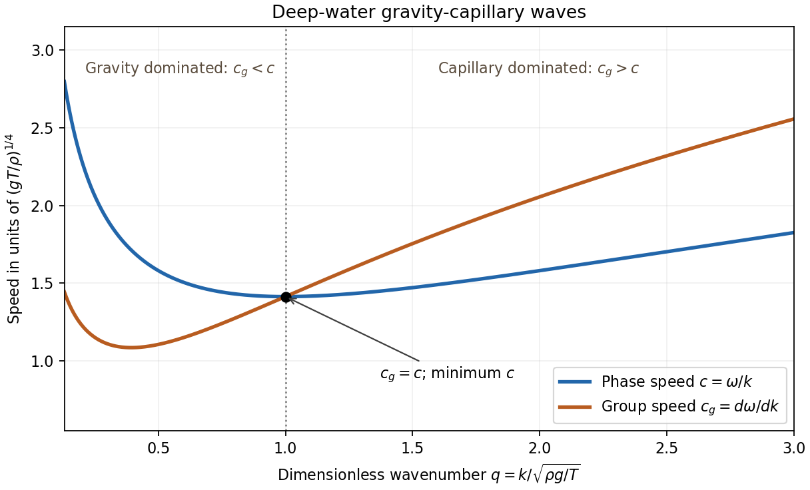

<h1 id="k/k4/solution">Solution</h1>

↑ **Parent:** [K4](../k4.md)

The [free surface](../../../../free-surface.md) is material, so applying the material [derivative](../../../../derivative.md) to $y-\eta(x,t)$ gives the exact [kinematic boundary condition](../../../../kinematic-boundary-condition.md)

$$
\boxed{\eta_t+\phi_x\eta_x=\phi_y\quad\text{at }y=\eta.}
$$

For an [incompressible fluid](../../../../incompressible-flow.md) with constant density, the [Euler equations](../../../../euler-equations-for-an-inviscid-fluid-split.md) are

$$
\partial_t\boldsymbol u+(\boldsymbol u\cdot\nabla)\boldsymbol u
=-\rho^{-1}\nabla p-g\boldsymbol e_y.
$$

Since the flow is [irrotational](../../../../irrotational-flow.md), $\boldsymbol u=\nabla\phi$ and $(\boldsymbol u\cdot\nabla)\boldsymbol u=\nabla(|\nabla\phi|^2/2)$. Integrating the resulting [gradient](../../../../gradient.md) equation gives a function of time on the right of [Bernoulli equation](../../../../bernoulli-equation.md). Adding a time-dependent constant to $\phi$ removes that function, without changing velocity, and choosing the atmospheric-pressure reference gives

$$
\phi_t+\frac12|\nabla\phi|^2+gy+\frac{p-p_a}\rho=0.
$$

The pressure immediately above the surface is atmospheric; the liquid-side pressure includes the stated [surface tension](../../../../surface-tension-split.md) jump.

At first order in wave amplitude, the products $\phi_x\eta_x$ and $|\nabla\phi|^2$, the slope-squared correction to curvature, and displacement corrections in evaluating $\phi$ at $y=\eta$ are all higher order. Hence, on $y=0$,

$$
\phi_y=\eta_t,\qquad
\phi_t+g\eta-\frac T\rho\eta_{xx}=0.
$$

For $\eta=A\cos(kx-\omega t)$, a harmonic [velocity potential](../../../../velocity-potential.md) decaying as $y\to-\infty$ and satisfying the first condition is

$$
\phi=\frac{A\omega}{k}e^{ky}\sin(kx-\omega t).
$$

Indeed $\Delta\phi=0$ and $\phi_y|_0=A\omega\sin(kx-\omega t)=\eta_t$. Substituting in the second condition yields the [dispersion relation](../../../../dispersion-relation-split.md) for a [gravity-capillary wave](../../../../gravity-capillary-wave.md):

$$
\boxed{\omega^2=gk+\frac T\rho k^3.}
$$

Taking the positive-frequency branch, the [phase velocity](../../../../phase-velocity.md) and [group velocity](../../../../group-velocity.md) are

$$
c=\frac\omega k=\sqrt{\frac gk+\frac T\rho k},
\qquad
c_g=\frac{d\omega}{dk}=\frac{g+3Tk^2/\rho}{2\omega}.
$$

Subtracting gives

$$
c_g-c=\frac{Tk^2/\rho-g}{2\omega}.
$$

Since $\omega>0$,

$$
\boxed{c_g>c\iff k>\sqrt{\rho g/T}.}
$$

The threshold is also the wavenumber at the [minimum phase speed of a gravity-capillary wave](../../../../minimum-phase-speed-of-a-gravity-capillary-wave.md).

**[Figure 1](#k/k4/image-phase-and-group-speeds-of-deep-water-gravity-capillary-waves). Phase and group speeds of deep-water gravity-capillary waves**. The curves meet at dimensionless wavenumber one, where the phase speed is minimal.

## ↑ Ancestors (12)

1. [K4](../k4.md)
2. [K](../../k.md)
3. [2011](../../../2011-split.md)
4. [Past exam of the options II course of the University of Oxford](../../../split.md)
5. [Options II course of the University of Oxford](../../../../options-ii-course-of-the-university-of-oxford.md)
6. [Year 2 of the mathematics course of the University of Oxford](../../../../year-2-of-the-mathematics-course-of-the-university-of-oxford.md)
7. [Mathematics course of the University of Oxford](../../../../mathematics-course-of-the-university-of-oxford.md)
8. [Undergraduate course of the University of Oxford](../../../../undergraduate-course-of-the-university-of-oxford.md)
9. [Course of the University of Oxford](../../../../course-of-the-university-of-oxford.md)
10. [University of Oxford](../../../../university-of-oxford-split.md)
11. [List of universities](../../../../list-of-universities.md)
12. [Codex Wiki](../../../../split.md)
