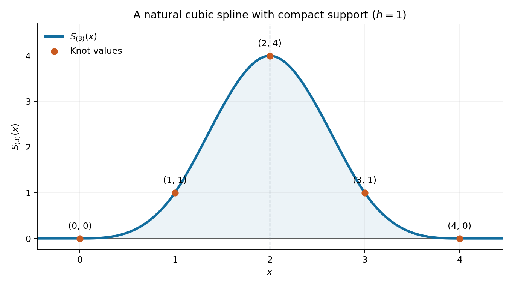

# 2012

↑ **Parent:** [Past exam of the options II course of the University of Oxford](../past-exam-of-the-options-ii-course-of-the-university-of-oxford.md)

Source paper: [Mathematics Part A FOI release](https://www.whatdotheyknow.com/request/maths_papers_2/response/1850333/attach/3/FOI%2020210708%201%20Data.zip?cookie_passthrough=1), member `FOI-20210708-1 - Data/4304 (1).pdf`. The cover identifies Options II, AO2, formal code 4304, Thursday 21 June 2012, 9.30am to 12.30pm. All sixteen source pages are readable. The section letters and nineteen printed question labels are retained below, including the unlettered opening tasks in D3 and M5.

**Table of contents**

- [A](#a)
  - [A2](#a/a2)
    - [a](#a/a2/a)
      - [Solution](#a/a2/a/solution)
    - [b](#a/a2/b)
      - [Solution](#a/a2/b/solution)
    - [c](#a/a2/c)
      - [Solution](#a/a2/c/solution)
    - [d](#a/a2/d)
      - [Solution](#a/a2/d/solution)
- [B](#b)
  - [B2](#b/b2)
    - [a](#b/b2/a)
      - [Solution](#b/b2/a/solution)
    - [b](#b/b2/b)
      - [Solution](#b/b2/b/solution)
    - [c](#b/b2/c)
      - [Solution](#b/b2/c/solution)
    - [d](#b/b2/d)
      - [Solution](#b/b2/d/solution)
    - [e](#b/b2/e)
      - [Solution](#b/b2/e/solution)
    - [f](#b/b2/f)
      - [Solution](#b/b2/f/solution)
- [C](#c)
  - [C2](#c/c2)
    - [a](#c/c2/a)
      - [i](#c/c2/a/i)
        - [Solution](#c/c2/a/i/solution)
      - [ii](#c/c2/a/ii)
        - [Solution](#c/c2/a/ii/solution)
      - [iii](#c/c2/a/iii)
        - [Solution](#c/c2/a/iii/solution)
    - [b](#c/c2/b)
      - [Solution](#c/c2/b/solution)
    - [c](#c/c2/c)
      - [Solution](#c/c2/c/solution)
- [D](#d)
  - [D3](#d/d3)
    - [Solution](#d/d3/solution)
    - [a](#d/d3/a)
      - [Solution](#d/d3/a/solution)
    - [b](#d/d3/b)
      - [Solution](#d/d3/b/solution)
    - [c](#d/d3/c)
      - [Solution](#d/d3/c/solution)
    - [d](#d/d3/d)
      - [Solution](#d/d3/d/solution)
  - [D4](#d/d4)
    - [Solution](#d/d4/solution)
- [E](#e)
  - [E3](#e/e3)
    - [a](#e/e3/a)
      - [i](#e/e3/a/i)
        - [Solution](#e/e3/a/i/solution)
      - [ii](#e/e3/a/ii)
        - [Solution](#e/e3/a/ii/solution)
      - [iii](#e/e3/a/iii)
        - [Solution](#e/e3/a/iii/solution)
      - [iv](#e/e3/a/iv)
        - [Solution](#e/e3/a/iv/solution)
    - [b](#e/e3/b)
      - [i](#e/e3/b/i)
        - [Solution](#e/e3/b/i/solution)
      - [ii](#e/e3/b/ii)
        - [1](#e/e3/b/ii/1)
          - [Solution](#e/e3/b/ii/1/solution)
        - [2](#e/e3/b/ii/2)
          - [Solution](#e/e3/b/ii/2/solution)
        - [3](#e/e3/b/ii/3)
          - [Solution](#e/e3/b/ii/3/solution)
  - [E4](#e/e4)
    - [a](#e/e4/a)
      - [i](#e/e4/a/i)
        - [Solution](#e/e4/a/i/solution)
      - [ii](#e/e4/a/ii)
        - [Solution](#e/e4/a/ii/solution)
      - [iii](#e/e4/a/iii)
        - [Solution](#e/e4/a/iii/solution)
      - [iv](#e/e4/a/iv)
        - [Solution](#e/e4/a/iv/solution)
      - [v](#e/e4/a/v)
        - [Solution](#e/e4/a/v/solution)
    - [b](#e/e4/b)
      - [i](#e/e4/b/i)
        - [Solution](#e/e4/b/i/solution)
      - [ii](#e/e4/b/ii)
        - [Solution](#e/e4/b/ii/solution)
- [F](#f)
  - [F2](#f/f2)
    - [a](#f/f2/a)
      - [i](#f/f2/a/i)
        - [Solution](#f/f2/a/i/solution)
      - [ii](#f/f2/a/ii)
        - [Solution](#f/f2/a/ii/solution)
      - [iii](#f/f2/a/iii)
        - [Solution](#f/f2/a/iii/solution)
    - [b](#f/f2/b)
      - [i](#f/f2/b/i)
        - [Solution](#f/f2/b/i/solution)
      - [ii](#f/f2/b/ii)
        - [Solution](#f/f2/b/ii/solution)
    - [c](#f/f2/c)
      - [i](#f/f2/c/i)
        - [Solution](#f/f2/c/i/solution)
      - [ii](#f/f2/c/ii)
        - [Solution](#f/f2/c/ii/solution)
- [G](#g)
  - [G2](#g/g2)
    - [Solution](#g/g2/solution)
- [H](#h)
  - [H2](#h/h2)
    - [a](#h/h2/a)
      - [Solution](#h/h2/a/solution)
    - [b](#h/h2/b)
      - [Solution](#h/h2/b/solution)
    - [c](#h/h2/c)
      - [Solution](#h/h2/c/solution)
    - [d](#h/h2/d)
      - [Solution](#h/h2/d/solution)
- [J](#j)
  - [J2](#j/j2)
    - [a](#j/j2/a)
      - [i](#j/j2/a/i)
        - [Solution](#j/j2/a/i/solution)
      - [ii](#j/j2/a/ii)
        - [Solution](#j/j2/a/ii/solution)
      - [iii](#j/j2/a/iii)
        - [Solution](#j/j2/a/iii/solution)
    - [b](#j/j2/b)
      - [Solution](#j/j2/b/solution)
- [K](#k)
  - [K3](#k/k3)
    - [a](#k/k3/a)
      - [Solution](#k/k3/a/solution)
    - [b](#k/k3/b)
      - [Solution](#k/k3/b/solution)
    - [c](#k/k3/c)
      - [Solution](#k/k3/c/solution)
    - [d](#k/k3/d)
      - [Solution](#k/k3/d/solution)
  - [K4](#k/k4)
    - [Solution](#k/k4/solution)
- [M](#m)
  - [M4](#m/m4)
    - [a](#m/m4/a)
      - [i](#m/m4/a/i)
        - [Solution](#m/m4/a/i/solution)
      - [ii](#m/m4/a/ii)
        - [Solution](#m/m4/a/ii/solution)
      - [iii](#m/m4/a/iii)
        - [Solution](#m/m4/a/iii/solution)
      - [iv](#m/m4/a/iv)
        - [Solution](#m/m4/a/iv/solution)
    - [b](#m/m4/b)
      - [i](#m/m4/b/i)
        - [Solution](#m/m4/b/i/solution)
      - [ii](#m/m4/b/ii)
        - [Solution](#m/m4/b/ii/solution)
    - [c](#m/m4/c)
      - [Solution](#m/m4/c/solution)
  - [M5](#m/m5)
    - [Solution](#m/m5/solution)
    - [a](#m/m5/a)
      - [Solution](#m/m5/a/solution)
    - [b](#m/m5/b)
      - [Solution](#m/m5/b/solution)
    - [c](#m/m5/c)
      - [Solution](#m/m5/c/solution)
    - [d](#m/m5/d)
      - [Solution](#m/m5/d/solution)
    - [e](#m/m5/e)
      - [Solution](#m/m5/e/solution)
- [O](#o)
  - [O4](#o/o4)
    - [a](#o/o4/a)
      - [Solution](#o/o4/a/solution)
    - [b](#o/o4/b)
      - [i](#o/o4/b/i)
        - [Solution](#o/o4/b/i/solution)
      - [ii](#o/o4/b/ii)
        - [Solution](#o/o4/b/ii/solution)
    - [c](#o/o4/c)
      - [i](#o/o4/c/i)
        - [Solution](#o/o4/c/i/solution)
      - [ii](#o/o4/c/ii)
        - [Solution](#o/o4/c/ii/solution)
  - [O5](#o/o5)
    - [a](#o/o5/a)
      - [Solution](#o/o5/a/solution)
    - [b](#o/o5/b)
      - [Solution](#o/o5/b/solution)
    - [c](#o/o5/c)
      - [Solution](#o/o5/c/solution)
    - [d](#o/o5/d)
      - [Solution](#o/o5/d/solution)
    - [e](#o/o5/e)
      - [Solution](#o/o5/e/solution)
    - [f](#o/o5/f)
      - [Solution](#o/o5/f/solution)
- [P](#p)
  - [P3](#p/p3)
    - [a](#p/p3/a)
      - [Solution](#p/p3/a/solution)
    - [b](#p/p3/b)
      - [Solution](#p/p3/b/solution)
    - [c](#p/p3/c)
      - [Solution](#p/p3/c/solution)
    - [d](#p/p3/d)
      - [Solution](#p/p3/d/solution)
  - [P4](#p/p4)
    - [a](#p/p4/a)
      - [Solution](#p/p4/a/solution)
    - [b](#p/p4/b)
      - [Solution](#p/p4/b/solution)
    - [c](#p/p4/c)
      - [Solution](#p/p4/c/solution)

## A

↑ **Parent:** [2012](2012.md)

<h3 id="a/a2">A2</h3>

↑ **Parent:** [A](#a)

<h4 id="a/a2/a">a</h4>

↑ **Parent:** [A2](#a/a2)

<h5 id="a/a2/a/solution">Solution</h5>

↑ **Parent:** [A](#a/a2/a)

Start with $O=(0,0)$ and $E=(1,0)$. A [constructible point](../galois-theory.md#constructible-point) is a point obtained from these by finitely many ruler-and-compass steps. At each step one may draw the [line](../euclidean-geometry.md#straight-line) through two previously obtained distinct points, or the [circle](../topology.md#circle) with a previously obtained [centre](../euclidean-geometry.md#center-geometry) and [radius](../topology.md#radius) equal to the [distance](../geometry-and-topology.md#distance) between two previously obtained points, and take isolated [intersection](../set.md#set-intersection) points of the drawn [lines](../euclidean-geometry.md#straight-line) or [circles](../topology.md#circle). A [constructible line](../galois-theory.md#constructible-line) is a [line](../euclidean-geometry.md#straight-line) through two distinct [constructible points](../galois-theory.md#constructible-point); a [constructible circle](../galois-theory.md#constructible-circle) has constructible [centre](../euclidean-geometry.md#center-geometry) and a [radius](../topology.md#radius) obtainable as such a [distance](../geometry-and-topology.md#distance). These conventions also permit copying a previously obtained segment with the compass.

**Finite construction from a fixed unit segment is essential:** a drawing through an arbitrary unspecified real point does not make that point constructible.

<h4 id="a/a2/b">b</h4>

↑ **Parent:** [A2](#a/a2)

<h5 id="a/a2/b/solution">Solution</h5>

↑ **Parent:** [B](#a/a2/b)

Consider an isolated [intersection](../set.md#set-intersection) of the two curves. For two distinct [lines](../euclidean-geometry.md#straight-line), solving their [linear equations](../linear-algebra.md#linear-equation) by elimination gives coordinates in $F$ whenever there is an [intersection](../set.md#set-intersection).

For a [line](../euclidean-geometry.md#straight-line) and a [circle](../topology.md#circle), solve the [line](../euclidean-geometry.md#straight-line) for one coordinate with a nonzero [coefficient](../vector-space.md#coefficient) and substitute into the [circle](../topology.md#circle) equation. The resulting quadratic has [coefficients](../vector-space.md#coefficient) in $F$. A real [root](../semisimple-lie-algebra.md#root-of-a-root-system) lies in $F$ if its [discriminant](../polynomial.md#discriminant) is a square in $F$, and otherwise in $F(\sqrt D)$ for its positive nonsquare [discriminant](../polynomial.md#discriminant) $D\in F$. The other coordinate is an $F$-linear expression in that [root](../semisimple-lie-algebra.md#root-of-a-root-system). Thus both coordinates lie in the same real [quadratic extension](../algebra.md#quadratic-extension). A [tangent](../geometry-and-topology.md#tangent) [intersection](../set.md#set-intersection) has [discriminant](../polynomial.md#discriminant) zero and already lies in $F$.

Write two [circle](../topology.md#circle) equations in normalized form $x^2+y^2+u_ix+v_iy+w_i=0$. Subtracting eliminates the quadratic terms. If the [circles](../topology.md#circle) are distinct and meet, this gives a nontrivial [line](../euclidean-geometry.md#straight-line), reducing the problem to the preceding case. Concentric distinct [circles](../topology.md#circle) do not intersect. Therefore

$$
\boxed{\text{each isolated intersection has coordinates in }F\text{ or in }F(\sqrt D),\quad [F(\sqrt D):F]=2.}
$$

The isolated-intersection qualification is implicit in the construction operation. If coincident curves were allowed and every point on their common curve counted as an [intersection](../set.md#set-intersection) point, the printed assertion would be false: a rational [line](../euclidean-geometry.md#straight-line) contains points with transcendental coordinates.

<h4 id="a/a2/c">c</h4>

↑ **Parent:** [A2](#a/a2)

<h5 id="a/a2/c/solution">Solution</h5>

↑ **Parent:** [C](#a/a2/c)

Induct through the finitely many construction steps. Initially all available coordinates lie in $\mathbb Q$. If coordinates obtained so far lie in a real [field](../algebra.md#field) $F$, the [line](../euclidean-geometry.md#straight-line) through two of its points has [coefficients](../vector-space.md#coefficient) in $F$. A [circle](../topology.md#circle) with [centre](../euclidean-geometry.md#center-geometry) in $F^2$ and [radius](../topology.md#radius) a [distance](../geometry-and-topology.md#distance) between two such points has equation

$$
(x-a)^2+(y-b)^2=r^2,
$$

whose [coefficients](../vector-space.md#coefficient) lie in $F$, since the squared [distance](../geometry-and-topology.md#distance) $r^2$ lies in $F$; the [radius](../topology.md#radius) itself need not lie there.

Part (b) therefore puts every new [intersection](../set.md#set-intersection) in $F$ or a real [quadratic extension](../algebra.md#quadratic-extension) of $F$. If a step produces several points, adjoin their coordinates successively, omitting extensions that add nothing. A finite construction ends in a real [field](../algebra.md#field) $K$ containing the desired coordinates, with a tower of genuine quadratic extensions

$$
\mathbb Q=F_0\subset F_1\subset\cdots\subset F_n=K.
$$

The [tower law for field extensions](../galois-theory.md#tower-law-for-field-extensions) yields

$$
\boxed{[K:\mathbb Q]=\prod_{i=0}^{n-1}[F_{i+1}:F_i]=2^n.}
$$

A construction involving no nontrivial extension has $n=0$ and [degree](../polynomial.md#degree-of-a-polynomial) one.

<h4 id="a/a2/d">d</h4>

↑ **Parent:** [A2](#a/a2)

<h5 id="a/a2/d/solution">Solution</h5>

↑ **Parent:** [D](#a/a2/d)

A [constructible regular polygon](../straightedge-and-compass-construction.md#constructible-regular-polygon) can be translated, rotated, and rescaled by constructible operations to one inscribed in the unit [circle](../topology.md#circle) with a vertex at $(1,0)$. Thus the real and imaginary parts of $\zeta=e^{2\pi i/p}$ are constructible. Part (c) puts both in a real [field](../algebra.md#field) $K$ of [degree](../polynomial.md#degree-of-a-polynomial) $2^n$ over $\mathbb Q$. Consequently $\zeta\in K(i)$, and $[K(i):\mathbb Q]=2^{n+1}$ because $K\subset\mathbb R$.

For [prime](../prime-number.md) $p$, the supplied irreducibility of $1+x+\cdots+x^{p-1}$ shows that $[\mathbb Q(\zeta):\mathbb Q]=p-1$. The intermediate-field tower law implies that $p-1$ divides $2^{n+1}$. Every positive divisor of a [power of two](../integer.md#power-of-two) is a [power of two](../integer.md#power-of-two), so

$$
\boxed{p=2^r+1\quad\text{for an integer }r\geq0.}
$$

This necessary condition includes $p=2$ with $r=0$. It does not assert sufficiency for arbitrary [integers](../integer.md) of this form.

<h2 id="b">B</h2>

↑ **Parent:** [2012](2012.md)

<h3 id="b/b2">B2</h3>

↑ **Parent:** [B](#b)

<h4 id="b/b2/a">a</h4>

↑ **Parent:** [B2](#b/b2)

<h5 id="b/b2/a/solution">Solution</h5>

↑ **Parent:** [A](#b/b2/a)

The [identity element](../algebraic-operation.md#identity-element) satisfies $e*x=exe^{-1}=x$. For $g,h\in G$,

$$
(gh)*x=ghxh^{-1}g^{-1}=g*(h*x).
$$

Both [action](../lagrangian-mechanics.md#action) axioms hold, so **[conjugation](../group-action.md#conjugation) is a [group action](../group-action.md) on $G$**.

<h4 id="b/b2/b">b</h4>

↑ **Parent:** [B2](#b/b2)

<h5 id="b/b2/b/solution">Solution</h5>

↑ **Parent:** [B](#b/b2/b)

By definition, $g$ stabilizes $x$ exactly when $gxg^{-1}=x$. Multiplying on the right by $g$ gives the equivalent condition $gx=xg$. Hence

$$
\boxed{\operatorname{Stab}_G(x)=Z(x).}
$$

Thus the [stabilizer](../group-action.md#stabilizer-subgroup) in this [action](../lagrangian-mechanics.md#action) is the [centralizer](../group-action.md#centralizer) of the element.

<h4 id="b/b2/c">c</h4>

↑ **Parent:** [B2](#b/b2)

<h5 id="b/b2/c/solution">Solution</h5>

↑ **Parent:** [C](#b/b2/c)

Let $H=Z(x)$. The map $G/H\to C(x)$ sending $gH$ to $gxg^{-1}$ is well defined: multiplying $g$ on the right by an element commuting with $x$ leaves its conjugate unchanged. It is onto by the [orbit](../dynamical-systems.md#orbit-dynamical-system) definition. If $gxg^{-1}=hxh^{-1}$, then $h^{-1}g$ commutes with $x$, so $gH=hH$, proving [injectivity](../algebra.md#injective-function).

Every [coset](../group-theory.md#coset) has $|H|$ elements, so $|C(x)|=|G|/|H|$. Therefore

$$
\boxed{|G|=|Z(x)|\,|C(x)|.}
$$

This is the [orbit-stabilizer theorem](../group-action.md#orbit-stabilizer-theorem) specialized to [conjugation](../group-action.md#conjugation).

<h4 id="b/b2/d">d</h4>

↑ **Parent:** [B2](#b/b2)

<h5 id="b/b2/d/solution">Solution</h5>

↑ **Parent:** [D](#b/b2/d)

An element $x$ is central exactly when $gx=xg$ for every $g\in G$. By part (b), this is exactly the assertion that every $g$ stabilizes $x$. That means every conjugate of $x$ is $x$; conversely, a singleton [conjugacy class](../group-action.md#conjugacy-class) has this property for every $g$.

$$
\boxed{x\in Z(G)\iff\operatorname{Stab}_G(x)=G\iff C(x)=\{x\}.}
$$

In particular, the singleton classes are in one-to-one correspondence with the elements of the [centre](../euclidean-geometry.md#center-geometry).

<h4 id="b/b2/e">e</h4>

↑ **Parent:** [B2](#b/b2)

<h5 id="b/b2/e/solution">Solution</h5>

↑ **Parent:** [E](#b/b2/e)

[Conjugacy](../group-action.md#conjugate-group-elements) is an [equivalence relation](../set-theory.md#equivalence-relation): the [identity element](../algebraic-operation.md#identity-element) gives reflexivity, [conjugation](../group-action.md#conjugation) by $g^{-1}$ reverses [conjugation](../group-action.md#conjugation) by $g$, and composing conjugations gives transitivity. Its [equivalence classes](../set-theory.md#equivalence-class) therefore partition the finite set $G$. Counting this disjoint [union](../set.md#set-union) gives

$$
\boxed{|G|=\sum_{i=1}^k|C_i|.}
$$

Separating singleton classes from the others gives the [class equation](../group-action.md#class-equation) $|G|=|Z(G)|+\sum_{|C_i|>1}|C_i|$.

<h4 id="b/b2/f">f</h4>

↑ **Parent:** [B2](#b/b2)

<h5 id="b/b2/f/solution">Solution</h5>

↑ **Parent:** [F](#b/b2/f)

Write $|G|=p^n$, where $n\geq1$. By part (c), each conjugacy-class size divides $p^n$ and hence is a power of $p$. Every nonsingleton class consequently has size divisible by $p$. The [class equation](../group-action.md#class-equation) implies

$$
|Z(G)|\equiv|G|\equiv0\pmod p.
$$

The [identity element](../algebraic-operation.md#identity-element) lies in the [centre](../euclidean-geometry.md#center-geometry), so the [centre](../euclidean-geometry.md#center-geometry) is nonempty. Its size is a positive multiple of $p$, and therefore

$$
\boxed{|Z(G)|\geq p\geq2.}
$$

This proves that a nontrivial finite [p-group](../finite-group-theory.md#p-group) has a nontrivial [centre](../euclidean-geometry.md#center-geometry).

<h2 id="c">C</h2>

↑ **Parent:** [2012](2012.md)

<h3 id="c/c2">C2</h3>

↑ **Parent:** [C](#c)

<h4 id="c/c2/a">a</h4>

↑ **Parent:** [C2](#c/c2)

<h5 id="c/c2/a/i">i</h5>

↑ **Parent:** [A](#c/c2/a)

<h6 id="c/c2/a/i/solution">Solution</h6>

↑ **Parent:** [I](#c/c2/a/i)

For an [integer](../integer.md) $a$ and an [odd prime](../prime-number.md#odd-prime) $p$, the [Legendre symbol](../quadratic-residue.md#legendre-symbol) is

$$
\boxed{\left(\frac ap\right)=\begin{cases}0,&p\mid a,\\1,&a\not\equiv0\pmod p\text{ and }a\text{ is a square modulo }p,\\-1,&a\text{ is not a square modulo }p.\end{cases}}
$$

The value one refers to a nonzero [quadratic residue](../quadratic-residue.md); divisibility by $p$ is recorded separately by zero.

<h5 id="c/c2/a/ii">ii</h5>

↑ **Parent:** [A](#c/c2/a)

<h6 id="c/c2/a/ii/solution">Solution</h6>

↑ **Parent:** [Ii](#c/c2/a/ii)

[Euler's criterion](../quadratic-residue.md#euler-s-criterion) states that

$$
\boxed{a^{(p-1)/2}\equiv\left(\frac ap\right)\pmod p.}
$$

For $p\nmid a$ this says that the power is $1$ for a [quadratic residue](../quadratic-residue.md) and $-1$ for a [quadratic nonresidue](../quadratic-residue.md#quadratic-nonresidue). When $p\mid a$, both sides are zero modulo $p$.

<h5 id="c/c2/a/iii">iii</h5>

↑ **Parent:** [A](#c/c2/a)

<h6 id="c/c2/a/iii/solution">Solution</h6>

↑ **Parent:** [Iii](#c/c2/a/iii)

[Euler's criterion](../quadratic-residue.md#euler-s-criterion) gives

$$
\left(\frac{ab}p\right)\equiv (ab)^{(p-1)/2}
\equiv a^{(p-1)/2}b^{(p-1)/2}
\equiv\left(\frac ap\right)\left(\frac bp\right)\pmod p.
$$

If either factor is divisible by $p$, both asserted values are zero. Otherwise the two values lie in $\{1,-1\}$, whose elements are distinct modulo an [odd prime](../prime-number.md#odd-prime). The [modular congruence](../modular-arithmetic.md#modular-congruence) is therefore equality:

$$
\boxed{\left(\frac{ab}p\right)=\left(\frac ap\right)\left(\frac bp\right).}
$$

Finally, $a\equiv b\pmod p$ means they give the same [residue class](../modular-arithmetic.md#residue-class) and thus the same set of square-congruence solutions. Divisibility by $p$ is also identical. Hence $\left(\frac ap\right)=\left(\frac bp\right)$.

<h4 id="c/c2/b">b</h4>

↑ **Parent:** [C2](#c/c2)

<h5 id="c/c2/b/solution">Solution</h5>

↑ **Parent:** [B](#c/c2/b)

The [quadratic reciprocity](../number-theory.md#quadratic-reciprocity) states that for distinct odd [primes](../prime-number.md) $p,q$,

$$
\left(\frac pq\right)\left(\frac qp\right)=(-1)^{(p-1)(q-1)/4}.
$$

With $q=3$, it gives $\left(\frac3p\right)=(-1)^{(p-1)/2}\left(\frac p3\right)$. The nonzero square modulo three is one, so $\left(\frac p3\right)=1$ when $p\equiv1\pmod3$, and $-1$ when $p\equiv-1\pmod3$. An [odd prime](../prime-number.md#odd-prime) other than three is congruent to $1,5,7$, or $11$ modulo twelve. Evaluating the two signs gives

$$
\begin{array}{c|rrrr}p\bmod12&1&5&7&11\\\hline
(-1)^{(p-1)/2}&1&1&-1&-1\\
\left(\frac p3\right)&1&-1&1&-1\\
\left(\frac3p\right)&1&-1&-1&1
\end{array}
$$

Thus

$$
\boxed{\left(\frac3p\right)=1\text{ for }p\equiv\pm1\pmod{12},\quad -1\text{ for }p\equiv\pm5\pmod{12}.}
$$

<h4 id="c/c2/c">c</h4>

↑ **Parent:** [C2](#c/c2)

<h5 id="c/c2/c/solution">Solution</h5>

↑ **Parent:** [C](#c/c2/c)

Reducing modulo $23$ gives $189\equiv5$. Reciprocity with five has positive sign, so

$$
\left(\frac{189}{23}\right)=\left(\frac5{23}\right)=\left(\frac{23}5\right)=\left(\frac35\right)=-1,
$$

since the nonzero squares modulo five are one and four. Modulo $59$, $189\equiv12=4\cdot3$, and $59\equiv-1\pmod{12}$. Thus part (b) gives

$$
\boxed{\left(\frac{189}{23}\right)=-1,\qquad\left(\frac{189}{59}\right)=1.}
$$

As $1357=23\cdot59$, a solution modulo $1357$ would in particular solve the [modular congruence](../modular-arithmetic.md#modular-congruence) modulo $23$, contradicting the first symbol. Therefore **there is no [integer](../integer.md) solution modulo $1357$**.

<h2 id="d">D</h2>

↑ **Parent:** [2012](2012.md)

<h3 id="d/d3">D3</h3>

↑ **Parent:** [D](#d)

<h4 id="d/d3/solution">Solution</h4>

↑ **Parent:** [D3](#d/d3)

The [monotone convergence theorem](../measure-theory.md#monotone-convergence-theorem) states that if [measurable functions](../measure-theory.md#measurable-function) $0\leq f_n\uparrow f$ pointwise on a [measure space](../measure.md#measure-space), then $\int f_n\uparrow\int f$, allowing the limit to be infinite.

Extend each restriction to $I_n$ by zero on $I\setminus I_n$. The functions $f\mathbf1_{I_n}$ are nonnegative and increase pointwise to $f$ because the [intervals](../real-analysis.md#interval-mathematics) are increasing and exhaust $I$. Hence

$$
\int_I f=\lim_{n\to\infty}\int_{I_n}f=\sup_n\int_{I_n}f.
$$

For nonnegative $f$, [integrability](../measure-theory.md#integrability) means finiteness of this [integral](../integral.md), so

$$
\boxed{f\in L^1(I)\iff\sup_n\int_{I_n}f<\infty.}
$$

No [boundedness](../topological-analysis.md#boundedness) or [closedness](../topology.md#closedness) of the [intervals](../real-analysis.md#interval-mathematics) is required.

<h4 id="d/d3/a">a</h4>

↑ **Parent:** [D3](#d/d3)

<h5 id="d/d3/a/solution">Solution</h5>

↑ **Parent:** [A](#d/d3/a)

The function is nonnegative, [measurable](../measure-theory.md#measurability), and even. Direct integration gives

$$
\int_{\mathbb R}e^{-|x|}\,dx=2\int_0^\infty e^{-x}\,dx=2.
$$

Thus **it is [integrable](../measure-theory.md#integrability)**, with [integral](../integral.md) $\boxed{2}$.

<h4 id="d/d3/b">b</h4>

↑ **Parent:** [D3](#d/d3)

<h5 id="d/d3/b/solution">Solution</h5>

↑ **Parent:** [B](#d/d3/b)

On finite [intervals](../real-analysis.md#interval-mathematics) the function is [continuous](../calculus.md#continuous-function), but

$$
\int_0^R\frac{x}{1+x^2}\,dx=\frac12\log(1+R^2)\longrightarrow\infty.
$$

Consequently its nonnegative [integral](../integral.md) on the half-line is infinite: **it is not [integrable](../measure-theory.md#integrability)**. The divergence occurs at infinity, not at the origin.

<h4 id="d/d3/c">c</h4>

↑ **Parent:** [D3](#d/d3)

<h5 id="d/d3/c/solution">Solution</h5>

↑ **Parent:** [C](#d/d3/c)

For every real $x$, the numerator is at most $2e^{|x|}$, while the denominator is at least $e^{2|x|}$. Therefore

$$
0\leq\frac{e^x+e^{-x}}{e^{2x}+e^{-2x}}\leq2e^{-|x|}.
$$

The upper bound is [integrable](../measure-theory.md#integrability) by part (a), so the comparison theorem shows that **the function is [integrable](../measure-theory.md#integrability) on $\mathbb R$**.

<h4 id="d/d3/d">d</h4>

↑ **Parent:** [D3](#d/d3)

<h5 id="d/d3/d/solution">Solution</h5>

↑ **Parent:** [D](#d/d3/d)

We prove [absolute integrability](../measure-theory.md#integrability). On $(0,1]$, $|\sin(1/x)|\leq1$ and the denominator is at least one, so $|f(x)|\leq1$. On $[1,\infty)$, the standard inequality $|\sin t|\leq|t|$ gives

$$
|f(x)|\leq\frac1{x(1+(\log x)^2)}.
$$

[Substitution](../algebra.md#substitution-algebra) $t=\log x$ yields

$$
\int_1^\infty\frac{dx}{x(1+(\log x)^2)}=\int_0^\infty\frac{dt}{1+t^2}=\frac\pi2.
$$

Thus $\int_0^\infty|f(x)|\,dx\leq1+\pi/2<\infty$, and **the function is [integrable](../measure-theory.md#integrability)** despite its oscillation near zero.

<h3 id="d/d4">D4</h3>

↑ **Parent:** [D](#d)

<h4 id="d/d4/solution">Solution</h4>

↑ **Parent:** [D4](#d/d4)

For a [continuously differentiable](../multivariable-calculus.md#continuously-differentiable-function) [diffeomorphism](../geometry-and-topology.md#diffeomorphism) $\phi:J\to I$ between [intervals](../real-analysis.md#interval-mathematics), the [integration by substitution](../integral.md#integration-by-substitution) states

$$
\int_I h(x)\,dx=\int_J h(\phi(t))|\phi'(t)|\,dt.
$$

It holds as an [identity element](../algebraic-operation.md#identity-element) of extended [integrals](../integral.md) for nonnegative [measurable](../measure-theory.md#measurability) $h$. For signed or complex-valued [measurable](../measure-theory.md#measurability) $h$, [integrability](../measure-theory.md#integrability) on one side is equivalent to [integrability](../measure-theory.md#integrability) after [substitution](../algebra.md#substitution-algebra), and the [identity element](../algebraic-operation.md#identity-element) then holds. The absolute [derivative](../calculus.md#derivative) accounts for a decreasing [substitution](../algebra.md#substitution-algebra); on oriented finite [intervals](../real-analysis.md#interval-mathematics) the equivalent formula uses $\phi'$ and oriented endpoints.

Put $C=\int_0^\infty(1+x^4)^{-1}\,dx=\pi/(2\sqrt2)$. The map $x=y^{-1/4}$ is a decreasing [diffeomorphism](../geometry-and-topology.md#diffeomorphism) of the positive half-line onto itself and

$$
\frac{|dx/dy|}{1+x^4}=\frac1{4y^{1/4}(1+y)}.
$$

Applying the nonnegative version before assuming finiteness proves both existence and value:

$$
\boxed{\int_0^\infty\frac{dy}{y^{1/4}(1+y)}=4C=\sqrt2\pi.}
$$

[Tonelli's theorem](../measure-theory.md#tonelli-theorem) permits either iterated [integral](../integral.md) of a nonnegative [measurable function](../measure-theory.md#measurable-function) on a product of sigma-finite [measure spaces](../measure.md#measure-space) and identifies both with its extended product [integral](../integral.md). [Fubini's theorem](../measure-theory.md#fubini-s-theorem) states that for an absolutely [integrable](../measure-theory.md#integrability) [measurable function](../measure-theory.md#measurable-function) on such a product, almost every section is [integrable](../measure-theory.md#integrability), the section-integral functions are [integrable](../measure-theory.md#integrability), and the two iterated [integrals](../integral.md) equal the product [integral](../integral.md).

The given two-variable function is [continuous](../calculus.md#continuous-function) and positive on the positive quadrant. For fixed $y>0$, substituting $t=xy^{1/4}$ gives

$$
\int_0^\infty f(x,y)\,dx=\frac{Cy^{-1/4}}{1+y}.
$$

Tonelli now gives

$$
\iint f(x,y)\,dx\,dy=C(4C)=4C^2=\frac{\pi^2}2<\infty.
$$

This proves [absolute integrability](../measure-theory.md#integrability), so Fubini is applicable.

For $x\neq1$, integrate the displayed partial fraction [identity element](../algebraic-operation.md#identity-element) in $y$ up to $R$:

$$
\int_0^R f(x,y)\,dy=\frac{\log(1+x^4R)-\log(1+R)}{x^4-1}
\longrightarrow\frac{4\log x}{x^4-1}.
$$

At $x=1$ the section [integral](../integral.md) is $\int_0^\infty(1+y)^{-2}\,dy=1$, agreeing with the [continuous](../calculus.md#continuous-function) limit of this expression. Therefore Fubini identifies the remaining [integral](../integral.md) and gives

$$
\boxed{\int_0^\infty\frac{\log x}{x^4-1}\,dx=\frac14\cdot\frac{\pi^2}2=\frac{\pi^2}8.}
$$

The apparent [singularity](../complex-analysis.md#complex-singularity) at one is removable, with limiting integrand value $1/4$. Positivity and the finite product [integral](../integral.md) already establish convergence at both ends.

<h2 id="e">E</h2>

↑ **Parent:** [2012](2012.md)

<h3 id="e/e3">E3</h3>

↑ **Parent:** [E](#e)

<h4 id="e/e3/a">a</h4>

↑ **Parent:** [E3](#e/e3)

<h5 id="e/e3/a/i">i</h5>

↑ **Parent:** [A](#e/e3/a)

<h6 id="e/e3/a/i/solution">Solution</h6>

↑ **Parent:** [I](#e/e3/a/i)

The [closure](../topology.md#closure-topology) of $A$ is the [intersection](../set.md#set-intersection) of every [closed](../topology.md#closed-set) subset containing it:

$$
\boxed{\overline A=\bigcap\{F\subseteq X:F\text{ closed and }A\subseteq F\}.}
$$

The collection is nonempty because it contains $X$. Arbitrary [intersections](../set.md#set-intersection) of [closed](../topology.md#closed-set) sets are [closed](../topology.md#closed-set), so this is the smallest [closed](../topology.md#closed-set) set containing $A$.

<h5 id="e/e3/a/ii">ii</h5>

↑ **Parent:** [A](#e/e3/a)

<h6 id="e/e3/a/ii/solution">Solution</h6>

↑ **Parent:** [Ii](#e/e3/a/ii)

Every subset is contained in its [closure](../topology.md#closure-topology), giving $\overline A\subseteq\overline{\overline A}$. On the other hand, $\overline A$ is already [closed](../topology.md#closed-set) by its definition as an [intersection](../set.md#set-intersection) of [closed](../topology.md#closed-set) sets. It is therefore one of the [closed](../topology.md#closed-set) supersets used when taking its own [closure](../topology.md#closure-topology), so $\overline{\overline A}\subseteq\overline A$. Hence

$$
\boxed{\overline{\overline A}=\overline A.}
$$

This is the [idempotence](../algebraic-operation.md#idempotence) of the [closure](../topology.md#closure-topology) operation.

<h5 id="e/e3/a/iii">iii</h5>

↑ **Parent:** [A](#e/e3/a)

<h6 id="e/e3/a/iii/solution">Solution</h6>

↑ **Parent:** [Iii](#e/e3/a/iii)

If $x\notin\overline A$, some [closed](../topology.md#closed-set) superset $F$ of $A$ misses $x$. Its [complement](../set.md#complement-of-a-set) is an [open set](../topology.md#open-set) containing $x$ and disjoint from $A$. Conversely, if an [open set](../topology.md#open-set) $U$ contains $x$ and misses $A$, the [closed](../topology.md#closed-set) set $X\setminus U$ contains $A$ and misses $x$, so $x\notin\overline A$.

Negating this equivalence gives the [neighbourhood](../topology.md#neighbourhood-mathematics) characterization

$$
\boxed{x\in\overline A\iff U\cap A\neq\varnothing\text{ for every open }U\ni x.}
$$

<h5 id="e/e3/a/iv">iv</h5>

↑ **Parent:** [A](#e/e3/a)

<h6 id="e/e3/a/iv/solution">Solution</h6>

↑ **Parent:** [Iv](#e/e3/a/iv)

An [accumulation point](../topology.md#limit-point) of $A$ is a point $x\in X$ such that every [open neighbourhood](../topology.md#open-neighbourhood) of $x$ contains a point of $A$ different from $x$:

$$
\boxed{x\in A'\iff (U\setminus\{x\})\cap A\neq\varnothing\text{ for every open }U\ni x.}
$$

The point itself need not belong to $A$. Requiring a different point distinguishes accumulation from mere membership in the [closure](../topology.md#closure-topology).

<h4 id="e/e3/b">b</h4>

↑ **Parent:** [E3](#e/e3)

<h5 id="e/e3/b/i">i</h5>

↑ **Parent:** [B](#e/e3/b)

<h6 id="e/e3/b/i/solution">Solution</h6>

↑ **Parent:** [I](#e/e3/b/i)

In a [metric space](../topological-analysis.md#metric-space),

$$
\boxed{x\in A'\iff\text{there exists a sequence }a_n\in A\setminus\{x\}\text{ with }a_n\to x.}
$$

The [sequence](../sequence-and-series.md#sequence) may equivalently be required to have pairwise distinct terms. The metric [hypothesis](../README.md#hypothesis) makes a countable [sequence](../sequence-and-series.md#sequence) sufficient; arbitrary [topological spaces](../topology.md#topological-space) need not have this sequential characterization.

<h5 id="e/e3/b/ii">ii</h5>

↑ **Parent:** [B](#e/e3/b)

<h6 id="e/e3/b/ii/1">1</h6>

↑ **Parent:** [Ii](#e/e3/b/ii)

<h6 id="e/e3/b/ii/1/solution">Solution</h6>

↑ **Parent:** [1](#e/e3/b/ii/1)

Take $A_1=\mathbb Q^2$. Every [open disk](../topology.md#open-disk) contains infinitely many points with both coordinates rational, so every point of the plane is an [accumulation point](../topology.md#limit-point) of $A_1$. Every disk also contains infinitely many points with an irrational first coordinate, and these lie in the [complement](../set.md#complement-of-a-set). Thus

$$
\boxed{A_1'=\mathbb R^2=(\mathbb R^2\setminus A_1)'.}
$$

The infinitely-many-points observation ensures that one can avoid the [centre](../euclidean-geometry.md#center-geometry) of the disk itself in both cases.

<h6 id="e/e3/b/ii/2">2</h6>

↑ **Parent:** [Ii](#e/e3/b/ii)

<h6 id="e/e3/b/ii/2/solution">Solution</h6>

↑ **Parent:** [2](#e/e3/b/ii/2)

Take

$$
A_2=\{(1/n,0):n\geq1\}.
$$

Its only [accumulation point](../topology.md#limit-point) is $(0,0)$, which is absent from $A_2$. Every listed point is isolated, so none belongs to $A_2'$. Consequently

$$
\boxed{A_2'=\{(0,0)\},\qquad A_2'\not\subseteq A_2,\quad A_2\not\subseteq A_2'.}
$$

For completeness, away from the origin a sufficiently small disk meets only finitely many of the listed points and can be shrunk to exclude all but its [centre](../euclidean-geometry.md#center-geometry), proving there are no further [accumulation points](../topology.md#limit-point).

<h6 id="e/e3/b/ii/3">3</h6>

↑ **Parent:** [Ii](#e/e3/b/ii)

<h6 id="e/e3/b/ii/3/solution">Solution</h6>

↑ **Parent:** [3](#e/e3/b/ii/3)

Use three nested [sequences](../sequence-and-series.md#sequence):

$$
A_3=\left\{\left(\frac1n+\frac1{n^2m},\frac1{n^2m^2k}\right):n,m,k\geq1\right\}.
$$

For fixed $n,m$, letting $k\to\infty$ produces the point $(1/n+1/(n^2m),0)$. Letting $m\to\infty$ produces $(1/n,0)$, and letting $n\to\infty$ produces $(0,0)$. Accordingly, put

$$
B=\left\{\left(\frac1n+\frac1{n^2m},0\right):n,m\geq1\right\},\qquad
C=\{(1/n,0):n\geq1\}.
$$

The successive derived sets are

$$
\boxed{A_3'=B\cup C\cup\{(0,0)\},\quad A_3''=C\cup\{(0,0)\},\quad A_3^{\prime\prime\prime}=\{(0,0)\}.}
$$

To see that no limits are missing, take any [convergent sequence](../sequence-and-series.md#convergent-sequence) of distinct points from $A_3$. If $n$ is unbounded, a subsequence has $n\to\infty$ and converges to the origin. Otherwise fix $n$ on a subsequence. Unbounded $m$ then forces limit $(1/n,0)$; with $n,m$ fixed, distinctness forces unbounded $k$, giving the corresponding point of $B$. The same argument, with one index fewer at each stage, proves the next two equalities. Distinct $n$-clusters are separated away from the origin because their first coordinates lie in the disjoint [intervals](../real-analysis.md#interval-mathematics) $[1/n,1/n+1/n^2]$.

The original set has positive second coordinates, the first derived set has isolated $B$-points on the axis, the second has infinitely many $C$-points, and the third is a singleton. All three required successive inequalities follow. This is a [three-stage accumulation tower](../topology.md#three-stage-accumulation-tower).

<h3 id="e/e4">E4</h3>

↑ **Parent:** [E](#e)

<h4 id="e/e4/a">a</h4>

↑ **Parent:** [E4](#e/e4)

<h5 id="e/e4/a/i">i</h5>

↑ **Parent:** [A](#e/e4/a)

<h6 id="e/e4/a/i/solution">Solution</h6>

↑ **Parent:** [I](#e/e4/a/i)

The [quotient topology](../topology.md#quotient-topology) is defined by

$$
\boxed{U\subseteq X/\mathcal R\text{ open}\iff p^{-1}(U)\text{ open in }X.}
$$

Preimages commute with arbitrary [unions](../set.md#set-union) and finite [intersections](../set.md#set-intersection) and take the empty and whole sets to the corresponding sets, so this definition indeed gives a [topology](../topology.md).

<h5 id="e/e4/a/ii">ii</h5>

↑ **Parent:** [A](#e/e4/a)

<h6 id="e/e4/a/ii/solution">Solution</h6>

↑ **Parent:** [Ii](#e/e4/a/ii)

A map is [continuous](../calculus.md#continuous-function) exactly when the preimage of every [open set](../topology.md#open-set) is [open](../topology.md#open-set). By the definition in part (i), every [open](../topology.md#open-set) $U\subseteq X/\mathcal R$ has [open](../topology.md#open-set) preimage $p^{-1}(U)$. Thus **$p$ is [continuous](../calculus.md#continuous-function)**, directly from the defining property of the [quotient topology](../topology.md#quotient-topology).

<h5 id="e/e4/a/iii">iii</h5>

↑ **Parent:** [A](#e/e4/a)

<h6 id="e/e4/a/iii/solution">Solution</h6>

↑ **Parent:** [Iii](#e/e4/a/iii)

If $g$ is [continuous](../calculus.md#continuous-function), so is the composition $g\circ p$. Conversely, assume the composition is [continuous](../calculus.md#continuous-function). For every [open set](../topology.md#open-set) $V\subseteq Y$,

$$
p^{-1}(g^{-1}(V))=(g\circ p)^{-1}(V)
$$

is [open](../topology.md#open-set) in $X$. The quotient definition then says that $g^{-1}(V)$ is [open](../topology.md#open-set) in $X/\mathcal R$. Hence $g$ is [continuous](../calculus.md#continuous-function) and

$$
\boxed{g\text{ continuous}\iff g\circ p\text{ continuous}.}
$$

This is the [universal property of the quotient topology](../topology.md#universal-property-of-the-quotient-topology).

<h5 id="e/e4/a/iv">iv</h5>

↑ **Parent:** [A](#e/e4/a)

<h6 id="e/e4/a/iv/solution">Solution</h6>

↑ **Parent:** [Iv](#e/e4/a/iv)

Let two distinct quotient points correspond to two [equivalence classes](../set-theory.md#equivalence-class). By [hypothesis](../README.md#hypothesis) those classes lie in disjoint [open](../topology.md#open-set) saturated sets $U,V\subseteq X$. Saturation gives $p^{-1}(p(U))=U$, so the quotient definition makes $p(U)$ [open](../topology.md#open-set), and likewise $p(V)$.

The image sets contain the two quotient points and are disjoint. Indeed, a class meeting both $U$ and $V$ would be contained in each because both sets are saturated, contradicting their disjointness. Thus **the quotient is [Hausdorff](../topology.md#hausdorff-space)**.

<h5 id="e/e4/a/v">v</h5>

↑ **Parent:** [A](#e/e4/a)

<h6 id="e/e4/a/v/solution">Solution</h6>

↑ **Parent:** [V](#e/e4/a/v)

Define $\widetilde f:X/\mathcal F\to Y$ by $\widetilde f([x])=f(x)$. Its definition is [independent](../random-variable.md#independent-random-variables) of the representative because the classes are precisely the fibres of $f$. It is onto since $f$ is onto, and [injective](../algebra.md#injective-function) because two points with equal $f$-values lie in the same fibre.

The relation $\widetilde f\circ p=f$ and part (iii) imply [continuity](../calculus.md#continuous-function) of $\widetilde f$. Since $X$ is [compact](../topology.md#compact-space) and $p$ is [continuous](../calculus.md#continuous-function), $X/\mathcal F$ is [compact](../topology.md#compact-space). A [continuous](../calculus.md#continuous-function) [bijection](../function.md#bijection) from a [compact](../topology.md#compact-space) space to a [Hausdorff space](../topology.md#hausdorff-space) is a [homeomorphism](../topology.md#homeomorphism). Therefore

$$
\boxed{X/\mathcal F\cong Y.}
$$

<h4 id="e/e4/b">b</h4>

↑ **Parent:** [E4](#e/e4)

<h5 id="e/e4/b/i">i</h5>

↑ **Parent:** [B](#e/e4/b)

<h6 id="e/e4/b/i/solution">Solution</h6>

↑ **Parent:** [I](#e/e4/b/i)

Every iterate $g^n(x,y)=(x+n,(-1)^n y)$ is an [isometry](../riemannian-geometry.md#isometry) of the strip with its Euclidean subspace metric. Let $a,b$ lie in distinct [orbits](../dynamical-systems.md#orbit-dynamical-system). Since the first-coordinate difference in $a-g^n b$ grows without bound as $|n|\to\infty$, the positive distances $d(a,g^n b)$ have a positive minimum $\delta$. Only finitely many indices can give a [distance](../geometry-and-topology.md#distance) below any fixed bound, and none gives zero.

Choose $0<\varepsilon<\delta/3$. Saturate the relative [open balls](../topology.md#open-ball) by setting

$$
U=\bigcup_{n\in\mathbb Z}g^nB_S(a,\varepsilon),\qquad
V=\bigcup_{n\in\mathbb Z}g^nB_S(b,\varepsilon).
$$

These are [open](../topology.md#open-set) saturated [neighbourhoods](../topology.md#neighbourhood-mathematics) of the two [orbits](../dynamical-systems.md#orbit-dynamical-system). Any two centres $g^n a,g^m b$ are at least $\delta$ apart, since their [distance](../geometry-and-topology.md#distance) equals $d(a,g^{m-n}b)$. Their radius-$\varepsilon$ balls therefore cannot intersect. Hence $U\cap V=\varnothing$, and part (a)(iv), an instance of [positive orbit separation implies a Hausdorff quotient](../topology.md#positive-orbit-separation-implies-a-hausdorff-quotient), proves

$$
\boxed{S/\mathcal R'\text{ is Hausdorff}.}
$$

<h5 id="e/e4/b/ii">ii</h5>

↑ **Parent:** [B](#e/e4/b)

<h6 id="e/e4/b/ii/solution">Solution</h6>

↑ **Parent:** [Ii](#e/e4/b/ii)

Let $D=[0,1]\times[-1,1]$ and $q=p\circ i:D\to S/\mathcal R'$. This is [continuous](../calculus.md#continuous-function). It is onto: given $(x,y)\in S$, choose an [integer](../integer.md) shift bringing $x$ into $[0,1]$, with the corresponding possible sign change in $y$; the resulting representative lies in $D$.

Two representatives in $D$ are in the same [orbit](../dynamical-systems.md#orbit-dynamical-system) only if their first coordinates differ by an [integer](../integer.md). An interior point can therefore be equivalent only to itself. Distinct [boundary](../topology.md#boundary-of-a-set) representatives have first coordinates zero and one, and the iterate $g$ identifies exactly $(0,y)$ with $(1,-y)$. Thus the fibres of $q$ are precisely the [equivalence classes](../set-theory.md#equivalence-class) defining the [Möbius band](../topological-surface.md#mobius-band) $M$.

The [rectangle](../euclidean-geometry.md#rectangle) $D$ is [compact](../topology.md#compact-space), and the target is [Hausdorff](../topology.md#hausdorff-space) by part (i). Applying part (a)(v) to $q$ therefore yields

$$
\boxed{M=D/\mathcal R\cong S/\mathcal R'.}
$$

The [compactness](../topology.md#compact-space) argument supplies [continuity](../calculus.md#continuous-function) of the inverse without requiring a discontinuous choice of one representative per [orbit](../dynamical-systems.md#orbit-dynamical-system).

<h2 id="f">F</h2>

↑ **Parent:** [2012](2012.md)

<h3 id="f/f2">F2</h3>

↑ **Parent:** [F](#f)

<h4 id="f/f2/a">a</h4>

↑ **Parent:** [F2](#f/f2)

<h5 id="f/f2/a/i">i</h5>

↑ **Parent:** [A](#f/f2/a)

<h6 id="f/f2/a/i/solution">Solution</h6>

↑ **Parent:** [I](#f/f2/a/i)

A $C^1$ [diffeomorphism](../geometry-and-topology.md#diffeomorphism) between [open subsets](../topology.md#open-set) of $\mathbb R^n$ is a [bijection](../function.md#bijection) $f:U\to V$ for which both $f$ and $f^{-1}$ are [continuously differentiable](../multivariable-calculus.md#continuously-differentiable-function). More generally, a $C^k$ [diffeomorphism](../geometry-and-topology.md#diffeomorphism) requires that regularity for both maps; a [smooth](../analysis.md#smooth-function) [diffeomorphism](../geometry-and-topology.md#diffeomorphism) has [derivatives](../calculus.md#derivative) of every order. In the $C^1$ setting used here,

$$
\boxed{f\text{ bijective},\qquad f,f^{-1}\in C^1.}
$$

<h5 id="f/f2/a/ii">ii</h5>

↑ **Parent:** [A](#f/f2/a)

<h6 id="f/f2/a/ii/solution">Solution</h6>

↑ **Parent:** [Ii](#f/f2/a/ii)

The [inverse function theorem](../multivariable-calculus.md#inverse-function-theorem) states that if $f:U\to\mathbb R^n$ is $C^1$ on an [open set](../topology.md#open-set) and $Df(a)$ is invertible, then there are [open neighbourhoods](../topology.md#open-neighbourhood) $U_0$ of $a$ and $V_0$ of $f(a)$ such that $f:U_0\to V_0$ is a $C^1$ [diffeomorphism](../geometry-and-topology.md#diffeomorphism). Its inverse satisfies

$$
\boxed{D(f^{-1})(f(x))=(Df(x))^{-1},\qquad x\in U_0.}
$$

If $f$ is $C^k$ or [smooth](../analysis.md#smooth-function), the inverse has the same regularity.

<h5 id="f/f2/a/iii">iii</h5>

↑ **Parent:** [A](#f/f2/a)

<h6 id="f/f2/a/iii/solution">Solution</h6>

↑ **Parent:** [Iii](#f/f2/a/iii)

The planar [implicit function theorem](../multivariable-calculus.md#implicit-function-theorem) states that if $F$ is $C^1$ near $(a,b)$, $F(a,b)=0$, and $F_y(a,b)\neq0$, then in some product [neighbourhood](../topology.md#neighbourhood-mathematics) the equation $F(x,y)=0$ is equivalent to $y=h(x)$ for a unique $C^1$ function with $h(a)=b$. Moreover,

$$
\boxed{h'(x)=-\frac{F_x(x,h(x))}{F_y(x,h(x))}.}
$$

If instead $F_x(a,b)\neq0$, exchange the coordinates to solve locally for $x$ as a function of $y$.

<h4 id="f/f2/b">b</h4>

↑ **Parent:** [F2](#f/f2)

<h5 id="f/f2/b/i">i</h5>

↑ **Parent:** [B](#f/f2/b)

<h6 id="f/f2/b/i/solution">Solution</h6>

↑ **Parent:** [I](#f/f2/b/i)

The function is [smooth](../analysis.md#smooth-function), $f(0,0)=0$, and

$$
f_x=ye^x+e^y\cos x,\qquad f_y=e^x+e^y\sin x.
$$

At the origin both [partial derivatives](../multivariable-calculus.md#partial-derivative) equal one. In particular, $f_y(0,0)=1\neq0$, so the [implicit function theorem](../multivariable-calculus.md#implicit-function-theorem) supplies a [neighbourhood](../topology.md#neighbourhood-mathematics) in which

$$
\boxed{C=\{(x,h(x))\},\qquad h\in C^1,\quad h(0)=0.}
$$

In fact $h$ is [smooth](../analysis.md#smooth-function) because $f$ is [smooth](../analysis.md#smooth-function).

<h5 id="f/f2/b/ii">ii</h5>

↑ **Parent:** [B](#f/f2/b)

<h6 id="f/f2/b/ii/solution">Solution</h6>

↑ **Parent:** [Ii](#f/f2/b/ii)

By the implicit [derivative](../calculus.md#derivative) formula,

$$
h'(0)=-\frac{f_x(0,0)}{f_y(0,0)}=-1.
$$

All sufficiently near points of the curve have $y=h(x)$, and the only such point with $x=0$ is the origin itself. Therefore for the punctured approach along the curve,

$$
\boxed{\lim_{\substack{(x,y)\to(0,0)\\(x,y)\in C,\ (x,y)\neq(0,0)}}\frac yx
=\lim_{x\to0}\frac{h(x)-h(0)}x=h'(0)=-1.}
$$

<h4 id="f/f2/c">c</h4>

↑ **Parent:** [F2](#f/f2)

<h5 id="f/f2/c/i">i</h5>

↑ **Parent:** [C](#f/f2/c)

<h6 id="f/f2/c/i/solution">Solution</h6>

↑ **Parent:** [I](#f/f2/c/i)

The [chain rule](../calculus.md#chain-rule) gives

$$
DG(x,y)=\begin{pmatrix}
f_x(x,y)&f_y(x,y)\\
f_x(x,y^2)&2y f_y(x,y^2)
\end{pmatrix},\qquad DG(0,0)=\begin{pmatrix}1&1\\1&0\end{pmatrix}.
$$

Its [determinant](../multilinear-algebra.md#determinant) is $-1$, so it is invertible. The map $G$ is [smooth](../analysis.md#smooth-function) and $G(0,0)=(0,0)$. The [inverse function theorem](../multivariable-calculus.md#inverse-function-theorem) therefore yields an [open neighbourhood](../topology.md#open-neighbourhood) $U$ of the origin for which $G(U)$ is [open](../topology.md#open-set), contains the origin, and

$$
\boxed{G:U\to G(U)\text{ is a diffeomorphism}.}
$$

<h5 id="f/f2/c/ii">ii</h5>

↑ **Parent:** [C](#f/f2/c)

<h6 id="f/f2/c/ii/solution">Solution</h6>

↑ **Parent:** [Ii](#f/f2/c/ii)

The inverse [derivative](../calculus.md#derivative) formula, evaluated at $G(0,0)=(0,0)$, gives

$$
\boxed{D(G^{-1})(0,0)=\begin{pmatrix}1&1\\1&0\end{pmatrix}^{-1}=\begin{pmatrix}0&1\\1&-1\end{pmatrix}.}
$$

Multiplying the two displayed [matrices](../vector-space.md#matrix) in either order gives the [identity element](../algebraic-operation.md#identity-element), verifying the [total derivative](../calculus.md#total-derivative) explicitly.

## G

↑ **Parent:** [2012](2012.md)

<h3 id="g/g2">G2</h3>

↑ **Parent:** [G](#g)

<h4 id="g/g2/solution">Solution</h4>

↑ **Parent:** [G2](#g/g2)

Take a [smooth](../analysis.md#smooth-function) variation $u+\varepsilon v$ with $v=0$ on the [boundary](../topology.md#boundary-of-a-set). Differentiating under the [integral](../integral.md) gives the [first variation](../calculus-of-variations.md#first-variation)

$$
\delta I[u](v)=\iint_R(F_uv+F_{u_\xi}v_\xi+F_{u_\zeta}v_\zeta)\,d\xi\,d\zeta.
$$

[Integration by parts](../calculus.md#integration-by-parts) removes the [derivatives](../calculus.md#derivative) of $v$, and the [boundary](../topology.md#boundary-of-a-set) contribution vanishes. The [fundamental lemma of the calculus of variations](../calculus-of-variations.md#fundamental-lemma-of-the-calculus-of-variations) therefore gives

$$
\boxed{F_u-\partial_\xi F_{u_\xi}-\partial_\zeta F_{u_\zeta}=0.}
$$

For a regular [constraint](../classical-mechanics.md#constraint-mechanics) $J[u]=c$, the [Lagrange multiplier](../mathematical-optimization.md#lagrange-multiplier) rule says that an extremal satisfies $\delta I=\lambda\delta J$ for a constant $\lambda$. Equivalently, apply the preceding Euler–Lagrange equation to $F-\lambda G$. Regularity means that $\delta J$ is not identically zero as a [linear functional](../dual-space.md#linear-functional) on the admissible variations. For the quadratic [constraint](../classical-mechanics.md#constraint-mechanics) below this holds at every nonzero admissible $u$; a zero [constraint](../classical-mechanics.md#constraint-mechanics) leaves only $u=0$.

In [polar coordinates](../multivariable-calculus.md#polar-coordinates) the constrained integrand is

$$
\mathcal L=r u_r^2+\frac1r u_\theta^2-\lambda r u^2.
$$

Its Euler–Lagrange equation is $-2\lambda r u-\partial_r(2ru_r)-\partial_\theta(2u_\theta/r)=0$, or

$$
\boxed{u_{rr}+\frac1r u_r+\frac1{r^2}u_{\theta\theta}+\lambda u=0,\qquad u(a,\theta)=0.}
$$

The [field](../algebra.md#field) is single-valued and [periodic](../function.md#periodic-function) in $\theta$. [Substitution](../algebra.md#substitution-algebra) $u=f(r)\cos(n\theta)$ with $n\in\{0,1,2,\ldots\}$ gives

$$
\boxed{f''+\frac1r f'+\left(\lambda-\frac{n^2}{r^2}\right)f=0,\qquad f(a)=0.}
$$

The [centre](../euclidean-geometry.md#center-geometry) is part of the disk, so one must also select the regular radial solution: for $n\geq1$, smoothness gives $f(r)=O(r^n)$ and the regular [derivative](../calculus.md#derivative) behaviour; for $n=0$, $f$ is [bounded](../topological-analysis.md#boundedness) and $f'(0)=0$. A singular solution at zero does not define an admissible [smooth](../analysis.md#smooth-function) [field](../algebra.md#field) on the disk.

For fixed $n$, let $c_n=\int_0^{2\pi}\cos^2(n\theta)\,d\theta$, so $c_0=2\pi$ and $c_n=\pi$ for $n\geq1$. The angular [derivative](../calculus.md#derivative) term has [integral](../integral.md) $n^2c_n$, including zero when $n=0$. Consequently

$$
\widehat I[f]=c_n\int_0^a\left(rf'^2+\frac{n^2}{r}f^2\right)\,dr,\qquad
\widehat J[f]=c_n\int_0^a rf^2\,dr.
$$

The one-dimensional Euler–Lagrange equation for $\widehat I-\lambda\widehat J$ is

$$
-(rf')'+\frac{n^2}{r}f=\lambda rf,
$$

exactly the same radial equation. The common factor $c_n$ cancels.

For two regular solutions with the same $n$ and different multipliers, multiply the equation for $f_1$ by $f_2$, multiply that for $f_2$ by $f_1$, subtract and integrate. The result is

$$
(\lambda_1-\lambda_2)\int_0^a rf_1f_2\,dr
=\left[r(f_1f_2'-f_1'f_2)\right]_0^a=0.
$$

At $a$, both functions vanish; at zero, regularity makes the [boundary](../topology.md#boundary-of-a-set) term tend to zero. Since the multipliers are distinct,

$$
\boxed{\int_0^a rf_1f_2\,dr=0.}
$$

This is weighted Sturm–Liouville [orthogonality](../inner-product.md#orthogonal-vectors) with weight $r$.

Finally, multiply one radial equation by $f$ and integrate by parts. The same endpoint conditions yield

$$
\int_0^a\left(rf'^2+\frac{n^2}{r}f^2\right)\,dr=\lambda\int_0^a rf^2\,dr.
$$

Multiplication by $c_n$ proves

$$
\boxed{\widehat I[f_i]-\lambda_i\widehat J[f_i]=0.}
$$

For any nonzero admissible solution the [energy](../energy.md) on the left before subtraction is positive, so its multiplier is the positive [Rayleigh quotient](../linear-operator-theory.md#rayleigh-quotient) $\lambda=\widehat I/\widehat J$.

## H

↑ **Parent:** [2012](2012.md)

<h3 id="h/h2">H2</h3>

↑ **Parent:** [H](#h)

<h4 id="h/h2/a">a</h4>

↑ **Parent:** [H2](#h/h2)

<h5 id="h/h2/a/solution">Solution</h5>

↑ **Parent:** [A](#h/h2/a)

Let $E(t)$ be the [matrix](../vector-space.md#matrix) whose columns are the moving [orthonormal basis](../inner-product.md#orthonormal-basis) [vectors](../vector-space.md#vector). Then $EE^T=I$. Differentiating gives

$$
\dot EE^T+E\dot E^T=0,
$$

so $W=\dot EE^T$ is [skew-symmetric](../linear-algebra.md#skew-symmetric-matrix). Every real [skew-symmetric](../linear-algebra.md#skew-symmetric-matrix) $3\times3$ [matrix](../vector-space.md#matrix) has the unique form

$$
W=\begin{pmatrix}0&-\omega_3&\omega_2\\\omega_3&0&-\omega_1\\-\omega_2&\omega_1&0\end{pmatrix},
$$

which acts on a [vector](../vector-space.md#vector) as $Wv=\boldsymbol\omega\times v$. Since $\dot E=WE$, each column satisfies

$$
\boxed{\dot{\mathbf e}_i=\boldsymbol\omega\times\mathbf e_i.}
$$

The [vector](../vector-space.md#vector) $\boldsymbol\omega$ is the instantaneous [angular velocity](../rigid-body-dynamics.md#angular-velocity). It may also be written $\boldsymbol\omega=\tfrac12\sum_i\mathbf e_i\times\dot{\mathbf e}_i$.

<h4 id="h/h2/b">b</h4>

↑ **Parent:** [H2](#h/h2)

<h5 id="h/h2/b/solution">Solution</h5>

↑ **Parent:** [B](#h/h2/b)

For [uniform density](../continuous-probability-distribution.md#continuous-uniform-distribution), the [centroid](../euclidean-geometry.md#centroid) is the [volume](../geometry-and-topology.md#volume) average of position and coincides with the [centre of mass](../classical-mechanics.md#center-of-mass):

$$
\boxed{\mathbf r_G=\frac1m\int_A\rho\,\mathbf r\,dV,\qquad m=\rho\operatorname{Vol}(A).}
$$

A point fixed in the body has $\mathbf r_{OQ}=\sum_iq_i\mathbf e_i$ with time-independent body coordinates $q_i$. Since $O$ is fixed, part (a) gives

$$
\mathbf v_Q=\sum_iq_i\dot{\mathbf e}_i=\boldsymbol\omega\times\mathbf r_{OQ}.
$$

The [centroid](../euclidean-geometry.md#centroid) is fixed relative to the body as well, so $\mathbf v_G=\boldsymbol\omega\times\mathbf r_{OG}$. Using $\mathbf r_{OQ}=\mathbf r_{OG}+\mathbf r_{GQ}$ therefore gives

$$
\boxed{\mathbf v_Q=\boldsymbol\omega\times\mathbf r_{OQ}=\mathbf v_G+\boldsymbol\omega\times\mathbf r_{GQ}.}
$$

<h4 id="h/h2/c">c</h4>

↑ **Parent:** [H2](#h/h2)

<h5 id="h/h2/c/solution">Solution</h5>

↑ **Parent:** [C](#h/h2/c)

Write $r=(x_1,x_2,x_3)^T$ for position relative to the [centroid](../euclidean-geometry.md#centroid). The [inertia tensor](../rigid-body-dynamics.md#inertia-tensor) there is

$$
\boxed{(J_G)_{ij}=\int_A\rho\bigl(|r|^2\delta_{ij}-x_ix_j\bigr)\,dV.}
$$

In particular its diagonal entries integrate the squares of distances from the corresponding axes, and its off-diagonal entries are the negative products of coordinates.

Insert $\mathbf v_Q=\mathbf v_G+\boldsymbol\omega\times r$ into $T=\tfrac12\int_A\rho|\mathbf v_Q|^2\,dV$. The cross term vanishes because $\int_A\rho r\,dV=0$. Using $|\boldsymbol\omega\times r|^2=|\boldsymbol\omega|^2|r|^2-(\boldsymbol\omega\cdot r)^2$ gives

$$
\boxed{T=\frac12m|\mathbf v_G|^2+\frac12\boldsymbol\omega^TJ_G\boldsymbol\omega.}
$$

If $a$ is the [vector](../vector-space.md#vector) from $G$ to $O$, positions relative to $O$ are $r-a$. Expanding the defining tensor [integral](../integral.md) with this [substitution](../algebra.md#substitution-algebra) again removes the terms [linear](../vector-space.md#linearity) in $r$. Thus the tensor [parallel axis theorem](../rigid-body-dynamics.md#parallel-axis-theorem) is

$$
\boxed{J_O=J_G+m\bigl(|a|^2I-aa^T\bigr),\quad (J_O)_{ij}=(J_G)_{ij}+m(|a|^2\delta_{ij}-a_ia_j).}
$$

Since $O$ is fixed, $\mathbf v_G=\boldsymbol\omega\times(-a)$, so $m|\mathbf v_G|^2=m\boldsymbol\omega^T(|a|^2I-aa^T)\boldsymbol\omega$. [Substitution](../algebra.md#substitution-algebra) into the [energy](../energy.md) decomposition yields

$$
\boxed{T=\frac12\boldsymbol\omega^TJ_O\boldsymbol\omega.}
$$

<h4 id="h/h2/d">d</h4>

↑ **Parent:** [H2](#h/h2)

<h5 id="h/h2/d/solution">Solution</h5>

↑ **Parent:** [D](#h/h2/d)

Choose the $z$-axis along the [cylinder](../geometry-and-topology.md#cylinder-geometry) and the origin at its midpoint, so $x^2+y^2\leq b^2$ and $-a\leq z\leq a$. [Reflection symmetry](../physics.md#reflection-symmetry) puts the [centroid](../euclidean-geometry.md#centroid) at the origin and makes all products of inertia zero. The [mass](../classical-mechanics.md#mass) is

$$
\boxed{m=2\pi\rho ab^2.}
$$

Cylindrical integration gives $\int_A\rho x^2\,dV=\int_A\rho y^2\,dV=mb^2/4$, while the uniform height coordinate has $\int_A\rho z^2\,dV=ma^2/3$. Consequently

$$
\boxed{J_G=m\operatorname{diag}\left(\frac{b^2}4+\frac{a^2}3,\ \frac{b^2}4+\frac{a^2}3,\ \frac{b^2}2\right).}
$$

The two equal transverse entries reflect the [rotational symmetry](../linear-algebra.md#rotational-symmetry) about the [cylinder](../geometry-and-topology.md#cylinder-geometry) axis.

## J

↑ **Parent:** [2012](2012.md)

<h3 id="j/j2">J2</h3>

↑ **Parent:** [J](#j)

<h4 id="j/j2/a">a</h4>

↑ **Parent:** [J2](#j/j2)

<h5 id="j/j2/a/i">i</h5>

↑ **Parent:** [A](#j/j2/a)

<h6 id="j/j2/a/i/solution">Solution</h6>

↑ **Parent:** [I](#j/j2/a/i)

Since $d/dx=\sqrt{m\omega/\hbar}\,d/d\xi$, dividing the [Schrödinger equation](../mathematical-physics.md#schrodinger-equation) by $\hbar\omega/2$ yields

$$
-\psi_{\xi\xi}+\xi^2\psi=\epsilon\psi,\qquad\epsilon=\frac{2E}{\hbar\omega}.
$$

For $\psi=f e^{-\xi^2/2}$, differentiation gives

$$
\psi_{\xi\xi}=e^{-\xi^2/2}\bigl(f''-2\xi f'+(\xi^2-1)f\bigr).
$$

The $\xi^2f$ terms cancel, leaving

$$
\boxed{f''-2\xi f'+(\epsilon-1)f=0,\qquad\epsilon=\frac{2E}{\hbar\omega}.}
$$

<h5 id="j/j2/a/ii">ii</h5>

↑ **Parent:** [A](#j/j2/a)

<h6 id="j/j2/a/ii/solution">Solution</h6>

↑ **Parent:** [Ii](#j/j2/a/ii)

Differentiate the [power series](../sequence-and-series.md#power-series) twice and align the [coefficient](../vector-space.md#coefficient) of $\xi^k$. The equation becomes

$$
(k+2)(k+1)a_{k+2}+(\epsilon-1-2k)a_k=0\qquad(k\geq0).
$$

Thus

$$
\boxed{a_{k+2}=\frac{2k+1-\epsilon}{(k+2)(k+1)}a_k.}
$$

Even [coefficients](../vector-space.md#coefficient) are generated from $a_0$, and odd [coefficients](../vector-space.md#coefficient) from $a_1$; the two [parity](../quantum-mechanics.md#parity) [sequences](../sequence-and-series.md#sequence) are [independent](../random-variable.md#independent-random-variables).

<h5 id="j/j2/a/iii">iii</h5>

↑ **Parent:** [A](#j/j2/a)

<h6 id="j/j2/a/iii/solution">Solution</h6>

↑ **Parent:** [Iii](#j/j2/a/iii)

A nonzero [polynomial](../polynomial.md) solution of [degree](../polynomial.md#degree-of-a-polynomial) $n$ has $a_n\neq0$ but $a_{n+2}=0$. The [recurrence](../markov-chain.md#recurrent-markov-chain) therefore forces $2n+1-\epsilon=0$. Since $\epsilon=2E/(\hbar\omega)$,

$$
\boxed{E_n=\left(n+\frac12\right)\hbar\omega,\qquad n=0,1,2,\ldots.}
$$

Conversely, for this value of $\epsilon$, choose only the [parity](../quantum-mechanics.md#parity) [sequence](../sequence-and-series.md#sequence) containing [degree](../polynomial.md#degree-of-a-polynomial) $n$ and set the other initial [coefficient](../vector-space.md#coefficient) to zero. The [recurrence](../markov-chain.md#recurrent-markov-chain) terminates at $n$, producing a nonzero [polynomial](../polynomial.md) times the decaying [Gaussian](../probability-distribution.md#normal-distribution). Thus every displayed [energy](../energy.md) occurs under the supplied normalizability criterion.

<h4 id="j/j2/b">b</h4>

↑ **Parent:** [J2](#j/j2)

<h5 id="j/j2/b/solution">Solution</h5>

↑ **Parent:** [B](#j/j2/b)

The Born [probability](../probability-theory.md#probability) is the [integral](../integral.md) of $|\psi_n|^2$ over the indicated [interval](../real-analysis.md#interval-mathematics). Changing variables to $\xi$ cancels the dimensional [normalization](../mathematics.md#normalization) factors and gives

$$
P_0(\ell)=\frac1{\sqrt\pi}\int_{-\ell}^{\ell}e^{-\xi^2}\,d\xi,\qquad
P_1(\ell)=\frac2{\sqrt\pi}\int_{-\ell}^{\ell}\xi^2e^{-\xi^2}\,d\xi.
$$

Since $\frac{d}{d\xi}(\xi e^{-\xi^2})=e^{-\xi^2}-2\xi^2e^{-\xi^2}$, integration gives

$$
\boxed{P_1(\ell)=P_0(\ell)-\frac2{\sqrt\pi}\ell e^{-\ell^2}.}
$$

As $\ell\to\infty$, the correction term tends to zero and $P_0(\ell)\to1$ by [normalization](../mathematics.md#normalization). Hence $\boxed{P_1(\ell)\to1}$. This is expected because the expanding [interval](../real-analysis.md#interval-mathematics) exhausts the whole position space and the state is normalized: the particle is somewhere on the [line](../euclidean-geometry.md#straight-line) with total [probability](../probability-theory.md#probability) one.

## K

↑ **Parent:** [2012](2012.md)

<h3 id="k/k3">K3</h3>

↑ **Parent:** [K](#k)

<h4 id="k/k3/a">a</h4>

↑ **Parent:** [K3](#k/k3)

<h5 id="k/k3/a/solution">Solution</h5>

↑ **Parent:** [A](#k/k3/a)

Orient the body [boundary](../topology.md#boundary-of-a-set) counterclockwise and write its [tangent](../geometry-and-topology.md#tangent) displacement as $(dx,dy)$. The outward normal from the body has displacement-weighted components $(dy,-dx)$. [Pressure](../pressure.md) therefore exerts the [force](../force.md) components $F_x=-\oint p\,dy$ and $F_y=\oint p\,dx$, or

$$
F_x-iF_y=-i\oint_{\partial B}p\,d\bar z.
$$

For steady [irrotational](../multivariable-calculus.md#irrotational-vector-field) incompressible flow at constant [density](../fluid-mechanics.md#density), Bernoulli gives $p=p_0-\rho|w'(z)|^2/2$, with any constant far-field kinetic term absorbed into $p_0$. Its constant contribution integrates to zero. The [boundary](../topology.md#boundary-of-a-set) is a [streamline](../fluid-mechanics.md#streamline), so $\operatorname{Im}w$ is constant there and $w'(z)\,dz$ is real. Thus $w'\,dz=\overline{w'}\,d\bar z$, giving $|w'|^2d\bar z=(w')^2dz$. This [identity element](../algebraic-operation.md#identity-element) remains valid at a [stagnation point](../fluid-mechanics.md#stagnation-point) as both sides vanish. [Substitution](../algebra.md#substitution-algebra) yields [Blasius force theorem](../fluid-mechanics.md#blasius-force-theorem):

$$
\boxed{F_x-iF_y=\frac{i\rho}2\oint_{\partial B}(w'(z))^2\,dz.}
$$

<h4 id="k/k3/b">b</h4>

↑ **Parent:** [K3](#k/k3)

<h5 id="k/k3/b/solution">Solution</h5>

↑ **Parent:** [B](#k/k3/b)

The [Milne-Thomson circle theorem](../fluid-mechanics.md#milne-thomson-circle-theorem) states that if $f$ is an analytic complex potential with no [singularity](../complex-analysis.md#complex-singularity) on or inside $|z|=a$, then

$$
w(z)=f(z)+\overline{f(a^2/\bar z)}
$$

makes $|z|=a$ a [streamline](../fluid-mechanics.md#streamline) while retaining the original exterior [singularities](../complex-analysis.md#complex-singularity) and adding reflected [singularities](../complex-analysis.md#complex-singularity) inside the [circle](../topology.md#circle). On the [circle](../topology.md#circle) the two terms are conjugates, so the resulting [streamfunction](../fluid-mechanics.md#stream-function) is zero there.

Put $A=me^{i\alpha}$ and $c=a^2/b$. Applying the formula to the exterior [planar potential doublet](../fluid-mechanics.md#two-dimensional-potential-doublet) gives

$$
\boxed{w(z)=\frac{me^{i\alpha}}{z-b}+\frac{me^{-i\alpha}z}{a^2-bz}.}
$$

Equivalently, up to an irrelevant constant,

$$
w(z)=\frac A{z-b}-\frac B{z-c},\qquad B=\frac{ma^2}{b^2}e^{-i\alpha}.
$$

The image [planar potential doublet](../fluid-mechanics.md#two-dimensional-potential-doublet) is inside the obstacle at $c<a$; the only physical [fluid](../fluid-mechanics.md#fluid) [singularity](../complex-analysis.md#complex-singularity) is the prescribed one at $b$.

<h4 id="k/k3/c">c</h4>

↑ **Parent:** [K3](#k/k3)

<h5 id="k/k3/c/solution">Solution</h5>

↑ **Parent:** [C](#k/k3/c)

The [complex velocity](../fluid-mechanics.md#complex-velocity) obtained from part (b) is

$$
w'(z)=-\frac A{(z-b)^2}+\frac B{(z-c)^2}.
$$

For a nonzero [planar potential doublet](../fluid-mechanics.md#two-dimensional-potential-doublet), $B/A=(a^2/b^2)e^{-2i\alpha}$. Its zeros therefore satisfy

$$
\frac{z-c}{z-b}=t_\pm,\qquad t_\pm=\pm\frac ab e^{-i\alpha},
$$

and hence

$$
\boxed{z_\pm=\frac{c-bt_\pm}{1-t_\pm}=a\frac{a/b\mp e^{-i\alpha}}{1\mp(a/b)e^{-i\alpha}}.}
$$

The denominators are nonzero because $a/b<1$. For either sign,

$$
|a/b\mp e^{-i\alpha}|^2=|1\mp(a/b)e^{-i\alpha}|^2,
$$

so $|z_\pm|=a$. They are distinct because $t_+\neq t_-$ and $t\mapsto(c-bt)/(1-t)$ is [injective](../algebra.md#injective-function), its [determinant](../multilinear-algebra.md#determinant) being $c-b\neq0$. Clearing the velocity denominators gives a quadratic with these two [roots](../semisimple-lie-algebra.md#root-of-a-root-system), so there are no further finite [stagnation points](../fluid-mechanics.md#stagnation-point). Thus **both [stagnation points](../fluid-mechanics.md#stagnation-point) lie on the obstacle [boundary](../topology.md#boundary-of-a-set)**.

<h4 id="k/k3/d">d</h4>

↑ **Parent:** [K3](#k/k3)

<h5 id="k/k3/d/solution">Solution</h5>

↑ **Parent:** [D](#k/k3/d)

In the [analytic continuation](../holomorphic-function.md#analytic-continuation) inside the [circle](../topology.md#circle), only the image location $c=a^2/b$ is singular; $b$ lies outside. Squaring the velocity gives

$$
(w')^2=\frac{A^2}{(z-b)^4}-\frac{2AB}{(z-b)^2(z-c)^2}+\frac{B^2}{(z-c)^4}.
$$

The last term has no [residue](../analysis.md#residue), and the middle term has [residue](../analysis.md#residue)

$$
\operatorname{res}((w')^2;c)=\left.\frac{d}{dz}\left(-\frac{2AB}{(z-b)^2}\right)\right|_{z=c}
=\frac{4AB}{(c-b)^3}
=-\frac{4m^2a^2b}{(b^2-a^2)^3},
$$

because $AB=m^2a^2/b^2$ and $c-b=-(b^2-a^2)/b$. The [residue theorem](../analysis.md#residue-theorem) and part (a) therefore yield

$$
\boxed{F_x-iF_y=-\pi\rho\operatorname{res}((w')^2;c)=\frac{4\pi\rho m^2a^2b}{(b^2-a^2)^3}.}
$$

Thus $F_y=0$ and $F_x>0$. **The [force](../force.md) points towards the [planar potential doublet](../fluid-mechanics.md#two-dimensional-potential-doublet) and is [independent](../random-variable.md#independent-random-variables) of its orientation**, since the factors $e^{i\alpha}$ and $e^{-i\alpha}$ cancel in $AB$.

<h3 id="k/k4">K4</h3>

↑ **Parent:** [K](#k)

<h4 id="k/k4/solution">Solution</h4>

↑ **Parent:** [K4](#k/k4)

A material interface obeys $D(y-\eta(x,t))/Dt=0$. In each [fluid](../fluid-mechanics.md#fluid) this gives $\phi_{jy}=\eta_t+(U_j+\phi_{jx})\eta_x$ at $y=\eta$, where $U_1=U$ and $U_2=V$. Discarding products of [perturbations](../asymptotic-expansion.md#perturbation) and evaluating at the undisturbed interface gives

$$
\boxed{\phi_{1y}=\eta_t+U\eta_x,\qquad\phi_{2y}=\eta_t+V\eta_x\quad(y=0).}
$$

For an inviscid [irrotational](../multivariable-calculus.md#irrotational-vector-field) [fluid](../fluid-mechanics.md#fluid), unsteady Bernoulli is $\Phi_t+\tfrac12|\nabla\Phi|^2+p/\rho+gy=C(t)$, with total potential $\Phi=U_jx+\phi_j$. Subtract the undisturbed relation and linearize at the moving interface. The [pressure](../pressure.md) [perturbation](../asymptotic-expansion.md#perturbation) there is $-\rho_j(\phi_{jt}+U_j\phi_{jx}+g\eta)$. With no [surface tension](../surface-tension.md) the two pressures agree, giving

$$
\boxed{\rho_1(\phi_{1t}+U\phi_{1x}+g\eta)=\rho_2(\phi_{2t}+V\phi_{2x}+g\eta)\quad(y=0).}
$$

Use [complex amplitudes](../wave.md#complex-amplitude) and take real parts at the end. For $k>0$, solutions of [Laplace's equation](../partial-differential-equation.md#laplace-equation) decaying away from the interface have the form

$$
\eta=Ae^{i(kx-\omega t)},\quad
\phi_1=B_1e^{ky}e^{i(kx-\omega t)},\quad
\phi_2=B_2e^{-ky}e^{i(kx-\omega t)}.
$$

Put $\Omega_1=\omega-Uk$ and $\Omega_2=\omega-Vk$. The kinematic conditions imply $B_1=-i\Omega_1A/k$ and $B_2=i\Omega_2A/k$. Substituting into the [pressure](../pressure.md) condition gives

$$
\rho_1\left(g-\frac{\Omega_1^2}k\right)A=\rho_2\left(g+\frac{\Omega_2^2}k\right)A.
$$

A nonzero [amplitude](../wave.md#wave-amplitude) therefore requires

$$
\boxed{\rho_1(\omega-Uk)^2+\rho_2(\omega-Vk)^2=(\rho_1-\rho_2)gk.}
$$

To determine [stability](../numerical-analysis.md#stability-of-a-numerical-method), let $R=\rho_1+\rho_2$ and $\overline U=(\rho_1U+\rho_2V)/R$. Completing the square yields

$$
(\omega-\overline Uk)^2=\frac{(\rho_1-\rho_2)gk}{R}-\frac{\rho_1\rho_2(U-V)^2k^2}{R^2}.
$$

For $U\neq V$, the right-hand side is negative exactly when

$$
k>\frac{(\rho_1^2-\rho_2^2)g}{\rho_1\rho_2(U-V)^2}.
$$

Then the two frequencies have opposite nonzero imaginary parts. The [root](../semisimple-lie-algebra.md#root-of-a-root-system) with positive imaginary part gives [exponential growth](../calculus.md#exponential-growth) through $e^{-i\omega t}$. In terms of [wavelength](../wave-equation.md#wavelength) $\lambda=2\pi/k$, the unstable range is

$$
\boxed{\lambda<\lambda_c=\frac{2\pi\rho_1\rho_2(U-V)^2}{(\rho_1^2-\rho_2^2)g}.}
$$

This is the short-wavelength [Kelvin-Helmholtz instability](../fluid-mechanics.md#kelvin-helmholtz-instability) for a density-stable interface without [surface tension](../surface-tension.md). Equality is the neutral threshold; if $U=V$, the gravitational term is positive and this shear [instability](../dynamical-systems.md#instability) is absent.

## M

↑ **Parent:** [2012](2012.md)

<h3 id="m/m4">M4</h3>

↑ **Parent:** [M](#m)

<h4 id="m/m4/a">a</h4>

↑ **Parent:** [M4](#m/m4)

<h5 id="m/m4/a/i">i</h5>

↑ **Parent:** [A](#m/m4/a)

<h6 id="m/m4/a/i/solution">Solution</h6>

↑ **Parent:** [I](#m/m4/a/i)

Each ticket is equally likely, so the supplied sums give

$$
\mathbb E X=\frac{40}{10}=4,\qquad\mathbb E X^2=\frac{216}{10}=\frac{108}5.
$$

Hence

$$
\boxed{\mathbb E X=4,\qquad\operatorname{Var}(X)=\mathbb E X^2-(\mathbb E X)^2=\frac{28}5=5.6.}
$$

Repeated numerical values still represent different equally likely tickets; they must retain their multiplicities.

<h5 id="m/m4/a/ii">ii</h5>

↑ **Parent:** [A](#m/m4/a)

<h6 id="m/m4/a/ii/solution">Solution</h6>

↑ **Parent:** [Ii](#m/m4/a/ii)

Replacement and mixing make the one hundred draws [independent and identically distributed](../random-variable.md#independent-and-identically-distributed-random-variables). Writing $S=\sum_{j=1}^{100}X_j$, [linearity of expectation](../expected-value.md#linearity-of-expectation) and additivity of variances of [independent](../random-variable.md#independent-random-variables) variables give

$$
\boxed{\mathbb E S=100\cdot4=400,\qquad\operatorname{Var}(S)=100\cdot\frac{28}5=560.}
$$

<h5 id="m/m4/a/iii">iii</h5>

↑ **Parent:** [A](#m/m4/a)

<h6 id="m/m4/a/iii/solution">Solution</h6>

↑ **Parent:** [Iii](#m/m4/a/iii)

The event $S\geq500$ is contained in $|S-400|\geq100$. Thus [Chebyshev's inequality](../probability-inequality.md#chebyshev-s-inequality) gives

$$
\boxed{\mathbb P(S\geq500)\leq\frac{\operatorname{Var}(S)}{100^2}=\frac{560}{10000}=0.056.}
$$

The [variance](../variance.md) bound is rigorous and uses no [normal approximation](../convergence-of-random-variables.md#normal-approximation).

<h5 id="m/m4/a/iv">iv</h5>

↑ **Parent:** [A](#m/m4/a)

<h6 id="m/m4/a/iv/solution">Solution</h6>

↑ **Parent:** [Iv](#m/m4/a/iv)

The [central limit theorem](../convergence-of-random-variables.md#central-limit-theorem) suggests approximating $S$ by a normal variable with mean $400$ and [variance](../variance.md) $560$. Thus

$$
\boxed{\mathbb P(S\geq500)\approx1-\Phi\left(\frac{500-400}{\sqrt{560}}\right).}
$$

Since $S$ is integer-valued, the usual [continuity correction](../convergence-of-random-variables.md#continuity-correction) replaces $500$ by $499.5$:

$$
\mathbb P(S\geq500)\approx1-\Phi\left(\frac{99.5}{\sqrt{560}}\right).
$$

These are approximation formulas rather than consequences of Chebyshev's bound; the [standard deviation](../variance.md#standard-deviation) is $\sqrt{560}$, not $560$.

<h4 id="m/m4/b">b</h4>

↑ **Parent:** [M4](#m/m4)

<h5 id="m/m4/b/i">i</h5>

↑ **Parent:** [B](#m/m4/b)

<h6 id="m/m4/b/i/solution">Solution</h6>

↑ **Parent:** [I](#m/m4/b/i)

[Convergence in probability](../convergence-of-random-variables.md#convergence-in-probability) to $Y$ means that for every $\varepsilon>0$,

$$
\boxed{\mathbb P(|Y_n-Y|>\varepsilon)\longrightarrow0.}
$$

Here the variables must be defined on a common [probability](../probability-theory.md#probability) space so that their differences are meaningful.

<h5 id="m/m4/b/ii">ii</h5>

↑ **Parent:** [B](#m/m4/b)

<h6 id="m/m4/b/ii/solution">Solution</h6>

↑ **Parent:** [Ii](#m/m4/b/ii)

[Convergence in distribution](../convergence-of-random-variables.md#convergence-in-distribution) to $Y$ means convergence of [cumulative distribution functions](../probability-distribution.md#cumulative-distribution-function) at every [continuity point](../calculus.md#continuity-point) of the [limiting distribution](../convergence-of-random-variables.md#limiting-distribution) function:

$$
\boxed{F_{Y_n}(x)\longrightarrow F_Y(x)\quad\text{whenever }F_Y\text{ is continuous at }x.}
$$

Convergence at a jump of $F_Y$ is not required. Only the laws are involved, so this definition does not require a particular [coupling](../probability-and-statistics.md#coupling) of the variables.

<h4 id="m/m4/c">c</h4>

↑ **Parent:** [M4](#m/m4)

<h5 id="m/m4/c/solution">Solution</h5>

↑ **Parent:** [C](#m/m4/c)

Assume [convergence in probability](../convergence-of-random-variables.md#convergence-in-probability) and fix $\varepsilon>0$. On the event $|Y_n-Y|\leq\varepsilon$, $Y\leq x-\varepsilon$ implies $Y_n\leq x$, while $Y_n\leq x$ implies $Y\leq x+\varepsilon$. Hence

$$
F_Y(x-\varepsilon)-\mathbb P(|Y_n-Y|>\varepsilon)
\leq F_{Y_n}(x)
\leq F_Y(x+\varepsilon)+\mathbb P(|Y_n-Y|>\varepsilon).
$$

Taking lower and upper limits in $n$ removes the error [probabilities](../probability-theory.md#probability). If $x$ is a [continuity point](../calculus.md#continuity-point) of $F_Y$, letting $\varepsilon\downarrow0$ squeezes both bounds to $F_Y(x)$. Thus

$$
\boxed{Y_n\to Y\text{ in probability}\Longrightarrow Y_n\to Y\text{ in distribution}.}
$$

<h3 id="m/m5">M5</h3>

↑ **Parent:** [M](#m)

<h4 id="m/m5/solution">Solution</h4>

↑ **Parent:** [M5](#m/m5)

A homogeneous [Poisson process](../poisson-process.md) of rate $\lambda>0$ is an integer-valued [counting process](../stochastic-process.md#counting-process) with $N_0=0$ almost surely, nondecreasing right-continuous paths with unit jumps, and [independent](../random-variable.md#independent-random-variables) [stationary increments](../stochastic-process.md#stationary-increments) satisfying

$$
\boxed{N_t-N_s\sim\operatorname{Poisson}(\lambda(t-s)),\qquad0\leq s<t.}
$$

Increments over disjoint time [intervals](../real-analysis.md#interval-mathematics) are [independent](../random-variable.md#independent-random-variables). In particular,

$$
\mathbb P(N_t=k)=e^{-\lambda t}\frac{(\lambda t)^k}{k!},\qquad k=0,1,2,\ldots.
$$

The finite Poisson counts ensure that there is no explosion in finite time. The increment formula also gives [stochastic continuity](../stochastic-process.md#stochastic-continuity), since the [probability](../probability-theory.md#probability) of any arrival in an [interval](../real-analysis.md#interval-mathematics) of length $h$ is $1-e^{-\lambda h}\to0$.

<h4 id="m/m5/a">a</h4>

↑ **Parent:** [M5](#m/m5)

<h5 id="m/m5/a/solution">Solution</h5>

↑ **Parent:** [A](#m/m5/a)

Since $N_3\sim\operatorname{Poisson}(3\lambda)$,

$$
\boxed{\mathbb P(N_3\geq1)=1-\mathbb P(N_3=0)=1-e^{-3\lambda}.}
$$

<h4 id="m/m5/b">b</h4>

↑ **Parent:** [M5](#m/m5)

<h5 id="m/m5/b/solution">Solution</h5>

↑ **Parent:** [B](#m/m5/b)

[Stationary increments](../stochastic-process.md#stationary-increments) give $N_5-N_3\sim\operatorname{Poisson}(2\lambda)$. Therefore

$$
\boxed{\mathbb P(N_5-N_3=4)=e^{-2\lambda}\frac{(2\lambda)^4}{4!}.}
$$

There is zero [probability](../probability-theory.md#probability) of an arrival at either deterministic endpoint, so endpoint inclusion does not alter the result.

<h4 id="m/m5/c">c</h4>

↑ **Parent:** [M5](#m/m5)

<h5 id="m/m5/c/solution">Solution</h5>

↑ **Parent:** [C](#m/m5/c)

Successive interarrival times $W_1=T_1$ and $W_2=T_2-T_1$ are [independent](../random-variable.md#independent-random-variables) exponential variables of rate $\lambda$. Their [joint density](../continuous-probability-distribution.md#joint-probability-density) is $\lambda^2e^{-\lambda(w_1+w_2)}$ for $w_1,w_2>0$. The transformation $t_1=w_1$, $t_2=w_1+w_2$ has [Jacobian determinant](../multivariable-calculus.md#jacobian-determinant) one, giving

$$
\boxed{f_{T_1,T_2}(t_1,t_2)=\lambda^2e^{-\lambda t_2}\,\mathbf1_{\{0<t_1<t_2\}}.}
$$

Integrating over $0<t_1<t_2<\infty$ gives one, as a [joint density](../continuous-probability-distribution.md#joint-probability-density) should.

<h4 id="m/m5/d">d</h4>

↑ **Parent:** [M5](#m/m5)

<h5 id="m/m5/d/solution">Solution</h5>

↑ **Parent:** [D](#m/m5/d)

Write $N_3=N_2+(N_3-N_2)$. [Independent increments](../stochastic-process.md#independent-increments) make $N_2$ [independent](../random-variable.md#independent-random-variables) of the second term. Hence

$$
\boxed{\operatorname{Cov}(N_2,N_3)=\operatorname{Var}(N_2)=2\lambda.}
$$

The overlapping time [interval](../real-analysis.md#interval-mathematics) contributes the [covariance](../variance.md#covariance); the extra unit of time contributes none.

<h4 id="m/m5/e">e</h4>

↑ **Parent:** [M5](#m/m5)

<h5 id="m/m5/e/solution">Solution</h5>

↑ **Parent:** [E](#m/m5/e)

After the third arrival, the future interarrival times are [independent](../random-variable.md#independent-random-variables) of the first three interarrival times and again generate a rate-$\lambda$ [Poisson process](../poisson-process.md). Conditional on $T_3=t<2$, exactly three arrivals have occurred by time $t$, and the number of further arrivals before two is Poisson with mean $\lambda(2-t)$. Consequently, in the regular conditional-distribution sense at $t=1$,

$$
\boxed{N_2\mid(T_3=1)\ \sim\ 3+\operatorname{Poisson}(\lambda).}
$$

Explicitly its conditional [mass](../classical-mechanics.md#mass) is zero for $k<3$ and is

$$
\mathbb P(N_2=k\mid T_3=1)=e^{-\lambda}\frac{\lambda^{k-3}}{(k-3)!},\qquad k\geq3.
$$

This conditions on the third arrival time itself, rather than merely on the event that the third arrival has happened by time one.

## O

↑ **Parent:** [2012](2012.md)

<h3 id="o/o4">O4</h3>

↑ **Parent:** [O](#o)

<h4 id="o/o4/a">a</h4>

↑ **Parent:** [O4](#o/o4)

<h5 id="o/o4/a/solution">Solution</h5>

↑ **Parent:** [A](#o/o4/a)

The [sample mean](../variance.md#sample-mean) has [expectation](../expected-value.md) $\theta$ and [variance](../variance.md) $\theta^2/n$. For $g(z)=\log z$, $g'(\theta)=1/\theta$. The first-order delta-method expansion is

$$
\log\overline Z\approx\log\theta+\frac{\overline Z-\theta}{\theta}.
$$

Taking its mean and [variance](../variance.md) gives

$$
\boxed{\mathbb E[\log\overline Z]\approx\log\theta,\qquad\operatorname{Var}(\log\overline Z)\approx\frac1n.}
$$

These are large-sample approximations. Retaining the quadratic Taylor term would add the leading mean correction $-1/(2n)$, but it does not change the requested first-order expression.

<h4 id="o/o4/b">b</h4>

↑ **Parent:** [O4](#o/o4)

<h5 id="o/o4/b/i">i</h5>

↑ **Parent:** [B](#o/o4/b)

<h6 id="o/o4/b/i/solution">Solution</h6>

↑ **Parent:** [I](#o/o4/b/i)

For nonnegative [integers](../integer.md) $j,k$, repeated [integration by parts](../calculus.md#integration-by-parts) gives the [beta integral](../complex-analysis.md#beta-integral) $\int_0^1y^j(1-y)^k\,dy=j!k!/(j+k+1)!$. Multiplying the stated [density](../fluid-mechanics.md#density) by $y$ and using this formula yields

$$
\mathbb E Y_{(r)}=\frac{n!}{(r-1)!(n-r)!}\frac{r!(n-r)!}{(n+1)!}.
$$

Cancellation gives

$$
\boxed{\mathbb E Y_{(r)}=\frac r{n+1}.}
$$

<h5 id="o/o4/b/ii">ii</h5>

↑ **Parent:** [B](#o/o4/b)

<h6 id="o/o4/b/ii/solution">Solution</h6>

↑ **Parent:** [Ii](#o/o4/b/ii)

The same [beta integral](../complex-analysis.md#beta-integral) with one additional power of $y$ gives

$$
\mathbb E Y_{(r)}^2=\frac{r(r+1)}{(n+1)(n+2)}.
$$

Subtracting the square of the mean yields

$$
\operatorname{Var}(Y_{(r)})=\frac{r(n+1-r)}{(n+1)^2(n+2)}.
$$

At $r=1$ and $r=n$, therefore,

$$
\boxed{\operatorname{Var}(Y_{(1)})=\operatorname{Var}(Y_{(n)})=\frac n{(n+1)^2(n+2)}.}
$$

Their equality also follows by reflecting every uniform observation via $y\mapsto1-y$.

<h4 id="o/o4/c">c</h4>

↑ **Parent:** [O4](#o/o4)

<h5 id="o/o4/c/i">i</h5>

↑ **Parent:** [C](#o/o4/c)

<h6 id="o/o4/c/i/solution">Solution</h6>

↑ **Parent:** [I](#o/o4/c/i)

For the shifted exponential model, $F(x)=1-e^{-\lambda(x-1)}$ for $x\geq1$. It is increasing, so the [probability integral transform](../probability-distribution.md#probability-integral-transform) preserves order: $F(X_{(r)})=Y_{(r)}$. The expected uniform plotting positions are $r/(n+1)$ by part (b). Replacing the random transformed [order statistic](../probability-theory.md#order-statistic) by this representative position gives

$$
1-e^{-\lambda(x_{(r)}-1)}\approx\frac r{n+1},\qquad
x_{(r)}\approx1+\frac1\lambda\left[-\log\left(1-\frac r{n+1}\right)\right].
$$

Thus **plotting $x_{(r)}$ against $t_r=-\log(1-r/(n+1))$ should give an approximate [line](../euclidean-geometry.md#straight-line) with intercept one and slope $\boxed{1/\lambda}$**.

The replacement is a quantile-plot approximation, not an assertion that [expectation](../expected-value.md) commutes exactly with the nonlinear inverse [distribution function](../probability-distribution.md#cumulative-distribution-function). The random points need not lie exactly on the [line](../euclidean-geometry.md#straight-line).

<h5 id="o/o4/c/ii">ii</h5>

↑ **Parent:** [C](#o/o4/c)

<h6 id="o/o4/c/ii/solution">Solution</h6>

↑ **Parent:** [Ii](#o/o4/c/ii)

For the Pareto model, integration gives $F(x)=1-x^{-\lambda}$ on $x\geq1$. The same plotting positions suggest $1-x_{(r)}^{-\lambda}\approx r/(n+1)$. Taking logarithms gives

$$
\log x_{(r)}\approx\frac1\lambda\left[-\log\left(1-\frac r{n+1}\right)\right].
$$

Therefore **plot $\log x_{(r)}$ vertically against $t_r=-\log(1-r/(n+1))$ horizontally**. A reasonable fit should be approximately a straight [line](../euclidean-geometry.md#straight-line) through the origin, with slope $\boxed{1/\lambda}$. This logarithmic transformation distinguishes the Pareto tail model from the shifted exponential plot in part (i).

<h3 id="o/o5">O5</h3>

↑ **Parent:** [O](#o)

<h4 id="o/o5/a">a</h4>

↑ **Parent:** [O5](#o/o5)

<h5 id="o/o5/a/solution">Solution</h5>

↑ **Parent:** [A](#o/o5/a)

[Independence](../random-variable.md#independent-random-variables) and normality give $\overline X\sim N(\mu,1/n)$. Consequently $Z=\sqrt n(\overline X-\mu)$ is standard normal, and

$$
\mathbb P\left(\overline X<\mu+\frac{z_\alpha}{\sqrt n}\right)=\Phi(z_\alpha)=1-\alpha.
$$

Rearranging the event gives $\mu>\overline X-z_\alpha/\sqrt n$. Thus the random [interval](../real-analysis.md#interval-mathematics) $(\overline X-z_\alpha/\sqrt n,\infty)$ covers the fixed parameter with [probability](../probability-theory.md#probability) $1-\alpha$. After observing the sample, its realized [confidence interval](../statistical-inference.md#confidence-interval) is

$$
\boxed{\left(\overline x-\frac{z_\alpha}{\sqrt n},\infty\right).}
$$

The coverage refers to repeated samples, not to a [posterior probability](../bayesian-statistics.md#posterior-probability) for the fixed parameter.

<h4 id="o/o5/b">b</h4>

↑ **Parent:** [O5](#o/o5)

<h5 id="o/o5/b/solution">Solution</h5>

↑ **Parent:** [B](#o/o5/b)

The [Neyman-Pearson lemma](../statistical-hypothesis-test.md#neyman-pearson-lemma) concerns testing two simple hypotheses with densities $f_0$ and $f_1$ relative to a common measure. A test that rejects when $f_1(x)>k f_0(x)$, accepts when $f_1(x)<k f_0(x)$, and randomizes on equality if necessary to achieve size $\alpha$, is most powerful among all tests with size at most $\alpha$:

$$
\boxed{\mathbb E_0\varphi=\alpha\quad\Longrightarrow\quad
\mathbb E_1\psi\leq\mathbb E_1\varphi\text{ for every test }\psi\text{ with }\mathbb E_0\psi\leq\alpha.}
$$

Here $\varphi$ is the described [likelihood-ratio test](../statistical-hypothesis-test.md#likelihood-ratio-test) and test functions take values in $[0,1]$. In the [continuous](../calculus.md#continuous-function) normal setting below the [boundary](../topology.md#boundary-of-a-set) has [probability](../probability-theory.md#probability) zero, so randomization is unnecessary.

<h4 id="o/o5/c">c</h4>

↑ **Parent:** [O5](#o/o5)

<h5 id="o/o5/c/solution">Solution</h5>

↑ **Parent:** [C](#o/o5/c)

The [likelihood ratio](../statistical-hypothesis-test.md#likelihood-ratio) between the two normal means is

$$
\frac{L(\mu_1;x)}{L(\mu_0;x)}
=\exp\left((\mu_1-\mu_0)\sum_{i=1}^nx_i-\frac n2(\mu_1^2-\mu_0^2)\right).
$$

Since $\mu_1>\mu_0$, it is strictly increasing in $\overline x$. The Neyman–Pearson test therefore rejects for large sample means. Under the null, $\sqrt n(\overline X-\mu_0)\sim N(0,1)$, so choosing a right-tail [probability](../probability-theory.md#probability) $\alpha$ gives

$$
\boxed{c_\alpha=\mu_0+\frac{z_\alpha}{\sqrt n},\qquad C=\{x:\overline x\geq c_\alpha\}.}
$$

This has size exactly $\alpha$ because the [sampling distribution](../statistical-modelling.md#sampling-distribution) is [continuous](../calculus.md#continuous-function).

<h4 id="o/o5/d">d</h4>

↑ **Parent:** [O5](#o/o5)

<h5 id="o/o5/d/solution">Solution</h5>

↑ **Parent:** [D](#o/o5/d)

For every particular alternative mean $\mu_1>\mu_0$, the [likelihood ratio](../statistical-hypothesis-test.md#likelihood-ratio) is increasing in the same statistic $\overline x$. Its size-$\alpha$ threshold is fixed solely by the null distribution, so it is always the same $c_\alpha$ found in part (c), [independent](../random-variable.md#independent-random-variables) of $\mu_1$.

The single [rejection region](../statistical-hypothesis-test.md#rejection-region) is therefore most powerful against every member of the composite alternative. Hence **the test is uniformly most powerful for $H_1:\mu>\mu_0$**.

<h4 id="o/o5/e">e</h4>

↑ **Parent:** [O5](#o/o5)

<h5 id="o/o5/e/solution">Solution</h5>

↑ **Parent:** [E](#o/o5/e)

For the observed mean, the one-sided $p$-value is the null [probability](../probability-theory.md#probability) of a [sample mean](../variance.md#sample-mean) at least as large:

$$
p=\mathbb P_{\mu_0}(\overline X\geq\overline x).
$$

Standardization under the null gives

$$
\boxed{p=1-\Phi\bigl(\sqrt n(\overline x-\mu_0)\bigr).}
$$

<h4 id="o/o5/f">f</h4>

↑ **Parent:** [O5](#o/o5)

<h5 id="o/o5/f/solution">Solution</h5>

↑ **Parent:** [F](#o/o5/f)

The [standard normal distribution](../probability-distribution.md#standard-normal-distribution) function is strictly increasing. Thus $p>\alpha$ implies

$$
1-\Phi(\sqrt n(\overline x-\mu_0))>\alpha
\quad\Longleftrightarrow\quad
\sqrt n(\overline x-\mu_0)<z_\alpha.
$$

Rearranging gives

$$
\boxed{\mu_0>\overline x-\frac{z_\alpha}{\sqrt n},\quad\text{so }\mu_0\in\left(\overline x-\frac{z_\alpha}{\sqrt n},\infty\right).}
$$

This is the confidence-interval/test duality for the matching one-sided procedures. The strict inequalities agree with the printed [open](../topology.md#open-set) [interval](../real-analysis.md#interval-mathematics).

## P

↑ **Parent:** [2012](2012.md)

<h3 id="p/p3">P3</h3>

↑ **Parent:** [P](#p)

<h4 id="p/p3/a">a</h4>

↑ **Parent:** [P3](#p/p3)

<h5 id="p/p3/a/solution">Solution</h5>

↑ **Parent:** [A](#p/p3/a)

A real square [matrix](../vector-space.md#matrix) $Q$ is [orthogonal](../inner-product.md#orthogonal-vectors) when $Q^TQ=I$, equivalently $Q^{-1}=Q^T$. For $c=\cos\theta$ and $s=\sin\theta$,

$$
M(\theta)^TM(\theta)=\begin{pmatrix}c&-s\\s&c\end{pmatrix}\begin{pmatrix}c&s\\-s&c\end{pmatrix}
=\begin{pmatrix}c^2+s^2&0\\0&c^2+s^2\end{pmatrix}=I.
$$

Thus **$M(\theta)$ is [orthogonal](../inner-product.md#orthogonal-vectors) for every allowed angle**, and indeed for every real angle.

<h4 id="p/p3/b">b</h4>

↑ **Parent:** [P3](#p/p3)

<h5 id="p/p3/b/solution">Solution</h5>

↑ **Parent:** [B](#p/p3/b)

Using [orthogonality](../inner-product.md#orthogonal-vectors),

$$
\|Qx\|^2=(Qx)^TQx=x^TQ^TQx=x^Tx=\|x\|^2.
$$

Both [norms](../normed-vector-space.md#norm) are nonnegative, so taking square [roots](../semisimple-lie-algebra.md#root-of-a-root-system) proves

$$
\boxed{\|Qx\|=\|x\|.}
$$

Thus an [orthogonal matrix](../linear-algebra.md#orthogonal-matrix) is a [Euclidean isometry](../riemannian-geometry.md#euclidean-isometry) fixing the origin.

<h4 id="p/p3/c">c</h4>

↑ **Parent:** [P3](#p/p3)

<h5 id="p/p3/c/solution">Solution</h5>

↑ **Parent:** [C](#p/p3/c)

The columns outside indices $i,j$ are unchanged coordinate [vectors](../vector-space.md#vector). The remaining two columns have nonzero entries only in rows $i,j$, with the $2\times2$ block $M(\theta)$. They have squared [norm](../normed-vector-space.md#norm) $\cos^2\theta+\sin^2\theta=1$ and mutual [inner product](../inner-product.md) zero; they are also [orthogonal](../inner-product.md#orthogonal-vectors) to all the unchanged columns. Hence $J^TJ=I$.

Let $r=\sqrt{x_i^2+x_j^2}$. If $r>0$, choose $\theta\in[-\pi,\pi]$ with $\cos\theta=x_i/r$ and $\sin\theta=x_j/r$. Then

$$
y_i=\cos\theta\,x_i+\sin\theta\,x_j=r,\qquad
y_j=-\sin\theta\,x_i+\cos\theta\,x_j=0.
$$

Every other coordinate is unchanged. If $r=0$, choose $\theta=0$; the same conclusions hold. Therefore the procedure can be fixed with the nonnegative [pivot](../probability-and-statistics.md#pivotal-quantity) convention

$$
\boxed{y_i=\sqrt{x_i^2+x_j^2},\qquad y_j=0,\qquad y_k=x_k\ (k\neq i,j).}
$$

This is a [Givens rotation](../numerical-analysis.md#givens-rotation).

<h4 id="p/p3/d">d</h4>

↑ **Parent:** [P3](#p/p3)

<h5 id="p/p3/d/solution">Solution</h5>

↑ **Parent:** [D](#p/p3/d)

Write $J_1,J_2,J_3$ for the actual successive [rotations](../riemannian-geometry.md#rotation-mathematics) $J(1,2)$, $J(1,3)$, and $J(2,3)$, each selected using the currently transformed [matrix](../vector-space.md#matrix). The first eliminates position $(2,1)$; the second eliminates $(3,1)$ while leaving row two unchanged. After these, the first column is $(r_{11},0,0)^T$. The final [rotation](../riemannian-geometry.md#rotation-mathematics) of rows two and three preserves both zeros in that column and eliminates $(3,2)$. Hence

$$
\boxed{R=J_3J_2J_1A\text{ is upper triangular}.}
$$

A lower-triangular starting [matrix](../vector-space.md#matrix) does not [force](../force.md) any further zeros above the diagonal. For example, the lower-triangular [matrix](../vector-space.md#matrix) with all entries on and below its diagonal equal to one gives, with the nonnegative [pivot](../probability-and-statistics.md#pivotal-quantity) convention,

$$
R=\begin{pmatrix}\sqrt3&2/\sqrt3&1/\sqrt3\\0&\sqrt{2/3}&1/\sqrt6\\0&0&1/\sqrt2\end{pmatrix},
$$

which has all upper-triangular entries nonzero.

Inverting the product of [rotations](../riemannian-geometry.md#rotation-mathematics) yields the [QR factorization](../inner-product.md#qr-decomposition)

$$
\boxed{Q=J_1^TJ_2^TJ_3^T,\qquad A=QR.}
$$

The order reverses when taking the [transpose](../vector-space.md#transpose). If $A$ is [orthogonal](../inner-product.md#orthogonal-vectors), then $R$ is both [orthogonal](../inner-product.md#orthogonal-vectors) and [upper triangular](../linear-algebra.md#upper-triangular-matrix). Its first column forces $|r_{11}|=1$ and [orthogonality](../inner-product.md#orthogonal-vectors) with the other columns forces $r_{12}=r_{13}=0$. Applying the same argument to the remaining block makes $R$ diagonal with entries of modulus one.

Our elimination rule makes $r_{11}$ and $r_{22}$ positive when nonzero, so they are both one. Every [rotation](../riemannian-geometry.md#rotation-mathematics) has [determinant](../multilinear-algebra.md#determinant) one; thus $\det R=\det A$ and

$$
\boxed{R=\operatorname{diag}(1,1,\det A).}
$$

Without a fixed pivot-sign convention one could only specify a diagonal sign [matrix](../vector-space.md#matrix). The convention chosen in part (c) determines the precise signs above.

<h3 id="p/p4">P4</h3>

↑ **Parent:** [P](#p)

<h4 id="p/p4/a">a</h4>

↑ **Parent:** [P4](#p/p4)

<h5 id="p/p4/a/solution">Solution</h5>

↑ **Parent:** [A](#p/p4/a)

Subtract the two finite sums. In the shifted sum replace the summation index $k$ by $k-1$. For every interior index the new [coefficient](../vector-space.md#coefficient) is

$$
(-1)^k\binom rk-(-1)^{k-1}\binom r{k-1}=(-1)^k\binom{r+1}k
$$

by [Pascal's identity](../binomial-coefficient.md#pascal-s-rule); the two endpoint [coefficients](../vector-space.md#coefficient) agree as well. Therefore

$$
\boxed{Q_{(r)}(x)-Q_{(r)}(x-h)=Q_{(r+1)}(x).}
$$

For a degree-$d$ [polynomial](../polynomial.md) with [leading coefficient](../polynomial.md#leading-coefficient-of-a-polynomial) $c\neq0$, the backward difference has leading term

$$
c\bigl(x^d-(x-h)^d\bigr)=cdh\,x^{d-1}+\text{lower-degree terms}.
$$

Since $h>0$, this [coefficient](../vector-space.md#coefficient) is nonzero for $d\geq1$. Starting with $Q_{(0)}=P$, iteration gives [degree](../polynomial.md#degree-of-a-polynomial) $n-r$ and [leading coefficient](../polynomial.md#leading-coefficient-of-a-polynomial) $c h^r n!/(n-r)!$ for $0\leq r\leq n$. The next difference of the resulting constant is zero:

$$
\boxed{\deg Q_{(r)}=n-r\ (0\leq r\leq n),\qquad Q_{(n+1)}\equiv0.}
$$

<h4 id="p/p4/b">b</h4>

↑ **Parent:** [P4](#p/p4)

<h5 id="p/p4/b/solution">Solution</h5>

↑ **Parent:** [B](#p/p4/b)

A [natural cubic spline](../uniform-approximation.md#natural-cubic-spline) with the given [knots](../knot-theory.md#knot) is a $C^2$ function that is [polynomial](../polynomial.md) of [degree](../polynomial.md#degree-of-a-polynomial) at most three on each [interval](../real-analysis.md#interval-mathematics) between consecutive [knots](../knot-theory.md#knot) and has $S''(x_0)=S''(x_4)=0$. With the usual whole-line convention, it extends affinely outside the extreme [knots](../knot-theory.md#knot). The word natural refers to these endpoint second-derivative conditions; the [interpolation](../interpolation.md) values must be specified separately.

For $H_k(x)=(x-x_k)^3_+$, direct differentiation on either side of the [knot](../knot-theory.md#knot) gives

$$
H_k'(x)=3(x-x_k)^2_+,\qquad H_k''(x)=6(x-x_k)_+.
$$

Both one-sided limits of the function and its first two [derivatives](../calculus.md#derivative) at $x_k$ are zero, so these formulas are [continuous](../calculus.md#continuous-function) there and

$$
\boxed{H_k\in C^2(\mathbb R).}
$$

Its third [derivative](../calculus.md#derivative) jumps from zero to six, which is permitted for a [cubic spline](../uniform-approximation.md#cubic-spline).

<h4 id="p/p4/c">c</h4>

↑ **Parent:** [P4](#p/p4)

<h5 id="p/p4/c/solution">Solution</h5>

↑ **Parent:** [C](#p/p4/c)

The finite sum of truncated cubes is $C^2$ by part (b) and is cubic on each [knot](../knot-theory.md#knot) [interval](../real-analysis.md#interval-mathematics). For $x\leq0$, every term vanishes. For $x\geq4h$, every truncated power equals its ordinary [polynomial](../polynomial.md), so part (a) applied to $P(x)=x^3$ gives

$$
S_{(3)}(x)=\sum_{k=0}^4(-1)^k\binom4k(x-kh)^3=Q_{(4)}(x)=0.
$$

It is therefore zero on both exterior [intervals](../real-analysis.md#interval-mathematics). Its $C^2$ regularity makes the endpoint second [derivatives](../calculus.md#derivative) zero too, proving naturality.

Evaluation at the five [knots](../knot-theory.md#knot) gives

$$
\boxed{\bigl(S_{(3)}(0),S_{(3)}(h),S_{(3)}(2h),S_{(3)}(3h),S_{(3)}(4h)\bigr)=h^3(0,1,4,1,0).}
$$

For example the three interior values in units of $h^3$ are $1$, $8-4=4$, and $27-4\cdot8+6=1$. At $4h$ the cancellation is $64-4\cdot27+6\cdot8-4=0$.

For $h=1$ an explicit graph description is

$$
S_{(3)}(x)=\begin{cases}
0,&x\leq0\text{ or }x\geq4,\\
x^3,&0\leq x\leq1,\\
4-6(x-2)^2+3|x-2|^3,&1\leq x\leq3,\\
(4-x)^3,&3\leq x\leq4.
\end{cases}
$$

It is symmetric about $x=2$, increases from zero to its maximum four at the [centre](../euclidean-geometry.md#center-geometry), and decreases symmetrically back to zero. It joins the zero tails with zero first and second [derivatives](../calculus.md#derivative).

**[Figure 1](#p/p4/c/image-a-compactly-supported-natural-cubic-spline-with-knot-values-zero-one-four-one-zero). A compactly supported natural cubic spline with knot values zero, one, four, one, zero**. The original plot uses the truncated-power formula for h equal to one. The maximum is four at x equal to two; both tails and the first two endpoint derivatives are zero.

## ↑ Ancestors (9)

1. [Past exam of the options II course of the University of Oxford](../past-exam-of-the-options-ii-course-of-the-university-of-oxford.md)
2. [Options II course of the University of Oxford](../university-of-oxford.md#options-ii-course-of-the-university-of-oxford)
3. [Year 2 of the mathematics course of the University of Oxford](../university-of-oxford.md#year-2-of-the-mathematics-course-of-the-university-of-oxford)
4. [Mathematics course of the University of Oxford](../university-of-oxford.md#mathematics-course-of-the-university-of-oxford)
5. [Undergraduate course of the University of Oxford](../university-of-oxford.md#undergraduate-course-of-the-university-of-oxford)
6. [Course of the University of Oxford](../university-of-oxford.md#course-of-the-university-of-oxford)
7. [University of Oxford](../university-of-oxford.md)
8. [List of universities](../README.md#list-of-universities)
9. [Codex Wiki](../README.md)
