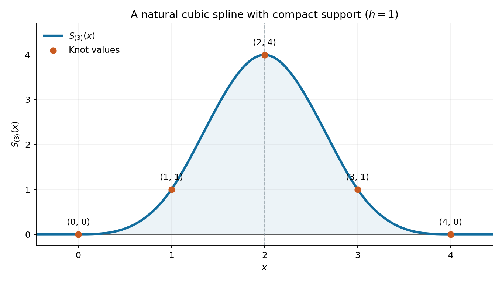

<h1 id="p/p4/c/solution">Solution</h1>

↑ **Parent:** [C](../c.md)

The finite sum of truncated cubes is $C^2$ by part (b) and is cubic on each [knot](../../../../../knot.md) [interval](../../../../../interval-mathematics.md). For $x\leq0$, every term vanishes. For $x\geq4h$, every truncated power equals its ordinary [polynomial](../../../../../polynomial-split.md), so part (a) applied to $P(x)=x^3$ gives

$$
S_{(3)}(x)=\sum_{k=0}^4(-1)^k\binom4k(x-kh)^3=Q_{(4)}(x)=0.
$$

It is therefore zero on both exterior [intervals](../../../../../interval-mathematics.md). Its $C^2$ regularity makes the endpoint second [derivatives](../../../../../derivative.md) zero too, proving naturality.

Evaluation at the five [knots](../../../../../knot.md) gives

$$
\boxed{\bigl(S_{(3)}(0),S_{(3)}(h),S_{(3)}(2h),S_{(3)}(3h),S_{(3)}(4h)\bigr)=h^3(0,1,4,1,0).}
$$

For example the three interior values in units of $h^3$ are $1$, $8-4=4$, and $27-4\cdot8+6=1$. At $4h$ the cancellation is $64-4\cdot27+6\cdot8-4=0$.

For $h=1$ an explicit graph description is

$$
S_{(3)}(x)=\begin{cases}
0,&x\leq0\text{ or }x\geq4,\\
x^3,&0\leq x\leq1,\\
4-6(x-2)^2+3|x-2|^3,&1\leq x\leq3,\\
(4-x)^3,&3\leq x\leq4.
\end{cases}
$$

It is symmetric about $x=2$, increases from zero to its maximum four at the [centre](../../../../../center-geometry.md), and decreases symmetrically back to zero. It joins the zero tails with zero first and second [derivatives](../../../../../derivative.md).

**[Figure 1](#p/p4/c/image-a-compactly-supported-natural-cubic-spline-with-knot-values-zero-one-four-one-zero). A compactly supported natural cubic spline with knot values zero, one, four, one, zero**. The original plot uses the truncated-power formula for h equal to one. The maximum is four at x equal to two; both tails and the first two endpoint derivatives are zero.

## ↑ Ancestors (13)

1. [C](../c.md)
2. [P4](../../p4.md)
3. [P](../../../p.md)
4. [2012](../../../../2012-split.md)
5. [Past exam of the options II course of the University of Oxford](../../../../split.md)
6. [Options II course of the University of Oxford](../../../../../options-ii-course-of-the-university-of-oxford.md)
7. [Year 2 of the mathematics course of the University of Oxford](../../../../../year-2-of-the-mathematics-course-of-the-university-of-oxford.md)
8. [Mathematics course of the University of Oxford](../../../../../mathematics-course-of-the-university-of-oxford.md)
9. [Undergraduate course of the University of Oxford](../../../../../undergraduate-course-of-the-university-of-oxford.md)
10. [Course of the University of Oxford](../../../../../course-of-the-university-of-oxford.md)
11. [University of Oxford](../../../../../university-of-oxford-split.md)
12. [List of universities](../../../../../list-of-universities.md)
13. [Codex Wiki](../../../../../split.md)
