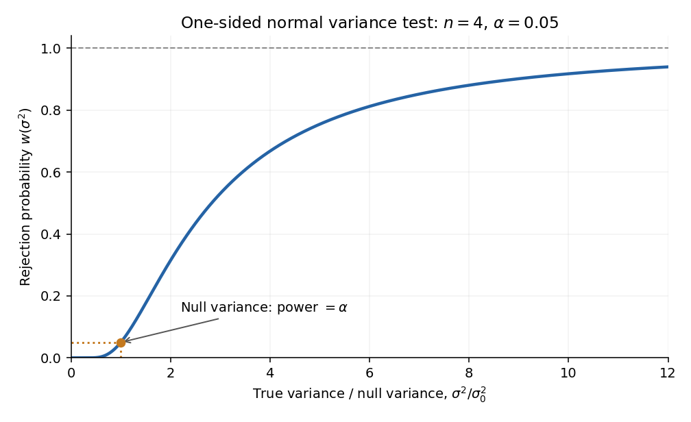

<h1 id="o4/e/solution">Solution</h1>

↑ **Parent:** [E](../e.md)

At a true [variance](../../../../variance-split.md) $\sigma^2>0$, $S/\sigma^2\sim\chi_n^2$. Therefore the [power function](../../../../power-function-of-a-statistical-test.md) is

$$
\boxed{w(\sigma^2)=1-F_n\left(\frac{\sigma_0^2}{\sigma^2}F_n^{-1}(1-\alpha)\right).}
$$

The argument of $F_n$ decreases as $\sigma^2$ increases. Since the chi-squared density is positive on the positive half-line, the power is continuous and strictly increasing, with

$$
\boxed{w(0^+)=0,\qquad w(\sigma_0^2)=\alpha,\qquad w(\infty)=1.}
$$

These features determine the requested rough sketch. The curve passes through the size at the null value and approaches one for very large [variance](../../../../variance-split.md).

**[Figure 1](#o4/e/image-power-rises-from-zero-through-the-test-size-to-one-as-the-variance-increases). Power rises from zero through the test size to one as the variance increases**. Original illustrative power curve for n=4 and alpha=0.05, plotted against the ratio of the true [variance](../../../../variance-split.md) to the null [variance](../../../../variance-split.md). The marked point has ratio one and power alpha.

## ↑ Ancestors (12)

1. [E](../e.md)
2. [O4](../../o4.md)
3. [2013](../../../2013-split.md)
4. [Past exam of the options II course of the University of Oxford](../../../split.md)
5. [Options II course of the University of Oxford](../../../../options-ii-course-of-the-university-of-oxford.md)
6. [Year 2 of the mathematics course of the University of Oxford](../../../../year-2-of-the-mathematics-course-of-the-university-of-oxford.md)
7. [Mathematics course of the University of Oxford](../../../../mathematics-course-of-the-university-of-oxford.md)
8. [Undergraduate course of the University of Oxford](../../../../undergraduate-course-of-the-university-of-oxford.md)
9. [Course of the University of Oxford](../../../../course-of-the-university-of-oxford.md)
10. [University of Oxford](../../../../university-of-oxford-split.md)
11. [List of universities](../../../../list-of-universities.md)
12. [Codex Wiki](../../../../split.md)
