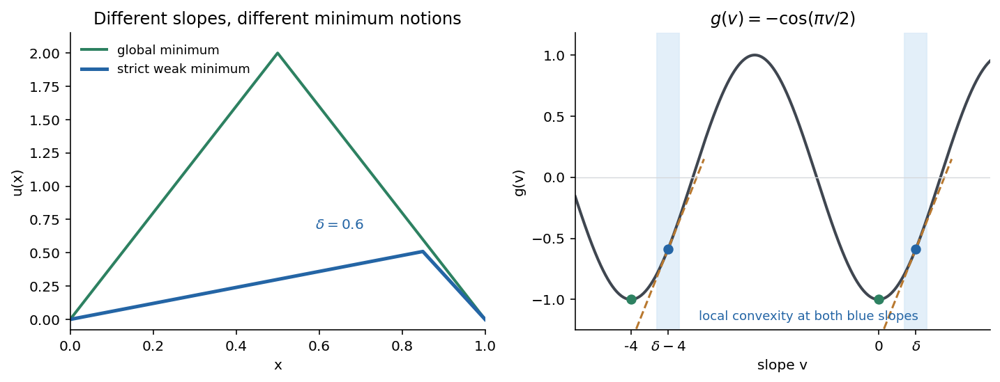

# 2007

↑ **Parent:** [Past exam of the partial differential equations for pure and applied mathematicians and calculus of variations course of the University of Oxford](../past-exam-of-the-partial-differential-equations-for-pure-and-applied-mathematicians-and-calculus-of-variations-course-of-the-university-of-oxford.md)

**Table of contents**

- [A](#a)
  - [1](#a/1)
    - [Solution](#a/1/solution)
  - [2](#a/2)
    - [Solution](#a/2/solution)
  - [3](#a/3)
    - [Solution](#a/3/solution)
  - [4](#a/4)
    - [Solution](#a/4/solution)
- [B](#b)
  - [5](#b/5)
    - [a](#b/5/a)
      - [i](#b/5/a/i)
        - [Solution](#b/5/a/i/solution)
      - [ii](#b/5/a/ii)
        - [Solution](#b/5/a/ii/solution)
      - [iii](#b/5/a/iii)
        - [Solution](#b/5/a/iii/solution)
    - [b](#b/5/b)
      - [i](#b/5/b/i)
        - [Solution](#b/5/b/i/solution)
      - [ii](#b/5/b/ii)
        - [Solution](#b/5/b/ii/solution)
  - [6](#b/6)
    - [a](#b/6/a)
      - [Solution](#b/6/a/solution)
    - [b](#b/6/b)
      - [i](#b/6/b/i)
        - [Solution](#b/6/b/i/solution)
      - [iii](#b/6/b/iii)
        - [Solution](#b/6/b/iii/solution)
  - [7](#b/7)
    - [a](#b/7/a)
      - [i](#b/7/a/i)
        - [Solution](#b/7/a/i/solution)
      - [ii](#b/7/a/ii)
        - [Solution](#b/7/a/ii/solution)
      - [iii](#b/7/a/iii)
        - [Solution](#b/7/a/iii/solution)
    - [b](#b/7/b)
      - [i](#b/7/b/i)
        - [Solution](#b/7/b/i/solution)
      - [ii](#b/7/b/ii)
        - [Solution](#b/7/b/ii/solution)
      - [iii](#b/7/b/iii)
        - [Solution](#b/7/b/iii/solution)
  - [8](#b/8)
    - [a](#b/8/a)
      - [i](#b/8/a/i)
        - [Solution](#b/8/a/i/solution)
      - [ii](#b/8/a/ii)
        - [Solution](#b/8/a/ii/solution)
      - [iii](#b/8/a/iii)
        - [Solution](#b/8/a/iii/solution)
    - [b](#b/8/b)
      - [Solution](#b/8/b/solution)

## A

↑ **Parent:** [2007](2007.md)

<h3 id="a/1">1</h3>

↑ **Parent:** [A](#a)

<h4 id="a/1/solution">Solution</h4>

↑ **Parent:** [1](#a/1)

[Weak convergence](../weak-topology.md#weak-convergence) means $\ell(u_j)\to\ell(u)$ for every [bounded linear functional](../topological-vector-space.md#continuous-linear-functional) $\ell\in X^*$. [Norm convergence](../normed-vector-space.md#norm-convergence) implies this by $|\ell(u_j-u)|\leq\|\ell\|\|u_j-u\|$. The converse fails for coordinate unit vectors in $\ell^2$: their [norms](../normed-vector-space.md#norm) are one, but pairing with any square-summable [sequence](../sequence-and-series.md#sequence) tends to zero, so they are weakly null.

For the [subsequence](../sequence-and-series.md#subsequence) assertion apply [Gram-Schmidt process](../inner-product.md#gram-schmidt-process) to a countable dense subset to choose a countable [orthonormal basis](../inner-product.md#orthonormal-basis) $(e_m)$ of the [separable Hilbert space](../hilbert-space.md#separable-hilbert-space) and a bound $M$ for the [sequence](../sequence-and-series.md#sequence). Repeated [subsequence](../sequence-and-series.md#subsequence) selection and diagonalization make every coefficient $\langle u_{j_k},e_m\rangle$ converge to a scalar $a_m$. [Bessel inequality](../hilbert-space.md#bessel-s-inequality) gives $\sum_{m=1}^N|a_m|^2\leq M^2$ for every $N$, so $u=\sum_ma_me_m$ exists in $H$ with [norm](../normed-vector-space.md#norm) at most $M$. Pairings with finite [linear combinations](../vector-space.md#linear-combination) of the basis converge. Approximating any other test vector by such combinations and using the common [norm](../normed-vector-space.md#norm) bound proves **$u_{j_k}\rightharpoonup u$**. The finite-dimensional case uses the same argument with a finite basis.

Apply this to every [subsequence](../sequence-and-series.md#subsequence) of the bounded $L^2$ [sequence](../sequence-and-series.md#sequence). Any [weakly convergent](../weak-topology.md#weak-convergence) further [subsequence](../sequence-and-series.md#subsequence) has limit $v$ with $\int_a^bv=0$, since interval indicators are $L^2$ tests. The permitted fact gives $v=0$ almost everywhere. If the whole [sequence](../sequence-and-series.md#sequence) failed to converge weakly to zero, some fixed test functional and [subsequence](../sequence-and-series.md#subsequence) would stay a positive distance from zero. Its [weakly convergent](../weak-topology.md#weak-convergence) further [subsequence](../sequence-and-series.md#subsequence) would then contradict the preceding conclusion. Thus **the entire [sequence](../sequence-and-series.md#sequence) converges weakly to zero in $L^2(0,1)$**.

<h3 id="a/2">2</h3>

↑ **Parent:** [A](#a)

<h4 id="a/2/solution">Solution</h4>

↑ **Parent:** [2](#a/2)

The first [weak derivative](../distribution-theory.md#weak-derivative) $D_ju=v$ is characterized by $\int_\Omega u\,\partial_j\phi=-\int_\Omega v\phi$ for every $\phi\in C_c^\infty(\Omega)$. The [fundamental lemma of the calculus of variations](../calculus-of-variations.md#fundamental-lemma-of-the-calculus-of-variations) in the locally integrable form says that a [function](../function.md) pairing to zero with every such test is zero almost everywhere. Applied to the difference of two candidate derivatives, it proves uniqueness. The [Sobolev space](../sobolev-space.md) consists of $u\in L^p$ with all first [weak derivatives](../distribution-theory.md#weak-derivative) in $L^p$, with [norm](../normed-vector-space.md#norm)

$$
\boxed{\|u\|_{W^{1,p}}=\left(\|u\|_p^p+\sum_{j=1}^n\|D_ju\|_p^p\right)^{1/p}.}
$$

For the one-dimensional tent, [integration by parts](../calculus.md#integration-by-parts) on each side of one has cancelling junction terms because the [function](../function.md) is continuous. Thus **$u'=1$ on $(0,1)$ and $u'=-1$ on $(1,2)$**, almost everywhere. Both it and its derivative are bounded, so it belongs to every stated [Sobolev space](../sobolev-space.md); its displayed [norm](../normed-vector-space.md#norm) to the power $p$ is $2/(p+1)+2$.

For $u=x_1/r$ in the punctured ball, ordinary differentiation gives

$$
\boxed{D_ju=\delta_{1j}/r-x_1x_j/r^3.}
$$

The [function](../function.md) is bounded and $|D_ju|\leq2/r$, so polar integration gives finite derivative $L^p$ [norms](../normed-vector-space.md#norm) when $\int_0^1r^{n-1-p}dr<\infty$, namely $p<n$. To verify these are [weak derivatives](../distribution-theory.md#weak-derivative) across the origin, integrate by parts outside a ball of radius $\varepsilon$ against a compactly supported smooth test. The inner boundary term is at most a fixed constant times $\varepsilon^{n-1}$, since $u$ is bounded. It tends to zero for $n>1$. The volume terms converge by local integrability of the displayed derivative. Thus **$u\in W^{1,p}(B)$ for $1\leq p<n$ with exactly these derivatives**. Its value at the origin can be chosen arbitrarily.

<h3 id="a/3">3</h3>

↑ **Parent:** [A](#a)

<h4 id="a/3/solution">Solution</h4>

↑ **Parent:** [3](#a/3)

Bounded coefficients and Cauchy-Schwarz give $|B[u,v]|\leq C\|u\|_{H^1}\|v\|_{H^1}$. [Uniform ellipticity](../elliptic-boundary-value-problem.md#uniformly-elliptic-operator) gives $B[u,u]\geq\theta\|Du\|_2^2$ because $c\geq0$. [Poincaré inequality](../sobolev-space.md#poincare-inequality) $\|u\|_2\leq C_P\|Du\|_2$ holds on $H_0^1$ of a bounded domain, so

$$
\boxed{B[u,u]\geq\nu\|u\|_{H^1}^2,\qquad\nu=\theta/(1+C_P^2)>0.}
$$

A [weak solution](../partial-differential-equation.md#weak-solution) is $u\in H_0^1$ satisfying $B[u,\phi]=\int f\phi$ for every $\phi\in H_0^1$. The energy is finite by boundedness of $B$ and the forcing functional, and

$$
I(v)\geq\frac\nu2\|v\|_{H^1}^2-\|f\|_2\|v\|_{H^1}\geq\frac\nu4\|v\|_{H^1}^2-C_f.
$$

It is bounded below and a [minimizing sequence](../calculus-of-variations.md#minimizing-sequence) is bounded in the [Hilbert space](../hilbert-space.md) $H_0^1$. Its [closed linear span](../vector-space.md#closed-linear-span) is [separable](../topology.md#separable-topological-space), so part 1 supplies a [weakly convergent](../weak-topology.md#weak-convergence) [subsequence](../sequence-and-series.md#subsequence) with limit $u$. Symmetry and nonnegativity of $B$ show

$$
B[v_j,v_j]=B[u,u]+2B[u,v_j-u]+B[v_j-u,v_j-u]\geq B[u,u]+o(1).
$$

The forcing term converges by [weak convergence](../weak-topology.md#weak-convergence). Thus $I(u)\leq\liminf I(v_j)$, proving attainment. [First variation](../calculus-of-variations.md#first-variation) in every zero-trace direction gives the weak equation. If $u,w$ are two solutions, test their difference equation with $u-w$ and use coercivity to get $u=w$. Hence **there is exactly one [weak solution](../partial-differential-equation.md#weak-solution), and it is the unique energy minimizer**. Indeed $I(v)-I(u)=\tfrac12B[v-u,v-u]$ directly verifies the minimizing property.

<h3 id="a/4">4</h3>

↑ **Parent:** [A](#a)

<h4 id="a/4/solution">Solution</h4>

↑ **Parent:** [4](#a/4)

The [spectral theorem for compact self-adjoint operators](../compact-operator.md#spectral-theorem-for-compact-hermitian-operators) used here concerns a compact [self-adjoint operator](../linear-operator-theory.md#self-adjoint-operator): its nonzero [eigenvalues](../linear-operator-theory.md#eigenvalue) are real, have finite multiplicity and can accumulate only at zero; the orthogonal complement of its kernel is the closed span of its orthonormal eigenvectors. Self-adjointness is essential for this eigenbasis statement.

Let $Kf$ be the unique zero-parameter [weak solution](../partial-differential-equation.md#weak-solution). Uniqueness gives linearity. Testing with $Kf$ and using coercivity gives $\|Kf\|_{H^1}\leq\nu^{-1}\|f\|_2$. The [Rellich-Kondrachov theorem](../sobolev-space.md#rellich-kondrachov-theorem) makes the embedding $H_0^1(\Omega)\hookrightarrow L^2(\Omega)$ compact on this bounded $C^1$ domain, so $K$ is compact on $L^2$. Symmetry gives

$$
\langle Kf,g\rangle=B[Kg,Kf]=\langle f,Kg\rangle.
$$

It is self-adjoint and positive. It is injective: if $Kf=0$, the weak equation pairs $f$ to zero with all $H_0^1$ tests, dense in $L^2$, so $f=0$. Moreover $\langle Kf,f\rangle=B[Kf,Kf]>0$ for $f\ne0$.

The parameter equation is equivalent to $u=K(f+\lambda u)$, that is

$$
\boxed{u-\lambda Ku=Kf.}
$$

A solution of this operator equation in $L^2$ lies in $H_0^1$, because its right-side representation is $K(f+\lambda u)$, and the equivalence follows in both directions. For $\lambda\leq0$, the form $B[u,v]-\lambda\langle u,v\rangle$ remains coercive; the preceding minimization argument gives a unique [weak solution](../partial-differential-equation.md#weak-solution).

The [spectral theorem](../hilbert-space.md#spectral-theorem) now supplies a complete [orthonormal basis](../inner-product.md#orthonormal-basis) $(\phi_j)$ of $L^2$ with $K\phi_j=\kappa_j\phi_j$, $\kappa_j>0$, and $\kappa_j\to0$. The elliptic [eigenvalues](../linear-operator-theory.md#eigenvalue) are $\lambda_j=1/\kappa_j>0$, with finite multiplicity and tending to infinity, and $L\phi_j=\lambda_j\phi_j$ weakly. If $\lambda$ is not one of them, then

$$
\boxed{u=\sum_j\frac{\langle f,\phi_j\rangle}{\lambda_j-\lambda}\phi_j.}
$$

This converges even in $H_0^1$: its squared energy [norm](../normed-vector-space.md#norm) is $\sum_j\lambda_j|\langle f,\phi_j\rangle|^2/|\lambda_j-\lambda|^2$, finite because the multiplier is bounded over $j$. Partial sums solve the weak equation with the corresponding $L^2$ projections of $f$. Passing to the limit proves the equation for every test; the same coefficients force uniqueness. Thus the expansion represents **the unique [weak solution](../partial-differential-equation.md#weak-solution) away from the elliptic [eigenvalues](../linear-operator-theory.md#eigenvalue)**.

## B

↑ **Parent:** [2007](2007.md)

<h3 id="b/5">5</h3>

↑ **Parent:** [B](#b)

<h4 id="b/5/a">a</h4>

↑ **Parent:** [5](#b/5)

<h5 id="b/5/a/i">i</h5>

↑ **Parent:** [A](#b/5/a)

<h6 id="b/5/a/i/solution">Solution</h6>

↑ **Parent:** [I](#b/5/a/i)

Use $\|w\|_{W^{1,\infty}}=\|w\|_\infty+\|w'\|_\infty$. Fix $u$. For $w$ small, all triples $(x,u+tw,u'+tw')$, $0\leq t\leq1$, lie in a fixed [compact set](../topology.md#compact-space) up to null sets. The continuous derivatives $f_u,f_v$ are uniformly continuous there, with a modulus $\omega(s)\to0$ as $s\to0$. The integral form of the mean-value expansion gives a remainder bounded by

$$
(b-a)\omega(\|w\|_{W^{1,\infty}})(\|w\|_\infty+\|w'\|_\infty).
$$

The proposed linear derivative is bounded because its coefficient [functions](../function.md) are bounded on that [compact set](../topology.md#compact-space). The remainder is little-oh of the [norm](../normed-vector-space.md#norm), proving [Fréchet differentiability](../multivariable-calculus.md#frechet-differentiability) and

$$
\boxed{DI(u)w=\int_a^b[f_v(x,u,u')w'+f_u(x,u,u')w]dx.}
$$

The derivative $u'$ only needs to exist almost everywhere; the uniform compact-range bound handles its measurable representative.

<h5 id="b/5/a/ii">ii</h5>

↑ **Parent:** [A](#b/5/a)

<h6 id="b/5/a/ii/solution">Solution</h6>

↑ **Parent:** [Ii](#b/5/a/ii)

Put $w=t\phi$ into the differentiability expansion. The remainder is $o(|t|\|\phi\|)$, so division by $t$ and passage to zero gives **$g'(0)=DI(u)\phi$**. For $\phi=0$ this is immediate as well.

<h5 id="b/5/a/iii">iii</h5>

↑ **Parent:** [A](#b/5/a)

<h6 id="b/5/a/iii/solution">Solution</h6>

↑ **Parent:** [Iii](#b/5/a/iii)

For a zero-trace $\phi$, the curve $u+t\phi$ remains admissible. When $|t|$ is small it is within the weak-minimum neighborhood in $W^{1,\infty}$, so its scalar energy has a minimum at zero. The preceding derivative therefore vanishes. Thus **$DI(u)\phi=0$ for every zero-trace variation**.

<h4 id="b/5/b">b</h4>

↑ **Parent:** [5](#b/5)

<h5 id="b/5/b/i">i</h5>

↑ **Parent:** [B](#b/5/b)

<h6 id="b/5/b/i/solution">Solution</h6>

↑ **Parent:** [I](#b/5/b/i)

The [first variation](../calculus-of-variations.md#first-variation) is

$$
DI(u)\phi=\int_0^1x^2(u'\phi+u\phi')dx=\int_0^1x^2(u\phi)'dx=-\int_0^12xu\phi\,dx.
$$

The endpoint terms vanish. The [fundamental lemma of the calculus of variations](../calculus-of-variations.md#fundamental-lemma-of-the-calculus-of-variations) gives $xu=0$ almost everywhere, hence $u=0$ on $(0,1)$. A Lipschitz representative is then identically zero and cannot have terminal value one. Therefore **there are no admissible solutions of the stationarity equation**.

<h5 id="b/5/b/ii">ii</h5>

↑ **Parent:** [B](#b/5/b)

<h6 id="b/5/b/ii/solution">Solution</h6>

↑ **Parent:** [Ii](#b/5/b/ii)

Stationarity says $\int(2u'\phi'+\phi)=0$, or $2u''=1$ in [distributions](../distribution-theory.md#distribution-mathematical-analysis). Integrating gives $u=x^2/4+Cx+D$. The endpoint values force $D=0$ and $C=3/4$. Conversely this polynomial satisfies the first-variation identity for every zero-trace variation. Thus **the only solution is $u(x)=(x^2+3x)/4$**.

<h3 id="b/6">6</h3>

↑ **Parent:** [B](#b)

<h4 id="b/6/a">a</h4>

↑ **Parent:** [6](#b/6)

<h5 id="b/6/a/solution">Solution</h5>

↑ **Parent:** [A](#b/6/a)

Along the reference curve put $p=f_{vv}$, $r=f_{uv}$, $s=f_{uu}$. The [second variation](../calculus-of-variations.md#second-variation) is

$$
q(\phi)=\delta^2I(\bar u)[\phi,\phi]=\int_a^b(p\phi'^2+2r\phi\phi'+s\phi^2)dx.
$$

Strict positivity means $q(\phi)>0$ for every nonzero zero-trace variation. Under the given regular Legendre condition $p>0$, the no-conjugate-point criterion also supplies a uniform coercive lower bound. The [Jacobi equation](../calculus-of-variations.md#jacobi-equation) is $-(pz'+rz)'+rz'+sz=0$. A point $c>a$ is conjugate to $a$ when a nonzero solution vanishes at both $a$ and $c$. In this regular setting, absence of [conjugate points](../riemannian-geometry.md#conjugate-points) in $(a,b]$ is equivalent to existence of a Jacobi solution positive throughout $[a,b]$.

Choose such a positive solution $z$. The given square identity extends from smooth compactly supported variations to $H_0^1$ by density and boundedness of its coefficients. With $v=\phi/z$ it reads $q(\phi)=\int pz^2v'^2$. The positive minima of $p,z$ bound this below by $c\|v'\|_2^2$. A zero-trace [function](../function.md) obeys $\|v\|_2\leq C\|v'\|_2$, while $\phi'=zv'+z'v$ and $\phi=zv$ give $\|\phi\|_{H^1}\leq C_1\|v'\|_2$. Consequently

$$
\boxed{q(\phi)\geq c_1\|\phi\|_{H^1}^2>0\quad(\phi\ne0).}
$$

In particular the required [second variation](../calculus-of-variations.md#second-variation) is positive for all nonzero Lipschitz zero-trace variations.

<h4 id="b/6/b">b</h4>

↑ **Parent:** [6](#b/6)

<h5 id="b/6/b/i">i</h5>

↑ **Parent:** [B](#b/6/b)

<h6 id="b/6/b/i/solution">Solution</h6>

↑ **Parent:** [I](#b/6/b/i)

The [Jacobi equation](../calculus-of-variations.md#jacobi-equation) is $z''+\lambda^2z=0$. For $|\lambda|<\pi$ the [function](../function.md) $z=\cos(\lambda(x-1/2))$ is positive on the closed interval. The preceding square identity gives

$$
I(u)=\int_0^1z^2[(u/z)']^2dx,
$$

with $z=1$ if $\lambda=0$. As in part (a), its positive minimum and bounded derivative provide a constant $\gamma>0$ with $I(u)\geq\gamma\|u\|_{H^1}^2$. The [second variation](../calculus-of-variations.md#second-variation) at zero is $2I$, so is positive, and **zero is the unique [global minimizer](../analysis.md#global-minimizer)**.

For a fixed zero-trace $u$, positivity of $\int u'^2-\lambda^2\int u^2$ for all $\lambda^2<\pi^2$ gives, by letting $\lambda^2\uparrow\pi^2$,

$$
\boxed{\int_0^1u'^2\geq\pi^2\int_0^1u^2.}
$$

This derivation did not assume the sharp inequality in advance. For equality, the nonnegative quadratic form $Q(u)=\int(u'^2-\pi^2u^2)$ has $Q(u)=0$. Expanding $Q(u+t\phi)\geq0$ for both signs of $t$ forces $\int u'\phi'-\pi^2u\phi=0$ for every test. Thus $u''+\pi^2u=0$, and the zero endpoint values give **exactly $u(x)=C\sin(\pi x)$**, including $C=0$. These [functions](../function.md) do give equality.

<h5 id="b/6/b/iii">iii</h5>

↑ **Parent:** [B](#b/6/b)

<h6 id="b/6/b/iii/solution">Solution</h6>

↑ **Parent:** [Iii](#b/6/b/iii)

Take $u_t(x)=t\sin(\pi x)$. It is admissible and

$$
I(u_t)=\frac{t^2}2(\pi^2-\lambda^2)\longrightarrow-\infty
$$

when $\lambda^2>\pi^2$. Hence **the infimum is minus infinity**. The roman label (iii) is retained exactly as printed.

<h3 id="b/7">7</h3>

↑ **Parent:** [B](#b)

<h4 id="b/7/a">a</h4>

↑ **Parent:** [7](#b/7)

<h5 id="b/7/a/i">i</h5>

↑ **Parent:** [A](#b/7/a)

<h6 id="b/7/a/i/solution">Solution</h6>

↑ **Parent:** [I](#b/7/a/i)

A [weak local minimizer of a variational integral](../calculus-of-variations.md#weak-local-minimizer-of-a-variational-integral) has some $\rho>0$ for which $I(v)\geq I(\bar u)$ whenever $v$ is admissible and $\|v-\bar u\|_{W^{1,\infty}}<\rho$.

<h5 id="b/7/a/ii">ii</h5>

↑ **Parent:** [A](#b/7/a)

<h6 id="b/7/a/ii/solution">Solution</h6>

↑ **Parent:** [Ii](#b/7/a/ii)

A [strong local minimizer of a variational integral](../calculus-of-variations.md#strong-local-minimizer-of-a-variational-integral) has the same property for all admissible $v$ with $\|v-\bar u\|_\infty<\rho$; its derivative need not be close. Since the supremum [norm](../normed-vector-space.md#norm) is bounded by the Sobolev [norm](../normed-vector-space.md#norm), this neighborhood contains a sufficiently small weak neighborhood. Thus **every strong local minimizer is a [weak local minimizer of a variational integral](../calculus-of-variations.md#weak-local-minimizer-of-a-variational-integral)**.

<h5 id="b/7/a/iii">iii</h5>

↑ **Parent:** [A](#b/7/a)

<h6 id="b/7/a/iii/solution">Solution</h6>

↑ **Parent:** [Iii](#b/7/a/iii)

A [global minimizer](../analysis.md#global-minimizer) satisfies $I(\bar u)\leq I(v)$ for every admissible $v$.

A [point of convexity](../real-analysis.md#point-of-convexity) $s$ of a differentiable scalar [function](../function.md) is one where its tangent supports the entire graph: $g(q)\geq g(s)+g'(s)(q-s)$ for every $q\in\mathbb R$. The [Weierstrass necessary condition](../calculus-of-variations.md#weierstrass-necessary-condition) for strong minimality, under its differentiability assumptions in the slope variable, is

$$
f(x,\bar u,q)-f(x,\bar u,\bar u')-f_v(x,\bar u,\bar u')(q-\bar u')\geq0\quad(q\in\mathbb R)
$$

for almost every $x$. In other words the reference slope is a [point of convexity](../real-analysis.md#point-of-convexity) of the slope integrand. The later example is smooth, so these derivative-based conditions apply there.

<h4 id="b/7/b">b</h4>

↑ **Parent:** [7](#b/7)

<h5 id="b/7/b/i">i</h5>

↑ **Parent:** [B](#b/7/b)

<h6 id="b/7/b/i/solution">Solution</h6>

↑ **Parent:** [I](#b/7/b/i)

Write $g(v)=-\cos(\pi v/2)$. For the stipulated $0<\delta<1$, the displayed tent is continuous at its junction, has zero endpoint values, and its slopes are $\delta$ and $\delta-4$. At both slopes $g'$ has the same value $c=(\pi/2)\sin(\pi\delta/2)>0$, and $g''=(\pi^2/4)\cos(\pi v/2)$ is strictly positive on common sufficiently small neighborhoods of them. [Taylor's theorem](../calculus.md#taylor-s-theorem) gives, for small $\|\phi'\|_\infty$,

$$
I(u^\delta+\phi)-I(u^\delta)\geq c\int_0^1\phi'+c_0\int_0^1\phi'^2=c_0\int_0^1\phi'^2.
$$

Thus **$u^\delta$ is a strict [weak local minimizer of a variational integral](../calculus-of-variations.md#weak-local-minimizer-of-a-variational-integral)**. It is not a [strong local minimizer of a variational integral](../calculus-of-variations.md#strong-local-minimizer-of-a-variational-integral): the global supporting-tangent requirement at either slope has nonzero slope $c$, whereas $g$ is bounded. Letting the trial slope tend to positive infinity violates that requirement. The [Weierstrass necessary condition](../calculus-of-variations.md#weierstrass-necessary-condition) therefore fails.

The opening parameter range $\delta\in(0,1)$ is essential. The subsequent phrase “for each $\delta>0$” must be read within it; taken literally beyond that range it is false. At $\delta=2$ the tent slopes are $2,-2$, where $g=1$ and $g''<0$, so this is not a weak minimum.

<h5 id="b/7/b/ii">ii</h5>

↑ **Parent:** [B](#b/7/b)

<h6 id="b/7/b/ii/solution">Solution</h6>

↑ **Parent:** [Ii](#b/7/b/ii)

If $u$ is a [strong local minimizer of a variational integral](../calculus-of-variations.md#strong-local-minimizer-of-a-variational-integral), the Weierstrass condition makes $u'(x)$ a [point of convexity](../real-analysis.md#point-of-convexity) of the bounded [function](../function.md) $g$ for almost every $x$. A global supporting line to a bounded [function](../function.md) must have zero slope, and its contact value must be a [global minimum](../analysis.md#global-minimum). Here that value is $-1$. Therefore $g(u')=-1$ almost everywhere and $I(u)=-1$, while every admissible energy is at least $-1$. Hence **every strong local minimizer is global**.

<h5 id="b/7/b/iii">iii</h5>

↑ **Parent:** [B](#b/7/b)

<h6 id="b/7/b/iii/solution">Solution</h6>

↑ **Parent:** [Iii](#b/7/b/iii)

For every positive integer $n$, set $u_n(x)=4n\min\{x,1-x\}$. Its slopes are $4n,-4n$ almost everywhere, both giving $g=-1$. Hence $I(u_n)=-1$, the universal lower bound, and these tents are all distinct. Thus **there are infinitely many global minimizers**. Zero is another one.

**[Figure 1](#b/7/b/iii/image-weak-and-global-minima-of-a-periodic-slope-energy). Weak and global minima of a periodic slope energy**.

<h3 id="b/8">8</h3>

↑ **Parent:** [B](#b)

<h4 id="b/8/a">a</h4>

↑ **Parent:** [8](#b/8)

<h5 id="b/8/a/i">i</h5>

↑ **Parent:** [A](#b/8/a)

<h6 id="b/8/a/i/solution">Solution</h6>

↑ **Parent:** [I](#b/8/a/i)

Superlinearity and [continuity](../calculus.md#continuous-function) make $\Phi$ bounded below by a finite constant $M$. Consequently **$I(u)\geq M(b-a)$ for every admissible [function](../function.md)**. The affine endpoint interpolant has finite energy by [continuity](../calculus.md#continuous-function) on its compact range, so the infimum is finite. Some other admissible energies can be infinite; this does not affect the bounded-below or minimizing-[sequence](../sequence-and-series.md#sequence) argument.

<h5 id="b/8/a/ii">ii</h5>

↑ **Parent:** [A](#b/8/a)

<h6 id="b/8/a/ii/solution">Solution</h6>

↑ **Parent:** [Ii](#b/8/a/ii)

The [De la Vallée-Poussin criterion](../convergence-of-random-variables.md#de-la-vallee-poussin-criterion) characterizes [uniform integrability](../convergence-of-random-variables.md#uniform-integrability) by existence of a nonnegative increasing [convex function](../real-analysis.md#convex-function) $\Psi$ with $\Psi(s)/s\to\infty$ and a uniform bound on $\int\Psi(|v_j|)$. On a finite interval this gives a [weakly convergent](../weak-topology.md#weak-convergence) [subsequence](../sequence-and-series.md#subsequence) in $L^1$ by the [Dunford-Pettis theorem](../convergence-of-random-variables.md#dunford-pettis-theorem).

After discarding a finite prefix of the [minimizing sequence](../calculus-of-variations.md#minimizing-sequence) if needed, put $H(t)=\Phi(t)-M\geq0$. Its derivative [sequence](../sequence-and-series.md#sequence) has $\int H(u_j')\leq C$. The superlinear bound directly gives [uniform integrability](../convergence-of-random-variables.md#uniform-integrability): for $H(t)\geq A|t|$ outside $[-R_A,R_A]$,

$$
\int_E|u_j'|\leq R_A|E|+C/A.
$$

If the convex version of the criterion is used, choose increasing $R_m\to\infty$ so $H(t)\geq m^2|t|$ for $|t|\geq R_m$, and set $\Psi(s)=\sum_{m\geq1}(s-R_m)_+$. This is locally a finite sum, convex and increasing. It is superlinear because for fixed $N$ and $s\geq2R_N$, $\Psi(s)\geq Ns/2$. If exactly $m$ terms are active, $\Psi(s)\leq ms\leq H(t)$ for $s=|t|$, so its integrals have the same bound. The criterion therefore supplies $u_{j_k}'\rightharpoonup v$ in $L^1$.

Define $u(x)=\alpha+\int_a^xv$. Interval-indicator tests give $u_{j_k}(x)\to u(x)$ for every $x$, including $b$, so its endpoint values are correct and $u\in W^{1,1}$. The common derivative $L^1$ bound makes these [functions](../function.md) uniformly bounded. [Uniform integrability](../convergence-of-random-variables.md#uniform-integrability) also gives common equicontinuity, since an increment is bounded by the derivative integral on the intervening interval. The [Arzelà-Ascoli theorem](../topological-analysis.md#arzela-ascoli-theorem) yields uniform convergence to the same identified limit, and in particular

$$
\boxed{u\in\mathcal A,\quad u_{j_k}'\rightharpoonup u'\text{ in }L^1,\quad u_{j_k}\to u\text{ in }L^1.}
$$

Here the printed admissible space is $W^{1,1}$, so this [compactness](../topology.md#compact-space) argument gives precisely the needed membership.

<h5 id="b/8/a/iii">iii</h5>

↑ **Parent:** [A](#b/8/a)

<h6 id="b/8/a/iii/solution">Solution</h6>

↑ **Parent:** [Iii](#b/8/a/iii)

Write $l=\inf_{\mathcal A}I$. Since the limit is admissible, the assumed lower-semicontinuity inequality gives $l\leq I(u)\leq\liminf I(u_{j_k})=l$. Thus **$I(u)=l$ and $u$ is a [global minimizer](../analysis.md#global-minimizer)**.

The extra integrand hypothesis in the [Tonelli existence theorem](../calculus-of-variations.md#tonelli-existence-theorem) for one dimension is **[convexity](../real-analysis.md#convex-function) in the derivative variable for each fixed $(x,u)$**. Together with the stated [continuity](../calculus.md#continuous-function) and coercive lower bound it gives the lower-semicontinuity property along the uniform-[function](../function.md)/weak-derivative convergence just proved.

<h4 id="b/8/b">b</h4>

↑ **Parent:** [8](#b/8)

<h5 id="b/8/b/solution">Solution</h5>

↑ **Parent:** [B](#b/8/b)

The assumed weak-star limit is the constant $m=\theta a+(1-\theta)b$. Each integer rescaling has exactly $j$ full periods on $(0,1)$, so a change of variables on those periods gives

$$
\int_0^1f(u_j(x))dx=\theta f(a)+(1-\theta)f(b).
$$

Apply the asserted lower semicontinuity to this [sequence](../sequence-and-series.md#sequence). The integral of $f$ of its constant limit is $f(m)$, giving

$$
\boxed{f(\theta a+(1-\theta)b)\leq\theta f(a)+(1-\theta)f(b).}
$$

This holds for every real $a,b$ and $0<\theta<1$; the endpoint values of $\theta$ give equality. Therefore **$f$ is convex**.

## ↑ Ancestors (9)

1. [Past exam of the partial differential equations for pure and applied mathematicians and calculus of variations course of the University of Oxford](../past-exam-of-the-partial-differential-equations-for-pure-and-applied-mathematicians-and-calculus-of-variations-course-of-the-university-of-oxford.md)
2. [Partial differential equations for pure and applied mathematicians and calculus of variations course of the University of Oxford](../university-of-oxford.md#partial-differential-equations-for-pure-and-applied-mathematicians-and-calculus-of-variations-course-of-the-university-of-oxford)
3. [Year 4 of the mathematics course of the University of Oxford](../university-of-oxford.md#year-4-of-the-mathematics-course-of-the-university-of-oxford)
4. [Mathematics course of the University of Oxford](../university-of-oxford.md#mathematics-course-of-the-university-of-oxford)
5. [Undergraduate course of the University of Oxford](../university-of-oxford.md#undergraduate-course-of-the-university-of-oxford)
6. [Course of the University of Oxford](../university-of-oxford.md#course-of-the-university-of-oxford)
7. [University of Oxford](../university-of-oxford.md)
8. [List of universities](../README.md#list-of-universities)
9. [Codex Wiki](../README.md)
