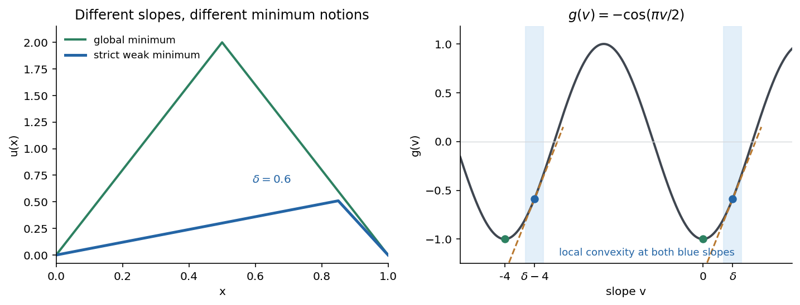

<h1 id="b/7/b/iii/solution">Solution</h1>

↑ **Parent:** [Iii](../iii.md)

For every positive integer $n$, set $u_n(x)=4n\min\{x,1-x\}$. Its slopes are $4n,-4n$ almost everywhere, both giving $g=-1$. Hence $I(u_n)=-1$, the universal lower bound, and these tents are all distinct. Thus **there are infinitely many global minimizers**. Zero is another one.

**[Figure 1](#b/7/b/iii/image-weak-and-global-minima-of-a-periodic-slope-energy). Weak and global minima of a periodic slope energy**.

## ↑ Ancestors (14)

1. [Iii](../iii.md)
2. [B](../../b.md)
3. [7](../../../7.md)
4. [B](../../../../b.md)
5. [2007](../../../../../2007-split.md)
6. [Past exam of the partial differential equations for pure and applied mathematicians and calculus of variations course of the University of Oxford](../../../../../split.md)
7. [Partial differential equations for pure and applied mathematicians and calculus of variations course of the University of Oxford](../../../../../../partial-differential-equations-for-pure-and-applied-mathematicians-and-calculus-of-variations-course-of-the-university-of-oxford.md)
8. [Year 4 of the mathematics course of the University of Oxford](../../../../../../year-4-of-the-mathematics-course-of-the-university-of-oxford.md)
9. [Mathematics course of the University of Oxford](../../../../../../mathematics-course-of-the-university-of-oxford.md)
10. [Undergraduate course of the University of Oxford](../../../../../../undergraduate-course-of-the-university-of-oxford.md)
11. [Course of the University of Oxford](../../../../../../course-of-the-university-of-oxford.md)
12. [University of Oxford](../../../../../../university-of-oxford-split.md)
13. [List of universities](../../../../../../list-of-universities.md)
14. [Codex Wiki](../../../../../../split.md)
