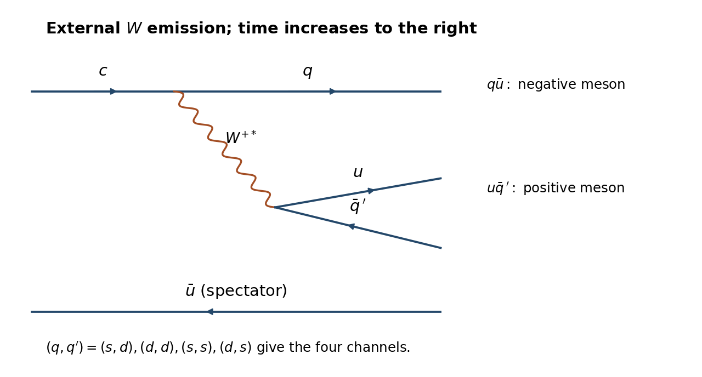

<h1 id="3/a/solution">Solution</h1>

↑ **Parent:** [A](../a.md)

The [weak charged current](../../../../../charged-current.md) spectator topology is $c\to qW^{+*}$, $W^{+*}\to u\bar q'$, with the initial $\bar u$ a spectator. The pair $q\bar u$ forms the negative [meson](../../../../../meson.md) and $u\bar q'$ the positive [meson](../../../../../meson.md). The amplitude contains $V_{cq}^*V_{uq'}$ in one common charged-current convention; complex conjugating all factors changes no rate classification. With $c_C=\cos\theta_C$ and $s_C=\sin\theta_C$, the CKM magnitudes are

$$
\begin{array}{c|c|c}
\text{mode}&(q,q')&\text{amplitude order}\\\hline
\pi^+K^-&(s,d)&c_C^2\\
\pi^+\pi^-&(d,d)&s_Cc_C\\
K^+K^-&(s,s)&s_Cc_C\\
K^+\pi^-&(d,s)&s_C^2
\end{array}.
$$

Thus **$\pi^+K^-$ is favoured, both equal-flavour pairs are singly Cabibbo suppressed, and $K^+\pi^-$ is doubly suppressed**. The corresponding parametric rate hierarchy is $1:\tan^2\theta_C:\tan^4\theta_C$ after normalizing to the favoured mode. [Cabibbo suppression](../../../../../cabibbo-suppression.md) counting alone does not rank the middle two: [phase space](../../../../../phase-space.md), different matrix elements and [hadronic final-state interactions](../../../../../hadronic-final-state-interaction.md) matter. With identical constant matrix elements, the larger [pion](../../../../../pion.md) [phase space](../../../../../phase-space.md) would favour $\pi^+\pi^-$, whereas experimentally $K^+K^-$ is faster. The empirical decreasing order is

$$
\boxed{\Gamma(\pi^+K^-) > \Gamma(K^+K^-) > \Gamma(\pi^+\pi^-) > \Gamma(K^+\pi^-)}.
$$

As a later cross-check, [HFLAV](../../../../../hflav.md)'s 2024 averages give approximately $4.00\%$, $0.411\%$, $0.149\%$ and $0.0138\%$ respectively. The exact middle ordering is an experimental input, not a consequence of the supplied masses and [Cabibbo angle](../../../../../cabibbo-angle.md) alone.[final branching-fraction average table and final doubly suppressed-mode estimate](../../../../../d0-hadronic-branching-fractions-and-final-state-radiation-by-hflav-2024.md)

**[Figure 1](#3/a/image-charm-spectator-topology). Charm spectator topology**.

## ↑ Ancestors (14)

1. [A](../a.md)
2. [3](../../3.md)
3. [Paper 1](../../../paper-1-split.md)
4. [2012](../../../split.md)
5. [Past exam of the particle and nuclear physics course of the University of Cambridge](../../../../split.md)
6. [Particle and Nuclear Physics course of the University of Cambridge](../../../../../particle-and-nuclear-physics-course-of-the-university-of-cambridge.md)
7. [Physics course of the year 3 of the natural sciences course of the University of Cambridge](../../../../../physics-course-of-the-year-3-of-the-natural-sciences-course-of-the-university-of-cambridge.md)
8. [Year 3 of the natural sciences course of the University of Cambridge](../../../../../year-3-of-the-natural-sciences-course-of-the-university-of-cambridge.md)
9. [Year of the natural sciences course of the University of Cambridge](../../../../../year-of-the-natural-sciences-course-of-the-university-of-cambridge.md)
10. [Natural sciences course of the University of Cambridge](../../../../../natural-sciences-course-of-the-university-of-cambridge.md)
11. [Course of the University of Cambridge](../../../../../course-of-the-university-of-cambridge.md)
12. [University of Cambridge](../../../../../university-of-cambridge-split.md)
13. [List of universities](../../../../../list-of-universities.md)
14. [Codex Wiki](../../../../../split.md)
