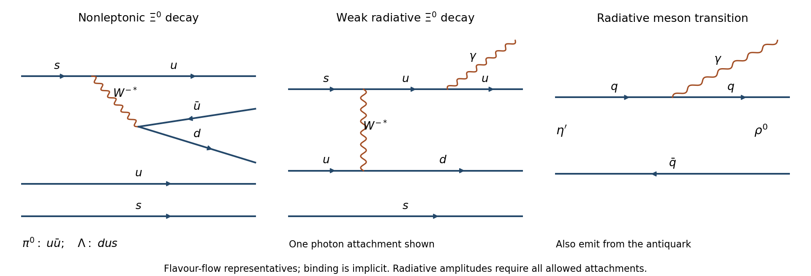

<h1 id="3/b/solution">Solution</h1>

↑ **Parent:** [B](../b.md)

The initial [strangeness](../../../../../strangeness.md) is $-2$. The $\Lambda\pi^0$ final state has [strangeness](../../../../../strangeness.md) $-1$, so its allowed nonleptonic amplitude is weak. One representative topology is $s\to uW^{-*}$ followed by $W^{-*}\to d\bar u$; spectator $u,s$ combine with the produced $d$ into the $\Lambda$, while $u\bar u$ contributes to the neutral [pion](../../../../../pion.md). The available rest [energy](../../../../../energy-split.md) is $1314.8-1115.7-135.0=64.1\,\mathrm{MeV}$.

The $\Lambda\bar K^0$ state would conserve [strangeness](../../../../../strangeness.md) and could have a strong vertex, but its threshold exceeds the parent mass by $1115.7+497.6-1314.8=298.5\,\mathrm{MeV}$. **It is kinematically forbidden.** Coupling strength cannot rescue a closed decay channel.

The radiative channel also changes [strangeness](../../../../../strangeness.md). It is a [weak radiative hyperon decay](../../../../../weak-radiative-hyperon-decay.md), not an ordinary electromagnetic decay between states of the same flavour. A representative two-quark contribution is W exchange $su\to ud$ with a [photon](../../../../../photon.md) attached to a charged line; the other allowed attachments, hadronic intermediate states and short-distance loop contributions must be included for a complete amplitude. Its extra electromagnetic coupling and hadronic dynamics suppress it relative to the nonleptonic channel. Consequently

$$
\boxed{\Gamma(\Lambda\pi^0)\gg\Gamma(\Lambda\gamma)>\Gamma(\Lambda\bar K^0)=0}.
$$

[NA48 Collaboration](../../../../../na48-collaboration.md) measured a radiative [branching fraction](../../../../../branching-fraction.md) of about $1.16\times10^{-3}$, corroborating the suppression rather than a purely electromagnetic interpretation.[abstract and branching-fraction result, 2004](../../../../../measurement-of-the-xi0-to-lambda-gamma-decay-asymmetry-and-branching-fraction-by-na48-collaboration.md)

**[Figure 2](#3/b/image-hyperon-and-radiative-meson-topologies). Hyperon and radiative meson topologies**.

## ↑ Ancestors (14)

1. [B](../b.md)
2. [3](../../3.md)
3. [Paper 1](../../../paper-1-split.md)
4. [2012](../../../split.md)
5. [Past exam of the particle and nuclear physics course of the University of Cambridge](../../../../split.md)
6. [Particle and Nuclear Physics course of the University of Cambridge](../../../../../particle-and-nuclear-physics-course-of-the-university-of-cambridge.md)
7. [Physics course of the year 3 of the natural sciences course of the University of Cambridge](../../../../../physics-course-of-the-year-3-of-the-natural-sciences-course-of-the-university-of-cambridge.md)
8. [Year 3 of the natural sciences course of the University of Cambridge](../../../../../year-3-of-the-natural-sciences-course-of-the-university-of-cambridge.md)
9. [Year of the natural sciences course of the University of Cambridge](../../../../../year-of-the-natural-sciences-course-of-the-university-of-cambridge.md)
10. [Natural sciences course of the University of Cambridge](../../../../../natural-sciences-course-of-the-university-of-cambridge.md)
11. [Course of the University of Cambridge](../../../../../course-of-the-university-of-cambridge.md)
12. [University of Cambridge](../../../../../university-of-cambridge-split.md)
13. [List of universities](../../../../../list-of-universities.md)
14. [Codex Wiki](../../../../../split.md)
