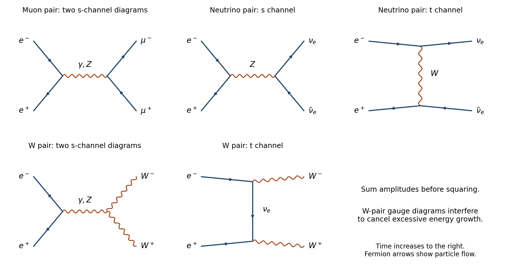

<h1 id="3/d/solution">Solution</h1>

↑ **Parent:** [D](../d.md)

For [electron-positron annihilation into a muon pair](../../../../../electron-positron-annihilation-into-a-muon-pair.md) the gauge diagrams are s-channel [photon](../../../../../photon.md) and Z exchange. For [electron-positron annihilation into electron neutrinos](../../../../../electron-positron-annihilation-into-electron-neutrinos.md) there is s-channel Z exchange and t-channel W exchange, with [interference](../../../../../interference-wave-propagation.md). For [electron-positron annihilation into W-boson pairs](../../../../../electron-positron-annihilation-into-w-boson-pairs.md) there are s-channel [photon](../../../../../photon.md) and Z diagrams and a t-channel electron-neutrino diagram. All three gauge amplitudes are required for the proper high-energy cancellation. Electron-Yukawa-suppressed s-channel Higgs diagrams can also produce the massive [muon](../../../../../muon.md) or W pair; they vanish in the usual zero-electron-mass approximation used for the leading gauge comparison.

**[Figure 3](#3/d/image-lepton-and-w-pair-gauge-diagrams). Lepton and W-pair gauge diagrams**.

There is **no energy-independent ordering**. For unpolarized beams and inclusive Born [cross sections](../../../../../cross-section-physics.md) the useful regimes are:

- Below the [muon](../../../../../muon.md) threshold only the [neutrino](../../../../../neutrino.md) channel is open, ignoring its tiny mass threshold. Immediately above $2m_\mu$, [muon](../../../../../muon.md) [phase space](../../../../../phase-space.md) initially vanishes.
- Well above $2m_\mu$ but well below the weak-boson masses, [photon](../../../../../photon.md) exchange gives $\sigma_{\mu\mu}\simeq4\pi\alpha^2/(3s)$, whereas $\sigma_{\nu_e\bar\nu_e}=O(G_F^2s)$. Hence the [muon](../../../../../muon.md) channel dominates and real W-pair production is closed.
- Near the Z pole, W pairs are still closed and the Z resonance dominates both open channels. The ratio is approximately $\Gamma(Z\to\nu_e\bar\nu_e)/\Gamma(Z\to\mu^+\mu^-)\simeq2$, from their neutral-current couplings: [neutrinos](../../../../../neutrino.md) rank above [muons](../../../../../muon.md). This is for one [neutrino](../../../../../neutrino.md) flavour.
- At $\sqrt s=2m_W\simeq160.806\,\mathrm{GeV}$ the on-shell W-pair channel opens from zero [phase space](../../../../../phase-space.md). Its position in the ordering changes across threshold and must be obtained from the summed amplitudes, rather than inferred solely from a weak/electromagnetic label.
- Far above the weak masses, forward t-channel W exchange makes the inclusive electron-neutrino [cross section](../../../../../cross-section-physics.md) approach a nonzero scale of order $g^4/m_W^2$. The W-pair [cross section](../../../../../cross-section-physics.md) behaves as $O[g^4\log(s/m_W^2)/s]$ and the [muon](../../../../../muon.md) [cross section](../../../../../cross-section-physics.md) as $O(g^4/s)$. Thus asymptotically the decreasing order is $\nu_e\bar\nu_e$, then $W^+W^-$, then $\mu^+\mu^-$. Fixed angular cuts, [beam spin polarization](../../../../../beam-spin-polarization.md) and radiative corrections modify these comparisons.

The Z-pole ratio follows $[\tfrac12]^2/[(-\tfrac12+\sin^2\theta_W)^2+\sin^4\theta_W]\simeq1.99$. Treating every weak reaction as uniformly slower misses both the resonance and forward exchange.

## ↑ Ancestors (14)

1. [D](../d.md)
2. [3](../../3.md)
3. [Paper 1](../../../paper-1-split.md)
4. [2012](../../../split.md)
5. [Past exam of the particle and nuclear physics course of the University of Cambridge](../../../../split.md)
6. [Particle and Nuclear Physics course of the University of Cambridge](../../../../../particle-and-nuclear-physics-course-of-the-university-of-cambridge.md)
7. [Physics course of the year 3 of the natural sciences course of the University of Cambridge](../../../../../physics-course-of-the-year-3-of-the-natural-sciences-course-of-the-university-of-cambridge.md)
8. [Year 3 of the natural sciences course of the University of Cambridge](../../../../../year-3-of-the-natural-sciences-course-of-the-university-of-cambridge.md)
9. [Year of the natural sciences course of the University of Cambridge](../../../../../year-of-the-natural-sciences-course-of-the-university-of-cambridge.md)
10. [Natural sciences course of the University of Cambridge](../../../../../natural-sciences-course-of-the-university-of-cambridge.md)
11. [Course of the University of Cambridge](../../../../../course-of-the-university-of-cambridge.md)
12. [University of Cambridge](../../../../../university-of-cambridge-split.md)
13. [List of universities](../../../../../list-of-universities.md)
14. [Codex Wiki](../../../../../split.md)
