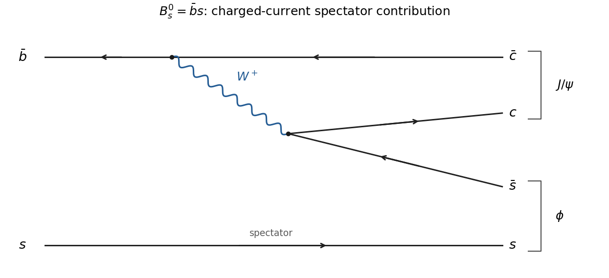

<h1 id="1/b/solution">Solution</h1>

↑ **Parent:** [B](../b.md)

For the [neutral strange B meson](../../../../../neutral-strange-b-meson.md), a charged-current tree amplitude has $\bar b\to\bar cW^+$ followed by $W^+\to c\bar s$, while the initial $s$ is a spectator. The $c\bar c$ pair forms the [J/psi meson](../../../../../j-psi-meson.md) and the $s\bar s$ pair forms the [phi meson](../../../../../phi-meson.md). Charge and [quark](../../../../../quark.md) flavour flow are conserved at each vertex except for the permitted weak flavour change. [antiquark](../../../../../antiquark.md) arrows point opposite their physical propagation direction.

**[Figure 1](#1/b/image-original-quark-level-charged-current-contribution-to-the-neutral-strange-b-meson-decay-arrows-show-fermion-flow). Original quark-level charged-current contribution to the neutral strange B-meson decay; arrows show fermion flow**.

Useful reconstruction modes are **$J/\psi\to\mu^+\mu^-$ or $e^+e^-$**, through a [virtual photon](../../../../../virtual-photon.md), and **$\phi\to K^+K^-$**, a strong decay. The latter is the largest individual $\phi$ mode, with $K_L^0K_S^0$ also important. For the $J/\psi$, the [inclusive branching fraction versus reconstruction mode](../../../../../inclusive-branching-fraction-versus-reconstruction-mode.md) distinction matters: hadronic decays dominate inclusively, principally through three [gluons](../../../../../gluon.md); each charged-lepton pair accounts for about 6%, not most decays. The charm pair lies below open-charm threshold. These distinctions are confirmed by the official particle listings.[J/psi(1S) listing, p. 2, decay modes; phi(1020) listing, p. 4, decay modes](../../../../../review-of-particle-physics-by-particle-data-group-2022.md)

## ↑ Ancestors (14)

1. [B](../b.md)
2. [1](../../1.md)
3. [Paper 1](../../../paper-1-split.md)
4. [2013](../../../split.md)
5. [Past exam of the particle and nuclear physics course of the University of Cambridge](../../../../split.md)
6. [Particle and Nuclear Physics course of the University of Cambridge](../../../../../particle-and-nuclear-physics-course-of-the-university-of-cambridge.md)
7. [Physics course of the year 3 of the natural sciences course of the University of Cambridge](../../../../../physics-course-of-the-year-3-of-the-natural-sciences-course-of-the-university-of-cambridge.md)
8. [Year 3 of the natural sciences course of the University of Cambridge](../../../../../year-3-of-the-natural-sciences-course-of-the-university-of-cambridge.md)
9. [Year of the natural sciences course of the University of Cambridge](../../../../../year-of-the-natural-sciences-course-of-the-university-of-cambridge.md)
10. [Natural sciences course of the University of Cambridge](../../../../../natural-sciences-course-of-the-university-of-cambridge.md)
11. [Course of the University of Cambridge](../../../../../course-of-the-university-of-cambridge.md)
12. [University of Cambridge](../../../../../university-of-cambridge-split.md)
13. [List of universities](../../../../../list-of-universities.md)
14. [Codex Wiki](../../../../../split.md)
