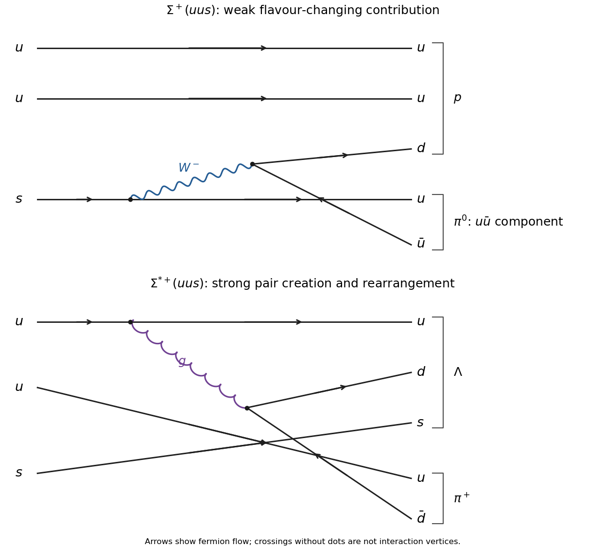

<h1 id="3/solution">Solution</h1>

↑ **Parent:** [3](../3.md)

For the lowest spatial state, [orbital angular momentum](../../../../orbital-angular-momentum.md) is zero and the spatial [wavefunction](../../../../wave-function-split.md) is symmetric. A [three-quark colour singlet](../../../../three-quark-colour-singlet.md) is antisymmetric, proportional to $\epsilon_{abc}|abc\rangle$. The [Pauli exclusion principle](../../../../pauli-exclusion-principle.md) for [quarks](../../../../quark.md) therefore requires a symmetric spin–flavour factor. Colour and flavour are different degrees of freedom even though both use three-dimensional group representations.

The [tensor product](../../../../tensor-product.md) flavour decomposition is $3\otimes3\otimes3=10_S\oplus8_M\oplus8_M\oplus1_A$. Three spin-one-half particles have a symmetric spin-$3/2$ quartet and mixed-symmetry spin-$1/2$ sectors. The symmetric [spin](../../../../spin.md) quartet combines with symmetric flavour factors to give a [baryon decuplet](../../../../baryon-decuplet.md). Mixed [spin](../../../../spin.md) and mixed flavour factors instead combine to a symmetric [spin](../../../../spin.md)–flavour state, giving one physical ground-state [baryon octet](../../../../baryon-octet.md), not two independent ground-state octets. Equivalently the [symmetric spin-flavour SU6 representation](../../../../symmetric-spin-flavour-su6-representation.md) has dimension $56=10\times4+8\times2$. The antisymmetric flavour singlet would require a fully antisymmetric three-spin state, which does not exist for only two single-quark [spin](../../../../spin.md) components.

The spin-one-half [baryon octet](../../../../baryon-octet.md) contains $(p,n)$, $(\Sigma^+,\Sigma^0,\Sigma^-)$, $\Lambda$ and $(\Xi^0,\Xi^-)$. The spin-three-halves [baryon decuplet](../../../../baryon-decuplet.md) contains the four $\Delta$ charge states, three $\Sigma^*$ states, two $\Xi^*$ states and $\Omega^-$. Both have positive [parity](../../../../parity.md) in this $L=0$ approximation. Strange-quark [mass](../../../../mass.md) breaks the approximate [flavour symmetry](../../../../flavor-symmetry.md) and splits multiplets.

In the [baryon hyperfine mass formula](../../../../baryon-hyperfine-mass-formula.md), the constituent-mass sum accounts phenomenologically for common confinement [energy](../../../../energy-split.md). A colour-magnetic [spin](../../../../spin.md)–[spin](../../../../spin.md) interaction contributes a contact-type term proportional to $\mathbf S_i\cdot\mathbf S_j/(m_im_j)$: each magnetic moment supplies one inverse [mass](../../../../mass.md). The common colour and spatial-overlap factors are absorbed into $A'$. These are effective constituent [masses](../../../../mass.md), not short-distance current-quark [masses](../../../../mass.md). Use dimensionless [spin](../../../../spin.md) operators with $\hbar=1$, as implicit in the supplied formula and coefficient.

Label the identical up [quarks](../../../../quark.md) 1 and 2. Their flavour and $L=0$ spatial factors are symmetric, and their colour pair is antisymmetric, so their [spin](../../../../spin.md) is a triplet, $S_{12}=1$. Thus

$$
\langle\mathbf S_1\cdot\mathbf S_2\rangle
=\frac12\left[1(1+1)-\frac34-\frac34\right]=\frac14.
$$

Coupling the strange [spin](../../../../spin.md) gives

$$
\langle(\mathbf S_1+\mathbf S_2)\cdot\mathbf S_3\rangle
=\frac12\left[J(J+1)-2-\frac34\right]
=\begin{cases}-1,&J=1/2,\\1/2,&J=3/2.\end{cases}
$$

The two up–strange denominators are identical. Hence

$$
\boxed{M_{1/2}=2m_u+m_s+A'\left(\frac1{4m_u^2}-\frac1{m_um_s}\right)},\qquad
\boxed{M_{3/2}=2m_u+m_s+A'\left(\frac1{4m_u^2}+\frac1{2m_um_s}\right)}.
$$

With the supplied [masses](../../../../mass.md) expressed in GeV units, the common [mass](../../../../mass.md) is $1.261\,\mathrm{GeV}/c^2$. The predicted values are

$$
\boxed{M(\Sigma^+)=1.177\,\mathrm{GeV}/c^2,\qquad
M(\Sigma^{*+})=1.377\,\mathrm{GeV}/c^2}.
$$

They are about $13$ and $3\,\mathrm{MeV}/c^2$ below the stated measurements, respectively. The predicted splitting is $201\,\mathrm{MeV}/c^2$, compared with $190\,\mathrm{MeV}/c^2$. The agreement is useful for such a simple model, but a common overlap constant neglects flavour-dependent spatial structure and other residual interactions.

For the weak decay, one contribution is $s\to uW^-$, $W^-\to d\bar u$. The two spectator up [quarks](../../../../quark.md) combine with $d$ into the [proton](../../../../proton.md), and the new $u\bar u$ supplies the [neutral pion](../../../../neutral-pion.md)'s corresponding component. This changes [strangeness](../../../../strangeness.md). In the strong decay, a [gluon](../../../../gluon.md) creates $d\bar d$; rearrangement gives $uds$ and $u\bar d$ without changing [strangeness](../../../../strangeness.md).

**[Figure 2](#3/image-original-weak-and-strong-quark-level-contributions-to-the-two-charged-sigma-baryon-decays-final-groupings-show-the-hadrons). Original weak and strong quark-level contributions to the two charged Sigma-baryon decays; final groupings show the hadrons**.

The strong channel conserves [parity](../../../../parity.md): the positive-parity daughter [baryon](../../../../baryon.md) and negative-parity [pion](../../../../pion.md) require odd relative [orbital angular momentum](../../../../orbital-angular-momentum.md), with a $P$ wave sufficient. The weak channel need not conserve [parity](../../../../parity.md). Using the [mean lifetime](../../../../mean-lifetime-physics.md) relation $\tau=\hbar/\Gamma$,

$$
\boxed{\tau(\Sigma^+)\simeq8.2\times10^{-11}\,\mathrm s,\qquad
\tau(\Sigma^{*+})\simeq1.8\times10^{-23}\,\mathrm s}.
$$

The widths differ by about $4.5\times10^{12}$, principally because one is weak and flavour changing and the other is an open strong decay. They are not comparable transitions differing only by a small [spin](../../../../spin.md) factor.

## ↑ Ancestors (13)

1. [3](../3.md)
2. [Paper 1](../../paper-1-split.md)
3. [2013](../../split.md)
4. [Past exam of the particle and nuclear physics course of the University of Cambridge](../../../split.md)
5. [Particle and Nuclear Physics course of the University of Cambridge](../../../../particle-and-nuclear-physics-course-of-the-university-of-cambridge.md)
6. [Physics course of the year 3 of the natural sciences course of the University of Cambridge](../../../../physics-course-of-the-year-3-of-the-natural-sciences-course-of-the-university-of-cambridge.md)
7. [Year 3 of the natural sciences course of the University of Cambridge](../../../../year-3-of-the-natural-sciences-course-of-the-university-of-cambridge.md)
8. [Year of the natural sciences course of the University of Cambridge](../../../../year-of-the-natural-sciences-course-of-the-university-of-cambridge.md)
9. [Natural sciences course of the University of Cambridge](../../../../natural-sciences-course-of-the-university-of-cambridge.md)
10. [Course of the University of Cambridge](../../../../course-of-the-university-of-cambridge.md)
11. [University of Cambridge](../../../../university-of-cambridge-split.md)
12. [List of universities](../../../../list-of-universities.md)
13. [Codex Wiki](../../../../split.md)
