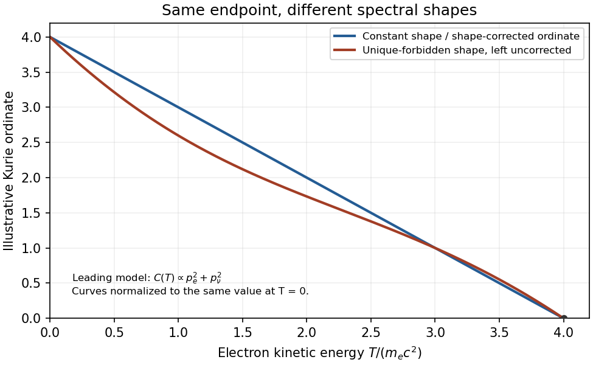

<h1 id="4/solution">Solution</h1>

↑ **Parent:** [4](../4.md)

At energies far below the $W$ [mass](../../../../mass.md), replace its propagator by a constant. The modern [V-A interaction](../../../../v-a-interaction.md) form of Fermi's contact theory has, in $\hbar=c=1$ units,

$$
\mathcal H_{\rm eff}=\frac{G_FV_{ud}}{\sqrt2}
[\bar\psi_p\gamma^\mu(g_V-g_A\gamma^5)\psi_n]
[\bar\psi_e\gamma_\mu(1-\gamma^5)\psi_\nu]+\mathrm{h.c.}
$$

Nucleons are treated nonrelativistically within nuclear states. To leading order in their velocity, the vector charge and axial spatial current give the two nuclear operators

$$
M_F=\langle f|\sum_k\tau_k^+|i\rangle,\qquad
\mathbf M_{GT}=\langle f|\sum_k\boldsymbol\sigma_k\tau_k^+|i\rangle,
$$

where $\tau^+$ here means neutron-to-proton conversion. **(i)** The scalar Fermi operator permits $\Delta J=0$, including $0\to0$, without [parity](../../../../parity.md) change. The rank-one Gamow–Teller operator permits $\Delta J=0,1$ without [parity](../../../../parity.md) change, excluding $0\to0$. Both terms can contribute when the same nuclear states permit them; their strengths contain nuclear matrix elements, not just [phase space](../../../../phase-space.md).

**(ii)** Expand the [lepton](../../../../lepton.md) waves across the [nucleus](../../../../atomic-nucleus-split.md) in powers of their momenta times nuclear radius. When $pR/\hbar\ll1$, the constant spatial term gives allowed transitions. If its matrix element vanishes by [spin](../../../../spin.md)/[parity](../../../../parity.md) selection, higher terms supply [lepton](../../../../lepton.md) [orbital angular momentum](../../../../orbital-angular-momentum.md): “forbidden” means suppressed, not impossible. First-forbidden terms change [parity](../../../../parity.md) and can have $\Delta J=0,1,2$; the rank-two $\Delta J=2$ case is unique first-forbidden. Higher orders carry additional small spatial factors and different energy-dependent shape factors. The contact approximation alone does not imply the allowed approximation.

For a single branch, neglect recoil and [neutrino](../../../../neutrino.md) [mass](../../../../mass.md) and first assume an energy-independent nuclear shape factor. [Fermi's golden rule](../../../../fermi-s-golden-rule.md) integrates the [neutrino](../../../../neutrino.md) [phase space](../../../../phase-space.md) with $E_\nu=Q-T$, while the [electron](../../../../electron.md) [momentum](../../../../momentum-split.md) volume is proportional to $p^2dp$. Including Coulomb distortion,

$$
N(p)\,dp=C\,p^2F(p)(Q-T)^2\,dp,\qquad
\boxed{N'(p)=\sqrt C\,(Q-T)}.
$$

This [momentum-bin Kurie ordinate](../../../../momentum-bin-kurie-ordinate.md) is linear in [kinetic energy](../../../../kinetic-energy.md) and vanishes at its endpoint. If instead using counts per unit [kinetic energy](../../../../kinetic-energy.md), $dN/dT\propto F(p)pE_e(Q-T)^2$ in $c=1$ units; converting with $dT/dp=p/E_e$ recovers the supplied momentum-bin definition. No extra factor of $E_e$ should be left inside that definition of $N'$.

The graph's horizontal coordinate is **$T/(m_ec^2)$**, not $T$ in MeV. Its intercept is approximately $3.9$–$4.0$, so

$$
\boxed{Q=T_{\max}\simeq2.0\,\mathrm{MeV}}.
$$

For a ground-to-ground branch between bare [nuclei](../../../../atomic-nucleus-split.md), the emitted [electron](../../../../electron.md)'s rest [energy](../../../../energy-split.md) must also be supplied:

$$
\boxed{[M_{\rm nuc}(^{91}\mathrm Y)-M_{\rm nuc}(^{91}\mathrm{Zr})]c^2
\simeq Q+m_ec^2\simeq2.5\,\mathrm{MeV}}.
$$

For neutral atomic [masses](../../../../mass.md) the [mass](../../../../mass.md) difference instead equals approximately $Q\simeq2.0\,\mathrm{MeV}$, neglecting small electron-binding corrections. The graph supports this approximate precision, not a precise evaluated [isotope](../../../../isotope.md) [mass](../../../../mass.md). Interpreting a branch to an excited daughter would require adding its [excitation energy](../../../../excitation-energy.md); the ground-state comparison assumes the ground-state branch intended here.

The [shell-model prediction for yttrium-91 beta decay](../../../../shell-model-prediction-for-yttrium-91-beta-decay.md) follows from shell filling: the [proton](../../../../proton.md) orbitals above 28 fill $2p_{3/2}$ with four [protons](../../../../proton.md) and $1f_{5/2}$ with six, reaching 38. Yttrium has its 39th [proton](../../../../proton.md) in $2p_{1/2}$, giving $J_i^\pi=1/2^-$. Its 52 [neutrons](../../../../neutron-split.md) include the closed 50-neutron core and a pair in $2d_{5/2}$, coupled to zero in the simple paired [ground state](../../../../ground-state.md). Zirconium has 40 paired [protons](../../../../proton.md) and 51 [neutrons](../../../../neutron-split.md), leaving an unpaired $2d_{5/2}$ [neutron](../../../../neutron-split.md), so $J_f^\pi=5/2^+$. Therefore

$$
\boxed{|\Delta J|=2,\quad\pi_f=-\pi_i:\qquad\text{first-forbidden unique beta decay}}.
$$

The single-particle change is [neutron](../../../../neutron-split.md) $d_{5/2}$ to [proton](../../../../proton.md) $p_{1/2}$; the [parity](../../../../parity.md) change and rank two prevent an allowed Fermi or Gamow–Teller contribution.

**The straight plotted line is a constant-shape idealization.** For the shell-model transition just inferred, a leading unique-forbidden shape factor contains $C(T)\propto p_e^2+p_\nu^2$ in $c=1$ units, with Coulomb/finite-size refinements. Consequently the uncorrected quantity specified in the paper is generally proportional to $(Q-T)\sqrt{C(T)}$, not exactly linear. A consistent [shape-corrected Kurie plot](../../../../shape-corrected-kurie-plot.md) also divides its ordinate by $\sqrt{C(T)}$. The source's exact straight-line construction and its forbidden-transition inference cannot both be exact with a Coulomb-only $F$; the approximate graphical endpoint can still be read as requested. Allowed and unique-forbidden spectral shapes are experimentally distinguishable.[1964 abstract; separate allowed and unique-forbidden spectrum measurements](../../../../shapes-of-allowed-and-unique-first-forbidden-beta-ray-spectra-114in-42k-86rb-90sr-and-90y-by-h-daniel-and-others.md)

**[Figure 3](#4/image-original-illustrative-comparison-of-constant-shape-and-unique-first-forbidden-kurie-ordinates-with-the-same-endpoint-no-source-data-points-reproduced). Original illustrative comparison of constant-shape and unique-first-forbidden Kurie ordinates with the same endpoint; no source data points reproduced**.

## ↑ Ancestors (13)

1. [4](../4.md)
2. [Paper 1](../../paper-1-split.md)
3. [2013](../../split.md)
4. [Past exam of the particle and nuclear physics course of the University of Cambridge](../../../split.md)
5. [Particle and Nuclear Physics course of the University of Cambridge](../../../../particle-and-nuclear-physics-course-of-the-university-of-cambridge.md)
6. [Physics course of the year 3 of the natural sciences course of the University of Cambridge](../../../../physics-course-of-the-year-3-of-the-natural-sciences-course-of-the-university-of-cambridge.md)
7. [Year 3 of the natural sciences course of the University of Cambridge](../../../../year-3-of-the-natural-sciences-course-of-the-university-of-cambridge.md)
8. [Year of the natural sciences course of the University of Cambridge](../../../../year-of-the-natural-sciences-course-of-the-university-of-cambridge.md)
9. [Natural sciences course of the University of Cambridge](../../../../natural-sciences-course-of-the-university-of-cambridge.md)
10. [Course of the University of Cambridge](../../../../course-of-the-university-of-cambridge.md)
11. [University of Cambridge](../../../../university-of-cambridge-split.md)
12. [List of universities](../../../../list-of-universities.md)
13. [Codex Wiki](../../../../split.md)
