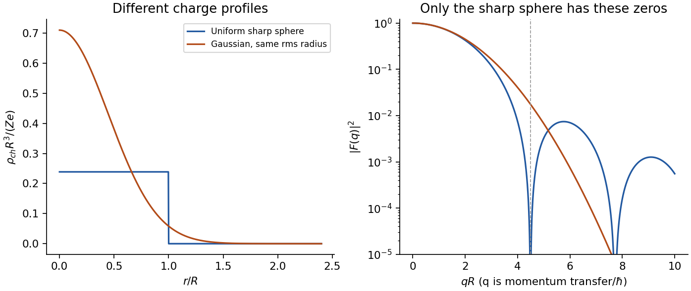
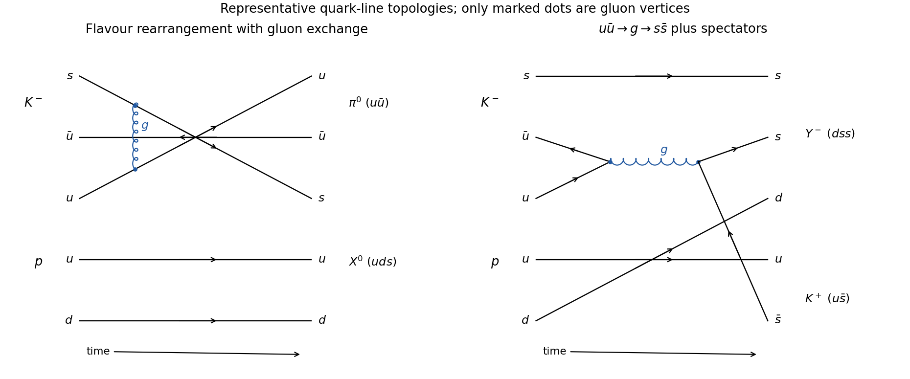
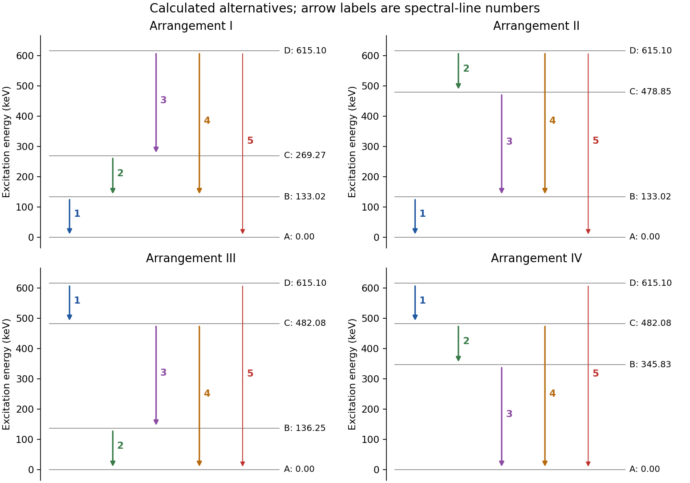

# Paper 1

↑ **Parent:** [2014](../2014.md)

Original solutions to all questions and alternatives. [Original public PDF, physical pages 307–311; dated 28 May 2014](https://www.whatdotheyknow.com/request/natural_science_tripos_physics_e_2/response/2340776/attach/2/FOI%202023%20399%20Zahid%20materials.pdf?cookie_passthrough=1#page=307)

**Table of contents**

- [1](#1)
  - [a](#1/a)
    - [Solution](#1/a/solution)
  - [b](#1/b)
    - [Solution](#1/b/solution)
  - [c](#1/c)
    - [Solution](#1/c/solution)
- [2](#2)
  - [a](#2/a)
    - [Solution](#2/a/solution)
  - [b](#2/b)
    - [Solution](#2/b/solution)
  - [c](#2/c)
    - [Solution](#2/c/solution)
- [3](#3)
  - [a](#3/a)
    - [i](#3/a/i)
      - [Solution](#3/a/i/solution)
    - [ii](#3/a/ii)
      - [Solution](#3/a/ii/solution)
  - [b](#3/b)
    - [i](#3/b/i)
      - [Solution](#3/b/i/solution)
    - [ii](#3/b/ii)
      - [Solution](#3/b/ii/solution)
  - [c](#3/c)
    - [Solution](#3/c/solution)
  - [d](#3/d)
    - [Solution](#3/d/solution)
- [4](#4)
  - [a](#4/a)
    - [Solution](#4/a/solution)
  - [b](#4/b)
    - [Solution](#4/b/solution)
    - [i](#4/b/i)
      - [Solution](#4/b/i/solution)
    - [ii](#4/b/ii)
      - [Solution](#4/b/ii/solution)
  - [c](#4/c)
    - [Solution](#4/c/solution)
  - [d](#4/d)
    - [Solution](#4/d/solution)

## 1

↑ **Parent:** [Paper 1](paper-1.md)

<h3 id="1/a">a</h3>

↑ **Parent:** [1](#1)

<h4 id="1/a/solution">Solution</h4>

↑ **Parent:** [A](#1/a)

In [time](../../classical-mechanics.md#time-in-physics) $\Delta t$ the particle advances $\beta c\Delta t$, while a light wavelet travels $c\Delta t/n$. Coherent addition along the direction of emitted [photons](../../quantum-mechanics.md#photon) gives the [Cherenkov cone angle](../../electromagnetic-wave.md#cherenkov-cone-angle)

$$
\boxed{\cos\alpha=\frac1{n\beta},\qquad n\beta>1.}
$$

The angle is measured between [photon](../../quantum-mechanics.md#photon) propagation and the particle velocity. It is complementary to the angle between the conical [wavefront](../../physical-optics.md#wavefront) surface and the trajectory; confusing those two angles exchanges sine and cosine. At threshold the [photon](../../quantum-mechanics.md#photon) cone closes, $\alpha\to0$.

<h3 id="1/b">b</h3>

↑ **Parent:** [1](#1)

<h4 id="1/b/solution">Solution</h4>

↑ **Parent:** [B](#1/b)

The decay is energetically open, but two spin-zero [pions](../../standard-model.md#pion) have total [angular momentum](../../momentum.md#angular-momentum) equal to their relative [orbital angular momentum](../../quantum-mechanics.md#orbital-angular-momentum) $L$. Conserving the parent [spin](../../angular-momentum-operator.md#spin) requires $L=1$. Interchanging two identical [neutral pions](../../standard-model.md#neutral-pion) multiplies this orbital state by $(-1)^L=-1$, whereas their total state must be symmetric by Bose statistics. There is no different [spin](../../angular-momentum-operator.md#spin) or species label to supply another minus sign. Thus **the two-neutral-pion final state is forbidden**. Its [parity](../../quantum-mechanics.md#parity) for $L=1$ would actually be $(-1)^2(-1)^1=-1$, matching the parent; the decisive obstruction is identical-boson [symmetry](../../physics.md#symmetry-physics), not the [energy](../../energy.md) or the shared quark-wavefunction component.

<h3 id="1/c">c</h3>

↑ **Parent:** [1](#1)

<h4 id="1/c/solution">Solution</h4>

↑ **Parent:** [C](#1/c)

Away from thresholds and narrow [resonances](../../dynamical-systems.md#resonance), photon-mediated annihilation gives one colour copy proportional to $Q_q^2$ relative to the [muon](../../standard-model.md#muon) cross-section. The accessible flavours are $u,d,s,c$, each with three colours, so

$$
\boxed{R\simeq3\sum_{q=u,d,s,c}Q_q^2
=3\left(\frac49+\frac19+\frac19+\frac49\right)=\frac{10}{3}\simeq3.3.}
$$

Bottom production is closed. QCD radiative corrections raise the leading parton-model result by a relative term beginning at $\alpha_s/\pi$; the requested estimate does not require a supplied value of $\alpha_s$.

## 2

↑ **Parent:** [Paper 1](paper-1.md)

<h3 id="2/a">a</h3>

↑ **Parent:** [2](#2)

<h4 id="2/a/solution">Solution</h4>

↑ **Parent:** [A](#2/a)

A useful convention for the [semi-empirical mass formula](../../atomic-nucleus.md#semi-empirical-mass-formula) is

$$
B(A,Z)=a_vA-a_sA^{2/3}-a_c\frac{Z(Z-1)}{A^{1/3}}
-a_a\frac{(A-2Z)^2}{A}+\delta(A,Z),
$$

where $B>0$ is the binding [energy](../../energy.md). The nuclear [mass](../../classical-mechanics.md#mass) is $Zm_p+(A-Z)m_n-B/c^2$. Atomic-mass comparisons instead use hydrogen-atom [masses](../../classical-mechanics.md#mass) and account for [electron](../../physics.md#electron) binding at the desired accuracy. No numerical fit coefficients are specified here.

The volume term represents short-range nuclear attraction with saturation: each [nucleon](../../physics.md#nucleon) has a limited number of close neighbours. The surface term subtracts the binding lost by [nucleons](../../physics.md#nucleon) at the boundary. Coulomb repulsion penalizes a large [proton](../../physics.md#proton) fraction. The asymmetry term penalizes unequal [neutron](../../neutron.md) and [proton](../../physics.md#proton) populations, reflecting the cost of filling different [Fermi seas](../../quantum-ideal-gas-statistics.md#fermi-sea) and nuclear interactions. Pairing favours even-even nuclei and penalizes odd-odd nuclei; odd-$A$ nuclei have zero pairing term in this approximation. For example, one may choose $\delta=\pm a_pA^{-1/2}$; an alternative fitted power requires a correspondingly different coefficient.

At fixed $A$, the smooth [mass](../../classical-mechanics.md#mass) dependence on $Z$ is approximately parabolic. Neglecting the neutron-proton [mass](../../classical-mechanics.md#mass) difference, pairing and small linear-in-$Z$ Coulomb corrections, minimization gives

$$
Z_{\rm stable}\simeq\frac{A}{2+(a_c/2a_a)A^{2/3}}.
$$

Thus the preferred [neutron excess](../../physics.md#neutron-excess) grows with [mass number](../../chemical-substance.md#mass-number). The surface penalty disfavors very light systems, while the growing Coulomb penalty reduces the binding per [nucleon](../../physics.md#nucleon) of very heavy systems; this explains broad fusion and fission [energy](../../energy.md) trends. The formula is a bulk approximation: shell closures, deformation and small separation-energy differences can give important exceptions. A fitted average binding trend is not a reliable substitute for a measured decay threshold near a boundary of stability.

<h3 id="2/b">b</h3>

↑ **Parent:** [2](#2)

<h4 id="2/b/solution">Solution</h4>

↑ **Parent:** [B](#2/b)

High-energy elastic [electron scattering](../../physics.md#electron-scattering) probes nuclear charge through the [electromagnetic interaction](../../electromagnetism.md#electromagnetic-interaction). Resolve the elastic peak with a spectrometer, measure its angular dependence and normalize by beam charge, target thickness and [detector acceptance](../../particle-detection.md#detector-acceptance). In a plane-wave, approximately static treatment,

$$
\frac{d\sigma}{d\Omega}\simeq\left(\frac{d\sigma}{d\Omega}\right)_{\rm point}|F(q)|^2,
\qquad F(q)=\frac1{Ze}\int\rho_{\rm ch}(\mathbf r)e^{i\mathbf q\cdot\mathbf r}d^3r.
$$

Here $q$ is [physical momentum](../../special-relativity.md#physical-momentum) transfer divided by $\hbar$, not the [momentum](../../momentum.md) itself. The low-$q$ slope, $F(q)=1-q^2\langle r^2\rangle/6+\cdots$, determines the charge r.m.s. radius. A sharp uniform sphere has

$$
F(q)=3\frac{\sin(qR)-qR\cos(qR)}{(qR)^3},\qquad
\langle r^2\rangle=3R^2/5.
$$

Its first [diffraction](../../quantum-scattering.md#diffraction) minimum is at $qR\simeq4.493$, illustrating how angular structure determines size. Radii approximately follow $R\propto A^{1/3}$, but a sharp radius, a surface half-density radius and an r.m.s. radius are different definitions.

A motivating experimental implementation is Hofstadter's magnetic-spectrometer measurement: selecting outgoing [electron](../../physics.md#electron) [momentum](../../momentum.md) separates [elastic scattering](../../quantum-scattering.md#elastic-scattering) from nuclear excitation, rather than treating every scattered [electron](../../physics.md#electron) as an elastic event. Beam-energy and angle calibration, empty-target or blocked-acceptance backgrounds, and target-thickness checks matter. Finite resolution mixes nearby excitations; multiple scattering and Coulomb distortion require correction before a precision density is inferred.[§III(b), pp.222–223; §IV(a), pp.227–231, spectrometer scans and elastic/inelastic separation](../../physics-bibliography.md#electron-scattering-and-nuclear-structure-by-robert-hofstadter)

Shape information comes from quadrupole moments, Coulomb-excitation transition strengths and rotational spectra. An intrinsic axial moment $Q_0=\int\rho(3z^2-r^2)d^3r$ is positive for a prolate charge [distribution](../../distribution-theory.md#distribution-mathematical-analysis) and negative for an oblate one. A laboratory quadrupole moment is not identical to $Q_0$: a rotationally averaged spin-zero state can have zero laboratory moment despite intrinsic deformation. Collective rotational levels approximately follow $E_J=\hbar^2J(J+1)/(2\mathcal I)$, while measured $E2$ strengths test the associated charge collectivity. Muonic-atom X-rays and [isotope shifts](../../physics.md#isotope-shift) supply complementary charge-radius constraints; hadronic probes provide additional, more interaction-dependent matter and [neutron](../../neutron.md) information. Neither a charge radius alone nor a finite-range form-factor measurement uniquely fixes the entire nuclear shape.

**[Figure 1](#2/b/image-original-model-charge-form-factors-at-equal-r-m-s-radius-the-diffraction-structure-carries-information-beyond-the-radius). Original model charge form factors at equal r.m.s. radius; the diffraction structure carries information beyond the radius**.

<h3 id="2/c">c</h3>

↑ **Parent:** [2](#2)

<h4 id="2/c/solution">Solution</h4>

↑ **Parent:** [C](#2/c)

An alpha emitter has an alpha-like cluster coupled to a daughter nucleus. Its positive decay [energy](../../energy.md) is $Q=[M_P-M_D-M_\alpha]c^2$; atomic [masses](../../classical-mechanics.md#mass) may be used consistently because the [electron](../../physics.md#electron) counts balance. The daughter and alpha share this [energy](../../energy.md) according to [momentum](../../momentum.md) conservation. The attractive nuclear interior and repulsive exterior [Coulomb potential](../../electrostatics.md#coulomb-potential-energy) produce a quasibound state with a barrier, so positive $Q$ does not imply rapid classical escape.

For daughter charge $Z_de$, the exterior barrier is approximately $C/r$, $C=2Z_de^2/(4\pi\epsilon_0)$, with outer turning radius $b=C/Q$. For zero [orbital angular momentum](../../quantum-mechanics.md#orbital-angular-momentum), the leading WKB [probability](../../probability-theory.md#probability) is

$$
T\sim\exp\left[-\frac2\hbar\int_R^b\sqrt{2\mu(C/r-Q)}\,dr\right],
\qquad\lambda\simeq\nu P_{\rm pre}T,\qquad t_{1/2}=\frac{\ln2}{\lambda}.
$$

Here $R$ is a nuclear matching radius, $\mu$ the [reduced mass](../../classical-mechanics.md#reduced-mass), $\nu$ an interior assault [frequency](../../wave.md#frequency) and $P_{\rm pre}$ a preformation factor. The barrier factor alone cannot determine the latter two. Nonzero emitted [orbital angular momentum](../../quantum-mechanics.md#orbital-angular-momentum) adds a [centrifugal barrier](../../mathematical-physics.md#centrifugal-barrier) and can strongly hinder a transition.

The dominant [action](../../lagrangian-mechanics.md#action) varies roughly as $Z_d/\sqrt Q$, explaining the Geiger-Nuttall relation and the enormous spread of alpha [half-lives](../../analysis.md#half-life). [angular momentum](../../momentum.md#angular-momentum) and [parity](../../quantum-mechanics.md#parity) constrain the emitted [partial wave](../../quantum-scattering.md#partial-wave): a spin-zero positive-parity alpha requires $|J_P-J_D|\le L\le J_P+J_D$ and $\pi_P=\pi_D(-1)^L$. Fine-structure alpha groups populate different daughter levels and therefore have different kinetic energies and penetrabilities. Shell structure and alpha clustering also change preformation [probabilities](../../probability-theory.md#probability), so equal $Q$ values do not guarantee equal lifetimes. Escape conserves the total [energy](../../energy.md) throughout tunnelling; the particle does not borrow a measured [energy](../../energy.md) from the barrier.

## 3

↑ **Parent:** [Paper 1](paper-1.md)

<h3 id="3/a">a</h3>

↑ **Parent:** [3](#3)

<h4 id="3/a/i">i</h4>

↑ **Parent:** [A](#3/a)

<h5 id="3/a/i/solution">Solution</h5>

↑ **Parent:** [I](#3/a/i)

Set $c=1$ and use metric $(+---)$. In the [rest frame](../../mathematical-physics.md#rest-frame) of B, $p_B=(m_B,\mathbf0)$ and $p_C=p_B+p_t$. Since $p_t^2=0$,

$$
m_C^2=m_B^2+2m_BE_t,
\qquad\boxed{|\mathbf p_C|=|\mathbf p_t|=\frac{m_C^2-m_B^2}{2m_B}.}
$$

The denominator is $m_B$ because this is the B [rest frame](../../mathematical-physics.md#rest-frame), not the C [rest frame](../../mathematical-physics.md#rest-frame). In this frame C and $t$ have equal, parallel three-momenta.

<h4 id="3/a/ii">ii</h4>

↑ **Parent:** [A](#3/a)

<h5 id="3/a/ii/solution">Solution</h5>

↑ **Parent:** [Ii](#3/a/ii)

The second decay has $\mathbf p_A=-\mathbf p_s$ in the B [rest frame](../../mathematical-physics.md#rest-frame). Using $p_A^2=m_A^2$ and $p_s^2=0$ gives

$$
\boxed{|\mathbf p_A|=|\mathbf p_s|=\frac{m_B^2-m_A^2}{2m_B},\qquad
E_A=\frac{m_B^2+m_A^2}{2m_B}.}
$$

This is an ordinary two-body decay in its parent's [rest frame](../../mathematical-physics.md#rest-frame).

<h3 id="3/b">b</h3>

↑ **Parent:** [3](#3)

<h4 id="3/b/i">i</h4>

↑ **Parent:** [B](#3/b)

<h5 id="3/b/i/solution">Solution</h5>

↑ **Parent:** [I](#3/b/i)

Let $q=(m_C^2-m_B^2)/(2m_B)$ and $p=(m_B^2-m_A^2)/(2m_B)$. In the B frame these are the energies of $t$ and $s$. If $\theta$ is their relative angle,

$$
m_{st}^2=2pq(1-\cos\theta),\qquad
\boxed{(m_{st}^2)_{\min}=0,\quad
(m_{st}^2)_{\max}=\frac{(m_C^2-m_B^2)(m_B^2-m_A^2)}{m_B^2}.}
$$

The minimum has parallel massless particles; the maximum has antiparallel ones. The isotropic decay allows both limiting directions. The bounds are [Lorentz invariant](../../special-relativity.md#lorentz-invariance) even though the B frame makes their calculation simple.

<h4 id="3/b/ii">ii</h4>

↑ **Parent:** [B](#3/b)

<h5 id="3/b/ii/solution">Solution</h5>

↑ **Parent:** [Ii](#3/b/ii)

Since $\mathbf p_A=-\mathbf p_s$, the same angle gives $m_{At}^2=m_A^2+2q(E_A+p\cos\theta)$. Therefore

$$
\boxed{(m_{At}^2)_{\min}=\frac{m_A^2m_C^2}{m_B^2},\qquad
(m_{At}^2)_{\max}=m_A^2+m_C^2-m_B^2.}
$$

The minimum now occurs when $s$ and $t$ are antiparallel. The eventwise identity $m_{At}^2+m_{st}^2=m_C^2+m_A^2-m_B^2$ independently checks the opposite ordering of the two endpoints.

<h3 id="3/c">c</h3>

↑ **Parent:** [3](#3)

<h4 id="3/c/solution">Solution</h4>

↑ **Parent:** [C](#3/c)

Use $K^-=s\bar u$ and $p=uud$. In the first reaction a [proton](../../physics.md#proton) $u$ can join the incoming $\bar u$ to form the $u\bar u$ component of the [neutral pion](../../standard-model.md#neutral-pion), leaving $uds$. In the second, a $u\bar u$ pair can annihilate into a [gluon](../../standard-model.md#gluon) which creates $s\bar s$; the remaining $u$ joins $\bar s$ in the outgoing [kaon](../../physics.md#kaon), leaving $dss$. Thus

$$
\boxed{X^0=uds,\qquad Y^-=dss.}
$$

[baryon number](../../standard-model.md#baryon-number) is one in both cases. Strong [strangeness](../../standard-model.md#strangeness) conservation provides a separate check: the first [baryon](../../physics.md#baryon) has [strangeness](../../standard-model.md#strangeness) $-1$; the second has [strangeness](../../standard-model.md#strangeness) $-2$ because the outgoing $K^+$ carries $+1$. The [Feynman diagrams](../../perturbative-quantum-field-theory.md#feynman-diagram) show representative [quark-line flavour rearrangement](../../standard-model.md#quark-line-flavour-rearrangement) and pair-annihilation topologies. Bound [hadrons](../../physics.md#hadron) require nonperturbative binding, so a single drawn [gluon](../../standard-model.md#gluon) is not an exclusive cross-section calculation.

**[Figure 2](#3/c/image-original-representative-quark-line-diagrams-flavour-rearrangement-and-u-antiu-annihilation-into-an-s-antis-pair). Original representative quark-line diagrams: flavour rearrangement and u-antiu annihilation into an s-antis pair**.

<h3 id="3/d">d</h3>

↑ **Parent:** [3](#3)

<h4 id="3/d/solution">Solution</h4>

↑ **Parent:** [D](#3/d)

The radiative $X^0$ decay conserves [strangeness](../../standard-model.md#strangeness) and proceeds electromagnetically. A strong $\Lambda\pi$ decay is closed because even the lighter neutral-pion threshold exceeds the supplied $X^0$ [mass](../../classical-mechanics.md#mass). The $Y^-$ decay has about $65\,\mathrm{MeV}$ of available [energy](../../energy.md), but changes [strangeness](../../standard-model.md#strangeness) from $-2$ to $-1$, so it requires the [weak interaction](../../standard-model.md#weak-interaction). Its lifetime is therefore ordinarily much longer than the electromagnetic lifetime of $X^0$; no numerical lifetime follows from these [masses](../../classical-mechanics.md#mass) alone.

Both particles are [baryons](../../physics.md#baryon) with half-integer [spin](../../angular-momentum-operator.md#spin). A radiative transition to [spin](../../angular-momentum-operator.md#spin) $1/2$ can couple through [photon](../../quantum-mechanics.md#photon) multipoles $L\ge1$, giving $J_X=L\pm1/2$. Electromagnetic [parity](../../quantum-mechanics.md#parity) is conserved, but without the electric/magnetic multipolarity neither $J_X$ nor its [parity](../../quantum-mechanics.md#parity) is fixed. In the weak $Y^-$ decay, coupling orbital $L$ to the final $\Lambda$ [spin](../../angular-momentum-operator.md#spin) gives $J_Y=L\pm1/2$; [parity conservation](../../quantum-mechanics.md#parity-conservation) cannot be imposed on that weak [amplitude](../../wave.md#wave-amplitude). The supplied modes therefore do not determine unique spin-parity assignments.

The [masses](../../classical-mechanics.md#mass) and flavours identify the familiar candidates as $\Sigma^0$ and $\Xi^-$. Their established ground-state assignments are both $1/2^+$, consistent with the lowest-orbital [quark model](../../physics.md#quark-model), but this is additional empirical/model information rather than a consequence of the two [decay channels](../../physics.md#decay-channel) alone.[Sigma-zero and Xi-minus listings, each p.1, established quantum numbers and decay information](../../physics-bibliography.md#review-of-particle-physics-by-particle-data-group-2022)

## 4

↑ **Parent:** [Paper 1](paper-1.md)

<h3 id="4/a">a</h3>

↑ **Parent:** [4](#4)

<h4 id="4/a/solution">Solution</h4>

↑ **Parent:** [A](#4/a)

Assume the quoted [intensities](../../wave.md#intensity-physics) represent relative emitted [photon numbers](../../quantum-harmonic-oscillator.md#photon-number), with efficiency corrections implicit, as required for population-flow bookkeeping. The prominent branch obeys $I_1=I_2+I_4$, and $I_2=I_3$ identifies a serial two-photon branch. The energies obey $E_2+E_3\simeq E_4$ and $E_1+E_4\simeq E_5$ within their uncertainties. The weak fifth line directly spans D to A. Reversing which end contains the line-1 step and interchanging the serial line-2/line-3 order produces the four possibilities.

Take A as zero. A [gamma-ray energy-network fit](../../normal-linear-model.md#gamma-ray-energy-network-fit) to the five [energy](../../energy.md) differences gives the following approximate [excitation energies](../../quantum-mechanics.md#excitation-energy) in keV:

$$
\boxed{\begin{array}{c|rrr}
\text{arrangement}&\Delta E_{AB}&\Delta E_{AC}&\Delta E_{AD}\\\hline
\mathrm I&133.02&269.27&615.10\\
\mathrm{II}&133.02&478.85&615.10\\
\mathrm{III}&136.25&482.08&615.10\\
\mathrm{IV}&345.83&482.08&615.10
\end{array}}
$$

The line connections, in the order $1,2,3,4,5$, are respectively: I: $(B\to A,C\to B,D\to C,D\to B,D\to A)$; II: $(B\to A,D\to C,C\to B,D\to B,D\to A)$; III: $(D\to C,B\to A,C\to B,C\to A,D\to A)$; IV: $(D\to C,C\to B,B\to A,C\to A,D\to A)$.

For I and II, the B population entering through lines 2 or 3 and line 4 exits through line 1. For III and IV, line 1 feeds C and its [intensity](../../wave.md#intensity-physics) splits into the direct line 4 and serial lines 2/3. The small direct D-to-A branch bypasses these intermediate balances. The central measured energies do not obey every sum exactly; all four fitted arrangements have $\chi^2\simeq0.81$ for two [energy](../../energy.md) constraints. Assigning the weakest line's central [energy](../../energy.md) as an exact [excitation energy](../../quantum-mechanics.md#excitation-energy) would discard the more precise cascade measurements.

**[Figure 3](#4/a/image-original-reconstructed-solutions-i-iv-with-all-five-observed-line-numbers-attached-to-calculated-transitions-excitation-energies-are-fitted-not-a-copy-of-the-source-diagram). Original reconstructed solutions I–IV, with all five observed line numbers attached to calculated transitions; excitation energies are fitted, not a copy of the source diagram**.

<h3 id="4/b">b</h3>

↑ **Parent:** [4](#4)

<h4 id="4/b/solution">Solution</h4>

↑ **Parent:** [B](#4/b)

The symbols $EL$ and $ML$ [mean](../../expected-value.md) electric and magnetic radiation multipoles of order $L$. The orders $L=1,2,3$ are called dipole, quadrupole and octupole. They describe the angular structure of charge/current radiation and the total [angular momentum](../../momentum.md#angular-momentum) carried by the radiation; they do not change the [photon](../../quantum-mechanics.md#photon)'s intrinsic [spin](../../angular-momentum-operator.md#spin) from one. A real single [photon](../../quantum-mechanics.md#photon) has no monopole radiation mode.

<h4 id="4/b/i">i</h4>

↑ **Parent:** [B](#4/b)

<h5 id="4/b/i/solution">Solution</h5>

↑ **Parent:** [I](#4/b/i)

An electric multipole has radiation [parity](../../quantum-mechanics.md#parity) $(-1)^L$ and a magnetic multipole [parity](../../quantum-mechanics.md#parity) $(-1)^{L+1}$. The radiation [quantum numbers](../../quantum-system.md#quantum-number) are therefore

$$
\boxed{\begin{array}{c|cccccc}
\text{mode}&E1&E2&E3&M1&M2&M3\\\hline
J_\gamma^P&1^-&2^+&3^-&1^+&2^-&3^+
\end{array}.}
$$

Equivalently, an $EL$ transition requires $\pi_f/\pi_i=(-1)^L$, while an $ML$ transition requires $\pi_f/\pi_i=(-1)^{L+1}$.

<h4 id="4/b/ii">ii</h4>

↑ **Parent:** [B](#4/b)

<h5 id="4/b/ii/solution">Solution</h5>

↑ **Parent:** [Ii](#4/b/ii)

For comparable transition energies and ordinary single-particle nuclear strengths in the long-wavelength regime, the usual qualitative ordering is **$E1$, $M1$, $E2$, $M2$, $E3$, $M3$ from faster to slower**. Each increase of multipole order is strongly suppressed, and magnetic radiation is usually weaker than electric radiation of the same order. More precisely,

$$
\lambda(\sigma L)\propto E_\gamma^{2L+1}B(\sigma L),\qquad \sigma=E\text{ or }M.
$$

The nuclear reduced transition strength $B$ is essential: collective enhancement, cancellation and [selection rules](../../atomic-physics.md#selection-rule) can overturn this benchmark. It is not a universal ranking between arbitrary transitions of different energies. The weak measured M3 branch is consistent with high-multipole suppression, but its absolute lifetime cannot be obtained from its arbitrary-unit [intensity](../../wave.md#intensity-physics) alone.[Appendix C, printed pp.60–67, transition rates and Weisskopf single-particle estimates](../../physics-bibliography.md#guidelines-for-nuclear-structure-evaluators-by-murray-j-martin)

<h3 id="4/c">c</h3>

↑ **Parent:** [4](#4)

<h4 id="4/c/solution">Solution</h4>

↑ **Parent:** [C](#4/c)

For a single-photon transition, [angular momentum addition](../../momentum.md#angular-momentum-addition) requires $|J_i-J_f|\le L\le J_i+J_f$, $L\ge1$, together with the electric/magnetic [parity](../../quantum-mechanics.md#parity) rules above. Thus a known final state and a measured multipole restrict both the [spin](../../angular-momentum-operator.md#spin) difference and [parity](../../quantum-mechanics.md#parity) of the emitting level. For example, an E1 line reverses [parity](../../quantum-mechanics.md#parity) and allows $\Delta J=0,1$ except $0\to0$; a mixed M1+E2 line preserves [parity](../../quantum-mechanics.md#parity) and must satisfy both angular triangles. An E2 line preserves [parity](../../quantum-mechanics.md#parity) and allows [spin](../../angular-momentum-operator.md#spin) differences up to two.

Line energies identify connected levels, while calibrated [intensities](../../wave.md#intensity-physics) and coincidences test cascade flow and branching. If a proposed assignment permits a fast low-order transition to a lower state, an experimentally stringent absence of that line argues against the assignment. Nevertheless, **an allowed transition can have a small or vanishing nuclear [matrix](../../vector-space.md#matrix) element**. Pure E2 radiation alone does not prove that M1 is forbidden by [angular momentum](../../momentum.md#angular-momentum). Detection sensitivity, efficiency and overlap must be considered, and in real nuclei [internal conversion](../../atomic-nucleus.md#internal-conversion) can remove [photons](../../quantum-mechanics.md#photon); this question explicitly excludes that competing channel. Lifetimes or reduced-strength estimates make a missing-line argument substantially stronger than a bare selection-rule statement.

<h3 id="4/d">d</h3>

↑ **Parent:** [4](#4)

<h4 id="4/d/solution">Solution</h4>

↑ **Parent:** [D](#4/d)

Use arrangement III. Lines 2 and 4 connect B and C to A, line 3 connects C to B, line 1 connects D to C, and line 5 connects D to A. Every measured multipole preserves [parity](../../quantum-mechanics.md#parity), so **B, C and D all have positive [parity](../../quantum-mechanics.md#parity)**. The two mixed M1+E2 transitions to $J_A=7/2$ strictly imply

$$
J_B,J_C\in\{5/2,7/2,9/2\}.
$$

The measured E2 C-to-B and D-to-C transitions require $|J_C-J_B|\le2$ and $|J_D-J_C|\le2$, with their angular sums at least two. The M3 D-to-A line gives $|J_D-7/2|\le3$ and $J_D+7/2\ge3$. These inequalities, with half-integer [spins](../../angular-momentum-operator.md#spin), are the strict observed-line constraints. They do not alone fix unique [spins](../../angular-momentum-operator.md#spin).

The customary low-multipole-dominance inference goes further. If lower-order allowed radiation would not be accidentally hindered, a pure M3 D-to-A decay indicates $|J_D-7/2|=3$, giving $J_D=1/2$ or $13/2$. Its E2 connection to C then forces $J_C=5/2$ or $9/2$, respectively. Treating the pure E2 C-to-B transition similarly as a [spin](../../angular-momentum-operator.md#spin) change of two selects

$$
\boxed{(J_B^P,J_C^P,J_D^P)
=(\tfrac{9}{2}^{+},\tfrac{5}{2}^{+},\tfrac{1}{2}^{+})
\quad\text{or}\quad(\tfrac{5}{2}^{+},\tfrac{9}{2}^{+},\tfrac{13}{2}^{+}).}
$$

In either assignment the missing D-to-B line changes [spin](../../angular-momentum-operator.md#spin) by four. Its lowest parity-preserving multipole is E4, so it is naturally much weaker than the observed E2 D-to-C branch. This spin-reflection ambiguity around the reference [spin](../../angular-momentum-operator.md#spin) is not resolved by the spectra under this approximation.

The boxed alternatives are **conditional on ordinary, unhindered lower-multipole strengths**. If accidental or structural hindrance is allowed, other [spins](../../angular-momentum-operator.md#spin) satisfying the preceding inequalities remain possible: an upper limit on an unobserved lower multipole does not mathematically prove its selection-rule prohibition. The supplied [intensities](../../wave.md#intensity-physics) and absence of other comparable lines support the usual assignments but do not supply measured reduced strengths sufficient to eliminate that qualification.

## ↑ Ancestors (11)

1. [2014](../2014.md)
2. [Past exam of the particle and nuclear physics course of the University of Cambridge](../../past-exam-of-the-particle-and-nuclear-physics-course-of-the-university-of-cambridge.md)
3. [Particle and Nuclear Physics course of the University of Cambridge](../../university-of-cambridge.md#particle-and-nuclear-physics-course-of-the-university-of-cambridge)
4. [Physics course of the year 3 of the natural sciences course of the University of Cambridge](../../university-of-cambridge.md#physics-course-of-the-year-3-of-the-natural-sciences-course-of-the-university-of-cambridge)
5. [Year 3 of the natural sciences course of the University of Cambridge](../../university-of-cambridge.md#year-3-of-the-natural-sciences-course-of-the-university-of-cambridge)
6. [Year of the natural sciences course of the University of Cambridge](../../university-of-cambridge.md#year-of-the-natural-sciences-course-of-the-university-of-cambridge)
7. [Natural sciences course of the University of Cambridge](../../university-of-cambridge.md#natural-sciences-course-of-the-university-of-cambridge)
8. [Course of the University of Cambridge](../../university-of-cambridge.md#course-of-the-university-of-cambridge)
9. [University of Cambridge](../../university-of-cambridge.md)
10. [List of universities](../../README.md#list-of-universities)
11. [Codex Wiki](../../README.md)
