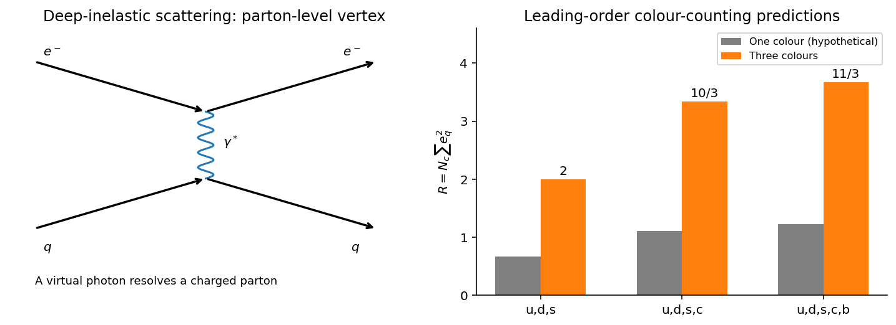

<h1 id="2/a/solution">Solution</h1>

↑ **Parent:** [A](../a.md)

Evidence for [quarks](../../../../../quark.md) comes from several kinds of observation that test different aspects of their interpretation. The light [meson](../../../../../meson.md) and [baryon](../../../../../baryon.md) spectra organize into approximate flavour multiplets with the charges and strangeness expected for $q\bar q$ and $qqq$. In particular, the [baryon octet](../../../../../baryon-octet.md) and [baryon decuplet](../../../../../baryon-decuplet.md) encode the three light [quark flavours](../../../../../quark-flavor.md) and their [spin](../../../../../spin.md) couplings. This is an economical account of hadron quantum numbers, but spectroscopy alone would not establish that the constituents behave as localized scattering centers.

[Deep inelastic scattering](../../../../../deep-inelastic-scattering.md) supplies that second test. In energetic [electron](../../../../../electron.md)–[proton](../../../../../proton.md) scattering the outgoing lepton measures the [energy](../../../../../energy-split.md) and [momentum](../../../../../momentum-split.md) transferred through a virtual [photon](../../../../../photon.md), while the broken-up target is summed over. Approximate [Bjorken scaling](../../../../../bjorken-scaling.md) means the structure functions depend primarily on $x=Q^2/(2P\cdot q)$ rather than varying rapidly with the resolving [momentum](../../../../../momentum-split.md) scale $Q^2$. It indicates nearly pointlike constituents. In the leading spin-half [parton model](../../../../../parton-model.md),

$$
F_2(x)=x\sum_q e_q^2[q(x)+\bar q(x)],\qquad F_2(x)=2xF_1(x).
$$

The charge-squared weights and the second relation test the constituents' fractional charges and spin-half nature. Scaling violations reflect [quark](../../../../../quark.md) and [gluon](../../../../../gluon.md) radiation rather than a failure of the constituent picture.[Structure Functions, §§18.1–18.3, deep-inelastic kinematics and leading parton expressions](../../../../../review-of-particle-physics-by-particle-data-group-2022.md)

[Particle jets](../../../../../jet-particle-physics.md) give complementary final-state evidence. A high-energy [quark](../../../../../quark.md) produces a collimated spray of hadrons because [confinement](../../../../../confinement.md) prevents it from emerging as an isolated particle. Back-to-back jets fit [quark](../../../../../quark.md)–antiquark production; three-jet events show hard [gluon](../../../../../gluon.md) radiation. Their angular correlations test a spin-one radiated parton. This distinguishes constituents of hadrons from a literal observation of free fractional-charge particles.

Three independent arguments identify an additional threefold colour degree of freedom. First, the spin-aligned $uuu$ state of a ground-state $\Delta^{++}$ would have symmetric space, [spin](../../../../../spin.md) and flavour factors. The [Pauli exclusion principle](../../../../../pauli-exclusion-principle.md) requires an antisymmetric additional factor. The [three-quark colour singlet](../../../../../three-quark-colour-singlet.md) supplies it. The same construction accommodates the spin-aligned $sss$ state of the $\Omega^-$ without altering its measured quantum numbers.

Second, the inclusive [hadronic R ratio](../../../../../hadronic-r-ratio.md), away from thresholds and narrow resonances, is at leading electromagnetic order

$$
R=\frac{\sigma(e^+e^-\to\text{hadrons})}{\sigma(e^+e^-\to\mu^+\mu^-)}
=N_c\sum_{q\ {
m accessible}}e_q^2.
$$

Each [quark flavour](../../../../../quark-flavor.md) has $N_c$ distinguishable colour final states. With $N_c=3$, the predicted plateaux for three, four and five accessible flavours are **$2$, $10/3$ and $11/3$**; without the factor three they would be a third as large. The measured inclusive normalization is therefore a colour-counting test, with radiative and threshold corrections included in precision comparisons.[Plots of [Cross sections](../../../../../cross-section-physics.md) and Related Quantities, inclusive [electron](../../../../../electron.md)–[Positron](../../../../../positron.md) hadronic [cross sections](../../../../../cross-section-physics.md) and R plots](../../../../../review-of-particle-physics-by-particle-data-group-2022.md)

**[Figure 1](#2/a/image-leading-colour-counting-predictions-for-the-hadronic-r-ratio-these-are-model-values-not-plotted-measurements). Leading colour-counting predictions for the hadronic R ratio; these are model values, not plotted measurements**.

Third, the neutral pion's two-photon amplitude contains a quark-loop colour sum, proportional to $N_c(e_u^2-e_d^2)$; its rate and the other evidence are consistent with three colours. [Quantum chromodynamics](../../../../../quantum-chromodynamics.md) identifies this degree of freedom as a gauge charge, with eight [gluons](../../../../../gluon.md). Observed hadrons are colour singlets; the evidence for colour is its quantitative and symmetry consequences, not visible colours or isolated coloured [quarks](../../../../../quark.md).

## ↑ Ancestors (14)

1. [A](../a.md)
2. [2](../../2.md)
3. [Paper 1](../../../paper-1-split.md)
4. [2015](../../../split.md)
5. [Past exam of the particle and nuclear physics course of the University of Cambridge](../../../../split.md)
6. [Particle and Nuclear Physics course of the University of Cambridge](../../../../../particle-and-nuclear-physics-course-of-the-university-of-cambridge.md)
7. [Physics course of the year 3 of the natural sciences course of the University of Cambridge](../../../../../physics-course-of-the-year-3-of-the-natural-sciences-course-of-the-university-of-cambridge.md)
8. [Year 3 of the natural sciences course of the University of Cambridge](../../../../../year-3-of-the-natural-sciences-course-of-the-university-of-cambridge.md)
9. [Year of the natural sciences course of the University of Cambridge](../../../../../year-of-the-natural-sciences-course-of-the-university-of-cambridge.md)
10. [Natural sciences course of the University of Cambridge](../../../../../natural-sciences-course-of-the-university-of-cambridge.md)
11. [Course of the University of Cambridge](../../../../../course-of-the-university-of-cambridge.md)
12. [University of Cambridge](../../../../../university-of-cambridge-split.md)
13. [List of universities](../../../../../list-of-universities.md)
14. [Codex Wiki](../../../../../split.md)
