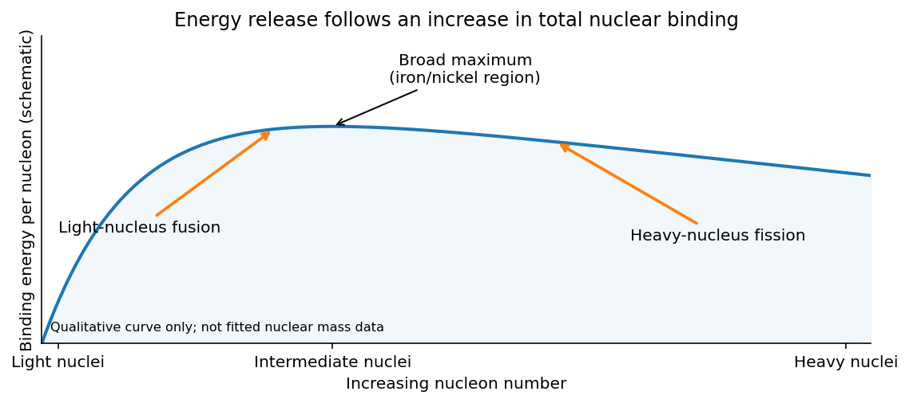

<h1 id="2/b/solution">Solution</h1>

↑ **Parent:** [B](../b.md)

The common energetic principle behind [nuclear fission](../../../../../nuclear-fission.md) and [nuclear fusion](../../../../../nuclear-fusion.md) is the [nuclear binding energy](../../../../../nuclear-binding-energy.md). If the products are more tightly bound in total than the reactants, their smaller rest [mass](../../../../../mass.md) releases

$$
\boxed{Q=\left(\sum_i M_i-\sum_f M_f\right)c^2
=\sum_f B_f-\sum_i B_i.}
$$

The two binding-energy expressions assume that the same numbers of [protons](../../../../../proton.md) and [neutrons](../../../../../neutron-split.md) are counted on both sides; emitted free nucleons have zero nuclear binding. The [energy](../../../../../energy-split.md) appears mainly as product [kinetic energy](../../../../../kinetic-energy.md), with radiation and subsequent decays contributing according to the reaction.

The [binding energy per nucleon](../../../../../binding-energy-per-nucleon.md) rises rapidly through light nuclei, has a broad maximum in the iron/nickel region, and decreases more slowly for heavier nuclei. Combining suitable light nuclei can therefore increase their total binding, whereas splitting a sufficiently heavy nucleus into moderately heavy fragments can do the same. This is an [energy](../../../../../energy-split.md) comparison, not a rule that every fusion or fission channel is exothermic: the actual nuclear masses fix the sign of $Q$.

**[Figure 2](#2/b/image-schematic-binding-energy-trend-explaining-why-light-nucleus-fusion-and-heavy-nucleus-fission-can-release-energy). Schematic binding-energy trend explaining why light-nucleus fusion and heavy-nucleus fission can release energy**.

In [nuclear fission](../../../../../nuclear-fission.md), the [liquid-drop model](../../../../../liquid-drop-model-of-the-nucleus.md) illustrates the competition between attractive short-range nuclear cohesion and long-range [proton](../../../../../proton.md) repulsive [Coulomb interaction](../../../../../coulomb-interaction.md). Deformation increases surface area and costs surface [energy](../../../../../energy-split.md), but separating the charge can reduce [nuclear Coulomb energy](../../../../../nuclear-coulomb-energy.md). Their competition creates a [fission barrier](../../../../../fission-barrier.md). An excited nucleus may pass over the barrier; [spontaneous fission](../../../../../spontaneous-fission.md) can occur through [quantum tunnelling](../../../../../quantum-tunnelling.md). The resulting fragments are often excited and neutron-rich, so they may emit prompt [neutrons](../../../../../neutron-split.md) and [photons](../../../../../photon.md) and undergo later [beta decay](../../../../../beta-decay.md). The typical total [energy](../../../../../energy-split.md) released by a heavy-nucleus fission is of order a few hundred MeV, rather than an electronic-scale [energy](../../../../../energy-split.md). Its size follows from an approximately MeV-per-nucleon binding gain summed over a heavy nucleus. A [neutron](../../../../../neutron-split.md) from one fission can induce another; a [nuclear chain reaction](../../../../../nuclear-chain-reaction.md) is the repeated physical process, distinct from the energy-release condition for one event.

In [nuclear fusion](../../../../../nuclear-fusion.md), the initial charged nuclei repel one another. Exothermicity does not remove this entrance [Coulomb barrier](../../../../../coulomb-barrier.md). A reaction requires sufficient overlap of their [wavefunctions](../../../../../wave-function-split.md), achieved by energetic encounters and [quantum tunnelling](../../../../../quantum-tunnelling.md). For nonresonant low-energy charged-particle fusion, a useful separation is

$$
\sigma(E)=\frac{S(E)}E e^{-2\pi\eta_C},\qquad
\eta_C=\frac{Z_1Z_2\alpha c}{v_{\rm rel}}.
$$

The [astrophysical S factor](../../../../../astrophysical-s-factor.md) isolates the nuclear part from much of the rapidly varying Coulomb penetration probability. In a thermal population, the competition between the decreasing high-energy population and increasing penetration produces the [Gamow peak](../../../../../gamow-peak.md). This explains how fusion can proceed below the classical barrier without requiring the mean thermal [energy](../../../../../energy-split.md) to equal its height.

Both processes conserve total [energy](../../../../../energy-split.md), charge, [baryon](../../../../../baryon.md) number and [angular momentum](../../../../../angular-momentum.md). Their very different entrance barriers and [mass](../../../../../mass.md) ranges explain why a favorable $Q$ value by itself does not specify a reaction rate. Short-range attraction gives approximately saturated nuclear binding, while surface, Coulomb, symmetry and pairing terms account for the broad trend and its isotope-dependent departures.

## ↑ Ancestors (14)

1. [B](../b.md)
2. [2](../../2.md)
3. [Paper 1](../../../paper-1-split.md)
4. [2015](../../../split.md)
5. [Past exam of the particle and nuclear physics course of the University of Cambridge](../../../../split.md)
6. [Particle and Nuclear Physics course of the University of Cambridge](../../../../../particle-and-nuclear-physics-course-of-the-university-of-cambridge.md)
7. [Physics course of the year 3 of the natural sciences course of the University of Cambridge](../../../../../physics-course-of-the-year-3-of-the-natural-sciences-course-of-the-university-of-cambridge.md)
8. [Year 3 of the natural sciences course of the University of Cambridge](../../../../../year-3-of-the-natural-sciences-course-of-the-university-of-cambridge.md)
9. [Year of the natural sciences course of the University of Cambridge](../../../../../year-of-the-natural-sciences-course-of-the-university-of-cambridge.md)
10. [Natural sciences course of the University of Cambridge](../../../../../natural-sciences-course-of-the-university-of-cambridge.md)
11. [Course of the University of Cambridge](../../../../../course-of-the-university-of-cambridge.md)
12. [University of Cambridge](../../../../../university-of-cambridge-split.md)
13. [List of universities](../../../../../list-of-universities.md)
14. [Codex Wiki](../../../../../split.md)
