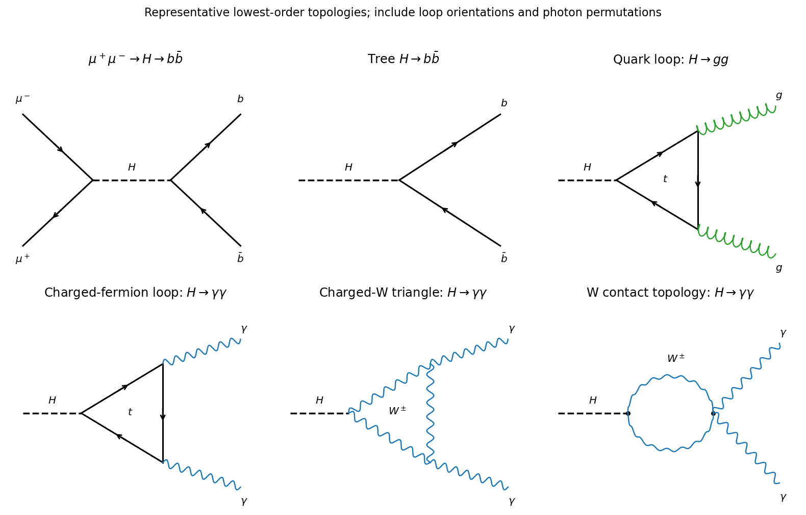

<h1 id="3/solution">Solution</h1>

↑ **Parent:** [3](../3.md)

In the [Breit-Wigner resonance cross section](../../../../breit-wigner-resonance-cross-section.md), $E$ is the total [centre-of-momentum energy](../../../../centre-of-momentum-energy.md), $E_0$ the resonance [energy](../../../../energy-split.md), and $p$ either incident particle's center-of-momentum [momentum](../../../../momentum-split.md) magnitude. The total [decay width](../../../../decay-width.md) is $\Gamma=\hbar/\tau$, while $\Gamma_i$ and $\Gamma_f$ are partial widths into the entrance and specified exit channels. Their ratios to $\Gamma$ are the corresponding [branching fractions](../../../../branching-fraction.md). The factor $g$ averages over incident [spin](../../../../spin.md) states and sums over the resonance's magnetic substates.

In [natural units](../../../../natural-units.md), $\hbar=c=1$, the resonant partial-wave cross-sectional scale is an area proportional to the squared reduced de Broglie wavelength, $1/p^2$. Equivalently a partial-wave scattering amplitude carries one factor $1/p$, and its squared modulus supplies $1/p^2$. In SI area units the same scale is $(\hbar/p)^2$; if $p$ is expressed in [energy](../../../../energy-split.md) units, multiply the final inverse-energy-squared answer by $(\hbar c)^2$.

For unpolarized spin-half incident [muons](../../../../muon.md), the [unpolarized resonance spin factor](../../../../unpolarized-resonance-spin-factor.md) is

$$
g=\frac{2J+1}{(2s_{\mu^-}+1)(2s_{\mu^+}+1)}
=\frac{2J+1}{4}.
$$

Hence **$g_Z=3/4$ and $g_H=1/4$**. The outgoing tau spins do not supply another independent multiplicity here: their allowed final states are already included in $\Gamma_f$.

Near a narrow resonance, treat the smooth prefactor $p^{-2}$ and the partial widths as constant across the line. At the peak the denominator is $\Gamma^2/4$. Half its height occurs when $(E-E_0)^2+\Gamma^2/4=\Gamma^2/2$, namely at $E=E_0\pm\Gamma/2$. Thus **the full width at half maximum is $\Gamma$** within the Breit-Wigner narrow-line approximation. A varying prefactor or convolution with the beam-energy distribution can modify an observed line shape.

**[Figure 3](#3/image-tree-production-and-decay-fermion-triangles-and-the-w-loop-topologies-for-higgs-diphoton-decay). Tree production and decay, fermion triangles, and the W-loop topologies for Higgs diphoton decay**.

The production amplitude has a [muon](../../../../muon.md) pair joined to a Higgs propagator through their [Yukawa coupling](../../../../yukawa-interaction.md), followed by the bottom-quark pair at a second Yukawa vertex. The separate $H\to b\bar b$ graph is a tree-level Higgs–[fermion](../../../../fermion.md) vertex. There are no tree-level $Hgg$ or $H\gamma\gamma$ vertices in the renormalizable [Standard Model](../../../../standard-model-split.md): their lowest nonzero graphs are loops. A [quark](../../../../quark.md) triangle, dominated by the top contribution, produces two [gluons](../../../../gluon.md). Charged-fermion triangles contribute to two [photons](../../../../photon.md); charged-W loops also contribute and are dominant in the Standard Model amplitude. [Photon](../../../../photon.md) permutations and the W contact topology belong to the full amplitude; the diagram shows these topologies rather than claiming one triangle alone is the entire gauge-invariant W contribution.[Status of Higgs [Boson](../../../../boson.md) Physics, §11.2.4 and discussion on physical page 5 of loop-induced [gluon](../../../../gluon.md) and [photon](../../../../photon.md) couplings](../../../../review-of-particle-physics-by-particle-data-group-2022.md)

## ↑ Ancestors (13)

1. [3](../3.md)
2. [Paper 1](../../paper-1-split.md)
3. [2015](../../split.md)
4. [Past exam of the particle and nuclear physics course of the University of Cambridge](../../../split.md)
5. [Particle and Nuclear Physics course of the University of Cambridge](../../../../particle-and-nuclear-physics-course-of-the-university-of-cambridge.md)
6. [Physics course of the year 3 of the natural sciences course of the University of Cambridge](../../../../physics-course-of-the-year-3-of-the-natural-sciences-course-of-the-university-of-cambridge.md)
7. [Year 3 of the natural sciences course of the University of Cambridge](../../../../year-3-of-the-natural-sciences-course-of-the-university-of-cambridge.md)
8. [Year of the natural sciences course of the University of Cambridge](../../../../year-of-the-natural-sciences-course-of-the-university-of-cambridge.md)
9. [Natural sciences course of the University of Cambridge](../../../../natural-sciences-course-of-the-university-of-cambridge.md)
10. [Course of the University of Cambridge](../../../../course-of-the-university-of-cambridge.md)
11. [University of Cambridge](../../../../university-of-cambridge-split.md)
12. [List of universities](../../../../list-of-universities.md)
13. [Codex Wiki](../../../../split.md)
