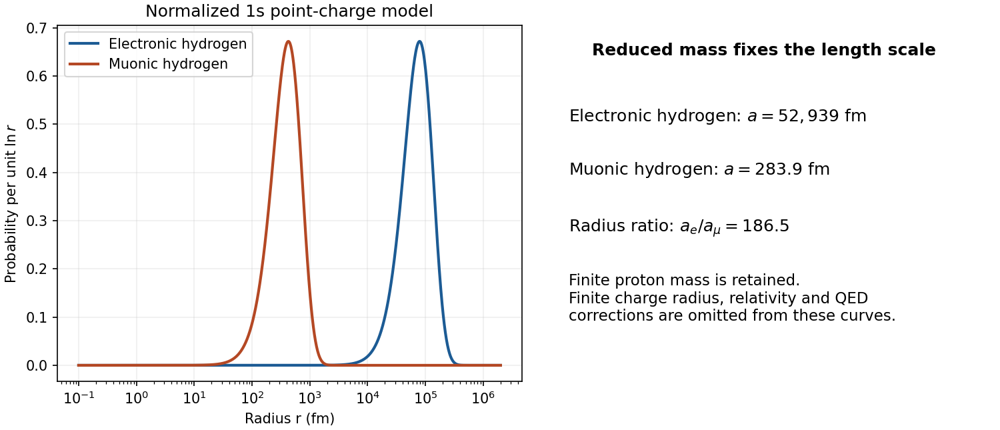
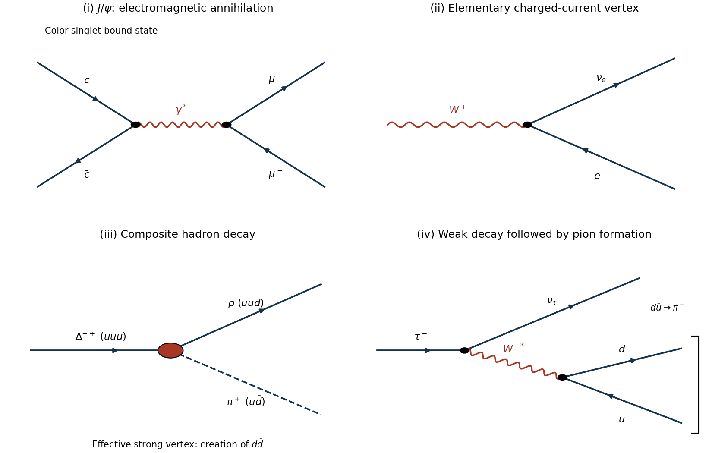
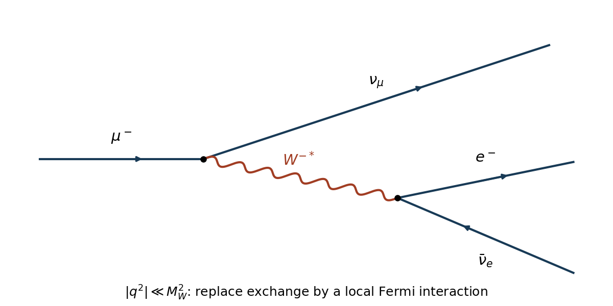
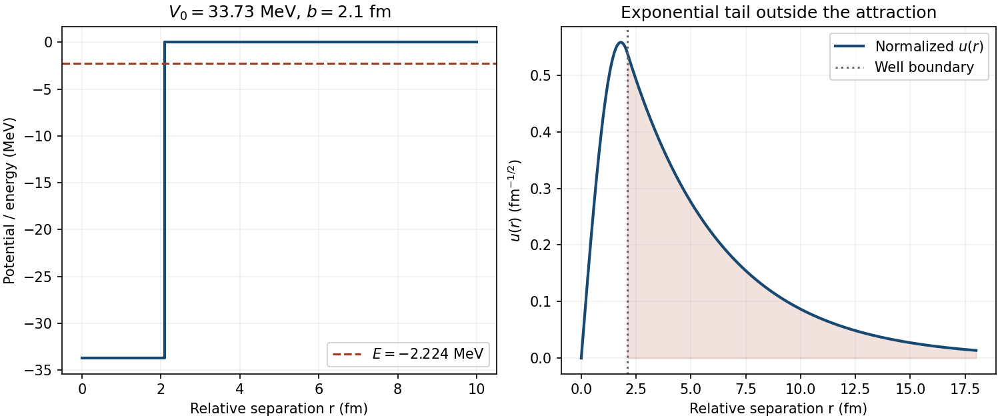

# Paper 1

↑ **Parent:** [2016](../2016.md)

Original source: [Released original, physical PDF pages 403–407](https://www.whatdotheyknow.com/request/natural_science_tripos_physics_e_2/response/2340776/attach/2/FOI%202023%20399%20Zahid%20materials.pdf?cookie_passthrough=1#page=403). All four questions and every option are covered.

**Table of contents**

- [1](#1)
  - [a](#1/a)
    - [Solution](#1/a/solution)
  - [b](#1/b)
    - [Solution](#1/b/solution)
  - [c](#1/c)
    - [Solution](#1/c/solution)
- [2](#2)
  - [a](#2/a)
    - [Solution](#2/a/solution)
  - [b](#2/b)
    - [Solution](#2/b/solution)
  - [c](#2/c)
    - [Solution](#2/c/solution)
- [3](#3)
  - [a](#3/a)
    - [i](#3/a/i)
      - [Solution](#3/a/i/solution)
    - [ii](#3/a/ii)
      - [Solution](#3/a/ii/solution)
    - [iii](#3/a/iii)
      - [Solution](#3/a/iii/solution)
    - [iv](#3/a/iv)
      - [Solution](#3/a/iv/solution)
  - [b](#3/b)
    - [Solution](#3/b/solution)
  - [c](#3/c)
    - [Solution](#3/c/solution)
  - [d](#3/d)
    - [Solution](#3/d/solution)
- [4](#4)
  - [a](#4/a)
    - [Solution](#4/a/solution)
  - [b](#4/b)
    - [Solution](#4/b/solution)
  - [c](#4/c)
    - [Solution](#4/c/solution)
  - [d](#4/d)
    - [Solution](#4/d/solution)
  - [e](#4/e)
    - [Solution](#4/e/solution)

## 1

↑ **Parent:** [Paper 1](paper-1.md)

<h3 id="1/a">a</h3>

↑ **Parent:** [1](#1)

<h4 id="1/a/solution">Solution</h4>

↑ **Parent:** [A](#1/a)

In the [nuclear shell model](../../atomic-nucleus.md#nuclear-shell-model), a level with total [angular momentum](../../momentum.md#angular-momentum) $j$ has $2j+1$ substates for each [nucleon](../../physics.md#nucleon) species. The first three levels accommodate $2+4+2=8$ [protons](../../physics.md#proton) or eight [neutrons](../../neutron.md). [nuclear pairing](../../atomic-nucleus.md#nuclear-pairing) makes a filled shell or a pair of like [nucleons](../../physics.md#nucleon) contribute $J=0$, and an orbital has spatial [parity](../../quantum-mechanics.md#parity) $(-1)^\ell$.

For [oxygen-17](../../chemical-substance.md#oxygen-17), eight [protons](../../physics.md#proton) and eight [neutrons](../../neutron.md) form a closed core; the remaining [neutron](../../neutron.md) occupies $1d_{5/2}$, so **$J^P=5/2^+$**. For [nitrogen-15](../../chemical-substance.md#nitrogen-15), eight [neutrons](../../neutron.md) close their shell, while the seventh [proton](../../physics.md#proton) occupies $1p_{1/2}$. Equivalently it is a [proton hole](../../atomic-nucleus.md#proton-hole) relative to the closed eight-proton shell, giving **$J^P=1/2^-$**. [beryllium-10](../../chemical-substance.md#beryllium-10) is an [even-even nucleus](../../atomic-nucleus.md#even-even-nucleus); pairing its four [protons](../../physics.md#proton) and six [neutrons](../../neutron.md) gives **$J^P=0^+$**.

[boron-10](../../chemical-substance.md#boron-10) needs an additional qualification. The fifth [proton](../../physics.md#proton) and fifth [neutron](../../neutron.md) each occupy $1p_{3/2}$. [addition of angular momentum](../../angular-momentum-operator.md#addition-of-angular-momentum) permits

$$
J=0,1,2,3,\qquad P=(-1)^{1+1}=+1.
$$

The experimentally correct ground-state assignment is **$3^+$**, corresponding to aligned unpaired $j=3/2$ contributions in this simple description. However, one-particle level ordering alone does not select it over the other couplings: their splitting requires the [nuclear residual interaction](../../atomic-nucleus.md#nuclear-residual-interaction). Assuming a preference for the aligned proton-neutron coupling gives the intended prediction; without that assumption, the strictly deducible result is the allowed positive-parity multiplet. The evaluated [ground state](../../quantum-mechanics.md#ground-state) is $3^+,T=0$, with a $1^+,T=0$ level above it.[Table 10.18, ground state and first excited state, physical page 1](../../physics-bibliography.md#energy-levels-of-boron-10-by-tunl-2004)

<h3 id="1/b">b</h3>

↑ **Parent:** [1](#1)

<h4 id="1/b/solution">Solution</h4>

↑ **Parent:** [B](#1/b)

Use [natural units](../../mathematical-physics.md#natural-units) and write the common light [constituent quark mass](../../standard-model.md#constituent-quark-mass) as $m$, and the strange one as $M$. For two [spin one-half](../../angular-momentum-operator.md#spin-one-half) constituents,

$$
\mathbf S_1\cdot\mathbf S_2=\frac12\left[S(S+1)-\frac32\right]
=\begin{cases}-3/4,&S=0,\\+1/4,&S=1.\end{cases}
$$

The relative hyperfine contributions are $-3$ and $+1$. Absorb their normalization and spatial overlap into pair-dependent parameters $h_{\ell\ell},h_{\ell s},h_{ss}$. The [meson hyperfine mass splitting](../../physics.md#meson-hyperfine-mass-splitting) model gives

$$
\begin{aligned}
m_\pi&=2m-3h_{\ell\ell},&m_\rho&=2m+h_{\ell\ell},\\
m_K&=m+M-3h_{\ell s},&m_{K^*}&=m+M+h_{\ell s},\\
m_\phi&=2M+h_{ss}.
\end{aligned}
$$

A common color-magnetic coefficient gives $h_{ij}\propto1/(m_i m_j)$, but its numerical value is not needed.

In the specified [Eta octet state](../../standard-model.md#eta-octet-state) used for the [eta meson](../../physics.md#eta-meson) the light-flavor probability is $1/3$ and the strange-flavor probability $2/3$. Assuming a flavor-diagonal [mass](../../classical-mechanics.md#mass) operator,

$$
m_\eta=\frac13(2m-3h_{\ell\ell})+\frac23(2M-3h_{ss})
=\frac23m+\frac43M-h_{\ell\ell}-2h_{ss}.
$$

Inserting the five [mass](../../classical-mechanics.md#mass) expressions into the proposed combination makes the coefficient of $h_{\ell s}$ equal to $4-4=0$. Those of $m,M,h_{\ell\ell},h_{ss}$ are $2/3,4/3,-1,-2$. Consequently

$$
\boxed{m_\eta=-\frac13m_{\pi^0}-2m_{\rho^0}+4m_{K^{*0}}+\frac43m_{K^0}-2m_\phi.}
$$

This is an identity within the assumed [mass](../../classical-mechanics.md#mass) operator and octet flavor assignment. It is not an exact relation among measured [masses](../../classical-mechanics.md#mass): [eta mixing](../../physics.md#eta-mixing) and additional spin-independent binding effects are outside those assumptions.

<h3 id="1/c">c</h3>

↑ **Parent:** [1](#1)

<h4 id="1/c/solution">Solution</h4>

↑ **Parent:** [C](#1/c)

For [neutrino-electron elastic scattering](../../quantum-scattering.md#neutrino-electron-elastic-scattering), work in the laboratory frame with a stationary [electron](../../physics.md#electron) and a massless incoming [neutrino](../../standard-model.md#neutrino) of [energy](../../energy.md) $E$. If the [electron](../../physics.md#electron) receives [kinetic energy](../../energy.md#kinetic-energy) $T$ and [momentum](../../momentum.md) $\mathbf p$, its [relativistic energy-momentum relation](../../special-relativity.md#energy-momentum-relation) gives

$$
p^2=(m+T)^2-m^2=T^2+2mT.
$$

[conservation of energy](../../mathematical-physics.md#conservation-of-energy) fixes the outgoing [neutrino](../../standard-model.md#neutrino) [energy](../../energy.md) to $E-T$, and [conservation of momentum](../../momentum.md#momentum-conservation) fixes its [momentum](../../momentum.md) to $\mathbf k-\mathbf p$. Its zero [mass](../../classical-mechanics.md#mass) therefore requires

$$
(E-T)^2=E^2+p^2-2Ep\cos\theta.
$$

Substitution and cancellation give

$$
(E+m)T=E\sqrt{T(T+2m)}\cos\theta.
$$

For $T>0$, this requires $\cos\theta>0$; squaring must not introduce a backward-electron branch. Squaring, cancelling $T$ and solving gives

$$
\boxed{T=\frac{2mE^2\cos^2\theta}{(E+m)^2-E^2\cos^2\theta}.}
$$

The expression increases with $\cos^2\theta$ on the physical interval $0\leq\theta\leq\pi/2$. Maximum transfer occurs for a forward [electron](../../physics.md#electron) and a backward outgoing [neutrino](../../standard-model.md#neutrino):

$$
T_{\max}=\frac{2E^2}{m+2E}
=\frac{2(0.86)^2}{0.511+2(0.86)}\,\mathrm{MeV}
=\boxed{0.663\,\mathrm{MeV}.}
$$

The remaining $0.197\,\mathrm{MeV}$ is carried by the [neutrino](../../standard-model.md#neutrino). An elastic collision cannot transfer the entire incident [energy](../../energy.md) to a free massive [electron](../../physics.md#electron).

## 2

↑ **Parent:** [Paper 1](paper-1.md)

<h3 id="2/a">a</h3>

↑ **Parent:** [2](#2)

<h4 id="2/a/solution">Solution</h4>

↑ **Parent:** [A](#2/a)

A [muonic atom](../../physics.md#muonic-atom) binds a negative [muon](../../standard-model.md#muon) in the nuclear [Coulomb potential](../../electrostatics.md#coulomb-potential-energy). The [muon](../../standard-model.md#muon) is a [spin one-half](../../angular-momentum-operator.md#spin-one-half) [lepton](../../standard-model.md#lepton) with the [electron](../../physics.md#electron)'s charge but about 207 times its [mass](../../classical-mechanics.md#mass). For a point [nucleus](../../atomic-nucleus.md) of [mass](../../classical-mechanics.md#mass) $M_N$ and charge $Ze$, the [reduced mass](../../classical-mechanics.md#reduced-mass) and nonrelativistic hydrogenic scales, with [fine-structure constant](../../perturbative-quantum-field-theory.md#fine-structure-constant) $\alpha$, are

$$
\mu_r=\frac{m_\mu M_N}{m_\mu+M_N},\qquad
a_\mu=\frac{\hbar}{Z\alpha\mu_r c},\qquad
E_n=-\frac{\mu_r c^2(Z\alpha)^2}{2n^2}.
$$

For a heavy [nucleus](../../atomic-nucleus.md) $\mu_r\simeq m_\mu$, giving a radius roughly $1/207$ of the corresponding electronic radius and transition [energies](../../energy.md) roughly 207 times larger. For hydrogen, [nuclear recoil](../../atomic-nucleus.md#nuclear-recoil) matters: $m_\mu\simeq106\,\mathrm{MeV}/c^2$ gives $\mu_r\simeq95\,\mathrm{MeV}/c^2$ and $a_\mu\simeq284\,\mathrm{fm}$ rather than the infinite-nuclear-mass value about $255\,\mathrm{fm}$.

A slowed negative [muon](../../standard-model.md#muon) is captured into an excited orbit and undergoes a [radiative cascade](../../atomic-physics.md#radiative-cascade), ejecting atomic [electrons](../../physics.md#electron) and emitting muonic X-rays. Inner orbits penetrate the [nuclear charge distribution](../../atomic-nucleus.md#nuclear-charge-distribution), particularly at large $Z$. Replacing a point charge by an extended charge makes the central attraction less singular and shifts states with substantial nuclear overlap. Measured transition [energies](../../energy.md) consequently constrain the [nuclear charge radius](../../atomic-nucleus.md#nuclear-charge-radius). Sensitivity is particularly strong for $S$ states, whose contact density scales as $(Z\alpha\mu_r)^3$.

An instructive experiment is [Randolf Pohl](../../physicist.md#randolf-pohl)'s team's muonic-hydrogen spectroscopy. A stopped-muon target prepared a metastable $2S$ population; a tunable pulsed laser drove a $2S\to2P$ transition, followed by a detectable $2P\to1S$ X-ray. Scanning laser frequency located a resonance whose interpretation included the [proton](../../physics.md#proton) finite-size contribution to the [Lamb shift](../../atomic-physics.md#lamb-shift). Delayed detection selected the long-lived population against prompt cascade backgrounds. Laser-off or detuned measurements provide a background control; [energy](../../energy.md) and time selection alone would not establish a laser-induced resonance.[Nature 466, pp. 213–216, Fig. 1 experimental principle and Figs. 4–5 time spectra and resonance](../../physics-bibliography.md#the-size-of-the-proton-by-randolf-pohl-and-others)

**[Figure 1](#2/a/image-reduced-mass-changes-the-orbital-scale-and-nuclear-size-sensitivity). reduced mass changes the orbital scale and nuclear-size sensitivity**. Original calculated hydrogenic radial probabilities, plotted against physical radius with probability measured per logarithmic interval. The Bohr radii are stated alongside; these are point-nucleus model curves, not measured nuclear densities.

Extracting a radius requires [quantum electrodynamics](../../perturbative-quantum-field-theory.md#quantum-electrodynamics), including [vacuum polarization](../../perturbative-quantum-field-theory.md#vacuum-polarization), recoil and nuclear-structure corrections. A free [muon](../../standard-model.md#muon) decays on a microsecond timescale; a bound negative [muon](../../standard-model.md#muon) can instead undergo [muon capture](../../physics.md#muon-capture), for example $\mu^-p\to n\nu_\mu$. These processes limit observation time. In heavy atoms, relativistic motion and nuclear overlap make the simple Bohr formulas only qualitative. **Muonic spectroscopy converts a smaller orbital scale into enhanced sensitivity to nuclear charge structure**, provided atomic and nuclear corrections are controlled.

<h3 id="2/b">b</h3>

↑ **Parent:** [2](#2)

<h4 id="2/b/solution">Solution</h4>

↑ **Parent:** [B](#2/b)

The [nuclear Fermi gas model](../../quantum-ideal-gas-statistics.md#nuclear-fermi-gas-model) treats [protons](../../physics.md#proton) and [neutrons](../../neutron.md) as two species of [spin one-half](../../angular-momentum-operator.md#spin-one-half) [fermions](../../tensor-product-of-quantum-systems.md#fermion) moving approximately independently in a confining [nuclear mean field](../../atomic-nucleus.md#nuclear-mean-field). At a [temperature](../../temperature.md) small compared with their [Fermi temperature](../../quantum-ideal-gas-statistics.md#fermi-temperature), the [Pauli exclusion principle](../../tensor-product-of-quantum-systems.md#pauli-exclusion-principle) fills the lowest available [momentum](../../momentum.md) states. It does not allow all [nucleons](../../physics.md#nucleon) to sit at zero [momentum](../../momentum.md).

For species $i=p,n$, two [spin](../../angular-momentum-operator.md#spin) states occupy each momentum-space cell $(2\pi\hbar)^3/V$. Counting a filled sphere gives

$$
N_i=\frac{2V}{(2\pi\hbar)^3}\frac{4\pi p_{F,i}^3}{3},\qquad
p_{F,i}=\hbar(3\pi^2 n_i)^{1/3},\qquad E_{F,i}=\frac{p_{F,i}^2}{2m_N},
$$

where $n_i=N_i/V$. The [Fermi energy](../../quantum-ideal-gas-statistics.md#fermi-energy) is measured from the mean-field well bottom; it need not equal the [energy](../../energy.md) needed to remove a [nucleon](../../physics.md#nucleon) into vacuum. Occupied-state averaging gives

$$
E_{\mathrm{kin}}=\frac35(NE_{F,n}+ZE_{F,p}),\qquad P_i=\frac25 n_iE_{F,i}.
$$

Even at zero [temperature](../../temperature.md) there is [kinetic energy](../../energy.md#kinetic-energy) and [degeneracy pressure](../../quantum-ideal-gas-statistics.md#degeneracy-pressure). As an explicitly illustrative input, total density $n=0.16\,\mathrm{fm}^{-3}$ and $N=Z$ give $p_Fc\simeq263\,\mathrm{MeV}$ and $E_F\simeq37\,\mathrm{MeV}$. These numbers illustrate the formula; they are not additional data supplied by the paper.

Separate [proton](../../physics.md#proton) and [neutron](../../neutron.md) seas explain a kinetic contribution to [nuclear symmetry energy](../../physics.md#symmetry-energy). At fixed $n$, put $\delta=(N-Z)/A$ and define $E_F$ at $n_p=n_n=n/2$. Then

$$
\frac{E_{\mathrm{kin}}}{A}
=\frac35E_F\frac{(1+\delta)^{5/3}+(1-\delta)^{5/3}}2
=\frac35E_F+\frac13E_F\delta^2+O(\delta^4).
$$

Increasing one species' population raises its [Fermi surface](../../fermi-liquid.md#fermi-surface) and costs [energy](../../energy.md), favoring similar populations before electrostatic and interaction terms are included.

[pauli blocking](../../tensor-product-of-quantum-systems.md#pauli-blocking) suppresses collisions deep in a filled sea because scattering needs unoccupied final states. An energetic external probe can knock a [nucleon](../../physics.md#nucleon) into an empty state and reveal its initial [Fermi motion](../../quantum-ideal-gas-statistics.md#fermi-motion), making the model useful for broad inclusive scattering distributions. A finite surface can be approximated using a position-dependent [nuclear mean field](../../atomic-nucleus.md#nuclear-mean-field).

A free gas cannot produce nuclear binding or saturation: those require an attractive interaction and its density dependence. The smooth gas picture also omits discrete [nuclear shells](../../atomic-nucleus.md#nuclear-shell), [nuclear spin-orbit splitting](../../atomic-nucleus.md#nuclear-spin-orbit-splitting), [nuclear pairing](../../atomic-nucleus.md#nuclear-pairing), short-distance correlations and deformation. It cannot assign all ground-state [spins](../../angular-momentum-operator.md#spin) from a [momentum](../../momentum.md) sphere. **Its useful prediction is the scale and occupancy of [nucleon](../../physics.md#nucleon) motion, with a surrounding mean field supplied separately.**

<h3 id="2/c">c</h3>

↑ **Parent:** [2](#2)

<h4 id="2/c/solution">Solution</h4>

↑ **Parent:** [C](#2/c)

The [Standard Model](../../standard-model.md) is a [gauge theory](../../classical-field-theory.md#gauge-theory) with group $SU(3)_c\times SU(2)_L\times U(1)_Y$, matter [quarks](../../standard-model.md#quark) and [leptons](../../standard-model.md#lepton), gauge bosons and a [Higgs field](../../standard-model.md#higgs-field). It combines [Quantum chromodynamics](../../standard-model.md#quantum-chromodynamics) with the [electroweak interaction](../../standard-model.md#electroweak-interaction). Its successes do not make its field content a complete account of nature. Established missing phenomena should be distinguished from theoretical questions about its parameters.

[neutrino oscillation](../../standard-model.md#neutrino-oscillation) demonstrates nonzero mass-squared differences and mixing of flavor states. The minimal renormalizable [Standard Model](../../standard-model.md) has no [right-handed neutrino](../../standard-model.md#right-handed-neutrino) and no [neutrino mass](../../standard-model.md#neutrino-mass) term. The atmospheric experiment compared zenith-angle distributions of muon-like and electron-like events in a large water [Cherenkov detector](../../particle-detection.md#cherenkov-detector). A direction-dependent muon-neutrino deficit, with different path lengths through Earth and comparison samples, discriminated against a uniform flux-normalization error.[Abstract and zenith-angle distributions, Physical Review Letters 81, pp. 1562–1567 (1998)](../../physics-bibliography.md#evidence-for-oscillation-of-atmospheric-neutrinos-by-y-fukuda-and-others) One extension adds [right-handed neutrinos](../../standard-model.md#right-handed-neutrino) and small Dirac Yukawa couplings; another has a [Majorana mass term](../../relativistic-quantum-field.md#majorana-mass-term) and [seesaw mechanism](../../standard-model.md#seesaw-mechanism), with light eigenvalue of order $m_D^2/M$. Oscillations alone do not decide whether [neutrinos](../../standard-model.md#neutrino) are [Majorana neutrinos](../../standard-model.md#majorana-neutrino).

[dark matter](../../cosmology.md#dark-matter) is inferred from gravitational observations such as galactic motions and [gravitational lensing](../../gravitational-lensing.md); [Standard Model](../../standard-model.md) particles do not supply the required dominant cold component. Active [neutrinos](../../standard-model.md#neutrino) contribute some matter but cannot constitute all the cold [dark matter](../../cosmology.md#dark-matter). A new stable weakly interacting particle, an [axion](../../relativistic-quantum-field.md#axion), or other hidden-sector states are possible explanations, with different scattering, production and astrophysical signals. **Dark-matter evidence does not identify a particular new particle.** The institutional account distinguishes gravitational evidence from proposed particle candidates.[Gravitational evidence and candidate-particle discussion](../../physics-bibliography.md#dark-matter-by-cern)

The matter-antimatter imbalance poses a different problem. Dynamical [baryogenesis](../../cosmology.md#baryogenesis) needs [Sakharov conditions](../../cosmology.md#sakharov-conditions), including baryon-number violation, [CP violation](../../quantum-field-theory.md#cp-violation) and departure from [thermal equilibrium](../../thermal-equilibrium.md). Although the [Standard Model](../../standard-model.md) contains relevant ingredients in principle, they do not generate the observed asymmetry in its conventional thermal history with measured parameters. Additional CP phases, a stronger electroweak transition, or [leptogenesis](../../cosmology.md#leptogenesis) from heavy [Majorana neutrinos](../../standard-model.md#majorana-neutrino) are possible extensions. Each needs a quantitative mechanism.

[gravity](../../physics.md#gravity) is absent as a dynamical quantum interaction, motivating [quantum gravity](../../quantum-theory.md#quantum-gravity) and unification. The [hierarchy problem](../../standard-model.md#hierarchy-problem) asks why the Higgs [mass](../../classical-mechanics.md#mass) scale is small compared with much higher scales when scalar [masses](../../classical-mechanics.md#mass) receive sensitive quantum corrections. [supersymmetry](../../supersymmetry.md) can cancel particular contributions between partner fields if its breaking pattern is suitable; compositeness gives another interpretation of the Higgs sector. Neither motivation proves that the corresponding new particles exist. The [Strong CP problem](../../relativistic-quantum-field.md#strong-cp-problem) asks why the allowed [QCD](../../standard-model.md#quantum-chromodynamics) CP-violating parameter is so small; an [axion](../../relativistic-quantum-field.md#axion) mechanism is one possible answer.

A [grand unified theory](../../classical-field-theory.md#grand-unified-theory) embeds the separate gauge factors in a larger group and can relate couplings or [fermion](../../tensor-product-of-quantum-systems.md#fermion) representations, sometimes predicting [proton decay](../../standard-model.md#proton-decay). Its tests differ from dark-matter or neutrino-mass searches. **A useful extension must explain a specified deficiency, preserve successful low-energy predictions and supply distinguishable experimental consequences.** Attractive new symmetries alone are not evidence.

## 3

↑ **Parent:** [Paper 1](paper-1.md)

<h3 id="3/a">a</h3>

↑ **Parent:** [3](#3)

The original [Feynman diagrams](../../perturbative-quantum-field-theory.md#feynman-diagram) below distinguish elementary weak and electromagnetic vertices from an [effective hadronic vertex](../../perturbative-quantum-field-theory.md#effective-hadronic-vertex). [fermion](../../tensor-product-of-quantum-systems.md#fermion) arrows track fermion number; time runs left to right.

**[Figure 2](#3/a/image-four-decay-channels-and-their-dominant-interactions). Four decay channels and their dominant interactions**. Original diagrams. Panel (iii) is an effective strong hadronic vertex; panel (iv) brackets the quark pair forming the pion.

<h4 id="3/a/i">i</h4>

↑ **Parent:** [A](#3/a)

<h5 id="3/a/i/solution">Solution</h5>

↑ **Parent:** [I](#3/a/i)

**The dominant interaction is electromagnetic.** The [color singlet](../../standard-model.md#colour-singlet) charm-anticharm component of the [J/psi meson](../../physics.md#j-psi-meson) annihilates through a virtual [photon](../../quantum-mechanics.md#photon), which creates a [muon](../../standard-model.md#muon) and an [antimuon](../../standard-model.md#antimuon):

$$
c\bar c\longrightarrow\gamma^*\longrightarrow\mu^-\mu^+.
$$

Panel (i) shows the two electromagnetic vertices. Vector quantum numbers allow the one-photon channel. A [Z boson](../../standard-model.md#z-boson) contribution is negligible at this [mass](../../classical-mechanics.md#mass) scale; a single [gluon](../../standard-model.md#gluon) cannot connect a [color singlet](../../standard-model.md#colour-singlet) initial state to colorless [leptons](../../standard-model.md#lepton). The dominant interaction for this specified final state need not dominate the [meson](../../physics.md#meson)'s total [decay width](../../relativistic-quantum-field.md#decay-width).

<h4 id="3/a/ii">ii</h4>

↑ **Parent:** [A](#3/a)

<h5 id="3/a/ii/solution">Solution</h5>

↑ **Parent:** [Ii](#3/a/ii)

**This is a weak charged-current decay.** Panel (ii) has one $W^+e^+\nu_e$ vertex. The outgoing [Positron](../../physics.md#positron) and [electron neutrino](../../standard-model.md#electron-neutrino) have total charge $+1$ and cancelling [lepton numbers](../../standard-model.md#lepton-number). The [W boson](../../standard-model.md#w-boson) is on shell here; a second virtual boson is unnecessary.

<h4 id="3/a/iii">iii</h4>

↑ **Parent:** [A](#3/a)

<h5 id="3/a/iii/solution">Solution</h5>

↑ **Parent:** [Iii](#3/a/iii)

**The dominant interaction is strong.** At [hadron](../../physics.md#hadron) level, panel (iii) is an [effective hadronic vertex](../../perturbative-quantum-field-theory.md#effective-hadronic-vertex) for $\Delta p\pi$. The initial $uuu$ constituents rearrange into $uud$ and $u\bar d$ after creation of a $d\bar d$ pair:

$$
uuu\longrightarrow (uud)+(u\bar d).
$$

One original [up quark](../../standard-model.md#up-quark) enters the charged [pion](../../standard-model.md#pion); the other two join the new [down quark](../../standard-model.md#down-quark) in the [proton](../../physics.md#proton). Gluon-induced pair creation supplies the [quark-flow diagram](../../perturbative-quantum-field-theory.md#quark-flow-diagram) interpretation. This is nonperturbative [hadronization](../../standard-model.md#hadronization): the [effective hadronic vertex](../../perturbative-quantum-field-theory.md#effective-hadronic-vertex) does not claim that one elementary perturbative [quark](../../standard-model.md#quark) graph calculates its width. Charge, [baryon number](../../standard-model.md#baryon-number) and net [quark](../../standard-model.md#quark) flavor are conserved.

<h4 id="3/a/iv">iv</h4>

↑ **Parent:** [A](#3/a)

<h5 id="3/a/iv/solution">Solution</h5>

↑ **Parent:** [Iv](#3/a/iv)

**The dominant interaction is weak.** In panel (iv),

$$
\tau^-\longrightarrow\nu_\tau+W^{-*},\qquad
W^{-*}\longrightarrow d\bar u\longrightarrow\pi^-.
$$

The [quark](../../standard-model.md#quark) vertex carries the [Cabibbo-Kobayashi-Maskawa matrix](../../standard-model.md#cabibbo-kobayashi-maskawa-matrix) factor $V_{ud}$. The [down quark](../../standard-model.md#down-quark) and anti-up [quark](../../standard-model.md#quark) form a [color singlet](../../standard-model.md#colour-singlet) [pion](../../standard-model.md#pion). The [pion](../../standard-model.md#pion) bracket represents its bound-state [matrix element](../../vector-space.md#matrix-element), conventionally specified by the [pion decay constant](../../standard-model.md#pion-decay-constant); it is not an additional weak vertex. The [neutrino](../../standard-model.md#neutrino) carries the initial [tau lepton](../../standard-model.md#tau-particle) number.

<h3 id="3/b">b</h3>

↑ **Parent:** [3](#3)

<h4 id="3/b/solution">Solution</h4>

↑ **Parent:** [B](#3/b)

Assume [allowed beta decay](../../physics.md#allowed-beta-decay), so the leading [matrix element](../../vector-space.md#matrix-element) has negligible lepton-momentum dependence. Neglect [nuclear recoil](../../atomic-nucleus.md#nuclear-recoil) and [neutrino mass](../../standard-model.md#neutrino-mass). Let $Q$ be the [kinetic energy](../../energy.md#kinetic-energy) available to the [electron](../../physics.md#electron) and [antineutrino](../../standard-model.md#antineutrino), $E_0=m_e+Q$, and $E=\sqrt{p^2+m_e^2}$. The [neutrino](../../standard-model.md#neutrino) [energy](../../energy.md) and [momentum](../../momentum.md) magnitude are $k=E_0-E$.

[Fermi's golden rule](../../quantum-mechanics.md#fermi-s-golden-rule) weights accessible final states. After angular integration, the momentum-space factors are $p^2\,dp$ and $k^2\,dk$. The energy-conserving [Dirac delta function](../../distribution-theory.md#dirac-delta-function) removes the [neutrino](../../standard-model.md#neutrino) integral:

$$
d\Gamma=Cp^2\,dp\int_0^\infty k^2\,dk\,\delta(E_0-E-k).
$$

The constant includes the allowed nuclear [matrix element](../../vector-space.md#matrix-element), weak-coupling and angular factors. Including the usual [Fermi function](../../physics.md#fermi-function) for electron-nucleus Coulomb distortion gives

$$
\boxed{\frac{d\Gamma}{dp}=C F(Z,E)\,p^2(E_0-\sqrt{p^2+m_e^2})^2,\quad
0\leq p\leq\sqrt{Q(Q+2m_e)}.}
$$

For the kinetic-energy spectrum, $dp/dT=E/p$ instead yields

$$
\frac{d\Gamma}{dT}=C F(Z,E)\,pE(Q-T)^2.
$$

The two distributions differ by a Jacobian; forgetting it changes the shape.

A pure fifth-power law additionally neglects [electron](../../physics.md#electron) [mass](../../classical-mechanics.md#mass) and Coulomb distortion and keeps the nuclear [matrix element](../../vector-space.md#matrix-element) fixed. Then $E=p$, $E_0\simeq Q$, and

$$
\Gamma=C\int_0^Q p^2(Q-p)^2\,dp
=CQ^5\int_0^1x^2(1-x)^2\,dx
=\boxed{\frac{C}{30}Q^5.}
$$

Two [momentum](../../momentum.md) powers come from each final particle and one from the remaining integration. This is the origin of the [Sargent rule](../../physics.md#sargent-rule). **Exact $Q^5$ dependence requires the relativistic-electron, constant-matrix-element limit.** For $Q\ll m_e$, the same approximation without Coulomb distortion has $pE\simeq m_e\sqrt{2m_eT}$ and instead scales as $m_e^{3/2}Q^{7/2}$. Forbidden-transition factors, nuclear-structure changes and Coulomb distortion also modify the simple law.

<h3 id="3/c">c</h3>

↑ **Parent:** [3](#3)

<h4 id="3/c/solution">Solution</h4>

↑ **Parent:** [C](#3/c)

The negative [muon](../../standard-model.md#muon) emits a virtual $W^-$ and becomes a [muon neutrino](../../standard-model.md#muon-neutrino); the boson creates an [electron](../../physics.md#electron) and an [electron antineutrino](../../standard-model.md#electron-antineutrino):

$$
\mu^-\to\nu_\mu+W^{-*}\to\nu_\mu+e^-+\bar\nu_e.
$$

Both vertices are [weak charged currents](../../standard-model.md#charged-current).

**[Figure 3](#3/c/image-muon-decay-through-a-virtual-charged-weak-boson). muon decay through a virtual charged weak boson**. Original tree diagram. Arrows indicate fermion-number flow, including the reversed arrow on the outgoing [electron antineutrino](../../standard-model.md#electron-antineutrino).

Typical transfers satisfy $|q^2|\lesssim m_\mu^2\ll M_W^2$, so the propagator factor $(M_W^2-q^2)^{-1}$ expands as $M_W^{-2}$ plus small corrections. Contracting this short-distance exchange produces the local [Fermi interaction](../../quantum-field-theory.md#fermi-interaction), with strength contained in $G_F$. This effective description does not assume that the real W [mass](../../classical-mechanics.md#mass) vanishes. The same treatment applies to leptonic tau decays with the relevant [masses](../../classical-mechanics.md#mass) changed.[Muon Decay Parameters, §57.1 introduction and §57.2](../../physics-bibliography.md#review-of-particle-physics-by-particle-data-group-2022)

In GeV units, $m_\mu=0.106\,\mathrm{GeV}$ and $\hbar=6.582\times10^{-25}\,\mathrm{GeV\,s}$. Thus

$$
\Gamma_\mu=\frac{(1.166\times10^{-5})^2(0.106)^5}{192\pi^3}\,\mathrm{GeV}
=3.0562\times10^{-19}\,\mathrm{GeV},
$$

$$
\boxed{\tau_\mu=\frac{\hbar}{\Gamma_\mu}=2.154\times10^{-6}\,\mathrm s.}
$$

The modest difference from a precision experimental lifetime is expected from the rounded [mass](../../classical-mechanics.md#mass) and omitted radiative and final-electron-mass corrections.

<h3 id="3/d">d</h3>

↑ **Parent:** [3](#3)

<h4 id="3/d/solution">Solution</h4>

↑ **Parent:** [D](#3/d)

Use an [inclusive spectator model](../../physics.md#inclusive-spectator-model): one heavy constituent decays through the [Fermi interaction](../../quantum-field-theory.md#fermi-interaction), and sum the open charged-current channels. In [weak-decay channel counting](../../physics.md#weak-decay-channel-counting), each massless final [lepton](../../standard-model.md#lepton) pair gives basic width

$$
\Gamma_0(m)=\frac{G_F^2m^5}{192\pi^3},\qquad
\tau=\frac{\hbar}{C\Gamma_0(m)}.
$$

A [quark](../../standard-model.md#quark) pair contributes three colors multiplied by its squared [Cabibbo-Kobayashi-Maskawa matrix](../../standard-model.md#cabibbo-kobayashi-maskawa-matrix) element. Do not multiply by three just because the initial [quark](../../standard-model.md#quark) has three colors: its lifetime is the width of one initial state, averaged over initial color when appropriate. Define

$$
S_u=|V_{ud}|^2+|V_{us}|^2=0.9893,\qquad
S_c=|V_{cd}|^2+|V_{cs}|^2=0.9893.
$$

For the [tau lepton](../../standard-model.md#tau-particle), two leptonic channels contain an [electron](../../physics.md#electron) or a [muon](../../standard-model.md#muon); light hadronic channels have $d\bar u$ or $s\bar u$. Therefore

$$
C_\tau=2+3S_u=4.9679,\qquad
\Gamma_\tau=2.0103\times10^{-12}\,\mathrm{GeV},\qquad
\boxed{\tau_\tau\simeq3.27\times10^{-13}\,\mathrm s.}
$$

No charmed [hadron](../../physics.md#hadron) can be produced: the lightest charmed [meson](../../physics.md#meson) exceeds the tau [mass](../../classical-mechanics.md#mass). [D-zero and D-plus listings, physical page 1 of each, masses 1864.84 and 1869.66 MeV](../../physics-bibliography.md#review-of-particle-physics-by-particle-data-group-2022) The supplied charm-quark parameter is not a free asymptotic final-particle [mass](../../classical-mechanics.md#mass). The leading count neglects [electron](../../physics.md#electron) and [muon](../../standard-model.md#muon) [masses](../../classical-mechanics.md#mass) and light hadronic threshold effects.

For the [charm quark](../../standard-model.md#charm-quark), $c\to sW^{+*}$ and $c\to dW^{+*}$ dominate. The emitted current has two light leptonic channels and the same light hadronic channels as above; a tau cannot be produced:

$$
C_c=S_c(2+3S_u)=4.91474347,\qquad
\Gamma_c=8.5232\times10^{-13}\,\mathrm{GeV},\qquad
\boxed{\tau_c^{\mathrm{spectator}}\simeq7.72\times10^{-13}\,\mathrm s.}
$$

For the [bottom quark](../../standard-model.md#bottom-quark), retain $b\to cW^{-*}$ with the supplied $V_{cb}$ and neglect the much smaller $b\to u$ channel. The emitted current can produce three [lepton](../../standard-model.md#lepton) flavors and two up-type [quark](../../standard-model.md#quark) families, with three colors for each family. In particular $b\to c\bar cs$ is open at the given [masses](../../classical-mechanics.md#mass), although suppressed by [phase space](../../hamiltonian-mechanics.md#phase-space). Counting each open channel as massless gives

$$
C_b=|V_{cb}|^2[3+3S_u+3S_c]=0.01429728,
$$

$$
\Gamma_b=1.0204\times10^{-12}\,\mathrm{GeV},\qquad
\boxed{\tau_b^{\mathrm{spectator}}\simeq6.45\times10^{-13}\,\mathrm s.}
$$

Setting Cabibbo sums to one recovers the familiar counts $5$, $5$ and $9|V_{cb}|^2$. Despite its larger [mass](../../classical-mechanics.md#mass), the [bottom quark](../../standard-model.md#bottom-quark) is slowed by its small interfamily mixing factor.

These are leading estimates rather than precise lifetimes of free [quarks](../../standard-model.md#quark). [confinement](../../standard-model.md#confinement) makes charm and bottom observable in [hadrons](../../physics.md#hadron), whose lifetimes involve spectator interactions, [Quantum chromodynamics](../../standard-model.md#quantum-chromodynamics) corrections and bound-state effects. [mass](../../classical-mechanics.md#mass) corrections are significant for bottom: even the single-charm channel with massless [leptons](../../standard-model.md#lepton) has the [three-body weak-decay mass correction](../../quantum-field-theory.md#three-body-weak-decay-mass-correction)

$$
f(r)=1-8r+8r^3-r^4-12r^2\ln r,\qquad
r=(m_c/m_b)^2=0.09,\qquad f(r)\simeq0.520.
$$

Tau and double-charm channels have different suppressions, so multiplying the entire width by this one factor is inconsistent. Accurate [hadron](../../physics.md#hadron) lifetimes require those channel-dependent factors and hadronic dynamics; the exercise supports the explicitly stated leading counts.

## 4

↑ **Parent:** [Paper 1](paper-1.md)

<h3 id="4/a">a</h3>

↑ **Parent:** [4](#4)

<h4 id="4/a/solution">Solution</h4>

↑ **Parent:** [A](#4/a)

An [S wave](../../quantum-scattering.md#s-wave-quantum-scattering) has $L=0$ and positive [parity](../../quantum-mechanics.md#parity). The [deuteron](../../atomic-nucleus.md#deuteron)'s $J=1$ therefore requires a [spin-one-half triplet state](../../angular-momentum-operator.md#spin-one-half-triplet-state), $S=1$. The two-nucleon [isospin](../../standard-model.md#isospin) description makes this the antisymmetric $T=0$ channel. Its existence proves sufficient attraction to bind in the $\,{}^3S_1$-dominated channel.

A [spin one-half](../../angular-momentum-operator.md#spin-one-half) pair could also form $S=0$. The absence of a bound $\,{}^1S_0$ [deuteron](../../atomic-nucleus.md#deuteron) indicates that the singlet interaction does not bind, not that it is everywhere repulsive. Together with triplet binding, this shows that a spin-independent central attraction is insufficient. No radial excited bound level also constrains the strength and range: the attraction supports only a shallow low-energy [bound state](../../quantum-system.md#bound-state).

For identical [neutrons](../../neutron.md) or [protons](../../physics.md#proton), two-particle [isospin](../../standard-model.md#isospin) has $T=1$ and is symmetric. At even $L$, spatial exchange is symmetric, so the [Pauli exclusion principle](../../tensor-product-of-quantum-systems.md#pauli-exclusion-principle) requires an antisymmetric [spin](../../angular-momentum-operator.md#spin) state, $S=0$. A low-energy $nn$ or $pp$ pair cannot occupy the [deuteron](../../atomic-nucleus.md#deuteron)'s $S=1,T=0$ channel. With approximate [charge independence of nuclear forces](../../nuclear-force.md#charge-independence-of-nuclear-forces), their singlet [strong interaction](../../standard-model.md#strong-interaction) corresponds to the unbound neutron-proton singlet; proton-proton electrostatic repulsion further disfavors binding. **There is no bound [dineutron](../../nuclear-force.md#dineutron) or [diproton](../../nuclear-force.md#diproton) in these physical low-energy channels.** The inference uses charge independence and singlet-channel behavior; the [deuteron](../../atomic-nucleus.md#deuteron)'s quantum numbers alone do not constrain every imaginable potential.

<h3 id="4/b">b</h3>

↑ **Parent:** [4](#4)

<h4 id="4/b/solution">Solution</h4>

↑ **Parent:** [B](#4/b)

The [nuclear binding energy](../../atomic-nucleus.md#nuclear-binding-energy) is the separated-nucleon [rest energy](../../special-relativity.md#rest-energy) minus the bound-state [rest energy](../../special-relativity.md#rest-energy). Consistent nuclear [masses](../../classical-mechanics.md#mass) avoid atomic-electron bookkeeping:

$$
B=(m_p+m_n-m_d)c^2
=(938.272+939.565-1875.613)\,\mathrm{MeV}
=\boxed{2.224\,\mathrm{MeV}.}
$$

It is positive because the bound [deuteron](../../atomic-nucleus.md#deuteron) has lower total [energy](../../energy.md).

<h3 id="4/c">c</h3>

↑ **Parent:** [4](#4)

<h4 id="4/c/solution">Solution</h4>

↑ **Parent:** [C](#4/c)

In a pure $L=0,S=1$ stretched state both [spins](../../angular-momentum-operator.md#spin) point along the total [angular momentum](../../momentum.md#angular-momentum), with no orbital contribution. The [nuclear magnetic moment](../../electromagnetism.md#nuclear-magnetic-moment) would be

$$
\mu_d^{(S)}=\mu_p+\mu_n=(2.793-1.913)\mu_N=0.880\mu_N.
$$

The measured $0.857\mu_N$ differs. More decisively, a pure [S wave](../../quantum-scattering.md#s-wave-quantum-scattering) spatial state is isotropic and has zero [electric quadrupole moment](../../electrostatics.md#electric-quadrupole-moment). Its nonzero value requires a nonspherical component of the quantum charge distribution.

Positive [parity](../../quantum-mechanics.md#parity) allows even $L$; coupling $S=1$ to $J=1$ permits $L=0$ and $L=2$. The state contains a [deuteron D-state admixture](../../atomic-nucleus.md#deuteron-d-state-admixture):

$$
|\psi_d\rangle=\sqrt{1-P_D}\,|{}^3S_1\rangle+\sqrt{P_D}\,|{}^3D_1\rangle,
$$

with radial [wavefunctions](../../wave-function.md) implicit. A [nuclear tensor force](../../nuclear-force.md#nuclear-tensor-force) couples the orbital components. The quadrupole moment involves their interference as well as a D-state contribution, making it sensitive to a small admixture. This is a quantum angular correlation, not two particles permanently fixed in space.

In the nonrelativistic one-body magnetic-moment approximation,

$$
\frac{\mu_d}{\mu_N}=(1-P_D)\mu_s+P_D\left(\frac34-\frac12\mu_s\right),
\qquad \mu_s=\frac{\mu_p+\mu_n}{\mu_N}=0.880.
$$

The D-state coupling has $\langle S_z\rangle=-1/2$ and $\langle L_z\rangle=3/2$ at $J_z=1$; the [proton](../../physics.md#proton) supplies approximately half the relative orbital magnetic moment. Thus

$$
P_D\simeq\frac{0.880-0.857}{\frac32(0.880-\frac12)}
=\boxed{0.040\ \text{in this approximation}.}
$$

The robust conclusion is **a predominantly [S wave](../../quantum-scattering.md#s-wave-quantum-scattering) state with a small tensor-induced [D wave](../../quantum-scattering.md#d-wave) component**. The 4% estimate is model dependent: exchange currents and other corrections also affect the magnetic moment, and a [wavefunction](../../wave-function.md) component probability is not itself a uniquely measured observable.[§I.F, Observables and not-so observable quantities; §II.B, spin-dependent nuclear interactions](../../physics-bibliography.md#modern-theory-of-nuclear-forces-by-evgeny-epelbaum-and-others)

<h3 id="4/d">d</h3>

↑ **Parent:** [4](#4)

<h4 id="4/d/solution">Solution</h4>

↑ **Parent:** [D](#4/d)

Use the relative coordinate and [reduced mass](../../classical-mechanics.md#reduced-mass)

$$
\mu=\frac{m_pm_n}{m_p+m_n},\qquad \mu c^2=469.459\,\mathrm{MeV}.
$$

Take $V=-V_0$ inside, $V=0$ outside, and $E=-B$. For $V_0>B>0$, define inverse lengths

$$
k=\frac{\sqrt{2\mu c^2(V_0-B)}}{\hbar c},\qquad
\kappa=\frac{\sqrt{2\mu c^2B}}{\hbar c}.
$$

The radial equation becomes $u''+k^2u=0$ inside and $u''-\kappa^2u=0$ outside. Finiteness of the full [wavefunction](../../wave-function.md) at the origin imposes $u(0)=0$; normalizability excludes the growing exterior exponential. Hence

$$
u(r)=A\begin{cases}
\sin(kr),&0\leq r\leq b,\\
\sin(kb)e^{-\kappa(r-b)},&r\geq b.
\end{cases}
$$

Continuity of $u$ was built in. Continuity of its derivative at the finite step gives

$$
\boxed{k\cot(kb)=-\kappa,\qquad k^2+\kappa^2=\frac{2\mu c^2V_0}{(\hbar c)^2}.}
$$

For the nodeless [ground state](../../quantum-mechanics.md#ground-state), $\pi/2<kb<\pi$ selects the first branch. Higher roots would correspond to different wells with more [bound states](../../quantum-system.md#bound-state). Normalization is

$$
A^{-2}=\frac b2-\frac{\sin(2kb)}{4k}+\frac{\sin^2(kb)}{2\kappa}.
$$

For the requested weak-binding estimate, $B/V_0\to0$ makes $\kappa/k\to0$. On the first branch $kb\to\pi/2$, and $k^2\simeq2\mu c^2V_0/(\hbar c)^2$. The leading threshold estimate is

$$
\boxed{V_0\simeq\frac{\pi^2(\hbar c)^2}{8\mu c^2b^2}
=\frac{\pi^2(197.3)^2}{8(469.459)(2.1)^2}\,\mathrm{MeV}
=23.2\,\mathrm{MeV}.}
$$

This is the zero-binding threshold of a [spherical square well](../../quantum-mechanics.md#spherical-square-well), so nonzero positive binding needs a depth above it. Corrections start at order $\sqrt B$, not just at order $B$: setting $kb=\pi/2+\epsilon$ gives $\epsilon\simeq\kappa b/(\pi/2)$ and

$$
V_0\simeq V_{\rm threshold}+\frac{(\hbar c)^2\kappa}{\mu c^2b}+O(B)
\simeq32.3\,\mathrm{MeV}+O(B).
$$

The actual numbers permit an accuracy check: $\kappa=0.231608\,\mathrm{fm}^{-1}$ and $\kappa b=0.486377$ are not extremely small. Retaining the exterior decay, solve

$$
x\cot x=-0.486377,\qquad \pi/2<x<\pi.
$$

This gives $x=kb=1.830503$, and the full square-well result is

$$
V_0=B+\frac{(\hbar c)^2x^2}{2\mu c^2b^2}
=\boxed{33.73\,\mathrm{MeV}\quad\text{without weak-binding truncation}.}
$$

Neglecting $B$ only in the interior kinetic relation while retaining the measured exterior decay instead estimates $V_0\simeq31.50\,\mathrm{MeV}$. These approximations should be identified: 23.2 MeV is the leading $B\to0$ threshold, whereas matching the supplied nonzero binding requires a boundary phase shift and a deeper well.

**[Figure 4](#4/d/image-a-weakly-bound-radial-state-extends-beyond-the-finite-nuclear-well). A weakly bound radial state extends beyond the finite nuclear well**. Original calculation from the stated [masses](../../classical-mechanics.md#mass), radius and binding. The reduced radial function is normalized with $\int_0^\infty|u|^2dr=1$ and matches its derivative at the well edge. The central-well model omits the tensor-induced D component.

<h3 id="4/e">e</h3>

↑ **Parent:** [4](#4)

<h4 id="4/e/solution">Solution</h4>

↑ **Parent:** [E](#4/e)

In [neutron-proton radiative capture](../../nuclear-force.md#neutron-proton-radiative-capture), the initial pair at rest has total [energy](../../energy.md) $Mc^2$, where $M=m_p+m_n$. The emitted [photon](../../quantum-mechanics.md#photon) carries [momentum](../../momentum.md), requiring equal and opposite [nuclear recoil](../../atomic-nucleus.md#nuclear-recoil). Some [binding energy](../../energy.md#binding-energy) becomes [deuteron](../../atomic-nucleus.md#deuteron) [kinetic energy](../../energy.md#kinetic-energy).

Exact two-body kinematics in [natural units](../../mathematical-physics.md#natural-units) gives

$$
M=E_\gamma+\sqrt{m_d^2+E_\gamma^2},\qquad E_\gamma=\frac{M^2-m_d^2}{2M}.
$$

Since $m_d=M-B$,

$$
E_\gamma=B-\frac{B^2}{2M},\qquad \boxed{B-E_\gamma=\frac{B^2}{2M}.}
$$

With the stated rounded [masses](../../classical-mechanics.md#mass),

$$
B-E_\gamma=\frac{(2.224)^2}{2(938.272+939.565)}\,\mathrm{MeV}
=0.00131699\,\mathrm{MeV}
=\boxed{1.317\,\mathrm{keV}}.
$$

The [photon](../../quantum-mechanics.md#photon) [energy](../../energy.md) is $2.222683\,\mathrm{MeV}$. At leading order the difference equals the nonrelativistic recoil estimate $p_\gamma^2/(2m_d)\simeq B^2/(2m_d)$; exact kinematics fixes the small distinction between using $m_d$ and $M$ in that approximation.

## ↑ Ancestors (11)

1. [2016](../2016.md)
2. [Past exam of the particle and nuclear physics course of the University of Cambridge](../../past-exam-of-the-particle-and-nuclear-physics-course-of-the-university-of-cambridge.md)
3. [Particle and Nuclear Physics course of the University of Cambridge](../../university-of-cambridge.md#particle-and-nuclear-physics-course-of-the-university-of-cambridge)
4. [Physics course of the year 3 of the natural sciences course of the University of Cambridge](../../university-of-cambridge.md#physics-course-of-the-year-3-of-the-natural-sciences-course-of-the-university-of-cambridge)
5. [Year 3 of the natural sciences course of the University of Cambridge](../../university-of-cambridge.md#year-3-of-the-natural-sciences-course-of-the-university-of-cambridge)
6. [Year of the natural sciences course of the University of Cambridge](../../university-of-cambridge.md#year-of-the-natural-sciences-course-of-the-university-of-cambridge)
7. [Natural sciences course of the University of Cambridge](../../university-of-cambridge.md#natural-sciences-course-of-the-university-of-cambridge)
8. [Course of the University of Cambridge](../../university-of-cambridge.md#course-of-the-university-of-cambridge)
9. [University of Cambridge](../../university-of-cambridge.md)
10. [List of universities](../../README.md#list-of-universities)
11. [Codex Wiki](../../README.md)
