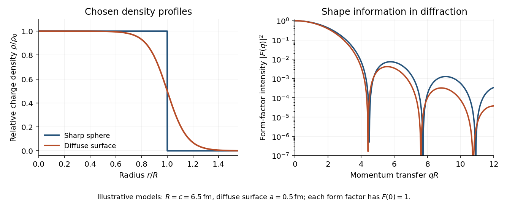

<h1 id="2/a/solution">Solution</h1>

↑ **Parent:** [A](../a.md)

**What is measured.** A monoenergetic [electron](../../../../electron.md) beam is directed at a thin target. A movable [magnetic spectrometer](../../../../magnetic-spectrometer.md) selects the scattering angle and outgoing momentum, separating [elastic scattering](../../../../elastic-scattering.md) from nuclear excitation and other backgrounds. Incident beam current and target thickness supply the normalization of the [differential scattering cross-section](../../../../differential-scattering-cross-section.md). The [Hofstadter nuclear electron scattering experiment](../../../../hofstadter-nuclear-electron-scattering-experiment.md) is a classic implementation of this electromagnetic probe.

For a heavy, approximately spin-zero [atomic nucleus](../../../../atomic-nucleus-split.md), neglecting recoil and treating the electron in the [Born approximation](../../../../born-approximation.md), the point-charge result is multiplied by the [nuclear charge form factor](../../../../nuclear-charge-form-factor.md):

$$
\frac{d\sigma}{d\Omega}\simeq\frac{Z^2\alpha^2\cos^2(\theta/2)}{4E^2\sin^4(\theta/2)}|F(q)|^2,\qquad q\simeq2E\sin\frac\theta2.
$$

Here $q$ is the magnitude of the spatial [momentum transfer](../../../../momentum-transfer.md) in [natural units](../../../../natural-units.md). The cosine factor includes the [electron](../../../../electron.md) [spin](../../../../spin.md). Dividing the elastic data by the point-charge factor isolates $|F(q)|^2$ within these approximations. Recoil, magnetic terms for targets with spin, [radiative corrections](../../../../radiative-correction.md) and particularly [Coulomb distortion in electron scattering](../../../../coulomb-distortion-in-electron-scattering.md) must be included when significant.

**From scattering to size and shape.** For a spherical [nuclear charge distribution](../../../../nuclear-charge-distribution.md),

$$
F(q)=\frac{4\pi}{Ze}\int_0^\infty r^2\rho_{\rm ch}(r)\frac{\sin(qr)}{qr}\,dr,\qquad F(0)=1.
$$

Thus the [nuclear charge form factor](../../../../nuclear-charge-form-factor.md) is a normalized [Fourier transform](../../../../fourier-transform-split.md). Its low-$q$ expansion,

$$
F(q)=1-\frac{q^2\langle r^2\rangle_{\rm ch}}6+\cdots,\qquad |F(q)|^2=1-\frac{q^2\langle r^2\rangle_{\rm ch}}3+\cdots,
$$

measures the [nuclear charge radius](../../../../nuclear-charge-radius.md) $r_{\rm ch}=\sqrt{\langle r^2\rangle_{\rm ch}}$. Larger [momentum transfers](../../../../momentum-transfer.md) resolve the density profile through [diffraction](../../../../diffraction.md) maxima and minima. For a uniform sphere of sharp radius $R$, the [uniform-sphere nuclear charge form factor](../../../../uniform-sphere-nuclear-charge-form-factor.md) is $3[\sin(qR)-qR\cos(qR)]/(qR)^3$; its first zero is at $qR\simeq4.493$, while $r_{\rm ch}=\sqrt{3/5}R$.

A practical extraction fits a family of densities to all measured cross sections, rather than treating a few measured values of $|F|^2$ as a complete density reconstruction. Finite angular coverage, resolution and the missing sign information make this an [inverse problem](../../../../inverse-problem-split.md).

**Observed pattern.** Apart from the lightest [nuclei](../../../../atomic-nucleus-split.md), the central density is approximately constant; the size grows approximately as $R\simeq1.2A^{1/3}\,\mathrm{fm}$ and there is a diffuse surface. The coefficient describes an equivalent sharp nuclear radius, rather than the root-mean-square radius itself. Heavy [nuclear charge distributions](../../../../nuclear-charge-distribution.md) are often described by the [two-parameter Fermi nuclear charge distribution](../../../../two-parameter-fermi-nuclear-charge-distribution.md), $\rho(r)=\rho_0/[1+\exp((r-c)/a)]$, with half-density radius $c$ scaling roughly as $A^{1/3}$ and diffuseness $a$ around $0.5\,\mathrm{fm}$. The surface thickness is then about $4a\ln3\simeq2.2\,\mathrm{fm}$. Shell effects, deformation and the lightest systems give departures from this smooth pattern. These qualitative features are established by the [electron scattering](../../../../electron-scattering.md) density measurements.[Electron Scattering and Nuclear Structure by Robert Hofstadter](../../../../electron-scattering-and-nuclear-structure-by-robert-hofstadter.md)

**[Figure 1](#2/a/image-original-sharp-edge-and-diffuse-nuclear-charge-models-showing-how-a-surface-profile-changes-the-nuclear-charge-form-factor). Original sharp-edge and diffuse nuclear charge models, showing how a surface profile changes the nuclear charge form factor**.

**Complementary probes.** Transition energies in a [muonic atom](../../../../muonic-atom.md) are especially sensitive to nuclear size because the heavy negative [muon](../../../../muon.md) orbits close to the charge. Electronic [isotope shifts](../../../../isotope-shift.md), after separating nuclear-mass and finite-size contributions, measure changes in $\langle r^2\rangle$. Both require atomic-structure calculations. Electromagnetic excitation and transition strengths constrain deformation and charge multipoles. Hadronic scattering can also constrain nuclear dimensions, but carries uncertainties from the [strong interaction](../../../../strong-interaction.md) and probes matter rather than purely electric charge.

## ↑ Ancestors (13)

1. [A](../a.md)
2. [2](../../2.md)
3. [2017](../../../2017-split.md)
4. [Past exam of the particle and nuclear physics course of the University of Cambridge](../../../split.md)
5. [Particle and Nuclear Physics course of the University of Cambridge](../../../../particle-and-nuclear-physics-course-of-the-university-of-cambridge.md)
6. [Physics course of the year 3 of the natural sciences course of the University of Cambridge](../../../../physics-course-of-the-year-3-of-the-natural-sciences-course-of-the-university-of-cambridge.md)
7. [Year 3 of the natural sciences course of the University of Cambridge](../../../../year-3-of-the-natural-sciences-course-of-the-university-of-cambridge.md)
8. [Year of the natural sciences course of the University of Cambridge](../../../../year-of-the-natural-sciences-course-of-the-university-of-cambridge.md)
9. [Natural sciences course of the University of Cambridge](../../../../natural-sciences-course-of-the-university-of-cambridge.md)
10. [Course of the University of Cambridge](../../../../course-of-the-university-of-cambridge.md)
11. [University of Cambridge](../../../../university-of-cambridge-split.md)
12. [List of universities](../../../../list-of-universities.md)
13. [Codex Wiki](../../../../split.md)
