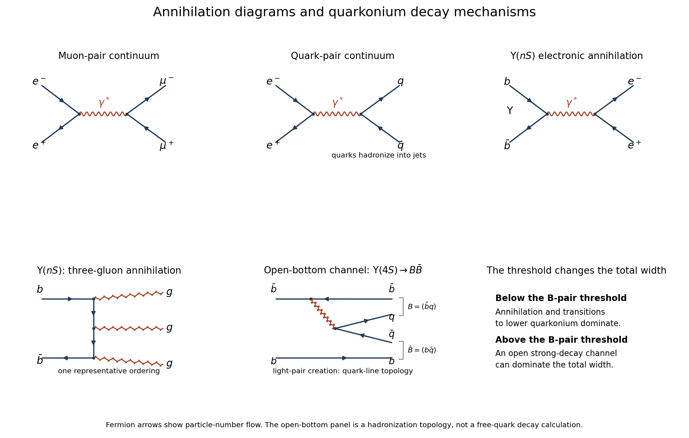

<h1 id="4/solution">Solution</h1>

↑ **Parent:** [4](../4.md)

**Continuum amplitudes.** The leading [quantum electrodynamics](../../../quantum-electrodynamics.md) diagram is [electron-positron annihilation](../../../electron-positron-annihilation.md) into a virtual [photon](../../../photon.md), followed by conversion to a muon pair. Replacing the outgoing muons with a quark-antiquark pair gives the quark-level hadronic diagram. The first two panels below show these processes.

**[Figure 2](#4/image-original-feynman-diagrams-for-electromagnetic-pair-production-vector-quarkonium-annihilation-and-the-open-bottom-decay-topology). Original Feynman diagrams for electromagnetic pair production, vector-quarkonium annihilation, and the open-bottom decay topology**.

The [Feynman rules](../../../feynman-rules.md) give, up to signs and factors of $i$,

$$
\mathcal M=\frac{e^2}{s}[\bar v_e\gamma^\mu u_e][\bar u_\mu\gamma_\mu v_\mu].
$$

The two vertices supply $e^2$, and the photon [propagator](../../../propagator.md) supplies $1/s$. Each external current scales as $\sqrt s$, so the complete amplitude is of order $e^2$, and its squared magnitude is of order $e^4\propto\alpha^2$. The two-body [relativistic scattering cross-section](../../../relativistic-scattering-cross-section.md) supplies the remaining $1/s$ from flux and [phase space](../../../phase-space.md). Integrating the angular distribution yields $\sigma_{\mu\mu}=4\pi\alpha^2/(3s)$. Keeping only the squared propagator while ignoring the external currents would incorrectly predict $1/s^2$.

A quark of charge $Q_fe$ contributes $N_cQ_f^2$ times the massless muon rate. With $u,d,s,c,b$ open and $N_c=3$, the [hadronic R ratio](../../../hadronic-r-ratio.md) is

$$
\boxed{R=3\left[2\left(\frac23\right)^2+3\left(\frac13\right)^2\right]=\frac{11}{3}.}
$$

This is the requested massless leading-QED continuum approximation. Strong corrections, physical hadron thresholds, resonance contributions and Z exchange are separate effects; the pure photon formula is not a complete high-energy electroweak cross section throughout the entire stated range.

**Efficiency normalization.** Read the original PDF plot as a continuum of about $0.8\,\mathrm{nb}$ and a maximum around $1.7\,\mathrm{nb}$ at $E\simeq10.58\,\mathrm{GeV}$. The supplied conversion constant gives

$$
1\,\mathrm{GeV}^{-2}=(0.1975)^2\,\mathrm{fm}^2=3.9006\times10^5\,\mathrm{nb}.
$$

Hence near the peak,

$$
\sigma_{\mu\mu}\simeq0.778\,\mathrm{nb},\qquad\sigma_{\rm cont}^{\rm QED}\simeq\frac{11}{3}\sigma_{\mu\mu}=2.85\,\mathrm{nb}.
$$

If $C$ multiplies the displayed cross sections, the required scale is

$$
\boxed{C\simeq\frac{2.85}{0.8}\simeq3.6,\qquad\epsilon\simeq C^{-1}\simeq0.28.}
$$

Here $\epsilon$ is the implied [detection efficiency](../../../detection-efficiency.md) under the common-scale assumption. Using continuum readings $0.75$–$0.85\,\mathrm{nb}$ gives approximately $C=3.4$–$3.8$, illustrating the graph-reading precision. The nearby open-bottom threshold also limits the precision of the ideal continuum approximation.

**Resonance quantum numbers and widths.** Direct formation through a single photon requires

$$
\boxed{J^P=1^-\quad\text{and, for neutral quarkonium, }J^{PC}=1^{--}.}
$$

These are the quantum numbers of the electromagnetic current. This concerns single-photon formation; associated production or two-photon reactions need not obey this restriction.

For a [Breit-Wigner resonance cross section](../../../breit-wigner-resonance-cross-section.md), subtract the continuum before finding the [full width at half maximum](../../../full-width-at-half-maximum.md). The plotted excess is about $0.9\,\mathrm{nb}$, so its half-height occurs at a total displayed cross section near $1.25\,\mathrm{nb}$, not $0.85\,\mathrm{nb}$. The crossings are roughly $10.57$ and $10.59\,\mathrm{GeV}$, with a separation around $0.02$–$0.025\,\mathrm{GeV}$. Thus

$$
\boxed{M_{\Upsilon(4S)}\simeq10.58\,\mathrm{GeV},\qquad\Gamma\simeq20\text{–}25\,\mathrm{MeV}.}
$$

For spin-one formation from unpolarized electrons and positrons, $g=3/4$ and $p\simeq M/2$. With $\Gamma_{\rm had}\simeq\Gamma$, the [peak resonance cross section and branching fractions](../../../peak-resonance-cross-section-and-branching-fractions.md) relation becomes

$$
\sigma_{\rm res,peak}=\frac{12\pi}{M^2}\frac{\Gamma_{ee}}\Gamma.
$$

The corrected excess is $C(1.7-0.8)\simeq3.2\,\mathrm{nb}$. Taking $\Gamma\simeq24\,\mathrm{MeV}$ as a representative graph reading gives

$$
\Gamma_{ee}=\frac{\left[\frac{3.2}{3.9006\times10^5}\right]\,(10.58)^2\,(0.024)}{12\pi}\,\mathrm{GeV}\simeq5.9\times10^{-7}\,\mathrm{GeV}.
$$

Thus the plot supports

$$
\boxed{\Gamma_{ee}\sim0.5\text{–}0.6\,\mathrm{keV}.}
$$

The width and electronic partial width are estimates from the printed graph under the prescribed Breit-Wigner and efficiency assumptions; these are not precision world-average values. A scale correction changes the peak height and inferred partial width, but not the peak position or width.

**Why the lower Upsilon states are narrow.** In [electromagnetic production and decay of vector quarkonium](../../../electromagnetic-production-and-decay-of-vector-quarkonium.md), every $nS$ state can annihilate as $b\bar b\to\gamma^*\to e^+e^-$. The electronic width probes the wavefunction at the origin, $\Gamma_{ee}\propto\alpha^2Q_b^2|\psi_{nS}(0)|^2/M_n^2$. The radial overlaps differ, but the same short-distance annihilation mechanism operates, so electronic widths remain of comparable order.

The hadronic mechanism changes sharply at $2m_B\simeq10.560\,\mathrm{GeV}$. The first three [Upsilon mesons](../../../upsilon-meson.md) lie below it and cannot produce an on-shell B-meson pair. Their leading purely strong annihilation channel is $b\bar b\to ggg$, followed by [hadronization](../../../hadronization.md): a color-singlet pair cannot annihilate to one gluon, and two gluons cannot match its negative charge-conjugation parity. Three-gluon annihilation carries three powers of $\alpha_s$ in the rate and requires quark-antiquark overlap. Electromagnetic annihilation to light quarks and, for excited states, transitions to lower bottomonium plus pions or photons also contribute.

The fourth state lies above the pair threshold and can instead undergo $\Upsilon(4S)\to B\bar B$ through light-pair creation, keeping the b and anti-b in separate outgoing [mesons](../../../meson.md). The final panel depicts this quark-line topology; it represents a nonperturbative strong decay, not a free on-shell b quark radiating a real gluon. For two pseudoscalar B mesons the pair is in a P wave to give $1^-$. Although close to threshold, this open strong channel has a much larger rate than the annihilation channels. Consequently a total width of tens of MeV can coexist with an electronic width below a keV; below threshold the total widths are smaller by hundreds or more, while their electronic widths remain of similar order.

**Hyperfine estimate.** For two spin-half constituents,

$$
\mathbf S_1\cdot\mathbf S_2=\frac12[S(S+1)-3/2]=\begin{cases}-3/4,&S=0,\\+1/4,&S=1.\end{cases}
$$

The [meson hyperfine mass splitting](../../../meson-hyperfine-mass-splitting.md) therefore raises the vector mass above the pseudoscalar mass. To infer its coefficient from only one measured mass, adopt the intended simple constituent ansatz that the spin-independent baseline is $m_b+m_q=5.31\,\mathrm{GeV}$. Then

$$
5.280=5.310-\frac{3A}{4(5.0)(0.31)},\qquad\boxed{A\simeq0.062\,\mathrm{GeV}^3.}
$$

For the spin-one partner,

$$
\boxed{M_{B^*}\simeq5.310+\frac{A}{4(5.0)(0.31)}=5.320\,\mathrm{GeV},\qquad M_{B^*}-M_B\simeq40\,\mathrm{MeV}.}
$$

The estimate is the same for $\bar bu$ and $\bar bd$ with the supplied equal light-quark masses. The splitting is below $m_\pi$, so the strong decay $B^*\to B\pi$ is closed. An electromagnetic transition is open and dominates over weak decay:

$$
\boxed{B^*\to B\gamma.}
$$

It preserves electric charge, giving the corresponding charged or neutral B meson; the photon energy is approximately $40\,\mathrm{MeV}$, slightly reduced by recoil. Strictly, the statement that the mass merely _includes_ a spin-spin term does not fix $A$: an independent spin-independent binding energy would leave the baseline unknown. The numerical prediction above explicitly uses the additive constituent-mass approximation.

## ↑ Ancestors (12)

1. [4](../4.md)
2. [2017](../../2017-split.md)
3. [Past exam of the particle and nuclear physics course of the University of Cambridge](../../split.md)
4. [Particle and Nuclear Physics course of the University of Cambridge](../../../particle-and-nuclear-physics-course-of-the-university-of-cambridge.md)
5. [Physics course of the year 3 of the natural sciences course of the University of Cambridge](../../../physics-course-of-the-year-3-of-the-natural-sciences-course-of-the-university-of-cambridge.md)
6. [Year 3 of the natural sciences course of the University of Cambridge](../../../year-3-of-the-natural-sciences-course-of-the-university-of-cambridge.md)
7. [Year of the natural sciences course of the University of Cambridge](../../../year-of-the-natural-sciences-course-of-the-university-of-cambridge.md)
8. [Natural sciences course of the University of Cambridge](../../../natural-sciences-course-of-the-university-of-cambridge.md)
9. [Course of the University of Cambridge](../../../course-of-the-university-of-cambridge.md)
10. [University of Cambridge](../../../university-of-cambridge-split.md)
11. [List of universities](../../../list-of-universities.md)
12. [Codex Wiki](../../../split.md)
