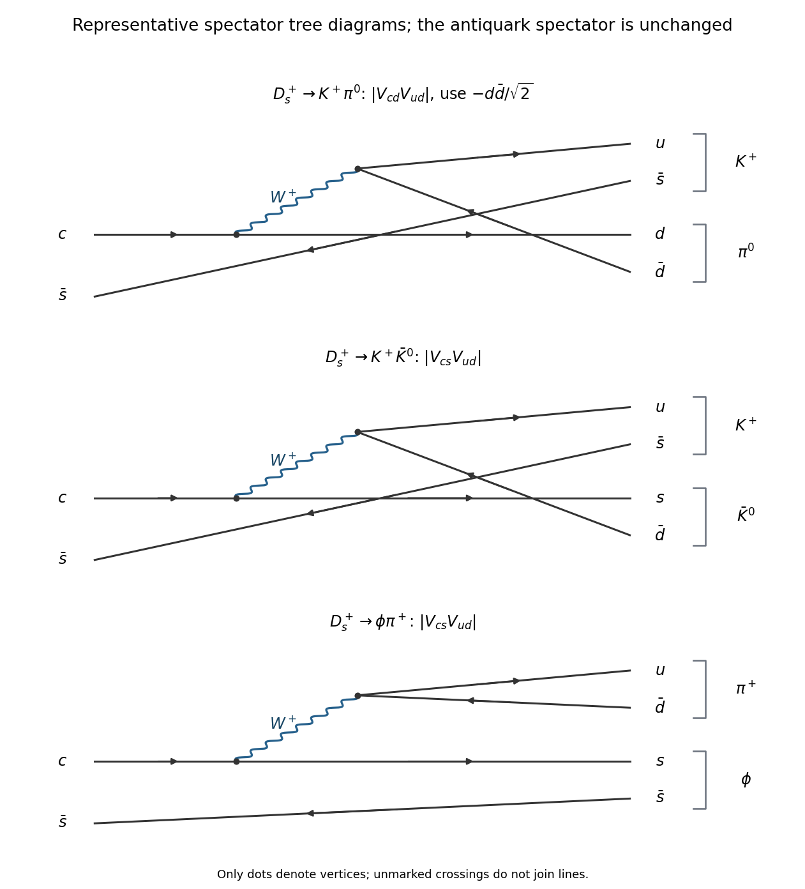

# 2018

↑ **Parent:** [Past exam of the particle and nuclear physics course of the University of Cambridge](../past-exam-of-the-particle-and-nuclear-physics-course-of-the-university-of-cambridge.md)

[Original paper, released PDF pages 326–330](https://www.whatdotheyknow.com/request/natural_science_tripos_physics_e/response/2127325/attach/3/FOI%202022%20639%20Sullivan%20materials.pdf?cookie_passthrough=1#page=326)

**Table of contents**

- [Section A](#section-a)
  - [A1](#section-a/a1)
    - [a](#section-a/a1/a)
      - [Solution](#section-a/a1/a/solution)
    - [b](#section-a/a1/b)
      - [Solution](#section-a/a1/b/solution)
    - [c](#section-a/a1/c)
      - [Solution](#section-a/a1/c/solution)
- [Section B](#section-b)
  - [B2](#section-b/b2)
    - [Solution](#section-b/b2/solution)
  - [B3](#section-b/b3)
    - [Solution](#section-b/b3/solution)
  - [B4](#section-b/b4)
    - [Solution](#section-b/b4/solution)

## Section A

↑ **Parent:** [2018](2018.md)

<h3 id="section-a/a1">A1</h3>

↑ **Parent:** [Section A](#section-a)

<h4 id="section-a/a1/a">a</h4>

↑ **Parent:** [A1](#section-a/a1)

<h5 id="section-a/a1/a/solution">Solution</h5>

↑ **Parent:** [A](#section-a/a1/a)

Treat the quoted maximum as the resonant [Z boson](../standard-model.md#z-boson) contribution described by the [Breit-Wigner resonance cross section](../quantum-scattering.md#breit-wigner-resonance-cross-section). The [electron](../physics.md#electron) and [Positron](../physics.md#positron) each have [spin](../angular-momentum-operator.md#spin) $1/2$, while the [Z boson](../standard-model.md#z-boson) has [spin](../angular-momentum-operator.md#spin) one, so

$$
g=\frac{2(1)+1}{[2(1/2)+1]^2}=\frac34.
$$

Neglect the [electron mass](../physics.md#electron-mass) at this [centre-of-mass energy](../special-relativity.md#center-of-mass-energy). Each incident momentum magnitude is then $p_i=E_0/2$ in [natural units](../mathematical-physics.md#natural-units). Write $B_e=\Gamma_{ee}/\Gamma$. At the resonance peak the denominator is $\Gamma^2/4$, and the same partial [decay width](../relativistic-quantum-field.md#decay-width) appears for production and decay:

$$
\sigma_{\rm peak}=\frac{\pi g}{p_i^2}\frac{\Gamma_{ee}^2}{\Gamma^2/4}
=\frac{12\pi}{E_0^2}B_e^2.
$$

The [peak resonance cross section and branching fractions](../quantum-scattering.md#peak-resonance-cross-section-and-branching-fractions) relation contains $B_e^2$, because the electronic channel occurs at both ends of the resonant process.

For an area in ordinary units, restore $(\hbar c)^2$. The original PDF prints $\hbar c=197.5\,\mathrm{MeV}$, which is dimensionally incomplete: the intended standard conversion is $197.5\,\mathrm{MeV\,fm}=0.1975\,\mathrm{GeV\,fm}$. Also,

$$
2.0\,\mathrm{nb}=2.0\times10^{-37}\,\mathrm{m^2}
=2.0\times10^{-7}\,\mathrm{fm^2}.
$$

Consequently

$$
B_e=\sqrt{\frac{\sigma_{\rm peak}E_0^2}{12\pi(\hbar c)^2}}
=\sqrt{\frac{(2.0\times10^{-7})(91.2)^2}{12\pi(0.1975)^2}},
\qquad
\boxed{B(Z^0\to e^+e^-)=0.03363\simeq3.4\%.}
$$

This estimate uses the supplied resonance model. The full physical elastic [electron](../physics.md#electron)-[Positron](../physics.md#positron) cross section also contains nonresonant [photon](../quantum-mechanics.md#photon) exchange and interference; an experimental use of the formula must isolate the resonant contribution.

<h4 id="section-a/a1/b">b</h4>

↑ **Parent:** [A1](#section-a/a1)

<h5 id="section-a/a1/b/solution">Solution</h5>

↑ **Parent:** [B](#section-a/a1/b)

For [gamma decay](../atomic-nucleus.md#gamma-decay), the [nuclear gamma-ray multipole selection rules](../atomic-nucleus.md#nuclear-gamma-ray-multipole-selection-rules) require the radiation's [angular momentum](../momentum.md#angular-momentum) $L$ to satisfy the triangle inequality

$$
|J_i-J_f|\leq L\leq J_i+J_f.
$$

Here $J_i=J_f=5/2$, so $0\leq L\leq5$. A real emitted [photon](../quantum-mechanics.md#photon) has no monopole radiation mode, leaving $L=1,2,3,4,5$.

The two nuclear [quantum states](../quantum-system.md#quantum-state) have the same [parity](../quantum-mechanics.md#parity). An electric multipole has parity factor $(-1)^L$, while a magnetic multipole has factor $(-1)^{L+1}$. Thus electric radiation requires even $L$ and magnetic radiation odd $L$:

$$
\boxed{M1,\quad E2,\quad M3,\quad E4,\quad M5.}
$$

In particular, an $E0$ nuclear transition cannot emit the single real [photon](../quantum-mechanics.md#photon) requested here; processes such as [internal conversion](../atomic-nucleus.md#internal-conversion) are different decay channels.

For usual nuclear [gamma ray](../quantum-mechanics.md#gamma-ray) energies, $kR\ll1$, where $k=E_\gamma/(\hbar c)$ and $R$ is the nuclear size. Higher [multipole radiation](../electromagnetic-wave.md#multipole-radiation) orders bring extra powers of this small parameter, so **$M1$ and $E2$ are the likely important contributions**, with $M3$, $E4$ and $M5$ generally much smaller. Often $M1$ is dominant, but an allowed $M1$ [matrix element](../vector-space.md#matrix-element) can be hindered and an $E2$ transition can be collectively enhanced. The [quantum numbers](../quantum-system.md#quantum-number) alone do not fix a numerical relative contribution or an unconditional ordering of the $M1$ and $E2$ rates.

<h4 id="section-a/a1/c">c</h4>

↑ **Parent:** [A1](#section-a/a1)

<h5 id="section-a/a1/c/solution">Solution</h5>

↑ **Parent:** [C](#section-a/a1/c)

The four tree-level diagrams for [electron-positron annihilation into W-boson pairs](../relativistic-quantum-field.md#electron-positron-annihilation-into-w-boson-pairs) are

$$
\boxed{s\text{-channel }\gamma^*,\quad s\text{-channel }Z^*,\quad
 t\text{-channel }\nu_e,\quad s\text{-channel }h^*.}
$$

**[Figure 1](#section-a/a1/c/image-the-four-tree-level-standard-model-diagrams-for-electron-positron-annihilation-into-w-pairs). The four tree-level Standard Model diagrams for electron-positron annihilation into W pairs**.

The first two diagrams contain the [electromagnetic interaction](../electromagnetism.md#electromagnetic-interaction) and [weak interaction](../standard-model.md#weak-interaction) neutral electron currents and the [gauge boson self-interaction](../relativistic-quantum-field.md#gauge-boson-self-interaction) vertices $\gamma W^+W^-$ and $ZW^+W^-$. The third has two [weak charged current](../standard-model.md#charged-current) vertices joined by an [electron neutrino](../standard-model.md#electron-neutrino) propagator. In the fourth, the incoming [electron](../physics.md#electron)-[Positron](../physics.md#positron) pair couples to the [Higgs boson](../standard-model.md#higgs-boson), which then couples to $W^+W^-$.

The small factor is at the initial Higgs-electron vertex. With the usual electroweak vacuum value $v\simeq246\,\mathrm{GeV}$, [electron Yukawa suppression of Higgs production](../standard-model.md#electron-yukawa-suppression-of-higgs-production) gives

$$
y_e=\frac{\sqrt2m_e}{v}\simeq2.9\times10^{-6},\qquad
 g_{hee}=\frac{m_e}{v}\simeq2.1\times10^{-6}.
$$

These are tiny compared with ordinary [electroweak interaction](../standard-model.md#electroweak-interaction) gauge couplings. The [decay amplitude](../relativistic-quantum-field.md#decay-amplitude) for the [Higgs boson](../standard-model.md#higgs-boson) diagram carries this small coefficient, and its separate squared contribution carries its square. Thus **the Higgs diagram is negligible because the electron Yukawa coupling is proportional to the electron mass**. It vanishes in the massless-electron approximation, even though the [Higgs boson](../standard-model.md#higgs-boson)-[W boson](../standard-model.md#w-boson) coupling itself is not small. The remaining three gauge diagrams must be added coherently, including their interference.

## Section B

↑ **Parent:** [2018](2018.md)

<h3 id="section-b/b2">B2</h3>

↑ **Parent:** [Section B](#section-b)

<h4 id="section-b/b2/solution">Solution</h4>

↑ **Parent:** [B2](#section-b/b2)

**Smooth-model fission energy**. Use [natural units](../mathematical-physics.md#natural-units) $c=1$, so the quoted nuclear [masses](../classical-mechanics.md#mass) are expressed as rest [energies](../energy.md). Conservation of [mass number](../chemical-substance.md#mass-number) and [atomic number](../chemical-substance.md#atomic-number) fixes the second fragment to $(A_2,Z_2)=((1-y)A,(1-y)Z)$. First omit [nuclear pairing](../atomic-nucleus.md#nuclear-pairing) to compare a continuous range of $y$. Pairing can subsequently add $\delta_1+\delta_2-\delta_{\rm parent}$ for integer fragments; it has no smooth parity assignment for arbitrary real $y$.

In the parent-minus-daughters mass difference, the [nucleon](../physics.md#nucleon) [rest energy](../special-relativity.md#rest-energy) and volume terms cancel. The [nuclear symmetry energy](../physics.md#symmetry-energy) also cancels because both fragments have the same $Z/A$:

$$
\frac{(A_1-2Z_1)^2}{A_1}+\frac{(A_2-2Z_2)^2}{A_2}
=[y+(1-y)]\frac{(A-2Z)^2}{A}.
$$

The remaining [liquid-drop fission energy](../physics.md#liquid-drop-fission-energy) is

$$
\boxed{\begin{aligned}
Q(y)={}&a_SA^{2/3}\left[1-y^{2/3}-(1-y)^{2/3}\right]\\
&+\frac{a_CZ^2}{A^{1/3}}\left[1-y^{5/3}-(1-y)^{5/3}\right].
\end{aligned}}
$$

Splitting increases the [surface energy](../surface-tension.md#surface-energy) cost, but reduces [nuclear Coulomb energy](../atomic-nucleus.md#nuclear-coulomb-energy). Both contributions are symmetric under $y\leftrightarrow1-y$, so the symmetric split is stationary. Symmetry alone would not establish a maximum, since the two contributions compete.

For a full check, put $S=a_SA^{2/3}$, $x=a_CZ^2/(a_SA)$ and $t=y^{1/3}+(1-y)^{1/3}$. On $0\leq y\leq1/2$, $t$ increases from $1$ to $2^{2/3}$. Expressing the two fractional-power sums through $t$ gives

$$
\frac QS=1+x-\frac{t^2+2/t}{3}+\frac{x}{9}(t^5-5t^2-5/t),
\qquad
\frac{d(Q/S)}{dt}=\frac{t^3-1}{9t^2}\left[5x(t^3-1)-6\right].
$$

The derivative can change sign only from negative to positive, so any interior stationary point in $t$ is a minimum. The largest value is therefore either the no-split endpoint $Q=0$ or the symmetric split. Thus [symmetric fission maximizes the positive liquid-drop energy release](../physics.md#symmetric-fission-maximizes-the-positive-liquid-drop-energy-release): whenever this smooth model permits an exothermic split, its largest release occurs at $y=1/2$.

There is a qualification to the paper's unqualified wording. For arbitrary low $Z^2/A$, the symmetric split need not maximize $Q$; indeed it is a local minimum when $Z^2/A<(2/5)a_S/a_C=10$. The symmetric-maximum conclusion is valid in the heavy, fission-favorable regime relevant here, rather than a universal property of the formula.

At $y=1/2$,

$$
Q_{\rm sym}=-a_SA^{2/3}(2^{1/3}-1)
+\frac{a_CZ^2}{A^{1/3}}(1-2^{-2/3}).
$$

Requiring $Q_{\rm sym}>0$ gives

$$
\boxed{\frac{Z^2}{A}>\frac{a_S}{a_C}
\frac{2^{1/3}-1}{1-2^{-2/3}}
=\frac{18.0}{0.72}\frac{0.259921}{0.370039}
\simeq17.6.}
$$

**Barrier and fragment yields**. Positive final-state [Q value](../energy.md#q-value) does not remove the [fission barrier](../physics.md#fission-barrier) along a deformation path. [Surface energy](../surface-tension.md#surface-energy) initially rises as the nucleus deforms; [spontaneous fission](../physics.md#spontaneous-fission) then requires collective [quantum tunnelling](../quantum-mechanics.md#quantum-tunnelling) unless enough excitation is present. Its rate is exponentially sensitive to barrier height, width and collective inertia. Thus nuclei close to the exothermicity threshold can have immeasurably long spontaneous-fission [mean lifetimes](../relativistic-quantum-field.md#mean-lifetime-physics), while sufficiently heavier nuclei have smaller effective [fission barriers](../physics.md#fission-barrier) or larger [quantum tunnelling](../quantum-mechanics.md#quantum-tunnelling) probabilities.

The [fission-fragment mass distribution](../physics.md#fission-fragment-mass-distribution) of low-excitation actinide fission is usually double peaked: complementary fragments have mass fractions roughly $0.4$ and $0.6$ rather than both exactly $1/2$. [Nuclear shell model](../atomic-nucleus.md#nuclear-shell-model) effects and the fission dynamics help favor asymmetric fragments. Maximizing the final smooth-model energy release is not a calculation of the fragment yield. The following yield curve is schematic, with no measured counts implied:

**[Figure 2](#section-b/b2/image-smooth-model-fission-energy-versus-a-schematic-asymmetric-fragment-yield-distribution). Smooth-model fission energy versus a schematic asymmetric fragment-yield distribution**.

**Capture excitation energies**. Capturing a negligible-energy neutron forms a compound nucleus with the rest energy of the target plus the free [neutron](../neutron.md). Relative to the compound [ground state](../quantum-mechanics.md#ground-state), the [neutron-capture excitation energy](../physics.md#neutron-capture-excitation-energy) is therefore

$$
E^*=M(A,92)+m_n-M(A+1,92)
=B(A+1,92)-B(A,92)=S_n(A+1,92),
$$

where $B$ is positive [nuclear binding energy](../atomic-nucleus.md#nuclear-binding-energy) and $S_n$ the compound nucleus's [neutron separation energy](../atomic-nucleus.md#neutron-separation-energy). The free [neutron](../neutron.md) [rest energy](../special-relativity.md#rest-energy) cancels in the binding-energy difference. With the supplied [semi-empirical mass formula](../atomic-nucleus.md#semi-empirical-mass-formula),

$$
\begin{aligned}
S_n={}&a_V-a_S[(A+1)^{2/3}-A^{2/3}]\\
&-a_CZ^2[(A+1)^{-1/3}-A^{-1/3}]\\
&-a_A\left[\frac{(A+1-2Z)^2}{A+1}-\frac{(A-2Z)^2}{A}\right]
+\delta(A+1,Z)-\delta(A,Z).
\end{aligned}
$$

At $Z=92$, [uranium-235](../chemical-substance.md#uranium-235) has odd $A$, while [uranium-236](../chemical-substance.md#uranium-236) is even-even. The pairing contribution is $+33.5(236)^{-3/4}=+0.55637\,\mathrm{MeV}$. By contrast [uranium-238](../chemical-substance.md#uranium-238) is even-even and [uranium-239](../chemical-substance.md#uranium-239) has odd $A$, giving $-33.5(238)^{-3/4}=-0.55286\,\mathrm{MeV}$. The individual contributions are

$$
\begin{array}{c|rr}
\text{Contribution (MeV)}&{}^{235}\mathrm U+n&{}^{238}\mathrm U+n\\\hline
\text{Volume}&15.80000&15.80000\\
\text{Surface}&-1.94320&-1.93502\\
\text{Coulomb}&1.39680&1.37342\\
\text{Asymmetry}&-9.15424&-9.51287\\
\text{Pairing}&0.55637&-0.55286
\end{array}
$$

Thus the model predicts

$$
\boxed{E^*({}^{236}\mathrm U)=6.65573\,\mathrm{MeV}\simeq6.66\,\mathrm{MeV},\qquad
E^*({}^{239}\mathrm U)=5.17268\,\mathrm{MeV}\simeq5.17\,\mathrm{MeV}.}
$$

Of the $1.48305\,\mathrm{MeV}$ predicted difference, $1.10922\,\mathrm{MeV}$ comes from the change in [nuclear pairing](../atomic-nucleus.md#nuclear-pairing). It is the primary reason the even-even capture product is more strongly excited; the smooth terms account for the remaining $0.37383\,\mathrm{MeV}$.

**Thermal versus fast-neutron fission**. The last comparison uses the supplied observed capture excitations, $6.5$ and $4.8\,\mathrm{MeV}$, rather than replacing them by the preceding smooth-model estimates. Interpreting the quoted $6.2$ and $6.6\,\mathrm{MeV}$ activation energies as the barriers in the respective capture channels gives

$$
\boxed{6.5>6.2:\quad\text{thermal capture on }{}^{235}\mathrm U\text{ can lead to prompt fission},}
$$

$$
\boxed{4.8<6.6:\quad\text{thermal capture on }{}^{238}\mathrm U\text{ is below the fission barrier}.}
$$

A simple [neutron-induced fission threshold](../physics.md#neutron-induced-fission-threshold) estimate for the second channel requires about $6.6-4.8=1.8\,\mathrm{MeV}$ additional centre-of-mass kinetic energy. Sub-barrier tunnelling is possible, but it does not give the large thermal-neutron fission probability of the first channel.

The barrier labels in the original PDF need care: it assigns them to $^{235}\mathrm U$ and $^{238}\mathrm U$, whereas the states formed after capture are $^{236}\mathrm U^*$ and $^{239}\mathrm U^*$. The comparison above uses the intended capture-channel interpretation. If the quoted numbers are literally barriers of the uncaptured target nuclei, the compound-nucleus barriers are missing and this numerical comparison does not follow from those data alone.

In a thermal reactor, [neutron moderation](../neutron.md#neutron-moderation) slows fission neutrons so the large low-energy fission cross section of [uranium-235](../chemical-substance.md#uranium-235) can support a [nuclear chain reaction](../physics.md#nuclear-chain-reaction). Fuel composition, moderator choice and geometry must balance production against capture and leakage; capture resonances of [uranium-238](../chemical-substance.md#uranium-238) during slowing are important losses from that neutron population. The reaction rate per target nucleus depends on the spectrum through $\int\phi(E)\sigma_f(E)\,dE$, where $\phi(E)$ is differential [neutron flux](../neutron.md#neutron-flux) per unit [energy](../energy.md). A fast spectrum can access the [uranium-238](../chemical-substance.md#uranium-238) fission channel and changes this balance. Also, [uranium-238](../chemical-substance.md#uranium-238) is a [fertile material](../physics.md#fertile-material): capture followed by two [beta-minus decays](../physics.md#beta-minus-decay) can produce [plutonium-239](../chemical-substance.md#plutonium-239), a [fissile material](../physics.md#fissile-material), so capture can contribute to breeding even when it causes no immediate fission.

<h3 id="section-b/b3">B3</h3>

↑ **Parent:** [Section B](#section-b)

<h4 id="section-b/b3/solution">Solution</h4>

↑ **Parent:** [B3](#section-b/b3)

**Colour and identical-quark spin**. A spatial ground-state [baryon](../physics.md#baryon) has a symmetric $\ell=0$ spatial [wavefunction](../wave-function.md). For $uuu$, $ddd$ or $sss$, the [quark flavour](../standard-model.md#quark-flavor) state is also symmetric, and the total-[spin](../angular-momentum-operator.md#spin) $3/2$ state of three spin-one-half [quarks](../standard-model.md#quark) is symmetric. Without another degree of freedom, the whole state would be symmetric under exchange of identical [fermions](../tensor-product-of-quantum-systems.md#fermion), contrary to the [Pauli exclusion principle](../tensor-product-of-quantum-systems.md#pauli-exclusion-principle).

A [three-quark colour singlet](../physics.md#three-quark-colour-singlet) supplies a completely antisymmetric factor,

$$
|1_c\rangle=\frac1{\sqrt6}\epsilon_{abc}|abc\rangle,
$$

using the three [color charge](../standard-model.md#color-charge) states. The remaining spatial-spin-flavour factor can then be symmetric. These baryons therefore provide evidence for an additional internal [degree of freedom](../classical-mechanics.md#degree-of-freedom) with at least three states, realized as colour in [Quantum chromodynamics](../standard-model.md#quantum-chromodynamics).

For the $uu$ pair in $uus$, the spatial and [quark flavour](../standard-model.md#quark-flavor) factors are symmetric under exchange of the two up quarks, while the colour factor is antisymmetric. The pair's [spin](../angular-momentum-operator.md#spin) state must consequently be symmetric. The [identical-quark pair spin in a ground-state baryon](../physics.md#identical-quark-pair-spin-in-a-ground-state-baryon) is

$$
\boxed{S_{uu}=1,}
$$

a [triplet state](../angular-momentum-operator.md#spin-one-half-triplet-state). This holds whether the complete baryon has total [spin](../angular-momentum-operator.md#spin) $1/2$ or $3/2$.

**Origin of the pair interaction**. The terms in the [baryon hyperfine mass formula](../physics.md#baryon-hyperfine-mass-formula) are effective colour-magnetic [spin-spin interactions](../angular-momentum-operator.md#spin-spin-interaction), arising from gluon exchange between the quarks' colour-magnetic moments. Each magnetic moment brings an inverse [constituent quark mass](../standard-model.md#constituent-quark-mass), explaining the factor $1/(m_im_j)$. The constant $A'$ absorbs the [strong coupling constant](../standard-model.md#strong-coupling-constant), colour factors and the spatial overlap. A common $A'$ is a constituent-model approximation.

**Spin algebra and the two masses**. Set $\hbar=c=1$, so each dimensionless [spin angular momentum](../angular-momentum-operator.md#spin) operator satisfies $\mathbf S_i^2=3/4$. Label the two up quarks 1 and 2 and the strange quark 3. Squaring $\mathbf S_{12}=\mathbf S_1+\mathbf S_2$ gives

$$
\langle\mathbf S_1\cdot\mathbf S_2\rangle
=\frac12\left[S_{12}(S_{12}+1)-\frac34-\frac34\right]
=\frac14.
$$

Next square the total [spin](../angular-momentum-operator.md#spin) $\mathbf J=\mathbf S_{12}+\mathbf S_3$:

$$
\langle\mathbf S_1\cdot\mathbf S_3+\mathbf S_2\cdot\mathbf S_3\rangle
=\frac12\left[J(J+1)-2-\frac34\right]
=\begin{cases}-1,&J=1/2,\\1/2,&J=3/2.\end{cases}
$$

Substituting these pair sums into the [baryon hyperfine mass formula](../physics.md#baryon-hyperfine-mass-formula) yields

$$
\boxed{M_{uus,1/2}=2m_u+m_s+\frac{A'}4
\left(\frac1{m_u^2}-\frac4{m_um_s}\right),}
$$

$$
\boxed{M_{uus,3/2}=2m_u+m_s+\frac{A'}4
\left(\frac1{m_u^2}+\frac2{m_um_s}\right).}
$$

Their difference is $3A'/(2m_um_s)$. Repeating the argument for the identical $ss$ pair in $uss$ gives

$$
M_{uss,1/2}=m_u+2m_s+\frac{A'}4\left(\frac1{m_s^2}-\frac4{m_um_s}\right),\qquad
M_{uss,3/2}=m_u+2m_s+\frac{A'}4\left(\frac1{m_s^2}+\frac2{m_um_s}\right).
$$

Thus the model predicts [equal Sigma and Xi hyperfine splittings](../physics.md#equal-sigma-and-xi-hyperfine-splittings):

$$
\boxed{\frac{M(\Sigma^*)-M(\Sigma)}{M(\Xi^*)-M(\Xi)}=1.}
$$

For a like-flavour comparison using exactly the supplied masses, the $uus$ splitting is $1383-1189=194\,\mathrm{MeV}$ and the $uss$ splitting is $1532-1315=217\,\mathrm{MeV}$, giving $194/217=0.894$. Averaging within the supplied [isospin multiplets](../standard-model.md#isospin-multiplet) instead gives $192/215=0.893$. The predicted equality captures the common scale but misses the observed ratio by about $11\%$ in this table. Different spatial overlaps, and hence different effective $A'$ values, can account for departures from the common-coefficient approximation.

**Radiative decay and recoil**. In a [radiative Sigma-to-Lambda transition](../physics.md#radiative-sigma-to-lambda-transition), both baryons retain valence content $uds$. A [photon](../quantum-mechanics.md#photon) couples to an electrically charged constituent while the final quarks are projected onto the lower [baryon](../physics.md#baryon)'s spin-flavour [wavefunction](../wave-function.md). The leading up- and down-quark diagrams are shown below; their contributions must be combined coherently. In the simplest model, the strange-quark spin operator alone cannot change the $ud$ pair from its Sigma triplet to the Lambda singlet. The transition is an $M1$ [multipole radiation](../electromagnetic-wave.md#multipole-radiation) transition, consistent with $1/2^+\to1/2^+$.

**[Figure 3](#section-b/b3/image-quark-diagrams-for-sigma-to-lambda-photon-emission-and-an-example-strong-delta-decay). Quark diagrams for Sigma-to-Lambda photon emission and an example strong Delta decay**.

For the photon energy, let $M_\Sigma=1193\,\mathrm{MeV}$ and $M_\Lambda=1116\,\mathrm{MeV}$ in [natural units](../mathematical-physics.md#natural-units). [Four-momentum conservation](../special-relativity.md#four-momentum-conservation) gives equal opposite final momenta of magnitude $E_\gamma$, so

$$
M_\Sigma=E_\gamma+\sqrt{M_\Lambda^2+E_\gamma^2},
\qquad
\boxed{E_\gamma=\frac{M_\Sigma^2-M_\Lambda^2}{2M_\Sigma}
=74.5151\,\mathrm{MeV}\simeq74.5\,\mathrm{MeV}.}
$$

The recoil [kinetic energy](../energy.md#kinetic-energy) of the [Lambda baryon](../physics.md#lambda-baryon) is $77-74.5151=2.4849\,\mathrm{MeV}$; assigning the entire mass difference to the [photon](../quantum-mechanics.md#photon) would miss it.

**Which baryons decay strongly?** The [open strong-decay thresholds for baryons](../physics.md#open-strong-decay-thresholds-for-baryons) require both sufficient energy and conserved [quark flavour](../standard-model.md#quark-flavor), including [strangeness](../standard-model.md#strangeness). The dominant strong decayers in the supplied table are

$$
\boxed{\Delta^-,\Delta^0,\Delta^+,\Delta^{++};\qquad
\Sigma^{*-},\Sigma^{*0},\Sigma^{*+};\qquad\Xi^{*-},\Xi^{*0}.}
$$

The [Delta baryon](../physics.md#delta-baryon) channels $\Delta\to N\pi$ have threshold near $940+140=1080\,\mathrm{MeV}$, below $1232\,\mathrm{MeV}$. The excited [Sigma baryons](../physics.md#sigma-baryon) can decay as $\Sigma^*\to\Lambda\pi$ or $\Sigma\pi$, and the excited [Xi baryons](../physics.md#xi-baryon) as $\Xi^*\to\Xi\pi$, all with open thresholds and conserved [strangeness](../standard-model.md#strangeness). Their positive-parity baryon states can emit the negative-parity [pion](../standard-model.md#pion) in an odd relative [orbital angular momentum](../quantum-mechanics.md#orbital-angular-momentum), with $L=1$ already allowing total $J=3/2$.

The last diagram illustrates $\Delta^{++}(uuu)\to p(uud)+\pi^+(u\bar d)$: a [gluon](../standard-model.md#gluon) creates a $d\bar d$ pair and the quarks regroup into the two hadrons. No quark changes flavour at the gluon vertices. This is a representative strong pair-creation topology; quantitative hadronic decay rates require bound-state dynamics.

The [Omega baryon](../physics.md#omega-baryon) is an important exception among the spin-$3/2$ states. Its $S=-3$ cannot become the $S=-2$ of $\Xi\pi$ through the [strong interaction](../standard-model.md#strong-interaction). Its flavour-conserving $\Xi K$ threshold is at least $1315+500=1815\,\mathrm{MeV}$, above its $1673\,\mathrm{MeV}$ mass, so it decays weakly. The ground-state strange octet also has no open strong channel: for example $\Sigma\to\Lambda\pi$ needs at least $1256\,\mathrm{MeV}$, and $\Lambda\to NK$ or $\Xi\to\Lambda K$ needs still more than the relevant initial mass. The neutral Sigma decays electromagnetically as above; the neutron and the other unstable octet members decay weakly, while the proton is stable within these processes.

<h3 id="section-b/b4">B4</h3>

↑ **Parent:** [Section B](#section-b)

<h4 id="section-b/b4/solution">Solution</h4>

↑ **Parent:** [B4](#section-b/b4)

**The nuclear determination of $|V_{ud}|$**. A $0^+\to0^+$ [beta decay transition](../physics.md#beta-decay-transition) has no nuclear [parity](../quantum-mechanics.md#parity) change and can proceed with zero lepton [orbital angular momentum](../quantum-mechanics.md#orbital-angular-momentum). The allowed scalar operator gives a [Fermi transition](../physics.md#fermi-transition); the rank-one [Gamow-Teller transition](../physics.md#gamow-teller-transition) operator cannot connect total nuclear spins zero to zero. The strong isobaric-analog transitions used for precision measurements are [superallowed beta decays](../physics.md#superallowed-beta-decay). A generic $0^+\to0^+$ assignment alone would not guarantee superallowed strength if the states were nonanalog.

At the [quark](../standard-model.md#quark) level the [weak charged current](../standard-model.md#charged-current) converts $d\leftrightarrow u$ and carries $V_{ud}$ in the amplitude. The nuclear Fermi operator is an [isospin](../standard-model.md#isospin) ladder operator, giving

$$
\mathcal M\propto G_FV_{ud}M_F,\qquad
\boxed{\Gamma\propto G_F^2|V_{ud}|^2|M_F|^2f.}
$$

Here $f$ denotes the known [phase space](../hamiltonian-mechanics.md#phase-space) dependence, with the dimensional factors included in the proportionality constant. In the isospin-symmetric limit, $M_F$ between analog states is fixed by isospin algebra, for example $|M_F|^2=2$ for the usual $T=1$ analog transitions. A measured partial [half-life](../analysis.md#half-life) and the computed [phase space](../hamiltonian-mechanics.md#phase-space) factor give the [comparative half-life](../physics.md#comparative-half-life); after [radiative corrections](../perturbative-quantum-field-theory.md#radiative-correction) and [isospin](../standard-model.md#isospin) breaking corrections, its inverse determines $|V_{ud}|^2$. The decay rate measures a magnitude squared, not the complex phase of $V_{ud}$.

**Ds decay diagrams and CKM comparisons**. The original PDF has $K^+\bar K^0$, with $\bar K^0=s\bar d$. The local TeX drops that overbar; using $K^0=d\bar s$ instead would give a different flavour channel. Use the PDF's [neutral antikaon](../physics.md#neutral-antikaon) throughout.

In the representative [Ds nonleptonic tree amplitudes](../physics.md#ds-nonleptonic-tree-amplitudes), the [Ds meson](../physics.md#ds-meson) spectator is $\bar s$. The elementary weak transitions are

$$
\begin{array}{c|c|c}
\text{Channel}&\text{Quark transition}&\text{CKM magnitude}\\\hline
K^+\pi^0&c\to dW^+,\quad W^+\to u\bar d&|V_{cd}V_{ud}|\\
K^+\bar K^0&c\to sW^+,\quad W^+\to u\bar d&|V_{cs}V_{ud}|\\
\phi\pi^+&c\to sW^+,\quad W^+\to u\bar d&|V_{cs}V_{ud}|
\end{array}
$$

**[Figure 4](#section-b/b4/image-the-three-ds-spectator-tree-diagrams-using-the-neutral-antikaon-channel-in-the-original-pdf). The three Ds spectator tree diagrams, using the neutral-antikaon channel in the original PDF**.

In the first two channels, the produced $u$ joins the spectator $\bar s$ to form $K^+$; the other quark joins $\bar d$. For the first channel this uses the $-d\bar d/\sqrt2$ component of the [neutral pion](../standard-model.md#neutral-pion). In the third, $s\bar s$ forms the [phi meson](../physics.md#phi-meson) and $u\bar d$ forms $\pi^+$. The two possible final pairings have different colour contractions and hadronic [matrix elements](../vector-space.md#matrix-element) even when their weak CKM factors coincide.

The purely CKM rate suppression of $c\to d$ relative to $c\to s$ is

$$
\boxed{\left|\frac{V_{cd}}{V_{cs}}\right|^2
=\left(\frac{0.225}{0.974}\right)^2=0.0533638.}
$$

Thus $K^+\pi^0$ is singly [Cabibbo suppressed](../standard-model.md#cabibbo-suppression), while $K^+\bar K^0$ and $\phi\pi^+$ are Cabibbo-favored at this level. If reduced hadronic strengths and [phase space](../hamiltonian-mechanics.md#phase-space) effects were equal, including the neutral-pion component would give

$$
\left[\frac{B(K^+\pi^0)}{B(K^+\bar K^0)}\right]_{\rm simple}
=\frac12\left|\frac{V_{cd}}{V_{cs}}\right|^2=0.0266819.
$$

The supplied [branching fractions](../relativistic-quantum-field.md#branching-fraction) instead give

$$
\frac{B(K^+\pi^0)}{B(K^+\bar K^0)}=\frac{6.3\times10^{-4}}{2.9\times10^{-2}}=0.0217241,
\qquad
\frac{B(K^+\pi^0)}{B(\phi\pi^+)}=0.0140,
$$

$$
\frac{B(K^+\bar K^0)}{B(\phi\pi^+)}=0.64444.
$$

The first observed ratio is $0.814$ times the neutral-pion-corrected simple estimate, requiring only an order-one remaining hadronic and [phase space](../hamiltonian-mechanics.md#phase-space) factor. Relative to $\phi\pi^+$, that remaining factor is $0.525$. The two Cabibbo-favored channels differ by a factor $0.644$ despite equal CKM magnitudes. The CKM hierarchy therefore explains why one channel is much rarer, but it does not calculate the three exclusive [branching fractions](../relativistic-quantum-field.md#branching-fraction); [spin](../angular-momentum-operator.md#spin), [phase space](../hamiltonian-mechanics.md#phase-space), [color charge](../standard-model.md#color-charge) and [strong interaction](../standard-model.md#strong-interaction) final-state effects also matter.

**What spin and parity establish**. In either pseudoscalar-pseudoscalar final state, the total intrinsic [spin](../angular-momentum-operator.md#spin) is zero. Conservation of [angular momentum](../momentum.md#angular-momentum) for a spin-zero parent forces $L=0$, so the final [parity](../quantum-mechanics.md#parity) is

$$
P_f=(-1)(-1)(-1)^0=+1,
$$

opposite to the parent $0^-$ [Ds meson](../physics.md#ds-meson). Consequently

$$
\boxed{D_s^+\to K^+\pi^0,\ K^+\bar K^0\text{ require parity violation and are weak decays}.}
$$

For a [vector meson](../physics.md#vector-meson) plus a [pion](../standard-model.md#pion), the intrinsic final [spin](../angular-momentum-operator.md#spin) is one. Coupling to total $J=0$ requires $L=1$, giving $P_f=(-1)(-1)(-1)^1=-1$, equal to the parent parity. Thus **spin and parity alone permit a parity-conserving $\phi\pi^+$ transition**. That is the limited sense in which it is not necessarily weak from this information alone. In reality it is also weak: the initial charm flavour disappears, which the [strong interaction](../standard-model.md#strong-interaction) and [electromagnetic interaction](../electromagnetism.md#electromagnetic-interaction) conserve.

**W branching fractions**. In the massless-daughter, tree-level estimate, each leptonic channel contributes one common unit of [decay width](../relativistic-quantum-field.md#decay-width). Each accessible quark pair contributes $3|V_{ij}|^2$ because of the three final colours. The [charged-current W branching-fraction counting](../standard-model.md#charged-current-w-branching-fraction-counting) denominator is

$$
D=3+3\sum_{i=u,c}\sum_{j=d,s,b}|V_{ij}|^2
=9.000897\simeq9.
$$

Only $u$ and $c$ are accessible up-type quarks; the large $V_{tb}$ is irrelevant because a [W boson](../standard-model.md#w-boson) cannot decay into the heavier [top quark](../standard-model.md#top-quark). Hence

$$
\boxed{B(W^-\to e^-\bar\nu_e)=\frac1D\simeq\frac19=11.1\%.}
$$

A final [bottom quark](../standard-model.md#bottom-quark) arises in $W^-\to b\bar u$ or $b\bar c$, so

$$
\boxed{B(W^-\text{ containing }b)=\frac{3(|V_{ub}|^2+|V_{cb}|^2)}D
=\frac{3(0.004^2+0.041^2)}{9.000897}
=5.66\times10^{-4}\simeq0.057\%.}
$$

This counts the primary decay channels; finite daughter masses and [QCD](../standard-model.md#quantum-chromodynamics) corrections refine the approximation.

**The requested top-lifetime estimate and its limitation**. Under the instructed equal-coefficient [Sargent's rule](../standard-model.md#sargent-s-rule) scaling, $\Gamma\propto m^5$ and the [mean lifetime](../relativistic-quantum-field.md#mean-lifetime-physics) is inversely proportional to that fifth power. Converting both masses to GeV gives

$$
\boxed{\tau_t^{(m^5)}=\tau_\mu\left(\frac{m_\mu}{m_t}\right)^5
=2.2\times10^{-6}\,\mathrm s\left(\frac{0.106}{175}\right)^5
=1.79\times10^{-22}\,\mathrm s.}
$$

This is the requested order-of-magnitude estimate, assuming the same effective coefficient for the two total decay rates. It corresponds to $c\tau\simeq54\,\mathrm{fm}$ and is longer than the [hadronization time](../standard-model.md#hadronization-time), roughly a few $10^{-24}\,\mathrm s$. Taken literally, it would allow top-flavored hadrons to form; it does not establish the physical statement that the top decays before hadronizing.

The extrapolation fails because [Sargent's rule](../standard-model.md#sargent-s-rule) uses a low-energy [Fermi interaction](../quantum-field-theory.md#fermi-interaction) approximation, whereas $m_t>m_W+m_b$ permits $t\to bW$ with an on-shell [W boson](../standard-model.md#w-boson). The physical leading [decay width](../relativistic-quantum-field.md#decay-width) instead scales as

$$
\Gamma(t\to bW)\simeq\frac{G_Fm_t^3|V_{tb}|^2}{8\pi\sqrt2}
(1-x)^2(1+2x),\qquad x=\frac{m_W^2}{m_t^2}.
$$

Using $m_W\simeq80.4\,\mathrm{GeV}$, the [Fermi constant](../quantum-field-theory.md#fermi-constant) $G_F=1.16638\times10^{-5}\,\mathrm{GeV^{-2}}$ and $|V_{tb}|=0.999$ gives about $1.55\,\mathrm{GeV}$ at the supplied top mass. Then $\tau_t=\hbar/\Gamma_t$, with $\hbar=6.58212\times10^{-25}\,\mathrm{GeV\,s}$, gives $\tau_t\simeq4.2\times10^{-25}\,\mathrm s$. This corrected regime explains [top-quark decay before hadronization](../standard-model.md#top-quark-decay-before-hadronization).[Top Quark review, section 61.2, equation 61.1 and comparison of lifetime with hadron formation](../physics-bibliography.md#review-of-particle-physics-by-particle-data-group-2022)

## ↑ Ancestors (10)

1. [Past exam of the particle and nuclear physics course of the University of Cambridge](../past-exam-of-the-particle-and-nuclear-physics-course-of-the-university-of-cambridge.md)
2. [Particle and Nuclear Physics course of the University of Cambridge](../university-of-cambridge.md#particle-and-nuclear-physics-course-of-the-university-of-cambridge)
3. [Physics course of the year 3 of the natural sciences course of the University of Cambridge](../university-of-cambridge.md#physics-course-of-the-year-3-of-the-natural-sciences-course-of-the-university-of-cambridge)
4. [Year 3 of the natural sciences course of the University of Cambridge](../university-of-cambridge.md#year-3-of-the-natural-sciences-course-of-the-university-of-cambridge)
5. [Year of the natural sciences course of the University of Cambridge](../university-of-cambridge.md#year-of-the-natural-sciences-course-of-the-university-of-cambridge)
6. [Natural sciences course of the University of Cambridge](../university-of-cambridge.md#natural-sciences-course-of-the-university-of-cambridge)
7. [Course of the University of Cambridge](../university-of-cambridge.md#course-of-the-university-of-cambridge)
8. [University of Cambridge](../university-of-cambridge.md)
9. [List of universities](../README.md#list-of-universities)
10. [Codex Wiki](../README.md)
