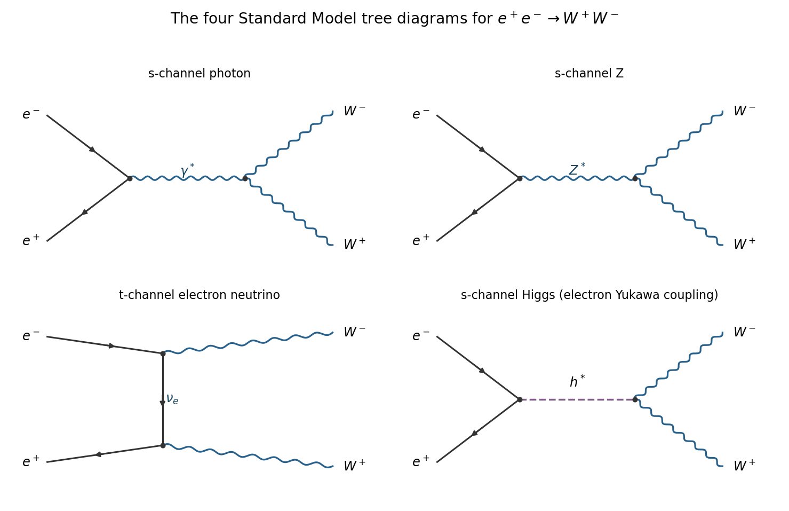

<h1 id="section-a/a1/c/solution">Solution</h1>

↑ **Parent:** [C](../c.md)

The four tree-level diagrams for [electron-positron annihilation into W-boson pairs](../../../../../electron-positron-annihilation-into-w-boson-pairs.md) are

$$
\boxed{s\text{-channel }\gamma^*,\quad s\text{-channel }Z^*,\quad
 t\text{-channel }\nu_e,\quad s\text{-channel }h^*.}
$$

**[Figure 1](#section-a/a1/c/image-the-four-tree-level-standard-model-diagrams-for-electron-positron-annihilation-into-w-pairs). The four tree-level Standard Model diagrams for electron-positron annihilation into W pairs**.

The first two diagrams contain the [electromagnetic interaction](../../../../../electromagnetic-interaction.md) and [weak interaction](../../../../../weak-interaction.md) neutral electron currents and the [gauge boson self-interaction](../../../../../gauge-boson-self-interaction.md) vertices $\gamma W^+W^-$ and $ZW^+W^-$. The third has two [weak charged current](../../../../../charged-current.md) vertices joined by an [electron neutrino](../../../../../electron-neutrino.md) propagator. In the fourth, the incoming [electron](../../../../../electron.md)-[Positron](../../../../../positron.md) pair couples to the [Higgs boson](../../../../../higgs-boson.md), which then couples to $W^+W^-$.

The small factor is at the initial Higgs-electron vertex. With the usual electroweak vacuum value $v\simeq246\,\mathrm{GeV}$, [electron Yukawa suppression of Higgs production](../../../../../electron-yukawa-suppression-of-higgs-production.md) gives

$$
y_e=\frac{\sqrt2m_e}{v}\simeq2.9\times10^{-6},\qquad
 g_{hee}=\frac{m_e}{v}\simeq2.1\times10^{-6}.
$$

These are tiny compared with ordinary [electroweak interaction](../../../../../electroweak-interaction.md) gauge couplings. The [decay amplitude](../../../../../decay-amplitude.md) for the [Higgs boson](../../../../../higgs-boson.md) diagram carries this small coefficient, and its separate squared contribution carries its square. Thus **the Higgs diagram is negligible because the electron Yukawa coupling is proportional to the electron mass**. It vanishes in the massless-electron approximation, even though the [Higgs boson](../../../../../higgs-boson.md)-[W boson](../../../../../w-boson.md) coupling itself is not small. The remaining three gauge diagrams must be added coherently, including their interference.

## ↑ Ancestors (14)

1. [C](../c.md)
2. [A1](../../a1.md)
3. [Section A](../../../section-a.md)
4. [2018](../../../../2018-split.md)
5. [Past exam of the particle and nuclear physics course of the University of Cambridge](../../../../split.md)
6. [Particle and Nuclear Physics course of the University of Cambridge](../../../../../particle-and-nuclear-physics-course-of-the-university-of-cambridge.md)
7. [Physics course of the year 3 of the natural sciences course of the University of Cambridge](../../../../../physics-course-of-the-year-3-of-the-natural-sciences-course-of-the-university-of-cambridge.md)
8. [Year 3 of the natural sciences course of the University of Cambridge](../../../../../year-3-of-the-natural-sciences-course-of-the-university-of-cambridge.md)
9. [Year of the natural sciences course of the University of Cambridge](../../../../../year-of-the-natural-sciences-course-of-the-university-of-cambridge.md)
10. [Natural sciences course of the University of Cambridge](../../../../../natural-sciences-course-of-the-university-of-cambridge.md)
11. [Course of the University of Cambridge](../../../../../course-of-the-university-of-cambridge.md)
12. [University of Cambridge](../../../../../university-of-cambridge-split.md)
13. [List of universities](../../../../../list-of-universities.md)
14. [Codex Wiki](../../../../../split.md)
