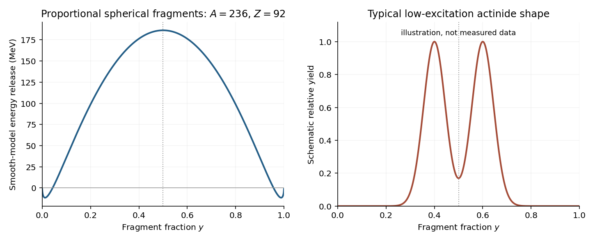

<h1 id="section-b/b2/solution">Solution</h1>

↑ **Parent:** [B2](../b2.md)

**Smooth-model fission energy**. Use [natural units](../../../../natural-units.md) $c=1$, so the quoted nuclear [masses](../../../../mass.md) are expressed as rest [energies](../../../../energy-split.md). Conservation of [mass number](../../../../mass-number.md) and [atomic number](../../../../atomic-number.md) fixes the second fragment to $(A_2,Z_2)=((1-y)A,(1-y)Z)$. First omit [nuclear pairing](../../../../nuclear-pairing.md) to compare a continuous range of $y$. Pairing can subsequently add $\delta_1+\delta_2-\delta_{\rm parent}$ for integer fragments; it has no smooth parity assignment for arbitrary real $y$.

In the parent-minus-daughters mass difference, the [nucleon](../../../../nucleon.md) [rest energy](../../../../rest-energy.md) and volume terms cancel. The [nuclear symmetry energy](../../../../symmetry-energy.md) also cancels because both fragments have the same $Z/A$:

$$
\frac{(A_1-2Z_1)^2}{A_1}+\frac{(A_2-2Z_2)^2}{A_2}
=[y+(1-y)]\frac{(A-2Z)^2}{A}.
$$

The remaining [liquid-drop fission energy](../../../../liquid-drop-fission-energy.md) is

$$
\boxed{\begin{aligned}
Q(y)={}&a_SA^{2/3}\left[1-y^{2/3}-(1-y)^{2/3}\right]\\
&+\frac{a_CZ^2}{A^{1/3}}\left[1-y^{5/3}-(1-y)^{5/3}\right].
\end{aligned}}
$$

Splitting increases the [surface energy](../../../../surface-energy.md) cost, but reduces [nuclear Coulomb energy](../../../../nuclear-coulomb-energy.md). Both contributions are symmetric under $y\leftrightarrow1-y$, so the symmetric split is stationary. Symmetry alone would not establish a maximum, since the two contributions compete.

For a full check, put $S=a_SA^{2/3}$, $x=a_CZ^2/(a_SA)$ and $t=y^{1/3}+(1-y)^{1/3}$. On $0\leq y\leq1/2$, $t$ increases from $1$ to $2^{2/3}$. Expressing the two fractional-power sums through $t$ gives

$$
\frac QS=1+x-\frac{t^2+2/t}{3}+\frac{x}{9}(t^5-5t^2-5/t),
\qquad
\frac{d(Q/S)}{dt}=\frac{t^3-1}{9t^2}\left[5x(t^3-1)-6\right].
$$

The derivative can change sign only from negative to positive, so any interior stationary point in $t$ is a minimum. The largest value is therefore either the no-split endpoint $Q=0$ or the symmetric split. Thus [symmetric fission maximizes the positive liquid-drop energy release](../../../../symmetric-fission-maximizes-the-positive-liquid-drop-energy-release.md): whenever this smooth model permits an exothermic split, its largest release occurs at $y=1/2$.

There is a qualification to the paper's unqualified wording. For arbitrary low $Z^2/A$, the symmetric split need not maximize $Q$; indeed it is a local minimum when $Z^2/A<(2/5)a_S/a_C=10$. The symmetric-maximum conclusion is valid in the heavy, fission-favorable regime relevant here, rather than a universal property of the formula.

At $y=1/2$,

$$
Q_{\rm sym}=-a_SA^{2/3}(2^{1/3}-1)
+\frac{a_CZ^2}{A^{1/3}}(1-2^{-2/3}).
$$

Requiring $Q_{\rm sym}>0$ gives

$$
\boxed{\frac{Z^2}{A}>\frac{a_S}{a_C}
\frac{2^{1/3}-1}{1-2^{-2/3}}
=\frac{18.0}{0.72}\frac{0.259921}{0.370039}
\simeq17.6.}
$$

**Barrier and fragment yields**. Positive final-state [Q value](../../../../q-value.md) does not remove the [fission barrier](../../../../fission-barrier.md) along a deformation path. [Surface energy](../../../../surface-energy.md) initially rises as the nucleus deforms; [spontaneous fission](../../../../spontaneous-fission.md) then requires collective [quantum tunnelling](../../../../quantum-tunnelling.md) unless enough excitation is present. Its rate is exponentially sensitive to barrier height, width and collective inertia. Thus nuclei close to the exothermicity threshold can have immeasurably long spontaneous-fission [mean lifetimes](../../../../mean-lifetime-physics.md), while sufficiently heavier nuclei have smaller effective [fission barriers](../../../../fission-barrier.md) or larger [quantum tunnelling](../../../../quantum-tunnelling.md) probabilities.

The [fission-fragment mass distribution](../../../../fission-fragment-mass-distribution.md) of low-excitation actinide fission is usually double peaked: complementary fragments have mass fractions roughly $0.4$ and $0.6$ rather than both exactly $1/2$. [Nuclear shell model](../../../../nuclear-shell-model.md) effects and the fission dynamics help favor asymmetric fragments. Maximizing the final smooth-model energy release is not a calculation of the fragment yield. The following yield curve is schematic, with no measured counts implied:

**[Figure 2](#section-b/b2/image-smooth-model-fission-energy-versus-a-schematic-asymmetric-fragment-yield-distribution). Smooth-model fission energy versus a schematic asymmetric fragment-yield distribution**.

**Capture excitation energies**. Capturing a negligible-energy neutron forms a compound nucleus with the rest energy of the target plus the free [neutron](../../../../neutron-split.md). Relative to the compound [ground state](../../../../ground-state.md), the [neutron-capture excitation energy](../../../../neutron-capture-excitation-energy.md) is therefore

$$
E^*=M(A,92)+m_n-M(A+1,92)
=B(A+1,92)-B(A,92)=S_n(A+1,92),
$$

where $B$ is positive [nuclear binding energy](../../../../nuclear-binding-energy.md) and $S_n$ the compound nucleus's [neutron separation energy](../../../../neutron-separation-energy.md). The free [neutron](../../../../neutron-split.md) [rest energy](../../../../rest-energy.md) cancels in the binding-energy difference. With the supplied [semi-empirical mass formula](../../../../semi-empirical-mass-formula.md),

$$
\begin{aligned}
S_n={}&a_V-a_S[(A+1)^{2/3}-A^{2/3}]\\
&-a_CZ^2[(A+1)^{-1/3}-A^{-1/3}]\\
&-a_A\left[\frac{(A+1-2Z)^2}{A+1}-\frac{(A-2Z)^2}{A}\right]
+\delta(A+1,Z)-\delta(A,Z).
\end{aligned}
$$

At $Z=92$, [uranium-235](../../../../uranium-235.md) has odd $A$, while [uranium-236](../../../../uranium-236.md) is even-even. The pairing contribution is $+33.5(236)^{-3/4}=+0.55637\,\mathrm{MeV}$. By contrast [uranium-238](../../../../uranium-238.md) is even-even and [uranium-239](../../../../uranium-239.md) has odd $A$, giving $-33.5(238)^{-3/4}=-0.55286\,\mathrm{MeV}$. The individual contributions are

$$
\begin{array}{c|rr}
\text{Contribution (MeV)}&{}^{235}\mathrm U+n&{}^{238}\mathrm U+n\\\hline
\text{Volume}&15.80000&15.80000\\
\text{Surface}&-1.94320&-1.93502\\
\text{Coulomb}&1.39680&1.37342\\
\text{Asymmetry}&-9.15424&-9.51287\\
\text{Pairing}&0.55637&-0.55286
\end{array}
$$

Thus the model predicts

$$
\boxed{E^*({}^{236}\mathrm U)=6.65573\,\mathrm{MeV}\simeq6.66\,\mathrm{MeV},\qquad
E^*({}^{239}\mathrm U)=5.17268\,\mathrm{MeV}\simeq5.17\,\mathrm{MeV}.}
$$

Of the $1.48305\,\mathrm{MeV}$ predicted difference, $1.10922\,\mathrm{MeV}$ comes from the change in [nuclear pairing](../../../../nuclear-pairing.md). It is the primary reason the even-even capture product is more strongly excited; the smooth terms account for the remaining $0.37383\,\mathrm{MeV}$.

**Thermal versus fast-neutron fission**. The last comparison uses the supplied observed capture excitations, $6.5$ and $4.8\,\mathrm{MeV}$, rather than replacing them by the preceding smooth-model estimates. Interpreting the quoted $6.2$ and $6.6\,\mathrm{MeV}$ activation energies as the barriers in the respective capture channels gives

$$
\boxed{6.5>6.2:\quad\text{thermal capture on }{}^{235}\mathrm U\text{ can lead to prompt fission},}
$$

$$
\boxed{4.8<6.6:\quad\text{thermal capture on }{}^{238}\mathrm U\text{ is below the fission barrier}.}
$$

A simple [neutron-induced fission threshold](../../../../neutron-induced-fission-threshold.md) estimate for the second channel requires about $6.6-4.8=1.8\,\mathrm{MeV}$ additional centre-of-mass kinetic energy. Sub-barrier tunnelling is possible, but it does not give the large thermal-neutron fission probability of the first channel.

The barrier labels in the original PDF need care: it assigns them to $^{235}\mathrm U$ and $^{238}\mathrm U$, whereas the states formed after capture are $^{236}\mathrm U^*$ and $^{239}\mathrm U^*$. The comparison above uses the intended capture-channel interpretation. If the quoted numbers are literally barriers of the uncaptured target nuclei, the compound-nucleus barriers are missing and this numerical comparison does not follow from those data alone.

In a thermal reactor, [neutron moderation](../../../../neutron-moderation.md) slows fission neutrons so the large low-energy fission cross section of [uranium-235](../../../../uranium-235.md) can support a [nuclear chain reaction](../../../../nuclear-chain-reaction.md). Fuel composition, moderator choice and geometry must balance production against capture and leakage; capture resonances of [uranium-238](../../../../uranium-238.md) during slowing are important losses from that neutron population. The reaction rate per target nucleus depends on the spectrum through $\int\phi(E)\sigma_f(E)\,dE$, where $\phi(E)$ is differential [neutron flux](../../../../neutron-flux.md) per unit [energy](../../../../energy-split.md). A fast spectrum can access the [uranium-238](../../../../uranium-238.md) fission channel and changes this balance. Also, [uranium-238](../../../../uranium-238.md) is a [fertile material](../../../../fertile-material.md): capture followed by two [beta-minus decays](../../../../beta-minus-decay.md) can produce [plutonium-239](../../../../plutonium-239.md), a [fissile material](../../../../fissile-material.md), so capture can contribute to breeding even when it causes no immediate fission.

## ↑ Ancestors (13)

1. [B2](../b2.md)
2. [Section B](../../section-b.md)
3. [2018](../../../2018-split.md)
4. [Past exam of the particle and nuclear physics course of the University of Cambridge](../../../split.md)
5. [Particle and Nuclear Physics course of the University of Cambridge](../../../../particle-and-nuclear-physics-course-of-the-university-of-cambridge.md)
6. [Physics course of the year 3 of the natural sciences course of the University of Cambridge](../../../../physics-course-of-the-year-3-of-the-natural-sciences-course-of-the-university-of-cambridge.md)
7. [Year 3 of the natural sciences course of the University of Cambridge](../../../../year-3-of-the-natural-sciences-course-of-the-university-of-cambridge.md)
8. [Year of the natural sciences course of the University of Cambridge](../../../../year-of-the-natural-sciences-course-of-the-university-of-cambridge.md)
9. [Natural sciences course of the University of Cambridge](../../../../natural-sciences-course-of-the-university-of-cambridge.md)
10. [Course of the University of Cambridge](../../../../course-of-the-university-of-cambridge.md)
11. [University of Cambridge](../../../../university-of-cambridge-split.md)
12. [List of universities](../../../../list-of-universities.md)
13. [Codex Wiki](../../../../split.md)
