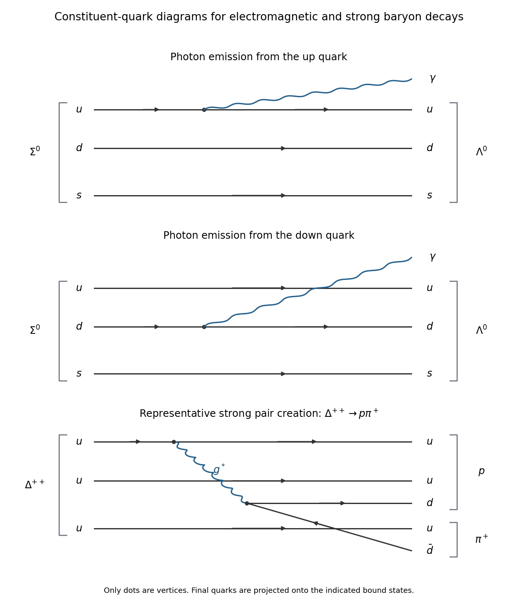

<h1 id="section-b/b3/solution">Solution</h1>

↑ **Parent:** [B3](../b3.md)

**Colour and identical-quark spin**. A spatial ground-state [baryon](../../../../baryon.md) has a symmetric $\ell=0$ spatial [wavefunction](../../../../wave-function-split.md). For $uuu$, $ddd$ or $sss$, the [quark flavour](../../../../quark-flavor.md) state is also symmetric, and the total-[spin](../../../../spin.md) $3/2$ state of three spin-one-half [quarks](../../../../quark.md) is symmetric. Without another degree of freedom, the whole state would be symmetric under exchange of identical [fermions](../../../../fermion.md), contrary to the [Pauli exclusion principle](../../../../pauli-exclusion-principle.md).

A [three-quark colour singlet](../../../../three-quark-colour-singlet.md) supplies a completely antisymmetric factor,

$$
|1_c\rangle=\frac1{\sqrt6}\epsilon_{abc}|abc\rangle,
$$

using the three [color charge](../../../../color-charge.md) states. The remaining spatial-spin-flavour factor can then be symmetric. These baryons therefore provide evidence for an additional internal [degree of freedom](../../../../degree-of-freedom.md) with at least three states, realized as colour in [Quantum chromodynamics](../../../../quantum-chromodynamics.md).

For the $uu$ pair in $uus$, the spatial and [quark flavour](../../../../quark-flavor.md) factors are symmetric under exchange of the two up quarks, while the colour factor is antisymmetric. The pair's [spin](../../../../spin.md) state must consequently be symmetric. The [identical-quark pair spin in a ground-state baryon](../../../../identical-quark-pair-spin-in-a-ground-state-baryon.md) is

$$
\boxed{S_{uu}=1,}
$$

a [triplet state](../../../../spin-one-half-triplet-state.md). This holds whether the complete baryon has total [spin](../../../../spin.md) $1/2$ or $3/2$.

**Origin of the pair interaction**. The terms in the [baryon hyperfine mass formula](../../../../baryon-hyperfine-mass-formula.md) are effective colour-magnetic [spin-spin interactions](../../../../spin-spin-interaction.md), arising from gluon exchange between the quarks' colour-magnetic moments. Each magnetic moment brings an inverse [constituent quark mass](../../../../constituent-quark-mass.md), explaining the factor $1/(m_im_j)$. The constant $A'$ absorbs the [strong coupling constant](../../../../strong-coupling-constant.md), colour factors and the spatial overlap. A common $A'$ is a constituent-model approximation.

**Spin algebra and the two masses**. Set $\hbar=c=1$, so each dimensionless [spin angular momentum](../../../../spin.md) operator satisfies $\mathbf S_i^2=3/4$. Label the two up quarks 1 and 2 and the strange quark 3. Squaring $\mathbf S_{12}=\mathbf S_1+\mathbf S_2$ gives

$$
\langle\mathbf S_1\cdot\mathbf S_2\rangle
=\frac12\left[S_{12}(S_{12}+1)-\frac34-\frac34\right]
=\frac14.
$$

Next square the total [spin](../../../../spin.md) $\mathbf J=\mathbf S_{12}+\mathbf S_3$:

$$
\langle\mathbf S_1\cdot\mathbf S_3+\mathbf S_2\cdot\mathbf S_3\rangle
=\frac12\left[J(J+1)-2-\frac34\right]
=\begin{cases}-1,&J=1/2,\\1/2,&J=3/2.\end{cases}
$$

Substituting these pair sums into the [baryon hyperfine mass formula](../../../../baryon-hyperfine-mass-formula.md) yields

$$
\boxed{M_{uus,1/2}=2m_u+m_s+\frac{A'}4
\left(\frac1{m_u^2}-\frac4{m_um_s}\right),}
$$

$$
\boxed{M_{uus,3/2}=2m_u+m_s+\frac{A'}4
\left(\frac1{m_u^2}+\frac2{m_um_s}\right).}
$$

Their difference is $3A'/(2m_um_s)$. Repeating the argument for the identical $ss$ pair in $uss$ gives

$$
M_{uss,1/2}=m_u+2m_s+\frac{A'}4\left(\frac1{m_s^2}-\frac4{m_um_s}\right),\qquad
M_{uss,3/2}=m_u+2m_s+\frac{A'}4\left(\frac1{m_s^2}+\frac2{m_um_s}\right).
$$

Thus the model predicts [equal Sigma and Xi hyperfine splittings](../../../../equal-sigma-and-xi-hyperfine-splittings.md):

$$
\boxed{\frac{M(\Sigma^*)-M(\Sigma)}{M(\Xi^*)-M(\Xi)}=1.}
$$

For a like-flavour comparison using exactly the supplied masses, the $uus$ splitting is $1383-1189=194\,\mathrm{MeV}$ and the $uss$ splitting is $1532-1315=217\,\mathrm{MeV}$, giving $194/217=0.894$. Averaging within the supplied [isospin multiplets](../../../../isospin-multiplet.md) instead gives $192/215=0.893$. The predicted equality captures the common scale but misses the observed ratio by about $11\%$ in this table. Different spatial overlaps, and hence different effective $A'$ values, can account for departures from the common-coefficient approximation.

**Radiative decay and recoil**. In a [radiative Sigma-to-Lambda transition](../../../../radiative-sigma-to-lambda-transition.md), both baryons retain valence content $uds$. A [photon](../../../../photon.md) couples to an electrically charged constituent while the final quarks are projected onto the lower [baryon](../../../../baryon.md)'s spin-flavour [wavefunction](../../../../wave-function-split.md). The leading up- and down-quark diagrams are shown below; their contributions must be combined coherently. In the simplest model, the strange-quark spin operator alone cannot change the $ud$ pair from its Sigma triplet to the Lambda singlet. The transition is an $M1$ [multipole radiation](../../../../multipole-radiation.md) transition, consistent with $1/2^+\to1/2^+$.

**[Figure 3](#section-b/b3/image-quark-diagrams-for-sigma-to-lambda-photon-emission-and-an-example-strong-delta-decay). Quark diagrams for Sigma-to-Lambda photon emission and an example strong Delta decay**.

For the photon energy, let $M_\Sigma=1193\,\mathrm{MeV}$ and $M_\Lambda=1116\,\mathrm{MeV}$ in [natural units](../../../../natural-units.md). [Four-momentum conservation](../../../../four-momentum-conservation.md) gives equal opposite final momenta of magnitude $E_\gamma$, so

$$
M_\Sigma=E_\gamma+\sqrt{M_\Lambda^2+E_\gamma^2},
\qquad
\boxed{E_\gamma=\frac{M_\Sigma^2-M_\Lambda^2}{2M_\Sigma}
=74.5151\,\mathrm{MeV}\simeq74.5\,\mathrm{MeV}.}
$$

The recoil [kinetic energy](../../../../kinetic-energy.md) of the [Lambda baryon](../../../../lambda-baryon.md) is $77-74.5151=2.4849\,\mathrm{MeV}$; assigning the entire mass difference to the [photon](../../../../photon.md) would miss it.

**Which baryons decay strongly?** The [open strong-decay thresholds for baryons](../../../../open-strong-decay-thresholds-for-baryons.md) require both sufficient energy and conserved [quark flavour](../../../../quark-flavor.md), including [strangeness](../../../../strangeness.md). The dominant strong decayers in the supplied table are

$$
\boxed{\Delta^-,\Delta^0,\Delta^+,\Delta^{++};\qquad
\Sigma^{*-},\Sigma^{*0},\Sigma^{*+};\qquad\Xi^{*-},\Xi^{*0}.}
$$

The [Delta baryon](../../../../delta-baryon.md) channels $\Delta\to N\pi$ have threshold near $940+140=1080\,\mathrm{MeV}$, below $1232\,\mathrm{MeV}$. The excited [Sigma baryons](../../../../sigma-baryon.md) can decay as $\Sigma^*\to\Lambda\pi$ or $\Sigma\pi$, and the excited [Xi baryons](../../../../xi-baryon.md) as $\Xi^*\to\Xi\pi$, all with open thresholds and conserved [strangeness](../../../../strangeness.md). Their positive-parity baryon states can emit the negative-parity [pion](../../../../pion.md) in an odd relative [orbital angular momentum](../../../../orbital-angular-momentum.md), with $L=1$ already allowing total $J=3/2$.

The last diagram illustrates $\Delta^{++}(uuu)\to p(uud)+\pi^+(u\bar d)$: a [gluon](../../../../gluon.md) creates a $d\bar d$ pair and the quarks regroup into the two hadrons. No quark changes flavour at the gluon vertices. This is a representative strong pair-creation topology; quantitative hadronic decay rates require bound-state dynamics.

The [Omega baryon](../../../../omega-baryon.md) is an important exception among the spin-$3/2$ states. Its $S=-3$ cannot become the $S=-2$ of $\Xi\pi$ through the [strong interaction](../../../../strong-interaction.md). Its flavour-conserving $\Xi K$ threshold is at least $1315+500=1815\,\mathrm{MeV}$, above its $1673\,\mathrm{MeV}$ mass, so it decays weakly. The ground-state strange octet also has no open strong channel: for example $\Sigma\to\Lambda\pi$ needs at least $1256\,\mathrm{MeV}$, and $\Lambda\to NK$ or $\Xi\to\Lambda K$ needs still more than the relevant initial mass. The neutral Sigma decays electromagnetically as above; the neutron and the other unstable octet members decay weakly, while the proton is stable within these processes.

## ↑ Ancestors (13)

1. [B3](../b3.md)
2. [Section B](../../section-b.md)
3. [2018](../../../2018-split.md)
4. [Past exam of the particle and nuclear physics course of the University of Cambridge](../../../split.md)
5. [Particle and Nuclear Physics course of the University of Cambridge](../../../../particle-and-nuclear-physics-course-of-the-university-of-cambridge.md)
6. [Physics course of the year 3 of the natural sciences course of the University of Cambridge](../../../../physics-course-of-the-year-3-of-the-natural-sciences-course-of-the-university-of-cambridge.md)
7. [Year 3 of the natural sciences course of the University of Cambridge](../../../../year-3-of-the-natural-sciences-course-of-the-university-of-cambridge.md)
8. [Year of the natural sciences course of the University of Cambridge](../../../../year-of-the-natural-sciences-course-of-the-university-of-cambridge.md)
9. [Natural sciences course of the University of Cambridge](../../../../natural-sciences-course-of-the-university-of-cambridge.md)
10. [Course of the University of Cambridge](../../../../course-of-the-university-of-cambridge.md)
11. [University of Cambridge](../../../../university-of-cambridge-split.md)
12. [List of universities](../../../../list-of-universities.md)
13. [Codex Wiki](../../../../split.md)
