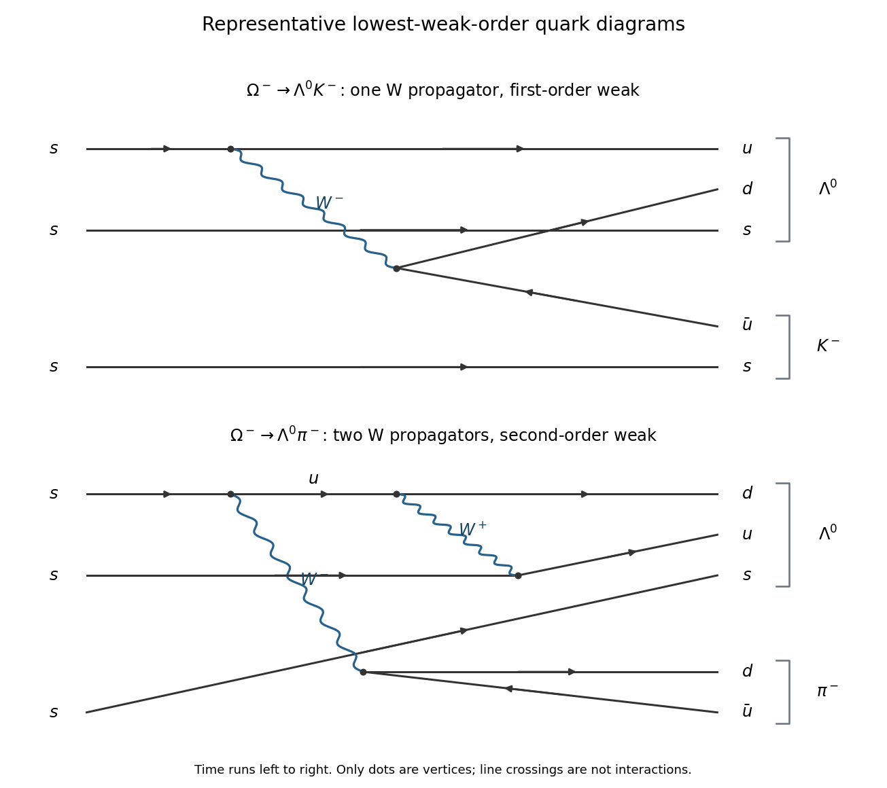

<h1 id="section-a/1/solution">Solution</h1>

↑ **Parent:** [1](../1.md)

Count [strangeness](../../../../strangeness.md) before drawing a [weak interaction](../../../../weak-interaction.md) diagram. An [Omega baryon](../../../../omega-baryon.md) has $S=-3$, a [Lambda baryon](../../../../lambda-baryon.md) has $S=-1$, a negatively charged [kaon](../../../../kaon.md) has $S=-1$, and a [pion](../../../../pion.md) has $S=0$. Thus the two [nonleptonic baryon decays](../../../../nonleptonic-baryon-decay.md) require

$$
\Delta S(\Lambda^0K^-)=+1,\qquad \Delta S(\Lambda^0\pi^-)=+2.
$$

The [strong interaction](../../../../strong-interaction.md) cannot supply either net change of [strangeness](../../../../strangeness.md).

**[Figure 1](#section-a/1/image-one-w-and-two-w-quark-diagrams-for-the-two-omega-decay-channels). One-W and two-W quark diagrams for the two Omega decay channels**.

In the upper [Feynman diagram](../../../../feynman-diagram.md), one initial [strange quark](../../../../strange-quark.md) undergoes the [weak charged current](../../../../charged-current.md) transition

$$
s\longrightarrow u+W^-,\qquad W^-\longrightarrow d+\bar u.
$$

The remaining two [strange quarks](../../../../strange-quark.md) are [spectator quarks](../../../../spectator-quark.md). Combine the outgoing $u,d$ and one spectator $s$ into the [Lambda baryon](../../../../lambda-baryon.md), and the remaining $s$ with $\bar u$ into the [kaon](../../../../kaon.md). This uses one [W boson](../../../../w-boson.md) propagator and two weak [interaction vertices](../../../../interaction-vertex.md). Its [Cabibbo-Kobayashi-Maskawa matrix](../../../../cabibbo-kobayashi-maskawa-matrix.md) factor has magnitude $|V_{us}V_{ud}|\simeq\sin\theta_C\cos\theta_C$.

For the lower [Feynman diagram](../../../../feynman-diagram.md), let the upper initial $s$ first emit a $W^-$ and become a virtual $u$, then emit a $W^+$ and become a $d$. The $W^+$ is absorbed by a second initial $s$, turning it into a $u$; the third initial $s$ remains a [spectator quark](../../../../spectator-quark.md). The emitted $W^-$ produces $d\bar u$. The complete [quark flavour](../../../../quark-flavor.md) flow is therefore

$$
\begin{aligned}
s_1&\longrightarrow u^*+W^-,&u^*&\longrightarrow d+W^+,\\
s_2+W^+&\longrightarrow u,&W^-&\longrightarrow d+\bar u,\\
s_3&\longrightarrow s.
\end{aligned}
$$

The final $d,u,s$ form the [Lambda baryon](../../../../lambda-baryon.md) and the other $d\bar u$ form the [pion](../../../../pion.md). [Electric charge conservation](../../../../charge-conservation.md) holds at every vertex. Internal lines are virtual; this is a contribution to one [decay amplitude](../../../../decay-amplitude.md), not a sequence of freely propagating on-shell constituent-quark decays.

This is a possible lowest-weak-order diagram for a [second-order strangeness-changing weak decay](../../../../second-order-strangeness-changing-weak-decay.md): it has two [W boson](../../../../w-boson.md) propagators and four weak [interaction vertices](../../../../interaction-vertex.md). Its [Cabibbo-Kobayashi-Maskawa matrix](../../../../cabibbo-kobayashi-maskawa-matrix.md) factor has magnitude $|V_{us}|^2|V_{ud}|^2$ in the displayed light-quark topology. Other contributions can exist, but a single charged-current insertion cannot turn two net strange quarks into nonstrange ones. No extra [loop Feynman diagram](../../../../loop-feynman-diagram.md) is compulsory: the displayed two-W tree already realizes the required [quark flavour](../../../../quark-flavor.md) change.

At low [energies](../../../../energy-split.md), one-W exchange produces one power of the [Fermi constant](../../../../fermi-constant.md) in an effective [decay amplitude](../../../../decay-amplitude.md); the second process requires an additional weak insertion. Hadronic [matrix elements](../../../../matrix-element.md) and propagators supply the accompanying dimensions, so a numerical ratio cannot be obtained by simply squaring a dimensionful constant. The robust comparison is

$$
\boxed{\Gamma(\Omega^-\to\Lambda^0\pi^-)\ll\Gamma(\Omega^-\to\Lambda^0K^-).}
$$

The dominant reason is the extra weak order, with additional [Cabibbo suppression](../../../../cabibbo-suppression.md) in this representative topology. It is not a comparison between a strong decay and a weak decay.

## ↑ Ancestors (13)

1. [1](../1.md)
2. [Section A](../../section-a.md)
3. [2019](../../../2019-split.md)
4. [Past exam of the particle and nuclear physics course of the University of Cambridge](../../../split.md)
5. [Particle and Nuclear Physics course of the University of Cambridge](../../../../particle-and-nuclear-physics-course-of-the-university-of-cambridge.md)
6. [Physics course of the year 3 of the natural sciences course of the University of Cambridge](../../../../physics-course-of-the-year-3-of-the-natural-sciences-course-of-the-university-of-cambridge.md)
7. [Year 3 of the natural sciences course of the University of Cambridge](../../../../year-3-of-the-natural-sciences-course-of-the-university-of-cambridge.md)
8. [Year of the natural sciences course of the University of Cambridge](../../../../year-of-the-natural-sciences-course-of-the-university-of-cambridge.md)
9. [Natural sciences course of the University of Cambridge](../../../../natural-sciences-course-of-the-university-of-cambridge.md)
10. [Course of the University of Cambridge](../../../../course-of-the-university-of-cambridge.md)
11. [University of Cambridge](../../../../university-of-cambridge-split.md)
12. [List of universities](../../../../list-of-universities.md)
13. [Codex Wiki](../../../../split.md)
