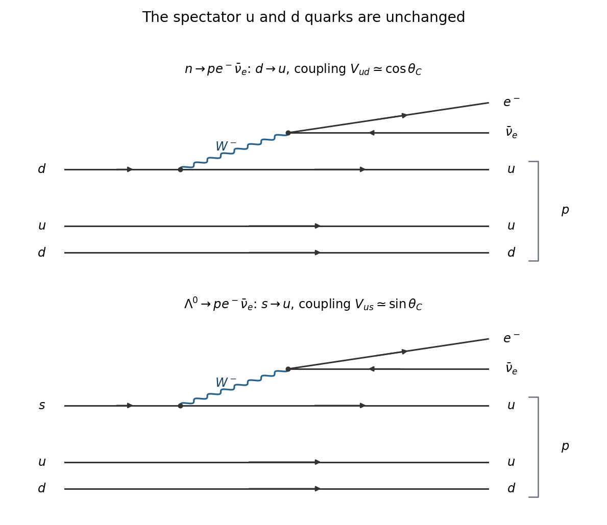

<h1 id="section-a/2/solution">Solution</h1>

↑ **Parent:** [2](../2.md)

In both [semileptonic decays](../../../../semileptonic-decay.md), an active [quark](../../../../quark.md) emits a virtual [W boson](../../../../w-boson.md), which produces an [electron](../../../../electron.md) and an [electron antineutrino](../../../../electron-antineutrino.md):

$$
\begin{aligned}
n:&\quad d\to u+W^-,\quad W^-\to e^-+\bar\nu_e,\\
\Lambda^0:&\quad s\to u+W^-,\quad W^-\to e^-+\bar\nu_e.
\end{aligned}
$$

The unchanged $u,d$ [spectator quarks](../../../../spectator-quark.md) combine with the produced $u$ into the final [proton](../../../../proton.md). The relevant [Cabibbo-Kobayashi-Maskawa matrix](../../../../cabibbo-kobayashi-maskawa-matrix.md) elements are $V_{ud}\simeq\cos\theta_C$ and $V_{us}\simeq\sin\theta_C$.

**[Figure 2](#section-a/2/image-neutron-and-lambda-semileptonic-decay-diagrams-and-their-cabibbo-factors). Neutron and Lambda semileptonic decay diagrams and their Cabibbo factors**.

Use the quoted [masses](../../../../mass.md) in [energy](../../../../energy-split.md) units, equivalently [natural units](../../../../natural-units.md) $c=1$, and define the energy releases before subtracting the electron rest energy as

$$
\Delta_n=939.6-938.3=1.3\,\mathrm{MeV},\qquad
\Delta_\Lambda=1115.7-938.3=177.4\,\mathrm{MeV}.
$$

The prescribed [density of states](../../../../density-of-states.md) ansatz uses precisely these differences to the fifth power. A [Cabibbo-angle extraction from semileptonic decay rates](../../../../cabibbo-angle-extraction-from-semileptonic-decay-rates.md) also needs a common reduced hadronic strength. In that approximation the partial decay rates, measured in $\mathrm s^{-1}$, are

$$
r_n=K\cos^2\theta_C\,\Delta_n^5,\qquad
r_\Lambda=K\sin^2\theta_C\,\Delta_\Lambda^5.
$$

The supplied [mean lifetimes](../../../../mean-lifetime-physics.md) describe all decays, so multiply their inverses by the relevant [branching fractions](../../../../branching-fraction.md):

$$
r_n=\frac{1}{880\,\mathrm s}=1.13636\times10^{-3}\,\mathrm s^{-1},\qquad
r_\Lambda=\frac{8.32\times10^{-4}}{2.63\times10^{-10}\,\mathrm s}
=3.16350\times10^6\,\mathrm s^{-1}.
$$

Taking their ratio cancels $K$ and gives

$$
\tan^2\theta_C
=\frac{r_\Lambda}{r_n}\left(\frac{\Delta_n}{\Delta_\Lambda}\right)^5
=\frac{8.32\times10^{-4}\times880}{2.63\times10^{-10}}
\left(\frac{1.3}{177.4}\right)^5
=0.0588300.
$$

Choose the conventional first-quadrant [Cabibbo angle](../../../../cabibbo-angle.md):

$$
\boxed{\theta_C=\arctan\sqrt{0.0588300}=0.237954\,\mathrm{rad}\simeq13.6^\circ.}
$$

The [Lambda baryon](../../../../lambda-baryon.md) partial rate is much larger despite its smaller weak flavour coupling because the fifth-power [phase space](../../../../phase-space.md) factor is enormous.

There is an assumption beyond the stated [density of states](../../../../density-of-states.md) ansatz: the neutron and Lambda reduced hadronic strengths have been set equal. If their ratio is $H=K_\Lambda/K_n$, the same data instead imply $\tan^2\theta_C=0.0588300/H$. Without specifying $H$, the angle is not uniquely determined. Unequal [hadronic form factors](../../../../hadronic-form-factor.md), finite [electron mass](../../../../electron-mass.md) and recoil make the displayed common-strength result an exercise-level estimate, rather than a precision measurement.

## ↑ Ancestors (13)

1. [2](../2.md)
2. [Section A](../../section-a.md)
3. [2019](../../../2019-split.md)
4. [Past exam of the particle and nuclear physics course of the University of Cambridge](../../../split.md)
5. [Particle and Nuclear Physics course of the University of Cambridge](../../../../particle-and-nuclear-physics-course-of-the-university-of-cambridge.md)
6. [Physics course of the year 3 of the natural sciences course of the University of Cambridge](../../../../physics-course-of-the-year-3-of-the-natural-sciences-course-of-the-university-of-cambridge.md)
7. [Year 3 of the natural sciences course of the University of Cambridge](../../../../year-3-of-the-natural-sciences-course-of-the-university-of-cambridge.md)
8. [Year of the natural sciences course of the University of Cambridge](../../../../year-of-the-natural-sciences-course-of-the-university-of-cambridge.md)
9. [Natural sciences course of the University of Cambridge](../../../../natural-sciences-course-of-the-university-of-cambridge.md)
10. [Course of the University of Cambridge](../../../../course-of-the-university-of-cambridge.md)
11. [University of Cambridge](../../../../university-of-cambridge-split.md)
12. [List of universities](../../../../list-of-universities.md)
13. [Codex Wiki](../../../../split.md)
