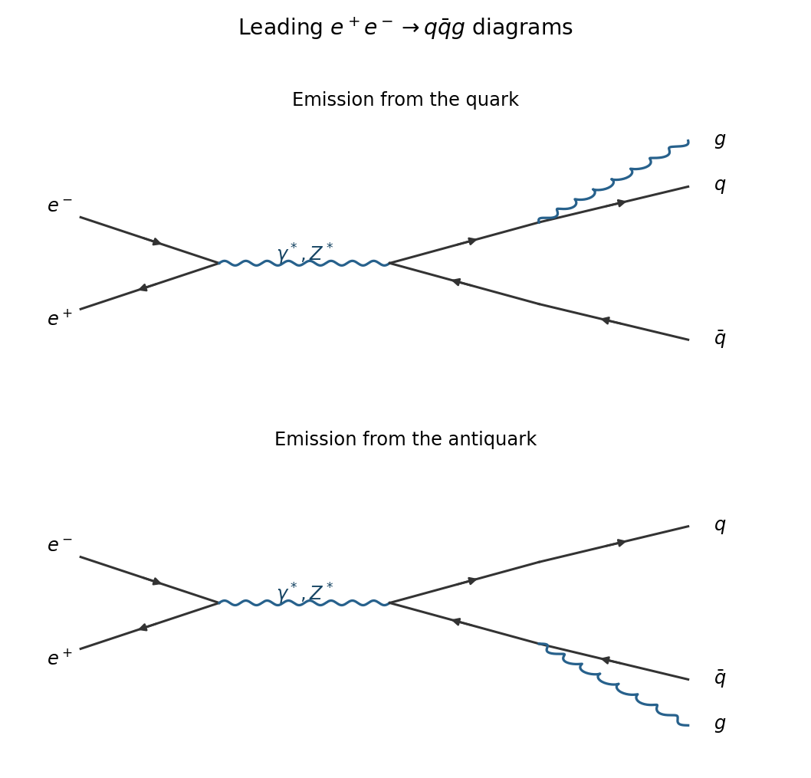
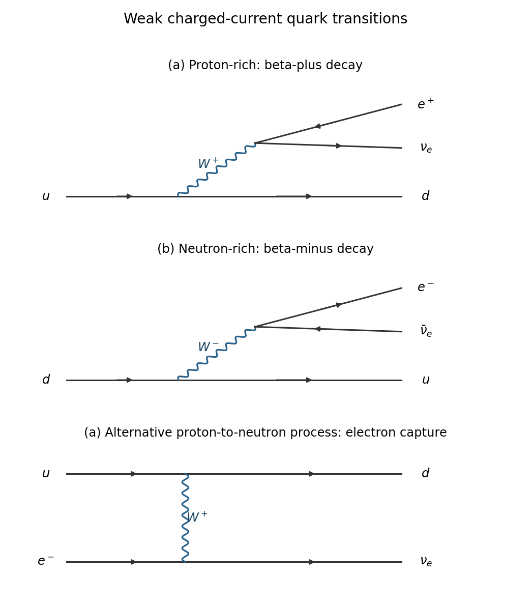
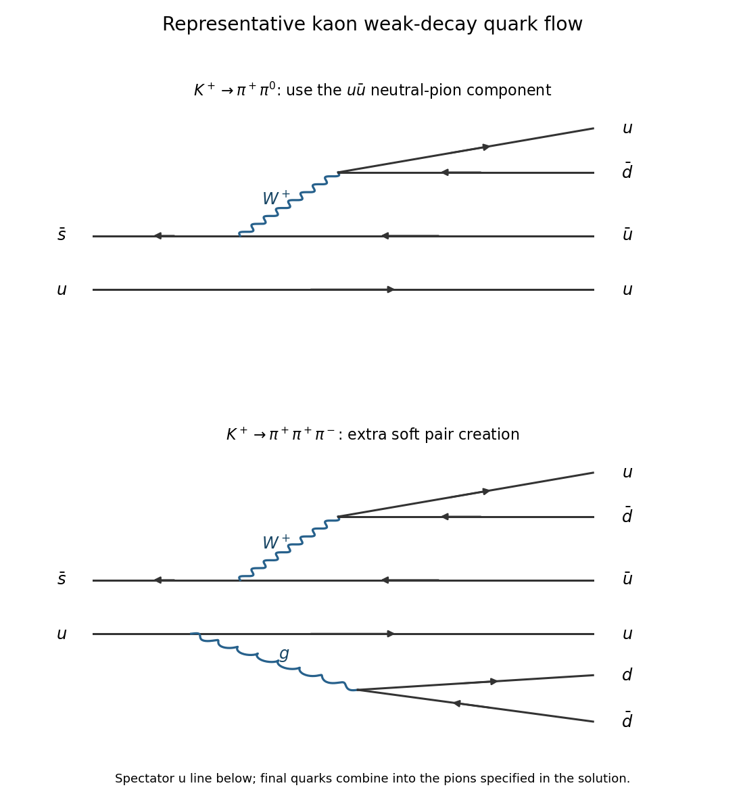
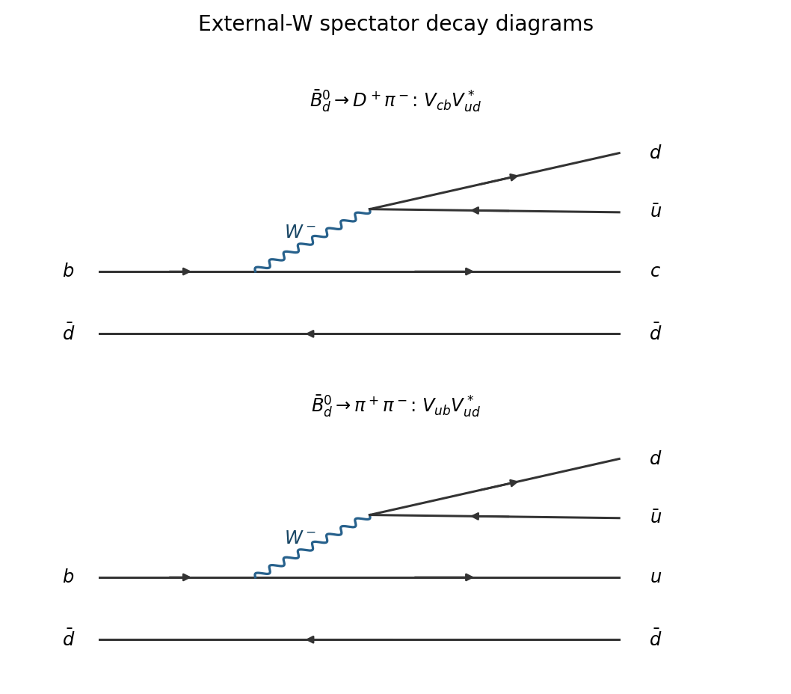
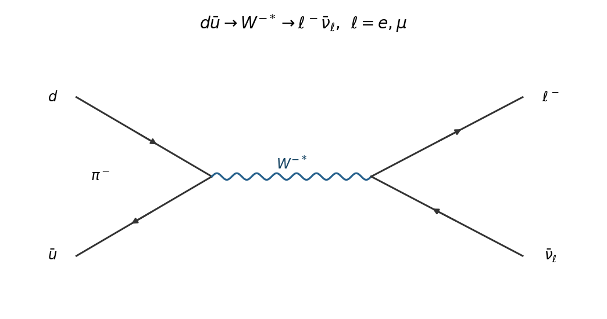
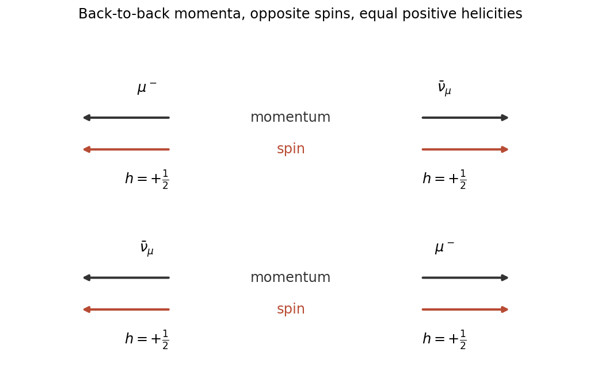
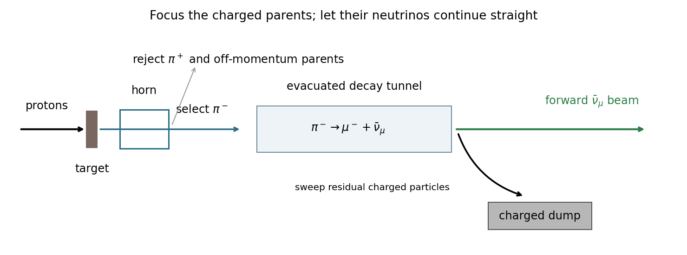
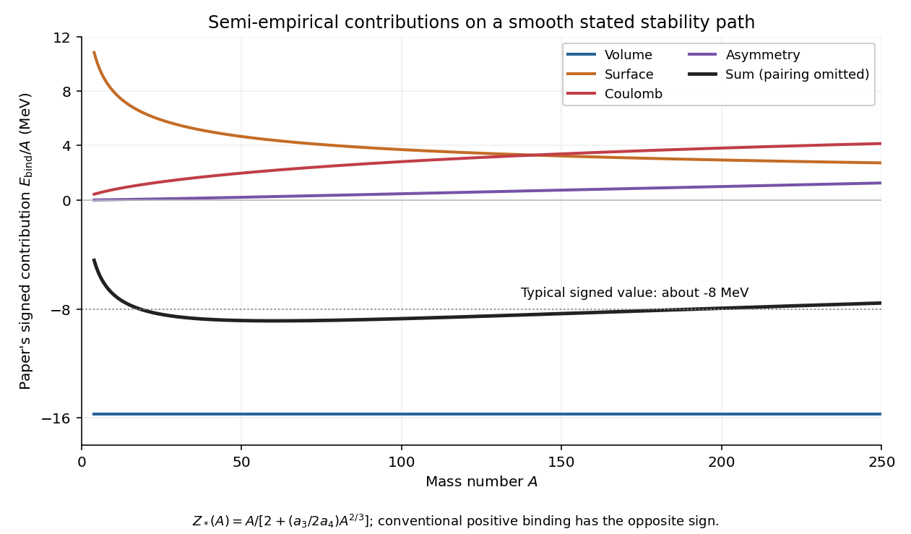

# 2021

↑ **Parent:** [Past exam of the particle and nuclear physics course of the University of Cambridge](../past-exam-of-the-particle-and-nuclear-physics-course-of-the-university-of-cambridge.md)

[Original paper, released PDF pages 425–432](https://www.whatdotheyknow.com/request/natural_science_tripos_physics_e/response/2127325/attach/3/FOI%202022%20639%20Sullivan%20materials.pdf?cookie_passthrough=1#page=425)

**Table of contents**

- [Section A](#section-a)
  - [1](#section-a/1)
    - [Solution](#section-a/1/solution)
  - [2](#section-a/2)
    - [Solution](#section-a/2/solution)
  - [3](#section-a/3)
    - [Solution](#section-a/3/solution)
- [Section B](#section-b)
  - [4](#section-b/4)
    - [a](#section-b/4/a)
      - [Solution](#section-b/4/a/solution)
    - [b](#section-b/4/b)
      - [Solution](#section-b/4/b/solution)
    - [c](#section-b/4/c)
      - [Solution](#section-b/4/c/solution)
    - [d](#section-b/4/d)
      - [Solution](#section-b/4/d/solution)
    - [e](#section-b/4/e)
      - [Solution](#section-b/4/e/solution)
  - [5](#section-b/5)
    - [a](#section-b/5/a)
      - [Solution](#section-b/5/a/solution)
    - [b](#section-b/5/b)
      - [Solution](#section-b/5/b/solution)
    - [c](#section-b/5/c)
      - [Solution](#section-b/5/c/solution)
    - [d](#section-b/5/d)
      - [Solution](#section-b/5/d/solution)
    - [e](#section-b/5/e)
      - [Solution](#section-b/5/e/solution)
    - [f](#section-b/5/f)
      - [Solution](#section-b/5/f/solution)
    - [g](#section-b/5/g)
      - [Solution](#section-b/5/g/solution)
    - [h](#section-b/5/h)
      - [Solution](#section-b/5/h/solution)
  - [6](#section-b/6)
    - [a](#section-b/6/a)
      - [Solution](#section-b/6/a/solution)
    - [b](#section-b/6/b)
      - [Solution](#section-b/6/b/solution)
    - [c](#section-b/6/c)
      - [Solution](#section-b/6/c/solution)
    - [d](#section-b/6/d)
      - [Solution](#section-b/6/d/solution)
    - [e](#section-b/6/e)
      - [Solution](#section-b/6/e/solution)
    - [f](#section-b/6/f)
      - [Solution](#section-b/6/f/solution)

## Section A

↑ **Parent:** [2021](2021.md)

<h3 id="section-a/1">1</h3>

↑ **Parent:** [Section A](#section-a)

<h4 id="section-a/1/solution">Solution</h4>

↑ **Parent:** [1](#section-a/1)

Choose the positive $z$ direction along the incident [electron](../physics.md#electron). With the neglected lepton [masses](../classical-mechanics.md#mass) and the paper's [natural units](../mathematical-physics.md#natural-units), the initial [four-momenta](../special-relativity.md#four-momentum) are

$$
p_-=(E_-,0,0,E_-),\qquad p_+=(E_+,0,0,-E_+).
$$

The squared [centre-of-mass energy](../special-relativity.md#center-of-mass-energy) is the [Lorentz invariant](../special-relativity.md#lorentz-invariance)

$$
s=(p_-+p_+)^2=(E_-+E_+)^2-(E_--E_+)^2=4E_-E_+.
$$

Producing the [Upsilon meson](../physics.md#upsilon-meson) as the sole final resonance requires $s=M_\Upsilon^2$. The threshold positron [energy](../energy.md) is therefore

$$
\boxed{E_+^{\min}=\frac{(10.580\,\mathrm{GeV})^2}{4(9.000\,\mathrm{GeV})}
=3.10934\,\mathrm{GeV}\simeq3.11\,\mathrm{GeV}.}
$$

At that beam setting, [four-momentum conservation](../special-relativity.md#four-momentum-conservation) gives $E_\Upsilon=E_-+E_+=12.10934\,\mathrm{GeV}$ and $p_{\Upsilon,z}=E_--E_+=5.89066\,\mathrm{GeV}$. Hence

$$
\boxed{\beta_\Upsilon=\frac{p_{\Upsilon,z}}{E_\Upsilon}
=\frac{9-3.10934}{9+3.10934}=0.48646.}
$$

The resonance moves in the incident-[electron](../physics.md#electron) direction, with [velocity](../classical-mechanics.md#velocity) approximately $0.486c$. The laboratory sum of beam [energies](../energy.md) exceeds the resonance [rest energy](../special-relativity.md#rest-energy) because the asymmetric beams also give it laboratory [kinetic energy](../energy.md#kinetic-energy).

<h3 id="section-a/2">2</h3>

↑ **Parent:** [Section A](#section-a)

<h4 id="section-a/2/solution">Solution</h4>

↑ **Parent:** [2](#section-a/2)

Read the line styles and fermion-number arrows in the original PDF: a wavy line is a [photon](../quantum-mechanics.md#photon), and a coiled line is a [gluon](../standard-model.md#gluon). The valid fundamental [interaction vertices](../perturbative-quantum-field-theory.md#interaction-vertex) are

$$
\boxed{\text{QED: (a), (f).}\qquad\text{QCD: (b), (g).}}
$$

Both (a) and (f) have one electron-line arrow entering and one leaving a photon vertex; changing the drawing's orientation does not change the [quantum electrodynamics](../perturbative-quantum-field-theory.md#quantum-electrodynamics) interaction. The [Quantum chromodynamics](../standard-model.md#quantum-chromodynamics) vertices (b) and (g) are the cubic and quartic [gluon](../standard-model.md#gluon) self-interactions.

The remaining cases fail for different reasons. Diagram (c) couples an isolated electron line to gluons and is not an allowed fermion vertex. Diagram (d) changes an [electron](../physics.md#electron) to a [muon](../standard-model.md#muon) at a photon vertex, violating the flavour-diagonal electromagnetic coupling. Diagram (e) couples a colourless [electron](../physics.md#electron) to a [gluon](../standard-model.md#gluon). Diagram (h) changes an [up quark](../standard-model.md#up-quark) into a [down quark](../standard-model.md#down-quark) at a gluon vertex, whereas [Quantum chromodynamics](../standard-model.md#quantum-chromodynamics) preserves quark flavour; that assignment also fails [electric charge conservation](../electric-charge.md#charge-conservation).

One measurement of the [strong coupling constant](../standard-model.md#strong-coupling-constant) uses the fraction of resolved [three-jet events](../standard-model.md#three-jet-event) in $e^+e^-\to q\bar qg$: with a fixed jet-resolution definition, its leading ratio to two-jet production is proportional to $\alpha_s$, with calculable higher-order corrections.

**[Figure 1](#section-a/2/image-the-two-leading-gluon-emission-diagrams-for-a-three-jet-measurement). The two leading gluon-emission diagrams for a three-jet measurement**.

The intermediate current is $\gamma^*$ or $Z^*$, and the extra [gluon](../standard-model.md#gluon) can be emitted from either the [quark](../standard-model.md#quark) or the [antiquark](../standard-model.md#antiquark). Both [Feynman diagrams](../perturbative-quantum-field-theory.md#feynman-diagram) contribute coherently. The observed jets arise from [hadronization](../standard-model.md#hadronization); a resolved-jet definition is needed because arbitrarily soft or collinear radiation is not a separate measurable third jet.

<h3 id="section-a/3">3</h3>

↑ **Parent:** [Section A](#section-a)

<h4 id="section-a/3/solution">Solution</h4>

↑ **Parent:** [3](#section-a/3)

The original chart has $Z$ vertically and $N$ horizontally. Thus its region (a) is proton-rich relative to the beta-stable band, whereas (b) is neutron-rich.

- In (a), [beta-plus decay](../physics.md#beta-plus-decay) changes a [proton](../physics.md#proton) into a [neutron](../neutron.md):

$$
(Z,N)\longrightarrow(Z-1,N+1)+e^++\nu_e.
$$

[Electron capture](../physics.md#electron-capture), $e^-+(Z,N)\to(Z-1,N+1)+\nu_e$, is the other proton-to-neutron weak process; it remains possible for some neutral atoms whose [beta-plus decay](../physics.md#beta-plus-decay) lacks the $2m_e$ atomic-mass threshold.
- In (b), [beta-minus decay](../physics.md#beta-minus-decay) changes a [neutron](../neutron.md) into a [proton](../physics.md#proton):

$$
(Z,N)\longrightarrow(Z+1,N-1)+e^-+\bar\nu_e.
$$

- In the heavy region (e), [alpha decay](../physics.md#alpha-decay) moves the parent down and left:

$$
(Z,N)\longrightarrow(Z-2,N-2)+{}^4_2\mathrm{He}.
$$

The emitted [alpha particle](../atomic-nucleus.md#alpha-particle) contains two [protons](../physics.md#proton) and two [neutrons](../neutron.md). Very heavy [nuclei](../atomic-nucleus.md) can also compete through [nuclear fission](../physics.md#nuclear-fission); the chart alone does not determine each nuclide's branching fractions.

**[Figure 2](#section-a/3/image-quark-level-beta-plus-beta-minus-and-electron-capture-processes). Quark-level beta-plus, beta-minus, and electron-capture processes**.

The quark transitions are $u\to d+W^+$ followed by $W^+\to e^+\nu_e$ in (a), and $d\to u+W^-$ followed by $W^-\to e^-\bar\nu_e$ in (b). The additional panel shows [electron capture](../physics.md#electron-capture) as $u+e^-\to d+\nu_e$ through [W boson](../standard-model.md#w-boson) exchange. The remaining quarks in each [nucleon](../physics.md#nucleon) are spectators.

Regions (c) and (d) lie beyond the proton and neutron binding limits, respectively. In (c), unbound [protons](../physics.md#proton) can be emitted, $(Z,N)\to(Z-1,N)+p$; in (d), unbound [neutrons](../neutron.md) can be emitted, $(Z,N)\to(Z,N-1)+n$. These are the [proton drip line](../atomic-nucleus.md#proton-drip-line) and [neutron drip line](../atomic-nucleus.md#neutron-drip-line) limits, with one- or several-nucleon emission possible according to the [nuclear separation energies](../atomic-nucleus.md#nuclear-separation-energy). They are not merely more distant points on a beta-decay trajectory.

## Section B

↑ **Parent:** [2021](2021.md)

<h3 id="section-b/4">4</h3>

↑ **Parent:** [Section B](#section-b)

<h4 id="section-b/4/a">a</h4>

↑ **Parent:** [4](#section-b/4)

<h5 id="section-b/4/a/solution">Solution</h5>

↑ **Parent:** [A](#section-b/4/a)

[Parity](../quantum-mechanics.md#parity) is full [spatial reflection](../quantum-mechanics.md#spatial-reflection), $\mathbf x\mapsto-\mathbf x$, represented by a [parity operator](../quantum-mechanics.md#parity-operator) $\mathcal P$. A [polar vector](../vector-space.md#polar-vector), such as [momentum](../momentum.md), reverses, whereas an [axial vector](../vector-space.md#pseudovector), such as [spin](../angular-momentum-operator.md#spin), does not. A state of definite [parity](../quantum-mechanics.md#parity) has $\mathcal P|\psi\rangle=\eta_P|\psi\rangle$, with $\eta_P=\pm1$ in the usual convention. A multiparticle state's [parity](../quantum-mechanics.md#parity) includes both the product of its [intrinsic parities](../quantum-field-theory.md#intrinsic-parity) and its orbital spatial factor, for example $(-1)^L$ for relative [orbital angular momentum](../quantum-mechanics.md#orbital-angular-momentum) $L$.

An interaction conserves [parity](../quantum-mechanics.md#parity) when its dynamics are invariant under this transformation, equivalently $[H,\mathcal P]=0$ for a time-independent [Hamiltonian](../hamiltonian-mechanics.md#hamiltonian). [Parity violation](../standard-model.md#parity-violation) means that a process and its fully reflected counterpart need not have the same [probability](../probability-theory.md#probability). It is more than a left-right asymmetry in an unreflected laboratory apparatus.

The electromagnetic and strong sectors of the [Standard Model](../standard-model.md) conserve [parity](../quantum-mechanics.md#parity) to the accuracy relevant here, taking the strong-sector [Yang-Mills theta term](../relativistic-quantum-field.md#yang-mills-theta-term) to vanish. The [weak charged current](../standard-model.md#charged-current) selects left-chiral fermions and right-chiral antifermions, as defined by [fermion chirality](../relativistic-quantum-field.md#chirality-physics); the reflected right-chiral charged current is not equally present. The neutral weak current also generally has different left- and right-chiral couplings. Consequently the weak sector violates [parity](../quantum-mechanics.md#parity); this does not mean that every individual weak decay must have opposite initial and final parity. For a massive particle, [helicity](../special-relativity.md#helicity) and [fermion chirality](../relativistic-quantum-field.md#chirality-physics) should be distinguished.

<h4 id="section-b/4/b">b</h4>

↑ **Parent:** [4](#section-b/4)

<h5 id="section-b/4/b/solution">Solution</h5>

↑ **Parent:** [B](#section-b/4/b)

In the [Wu experiment](../standard-model.md#wu-experiment), [Chien-Shiung Wu](../physicist.md#chien-shiung-wu) and collaborators studied [beta-minus decay](../physics.md#beta-minus-decay) of polarized [cobalt-60](../chemical-substance.md#cobalt-60),

$$
{}^{60}_{27}\mathrm{Co}\longrightarrow{}^{60}_{28}\mathrm{Ni}^{*}+e^-+\bar\nu_e.
$$

A thin [cobalt-60](../chemical-substance.md#cobalt-60) layer on a [cerium magnesium nitrate](../chemical-substance.md#cerium-magnesium-nitrate) crystal was cooled by [adiabatic demagnetization](../temperature.md#adiabatic-demagnetization) to a few millikelvin. A polarizing [magnetic field](../magnetic-field.md) produced [nuclear polarization](../physics.md#nuclear-polarization). An [anthracene](../chemical-substance.md#anthracene) scintillation counter and [photomultiplier](../particle-detection.md#photomultiplier) detected the emitted [electrons](../physics.md#electron); angular [gamma ray](../quantum-mechanics.md#gamma-ray) observations from the daughter de-excitation monitored whether the nuclei remained polarized.[Apparatus and polarization controls, pp. 1413–1414](../physics-bibliography.md#experimental-test-of-parity-conservation-in-beta-decay-by-chien-shiung-wu-and-others)

The [electrons](../physics.md#electron) were emitted preferentially opposite the parent [nuclear spin](../atomic-nucleus.md#nuclear-spin). Reversing the [nuclear polarization](../physics.md#nuclear-polarization) reversed the asymmetry, while warming the sample removed both polarization and the effect. Those controls distinguished a spin-correlated asymmetry from a fixed detector bias.

The relevant angular correlation is a [polarized beta-decay angular distribution](../standard-model.md#polarized-beta-decay-angular-distribution) of the form

$$
W(\theta)\propto1+A_\beta P\frac vc\cos\theta,
\qquad \cos\theta=\widehat{\mathbf J}\cdot\widehat{\mathbf p}_e.
$$

Under [parity](../quantum-mechanics.md#parity), $\mathbf p_e\to-\mathbf p_e$ but $\mathbf J\to\mathbf J$, so the spin-momentum correlation changes sign. [Parity conservation](../quantum-mechanics.md#parity-conservation) would require equal rates for these two directions relative to the same spin. The observed nonzero coefficient therefore demonstrated **parity violation in beta decay**. An unpolarized source would average this correlation to zero and could not provide the same test.

<h4 id="section-b/4/c">c</h4>

↑ **Parent:** [4](#section-b/4)

<h5 id="section-b/4/c/solution">Solution</h5>

↑ **Parent:** [C](#section-b/4/c)

For both modes, a leading weak quark transition in $K^+=u\bar s$ is $\bar s\to\bar u+W^+$, followed by $W^+\to u\bar d$, with the original $u$ acting as a [spectator quark](../standard-model.md#spectator-quark). This produces the four quarks needed for $\pi^+\pi^0$, using the $u\bar u$ component of $\pi^0$. Producing three pions additionally requires a $d\bar d$ pair from strong [hadronization](../standard-model.md#hadronization). A representative quark-line diagram draws it as gluon emission and splitting.

**[Figure 3](#section-b/4/c/image-representative-weak-quark-diagrams-for-the-two-pion-and-three-pion-kaon-decays). Representative weak quark diagrams for the two-pion and three-pion kaon decays**.

The three-pion assignment is $u\bar d$, $u\bar d$, and $d\bar u$, matching $\pi^+\pi^+\pi^-$. The extra soft pair creation is a schematic representation of [hadronization](../standard-model.md#hadronization), not a controlled perturbative prediction of the relative decay rates. Both processes are first order in the effective weak interaction.

There is an explicit error or hypothetical assumption to address: the original PDF assigns **$0^+$ to all these mesons**. Taken literally, the two-pion final state has $L=0$, because all particles have zero [spin](../angular-momentum-operator.md#spin) and the initial $J$ is zero. Its [parity](../quantum-mechanics.md#parity) is $(+1)^2(-1)^0=+1$. For three spinless particles, use two Jacobi [orbital angular momentum](../quantum-mechanics.md#orbital-angular-momentum) quantum numbers $l,L$. Coupling to total zero requires $l=L$, so the orbital parity $(-1)^{l+L}$ is $+1$ and the three-particle parity is also $+1$. Thus **under the printed $0^+$ assignment, both channels conserve parity**.

The named physical [pions](../standard-model.md#pion) and [kaons](../physics.md#kaon) are instead [pseudoscalar mesons](../physics.md#pseudoscalar-meson) with $J^P=0^-$. With those physical assignments,

$$
P_{2\pi}=(-1)^2(-1)^0=+1,\qquad
P_{3\pi}=(-1)^3(-1)^{l+L}=-1,
\qquad P_K=-1.
$$

Therefore

$$
\boxed{\text{Physical mesons: }K^+\to2\pi\text{ violates parity; }K^+\to3\pi\text{ preserves parity}.}
$$

These two opposite-parity final states from the same physical kaon are a classic illustration of [parity violation](../standard-model.md#parity-violation) in a weak decay. The physical conclusion requires correcting the printed parity assignment explicitly.

<h4 id="section-b/4/d">d</h4>

↑ **Parent:** [4](#section-b/4)

<h5 id="section-b/4/d/solution">Solution</h5>

↑ **Parent:** [D](#section-b/4/d)

The [antiquark](../standard-model.md#antiquark) $\bar d$ in the specified $\overline B_d^0=b\bar d$ is a spectator. For the charmed final state the leading external-[W boson](../standard-model.md#w-boson) tree is

$$
b\to c+W^-,\qquad W^-\to d+\bar u,
$$

with $c\bar d=D^+$ and $d\bar u=\pi^-$. For the charmless final state replace the active transition by $b\to u+W^-$, giving $u\bar d=\pi^+$ and the same $d\bar u=\pi^-$. Their weak amplitudes have factors $V_{cb}V_{ud}^*$ and $V_{ub}V_{ud}^*$, respectively, up to an irrelevant overall conjugation convention.

**[Figure 4](#section-b/4/d/image-leading-spectator-diagrams-for-the-charmed-and-charmless-neutral-b-decays). Leading spectator diagrams for the charmed and charmless neutral-B decays**.

The diagrams determine the leading weak flavour factors. Strong-interaction matrix elements and, particularly for the charmless channel, additional [loop diagrams](../perturbative-quantum-field-theory.md#loop-feynman-diagram) can also contribute to physical [branching fractions](../relativistic-quantum-field.md#branching-fraction).

<h4 id="section-b/4/e">e</h4>

↑ **Parent:** [4](#section-b/4)

<h5 id="section-b/4/e/solution">Solution</h5>

↑ **Parent:** [E](#section-b/4/e)

Ignoring the requested final-mass difference and initially taking equal hadronic matrix elements, the common $W^-\to d\bar u$ factor cancels. A [decay width](../relativistic-quantum-field.md#decay-width) is proportional to the squared [decay amplitude](../relativistic-quantum-field.md#decay-amplitude), so

$$
\frac{B(\overline B_d^0\to D^+\pi^-)}{B(\overline B_d^0\to\pi^+\pi^-)}
\simeq\left|\frac{V_{cb}}{V_{ub}}\right|^2
\simeq\frac{\sin^4\theta_C}{\sin^6\theta_C}
=\frac1{\sin^2\theta_C}.
$$

With the supplied [Cabibbo angle](../standard-model.md#cabibbo-angle),

$$
\boxed{R_B^{\mathrm{rough}}=\frac1{0.225^2}=19.75\simeq20.}
$$

The quoted measurement, about $500\pm10$, is larger by a factor $500/19.75\simeq25.3$. If that whole difference were attributed to a ratio of other amplitudes, it would require a factor $\sqrt{25.3}\simeq5.03$.

This does not invalidate quark mixing. The supplied [Cabibbo-Kobayashi-Maskawa matrix](../standard-model.md#cabibbo-kobayashi-maskawa-matrix) is only a schematic hierarchy in powers of $\sin\theta_C$, particularly for $V_{ub}$; its omitted coefficients matter greatly after squaring. Equal phase space also does not imply equal hadronic [decay amplitudes](../relativistic-quantum-field.md#decay-amplitude): the two transitions have different [hadronic form factors](../physics.md#hadronic-form-factor) and strong-interaction dynamics, and loop contributions can interfere with the charmless tree amplitude. Thus the calculation correctly predicts enhancement of the charmed channel, but **the supplied CKM hierarchy alone does not quantitatively predict the measured ratio**. It would be unjustified to treat $19.75$ as a precision prediction with only the quoted experimental error.

<h3 id="section-b/5">5</h3>

↑ **Parent:** [Section B](#section-b)

<h4 id="section-b/5/a">a</h4>

↑ **Parent:** [5](#section-b/5)

<h5 id="section-b/5/a/solution">Solution</h5>

↑ **Parent:** [A](#section-b/5/a)

In the [pion](../standard-model.md#pion) [rest frame](../mathematical-physics.md#rest-frame), write its [four-momentum](../special-relativity.md#four-momentum) as $P=(m_\pi,\mathbf0)$ and the charged lepton's as $p_\ell=(E_\ell,\mathbf p)$. By [four-momentum conservation](../special-relativity.md#four-momentum-conservation), the massless [antineutrino](../standard-model.md#antineutrino) has $k=P-p_\ell$, with $k^2=0$. Therefore

$$
0=(P-p_\ell)^2=m_\pi^2+m_\ell^2-2m_\pi E_\ell,
\qquad E_\ell=\frac{m_\pi^2+m_\ell^2}{2m_\pi}.
$$

Its energy is $E_\nu=m_\pi-E_\ell$, and for a massless [antineutrino](../standard-model.md#antineutrino), $E_\nu=|\mathbf k|$. The final [momenta](../momentum.md) are equal and opposite, so

$$
\boxed{|\mathbf p_\ell|=|\mathbf k|=E_\nu
=\frac{m_\pi^2-m_\ell^2}{2m_\pi}.}
$$

The expression is positive precisely when the two-body decay is energetically allowed, $m_\pi>m_\ell$, neglecting the [neutrino mass](../standard-model.md#neutrino-mass).

<h4 id="section-b/5/b">b</h4>

↑ **Parent:** [5](#section-b/5)

<h5 id="section-b/5/b/solution">Solution</h5>

↑ **Parent:** [B](#section-b/5/b)

The variable initial [energy](../energy.md) $E_0$ replaces $m_\pi$ in the kinematic expression before differentiation. The charged-lepton [mass](../classical-mechanics.md#mass) remains fixed:

$$
p(E_0)=\frac{E_0^2-m_\ell^2}{2E_0}
=\frac{E_0}{2}-\frac{m_\ell^2}{2E_0}.
$$

Thus the required [Jacobian determinant](../multivariable-calculus.md#jacobian-determinant) in this one-dimensional change of variables is

$$
\boxed{\left.\frac{dp}{dE_0}\right|_{E_0=m_\pi}
=\frac12+\frac{m_\ell^2}{2m_\pi^2}
=\frac{m_\pi^2+m_\ell^2}{2m_\pi^2}.}
$$

Equivalently, $E_0=\sqrt{p^2+m_\ell^2}+p$ gives $dE_0/dp=1+p/E_\ell$, so $dp/dE_0=E_\ell/(E_\ell+p)=E_\ell/m_\pi$, the same result. It is dimensionless in [natural units](../mathematical-physics.md#natural-units).

<h4 id="section-b/5/c">c</h4>

↑ **Parent:** [5](#section-b/5)

<h5 id="section-b/5/c/solution">Solution</h5>

↑ **Parent:** [C](#section-b/5/c)

In the simple box-state counting used here, the final [three-momentum](../special-relativity.md#three-momentum) lies in a spherical shell: $dn=Cp^2dp$, where the common constant $C$ contains the normalization volume and angular factor. [Momentum conservation](../momentum.md#momentum-conservation) fixes the other final particle's [momentum](../momentum.md). Hence the [density of states](../quantum-ideal-gas-statistics.md#density-of-states) is

$$
\rho_\ell(E_0)=Cp_\ell^2\frac{dp_\ell}{dE_0}.
$$

Combining parts (a) and (b) gives

$$
\boxed{\frac{\rho_\mu}{\rho_e}
=\left[\frac{m_\pi^2-m_\mu^2}{m_\pi^2-m_e^2}\right]^2
\frac{m_\pi^2+m_\mu^2}{m_\pi^2+m_e^2}.}
$$

With the paper's rounded [masses](../classical-mechanics.md#mass),

$$
R_{\mathrm{naive}}=\left(\frac{19600-11236}{19600-0.25}\right)^2
\frac{19600+11236}{19600+0.25}
=0.28650.
$$

By [Fermi's golden rule](../quantum-mechanics.md#fermi-s-golden-rule), equal squared matrix elements make the rate ratio equal to this density ratio. Thus **the naive constant-matrix-element estimate is $R\simeq0.287$**, which favours the electronic decay by about $3.49$ to one.

This is the particular noncovariant state-counting convention in the question. A calculation with the [Lorentz-invariant phase-space measure](../quantum-scattering.md#lorentz-invariant-phase-space-measure) places factors $1/(2E)$ in the measure and correspondingly normalizes its [decay amplitude](../relativistic-quantum-field.md#decay-amplitude) differently. Only the complete product of phase space and squared matrix element is convention-independent; mixing the two conventions would give a wrong rate.

<h4 id="section-b/5/d">d</h4>

↑ **Parent:** [5](#section-b/5)

<h5 id="section-b/5/d/solution">Solution</h5>

↑ **Parent:** [D](#section-b/5/d)

The charged [pion](../standard-model.md#pion) has valence content $\pi^-=d\bar u$. Its constituents annihilate into a virtual [W boson](../standard-model.md#w-boson), followed by the lepton pair:

$$
d+\bar u\longrightarrow W^{-*}\longrightarrow\ell^-+\bar\nu_\ell,
\qquad \ell=e,\mu.
$$

**[Figure 5](#section-b/5/d/image-the-leading-quark-level-charged-pion-leptonic-decay-diagram). The leading quark-level charged-pion leptonic decay diagram**.

The quark vertex carries the $u$--$d$ [Cabibbo-Kobayashi-Maskawa matrix](../standard-model.md#cabibbo-kobayashi-maskawa-matrix) element, and the leptonic vertex is the [weak charged current](../standard-model.md#charged-current). The pion's nonperturbative spatial structure is encoded in the [pion decay constant](../standard-model.md#pion-decay-constant) when evaluating the [decay amplitude](../relativistic-quantum-field.md#decay-amplitude).

<h4 id="section-b/5/e">e</h4>

↑ **Parent:** [5](#section-b/5)

<h5 id="section-b/5/e/solution">Solution</h5>

↑ **Parent:** [E](#section-b/5/e)

A spin-zero [pion](../standard-model.md#pion) has no preferred emission direction. Choose the [antineutrino](../standard-model.md#antineutrino) [momentum](../momentum.md) along $+z$. A massless [antineutrino](../standard-model.md#antineutrino) has positive [helicity](../special-relativity.md#helicity), so its [spin](../angular-momentum-operator.md#spin) points along $+z$. The [muon](../standard-model.md#muon) moves along $-z$, and total $J_z=0$ requires its [spin](../angular-momentum-operator.md#spin) to point along $-z$:

$$
\begin{array}{c|cc}
&\mu^-&\bar\nu_\mu\\\hline
\text{Momentum}&-p\widehat{\mathbf z}&+p\widehat{\mathbf z}\\
\text{Spin}&-\tfrac12\widehat{\mathbf z}&+\tfrac12\widehat{\mathbf z}\\
\text{Helicity}&+\tfrac12&+\tfrac12
\end{array}
$$

**[Figure 6](#section-b/5/e/image-allowed-spin-and-momentum-orientations-in-negative-pion-decay). Allowed spin and momentum orientations in negative-pion decay**.

The reversed configuration is obtained by rotating the entire event and is equally allowed. The two spins are opposite, while each is aligned with its own particle's [momentum](../momentum.md); **both outgoing helicities are positive**. A negative-helicity [muon](../standard-model.md#muon) with this fixed antineutrino direction would give a nonzero total spin projection and is forbidden for this two-body decay of a spin-zero parent. The required positive-helicity charged lepton is the suppressed component of the [weak charged current](../standard-model.md#charged-current).

<h4 id="section-b/5/f">f</h4>

↑ **Parent:** [5](#section-b/5)

<h5 id="section-b/5/f/solution">Solution</h5>

↑ **Parent:** [F](#section-b/5/f)

For the charged [lepton](../standard-model.md#lepton), $p_\ell=\beta_\ell\gamma_\ell m_\ell$ and $E_\ell=\gamma_\ell m_\ell$. Their ratio is therefore its speed in [natural units](../mathematical-physics.md#natural-units). Using part (a),

$$
\boxed{\beta_\ell=\frac{p_\ell}{E_\ell}
=\frac{m_\pi^2-m_\ell^2}{m_\pi^2+m_\ell^2}.}
$$

Numerically,

$$
\boxed{\beta_e=\frac{19600-0.25}{19600+0.25}=0.99997449,\qquad
\beta_\mu=\frac{19600-11236}{19600+11236}=0.271241.}
$$

The [electron](../physics.md#electron) is almost ultrarelativistic, while the [muon](../standard-model.md#muon) is relatively slow. In ordinary units these are approximately $0.999974c$ and $0.271c$.

<h4 id="section-b/5/g">g</h4>

↑ **Parent:** [5](#section-b/5)

<h5 id="section-b/5/g/solution">Solution</h5>

↑ **Parent:** [G](#section-b/5/g)

The [weak charged current](../standard-model.md#charged-current) creates a negative charged [lepton](../standard-model.md#lepton) in a left-chiral state. For a massless particle, that would have negative [helicity](../special-relativity.md#helicity); part (e) instead requires positive [helicity](../special-relativity.md#helicity). A nonzero [mass](../classical-mechanics.md#mass) supplies the necessary wrong-helicity component. This [helicity suppression](../standard-model.md#helicity-suppression) is extremely strong for the fast [electron](../physics.md#electron), but much weaker for the slow [muon](../standard-model.md#muon).

For a positive-helicity charged lepton with spinors normalized to unit probability, the left-chiral weight is $(1-\beta_\ell)/2$. With the box-state normalization of part (c), this gives the useful consistent rate ratio

$$
R=\frac{\rho_\mu}{\rho_e}\frac{1-\beta_\mu}{1-\beta_e}.
$$

Indeed $1-\beta_\ell=2m_\ell^2/(m_\pi^2+m_\ell^2)$ cancels the extra energy-dependent factor in that density ratio, leaving the standard [pion electron-to-muon decay ratio](../standard-model.md#pion-electron-to-muon-decay-ratio) in inverted form:

$$
\boxed{R=\frac{m_\mu^2}{m_e^2}
\left[\frac{1-m_\mu^2/m_\pi^2}{1-m_e^2/m_\pi^2}\right]^2.}
$$

Using the rounded masses in this paper gives $R\simeq8185$, close to the stated order of $8000$. Precision predictions require more accurate [masses](../classical-mechanics.md#mass) and electromagnetic radiative corrections. The essential mechanism is the charged-lepton-mass dependence of the [decay amplitude](../relativistic-quantum-field.md#decay-amplitude); simply counting available final [momenta](../momentum.md) misses it.

<h4 id="section-b/5/h">h</h4>

↑ **Parent:** [5](#section-b/5)

<h5 id="section-b/5/h/solution">Solution</h5>

↑ **Parent:** [H](#section-b/5/h)

Use a high-energy [proton](../physics.md#proton) beam on a target to produce secondary [pions](../standard-model.md#pion), then select and focus the negative ones. A [magnetic horn](../physics.md#magnetic-horn) and a charge-selecting dipole system remove positive pions, limiting wrong-sign $\nu_\mu$ contamination. Select a narrow range of [magnetic rigidity](../relativistic-electromagnetism.md#magnetic-rigidity); if additional species rejection is available, velocity or mass discrimination reduces negative [kaon](../physics.md#kaon) contamination at the same momentum.

**[Figure 7](#section-b/5/h/image-a-focused-negative-pion-decay-beam-producing-muon-antineutrinos). A focused negative-pion decay beam producing muon antineutrinos**.

The selected $\pi^-$ travel through an evacuated [decay tunnel](../physics.md#decay-tunnel) and undergo $\pi^-\to\mu^-\bar\nu_\mu$. Their forward [Lorentz boost](../special-relativity.md#lorentz-boost) concentrates the [antineutrinos](../standard-model.md#antineutrino) within an angle of order $1/\gamma_\pi$. Choose a tunnel long enough for substantial pion decay but short compared with the boosted [muon](../standard-model.md#muon) decay length. Since $\tau_\mu\simeq2.2\,\mu\mathrm s$ is much longer than $\tau_\pi\simeq26\,\mathrm{ns}$, this reduces secondary $\mu^-\to e^-\bar\nu_e\nu_\mu$ contamination.

Downstream magnets sweep the remaining charged particles into absorbers, and shielding stops residual hadrons and [muons](../standard-model.md#muon). The [antineutrino](../standard-model.md#antineutrino) beam continues straight through. Parent-particle collimation, charge selection, and a forward detector improve purity; neutral-kaon decays, remaining wrong-sign parents, and muon decays prevent perfect purity. [Neutrinos](../standard-model.md#neutrino) themselves cannot be focused or charge-selected by these magnets. Neutrinos produced after stopped-muon decay or capture are much less forward and can be reduced by directional and energy selection.

<h3 id="section-b/6">6</h3>

↑ **Parent:** [Section B](#section-b)

<h4 id="section-b/6/a">a</h4>

↑ **Parent:** [6](#section-b/6)

<h5 id="section-b/6/a/solution">Solution</h5>

↑ **Parent:** [A](#section-b/6/a)

There are three free-particle rest-energy terms and five nuclear corrections. In the paper's [natural units](../mathematical-physics.md#natural-units), their meanings are:

- $Zm_p$: the rest [energy](../energy.md) of $Z$ free [protons](../physics.md#proton).
- $Zm_e$: the rest [energy](../energy.md) of the atomic [electrons](../physics.md#electron); including this term makes the result an atomic, rather than bare nuclear, [mass](../classical-mechanics.md#mass). Small atomic binding energies are neglected.
- $(A-Z)m_n$: the rest [energy](../energy.md) of the free [neutrons](../neutron.md).
- $a_1A$, with $a_1<0$: the attractive volume term. The short-range [nuclear force](../nuclear-force.md) mainly binds each [nucleon](../physics.md#nucleon) to nearby neighbours, so the leading attraction is extensive.
- $a_2A^{2/3}>0$: the surface correction. Surface [nucleons](../physics.md#nucleon) have fewer neighbours and are less bound; surface area grows as $A^{2/3}$ at approximately constant nuclear density.
- $a_3Z^2/A^{1/3}>0$: the [nuclear Coulomb energy](../atomic-nucleus.md#nuclear-coulomb-energy) cost of repelling [protons](../physics.md#proton), scaling as $Z^2/R$ with nuclear radius $R\propto A^{1/3}$.
- $a_4(A-2Z)^2/A>0$: the [nuclear symmetry energy](../physics.md#symmetry-energy), penalizing unequal neutron and proton populations. The [Pauli exclusion principle](../tensor-product-of-quantum-systems.md#pauli-exclusion-principle) forces an excess species into higher single-particle states; strong-interaction effects also contribute.
- $\delta(A)/A^{1/2}$: [nuclear pairing](../atomic-nucleus.md#nuclear-pairing). It lowers the mass for even-even [nuclei](../atomic-nucleus.md), raises it for odd-odd [nuclei](../atomic-nucleus.md), and vanishes for odd $A$ in the stated model.

The sign convention is significant: the quantity labeled $E_{\mathrm{bind}}$ in the supplied mass formula is added to the free-particle masses and is normally negative for a bound nucleus. It is the negative of the conventional positive [nuclear binding energy](../atomic-nucleus.md#nuclear-binding-energy) $B$:

$$
\boxed{M=Zm_p+Zm_e+(A-Z)m_n+E_{\mathrm{bind}},\qquad B=-E_{\mathrm{bind}}>0.}
$$

The coefficients must therefore retain their printed signs; using positive $B$ while still adding it to the masses would be inconsistent.

<h4 id="section-b/6/b">b</h4>

↑ **Parent:** [6](#section-b/6)

<h5 id="section-b/6/b/solution">Solution</h5>

↑ **Parent:** [B](#section-b/6/b)

In the supplied signed convention, and omitting pairing, the four contributions per [nucleon](../physics.md#nucleon) are

$$
\frac{E_{\mathrm{bind}}}{A}
=\underbrace{a_1}_{\mathrm{volume}}
+\underbrace{a_2A^{-1/3}}_{\mathrm{surface}}
+\underbrace{a_3Z^2A^{-4/3}}_{\mathrm{Coulomb}}
+\underbrace{a_4(1-2Z/A)^2}_{\mathrm{asymmetry}}.
$$

The volume contribution is the constant $-15.7\,\mathrm{MeV}$. The positive surface correction decreases with $A$. At fixed proton fraction $Z/A$, the positive Coulomb correction grows as $A^{2/3}$, while the asymmetry correction is constant. Along the beta-stable valley the fraction $Z/A$ itself falls, and the asymmetry correction consequently grows.

Because the formula depends on both $A$ and $Z$, no unique plot against $A$ exists until a path $Z(A)$ is chosen. The original sketch below uses the continuous minimum of the nuclear Coulomb-plus-asymmetry terms,

$$
Z_*(A)=\frac{A}{2+[a_3/(2a_4)]A^{2/3}},
$$

ignoring the small neutron-proton-electron rest-mass difference in locating that path. This is a stated smooth approximation to the [valley of stability](../physics.md#valley-of-stability), not an assertion that nuclei have noninteger $Z$.

**[Figure 8](#section-b/6/b/image-signed-semi-empirical-binding-energy-contributions-along-a-stated-smooth-stability-path). Signed semi-empirical binding-energy contributions along a stated smooth stability path**.

The four individual terms and their sum appear in one plot. A typical well-bound nucleus has **$E_{\mathrm{bind}}/A\sim-8\,\mathrm{MeV}$ in the paper's convention**, equivalently conventional positive [binding energy per nucleon](../atomic-nucleus.md#binding-energy-per-nucleon) $B/A\sim+8\,\mathrm{MeV}$. If a positive-binding-energy plot is preferred, every plotted contribution must have its sign reversed. The competition between the surface and Coulomb penalties gives the familiar maximum of positive binding per nucleon near the iron-group [nuclei](../atomic-nucleus.md).

<h4 id="section-b/6/c">c</h4>

↑ **Parent:** [6](#section-b/6)

<h5 id="section-b/6/c/solution">Solution</h5>

↑ **Parent:** [C](#section-b/6/c)

The qualitative explanation is [nuclear pairing](../atomic-nucleus.md#nuclear-pairing): $^{40}\mathrm K$ is odd-odd ($Z=19,N=21$), while both $^{40}\mathrm{Ar}$ and $^{40}\mathrm{Ca}$ are even-even. At $A=40$, moving from the odd-odd to either even-even branch lowers the pairing contribution to the atomic [mass](../classical-mechanics.md#mass) by

$$
\frac{(+11.2)-(-11.2)}{\sqrt{40}}=3.542\,\mathrm{MeV}.
$$

Two neighboring even-even [nuclear isobars](../atomic-nucleus.md#isobar-nuclide) can therefore both be lower in mass than the intervening odd-odd member. The two possible directions are

$$
{}^{40}_{19}\mathrm K\to{}^{40}_{18}\mathrm{Ar}
\quad\text{by electron capture or positron emission},\qquad
{}^{40}_{19}\mathrm K\to{}^{40}_{20}\mathrm{Ca}
\quad\text{by beta-minus decay}.
$$

However, the particular coefficients printed in this paper do **not** quantitatively reproduce both allowed directions. Let $D=m_p+m_e-m_n\simeq-0.7823\,\mathrm{MeV}$. Using every supplied term, rather than pairing alone, gives

$$
\begin{aligned}
M(40,19)-M(40,18)
&=D+\frac{0.71(19^2-18^2)}{40^{1/3}}
+\frac{23.3(2^2-4^2)}{40}+\frac{22.4}{\sqrt{40}}
\simeq+3.451\,\mathrm{MeV},\\
M(40,19)-M(40,20)
&=-D+\frac{0.71(19^2-20^2)}{40^{1/3}}
+\frac{23.3(2^2-0^2)}{40}+\frac{22.4}{\sqrt{40}}
\simeq-1.443\,\mathrm{MeV}.
\end{aligned}
$$

Thus this parametrization would forbid the calcium beta-minus branch. The physical atomic mass differences are instead approximately $+1.505\,\mathrm{MeV}$ to argon and $+1.311\,\mathrm{MeV}$ to calcium, so both physical directions are allowed.[Decay scheme and atomic Q values](../physics-bibliography.md#the-kdk-experiment-by-kdk-collaboration-2021)

The valid interpretation is therefore **pairing explains how both directions can be possible, but the supplied smooth mass formula is insufficient to establish both for this isotope**. The [semi-empirical mass formula](../atomic-nucleus.md#semi-empirical-mass-formula) has MeV-scale residual errors and omits [nuclear shell closure](../atomic-nucleus.md#nuclear-shell-closure) corrections; $^{40}\mathrm{Ca}$ has the especially stable $Z=N=20$ shell closures. One must use measured [masses](../classical-mechanics.md#mass) or a model with those corrections for a quantitative proof, rather than changing the printed numbers silently.

<h4 id="section-b/6/d">d</h4>

↑ **Parent:** [6](#section-b/6)

<h5 id="section-b/6/d/solution">Solution</h5>

↑ **Parent:** [D](#section-b/6/d)

The two processes are [electron capture](../physics.md#electron-capture) and [beta-plus decay](../physics.md#beta-plus-decay):

$$
\boxed{{}^{40}_{19}\mathrm K+e^-\to{}^{40}_{18}\mathrm{Ar}+\nu_e,\qquad
{}^{40}_{19}\mathrm K\to{}^{40}_{18}\mathrm{Ar}+e^++\nu_e.}
$$

For neutral atomic [masses](../classical-mechanics.md#mass), their available total [energies](../energy.md) obey

$$
Q_{\mathrm{EC}}=M_a(\mathrm K)-M_a(\mathrm{Ar}),\qquad
Q_{\beta^+}=M_a(\mathrm K)-M_a(\mathrm{Ar})-2m_e.
$$

Hence **electron capture has approximately $2m_ec^2=1.022\,\mathrm{MeV}$ more available energy**. Electron-hole energies and [nuclear recoil](../atomic-nucleus.md#nuclear-recoil) give smaller corrections for capture from a particular shell. With the physical mass difference, $Q_{\mathrm{EC}}\simeq1.505\,\mathrm{MeV}$ and the positron kinetic-energy budget is only about $0.483\,\mathrm{MeV}$.

[Electron capture](../physics.md#electron-capture) dominates the argon-producing decays. Energetic advantage alone is not a universal theorem about branching fractions: electron density at the nucleus and nuclear transition matrix elements and selection rules also matter. In this case capture can populate the approximately $1.461\,\mathrm{MeV}$ excited argon level, whereas positron emission cannot; this is an additional reason the physical capture branch is much larger.[Dominant capture branch to the 1460.8-keV argon level and rare positron branch](../physics-bibliography.md#the-kdk-experiment-by-kdk-collaboration-2021)

<h4 id="section-b/6/e">e</h4>

↑ **Parent:** [6](#section-b/6)

<h5 id="section-b/6/e/solution">Solution</h5>

↑ **Parent:** [E](#section-b/6/e)

The number of radioactive atoms is determined by the supplied isotope mass, rather than by the total body mass:

$$
N=\frac{0.0164\,\mathrm g}{40\,\mathrm{g\,mol^{-1}}}
(6.02214076\times10^{23}\,\mathrm{mol^{-1}})
=2.4691\times10^{20}.
$$

The [radioactive activity](../physics.md#radioactive-activity) is $\mathcal A=\lambda N$, with [nuclear decay constant](../physics.md#nuclear-decay-constant) $\lambda=\ln2/T_{1/2}$. Using $1\,\mathrm{yr}=365.25\times86400\,\mathrm s$,

$$
\lambda=\frac{\ln2}{(1.3\times10^9)(3.15576\times10^7)\,\mathrm s}
=1.6895\times10^{-17}\,\mathrm{s^{-1}}.
$$

Therefore

$$
\boxed{\mathcal A=4.17\times10^3\,\mathrm{Bq}\simeq4.2\,\mathrm{kBq}.}
$$

A [becquerel](../physics.md#becquerel) is one decay per second; this is total activity over all decay branches. Multiplying by the argon-producing [branching fraction](../relativistic-quantum-field.md#branching-fraction) would give that branch's activity, not the total asked for. Activity alone is also distinct from an absorbed radiation dose.

<h4 id="section-b/6/f">f</h4>

↑ **Parent:** [6](#section-b/6)

<h5 id="section-b/6/f/solution">Solution</h5>

↑ **Parent:** [F](#section-b/6/f)

Let $K(t)$ be the surviving [potassium-40](../chemical-substance.md#potassium-40) population and $A_r(t)$ the accumulated radiogenic [argon-40](../chemical-substance.md#argon-40). The total [nuclear decay constant](../physics.md#nuclear-decay-constant) $\lambda$ sets $K(t)=K_0e^{-\lambda t}$. Only fraction $b=0.11$ of lost potassium atoms produces argon, so under the stated retention and zero-initial-argon assumptions,

$$
A_r(t)=b[K_0-K(t)].
$$

Dividing by the present potassium abundance eliminates the unknown initial population:

$$
\frac{A_r}{K}=b(e^{\lambda t}-1),\qquad
\boxed{t=\frac{T_{1/2}}{\ln2}\ln\left(1+\frac{A_r/K}{b}\right).}
$$

With $A_r/K=0.3$,

$$
t=\frac{1.3\times10^9\,\mathrm{yr}}{\ln2}
\ln\left(1+\frac{0.3}{0.11}\right)
=2.4676\times10^9\,\mathrm{yr}.
$$

Thus the inferred [potassium-argon dating](../physics.md#potassium-argon-dating) age is **about $2.5$ billion years**, consistent with the proposed $2.5\times10^9$-year age to the accuracy of the supplied inputs. Omitting the branching fraction would seriously underestimate the age. At exactly $2.5$ billion years, the model predicts $A_r/K\simeq0.307$, consistent with the rounded measured $0.3$.

This dates closure of the mineral to argon loss and potassium exchange under the assumptions, not necessarily its original crystallization or the first formation of the Earth's crust. The depth alone is not an age measurement. No uncertainty or argon-retention history is supplied, so the agreement is a consistency check rather than proof of a particular geological event.

## ↑ Ancestors (10)

1. [Past exam of the particle and nuclear physics course of the University of Cambridge](../past-exam-of-the-particle-and-nuclear-physics-course-of-the-university-of-cambridge.md)
2. [Particle and Nuclear Physics course of the University of Cambridge](../university-of-cambridge.md#particle-and-nuclear-physics-course-of-the-university-of-cambridge)
3. [Physics course of the year 3 of the natural sciences course of the University of Cambridge](../university-of-cambridge.md#physics-course-of-the-year-3-of-the-natural-sciences-course-of-the-university-of-cambridge)
4. [Year 3 of the natural sciences course of the University of Cambridge](../university-of-cambridge.md#year-3-of-the-natural-sciences-course-of-the-university-of-cambridge)
5. [Year of the natural sciences course of the University of Cambridge](../university-of-cambridge.md#year-of-the-natural-sciences-course-of-the-university-of-cambridge)
6. [Natural sciences course of the University of Cambridge](../university-of-cambridge.md#natural-sciences-course-of-the-university-of-cambridge)
7. [Course of the University of Cambridge](../university-of-cambridge.md#course-of-the-university-of-cambridge)
8. [University of Cambridge](../university-of-cambridge.md)
9. [List of universities](../README.md#list-of-universities)
10. [Codex Wiki](../README.md)
