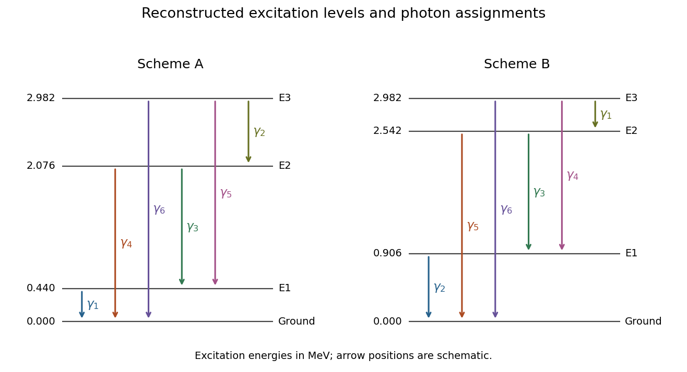

# 2022

↑ **Parent:** [Past exam of the particle and nuclear physics course of the University of Cambridge](../past-exam-of-the-particle-and-nuclear-physics-course-of-the-university-of-cambridge.md)

[Original paper, released PDF pages 482–492](https://www.whatdotheyknow.com/request/natural_science_tripos_physics_e/response/2127325/attach/3/FOI%202022%20639%20Sullivan%20materials.pdf?cookie_passthrough=1#page=482)

**Table of contents**

- [Section A](#section-a)
  - [1](#section-a/1)
    - [Solution](#section-a/1/solution)
  - [2](#section-a/2)
    - [Solution](#section-a/2/solution)
  - [3](#section-a/3)
    - [a](#section-a/3/a)
      - [Solution](#section-a/3/a/solution)
    - [b](#section-a/3/b)
      - [Solution](#section-a/3/b/solution)
    - [c](#section-a/3/c)
      - [Solution](#section-a/3/c/solution)
    - [d](#section-a/3/d)
      - [Solution](#section-a/3/d/solution)
- [Section B](#section-b)
  - [4](#section-b/4)
    - [a](#section-b/4/a)
      - [Solution](#section-b/4/a/solution)
    - [b](#section-b/4/b)
      - [Solution](#section-b/4/b/solution)
    - [c](#section-b/4/c)
      - [Solution](#section-b/4/c/solution)
    - [d](#section-b/4/d)
      - [i](#section-b/4/d/i)
        - [Solution](#section-b/4/d/i/solution)
      - [ii](#section-b/4/d/ii)
        - [Solution](#section-b/4/d/ii/solution)
      - [iii](#section-b/4/d/iii)
        - [Solution](#section-b/4/d/iii/solution)
  - [5](#section-b/5)
    - [a](#section-b/5/a)
      - [Solution](#section-b/5/a/solution)
    - [b](#section-b/5/b)
      - [Solution](#section-b/5/b/solution)
    - [c](#section-b/5/c)
      - [Solution](#section-b/5/c/solution)
    - [d](#section-b/5/d)
      - [Solution](#section-b/5/d/solution)
    - [e](#section-b/5/e)
      - [Solution](#section-b/5/e/solution)
  - [6](#section-b/6)
    - [a](#section-b/6/a)
      - [Solution](#section-b/6/a/solution)
    - [b](#section-b/6/b)
      - [Solution](#section-b/6/b/solution)
    - [c](#section-b/6/c)
      - [Solution](#section-b/6/c/solution)
    - [d](#section-b/6/d)
      - [Solution](#section-b/6/d/solution)
    - [e](#section-b/6/e)
      - [Solution](#section-b/6/e/solution)

## Section A

↑ **Parent:** [2022](2022.md)

<h3 id="section-a/1">1</h3>

↑ **Parent:** [Section A](#section-a)

<h4 id="section-a/1/solution">Solution</h4>

↑ **Parent:** [1](#section-a/1)

All three processes are [weak charged current](../standard-model.md#charged-current) transformations between neighboring [nuclear isobars](../atomic-nucleus.md#isobar-nuclide). Neglecting [neutrino masses](../standard-model.md#neutrino-mass), and writing $M_a(A,Z)$ for a neutral atomic [mass](../classical-mechanics.md#mass), their [Q values](../energy.md#q-value) are:

- [Beta-minus decay](../physics.md#beta-minus-decay): a [neutron](../neutron.md) converts to a [proton](../physics.md#proton), emitting an [electron](../physics.md#electron) and an [electron antineutrino](../standard-model.md#electron-antineutrino),

$$
(A,Z)\longrightarrow(A,Z+1)+e^-+\bar\nu_e,\qquad
Q_{\beta^-}=M_a(A,Z)-M_a(A,Z+1)>0.
$$

- [Beta-plus decay](../physics.md#beta-plus-decay): a [proton](../physics.md#proton) converts to a [neutron](../neutron.md), emitting a [Positron](../physics.md#positron) and an [electron neutrino](../standard-model.md#electron-neutrino),

$$
(A,Z)\longrightarrow(A,Z-1)+e^++\nu_e,\qquad
Q_{\beta^+}=M_a(A,Z)-M_a(A,Z-1)-2m_e>0.
$$

- [Electron capture](../physics.md#electron-capture): a bound atomic [electron](../physics.md#electron) is absorbed in the conversion of a [proton](../physics.md#proton) to a [neutron](../neutron.md),

$$
e^-+(A,Z)\longrightarrow(A,Z-1)+\nu_e,\qquad
Q_{\mathrm{EC}}=M_a(A,Z)-M_a(A,Z-1)>0.
$$

These formulae use the paper's [natural units](../mathematical-physics.md#natural-units). With energies in MeV, [beta-plus decay](../physics.md#beta-plus-decay) requires an atomic mass-energy difference exceeding $2m_ec^2=1.022\,\mathrm{MeV}$. The extra electron-mass subtraction arises from using neutral atomic rather than bare nuclear [masses](../classical-mechanics.md#mass). [Electron capture](../physics.md#electron-capture) can occur when the atomic mass-energy difference is positive but below this threshold. For a particular capture shell or excited daughter, the available [energy](../energy.md) must also cover the electron-hole and nuclear [excitation energies](../quantum-mechanics.md#excitation-energy), and the small [nuclear recoil](../atomic-nucleus.md#nuclear-recoil). Small atomic binding corrections are suppressed in the displayed threshold formulae.

The question's fixed-$A$ family consists of [nuclear isobars](../atomic-nucleus.md#isobar-nuclide), rather than [isotopes](../chemical-substance.md#isotope): [isotopes](../chemical-substance.md#isotope) have fixed $Z$. The [semi-empirical mass formula](../atomic-nucleus.md#semi-empirical-mass-formula) gives a convex [nuclear mass parabola](../atomic-nucleus.md#nuclear-mass-parabola) as a function of $Z$ at fixed $A$. For odd $A$, [nuclear pairing](../atomic-nucleus.md#nuclear-pairing) does not split the family into two branches, so there is **typically one beta-stable isobar**, at the discrete minimum. Neighboring members can lower their [mass](../classical-mechanics.md#mass) by changing $Z$ toward it.

For even $A$, [nuclear pairing](../atomic-nucleus.md#nuclear-pairing) lowers even-even [nuclei](../atomic-nucleus.md) and raises odd-odd [nuclei](../atomic-nucleus.md), producing two offset [nuclear mass parabolas](../atomic-nucleus.md#nuclear-mass-parabola). There are **often two beta-stable even-even isobars**, separated by an odd-odd member to which neither can energetically decay. The number is not an exact universal rule: some even-$A$ chains have one or more than two such minima against single [beta decay](../physics.md#beta-decay), and a few light odd-odd [nuclei](../atomic-nucleus.md) are stable. Stability against single [beta decay](../physics.md#beta-decay) also does not guarantee stability against [double beta decay](../physics.md#double-beta-decay).

<h3 id="section-a/2">2</h3>

↑ **Parent:** [Section A](#section-a)

<h4 id="section-a/2/solution">Solution</h4>

↑ **Parent:** [2](#section-a/2)

[Radiocarbon dating](../physics.md#radiocarbon-dating) measures how long carbon-bearing material has been isolated from a carbon reservoir. Atmospheric [cosmic rays](../galaxy.md#cosmic-ray) produce secondary [neutrons](../neutron.md), which create [carbon-14](../chemical-substance.md#carbon-14) chiefly through

$$
{}^{14}_{7}\mathrm N+n\longrightarrow{}^{14}_{6}\mathrm C+p.
$$

The [carbon-14](../chemical-substance.md#carbon-14) enters atmospheric carbon dioxide and then living organisms through carbon exchange, including photosynthesis and food consumption. While exchange continues, the organism's $^{14}\mathrm C/{}^{12}\mathrm C$ ratio tracks the relevant environmental ratio approximately.

After exchange ceases, the remaining [carbon-14](../chemical-substance.md#carbon-14) undergoes [beta-minus decay](../physics.md#beta-minus-decay),

$$
{}^{14}_{6}\mathrm C\longrightarrow{}^{14}_{7}\mathrm N+e^-+\bar\nu_e,
$$

while stable [carbon-12](../chemical-substance.md#carbon-12) remains. With [half-life](../analysis.md#half-life) $T_{1/2}\simeq5730\,\mathrm{yr}$, the [radioactive decay](../physics.md#radioactive-decay) law gives

$$
N_{14}(t)=N_{14}(0)e^{-\lambda t},\qquad \lambda=\frac{\ln2}{T_{1/2}}.
$$

Thus measuring the isotope ratio $R$, or the [radioactive activity](../physics.md#radioactive-activity) per fixed amount of carbon, gives

$$
\boxed{t=\frac{T_{1/2}}{\ln2}\ln\frac{R_0}{R}
=\frac{T_{1/2}}{\ln2}\ln\frac{a_0}{a}.}
$$

Here $a=\lambda N_{14}$ is compared at equal carbon content; $R_0,a_0$ describe the appropriate initial reservoir. [Accelerator mass spectrometry](../chemistry.md#accelerator-mass-spectrometry) counts the rare [carbon-14](../chemical-substance.md#carbon-14) relative to stable carbon directly; a decay-counting method instead measures its [radioactive activity](../physics.md#radioactive-activity).

The initial ratio is not perfectly constant. Atmospheric production changes and reservoir differences therefore require [radiocarbon calibration](../physics.md#radiocarbon-calibration), often using independently dated tree rings. Contamination and subsequent carbon exchange must also be controlled. The date measures closure of the carbon system, not automatically the date of every later event involving the object. The physical [half-life](../analysis.md#half-life) is about $5730$ years; conventional radiocarbon ages historically use $5568$ years and must be calibrated before interpretation as calendar dates.[Physical versus conventional half-lives and calibration against tree rings](../physics-bibliography.md#radiocarbon-calibration-by-oxford-radiocarbon-accelerator-unit)

<h3 id="section-a/3">3</h3>

↑ **Parent:** [Section A](#section-a)

<h4 id="section-a/3/a">a</h4>

↑ **Parent:** [3](#section-a/3)

<h5 id="section-a/3/a/solution">Solution</h5>

↑ **Parent:** [A](#section-a/3/a)

Use the usual [Feynman rule](../perturbative-quantum-field-theory.md#feynman-rule) convention in which the diagonal quadratic terms of the free [Lagrangian](../calculus-of-variations.md#lagrangian), including the physical [W boson](../standard-model.md#w-boson) and [Z boson](../standard-model.md#z-boson) masses, are incorporated into their [propagators](../quantum-field-theory.md#propagator). Then there are

$$
\boxed{0\text{ fundamental two-gauge-boson interaction vertices}.}
$$

A line joining two ends is a [propagator](../quantum-field-theory.md#propagator), not an interaction vertex. [Gauge boson self-interactions](../relativistic-quantum-field.md#gauge-boson-self-interaction) begin with cubic terms in the [Yang-Mills theory](../relativistic-quantum-field.md#yang-mills-theory) [Lagrangian](../calculus-of-variations.md#lagrangian). The question's $g,W,Z,\gamma$ name four families: they include eight [gluon](../standard-model.md#gluon) colour components and the two charged [W bosons](../standard-model.md#w-boson) $W^\pm$.

There is a convention to distinguish here: if a calculation expands around massless free fields, quadratic $m_W^2W^+_\mu W^{-\mu}$ and $m_Z^2Z_\mu Z^\mu/2$ terms may be drawn as two-leg mass insertions. Those two insertion types belong to that bookkeeping convention. Similarly, two-point [self-energy](../perturbative-quantum-field-theory.md#self-energy) corrections occur in [loop diagrams](../perturbative-quantum-field-theory.md#loop-feynman-diagram). Neither is an additional fundamental interaction in the standard physical-mass, tree-level rules used for the count above.

<h4 id="section-a/3/b">b</h4>

↑ **Parent:** [3](#section-a/3)

<h5 id="section-a/3/b/solution">Solution</h5>

↑ **Parent:** [B](#section-a/3/b)

There are **three vertex types**, with all legs labeled in the following original drawings:

$$
\boxed{ggg,\qquad W^+W^-\gamma,\qquad W^+W^-Z.}
$$

**[Figure 1](#section-a/3/b/image-the-three-fundamental-cubic-gauge-boson-vertex-types). The three fundamental cubic gauge-boson vertex types**.

The [gluon](../standard-model.md#gluon) cubic [interaction vertex](../perturbative-quantum-field-theory.md#interaction-vertex) follows from the non-Abelian [gauge field strength](../relativistic-quantum-field.md#gauge-field-strength) of [Quantum chromodynamics](../standard-model.md#quantum-chromodynamics). The electroweak [Yang-Mills theory](../relativistic-quantum-field.md#yang-mills-theory) [Lagrangian](../calculus-of-variations.md#lagrangian), after expressing the fields in the physical charged and neutral [basis](../vector-space.md#basis), produces the two charged-[W boson](../standard-model.md#w-boson) vertices. In particular there are no fundamental $\gamma\gamma\gamma$, $ZZZ$, $ZZ\gamma$, or $Z\gamma\gamma$ vertices, and the separate colour and electroweak gauge factors do not generate a mixed $gg\gamma$ or $ggZ$ vertex. The count is by the boson labels requested, not by separate assignments of [gluon](../standard-model.md#gluon) colour indices.

<h4 id="section-a/3/c">c</h4>

↑ **Parent:** [3](#section-a/3)

<h5 id="section-a/3/c/solution">Solution</h5>

↑ **Parent:** [C](#section-a/3/c)

There are **five vertex types**:

$$
\boxed{gggg,\quad W^+W^-W^+W^-,\quad
W^+W^-ZZ,\quad W^+W^-Z\gamma,\quad W^+W^-\gamma\gamma.}
$$

**[Figure 2](#section-a/3/c/image-the-five-fundamental-quartic-gauge-boson-vertex-types). The five fundamental quartic gauge-boson vertex types**.

The quartic terms arise from the square of the quadratic-field piece of the non-Abelian [gauge field strength](../relativistic-quantum-field.md#gauge-field-strength). Every electroweak quartic [gauge boson self-interaction](../relativistic-quantum-field.md#gauge-boson-self-interaction) contains a $W^+W^-$ pair. The absence of a fundamental purely neutral quartic vertex does not forbid amplitudes such as light-by-light scattering: those can be generated by [loop diagrams](../perturbative-quantum-field-theory.md#loop-feynman-diagram), rather than by a single fundamental [interaction vertex](../perturbative-quantum-field-theory.md#interaction-vertex).

<h4 id="section-a/3/d">d</h4>

↑ **Parent:** [3](#section-a/3)

<h5 id="section-a/3/d/solution">Solution</h5>

↑ **Parent:** [D](#section-a/3/d)

There are

$$
\boxed{0\text{ fundamental five-gauge-boson vertices}.}
$$

For a [Yang-Mills theory](../relativistic-quantum-field.md#yang-mills-theory), schematically $F=\partial A+gAA$. The gauge kinetic [Lagrangian](../calculus-of-variations.md#lagrangian) is quadratic in $F$, so its terms are at most quartic in the [gauge fields](../relativistic-quantum-field.md#gauge-field):

$$
F^2\sim(\partial A)^2+g(\partial A)AA+g^2AAAA.
$$

Thus there is no elementary five-leg pure-gauge [interaction vertex](../perturbative-quantum-field-theory.md#interaction-vertex) in the renormalizable [Standard Model](../standard-model.md). A five-boson scattering amplitude can still be assembled from several lower-valence vertices, or generated by [loop diagrams](../perturbative-quantum-field-theory.md#loop-feynman-diagram). The number of external legs of a complete [Feynman diagram](../perturbative-quantum-field-theory.md#feynman-diagram) is not the valence of a fundamental vertex.

## Section B

↑ **Parent:** [2022](2022.md)

<h3 id="section-b/4">4</h3>

↑ **Parent:** [Section B](#section-b)

<h4 id="section-b/4/a">a</h4>

↑ **Parent:** [4](#section-b/4)

<h5 id="section-b/4/a/solution">Solution</h5>

↑ **Parent:** [A](#section-b/4/a)

[Neon](../chemical-substance.md#neon) has $Z=10$ and [sodium](../chemical-substance.md#sodium) has $Z=11$, while $A=23$ is unchanged. The conversion is therefore [beta-minus decay](../physics.md#beta-minus-decay),

$$
\boxed{{}^{23}_{10}\mathrm{Ne}\longrightarrow{}^{23}_{11}\mathrm{Na}^{(*)}+e^-+\bar\nu_e.}
$$

A [neutron](../neutron.md) is converted to a [proton](../physics.md#proton) by the [weak charged current](../standard-model.md#charged-current). If an excited daughter is populated, subsequent [gamma decay](../atomic-nucleus.md#gamma-decay) produces the observed [photons](../quantum-mechanics.md#photon) without changing either $A$ or $Z$. The initial weak transition and the later electromagnetic [nuclear de-excitation](../atomic-nucleus.md#nuclear-de-excitation) are distinct stages. A direct transition to the daughter [ground state](../quantum-mechanics.md#ground-state) produces no nuclear de-excitation [gamma ray](../quantum-mechanics.md#gamma-ray).

<h4 id="section-b/4/b">b</h4>

↑ **Parent:** [4](#section-b/4)

<h5 id="section-b/4/b/solution">Solution</h5>

↑ **Parent:** [B](#section-b/4/b)

The supplied schematic has four daughter [energy levels](../quantum-mechanics.md#energy-level), including the [ground state](../quantum-mechanics.md#ground-state), and all six downward pair transitions. Thus the observed [gamma ray](../quantum-mechanics.md#gamma-ray) [energies](../energy.md) must be the six positive pairwise differences of

$$
0<E_1<E_2<E_3.
$$

The largest difference fixes $E_3=2.982\,\mathrm{MeV}$. Since $E_1,E_2$ are themselves transitions to the [ground state](../quantum-mechanics.md#ground-state), each must occur among the measured [energies](../energy.md). Testing those pairs gives exactly **two level schemes**:

$$
\boxed{\begin{aligned}
\mathrm A:\ &(E_1,E_2,E_3)=(0.440,2.076,2.982)\,\mathrm{MeV},\\
\mathrm B:\ &(E_1,E_2,E_3)=(0.906,2.542,2.982)\,\mathrm{MeV}.
\end{aligned}}
$$

They are reflections of one another about half the total span: replacing every level $E$ by $E_3-E$ preserves the set of differences. The assignment of every observed line is

$$
\begin{array}{c|cc}
\text{Transition}&\mathrm A&\mathrm B\\\hline
1\to0&\gamma_1&\gamma_2\\
2\to0&\gamma_4&\gamma_5\\
3\to0&\gamma_6&\gamma_6\\
2\to1&\gamma_3&\gamma_3\\
3\to1&\gamma_5&\gamma_4\\
3\to2&\gamma_2&\gamma_1
\end{array}
$$

**[Figure 3](#section-b/4/b/image-the-two-level-schemes-reconstructed-from-the-six-gamma-ray-energies). The two level schemes reconstructed from the six gamma-ray energies**.

These original diagrams plot the inferred [excitation energies](../quantum-mechanics.md#excitation-energy) to scale. They do not reproduce the source schematic. The reconstruction treats the supplied three-decimal [gamma ray](../quantum-mechanics.md#gamma-ray) [energies](../energy.md) as the transition gaps, neglecting their much smaller [nuclear recoil](../atomic-nucleus.md#nuclear-recoil) corrections.

<h4 id="section-b/4/c">c</h4>

↑ **Parent:** [4](#section-b/4)

<h5 id="section-b/4/c/solution">Solution</h5>

↑ **Parent:** [C](#section-b/4/c)

For every daughter [energy level](../quantum-mechanics.md#energy-level), the total number leaving it must equal direct beta feeding plus cascades entering it. Direct feeding cannot be negative. This [nuclear level population balance](../atomic-nucleus.md#nuclear-level-population-balance) gives a decisive test without assuming any electromagnetic transition-strength model.

In scheme B, the first excited level is populated by $2\to1$ and $3\to1$, with counts $N_3+N_4=38\,500+3770=42\,270$. Its only downward transition is $1\to0$, whose count is $N_2=1$. Its direct beta feeding would therefore have to be

$$
F_1^{(B)}=N_2-N_3-N_4=1-38\,500-3770=-42\,269,
$$

which is impossible.

For scheme A the corresponding direct feeding values, in the same arbitrary count normalization, are

$$
F_1=N_1-N_3-N_5=1\,230\,470,\qquad
F_2=N_3+N_4-N_2=42\,269,\qquad
F_3=N_2+N_5+N_6=2501.
$$

All are non-negative. Thus **scheme A is the compatible scheme**. Under the stipulated complete decay sample and the six-transition model, scheme B is ruled out by population conservation, rather than merely being less probable. This inference assumes that the reported emitted-photon counts account for de-excitation: substantial unreported [internal conversion](../atomic-nucleus.md#internal-conversion) or other decay paths would require additional terms.

<h4 id="section-b/4/d">d</h4>

↑ **Parent:** [4](#section-b/4)

<h5 id="section-b/4/d/i">i</h5>

↑ **Parent:** [D](#section-b/4/d)

<h6 id="section-b/4/d/i/solution">Solution</h6>

↑ **Parent:** [I](#section-b/4/d/i)

The four direct [beta decay](../physics.md#beta-decay) [branching fractions](../relativistic-quantum-field.md#branching-fraction) exhaust the parent decays in the model, so

$$
\boxed{\Gamma_0+\Gamma_1+\Gamma_2+\Gamma_3=1.}
$$

Here the question's $\Gamma_i$ are dimensionless [branching fractions](../relativistic-quantum-field.md#branching-fraction), despite the conventional use of $\Gamma$ for a dimensionful [decay width](../relativistic-quantum-field.md#decay-width). Its “zeroth excited state” means the daughter [ground state](../quantum-mechanics.md#ground-state). Cascades through an excited level do not count as an additional direct beta branch to it.

<h5 id="section-b/4/d/ii">ii</h5>

↑ **Parent:** [D](#section-b/4/d)

<h6 id="section-b/4/d/ii/solution">Solution</h6>

↑ **Parent:** [Ii](#section-b/4/d/ii)

Let $K$ be the common normalization converting the quoted $N_i$ to photon numbers per parent decay. Apply [nuclear level population balance](../atomic-nucleus.md#nuclear-level-population-balance) to scheme A, starting with the top level:

$$
\begin{aligned}
\Gamma_3&=K(N_2+N_5+N_6),\\
\Gamma_2+KN_2&=K(N_3+N_4),\\
\Gamma_1+K(N_3+N_5)&=KN_1.
\end{aligned}
$$

For example, the $3\to2$ transition contributes $KN_2$ to the population of level 2; it must be subtracted from the total leaving level 2 to obtain its direct beta feeding. Similarly, a [photon](../quantum-mechanics.md#photon) in the strong $1\to0$ line need not imply a direct beta transition to level 1.

The three equations give

$$
\Gamma_1=K(N_1-N_3-N_5),\quad
\Gamma_2=K(N_3+N_4-N_2),\quad
\Gamma_3=K(N_2+N_5+N_6).
$$

Adding them cancels the internal cascade counts:

$$
1-\Gamma_0=K(N_1+N_4+N_6),\qquad
K=\frac{1-\Gamma_0}{N_1+N_4+N_6}.
$$

This also has a simple physical meaning: each decay that initially feeds an excited daughter eventually contributes exactly one of the three transitions into the [ground state](../quantum-mechanics.md#ground-state). The number of all emitted [photons](../quantum-mechanics.md#photon) is not the correct normalization, because a single cascade can emit several.

Consequently the required formulae are

$$
\boxed{\begin{aligned}
\Gamma_1&=(1-\Gamma_0)\frac{N_1-N_3-N_5}{N_1+N_4+N_6},\\
\Gamma_2&=(1-\Gamma_0)\frac{N_3+N_4-N_2}{N_1+N_4+N_6},\\
\Gamma_3&=(1-\Gamma_0)\frac{N_2+N_5+N_6}{N_1+N_4+N_6}.
\end{aligned}}
$$

<h5 id="section-b/4/d/iii">iii</h5>

↑ **Parent:** [D](#section-b/4/d)

<h6 id="section-b/4/d/iii/solution">Solution</h6>

↑ **Parent:** [Iii](#section-b/4/d/iii)

Using the observed counts,

$$
N_1+N_4+N_6=1\,275\,240,\qquad
1-\Gamma_0=0.33.
$$

Thus

$$
\boxed{\begin{aligned}
\Gamma_1&=0.33\frac{1\,230\,470}{1\,275\,240}=0.318415\simeq31.84\%,\\
\Gamma_2&=0.33\frac{42\,269}{1\,275\,240}=0.0109382\simeq1.094\%,\\
\Gamma_3&=0.33\frac{2501}{1\,275\,240}=0.000647196\simeq0.06472\%.
\end{aligned}}
$$

Together with the $67\%$ direct [ground state](../quantum-mechanics.md#ground-state) branch, these sum to unity. No measurement uncertainties were supplied for these ratios, so the extra digits only document the arithmetic.

<h3 id="section-b/5">5</h3>

↑ **Parent:** [Section B](#section-b)

<h4 id="section-b/5/a">a</h4>

↑ **Parent:** [5](#section-b/5)

<h5 id="section-b/5/a/solution">Solution</h5>

↑ **Parent:** [A](#section-b/5/a)

A ground-state [baryon](../physics.md#baryon) contains three [quarks](../standard-model.md#quark) in a spatially symmetric $L=0$ [wavefunction](../wave-function.md), giving positive [parity](../quantum-mechanics.md#parity). Each [quark](../standard-model.md#quark) is a [spin one-half](../angular-momentum-operator.md#spin-one-half) [fermion](../tensor-product-of-quantum-systems.md#fermion), so the complete [wavefunction](../wave-function.md) must be antisymmetric under interchange of its complete quark labels. A physical [baryon](../physics.md#baryon) is a [colour singlet](../standard-model.md#colour-singlet), with the antisymmetric colour factor

$$
\psi_{\mathrm{colour}}\propto\epsilon_{abc}|a\,b\,c\rangle.
$$

Consequently the combined spin-and-flavour factor must be symmetric. The product notation in the question organizes the degrees of freedom; it need not mean that spin and flavour are separately unentangled. In particular the octet requires a correlated sum of products.

For the three light flavours, the [flavour symmetry](../standard-model.md#flavor-symmetry) decomposition is

$$
\mathbf3\otimes\mathbf3\otimes\mathbf3
=\mathbf{10}_{S}\oplus\mathbf8_{M}\oplus\mathbf8_{M}\oplus\mathbf1_{A}.
$$

The subscripts describe permutation symmetry, with $M$ denoting mixed symmetry. The [addition of angular momentum](../angular-momentum-operator.md#addition-of-angular-momentum) of three [spin one-half](../angular-momentum-operator.md#spin-one-half) particles gives

$$
\mathbf2\otimes\mathbf2\otimes\mathbf2
=\mathbf4_S\oplus\mathbf2_M\oplus\mathbf2_M.
$$

The symmetric spin quartet has total $J=3/2$; the two spin doublets have $J=1/2$.

For $J=3/2$, the spin factor is symmetric, so the flavour factor must also be symmetric: this gives the **spin-$3/2$ baryon decuplet**. Its flavour content is four $\Delta$ states, three $\Sigma^*$ states, two $\Xi^*$ states, and one $\Omega$ state.

For $J=1/2$, the mixed-symmetry spin functions combine with the mixed-symmetry flavour functions to make one fully symmetric spin-flavour factor for each octet weight: this gives the **spin-$1/2$ baryon octet**, containing two [nucleons](../physics.md#nucleon), three [Sigma baryons](../physics.md#sigma-baryon), one [Lambda baryon](../physics.md#lambda-baryon), and two [Xi baryons](../physics.md#xi-baryon). The two mixed-symmetry octets in the raw flavour product are not two distinct ground-state octets; their permutation partners are correlated with the spin factors. An antisymmetric flavour singlet would require a fully antisymmetric spin factor to make a symmetric product, but three spin states drawn from a two-dimensional single-quark spin space have no such factor.

Equivalently, the symmetric three-particle representation of [spin-flavour symmetry](../physics.md#spin-flavour-symmetry) has dimension $\binom{8}{3}=56$ and decomposes under flavour and spin into

$$
\boxed{\mathbf{56}_{S}=(\mathbf{10},\mathbf4)\oplus(\mathbf8,\mathbf2),
\qquad56=10\times4+8\times2.}
$$

These are approximate multiplets: the larger [strange quark](../standard-model.md#strange-quark) [mass](../classical-mechanics.md#mass) breaks exact [flavour symmetry](../standard-model.md#flavor-symmetry) and splits their [energies](../energy.md).

<h4 id="section-b/5/b">b</h4>

↑ **Parent:** [5](#section-b/5)

<h5 id="section-b/5/b/solution">Solution</h5>

↑ **Parent:** [B](#section-b/5/b)

The [baryon hyperfine mass formula](../physics.md#baryon-hyperfine-mass-formula) is a phenomenological [constituent-quark model](../physics.md#constituent-quark-model). The three [constituent quark masses](../standard-model.md#constituent-quark-mass) include effects of strong-interaction dressing and an approximate spin-independent confinement energy; they are not the small running [quark masses](../standard-model.md#quark-mass) in a short-distance [Quantum chromodynamics](../standard-model.md#quantum-chromodynamics) calculation.

The residual correction has the form of a colour-magnetic [spin-spin interaction](../angular-momentum-operator.md#spin-spin-interaction). A nonrelativistic reduction of one-[gluon](../standard-model.md#gluon) exchange produces a contact contribution proportional to

$$
\alpha_s\frac{\mathbf S_i\cdot\mathbf S_j}{m_im_j}\,\delta^3(\mathbf r_i-\mathbf r_j).
$$

After taking its expectation in the common spatial [wavefunction](../wave-function.md) and the [colour singlet](../standard-model.md#colour-singlet), the colour factor, coupling, and contact density are absorbed into $A'$. Summing the three quark pairs gives the supplied formula. Positive $A'$ raises aligned-spin configurations relative to lower-spin configurations. In [natural units](../mathematical-physics.md#natural-units), the [spin angular momentum](../angular-momentum-operator.md#spin) operators are dimensionless, so $A'$ has units of [energy](../energy.md) cubed, as in the given $\mathrm{GeV^3}$.

<h4 id="section-b/5/c">c</h4>

↑ **Parent:** [5](#section-b/5)

<h5 id="section-b/5/c/solution">Solution</h5>

↑ **Parent:** [C](#section-b/5/c)

Label the identical [strange quarks](../standard-model.md#strange-quark) as 1 and 2 and the [up quark](../standard-model.md#up-quark) as 3. In the ground spatial state, the $ss$ pair has symmetric space and flavour factors but an antisymmetric colour factor. The [Pauli exclusion principle](../tensor-product-of-quantum-systems.md#pauli-exclusion-principle) therefore requires a symmetric spin factor: the pair has $S_{ss}=1$.

The [angular momentum](../momentum.md#angular-momentum) identity

$$
\mathbf S_{ss}^2=(\mathbf S_1+\mathbf S_2)^2
=\mathbf S_1^2+\mathbf S_2^2+2\mathbf S_1\cdot\mathbf S_2
$$

gives

$$
\langle\mathbf S_1\cdot\mathbf S_2\rangle
=\frac12\left[1(1+1)-\frac34-\frac34\right]=\frac14.
$$

Next couple $\mathbf S_{ss}$ to $\mathbf S_u$, where $S_u=1/2$. For total $J$,

$$
\langle\mathbf S_u\cdot\mathbf S_{ss}\rangle
=\frac12\left[J(J+1)-S_u(S_u+1)-S_{ss}(S_{ss}+1)\right].
$$

For the spin-$1/2$ [Xi baryon](../physics.md#xi-baryon), this is $(3/4-3/4-2)/2=-1$. By symmetry the two $us$ pair correlations are each $-1/2$. Inserting the pair correlations into the [baryon hyperfine mass formula](../physics.md#baryon-hyperfine-mass-formula) gives

$$
\boxed{M_{uss,J=1/2}=m_u+2m_s+
A'\left(\frac1{4m_s^2}-\frac1{m_um_s}\right).}
$$

For the spin-$3/2$ state, the same coupling gives $(15/4-3/4-2)/2=1/2$. Each $us$ pair correlation is therefore $1/4$, as expected for a fully symmetric spin state. Hence

$$
\boxed{M_{uss,J=3/2}=m_u+2m_s+
A'\left(\frac1{4m_s^2}+\frac1{2m_um_s}\right).}
$$

The predicted splitting is a useful independent check:

$$
M_{uss,J=3/2}-M_{uss,J=1/2}=\frac{3A'}{2m_um_s}>0.
$$

<h4 id="section-b/5/d">d</h4>

↑ **Parent:** [5](#section-b/5)

<h5 id="section-b/5/d/solution">Solution</h5>

↑ **Parent:** [D](#section-b/5/d)

Use GeV consistently with the supplied $A'$:

$$
m_u=0.362\,\mathrm{GeV},\qquad m_s=0.537\,\mathrm{GeV},\qquad A'=0.026\,\mathrm{GeV^3}.
$$

The spin-independent sum is $m_u+2m_s=1.436\,\mathrm{GeV}$. The [spin-spin interaction](../angular-momentum-operator.md#spin-spin-interaction) corrections are

$$
\begin{aligned}
\Delta M_{1/2}&=0.026\left[\frac1{4(0.537)^2}-\frac1{(0.362)(0.537)}\right]\mathrm{GeV}
=-0.111208\,\mathrm{GeV},\\
\Delta M_{3/2}&=0.026\left[\frac1{4(0.537)^2}+\frac1{2(0.362)(0.537)}\right]\mathrm{GeV}
=+0.0894151\,\mathrm{GeV}.
\end{aligned}
$$

Thus

$$
\boxed{M(\Xi^0)\simeq1324.8\,\mathrm{MeV},\qquad
M(\Xi^{*0})\simeq1525.4\,\mathrm{MeV}.}
$$

The displayed decimal places document the calculation, rather than asserting that this simple [constituent-quark model](../physics.md#constituent-quark-model) has sub-MeV predictive precision.

<h4 id="section-b/5/e">e</h4>

↑ **Parent:** [5](#section-b/5)

<h5 id="section-b/5/e/solution">Solution</h5>

↑ **Parent:** [E](#section-b/5/e)

The predicted-minus-measured differences are

$$
\Delta_\Xi=1324.79-1314.86=+9.93\,\mathrm{MeV},\qquad
\Delta_{\Xi^*}=1525.42-1531.79=-6.37\,\mathrm{MeV}.
$$

Relative to the measured [masses](../classical-mechanics.md#mass), these are $+0.755\%$ and $-0.416\%$. The predicted [spin-spin interaction](../angular-momentum-operator.md#spin-spin-interaction) splitting is $200.62\,\mathrm{MeV}$, compared with the measured $216.93\,\mathrm{MeV}$, a discrepancy of about $7.5\%$ in the splitting.

This is an effective [constituent-quark model](../physics.md#constituent-quark-model), with a common spatial contact factor and a nonrelativistic spin-dependent interaction applied to light [quarks](../standard-model.md#quark). Relativistic motion, different spatial [wavefunctions](../wave-function.md), and omitted strong-interaction corrections prevent an expectation of accuracy at the experimental $0.2$--$0.3\,\mathrm{MeV}$ scale. Agreement at the level of several percent in absolute [baryon](../physics.md#baryon) [masses](../classical-mechanics.md#mass) would already be useful for such a simple formula; **the sub-percent absolute-mass agreement here is better than that rough expectation**.

No theoretical uncertainty or fitting prescription is supplied, so there is no unique numerical “expected error” or justified statistical significance to attach to the deviations. Small relative errors in the large spin-independent mass sum also need not imply equally small relative errors in the much smaller [spin-spin interaction](../angular-momentum-operator.md#spin-spin-interaction) splitting.

<h3 id="section-b/6">6</h3>

↑ **Parent:** [Section B](#section-b)

<h4 id="section-b/6/a">a</h4>

↑ **Parent:** [6](#section-b/6)

<h5 id="section-b/6/a/solution">Solution</h5>

↑ **Parent:** [A](#section-b/6/a)

The charged [pion](../standard-model.md#pion) has [spin](../angular-momentum-operator.md#spin) zero. In its [rest frame](../mathematical-physics.md#rest-frame), the outgoing [muon](../standard-model.md#muon) or [Positron](../physics.md#positron) and the [neutrino](../standard-model.md#neutrino) travel in opposite directions. With a nearly massless left-helicity [neutrino](../standard-model.md#neutrino), total [angular momentum](../momentum.md#angular-momentum) zero requires the positive charged [antilepton](../standard-model.md#antilepton) to have negative [helicity](../special-relativity.md#helicity). The [weak charged current](../standard-model.md#charged-current) instead creates a massless positive [antilepton](../standard-model.md#antilepton) with positive [helicity](../special-relativity.md#helicity). A nonzero charged-lepton [mass](../classical-mechanics.md#mass) supplies the required opposite-helicity component.

Thus the [decay amplitude](../relativistic-quantum-field.md#decay-amplitude) is proportional to $m_\ell$: this is [helicity suppression](../standard-model.md#helicity-suppression). Explicitly, contracting the pion's axial-current matrix element, proportional to its four-momentum $p_\pi^\mu$, with the leptonic current and applying the [Dirac equation](../relativistic-quantum-field.md#dirac-equation) leaves a factor $m_\ell$. The [leptonic pseudoscalar decay width](../standard-model.md#leptonic-pseudoscalar-decay-width) is, in the $f_\pi$ convention,

$$
\Gamma(\pi^+\to\ell^+\nu_\ell)=
\frac{G_F^2|V_{ud}|^2f_\pi^2m_\pi m_\ell^2}{8\pi}
\left(1-\frac{m_\ell^2}{m_\pi^2}\right)^2.
$$

The [phase space](../hamiltonian-mechanics.md#phase-space) advantage of the lighter [Positron](../physics.md#positron) cannot offset its much stronger [helicity suppression](../standard-model.md#helicity-suppression). The common factors cancel in the [pion electron-to-muon decay ratio](../standard-model.md#pion-electron-to-muon-decay-ratio):

$$
\boxed{\frac{\Gamma_e}{\Gamma_\mu}
=\frac{m_e^2}{m_\mu^2}
\left[\frac{1-m_e^2/m_\pi^2}{1-m_\mu^2/m_\pi^2}\right]^2
\simeq1.28\times10^{-4}.}
$$

This tree-level estimate explains why the muonic branch dominates by roughly four orders of magnitude. The paper's table gives an electronic [branching fraction](../relativistic-quantum-field.md#branching-fraction) $1.230\times10^{-4}$; electromagnetic corrections change the simple ratio by a few percent without changing the mechanism.

<h4 id="section-b/6/b">b</h4>

↑ **Parent:** [6](#section-b/6)

<h5 id="section-b/6/b/solution">Solution</h5>

↑ **Parent:** [B](#section-b/6/b)

The original table gives the dimensionless [branching fractions](../relativistic-quantum-field.md#branching-fraction)

$$
B(\pi^0\to e^+e^+e^-e^-)=(3.34\pm0.16)\times10^{-5},
\qquad
B(\pi^0\to e^+e^-)=(6.46\pm0.33)\times10^{-8}.
$$

Thus the four-lepton channel is about $517$ times as frequent, despite its smaller available [phase space](../hamiltonian-mechanics.md#phase-space).

The dominant neutral-[pion](../standard-model.md#pion) interaction is with two [photons](../quantum-mechanics.md#photon). In [double Dalitz decay](../physics.md#double-dalitz-decay), both are virtual and convert to separate [electron](../physics.md#electron)-[Positron](../physics.md#positron) pairs:

$$
\pi^0\to\gamma^*\gamma^*\to(e^+e^-)(e^+e^-).
$$

This requires two electromagnetic conversions but does not force the whole final state into a helicity-suppressed two-fermion configuration. The two virtual [photons](../quantum-mechanics.md#photon) and four final [leptons](../standard-model.md#lepton) allow the necessary [angular momentum](../momentum.md#angular-momentum) correlations.

For the two-lepton mode, a single virtual [photon](../quantum-mechanics.md#photon) cannot mediate a $0^{-+}$ [pion](../standard-model.md#pion) into $e^+e^-$: the electromagnetic vector current has the wrong quantum numbers. The leading electromagnetic mechanism involves two virtual [photons](../quantum-mechanics.md#photon) attached to the same lepton line, with a loop integration. The resulting pseudoscalar two-lepton amplitude vanishes as $m_e\to0$, so its [decay width](../relativistic-quantum-field.md#decay-width) has an additional [helicity suppression](../standard-model.md#helicity-suppression) factor proportional to $m_e^2/m_\pi^2$.

Both channels involve extra electromagnetic couplings relative to $\pi^0\to\gamma\gamma$. The crucial distinction is the extra leptonic loop and [helicity suppression](../standard-model.md#helicity-suppression) of the two-lepton channel; counting final particles or couplings alone misses it. The pion-two-photon interaction itself already contains strong-interaction structure, so “extra loop” here compares the diagrams after representing that common interaction by an effective $\pi^0\gamma\gamma$ vertex.

<h4 id="section-b/6/c">c</h4>

↑ **Parent:** [6](#section-b/6)

<h5 id="section-b/6/c/solution">Solution</h5>

↑ **Parent:** [C](#section-b/6/c)

Both formal processes use one [weak charged current](../standard-model.md#charged-current) transition, with a virtual [W boson](../standard-model.md#w-boson) producing the lepton pair. Two representative lowest-order quark-line diagrams are shown below. They use the $d\bar d$ component of $\pi^0$; attachment to the antiquark line in the $u\bar u$ component gives the other contribution to the same hadronic current.

**[Figure 4](#section-b/6/c/image-representative-quark-line-diagrams-for-the-two-formal-pion-beta-transitions). Representative quark-line diagrams for the two formal pion beta transitions**.

In the first diagram, $d\to u+W^-$ and $W^-\to e^-\bar\nu_e$, with $\bar d$ a [spectator quark](../standard-model.md#spectator-quark). In the second, $u\to d+W^+$ and $W^+\to e^+\nu_e$, again with a spectator $\bar d$. The diagram for the first process describes the coupling but cannot make an energetically forbidden on-shell decay occur.

From the original tables,

$$
m_{\pi^0}=134.9768\,\mathrm{MeV},\qquad
m_{\pi^+}=139.57039\,\mathrm{MeV},\qquad m_e\simeq0.510999\,\mathrm{MeV}.
$$

Therefore the first process has [Q value](../energy.md#q-value)

$$
Q(\pi^0\to\pi^+e^-\bar\nu_e)=m_{\pi^0}-m_{\pi^+}-m_e
=-5.10459\,\mathrm{MeV}<0,
$$

and is forbidden for an isolated [pion](../standard-model.md#pion). The second has

$$
Q(\pi^+\to\pi^0e^+\nu_e)=m_{\pi^+}-m_{\pi^0}-m_e
=4.08259\,\mathrm{MeV}>0.
$$

The table therefore lists only the second, [pion beta decay](../physics.md#pion-beta-decay), with

$$
\boxed{B(\pi^+\to\pi^0e^+\nu_e)=(1.036\pm0.006)\times10^{-8}.}
$$

Its tiny [branching fraction](../relativistic-quantum-field.md#branching-fraction) combines a [weak interaction](../standard-model.md#weak-interaction) with an exceptionally small available [energy](../energy.md). An allowed semileptonic transition has a [decay width](../relativistic-quantum-field.md#decay-width) scaling approximately as $G_F^2|V_{ud}|^2\Delta^5$, where $\Delta=m_{\pi^+}-m_{\pi^0}$, with electron-threshold and recoil corrections. The fifth power makes the few-MeV gap especially restrictive. Unlike direct $\pi^+\to e^+\nu_e$, this semileptonic channel is not forced to have an amplitude proportional to $m_e$; its primary extra suppression is the small [phase space](../hamiltonian-mechanics.md#phase-space). Its approximately Cabibbo-favoured $u\leftrightarrow d$ current does not supply a further large flavour suppression. The observed [branching fraction](../relativistic-quantum-field.md#branching-fraction) corresponds to a partial decay rate of about $(1.036\times10^{-8})/(2.6033\times10^{-8}\,\mathrm s)=0.398\,\mathrm{s^{-1}}$, competing with the much faster dominant muonic decay.

<h4 id="section-b/6/d">d</h4>

↑ **Parent:** [6](#section-b/6)

<h5 id="section-b/6/d/solution">Solution</h5>

↑ **Parent:** [D](#section-b/6/d)

For (i), [CP symmetry](../quantum-field-theory.md#cp-symmetry) relates the negative- and positive-[pion](../standard-model.md#pion) radiative channels to excellent accuracy. The original positive-pion table therefore predicts

$$
\boxed{B(\pi^-\to\mu^-\bar\nu_\mu\gamma)
\simeq(2.00\pm0.25)\times10^{-4}.}
$$

The comparison requires the same photon-energy and event-selection definition. The table attaches an unexplained footnote to this radiative channel; it does not specify those cuts in the supplied excerpt. An arbitrarily soft [photon](../quantum-mechanics.md#photon) is not a separately infrared-finite exclusive observable, so the numerical value must retain the table's definition.

Part (ii) contains an apparent notation error in the original PDF as well as the TeX: it prints $e^-\nu_e e^-e^+$, rather than $e^-\bar\nu_e e^-e^+$. Taken literally, the charged leptons carry net electron-family [lepton number](../standard-model.md#lepton-number) $2-1=+1$, and the printed $\nu_e$ adds another $+1$. The initial [pion](../standard-model.md#pion) has zero [lepton number](../standard-model.md#lepton-number). This is a $\Delta L_e=2$ channel, not the charge conjugate of the listed positive-pion decay. In the ordinary lepton-number-conserving [Standard Model](../standard-model.md) approximation,

$$
\boxed{B(\pi^-\to e^-\nu_e e^-e^+)=0\quad\text{for the channel as printed}.}
$$

Allowing lepton-number-violating [masses](../classical-mechanics.md#mass) for [Majorana neutrinos](../standard-model.md#majorana-neutrino) would require additional physical assumptions and does not justify assigning the tabulated number to that channel.

For the likely intended charge-conjugate process, the prediction is instead

$$
\boxed{B(\pi^-\to e^-\bar\nu_e e^-e^+)
\simeq(3.2\pm0.5)\times10^{-9}.}
$$

This distinction follows from a [lepton-number test of a decay channel](../standard-model.md#lepton-number-test-of-a-decay-channel); replacing the printed [neutrino](../standard-model.md#neutrino) by an [antineutrino](../standard-model.md#antineutrino) must be stated explicitly.

<h4 id="section-b/6/e">e</h4>

↑ **Parent:** [6](#section-b/6)

<h5 id="section-b/6/e/solution">Solution</h5>

↑ **Parent:** [E](#section-b/6/e)

The table gives the [Xi baryon](../physics.md#xi-baryon) [mean lifetime](../relativistic-quantum-field.md#mean-lifetime-physics) $\tau_{\Xi^0}=2.90\times10^{-10}\,\mathrm s$. At $t_1=10^{-12}\,\mathrm s$, an initially resting particle has [survival probability](../markov-chain.md#survival-probability)

$$
P(\Xi^0\text{ survives})=e^{-t_1/\tau_{\Xi^0}}=0.99656.
$$

Thus the most probable contents are **one undecayed $\Xi^0$**. The initial [momentum](../momentum.md) is unspecified. For a moving parent, [time dilation](../special-relativity.md#time-dilation) replaces the denominator by $\gamma_\Xi\tau_{\Xi^0}$, making the survival probability at least as large. The times below are characteristic proper [mean lifetimes](../relativistic-quantum-field.md#mean-lifetime-physics); laboratory times depend on the particle velocities.

The principal first step is

$$
\Xi^0\to\Lambda\pi^0,\qquad B_\Xi=0.99524.
$$

It typically occurs on the $10^{-10}\,\mathrm s$ scale. The [neutral pion](../standard-model.md#neutral-pion) almost immediately converts to two [photons](../quantum-mechanics.md#photon), with $\tau_{\pi^0}=8.43\times10^{-17}\,\mathrm s$ and $B_{\gamma\gamma}=0.98823$. The [Lambda baryon](../physics.md#lambda-baryon) has $\tau_\Lambda=2.632\times10^{-10}\,\mathrm s$ and two dominant routes.

In the charged-pion route,

$$
\begin{aligned}
\Xi^0&\to\Lambda+\pi^0,\qquad \pi^0\to2\gamma,\\
\Lambda&\to p+\pi^-,\qquad B=0.639,\\
\pi^-&\to\mu^-+\bar\nu_\mu,\qquad \tau_{\pi^-}=2.6033\times10^{-8}\,\mathrm s,\\
\mu^-&\to e^-+\bar\nu_e+\nu_\mu,\qquad \tau_\mu\simeq2.197\times10^{-6}\,\mathrm s.
\end{aligned}
$$

The [muon](../standard-model.md#muon) lifetime is a standard additional input, not present in the supplied five table pages.[Muon listing, mean-life entry: approximately 2.197 microseconds](../physics-bibliography.md#review-of-particle-physics-by-particle-data-group-2022) The successive contents are approximately $\Lambda+2\gamma$, then $p+\pi^-+2\gamma$, then $p+\mu^-+\bar\nu_\mu+2\gamma$. After a few muon lifetimes the dominant stable endpoint is

$$
\boxed{p+e^-+\bar\nu_e+\nu_\mu+\bar\nu_\mu+2\gamma.}
$$

The leading-path probability including the tabulated two-photon pion branch is

$$
P_A\simeq(0.99524)(0.639)(0.98823)(0.999877)=0.6284.
$$

Here the last factor is the tabulated dominant muonic charged-pion fraction; rare radiative corrections are being neglected in describing a fixed photon count. Before selecting pion decay channels, the probability of reaching the $p\pi^-\pi^0$ history is $0.99524\times0.639=0.63596$.

In the neutral-pion route,

$$
\Xi^0\to\Lambda\pi^0,\qquad
\Lambda\to n\pi^0\quad(B=0.358),\qquad
\pi^0\pi^0\to4\gamma.
$$

This produces $n+4\gamma$ by roughly the nanosecond scale. It is a long-lived intermediate state, not the final endpoint: the free [neutron](../neutron.md) has $\tau_n=879.4\,\mathrm s$ in the original table and eventually undergoes [beta-minus decay](../physics.md#beta-minus-decay),

$$
n\to p+e^-+\bar\nu_e.
$$

Thus after several thousand seconds the dominant stable endpoint is

$$
\boxed{p+e^-+\bar\nu_e+4\gamma,\qquad
P_B\simeq(0.99524)(0.358)(0.98823)^2=0.3480.}
$$

Before selecting the two $\pi^0\to2\gamma$ decays, the $n\pi^0\pi^0$ history has probability $0.99524\times0.358=0.35630$. The familiar rough description is therefore a $64\%$ charged-pion route and a $36\%$ neutron route; including the specified leading pion branches gives approximately **$62.8\%$ and $34.8\%$** for the two displayed endpoints. The remainder includes [Dalitz decays](../physics.md#dalitz-decay) and other rare channels, not a failure of probability conservation.

These are [particle decay cascades](../physics.md#particle-decay-cascade), treating the separated final [proton](../physics.md#proton), [electron](../physics.md#electron), [photons](../quantum-mechanics.md#photon) and [neutrinos](../standard-model.md#neutrino) as stable asymptotic particles and neglecting subsequent collisions and rare extra radiation. An infinitely large box prevents escaping particles from being removed from the inventory. Neutrino labels specify their production flavours. Each lifetime describes a stochastic waiting time, so there is no finite sharp instant at which every unstable particle has certainly decayed.

## ↑ Ancestors (10)

1. [Past exam of the particle and nuclear physics course of the University of Cambridge](../past-exam-of-the-particle-and-nuclear-physics-course-of-the-university-of-cambridge.md)
2. [Particle and Nuclear Physics course of the University of Cambridge](../university-of-cambridge.md#particle-and-nuclear-physics-course-of-the-university-of-cambridge)
3. [Physics course of the year 3 of the natural sciences course of the University of Cambridge](../university-of-cambridge.md#physics-course-of-the-year-3-of-the-natural-sciences-course-of-the-university-of-cambridge)
4. [Year 3 of the natural sciences course of the University of Cambridge](../university-of-cambridge.md#year-3-of-the-natural-sciences-course-of-the-university-of-cambridge)
5. [Year of the natural sciences course of the University of Cambridge](../university-of-cambridge.md#year-of-the-natural-sciences-course-of-the-university-of-cambridge)
6. [Natural sciences course of the University of Cambridge](../university-of-cambridge.md#natural-sciences-course-of-the-university-of-cambridge)
7. [Course of the University of Cambridge](../university-of-cambridge.md#course-of-the-university-of-cambridge)
8. [University of Cambridge](../university-of-cambridge.md)
9. [List of universities](../README.md#list-of-universities)
10. [Codex Wiki](../README.md)
